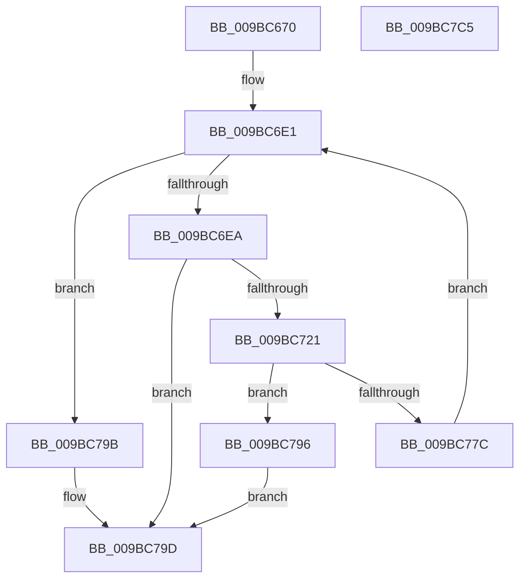

# VslDebugReadWriteSecureProcess

- RVA: `0x009BC670`–`0x009BC7C6` (길이 `342` bytes)
- VA: `0x00000001409BC670`
- 실행 섹션: `PAGE`
- PDB 이름 있음: `예`; PDB Function 태그: `아니요`
- unwind 정보 RVA: `0x0009F020`
- 디코드: `95`개 명령, `342/342` bytes 표시
- 미해석 바이트: `0` (있으면 어셈블리에 `.byte`로 보존)

> 이 문서는 커널 이미지의 기계어와 PDB 기호를 분석해 생성했습니다. 4번과 5번은 함수 원형과 자료형을 바이너리 사용 방식에서 추정한 C 해석이며 원본 소스 복구 결과는 아닙니다.

## 1. Dependencies

- 직접 호출 지점: **6**; 고유 호출 대상: **5**
- 직접 호출자로 확인된 함수: **1**
- RIP 상대 이미지 참조: **1**

### Outgoing calls
- `0x009BC6BB` → [memset](../../text/6C/memset_function_006C6C40.md) (function, `0x006C6C40`)
- `0x009BC6CB` → [memset](../../text/6C/memset_function_006C6C40.md) (function, `0x006C6C40`)
- `0x009BC718` → [VslpLockPagesForTransfer](../../text/29/VslpLockPagesForTransfer_function_0029E0FC.md) (function, `0x0029E0FC`)
- `0x009BC75D` → [VslpEnterIumSecureMode](../../text/23/VslpEnterIumSecureMode_function_00235E50.md) (function, `0x00235E50`)
- `0x009BC76A` → [VslpUnlockPagesForTransfer](../../text/29/VslpUnlockPagesForTransfer_function_0029EE4C.md) (function, `0x0029EE4C`)
- `0x009BC7A4` → [_security_check_cookie](../../text/6A/_security_check_cookie_function_006AC640.md) (function, `0x006AC640`)

### Direct callers
- [MiCopyVirtualMemory](MiCopyVirtualMemory_function_009BBB50.md) at `0x009BBEE2`
- [MiCopyVirtualMemory](MiCopyVirtualMemory_function_009BBB50.md) at `0x009BC1B3`

### Static image references
- `0x009BC68E` → RVA `0x00E0A740` (`.data`; read)

## 2. Other-region calls and transfers

- 다른 실행 섹션으로 향하는 call: **6**
  - `0x009BC6BB` → [memset](../../text/6C/memset_function_006C6C40.md) (`PAGE` → `.text`)
  - `0x009BC6CB` → [memset](../../text/6C/memset_function_006C6C40.md) (`PAGE` → `.text`)
  - `0x009BC718` → [VslpLockPagesForTransfer](../../text/29/VslpLockPagesForTransfer_function_0029E0FC.md) (`PAGE` → `.text`)
  - `0x009BC75D` → [VslpEnterIumSecureMode](../../text/23/VslpEnterIumSecureMode_function_00235E50.md) (`PAGE` → `.text`)
  - `0x009BC76A` → [VslpUnlockPagesForTransfer](../../text/29/VslpUnlockPagesForTransfer_function_0029EE4C.md) (`PAGE` → `.text`)
  - `0x009BC7A4` → [_security_check_cookie](../../text/6A/_security_check_cookie_function_006AC640.md) (`PAGE` → `.text`)
- 별도 외부 분기/꼬리 이동을 확인하지 못했습니다.

## 3. Assembly (complete function range)

```asm
009BC670  48 89 5C 24 08                  mov qword ptr [rsp + 8], rbx
009BC675  48 89 74 24 10                  mov qword ptr [rsp + 0x10], rsi
009BC67A  55                              push rbp
009BC67B  57                              push rdi
009BC67C  41 54                           push r12
009BC67E  41 56                           push r14
009BC680  41 57                           push r15
009BC682  48 8D 6C 24 F0                  lea rbp, [rsp - 0x10]
009BC687  48 81 EC 10 01 00 00            sub rsp, 0x110
009BC68E  48 8B 05 AB E0 44 00            mov rax, qword ptr [rip + 0x44e0ab]
009BC695  48 33 C4                        xor rax, rsp
009BC698  48 89 45 00                     mov qword ptr [rbp], rax
009BC69C  4C 8B 65 68                     mov r12, qword ptr [rbp + 0x68]
009BC6A0  48 8B F2                        mov rsi, rdx
009BC6A3  33 D2                           xor edx, edx
009BC6A5  48 89 4C 24 38                  mov qword ptr [rsp + 0x38], rcx
009BC6AA  49 8B F8                        mov rdi, r8
009BC6AD  4C 8B F1                        mov r14, rcx
009BC6B0  48 8D 4D 90                     lea rcx, [rbp - 0x70]
009BC6B4  49 8B D9                        mov rbx, r9
009BC6B7  44 8D 42 68                     lea r8d, [rdx + 0x68]
009BC6BB  E8 80 A5 D0 FF                  call 0x1406c6c40
009BC6C0  33 D2                           xor edx, edx
009BC6C2  48 8D 4C 24 40                  lea rcx, [rsp + 0x40]
009BC6C7  44 8D 42 48                     lea r8d, [rdx + 0x48]
009BC6CB  E8 70 A5 D0 FF                  call 0x1406c6c40
009BC6D0  49 83 24 24 00                  and qword ptr [r12], 0
009BC6D5  33 D2                           xor edx, edx
009BC6D7  38 55 60                        cmp byte ptr [rbp + 0x60], dl
009BC6DA  0F 95 C2                        setne dl
009BC6DD  89 54 24 30                     mov dword ptr [rsp + 0x30], edx
009BC6E1  48 85 DB                        test rbx, rbx
009BC6E4  0F 84 B1 00 00 00               je 0x1409bc79b
009BC6EA  8B CF                           mov ecx, edi
009BC6EC  B8 00 A0 1F 00                  mov eax, 0x1fa000
009BC6F1  81 E1 FF 0F 00 00               and ecx, 0xfff
009BC6F7  44 8B CA                        mov r9d, edx
009BC6FA  2B C1                           sub eax, ecx
009BC6FC  44 8B FB                        mov r15d, ebx
009BC6FF  8B C8                           mov ecx, eax
009BC701  48 8B D7                        mov rdx, rdi
009BC704  48 3B CB                        cmp rcx, rbx
009BC707  48 8D 4C 24 40                  lea rcx, [rsp + 0x40]
009BC70C  44 0F 46 F8                     cmovbe r15d, eax
009BC710  83 64 24 20 00                  and dword ptr [rsp + 0x20], 0
009BC715  45 8B C7                        mov r8d, r15d
009BC718  E8 DF 19 8E FF                  call 0x14029e0fc
009BC71D  85 C0                           test eax, eax
009BC71F  78 7C                           js 0x1409bc79d
009BC721  49 8B 86 70 01 00 00            mov rax, qword ptr [r14 + 0x170]
009BC728  4C 8D 4D 90                     lea r9, [rbp - 0x70]
009BC72C  48 83 65 C0 00                  and qword ptr [rbp - 0x40], 0
009BC731  BA 29 00 00 00                  mov edx, 0x29
009BC736  48 89 45 98                     mov qword ptr [rbp - 0x68], rax
009BC73A  45 33 C0                        xor r8d, r8d
009BC73D  0F B6 45 60                     movzx eax, byte ptr [rbp + 0x60]
009BC741  B1 02                           mov cl, 2
009BC743  48 89 45 A8                     mov qword ptr [rbp - 0x58], rax
009BC747  48 8B 44 24 40                  mov rax, qword ptr [rsp + 0x40]
009BC74C  48 89 45 B0                     mov qword ptr [rbp - 0x50], rax
009BC750  48 8B 44 24 78                  mov rax, qword ptr [rsp + 0x78]
009BC755  48 89 45 B8                     mov qword ptr [rbp - 0x48], rax
009BC759  48 89 75 A0                     mov qword ptr [rbp - 0x60], rsi
009BC75D  E8 EE 96 87 FF                  call 0x140235e50
009BC762  48 8D 4C 24 40                  lea rcx, [rsp + 0x40]
009BC767  44 8B F0                        mov r14d, eax
009BC76A  E8 DD 26 8E FF                  call 0x14029ee4c
009BC76F  48 8B 4D C0                     mov rcx, qword ptr [rbp - 0x40]
009BC773  49 01 0C 24                     add qword ptr [r12], rcx
009BC777  45 85 F6                        test r14d, r14d
009BC77A  78 1A                           js 0x1409bc796
009BC77C  8B 54 24 30                     mov edx, dword ptr [rsp + 0x30]
009BC780  4C 8B 74 24 38                  mov r14, qword ptr [rsp + 0x38]
009BC785  41 8B C7                        mov eax, r15d
009BC788  48 03 F0                        add rsi, rax
009BC78B  48 03 F8                        add rdi, rax
009BC78E  48 2B D8                        sub rbx, rax
009BC791  E9 4B FF FF FF                  jmp 0x1409bc6e1
009BC796  41 8B C6                        mov eax, r14d
009BC799  EB 02                           jmp 0x1409bc79d
009BC79B  33 C0                           xor eax, eax
009BC79D  48 8B 4D 00                     mov rcx, qword ptr [rbp]
009BC7A1  48 33 CC                        xor rcx, rsp
009BC7A4  E8 97 FE CE FF                  call 0x1406ac640
009BC7A9  4C 8D 9C 24 10 01 00 00         lea r11, [rsp + 0x110]
009BC7B1  49 8B 5B 30                     mov rbx, qword ptr [r11 + 0x30]
009BC7B5  49 8B 73 38                     mov rsi, qword ptr [r11 + 0x38]
009BC7B9  49 8B E3                        mov rsp, r11
009BC7BC  41 5F                           pop r15
009BC7BE  41 5E                           pop r14
009BC7C0  41 5C                           pop r12
009BC7C2  5F                              pop rdi
009BC7C3  5D                              pop rbp
009BC7C4  C3                              ret
009BC7C5  CC                              int3
```

## 4. C-style interpretation (structured pseudocode)

```c
__int64 __fastcall VslDebugReadWriteSecureProcess(__int64 a1, __int64 a2, __int64 a3, __int64 a4, unsigned __int8 a5, __int64 a6)
{
    __int64 result;
    __int64 v_r15;
    __int64 v_rbx;
    __int64 v_rdi;
    __int64 v_rsi;
    __int64 v_rsp;
    unsigned __int64 v_stack_m100;
    unsigned int v_stack_m108;
    unsigned int v_stack_m118;
    unsigned __int64 v_stack_m28;
    unsigned __int64 v_stack_m38;
    unsigned __int64 v_stack_m78;
    unsigned __int64 v_stack_m80;
    unsigned __int64 v_stack_m88;
    unsigned __int64 v_stack_m90;
    unsigned __int64 v_stack_m98;
    unsigned __int64 v_stack_mA0;
    unsigned __int64 v_stack_mA8;
    unsigned __int64 v_stack_mC0;
    unsigned __int64 v_stack_mF8;
    unsigned __int64 v_stack_p10;
    unsigned __int64 v_stack_p8;

    v_stack_p8 = v_rbx;
    v_stack_p10 = v_rsi;
    v_rsp = (v_rsp) - (272);
    result = (*(unsigned __int64 *)(v_rip + 4513963)) ^ (v_rsp);
    v_stack_m38 = result;
    a2 = 0;
    v_stack_m100 = a1;
    result = memset(v_stack_mA8, a2, a2 + 104, a4);
    a2 = 0;
    result = memset(v_stack_mF8, a2, a2 + 72, a4);
    a2 = 0;
    a2 = (a5 != 0) ? 1 : 0;
    v_stack_m108 = (unsigned int)(a2);
loc_009BC6E1:
    if (a4 == 0) goto loc_009BC79B;
    a1 = (unsigned int)(((unsigned int)((unsigned int)(a3))) & (0xFFFULL));
    result = (unsigned int)(((unsigned int)(0x1FA000ULL)) - ((unsigned int)(a1)));
    v_r15 = (unsigned int)((unsigned int)(a4));
    if (((unsigned int)((unsigned int)(result))) <= a4) { v_r15 = (unsigned int)(result); }
    result = VslpLockPagesForTransfer(v_stack_mF8, a3, (unsigned int)((unsigned int)(v_r15)), (unsigned int)((unsigned int)(a2)));
    if (sign_flag) goto loc_009BC79D;
    v_stack_mA0 = *(unsigned __int64 *)(a1 + 368);
    a3 = 0;
    v_stack_m90 = a5;
    v_stack_m88 = v_stack_mF8;
    v_stack_m80 = v_stack_mC0;
    v_stack_m98 = a2;
    result = VslpEnterIumSecureMode(2, 41, a3, v_stack_mA8);
    result = VslpUnlockPagesForTransfer(v_stack_mF8, 41, a3, v_stack_mA8);
    if (sign_flag) goto loc_009BC796;
    v_rsi = (a2) + ((unsigned int)((unsigned int)(v_r15)));
    v_rdi = (a3) + ((unsigned int)((unsigned int)(v_r15)));
    v_rbx = (a4) - ((unsigned int)((unsigned int)(v_r15)));
    goto loc_009BC6E1;
loc_009BC796:
    goto loc_009BC79D;
loc_009BC79B:
    result = 0;
loc_009BC79D:
    a1 = (v_stack_m38) ^ (v_rsp);
    result = _security_check_cookie(a1, (unsigned int)(v_stack_m108), a3, v_stack_mA8);
    return result;
}
```

## 5. (Beta) C Style

```c
int64_t VslDebugReadWriteSecureProcess(int64_t Arg1, int64_t Arg2, int64_t Arg3, int64_t Arg4, uint8_t Arg5, void *Arg6)
{
    uint8_t *arg6 = (uint8_t *)Arg6;

    int64_t result;
    int64_t local_r15;
    int64_t local_rbx;
    int64_t local_rdi;
    int64_t local_rsi;
    int64_t local_rsp;
    uint64_t v_stack_m100;
    uint32_t v_stack_m108;
    uint32_t v_stack_m118;
    uint64_t v_stack_m28;
    uint64_t v_stack_m38;
    uint64_t v_stack_m78;
    uint64_t v_stack_m80;
    uint64_t v_stack_m88;
    uint64_t v_stack_m90;
    uint64_t v_stack_m98;
    uint64_t v_stack_mA0;
    uint64_t v_stack_mA8;
    uint64_t v_stack_mC0;
    uint64_t v_stack_mF8;
    uint64_t v_stack_p10;
    uint64_t v_stack_p8;

    v_stack_p8 = local_rbx;
    v_stack_p10 = local_rsi;
    local_rsp = (local_rsp) - (272);
    result = (*(uint64_t *)(v_rip + 0x44E0AB)) ^ (local_rsp);
    v_stack_m38 = result;
    Arg2 = 0;
    v_stack_m100 = Arg1;
    result = memset(v_stack_mA8, Arg2, Arg2 + 104, Arg4);
    Arg2 = 0;
    result = memset(v_stack_mF8, Arg2, Arg2 + 72, Arg4);
    Arg2 = 0;
    Arg2 = (Arg5 != 0) ? 1 : 0;
    v_stack_m108 = (uint32_t)(Arg2);
loc_009BC6E1:
    if (Arg4 == 0) goto loc_009BC79B;
    Arg1 = (uint32_t)(((uint32_t)((uint32_t)(Arg3))) & (0xFFFULL));
    result = (uint32_t)(((uint32_t)(0x1FA000ULL)) - ((uint32_t)(Arg1)));
    local_r15 = (uint32_t)((uint32_t)(Arg4));
    if (((uint32_t)((uint32_t)(result))) <= Arg4) { local_r15 = (uint32_t)(result); }
    result = VslpLockPagesForTransfer(v_stack_mF8, Arg3, (uint32_t)((uint32_t)(local_r15)), (uint32_t)((uint32_t)(Arg2)));
    if (sign_flag) goto loc_009BC79D;
    v_stack_mA0 = *(uint64_t *)(Arg1 + 0x170);
    Arg3 = 0;
    v_stack_m90 = Arg5;
    v_stack_m88 = v_stack_mF8;
    v_stack_m80 = v_stack_mC0;
    v_stack_m98 = Arg2;
    result = VslpEnterIumSecureMode(2, 41, Arg3, v_stack_mA8);
    result = VslpUnlockPagesForTransfer(v_stack_mF8, 41, Arg3, v_stack_mA8);
    if (sign_flag) goto loc_009BC796;
    local_rsi = (Arg2) + ((uint32_t)((uint32_t)(local_r15)));
    local_rdi = (Arg3) + ((uint32_t)((uint32_t)(local_r15)));
    local_rbx = (Arg4) - ((uint32_t)((uint32_t)(local_r15)));
    goto loc_009BC6E1;
loc_009BC796:
    goto loc_009BC79D;
loc_009BC79B:
    result = 0;
loc_009BC79D:
    Arg1 = (v_stack_m38) ^ (local_rsp);
    result = _security_check_cookie(Arg1, (uint32_t)(v_stack_m108), Arg3, v_stack_mA8);
    return result;
}
```

### 관측된 메모리 오프셋

구조체 형식이 확인되지 않은 접근은 인자 기준의 오프셋으로만 기록했습니다.

| 기준 인자 | 오프셋 표현 | 폭 (bit) | 접근 |
|---|---:|---:|---|
| `Arg6` | `+ 0x0` | `64` | `R/W` |

## 6. Execution-region graph

[열기: 2D/3D 그래프와 함수 탐색 컨트롤 패널](../../../control-panel.html?section=page&rva=0x009BC670&view=graph)

- 2D 그래프는 위에서 아래로 흐르고, 3D 그래프는 빈 공간을 드래그해 회전합니다. Shift+드래그는 이동, 휠은 확대·축소, 함수 노드 선택은 대상 보고서 이동입니다.

### Static fallback


