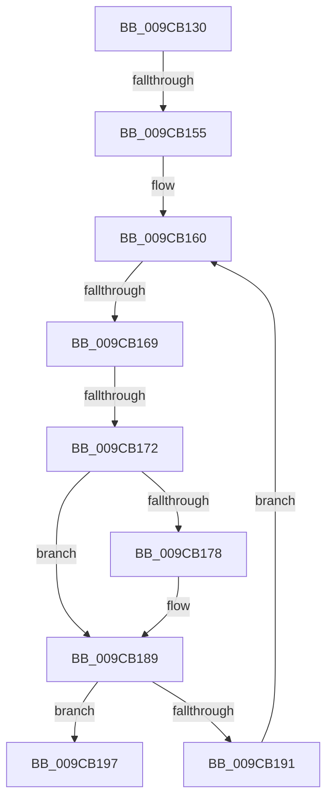

# AlpcpAllocateFromBitmap

- RVA: `0x009CB130`–`0x009CB1A6` (길이 `118` bytes)
- VA: `0x00000001409CB130`
- 실행 섹션: `PAGE`
- PDB 이름 있음: `예`; PDB Function 태그: `아니요`
- unwind 정보 RVA: `0x000A0CDC`
- 디코드: `34`개 명령, `118/118` bytes 표시
- 미해석 바이트: `0` (있으면 어셈블리에 `.byte`로 보존)

> 이 문서는 커널 이미지의 기계어와 PDB 기호를 분석해 생성했습니다. 4번과 5번은 함수 원형과 자료형을 바이너리 사용 방식에서 추정한 C 해석이며 원본 소스 복구 결과는 아닙니다.

## 1. Dependencies

- 직접 호출 지점: **0**; 고유 호출 대상: **0**
- 직접 호출자로 확인된 함수: **2**
- RIP 상대 이미지 참조: **0**

### Outgoing calls
- 직접 디코드된 call 명령이 없습니다.

### Direct callers
- [sub_0088E1DC](../88/Unknown_function_0088E1DC.md) at `0x0088E8B6`
- [sub_0088EC77](../88/Unknown_function_0088EC77.md) at `0x0088F1C9`

### Static image references
- 디코드된 RIP-relative 메모리 참조가 없습니다.

## 2. Other-region calls and transfers

- 다른 실행 섹션으로 향하는 call: **0**
- call이 아닌 외부 분기/꼬리 이동: **3**
  - `0x009CB14F` → [sub_009CB211 + 0x1C](Unknown_function_009CB211.md) (`tail-transfer`)
  - `0x009CB163` → [sub_009CB211 + 0x13](Unknown_function_009CB211.md) (`tail-transfer`)
  - `0x009CB16C` → [sub_009CB211 + 0x1](Unknown_function_009CB211.md) (`tail-transfer`)

## 3. Assembly (complete function range)

```asm
009CB130  48 89 6C 24 18                  mov qword ptr [rsp + 0x18], rbp
009CB135  56                              push rsi
009CB136  48 83 EC 20                     sub rsp, 0x20
009CB13A  41 8B E8                        mov ebp, r8d
009CB13D  48 8B F1                        mov rsi, rcx
009CB140  41 B8 FF FF FF FF               mov r8d, 0xffffffff
009CB146  45 33 DB                        xor r11d, r11d
009CB149  4C 8B C9                        mov r9, rcx
009CB14C  4C 3B CA                        cmp r9, rdx
009CB14F  0F 84 D8 00 00 00               je 0x1409cb22d
009CB155  41 8B 09                        mov ecx, dword ptr [r9]
009CB158  33 C0                           xor eax, eax
009CB15A  66 0F 1F 44 00 00               nop word ptr [rax + rax]
009CB160  83 F8 20                        cmp eax, 0x20
009CB163  0F 83 BB 00 00 00               jae 0x1409cb224
009CB169  F6 C1 01                        test cl, 1
009CB16C  0F 85 A0 00 00 00               jne 0x1409cb212
009CB172  41 83 F8 FF                     cmp r8d, -1
009CB176  75 11                           jne 0x1409cb189
009CB178  4D 8B C1                        mov r8, r9
009CB17B  4C 2B C6                        sub r8, rsi
009CB17E  49 C1 F8 02                     sar r8, 2
009CB182  41 C1 E0 05                     shl r8d, 5
009CB186  44 03 C0                        add r8d, eax
009CB189  41 FF C3                        inc r11d
009CB18C  44 3B DD                        cmp r11d, ebp
009CB18F  74 06                           je 0x1409cb197
009CB191  D1 E9                           shr ecx, 1
009CB193  FF C0                           inc eax
009CB195  EB C9                           jmp 0x1409cb160
009CB197  41 8B C0                        mov eax, r8d
009CB19A  45 8B D0                        mov r10d, r8d
009CB19D  48 C1 E8 05                     shr rax, 5
009CB1A1  BA 01 00 00 00                  mov edx, 1
```

## 4. C-style interpretation (structured pseudocode)

```c
__int64 __fastcall AlpcpAllocateFromBitmap(__int64 a1, __int64 a2, int a3)
{
    __int64 result;
    __int64 v_r11;
    __int64 v_rsp;
    unsigned __int64 v_stack_p18;

    v_stack_p18 = v_rbp;
    v_rsp = (v_rsp) - (32);
    v_r11 = 0;
    result = 0;
loc_009CB160:
    if (((unsigned int)((unsigned int)(0xFFFFFFFFULL))) == -1) {
        a3 = a1;
        a3 = (a3) - (a1);
        a3 = (a3) >> (2);
        a3 = (unsigned int)((a3) << (5));
        a3 = (unsigned int)((a3) + (0));
    }
    v_r11 = (unsigned int)((v_r11) + 1);
    if (((unsigned int)(v_r11)) == ((unsigned int)((unsigned int)(a3)))) goto loc_009CB197;
    a1 = (unsigned int)(((unsigned int)(*(unsigned int *)(a1))) >> (1));
    result = (unsigned int)((result) + 1);
    goto loc_009CB160;
loc_009CB197:
    result = ((unsigned int)(a3)) >> (5);
    return result;
}
```

## 5. (Beta) C Style

```c
int64_t AlpcpAllocateFromBitmap(int64_t Arg1, int64_t Arg2, int32_t Arg3)
{
    int64_t result;
    int64_t local_r11;
    int64_t local_rsp;
    uint64_t v_stack_p18;

    v_stack_p18 = local_rbp;
    local_rsp = (local_rsp) - (32);
    local_r11 = 0;
    result = 0;
loc_009CB160:
    if (((uint32_t)((uint32_t)(0xFFFFFFFFULL))) == -1) {
        Arg3 = Arg1;
        Arg3 = (Arg3) - (Arg1);
        Arg3 = (Arg3) >> (2);
        Arg3 = (uint32_t)((Arg3) << (5));
        Arg3 = (uint32_t)((Arg3) + (0));
    }
    local_r11 = (uint32_t)((local_r11) + 1);
    if (((uint32_t)(local_r11)) == ((uint32_t)((uint32_t)(Arg3)))) goto loc_009CB197;
    Arg1 = (uint32_t)(((uint32_t)(*(uint32_t *)(Arg1))) >> (1));
    result = (uint32_t)((result) + 1);
    goto loc_009CB160;
loc_009CB197:
    result = ((uint32_t)(Arg3)) >> (5);
    return result;
}
```

## 6. Execution-region graph

[열기: 2D/3D 그래프와 함수 탐색 컨트롤 패널](../../../control-panel.html?section=page&rva=0x009CB130&view=graph)

- 2D 그래프는 위에서 아래로 흐르고, 3D 그래프는 빈 공간을 드래그해 회전합니다. Shift+드래그는 이동, 휠은 확대·축소, 함수 노드 선택은 대상 보고서 이동입니다.

### Static fallback


