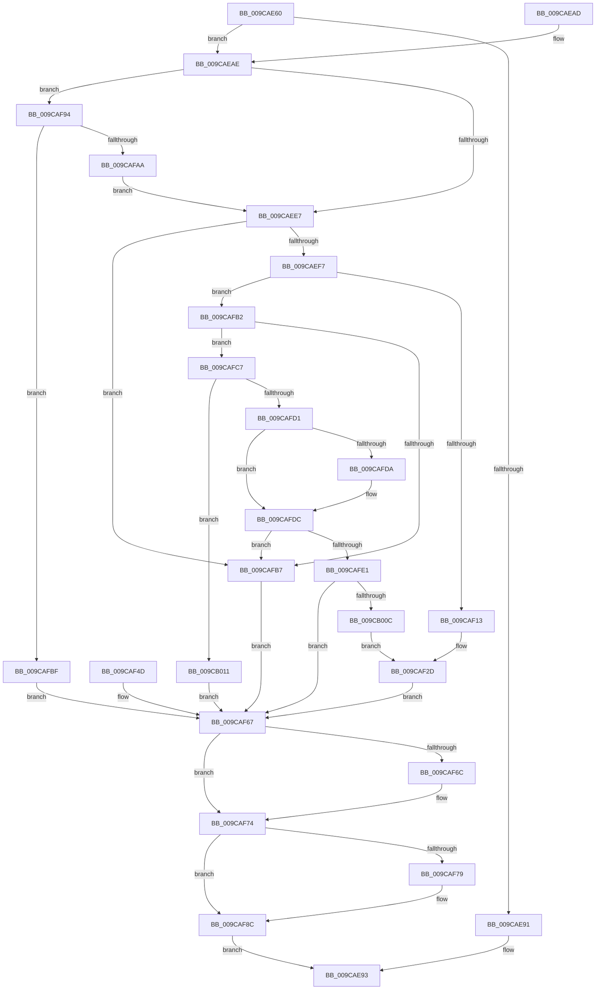

# AlpcpExposeHandleAttribute

- RVA: `0x009CAE60`–`0x009CB01C` (길이 `444` bytes)
- VA: `0x00000001409CAE60`
- 실행 섹션: `PAGE`
- PDB 이름 있음: `예`; PDB Function 태그: `아니요`
- unwind 정보 RVA: `0x000A0BD0`
- 디코드: `112`개 명령, `444/444` bytes 표시
- 미해석 바이트: `0` (있으면 어셈블리에 `.byte`로 보존)

> 이 문서는 커널 이미지의 기계어와 PDB 기호를 분석해 생성했습니다. 4번과 5번은 함수 원형과 자료형을 바이너리 사용 방식에서 추정한 C 해석이며 원본 소스 복구 결과는 아닙니다.

## 1. Dependencies

- 직접 호출 지점: **4**; 고유 호출 대상: **4**
- 직접 호출자로 확인된 함수: **1**
- RIP 상대 이미지 참조: **0**

### Outgoing calls
- `0x009CAF6F` → [ObfDereferenceObject](../../text/2F/ObfDereferenceObject_function_002F9350.md) (function, `0x002F9350`)
- `0x009CAF80` → [AlpcpDereferenceBlobEx](../88/AlpcpDereferenceBlobEx_function_0088AF00.md) (function, `0x0088AF00`)
- `0x009CAF98` → [AlpcpReferenceConnectedPort](AlpcpReferenceConnectedPort_function_009CB030.md) (function, `0x009CB030`)
- `0x009CAFFC` → [ObCompleteObjectDuplication](../89/ObCompleteObjectDuplication_function_0089387C.md) (function, `0x0089387C`)

### Direct callers
- [AlpcpExposeAttributes](../89/AlpcpExposeAttributes_function_00897630.md) at `0x008977F5`
- [AlpcpExposeAttributes](../89/AlpcpExposeAttributes_function_00897630.md) at `0x008979C5`

### Static image references
- 디코드된 RIP-relative 메모리 참조가 없습니다.

## 2. Other-region calls and transfers

- 다른 실행 섹션으로 향하는 call: **1**
  - `0x009CAF6F` → [ObfDereferenceObject](../../text/2F/ObfDereferenceObject_function_002F9350.md) (`PAGE` → `.text`)
- 별도 외부 분기/꼬리 이동을 확인하지 못했습니다.

## 3. Assembly (complete function range)

```asm
009CAE60  48 89 5C 24 08                  mov qword ptr [rsp + 8], rbx
009CAE65  48 89 74 24 18                  mov qword ptr [rsp + 0x18], rsi
009CAE6A  57                              push rdi
009CAE6B  41 54                           push r12
009CAE6D  41 55                           push r13
009CAE6F  41 56                           push r14
009CAE71  41 57                           push r15
009CAE73  48 83 EC 70                     sub rsp, 0x70
009CAE77  49 8B F1                        mov rsi, r9
009CAE7A  4D 8B F0                        mov r14, r8
009CAE7D  48 8D 9A 98 00 00 00            lea rbx, [rdx + 0x98]
009CAE84  48 89 5C 24 50                  mov qword ptr [rsp + 0x50], rbx
009CAE89  48 8B 3B                        mov rdi, qword ptr [rbx]
009CAE8C  48 85 FF                        test rdi, rdi
009CAE8F  75 1D                           jne 0x1409caeae
009CAE91  33 C0                           xor eax, eax
009CAE93  4C 8D 5C 24 70                  lea r11, [rsp + 0x70]
009CAE98  49 8B 5B 30                     mov rbx, qword ptr [r11 + 0x30]
009CAE9C  49 8B 73 40                     mov rsi, qword ptr [r11 + 0x40]
009CAEA0  49 8B E3                        mov rsp, r11
009CAEA3  41 5F                           pop r15
009CAEA5  41 5E                           pop r14
009CAEA7  41 5D                           pop r13
009CAEA9  41 5C                           pop r12
009CAEAB  5F                              pop rdi
009CAEAC  C3                              ret
009CAEAD  CC                              int3
009CAEAE  65 48 8B 04 25 88 01 00 00      mov rax, qword ptr gs:[0x188]
009CAEB7  44 0F B6 A0 32 02 00 00         movzx r12d, byte ptr [rax + 0x232]
009CAEBF  48 89 7C 24 48                  mov qword ptr [rsp + 0x48], rdi
009CAEC4  45 33 ED                        xor r13d, r13d
009CAEC7  44 89 AC 24 A8 00 00 00         mov dword ptr [rsp + 0xa8], r13d
009CAECF  45 33 FF                        xor r15d, r15d
009CAED2  4C 89 7C 24 38                  mov qword ptr [rsp + 0x38], r15
009CAED7  8B 81 A0 01 00 00               mov eax, dword ptr [rcx + 0x1a0]
009CAEDD  24 06                           and al, 6
009CAEDF  3C 02                           cmp al, 2
009CAEE1  0F 84 AD 00 00 00               je 0x1409caf94
009CAEE7  8B 81 00 01 00 00               mov eax, dword ptr [rcx + 0x100]
009CAEED  0F BA E0 13                     bt eax, 0x13
009CAEF1  0F 83 C0 00 00 00               jae 0x1409cafb7
009CAEF7  0F 57 C0                        xorps xmm0, xmm0
009CAEFA  33 D2                           xor edx, edx
009CAEFC  0F 11 44 24 58                  movups xmmword ptr [rsp + 0x58], xmm0
009CAF01  48 89 54 24 68                  mov qword ptr [rsp + 0x68], rdx
009CAF06  8B 57 04                        mov edx, dword ptr [rdi + 4]
009CAF09  0F BA E0 19                     bt eax, 0x19
009CAF0D  0F 83 9F 00 00 00               jae 0x1409cafb2
009CAF13  C7 44 24 58 00 00 04 00         mov dword ptr [rsp + 0x58], 0x40000
009CAF1B  89 54 24 68                     mov dword ptr [rsp + 0x68], edx
009CAF1F  41 BD 01 00 00 00               mov r13d, 1
009CAF25  44 89 AC 24 A8 00 00 00         mov dword ptr [rsp + 0xa8], r13d
009CAF2D  45 33 E4                        xor r12d, r12d
009CAF30  0F 10 44 24 58                  movups xmm0, xmmword ptr [rsp + 0x58]
009CAF35  41 0F 11 06                     movups xmmword ptr [r14], xmm0
009CAF39  F2 0F 10 4C 24 68               movsd xmm1, qword ptr [rsp + 0x68]
009CAF3F  F2 41 0F 11 4E 10               movsd qword ptr [r14 + 0x10], xmm1
009CAF45  81 0E 00 00 00 10               or dword ptr [rsi], 0x10000000
009CAF4B  EB 1A                           jmp 0x1409caf67
009CAF4D  44 8B E0                        mov r12d, eax
009CAF50  4C 8B 7C 24 38                  mov r15, qword ptr [rsp + 0x38]
009CAF55  48 8B 7C 24 48                  mov rdi, qword ptr [rsp + 0x48]
009CAF5A  44 8B AC 24 A8 00 00 00         mov r13d, dword ptr [rsp + 0xa8]
009CAF62  48 8B 5C 24 50                  mov rbx, qword ptr [rsp + 0x50]
009CAF67  4D 85 FF                        test r15, r15
009CAF6A  74 08                           je 0x1409caf74
009CAF6C  49 8B CF                        mov rcx, r15
009CAF6F  E8 DC E3 92 FF                  call 0x1402f9350
009CAF74  45 85 ED                        test r13d, r13d
009CAF77  75 13                           jne 0x1409caf8c
009CAF79  41 8D 55 01                     lea edx, [r13 + 1]
009CAF7D  48 8B CF                        mov rcx, rdi
009CAF80  E8 7B FF EB FF                  call 0x14088af00
009CAF85  48 C7 03 00 00 00 00            mov qword ptr [rbx], 0
009CAF8C  41 8B C4                        mov eax, r12d
009CAF8F  E9 FF FE FF FF                  jmp 0x1409cae93
009CAF94  48 8B 4A 18                     mov rcx, qword ptr [rdx + 0x18]
009CAF98  E8 93 00 00 00                  call 0x1409cb030
009CAF9D  4C 8B F8                        mov r15, rax
009CAFA0  48 89 44 24 38                  mov qword ptr [rsp + 0x38], rax
009CAFA5  48 85 C0                        test rax, rax
009CAFA8  74 15                           je 0x1409cafbf
009CAFAA  48 8B C8                        mov rcx, rax
009CAFAD  E9 35 FF FF FF                  jmp 0x1409caee7
009CAFB2  83 FA 01                        cmp edx, 1
009CAFB5  76 10                           jbe 0x1409cafc7
009CAFB7  41 BC 22 00 00 C0               mov r12d, 0xc0000022
009CAFBD  EB A8                           jmp 0x1409caf67
009CAFBF  41 BC 37 00 00 C0               mov r12d, 0xc0000037
009CAFC5  EB A0                           jmp 0x1409caf67
009CAFC7  8B 81 40 01 00 00               mov eax, dword ptr [rcx + 0x140]
009CAFCD  23 07                           and eax, dword ptr [rdi]
009CAFCF  74 40                           je 0x1409cb011
009CAFD1  48 8B 51 18                     mov rdx, qword ptr [rcx + 0x18]
009CAFD5  F6 C2 01                        test dl, 1
009CAFD8  74 02                           je 0x1409cafdc
009CAFDA  33 D2                           xor edx, edx
009CAFDC  48 85 D2                        test rdx, rdx
009CAFDF  74 D6                           je 0x1409cafb7
009CAFE1  89 44 24 68                     mov dword ptr [rsp + 0x68], eax
009CAFE5  48 8D 4F 08                     lea rcx, [rdi + 8]
009CAFE9  48 8D 44 24 6C                  lea rax, [rsp + 0x6c]
009CAFEE  48 89 44 24 20                  mov qword ptr [rsp + 0x20], rax
009CAFF3  4C 8D 4C 24 60                  lea r9, [rsp + 0x60]
009CAFF8  45 0F B6 C4                     movzx r8d, r12b
009CAFFC  E8 7B 88 EC FF                  call 0x14089387c
009CB001  44 8B E0                        mov r12d, eax
009CB004  85 C0                           test eax, eax
009CB006  0F 88 5B FF FF FF               js 0x1409caf67
009CB00C  E9 1C FF FF FF                  jmp 0x1409caf2d
009CB011  41 BC 24 00 00 C0               mov r12d, 0xc0000024
009CB017  E9 4B FF FF FF                  jmp 0x1409caf67
```

## 4. C-style interpretation (structured pseudocode)

```c
__int64 __fastcall AlpcpExposeHandleAttribute(__int64 a1, __int64 a2, __int64 a3, __int64 a4)
{
    __int64 result;
    __int64 v_r12;
    __int64 v_r13;
    __int64 v_r15;
    __int64 v_rsp;
    unsigned __int64 v_stack_m10;
    unsigned __int64 v_stack_m18;
    unsigned __int64 v_stack_m20;
    unsigned __int64 v_stack_m28;
    unsigned __int64 v_stack_m38;
    unsigned __int64 v_stack_m4;
    unsigned __int64 v_stack_m48;
    unsigned __int64 v_stack_m50;
    unsigned __int64 v_stack_m8;
    unsigned __int64 v_stack_p18;
    unsigned int v_stack_p38;
    unsigned __int64 v_stack_p8;

    v_stack_p8 = v_rbx;
    v_stack_p18 = v_rsi;
    v_rsp = (v_rsp) - (112);
    v_stack_m48 = a2 + 152;
    if (*(unsigned __int64 *)(a2 + 152) != 0) goto loc_009CAEAE;
    result = 0;
loc_009CAE93:
    return result;
loc_009CAEAE:
    v_stack_m28 = *(unsigned __int64 *)(a2 + 152);
    v_r13 = 0;
    v_stack_p38 = 0;
    v_r15 = 0;
    v_stack_m38 = 0;
    result = (unsigned __int8)(((unsigned int)(*(unsigned int *)(a1 + 416))) & (6));
    if (((unsigned __int8)(result)) == 2) goto loc_009CAF94;
loc_009CAEE7:
    if (((unsigned __int8)(result)) >= 2) goto loc_009CAFB7;
    a2 = 0;
    v_stack_m18 = v_xmm0;
    v_stack_m8 = 0;
    if (condition_is_above_or_equal) goto loc_009CAFB2;
    v_stack_m18 = 0x40000ULL;
    v_stack_m8 = (unsigned int)((unsigned int)(*(unsigned int *)(*(unsigned __int64 *)(a2 + 152) + 4)));
    v_stack_p38 = 1;
loc_009CAF2D:
    v_r12 = 0;
    *(unsigned __int64 *)(a3) = v_xmm0;
    *(unsigned __int64 *)(a3 + 16) = v_xmm1;
    goto loc_009CAF67;
loc_009CAF67:
    result = (unsigned int)(*(unsigned int *)(a1 + 256));
    if (0 != 0) {
        a1 = 0;
        result = ObfDereferenceObject(a1, (unsigned int)(*(unsigned int *)(*(unsigned __int64 *)(a2 + 152) + 4)), a3, a4);
    }
    if (1 == 0) {
        a2 = 1 + 1;
        a1 = *(unsigned __int64 *)(a2 + 152);
        result = AlpcpDereferenceBlobEx(a1, a2, a3, a4);
        *(unsigned __int64 *)(*(unsigned __int64 *)(v_stack_m28 + 48)) = 0;
    }
    goto loc_009CAE93;
loc_009CAF94:
    result = AlpcpReferenceConnectedPort(*(unsigned __int64 *)(a2 + 24), a2, a3, a4);
    v_stack_m38 = result;
    if (result == 0) goto loc_009CAFBF;
    goto loc_009CAEE7;
loc_009CAFB2:
    if (((unsigned int)(a2)) <= 1) goto loc_009CAFC7;
loc_009CAFB7:
    goto loc_009CAF67;
loc_009CAFBF:
    goto loc_009CAF67;
loc_009CAFC7:
    result = (unsigned int)(((unsigned int)(*(unsigned int *)(result + 320))) & (*(unsigned int *)(*(unsigned __int64 *)(a2 + 152))));
    if (condition_is_equal) goto loc_009CB011;
    if ((((unsigned __int8)(*(unsigned __int64 *)(result + 24))) & (1)) != 0) {
        a2 = 0;
    }
    if (0 == 0) goto loc_009CAFB7;
    v_stack_m8 = (unsigned int)(result);
    v_stack_m50 = v_stack_m4;
    result = ObCompleteObjectDuplication(*(unsigned __int64 *)(a2 + 152) + 8, a2, (unsigned __int8)((unsigned int)(0xC0000037ULL)), v_stack_m10);
    if (sign_flag) goto loc_009CAF67;
    goto loc_009CAF2D;
loc_009CB011:
    goto loc_009CAF67;
}
```

## 5. (Beta) C Style

```c
int64_t AlpcpExposeHandleAttribute(void *Arg1, void *Arg2, void *Arg3, void *Arg4)
{
    uint8_t *arg1 = (uint8_t *)Arg1;
    uint8_t *arg2 = (uint8_t *)Arg2;
    uint8_t *arg3 = (uint8_t *)Arg3;
    uint8_t *arg4 = (uint8_t *)Arg4;

    int64_t result;
    int64_t local_r12;
    int64_t local_r13;
    int64_t local_r15;
    int64_t local_rsp;
    uint64_t v_stack_m10;
    uint64_t v_stack_m18;
    uint64_t v_stack_m20;
    uint64_t v_stack_m28;
    uint64_t v_stack_m38;
    uint64_t v_stack_m4;
    uint64_t v_stack_m48;
    uint64_t v_stack_m50;
    uint64_t v_stack_m8;
    uint64_t v_stack_p18;
    uint32_t v_stack_p38;
    uint64_t v_stack_p8;

    v_stack_p8 = local_rbx;
    v_stack_p18 = local_rsi;
    local_rsp = (local_rsp) - (112);
    v_stack_m48 = Arg2 + 152;
    if (*(uint64_t *)(arg2 + 0x98) != 0) goto loc_009CAEAE;
    result = 0;
loc_009CAE93:
    return result;
loc_009CAEAE:
    v_stack_m28 = *(uint64_t *)(arg2 + 0x98);
    local_r13 = 0;
    v_stack_p38 = 0;
    local_r15 = 0;
    v_stack_m38 = 0;
    result = (uint8_t)(((uint32_t)(*(uint32_t *)(arg1 + 0x1A0))) & (6));
    if (((uint8_t)(result)) == 2) goto loc_009CAF94;
loc_009CAEE7:
    if (((uint8_t)(result)) >= 2) goto loc_009CAFB7;
    Arg2 = 0;
    v_stack_m18 = v_xmm0;
    v_stack_m8 = 0;
    if (condition_is_above_or_equal) goto loc_009CAFB2;
    v_stack_m18 = 0x40000ULL;
    v_stack_m8 = (uint32_t)((uint32_t)(*(uint32_t *)(*(uint64_t *)(arg2 + 0x98) + 0x4)));
    v_stack_p38 = 1;
loc_009CAF2D:
    local_r12 = 0;
    *(uint64_t *)(arg3) = v_xmm0;
    *(uint64_t *)(arg3 + 0x10) = v_xmm1;
    goto loc_009CAF67;
loc_009CAF67:
    result = (uint32_t)(*(uint32_t *)(arg1 + 0x100));
    if (0 != 0) {
        Arg1 = 0;
        result = ObfDereferenceObject(Arg1, (uint32_t)(*(uint32_t *)(*(uint64_t *)(arg2 + 0x98) + 0x4)), Arg3, Arg4);
    }
    if (1 == 0) {
        Arg2 = 1 + 1;
        Arg1 = *(uint64_t *)(arg2 + 0x98);
        result = AlpcpDereferenceBlobEx(Arg1, Arg2, Arg3, Arg4);
        *(uint64_t *)(*(uint64_t *)(v_stack_m28 + 0x30)) = 0;
    }
    goto loc_009CAE93;
loc_009CAF94:
    result = AlpcpReferenceConnectedPort(*(uint64_t *)(arg2 + 0x18), Arg2, Arg3, Arg4);
    v_stack_m38 = result;
    if (result == 0) goto loc_009CAFBF;
    goto loc_009CAEE7;
loc_009CAFB2:
    if (((uint32_t)(Arg2)) <= 1) goto loc_009CAFC7;
loc_009CAFB7:
    goto loc_009CAF67;
loc_009CAFBF:
    goto loc_009CAF67;
loc_009CAFC7:
    result = (uint32_t)(((uint32_t)(*(uint32_t *)(result + 0x140))) & (*(uint32_t *)(*(uint64_t *)(arg2 + 0x98))));
    if (condition_is_equal) goto loc_009CB011;
    if ((((uint8_t)(*(uint64_t *)(result + 0x18))) & (1)) != 0) {
        Arg2 = 0;
    }
    if (0 == 0) goto loc_009CAFB7;
    v_stack_m8 = (uint32_t)(result);
    v_stack_m50 = v_stack_m4;
    result = ObCompleteObjectDuplication(*(uint64_t *)(arg2 + 0x98) + 8, Arg2, (uint8_t)((uint32_t)(0xC0000037ULL)), v_stack_m10);
    if (sign_flag) goto loc_009CAF67;
    goto loc_009CAF2D;
loc_009CB011:
    goto loc_009CAF67;
}
```

### 관측된 메모리 오프셋

구조체 형식이 확인되지 않은 접근은 인자 기준의 오프셋으로만 기록했습니다.

| 기준 인자 | 오프셋 표현 | 폭 (bit) | 접근 |
|---|---:|---:|---|
| `Arg1` | `+ 0x1A0` | `32` | `R` |
| `Arg2` | `+ 0x0` | `64` | `R` |
| `Arg2` | `+ 0x0` | `64` | `W` |
| `Arg2` | `+ 0x18` | `64` | `R` |
| `Arg2` | `+ 0x98` | `64` | `R` |
| `Arg3` | `+ 0x0` | `128` | `R` |
| `Arg3` | `+ 0x10` | `64` | `W` |
| `Arg4` | `+ 0x0` | `32` | `R/W` |

## 6. Execution-region graph

[열기: 2D/3D 그래프와 함수 탐색 컨트롤 패널](../../../control-panel.html?section=page&rva=0x009CAE60&view=graph)

- 2D 그래프는 위에서 아래로 흐르고, 3D 그래프는 빈 공간을 드래그해 회전합니다. Shift+드래그는 이동, 휠은 확대·축소, 함수 노드 선택은 대상 보고서 이동입니다.

### Static fallback


