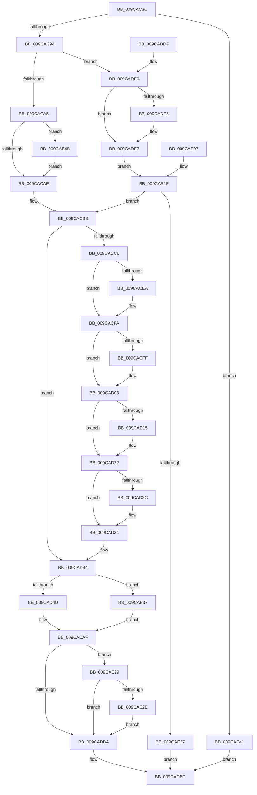

# AlpcpPortQueryConnectedSidInfo

- RVA: `0x009CAC3C`–`0x009CAE52` (길이 `534` bytes)
- VA: `0x00000001409CAC3C`
- 실행 섹션: `PAGE`
- PDB 이름 있음: `예`; PDB Function 태그: `아니요`
- unwind 정보 RVA: `0x000A0B98`
- 디코드: `146`개 명령, `534/534` bytes 표시
- 미해석 바이트: `0` (있으면 어셈블리에 `.byte`로 보존)

> 이 문서는 커널 이미지의 기계어와 PDB 기호를 분석해 생성했습니다. 4번과 5번은 함수 원형과 자료형을 바이너리 사용 방식에서 추정한 C 해석이며 원본 소스 복구 결과는 아닙니다.

## 1. Dependencies

- 직접 호출 지점: **16**; 고유 호출 대상: **16**
- 직접 호출자로 확인된 함수: **1**
- RIP 상대 이미지 참조: **1**

### Outgoing calls
- `0x009CAC86` → [memset](../../text/6C/memset_function_006C6C40.md) (function, `0x006C6C40`)
- `0x009CACB9` → [AlpcpReferenceConnectedPort](AlpcpReferenceConnectedPort_function_009CB030.md) (function, `0x009CB030`)
- `0x009CACD5` → [KeAbPreAcquire](../../text/21/KeAbPreAcquire_function_00210230.md) (function, `0x00210230`)
- `0x009CACF5` → [ExfAcquirePushLockSharedEx](../../text/21/ExfAcquirePushLockSharedEx_function_0021044C.md) (function, `0x0021044C`)
- `0x009CAD1D` → [ObfReferenceObjectWithTag](../../text/21/ObfReferenceObjectWithTag_function_00210710.md) (function, `0x00210710`)
- `0x009CAD2F` → [ExfReleasePushLockShared](../../text/26/ExfReleasePushLockShared_function_00263440.md) (function, `0x00263440`)
- `0x009CAD37` → [KeAbPostRelease](../../text/2E/KeAbPostRelease_function_002E1600.md) (function, `0x002E1600`)
- `0x009CAD3F` → [ObfDereferenceObject](../../text/2F/ObfDereferenceObject_function_002F9350.md) (function, `0x002F9350`)
- `0x009CAD57` → [PsReferencePrimaryTokenWithTag](../../text/20/PsReferencePrimaryTokenWithTag_function_0020FF80.md) (function, `0x0020FF80`)
- `0x009CAD6E` → [SeQueryUserSidToken](../99/SeQueryUserSidToken_function_00990950.md) (function, `0x00990950`)
- `0x009CAD80` → [ObFastDereferenceObject](../../text/3E/ObFastDereferenceObject_function_003ED5F0.md) (function, `0x003ED5F0`)
- `0x009CAD8F` → [RtlEqualSid](../../text/40/RtlEqualSid_function_00400AD0.md) (function, `0x00400AD0`)
- `0x009CAD9E` → [ObfDereferenceObjectWithTag](../../text/2F/ObfDereferenceObjectWithTag_function_002F78E0.md) (function, `0x002F78E0`)
- `0x009CADC7` → [_security_check_cookie](../../text/6A/_security_check_cookie_function_006AC640.md) (function, `0x006AC640`)
- `0x009CADFC` → [SeCaptureSid](../92/SeCaptureSid_function_009276D4.md) (function, `0x009276D4`)
- `0x009CAE30` → [ExFreePoolWithTag](../../poolcode/B8/ExFreePoolWithTag_function_00B82870.md) (function, `0x00B82870`)

### Direct callers
- [NtAlpcQueryInformation](../8E/NtAlpcQueryInformation_function_008E7200.md) at `0x008E73AA`

### Static image references
- `0x009CAC4F` → RVA `0x00E0A740` (`.data`; read)

## 2. Other-region calls and transfers

- 다른 실행 섹션으로 향하는 call: **13**
  - `0x009CAC86` → [memset](../../text/6C/memset_function_006C6C40.md) (`PAGE` → `.text`)
  - `0x009CACD5` → [KeAbPreAcquire](../../text/21/KeAbPreAcquire_function_00210230.md) (`PAGE` → `.text`)
  - `0x009CACF5` → [ExfAcquirePushLockSharedEx](../../text/21/ExfAcquirePushLockSharedEx_function_0021044C.md) (`PAGE` → `.text`)
  - `0x009CAD1D` → [ObfReferenceObjectWithTag](../../text/21/ObfReferenceObjectWithTag_function_00210710.md) (`PAGE` → `.text`)
  - `0x009CAD2F` → [ExfReleasePushLockShared](../../text/26/ExfReleasePushLockShared_function_00263440.md) (`PAGE` → `.text`)
  - `0x009CAD37` → [KeAbPostRelease](../../text/2E/KeAbPostRelease_function_002E1600.md) (`PAGE` → `.text`)
  - `0x009CAD3F` → [ObfDereferenceObject](../../text/2F/ObfDereferenceObject_function_002F9350.md) (`PAGE` → `.text`)
  - `0x009CAD57` → [PsReferencePrimaryTokenWithTag](../../text/20/PsReferencePrimaryTokenWithTag_function_0020FF80.md) (`PAGE` → `.text`)
  - `0x009CAD80` → [ObFastDereferenceObject](../../text/3E/ObFastDereferenceObject_function_003ED5F0.md) (`PAGE` → `.text`)
  - `0x009CAD8F` → [RtlEqualSid](../../text/40/RtlEqualSid_function_00400AD0.md) (`PAGE` → `.text`)
  - `0x009CAD9E` → [ObfDereferenceObjectWithTag](../../text/2F/ObfDereferenceObjectWithTag_function_002F78E0.md) (`PAGE` → `.text`)
  - `0x009CADC7` → [_security_check_cookie](../../text/6A/_security_check_cookie_function_006AC640.md) (`PAGE` → `.text`)
  - `0x009CAE30` → [ExFreePoolWithTag](../../poolcode/B8/ExFreePoolWithTag_function_00B82870.md) (`PAGE` → `POOLCODE`)
- 별도 외부 분기/꼬리 이동을 확인하지 못했습니다.

## 3. Assembly (complete function range)

```asm
009CAC3C  40 53                           push rbx
009CAC3E  56                              push rsi
009CAC3F  57                              push rdi
009CAC40  41 54                           push r12
009CAC42  41 55                           push r13
009CAC44  41 56                           push r14
009CAC46  41 57                           push r15
009CAC48  48 81 EC C0 00 00 00            sub rsp, 0xc0
009CAC4F  48 8B 05 EA FA 43 00            mov rax, qword ptr [rip + 0x43faea]
009CAC56  48 33 C4                        xor rax, rsp
009CAC59  48 89 84 24 B0 00 00 00         mov qword ptr [rsp + 0xb0], rax
009CAC61  49 8B F9                        mov rdi, r9
009CAC64  4C 8B F2                        mov r14, rdx
009CAC67  4C 8B E1                        mov r12, rcx
009CAC6A  48 89 4C 24 58                  mov qword ptr [rsp + 0x58], rcx
009CAC6F  48 89 54 24 50                  mov qword ptr [rsp + 0x50], rdx
009CAC74  33 DB                           xor ebx, ebx
009CAC76  48 89 5C 24 40                  mov qword ptr [rsp + 0x40], rbx
009CAC7B  33 D2                           xor edx, edx
009CAC7D  44 8D 43 44                     lea r8d, [rbx + 0x44]
009CAC81  48 8D 4C 24 60                  lea rcx, [rsp + 0x60]
009CAC86  E8 B5 BF CF FF                  call 0x1406c6c40
009CAC8B  4D 85 E4                        test r12, r12
009CAC8E  0F 84 AD 01 00 00               je 0x1409cae41
009CAC94  44 8A BC 24 20 01 00 00         mov r15b, byte ptr [rsp + 0x120]
009CAC9C  45 84 FF                        test r15b, r15b
009CAC9F  0F 85 3B 01 00 00               jne 0x1409cade0
009CACA5  48 85 FF                        test rdi, rdi
009CACA8  0F 85 9D 01 00 00               jne 0x1409cae4b
009CACAE  4C 89 74 24 40                  mov qword ptr [rsp + 0x40], r14
009CACB3  48 8B F3                        mov rsi, rbx
009CACB6  49 8B CC                        mov rcx, r12
009CACB9  E8 72 03 00 00                  call 0x1409cb030
009CACBE  4C 8B E8                        mov r13, rax
009CACC1  48 85 C0                        test rax, rax
009CACC4  74 7E                           je 0x1409cad44
009CACC6  48 8D B8 60 01 00 00            lea rdi, [rax + 0x160]
009CACCD  45 33 C0                        xor r8d, r8d
009CACD0  33 D2                           xor edx, edx
009CACD2  48 8B CF                        mov rcx, rdi
009CACD5  E8 56 55 84 FF                  call 0x140210230
009CACDA  48 8B F0                        mov rsi, rax
009CACDD  33 C0                           xor eax, eax
009CACDF  44 8D 60 11                     lea r12d, [rax + 0x11]
009CACE3  F0 4C 0F B1 27                  lock cmpxchg qword ptr [rdi], r12
009CACE8  74 10                           je 0x1409cacfa
009CACEA  4C 8B CF                        mov r9, rdi
009CACED  4C 8B C6                        mov r8, rsi
009CACF0  33 D2                           xor edx, edx
009CACF2  48 8B CF                        mov rcx, rdi
009CACF5  E8 52 57 84 FF                  call 0x14021044c
009CACFA  48 85 F6                        test rsi, rsi
009CACFD  74 04                           je 0x1409cad03
009CACFF  C6 46 0A 01                     mov byte ptr [rsi + 0xa], 1
009CAD03  49 8B 45 18                     mov rax, qword ptr [r13 + 0x18]
009CAD07  A8 01                           test al, 1
009CAD09  48 8B F3                        mov rsi, rbx
009CAD0C  48 0F 44 F0                     cmove rsi, rax
009CAD10  48 85 F6                        test rsi, rsi
009CAD13  74 0D                           je 0x1409cad22
009CAD15  BA 41 6C 70 63                  mov edx, 0x63706c41
009CAD1A  48 8B CE                        mov rcx, rsi
009CAD1D  E8 EE 59 84 FF                  call 0x140210710
009CAD22  49 8B C4                        mov rax, r12
009CAD25  F0 48 0F B1 1F                  lock cmpxchg qword ptr [rdi], rbx
009CAD2A  74 08                           je 0x1409cad34
009CAD2C  48 8B CF                        mov rcx, rdi
009CAD2F  E8 0C 87 89 FF                  call 0x140263440
009CAD34  48 8B CF                        mov rcx, rdi
009CAD37  E8 C4 68 91 FF                  call 0x1402e1600
009CAD3C  49 8B CD                        mov rcx, r13
009CAD3F  E8 0C E6 92 FF                  call 0x1402f9350
009CAD44  48 85 F6                        test rsi, rsi
009CAD47  0F 84 EA 00 00 00               je 0x1409cae37
009CAD4D  BF 44 66 6C 74                  mov edi, 0x746c6644
009CAD52  8B D7                           mov edx, edi
009CAD54  48 8B CE                        mov rcx, rsi
009CAD57  E8 24 52 84 FF                  call 0x14020ff80
009CAD5C  48 8B D8                        mov rbx, rax
009CAD5F  45 33 C9                        xor r9d, r9d
009CAD62  45 8D 41 44                     lea r8d, [r9 + 0x44]
009CAD66  48 8D 54 24 60                  lea rdx, [rsp + 0x60]
009CAD6B  48 8B C8                        mov rcx, rax
009CAD6E  E8 DD 5B FC FF                  call 0x140990950
009CAD73  48 8D 8E 48 02 00 00            lea rcx, [rsi + 0x248]
009CAD7A  44 8B C7                        mov r8d, edi
009CAD7D  48 8B D3                        mov rdx, rbx
009CAD80  E8 6B 28 A2 FF                  call 0x1403ed5f0
009CAD85  48 8D 54 24 60                  lea rdx, [rsp + 0x60]
009CAD8A  48 8B 4C 24 40                  mov rcx, qword ptr [rsp + 0x40]
009CAD8F  E8 3C 5D A3 FF                  call 0x140400ad0
009CAD94  8A D8                           mov bl, al
009CAD96  BA 41 6C 70 63                  mov edx, 0x63706c41
009CAD9B  48 8B CE                        mov rcx, rsi
009CAD9E  E8 3D CB 92 FF                  call 0x1402f78e0
009CADA3  F6 DB                           neg bl
009CADA5  1B DB                           sbb ebx, ebx
009CADA7  F7 D3                           not ebx
009CADA9  81 E3 A0 02 00 C0               and ebx, 0xc00002a0
009CADAF  48 8B 4C 24 40                  mov rcx, qword ptr [rsp + 0x40]
009CADB4  41 80 FF 01                     cmp r15b, 1
009CADB8  76 6F                           jbe 0x1409cae29
009CADBA  8B C3                           mov eax, ebx
009CADBC  48 8B 8C 24 B0 00 00 00         mov rcx, qword ptr [rsp + 0xb0]
009CADC4  48 33 CC                        xor rcx, rsp
009CADC7  E8 74 18 CE FF                  call 0x1406ac640
009CADCC  48 81 C4 C0 00 00 00            add rsp, 0xc0
009CADD3  41 5F                           pop r15
009CADD5  41 5E                           pop r14
009CADD7  41 5D                           pop r13
009CADD9  41 5C                           pop r12
009CADDB  5F                              pop rdi
009CADDC  5E                              pop rsi
009CADDD  5B                              pop rbx
009CADDE  C3                              ret
009CADDF  CC                              int3
009CADE0  48 85 FF                        test rdi, rdi
009CADE3  74 02                           je 0x1409cade7
009CADE5  89 1F                           mov dword ptr [rdi], ebx
009CADE7  48 8D 44 24 40                  lea rax, [rsp + 0x40]
009CADEC  48 89 44 24 30                  mov qword ptr [rsp + 0x30], rax
009CADF1  C6 44 24 28 01                  mov byte ptr [rsp + 0x28], 1
009CADF6  41 8A D7                        mov dl, r15b
009CADF9  49 8B CE                        mov rcx, r14
009CADFC  E8 D3 C8 F5 FF                  call 0x1409276d4
009CAE01  89 44 24 48                     mov dword ptr [rsp + 0x48], eax
009CAE05  EB 18                           jmp 0x1409cae1f
009CAE07  89 44 24 48                     mov dword ptr [rsp + 0x48], eax
009CAE0B  33 DB                           xor ebx, ebx
009CAE0D  44 8A BC 24 20 01 00 00         mov r15b, byte ptr [rsp + 0x120]
009CAE15  4C 8B 64 24 58                  mov r12, qword ptr [rsp + 0x58]
009CAE1A  4C 8B 74 24 50                  mov r14, qword ptr [rsp + 0x50]
009CAE1F  85 C0                           test eax, eax
009CAE21  0F 89 8C FE FF FF               jns 0x1409cacb3
009CAE27  EB 93                           jmp 0x1409cadbc
009CAE29  49 3B CE                        cmp rcx, r14
009CAE2C  74 8C                           je 0x1409cadba
009CAE2E  33 D2                           xor edx, edx
009CAE30  E8 3B 7A 1B 00                  call 0x140b82870
009CAE35  EB 83                           jmp 0x1409cadba
009CAE37  BB 37 00 00 C0                  mov ebx, 0xc0000037
009CAE3C  E9 6E FF FF FF                  jmp 0x1409cadaf
009CAE41  B8 0D 00 00 C0                  mov eax, 0xc000000d
009CAE46  E9 71 FF FF FF                  jmp 0x1409cadbc
009CAE4B  89 1F                           mov dword ptr [rdi], ebx
009CAE4D  E9 5C FE FF FF                  jmp 0x1409cacae
```

## 4. C-style interpretation (structured pseudocode)

```c
__int64 __fastcall AlpcpPortQueryConnectedSidInfo(__int64 a1, __int64 a2, __int64 a3, __int64 a4, unsigned __int8 a5)
{
    __int64 result;
    __int64 v_rbx;
    __int64 v_rsi;
    __int64 v_rsp;
    unsigned __int64 v_stack_m48;
    unsigned __int64 v_stack_m98;
    unsigned __int64 v_stack_mA0;
    unsigned __int64 v_stack_mA8;
    unsigned __int64 v_stack_mB8;
    unsigned __int8 v_stack_p120;
    unsigned __int8 v_stack_p28;
    unsigned __int64 v_stack_p30;
    unsigned __int64 v_stack_p40;
    unsigned int v_stack_p48;
    unsigned __int64 v_stack_p50;
    unsigned __int64 v_stack_p58;

    v_rsp = (v_rsp) - (192);
    result = (*(unsigned __int64 *)(v_rip + 4455146)) ^ (v_rsp);
    v_stack_m48 = result;
    v_stack_mA0 = a1;
    v_stack_mA8 = a2;
    v_rbx = 0;
    v_stack_mB8 = 0;
    a2 = 0;
    result = memset(v_stack_m98, a2, v_rbx + 68, a4);
    if (a1 == 0) goto loc_009CAE41;
    if (a5 != 0) goto loc_009CADE0;
    if (a4 != 0) goto loc_009CAE4B;
loc_009CACAE:
    v_stack_mB8 = 0;
loc_009CACB3:
    result = AlpcpReferenceConnectedPort(a1, a2, v_rbx + 68, a4);
    if (result == 0) goto loc_009CAD44;
    a3 = 0;
    a2 = 0;
    result = KeAbPreAcquire(result + 352, a2, a3, a4);
    result = 0;
    if (!(condition_is_equal)) {
        a4 = result + 352;
        a3 = 0;
        a2 = 0;
        a1 = result + 352;
        result = ExfAcquirePushLockSharedEx(a1, a2, a3, a4);
    }
    if (result != 0) {
        *(unsigned __int8 *)(result + 10) = 1;
    }
    v_rsi = 0;
    if ((((unsigned __int8)(*(unsigned __int64 *)(result + 24))) & (1)) == 0) { v_rsi = *(unsigned __int64 *)(result + 24); }
    result = *(unsigned __int64 *)(result + 24);
    if (v_rsi != 0) {
        a2 = 0x63706C41ULL;
        a1 = v_rsi;
        result = ObfReferenceObjectWithTag(a1, a2, a3, a4);
    }
    result = result + 17;
    if (v_rsi != 0) {
        a1 = result + 352;
        result = ExfReleasePushLockShared(a1, a2, a3, a4);
    }
    result = KeAbPostRelease(result + 352, a2, a3, a4);
    result = ObfDereferenceObject(result, a2, a3, a4);
loc_009CAD44:
    if (v_rsi == 0) goto loc_009CAE37;
    result = PsReferencePrimaryTokenWithTag(v_rsi, (unsigned int)((unsigned int)((unsigned int)(0x746C6644ULL))), a3, a4);
    a4 = 0;
    result = SeQueryUserSidToken(result, v_stack_m98, a4 + 68, a4);
    result = ObFastDereferenceObject(v_rsi + 584, result, (unsigned int)((unsigned int)((unsigned int)(0x746C6644ULL))), a4);
    result = RtlEqualSid(v_stack_mB8, v_stack_m98, (unsigned int)((unsigned int)((unsigned int)(0x746C6644ULL))), a4);
    result = ObfDereferenceObjectWithTag(v_rsi, (unsigned int)(0x63706C41ULL), (unsigned int)((unsigned int)((unsigned int)(0x746C6644ULL))), a4);
    v_rbx = (unsigned __int8)(-((unsigned __int8)(result)));
    v_rbx = (unsigned int)(~(v_rbx));
    v_rbx = (unsigned int)((v_rbx) & (0xC00002A0ULL));
loc_009CADAF:
    if (a5 <= 1) goto loc_009CAE29;
loc_009CADBA:
loc_009CADBC:
    a1 = (v_stack_m48) ^ (v_rsp);
    result = _security_check_cookie(a1, (unsigned int)(0x63706C41ULL), (unsigned int)((unsigned int)((unsigned int)(0x746C6644ULL))), a4);
    v_rsp = (v_rsp) + (192);
    return result;
loc_009CADE0:
    if ((unsigned int)(0x746C6644ULL) != 0) {
        *(unsigned int *)((unsigned int)(0x746C6644ULL)) = (unsigned int)(v_rbx);
    }
    v_stack_p30 = v_stack_p40;
    v_stack_p28 = 1;
    result = SeCaptureSid(a2, a5, (unsigned int)((unsigned int)((unsigned int)(0x746C6644ULL))), a4);
    v_stack_p48 = (unsigned int)(result);
    goto loc_009CAE1F;
loc_009CAE1F:
    if (!sign_flag) goto loc_009CACB3;
    goto loc_009CADBC;
loc_009CAE29:
    if (a2 == a2) goto loc_009CADBA;
    a2 = 0;
    result = ExFreePoolWithTag(a2, a2, (unsigned int)((unsigned int)((unsigned int)(0x746C6644ULL))), a4);
    goto loc_009CADBA;
loc_009CAE37:
    goto loc_009CADAF;
loc_009CAE41:
    goto loc_009CADBC;
loc_009CAE4B:
    *(unsigned int *)((unsigned int)(0x746C6644ULL)) = (unsigned int)((unsigned int)(0xC0000037ULL));
    goto loc_009CACAE;
}
```

## 5. (Beta) C Style

```c
int64_t AlpcpPortQueryConnectedSidInfo(int64_t Arg1, int64_t Arg2, int64_t Arg3, int64_t Arg4, uint8_t Arg5)
{
    int64_t result;
    int64_t local_rbx;
    int64_t local_rsi;
    int64_t local_rsp;
    uint64_t v_stack_m48;
    uint64_t v_stack_m98;
    uint64_t v_stack_mA0;
    uint64_t v_stack_mA8;
    uint64_t v_stack_mB8;
    uint8_t v_stack_p120;
    uint8_t v_stack_p28;
    uint64_t v_stack_p30;
    uint64_t v_stack_p40;
    uint32_t v_stack_p48;
    uint64_t v_stack_p50;
    uint64_t v_stack_p58;

    local_rsp = (local_rsp) - (192);
    result = (*(uint64_t *)(v_rip + 0x43FAEA)) ^ (local_rsp);
    v_stack_m48 = result;
    v_stack_mA0 = Arg1;
    v_stack_mA8 = Arg2;
    local_rbx = 0;
    v_stack_mB8 = 0;
    Arg2 = 0;
    result = memset(v_stack_m98, Arg2, local_rbx + 68, Arg4);
    if (Arg1 == 0) goto loc_009CAE41;
    if (Arg5 != 0) goto loc_009CADE0;
    if (Arg4 != 0) goto loc_009CAE4B;
loc_009CACAE:
    v_stack_mB8 = 0;
loc_009CACB3:
    result = AlpcpReferenceConnectedPort(Arg1, Arg2, local_rbx + 68, Arg4);
    if (result == 0) goto loc_009CAD44;
    Arg3 = 0;
    Arg2 = 0;
    result = KeAbPreAcquire(result + 352, Arg2, Arg3, Arg4);
    result = 0;
    if (!(condition_is_equal)) {
        Arg4 = result + 352;
        Arg3 = 0;
        Arg2 = 0;
        Arg1 = result + 352;
        result = ExfAcquirePushLockSharedEx(Arg1, Arg2, Arg3, Arg4);
    }
    if (result != 0) {
        *(uint8_t *)(result + 0xA) = 1;
    }
    local_rsi = 0;
    if ((((uint8_t)(*(uint64_t *)(result + 0x18))) & (1)) == 0) { local_rsi = *(uint64_t *)(result + 0x18); }
    result = *(uint64_t *)(result + 0x18);
    if (local_rsi != 0) {
        Arg2 = 0x63706C41ULL;
        Arg1 = local_rsi;
        result = ObfReferenceObjectWithTag(Arg1, Arg2, Arg3, Arg4);
    }
    result = result + 17;
    if (local_rsi != 0) {
        Arg1 = result + 352;
        result = ExfReleasePushLockShared(Arg1, Arg2, Arg3, Arg4);
    }
    result = KeAbPostRelease(result + 352, Arg2, Arg3, Arg4);
    result = ObfDereferenceObject(result, Arg2, Arg3, Arg4);
loc_009CAD44:
    if (local_rsi == 0) goto loc_009CAE37;
    result = PsReferencePrimaryTokenWithTag(local_rsi, (uint32_t)((uint32_t)((uint32_t)(0x746C6644ULL))), Arg3, Arg4);
    Arg4 = 0;
    result = SeQueryUserSidToken(result, v_stack_m98, Arg4 + 68, Arg4);
    result = ObFastDereferenceObject(local_rsi + 584, result, (uint32_t)((uint32_t)((uint32_t)(0x746C6644ULL))), Arg4);
    result = RtlEqualSid(v_stack_mB8, v_stack_m98, (uint32_t)((uint32_t)((uint32_t)(0x746C6644ULL))), Arg4);
    result = ObfDereferenceObjectWithTag(local_rsi, (uint32_t)(0x63706C41ULL), (uint32_t)((uint32_t)((uint32_t)(0x746C6644ULL))), Arg4);
    local_rbx = (uint8_t)(-((uint8_t)(result)));
    local_rbx = (uint32_t)(~(local_rbx));
    local_rbx = (uint32_t)((local_rbx) & (0xC00002A0ULL));
loc_009CADAF:
    if (Arg5 <= 1) goto loc_009CAE29;
loc_009CADBA:
loc_009CADBC:
    Arg1 = (v_stack_m48) ^ (local_rsp);
    result = _security_check_cookie(Arg1, (uint32_t)(0x63706C41ULL), (uint32_t)((uint32_t)((uint32_t)(0x746C6644ULL))), Arg4);
    local_rsp = (local_rsp) + (192);
    return result;
loc_009CADE0:
    if ((uint32_t)(0x746C6644ULL) != 0) {
        *(uint32_t *)((uint32_t)(0x746C6644ULL)) = (uint32_t)(local_rbx);
    }
    v_stack_p30 = v_stack_p40;
    v_stack_p28 = 1;
    result = SeCaptureSid(Arg2, Arg5, (uint32_t)((uint32_t)((uint32_t)(0x746C6644ULL))), Arg4);
    v_stack_p48 = (uint32_t)(result);
    goto loc_009CAE1F;
loc_009CAE1F:
    if (!sign_flag) goto loc_009CACB3;
    goto loc_009CADBC;
loc_009CAE29:
    if (Arg2 == Arg2) goto loc_009CADBA;
    Arg2 = 0;
    result = ExFreePoolWithTag(Arg2, Arg2, (uint32_t)((uint32_t)((uint32_t)(0x746C6644ULL))), Arg4);
    goto loc_009CADBA;
loc_009CAE37:
    goto loc_009CADAF;
loc_009CAE41:
    goto loc_009CADBC;
loc_009CAE4B:
    *(uint32_t *)((uint32_t)(0x746C6644ULL)) = (uint32_t)((uint32_t)(0xC0000037ULL));
    goto loc_009CACAE;
}
```

## 6. Execution-region graph

[열기: 2D/3D 그래프와 함수 탐색 컨트롤 패널](../../../control-panel.html?section=page&rva=0x009CAC3C&view=graph)

- 2D 그래프는 위에서 아래로 흐르고, 3D 그래프는 빈 공간을 드래그해 회전합니다. Shift+드래그는 이동, 휠은 확대·축소, 함수 노드 선택은 대상 보고서 이동입니다.

### Static fallback


