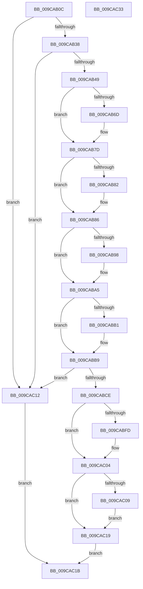

# AlpcpPortQueryServerSessionInfo

- RVA: `0x009CAB0C`–`0x009CAC34` (길이 `296` bytes)
- VA: `0x00000001409CAB0C`
- 실행 섹션: `PAGE`
- PDB 이름 있음: `예`; PDB Function 태그: `아니요`
- unwind 정보 RVA: `0x000A0B54`
- 디코드: `88`개 명령, `296/296` bytes 표시
- 미해석 바이트: `0` (있으면 어셈블리에 `.byte`로 보존)

> 이 문서는 커널 이미지의 기계어와 PDB 기호를 분석해 생성했습니다. 4번과 5번은 함수 원형과 자료형을 바이너리 사용 방식에서 추정한 C 해석이며 원본 소스 복구 결과는 아닙니다.

## 1. Dependencies

- 직접 호출 지점: **9**; 고유 호출 대상: **9**
- 직접 호출자로 확인된 함수: **1**
- RIP 상대 이미지 참조: **0**

### Outgoing calls
- `0x009CAB38` → [AlpcpReferenceConnectedPort](AlpcpReferenceConnectedPort_function_009CB030.md) (function, `0x009CB030`)
- `0x009CAB58` → [KeAbPreAcquire](../../text/21/KeAbPreAcquire_function_00210230.md) (function, `0x00210230`)
- `0x009CAB78` → [ExfAcquirePushLockSharedEx](../../text/21/ExfAcquirePushLockSharedEx_function_0021044C.md) (function, `0x0021044C`)
- `0x009CABA0` → [ObfReferenceObjectWithTag](../../text/21/ObfReferenceObjectWithTag_function_00210710.md) (function, `0x00210710`)
- `0x009CABB4` → [ExfReleasePushLockShared](../../text/26/ExfReleasePushLockShared_function_00263440.md) (function, `0x00263440`)
- `0x009CABBC` → [KeAbPostRelease](../../text/2E/KeAbPostRelease_function_002E1600.md) (function, `0x002E1600`)
- `0x009CABC4` → [ObfDereferenceObject](../../text/2F/ObfDereferenceObject_function_002F9350.md) (function, `0x002F9350`)
- `0x009CABD7` → [PsGetProcessSessionIdEx](../../text/22/PsGetProcessSessionIdEx_function_0022F8F0.md) (function, `0x0022F8F0`)
- `0x009CABE6` → [ObfDereferenceObjectWithTag](../../text/2F/ObfDereferenceObjectWithTag_function_002F78E0.md) (function, `0x002F78E0`)

### Direct callers
- [NtAlpcQueryInformation](../8E/NtAlpcQueryInformation_function_008E7200.md) at `0x008E73EA`

### Static image references
- 디코드된 RIP-relative 메모리 참조가 없습니다.

## 2. Other-region calls and transfers

- 다른 실행 섹션으로 향하는 call: **8**
  - `0x009CAB58` → [KeAbPreAcquire](../../text/21/KeAbPreAcquire_function_00210230.md) (`PAGE` → `.text`)
  - `0x009CAB78` → [ExfAcquirePushLockSharedEx](../../text/21/ExfAcquirePushLockSharedEx_function_0021044C.md) (`PAGE` → `.text`)
  - `0x009CABA0` → [ObfReferenceObjectWithTag](../../text/21/ObfReferenceObjectWithTag_function_00210710.md) (`PAGE` → `.text`)
  - `0x009CABB4` → [ExfReleasePushLockShared](../../text/26/ExfReleasePushLockShared_function_00263440.md) (`PAGE` → `.text`)
  - `0x009CABBC` → [KeAbPostRelease](../../text/2E/KeAbPostRelease_function_002E1600.md) (`PAGE` → `.text`)
  - `0x009CABC4` → [ObfDereferenceObject](../../text/2F/ObfDereferenceObject_function_002F9350.md) (`PAGE` → `.text`)
  - `0x009CABD7` → [PsGetProcessSessionIdEx](../../text/22/PsGetProcessSessionIdEx_function_0022F8F0.md) (`PAGE` → `.text`)
  - `0x009CABE6` → [ObfDereferenceObjectWithTag](../../text/2F/ObfDereferenceObjectWithTag_function_002F78E0.md) (`PAGE` → `.text`)
- 별도 외부 분기/꼬리 이동을 확인하지 못했습니다.

## 3. Assembly (complete function range)

```asm
009CAB0C  48 89 5C 24 10                  mov qword ptr [rsp + 0x10], rbx
009CAB11  48 89 74 24 18                  mov qword ptr [rsp + 0x18], rsi
009CAB16  57                              push rdi
009CAB17  41 54                           push r12
009CAB19  41 55                           push r13
009CAB1B  41 56                           push r14
009CAB1D  41 57                           push r15
009CAB1F  48 83 EC 20                     sub rsp, 0x20
009CAB23  4D 8B F1                        mov r14, r9
009CAB26  45 8B E0                        mov r12d, r8d
009CAB29  4C 8B FA                        mov r15, rdx
009CAB2C  45 33 ED                        xor r13d, r13d
009CAB2F  48 85 C9                        test rcx, rcx
009CAB32  0F 84 DA 00 00 00               je 0x1409cac12
009CAB38  E8 F3 04 00 00                  call 0x1409cb030
009CAB3D  48 8B F0                        mov rsi, rax
009CAB40  48 85 C0                        test rax, rax
009CAB43  0F 84 C9 00 00 00               je 0x1409cac12
009CAB49  48 8D B8 60 01 00 00            lea rdi, [rax + 0x160]
009CAB50  45 33 C0                        xor r8d, r8d
009CAB53  33 D2                           xor edx, edx
009CAB55  48 8B CF                        mov rcx, rdi
009CAB58  E8 D3 56 84 FF                  call 0x140210230
009CAB5D  48 8B D8                        mov rbx, rax
009CAB60  41 8D 4D 11                     lea ecx, [r13 + 0x11]
009CAB64  33 C0                           xor eax, eax
009CAB66  F0 48 0F B1 0F                  lock cmpxchg qword ptr [rdi], rcx
009CAB6B  74 10                           je 0x1409cab7d
009CAB6D  4C 8B CF                        mov r9, rdi
009CAB70  4C 8B C3                        mov r8, rbx
009CAB73  33 D2                           xor edx, edx
009CAB75  48 8B CF                        mov rcx, rdi
009CAB78  E8 CF 58 84 FF                  call 0x14021044c
009CAB7D  48 85 DB                        test rbx, rbx
009CAB80  74 04                           je 0x1409cab86
009CAB82  C6 43 0A 01                     mov byte ptr [rbx + 0xa], 1
009CAB86  48 8B 46 18                     mov rax, qword ptr [rsi + 0x18]
009CAB8A  A8 01                           test al, 1
009CAB8C  49 8B DD                        mov rbx, r13
009CAB8F  48 0F 44 D8                     cmove rbx, rax
009CAB93  48 85 DB                        test rbx, rbx
009CAB96  74 0D                           je 0x1409caba5
009CAB98  BA 41 6C 70 63                  mov edx, 0x63706c41
009CAB9D  48 8B CB                        mov rcx, rbx
009CABA0  E8 6B 5B 84 FF                  call 0x140210710
009CABA5  B8 11 00 00 00                  mov eax, 0x11
009CABAA  F0 4C 0F B1 2F                  lock cmpxchg qword ptr [rdi], r13
009CABAF  74 08                           je 0x1409cabb9
009CABB1  48 8B CF                        mov rcx, rdi
009CABB4  E8 87 88 89 FF                  call 0x140263440
009CABB9  48 8B CF                        mov rcx, rdi
009CABBC  E8 3F 6A 91 FF                  call 0x1402e1600
009CABC1  48 8B CE                        mov rcx, rsi
009CABC4  E8 87 E7 92 FF                  call 0x1402f9350
009CABC9  48 85 DB                        test rbx, rbx
009CABCC  74 44                           je 0x1409cac12
009CABCE  8B BB D0 01 00 00               mov edi, dword ptr [rbx + 0x1d0]
009CABD4  48 8B CB                        mov rcx, rbx
009CABD7  E8 14 4D 86 FF                  call 0x14022f8f0
009CABDC  8B F0                           mov esi, eax
009CABDE  BA 41 6C 70 63                  mov edx, 0x63706c41
009CABE3  48 8B CB                        mov rcx, rbx
009CABE6  E8 F5 CC 92 FF                  call 0x1402f78e0
009CABEB  90                              nop
009CABEC  41 83 FC 08                     cmp r12d, 8
009CABF0  1B C0                           sbb eax, eax
009CABF2  25 04 00 00 C0                  and eax, 0xc0000004
009CABF7  41 83 FC 08                     cmp r12d, 8
009CABFB  72 07                           jb 0x1409cac04
009CABFD  41 89 37                        mov dword ptr [r15], esi
009CAC00  41 89 7F 04                     mov dword ptr [r15 + 4], edi
009CAC04  4D 85 F6                        test r14, r14
009CAC07  74 10                           je 0x1409cac19
009CAC09  41 C7 06 08 00 00 00            mov dword ptr [r14], 8
009CAC10  EB 07                           jmp 0x1409cac19
009CAC12  B8 0D 00 00 C0                  mov eax, 0xc000000d
009CAC17  EB 02                           jmp 0x1409cac1b
009CAC19  EB 00                           jmp 0x1409cac1b
009CAC1B  48 8B 5C 24 58                  mov rbx, qword ptr [rsp + 0x58]
009CAC20  48 8B 74 24 60                  mov rsi, qword ptr [rsp + 0x60]
009CAC25  48 83 C4 20                     add rsp, 0x20
009CAC29  41 5F                           pop r15
009CAC2B  41 5E                           pop r14
009CAC2D  41 5D                           pop r13
009CAC2F  41 5C                           pop r12
009CAC31  5F                              pop rdi
009CAC32  C3                              ret
009CAC33  CC                              int3
```

## 4. C-style interpretation (structured pseudocode)

```c
__int64 __fastcall AlpcpPortQueryServerSessionInfo(__int64 a1, __int64 a2, int a3, __int64 a4)
{
    __int64 result;
    __int64 v_r13;
    __int64 v_rbx;
    __int64 v_rsp;
    unsigned __int64 v_stack_p10;
    unsigned __int64 v_stack_p18;

    v_stack_p10 = v_rbx;
    v_stack_p18 = v_rsi;
    v_rsp = (v_rsp) - (32);
    v_r13 = 0;
    if (a1 == 0) goto loc_009CAC12;
    result = AlpcpReferenceConnectedPort(a1, a2, a3, a4);
    if (result == 0) goto loc_009CAC12;
    a3 = 0;
    a2 = 0;
    result = KeAbPreAcquire(result + 352, a2, a3, a4);
    result = 0;
    if (!(condition_is_equal)) {
        a4 = result + 352;
        a3 = 0;
        a2 = 0;
        a1 = result + 352;
        result = ExfAcquirePushLockSharedEx(a1, a2, a3, a4);
    }
    if (result != 0) {
        *(unsigned __int8 *)(result + 10) = 1;
    }
    v_rbx = 0;
    if ((((unsigned __int8)(*(unsigned __int64 *)(result + 24))) & (1)) == 0) { v_rbx = *(unsigned __int64 *)(result + 24); }
    result = *(unsigned __int64 *)(result + 24);
    if (v_rbx != 0) {
        a2 = 0x63706C41ULL;
        a1 = v_rbx;
        result = ObfReferenceObjectWithTag(a1, a2, a3, a4);
    }
    result = 17;
    if (v_rbx != 0) {
        a1 = result + 352;
        result = ExfReleasePushLockShared(a1, a2, a3, a4);
    }
    result = KeAbPostRelease(result + 352, a2, a3, a4);
    result = ObfDereferenceObject(result, a2, a3, a4);
    if (v_rbx == 0) goto loc_009CAC12;
    result = PsGetProcessSessionIdEx(v_rbx, a2, a3, a4);
    result = ObfDereferenceObjectWithTag(v_rbx, (unsigned int)(0x63706C41ULL), a3, a4);
    result = (unsigned int)((result) & (0xC0000004ULL));
    if (((unsigned int)((unsigned int)(a3))) >= 8) {
        *(unsigned int *)(a2) = (unsigned int)((unsigned int)((unsigned int)(result)));
        *(unsigned int *)(a2 + 4) = (unsigned int)((unsigned int)(*(unsigned int *)(v_rbx + 464)));
    }
    if (a4 == 0) goto loc_009CAC19;
    *(unsigned int *)(a4) = 8;
    goto loc_009CAC19;
loc_009CAC12:
    goto loc_009CAC1B;
loc_009CAC19:
    goto loc_009CAC1B;
loc_009CAC1B:
    v_rsp = (v_rsp) + (32);
    return (unsigned int)(0xC000000DULL);
}
```

## 5. (Beta) C Style

```c
int64_t AlpcpPortQueryServerSessionInfo(int64_t Arg1, void *Arg2, int32_t Arg3, int64_t Arg4)
{
    uint8_t *arg2 = (uint8_t *)Arg2;

    int64_t result;
    int64_t local_r13;
    int64_t local_rbx;
    int64_t local_rsp;
    uint64_t v_stack_p10;
    uint64_t v_stack_p18;

    v_stack_p10 = local_rbx;
    v_stack_p18 = local_rsi;
    local_rsp = (local_rsp) - (32);
    local_r13 = 0;
    if (Arg1 == 0) goto loc_009CAC12;
    result = AlpcpReferenceConnectedPort(Arg1, Arg2, Arg3, Arg4);
    if (result == 0) goto loc_009CAC12;
    Arg3 = 0;
    Arg2 = 0;
    result = KeAbPreAcquire(result + 352, Arg2, Arg3, Arg4);
    result = 0;
    if (!(condition_is_equal)) {
        Arg4 = result + 352;
        Arg3 = 0;
        Arg2 = 0;
        Arg1 = result + 352;
        result = ExfAcquirePushLockSharedEx(Arg1, Arg2, Arg3, Arg4);
    }
    if (result != 0) {
        *(uint8_t *)(result + 0xA) = 1;
    }
    local_rbx = 0;
    if ((((uint8_t)(*(uint64_t *)(result + 0x18))) & (1)) == 0) { local_rbx = *(uint64_t *)(result + 0x18); }
    result = *(uint64_t *)(result + 0x18);
    if (local_rbx != 0) {
        Arg2 = 0x63706C41ULL;
        Arg1 = local_rbx;
        result = ObfReferenceObjectWithTag(Arg1, Arg2, Arg3, Arg4);
    }
    result = 17;
    if (local_rbx != 0) {
        Arg1 = result + 352;
        result = ExfReleasePushLockShared(Arg1, Arg2, Arg3, Arg4);
    }
    result = KeAbPostRelease(result + 352, Arg2, Arg3, Arg4);
    result = ObfDereferenceObject(result, Arg2, Arg3, Arg4);
    if (local_rbx == 0) goto loc_009CAC12;
    result = PsGetProcessSessionIdEx(local_rbx, Arg2, Arg3, Arg4);
    result = ObfDereferenceObjectWithTag(local_rbx, (uint32_t)(0x63706C41ULL), Arg3, Arg4);
    result = (uint32_t)((result) & (0xC0000004ULL));
    if (((uint32_t)((uint32_t)(Arg3))) >= 8) {
        *(uint32_t *)(arg2) = (uint32_t)((uint32_t)((uint32_t)(result)));
        *(uint32_t *)(arg2 + 0x4) = (uint32_t)((uint32_t)(*(uint32_t *)(local_rbx + 0x1D0)));
    }
    if (Arg4 == 0) goto loc_009CAC19;
    *(uint32_t *)(Arg4) = 8;
    goto loc_009CAC19;
loc_009CAC12:
    goto loc_009CAC1B;
loc_009CAC19:
    goto loc_009CAC1B;
loc_009CAC1B:
    local_rsp = (local_rsp) + (32);
    return (uint32_t)(0xC000000DULL);
}
```

### 관측된 메모리 오프셋

구조체 형식이 확인되지 않은 접근은 인자 기준의 오프셋으로만 기록했습니다.

| 기준 인자 | 오프셋 표현 | 폭 (bit) | 접근 |
|---|---:|---:|---|
| `Arg2` | `+ 0x0` | `32` | `W` |
| `Arg2` | `+ 0x4` | `32` | `W` |

## 6. Execution-region graph

[열기: 2D/3D 그래프와 함수 탐색 컨트롤 패널](../../../control-panel.html?section=page&rva=0x009CAB0C&view=graph)

- 2D 그래프는 위에서 아래로 흐르고, 3D 그래프는 빈 공간을 드래그해 회전합니다. Shift+드래그는 이동, 휠은 확대·축소, 함수 노드 선택은 대상 보고서 이동입니다.

### Static fallback


