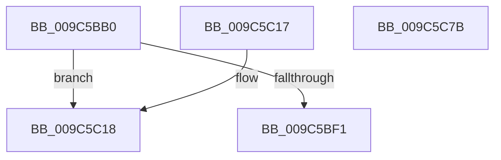

# AlpcpProbeAndCaptureMessageHeader

- RVA: `0x009C5BB0`–`0x009C5C7C` (길이 `204` bytes)
- VA: `0x00000001409C5BB0`
- 실행 섹션: `PAGE`
- PDB 이름 있음: `예`; PDB Function 태그: `아니요`
- unwind 정보 RVA: `0x000A0070`
- 디코드: `53`개 명령, `204/204` bytes 표시
- 미해석 바이트: `0` (있으면 어셈블리에 `.byte`로 보존)

> 이 문서는 커널 이미지의 기계어와 PDB 기호를 분석해 생성했습니다. 4번과 5번은 함수 원형과 자료형을 바이너리 사용 방식에서 추정한 C 해석이며 원본 소스 복구 결과는 아닙니다.

## 1. Dependencies

- 직접 호출 지점: **4**; 고유 호출 대상: **2**
- 직접 호출자로 확인된 함수: **3**
- RIP 상대 이미지 참조: **1**

### Outgoing calls
- `0x009C5BFF` → [RtlCopyVolatileMemory](../../text/6B/RtlCopyVolatileMemory_function_006BC9D0.md) (function, `0x006BC9D0`)
- `0x009C5C0C` → [_security_check_cookie](../../text/6A/_security_check_cookie_function_006AC640.md) (function, `0x006AC640`)
- `0x009C5C2A` → [RtlCopyVolatileMemory](../../text/6B/RtlCopyVolatileMemory_function_006BC9D0.md) (function, `0x006BC9D0`)
- `0x009C5C70` → [_security_check_cookie](../../text/6A/_security_check_cookie_function_006AC640.md) (function, `0x006AC640`)

### Direct callers
- [AlpcpProcessConnectionRequest](../92/AlpcpProcessConnectionRequest_function_00925FD4.md) at `0x00926079`
- [NtAlpcOpenSenderThread](NtAlpcOpenSenderThread_function_009C5920.md) at `0x009C59F8`
- [AlpcpAcceptConnectPort](../A3/AlpcpAcceptConnectPort_function_00A34290.md) at `0x00A34455`

### Static image references
- `0x009C5BB6` → RVA `0x00E0A740` (`.data`; read)

## 2. Other-region calls and transfers

- 다른 실행 섹션으로 향하는 call: **4**
  - `0x009C5BFF` → [RtlCopyVolatileMemory](../../text/6B/RtlCopyVolatileMemory_function_006BC9D0.md) (`PAGE` → `.text`)
  - `0x009C5C0C` → [_security_check_cookie](../../text/6A/_security_check_cookie_function_006AC640.md) (`PAGE` → `.text`)
  - `0x009C5C2A` → [RtlCopyVolatileMemory](../../text/6B/RtlCopyVolatileMemory_function_006BC9D0.md) (`PAGE` → `.text`)
  - `0x009C5C70` → [_security_check_cookie](../../text/6A/_security_check_cookie_function_006AC640.md) (`PAGE` → `.text`)
- 별도 외부 분기/꼬리 이동을 확인하지 못했습니다.

## 3. Assembly (complete function range)

```asm
009C5BB0  40 53                           push rbx
009C5BB2  48 83 EC 40                     sub rsp, 0x40
009C5BB6  48 8B 05 83 4B 44 00            mov rax, qword ptr [rip + 0x444b83]
009C5BBD  48 33 C4                        xor rax, rsp
009C5BC0  48 89 44 24 38                  mov qword ptr [rsp + 0x38], rax
009C5BC5  33 C0                           xor eax, eax
009C5BC7  41 81 E0 00 00 00 C0            and r8d, 0xc0000000
009C5BCE  48 89 44 24 30                  mov qword ptr [rsp + 0x30], rax
009C5BD3  0F 57 C0                        xorps xmm0, xmm0
009C5BD6  48 8B DA                        mov rbx, rdx
009C5BD9  48 BA 00 00 FF FF FF 7F 00 00   movabs rdx, 0x7fffffff0000
009C5BE3  0F 11 44 24 20                  movups xmmword ptr [rsp + 0x20], xmm0
009C5BE8  41 81 F8 00 00 00 80            cmp r8d, 0x80000000
009C5BEF  74 27                           je 0x1409c5c18
009C5BF1  48 3B CA                        cmp rcx, rdx
009C5BF4  44 8D 40 28                     lea r8d, [rax + 0x28]
009C5BF8  48 0F 42 D1                     cmovb rdx, rcx
009C5BFC  48 8B CB                        mov rcx, rbx
009C5BFF  E8 CC 6D CF FF                  call 0x1406bc9d0
009C5C04  48 8B 4C 24 38                  mov rcx, qword ptr [rsp + 0x38]
009C5C09  48 33 CC                        xor rcx, rsp
009C5C0C  E8 2F 6A CE FF                  call 0x1406ac640
009C5C11  48 83 C4 40                     add rsp, 0x40
009C5C15  5B                              pop rbx
009C5C16  C3                              ret
009C5C17  CC                              int3
009C5C18  48 3B CA                        cmp rcx, rdx
009C5C1B  41 B8 18 00 00 00               mov r8d, 0x18
009C5C21  48 0F 42 D1                     cmovb rdx, rcx
009C5C25  48 8D 4C 24 20                  lea rcx, [rsp + 0x20]
009C5C2A  E8 A1 6D CF FF                  call 0x1406bc9d0
009C5C2F  0F B7 44 24 20                  movzx eax, word ptr [rsp + 0x20]
009C5C34  8B 4C 24 34                     mov ecx, dword ptr [rsp + 0x34]
009C5C38  66 89 03                        mov word ptr [rbx], ax
009C5C3B  66 83 C0 28                     add ax, 0x28
009C5C3F  66 89 43 02                     mov word ptr [rbx + 2], ax
009C5C43  8B 44 24 24                     mov eax, dword ptr [rsp + 0x24]
009C5C47  89 43 04                        mov dword ptr [rbx + 4], eax
009C5C4A  8B 44 24 28                     mov eax, dword ptr [rsp + 0x28]
009C5C4E  48 89 43 08                     mov qword ptr [rbx + 8], rax
009C5C52  8B 44 24 2C                     mov eax, dword ptr [rsp + 0x2c]
009C5C56  48 89 43 10                     mov qword ptr [rbx + 0x10], rax
009C5C5A  8B 44 24 30                     mov eax, dword ptr [rsp + 0x30]
009C5C5E  48 89 4B 20                     mov qword ptr [rbx + 0x20], rcx
009C5C62  89 43 18                        mov dword ptr [rbx + 0x18], eax
009C5C65  89 4B 20                        mov dword ptr [rbx + 0x20], ecx
009C5C68  48 8B 4C 24 38                  mov rcx, qword ptr [rsp + 0x38]
009C5C6D  48 33 CC                        xor rcx, rsp
009C5C70  E8 CB 69 CE FF                  call 0x1406ac640
009C5C75  48 83 C4 40                     add rsp, 0x40
009C5C79  5B                              pop rbx
009C5C7A  C3                              ret
009C5C7B  CC                              int3
```

## 4. C-style interpretation (structured pseudocode)

```c
__int64 __fastcall AlpcpProbeAndCaptureMessageHeader(__int64 a1, __int64 a2, int a3)
{
    __int64 result;
    __int64 v_rsp;
    unsigned __int64 v_stack_m10;
    unsigned __int64 v_stack_m18;
    unsigned __int64 v_stack_m28;
    unsigned __int64 v_stack_p20;
    unsigned int v_stack_p24;
    unsigned int v_stack_p28;
    unsigned int v_stack_p2C;
    unsigned int v_stack_p30;
    unsigned int v_stack_p34;
    unsigned __int64 v_stack_p38;

    v_rsp = (v_rsp) - (64);
    result = (*(unsigned __int64 *)(v_rip + 4475779)) ^ (v_rsp);
    v_stack_m10 = result;
    result = 0;
    a3 = (unsigned int)((a3) & (0xC0000000ULL));
    v_stack_m18 = 0;
    v_stack_m28 = v_xmm0;
    if (a3 == 0x80000000ULL) goto loc_009C5C18;
    if (a1 < a2) { a2 = a1; }
    result = RtlCopyVolatileMemory(a2, a2, result + 40, a4);
    a1 = (v_stack_m10) ^ (v_rsp);
    result = _security_check_cookie(a1, a2, result + 40, a4);
    v_rsp = (v_rsp) + (64);
    return result;
loc_009C5C18:
    if (a1 < a2) { a2 = a1; }
    result = RtlCopyVolatileMemory(v_stack_p20, a2, 24, a4);
    *(unsigned __int16 *)(a2) = (unsigned __int16)(v_stack_p20);
    result = (unsigned __int16)((v_stack_p20) + (40));
    *(unsigned __int16 *)(a2 + 2) = (unsigned __int16)(result);
    *(unsigned int *)(a2 + 4) = (unsigned int)((unsigned int)(v_stack_p24));
    *(unsigned __int64 *)(a2 + 8) = (unsigned int)(v_stack_p28);
    *(unsigned __int64 *)(a2 + 16) = (unsigned int)(v_stack_p2C);
    *(unsigned __int64 *)(a2 + 32) = (unsigned int)(v_stack_p34);
    *(unsigned int *)(a2 + 24) = (unsigned int)((unsigned int)(v_stack_p30));
    *(unsigned int *)(a2 + 32) = (unsigned int)((unsigned int)(v_stack_p34));
    a1 = (v_stack_p38) ^ (v_rsp);
    result = _security_check_cookie(a1, a2, 24, a4);
    v_rsp = (v_rsp) + (64);
    return result;
}
```

## 5. (Beta) C Style

```c
int64_t AlpcpProbeAndCaptureMessageHeader(int64_t Arg1, void *Arg2, int32_t Arg3)
{
    uint8_t *arg2 = (uint8_t *)Arg2;

    int64_t result;
    int64_t local_rsp;
    uint64_t v_stack_m10;
    uint64_t v_stack_m18;
    uint64_t v_stack_m28;
    uint64_t v_stack_p20;
    uint32_t v_stack_p24;
    uint32_t v_stack_p28;
    uint32_t v_stack_p2C;
    uint32_t v_stack_p30;
    uint32_t v_stack_p34;
    uint64_t v_stack_p38;

    local_rsp = (local_rsp) - (64);
    result = (*(uint64_t *)(v_rip + 0x444B83)) ^ (local_rsp);
    v_stack_m10 = result;
    result = 0;
    Arg3 = (uint32_t)((Arg3) & (0xC0000000ULL));
    v_stack_m18 = 0;
    v_stack_m28 = v_xmm0;
    if (Arg3 == 0x80000000ULL) goto loc_009C5C18;
    if (Arg1 < Arg2) { Arg2 = Arg1; }
    result = RtlCopyVolatileMemory(Arg2, Arg2, result + 40, a4);
    Arg1 = (v_stack_m10) ^ (local_rsp);
    result = _security_check_cookie(Arg1, Arg2, result + 40, a4);
    local_rsp = (local_rsp) + (64);
    return result;
loc_009C5C18:
    if (Arg1 < Arg2) { Arg2 = Arg1; }
    result = RtlCopyVolatileMemory(v_stack_p20, Arg2, 24, a4);
    *(uint16_t *)(arg2) = (uint16_t)(v_stack_p20);
    result = (uint16_t)((v_stack_p20) + (40));
    *(uint16_t *)(arg2 + 0x2) = (uint16_t)(result);
    *(uint32_t *)(arg2 + 0x4) = (uint32_t)((uint32_t)(v_stack_p24));
    *(uint64_t *)(arg2 + 0x8) = (uint32_t)(v_stack_p28);
    *(uint64_t *)(arg2 + 0x10) = (uint32_t)(v_stack_p2C);
    *(uint64_t *)(arg2 + 0x20) = (uint32_t)(v_stack_p34);
    *(uint32_t *)(arg2 + 0x18) = (uint32_t)((uint32_t)(v_stack_p30));
    *(uint32_t *)(arg2 + 0x20) = (uint32_t)((uint32_t)(v_stack_p34));
    Arg1 = (v_stack_p38) ^ (local_rsp);
    result = _security_check_cookie(Arg1, Arg2, 24, a4);
    local_rsp = (local_rsp) + (64);
    return result;
}
```

### 관측된 메모리 오프셋

구조체 형식이 확인되지 않은 접근은 인자 기준의 오프셋으로만 기록했습니다.

| 기준 인자 | 오프셋 표현 | 폭 (bit) | 접근 |
|---|---:|---:|---|
| `Arg2` | `+ 0x0` | `16` | `W` |
| `Arg2` | `+ 0x2` | `16` | `W` |
| `Arg2` | `+ 0x4` | `32` | `W` |
| `Arg2` | `+ 0x8` | `64` | `W` |
| `Arg2` | `+ 0x10` | `64` | `W` |
| `Arg2` | `+ 0x18` | `32` | `W` |
| `Arg2` | `+ 0x20` | `32` | `W` |
| `Arg2` | `+ 0x20` | `64` | `W` |

## 6. Execution-region graph

[열기: 2D/3D 그래프와 함수 탐색 컨트롤 패널](../../../control-panel.html?section=page&rva=0x009C5BB0&view=graph)

- 2D 그래프는 위에서 아래로 흐르고, 3D 그래프는 빈 공간을 드래그해 회전합니다. Shift+드래그는 이동, 휠은 확대·축소, 함수 노드 선택은 대상 보고서 이동입니다.

### Static fallback


