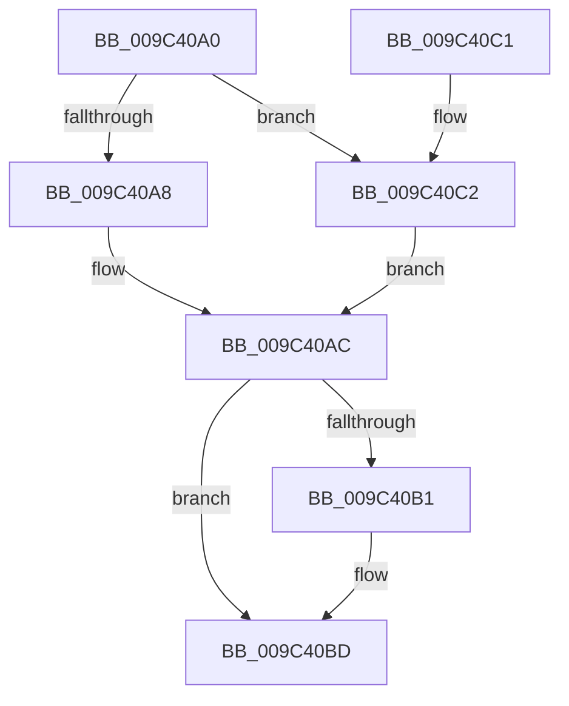

# CmpEffectiveTokenForSubject

- RVA: `0x009C40A0`–`0x009C40C7` (길이 `39` bytes)
- VA: `0x00000001409C40A0`
- 실행 섹션: `PAGE`
- PDB 이름 있음: `예`; PDB Function 태그: `아니요`
- unwind 정보 RVA: `0x000DB714`
- 디코드: `16`개 명령, `39/39` bytes 표시
- 미해석 바이트: `0` (있으면 어셈블리에 `.byte`로 보존)

> 이 문서는 커널 이미지의 기계어와 PDB 기호를 분석해 생성했습니다. 4번과 5번은 함수 원형과 자료형을 바이너리 사용 방식에서 추정한 C 해석이며 원본 소스 복구 결과는 아닙니다.

## 1. Dependencies

- 직접 호출 지점: **0**; 고유 호출 대상: **0**
- 직접 호출자로 확인된 함수: **2**
- RIP 상대 이미지 참조: **0**

### Outgoing calls
- 직접 디코드된 call 명령이 없습니다.

### Direct callers
- [CmpExamineSaclForAuditEvent](../7E/CmpExamineSaclForAuditEvent_function_007ECDB0.md) at `0x007ECE08`
- [CmpExamineSaclForAuditEvent](../7E/CmpExamineSaclForAuditEvent_function_007ECDB0.md) at `0x007ECE4E`
- [CmpReportAuditVirtualizationEvent](../7E/CmpReportAuditVirtualizationEvent_function_007ED758.md) at `0x007ED7F6`

### Static image references
- 디코드된 RIP-relative 메모리 참조가 없습니다.

## 2. Other-region calls and transfers

- 다른 실행 섹션으로 향하는 call: **0**
- 별도 외부 분기/꼬리 이동을 확인하지 못했습니다.

## 3. Assembly (complete function range)

```asm
009C40A0  48 8B 01                        mov rax, qword ptr [rcx]
009C40A3  48 85 C0                        test rax, rax
009C40A6  75 1A                           jne 0x1409c40c2
009C40A8  4C 8B 41 10                     mov r8, qword ptr [rcx + 0x10]
009C40AC  48 85 D2                        test rdx, rdx
009C40AF  74 0C                           je 0x1409c40bd
009C40B1  33 C9                           xor ecx, ecx
009C40B3  48 85 C0                        test rax, rax
009C40B6  0F 95 C1                        setne cl
009C40B9  FF C1                           inc ecx
009C40BB  89 0A                           mov dword ptr [rdx], ecx
009C40BD  49 8B C0                        mov rax, r8
009C40C0  C3                              ret
009C40C1  CC                              int3
009C40C2  4C 8B C0                        mov r8, rax
009C40C5  EB E5                           jmp 0x1409c40ac
```

## 4. C-style interpretation (structured pseudocode)

```c
__int64 __fastcall CmpEffectiveTokenForSubject(__int64 a1, __int64 a2)
{
    if (*(unsigned __int64 *)(a1) != 0) goto loc_009C40C2;
loc_009C40AC:
    if (a2 != 0) {
        a1 = 0;
        a1 = (*(unsigned __int64 *)(a1) != 0) ? 1 : 0;
        a1 = (unsigned int)((a1) + 1);
        *(unsigned int *)(a2) = (unsigned int)(a1);
    }
    return *(unsigned __int64 *)(a1 + 16);
loc_009C40C2:
    goto loc_009C40AC;
}
```

## 5. (Beta) C Style

```c
int64_t CmpEffectiveTokenForSubject(void *Arg1, int64_t Arg2)
{
    uint8_t *arg1 = (uint8_t *)Arg1;

    if (*(uint64_t *)(arg1) != 0) goto loc_009C40C2;
loc_009C40AC:
    if (Arg2 != 0) {
        Arg1 = 0;
        Arg1 = (*(uint64_t *)(arg1) != 0) ? 1 : 0;
        Arg1 = (uint32_t)((Arg1) + 1);
        *(uint32_t *)(Arg2) = (uint32_t)(Arg1);
    }
    return *(uint64_t *)(arg1 + 0x10);
loc_009C40C2:
    goto loc_009C40AC;
}
```

### 관측된 메모리 오프셋

구조체 형식이 확인되지 않은 접근은 인자 기준의 오프셋으로만 기록했습니다.

| 기준 인자 | 오프셋 표현 | 폭 (bit) | 접근 |
|---|---:|---:|---|
| `Arg1` | `+ 0x0` | `64` | `R` |
| `Arg1` | `+ 0x10` | `64` | `R` |

## 6. Execution-region graph

[열기: 2D/3D 그래프와 함수 탐색 컨트롤 패널](../../../control-panel.html?section=page&rva=0x009C40A0&view=graph)

- 2D 그래프는 위에서 아래로 흐르고, 3D 그래프는 빈 공간을 드래그해 회전합니다. Shift+드래그는 이동, 휠은 확대·축소, 함수 노드 선택은 대상 보고서 이동입니다.

### Static fallback


