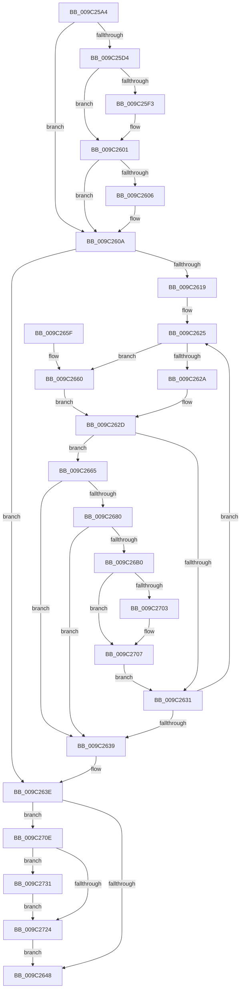

# EtwpAddBinaryInfoEvents

- RVA: `0x009C25A4`–`0x009C273B` (길이 `407` bytes)
- VA: `0x00000001409C25A4`
- 실행 섹션: `PAGE`
- PDB 이름 있음: `예`; PDB Function 태그: `아니요`
- unwind 정보 RVA: `0x0009F6F8`
- 디코드: `124`개 명령, `407/407` bytes 표시
- 미해석 바이트: `0` (있으면 어셈블리에 `.byte`로 보존)

> 이 문서는 커널 이미지의 기계어와 PDB 기호를 분석해 생성했습니다. 4번과 5번은 함수 원형과 자료형을 바이너리 사용 방식에서 추정한 C 해석이며 원본 소스 복구 결과는 아닙니다.

## 1. Dependencies

- 직접 호출 지점: **6**; 고유 호출 대상: **5**
- 직접 호출자로 확인된 함수: **3**
- RIP 상대 이미지 참조: **0**

### Outgoing calls
- `0x009C25E3` → [KeAbPreAcquire](../../text/21/KeAbPreAcquire_function_00210230.md) (function, `0x00210230`)
- `0x009C25FC` → [ExfAcquirePushLockExclusiveEx](../../text/20/ExfAcquirePushLockExclusiveEx_function_0020FC90.md) (function, `0x0020FC90`)
- `0x009C26DA` → [memcpy](../../text/6C/memcpy_function_006C6840.md) (function, `0x006C6840`)
- `0x009C26F9` → [memcpy](../../text/6C/memcpy_function_006C6840.md) (function, `0x006C6840`)
- `0x009C2727` → [KeAbPostRelease](../../text/2E/KeAbPostRelease_function_002E1600.md) (function, `0x002E1600`)
- `0x009C2734` → [ExfTryToWakePushLock](../../text/26/ExfTryToWakePushLock_function_00265DD0.md) (function, `0x00265DD0`)

### Direct callers
- [EtwpRealtimeNotifyConsumers](EtwpRealtimeNotifyConsumers_function_009C019C.md) at `0x009C033F`
- [EtwpAddLogHeader](EtwpAddLogHeader_function_009C0BD0.md) at `0x009C1138`
- [EtwpFinalizeHeader](EtwpFinalizeHeader_function_009C1EF0.md) at `0x009C21BF`

### Static image references
- 디코드된 RIP-relative 메모리 참조가 없습니다.

## 2. Other-region calls and transfers

- 다른 실행 섹션으로 향하는 call: **6**
  - `0x009C25E3` → [KeAbPreAcquire](../../text/21/KeAbPreAcquire_function_00210230.md) (`PAGE` → `.text`)
  - `0x009C25FC` → [ExfAcquirePushLockExclusiveEx](../../text/20/ExfAcquirePushLockExclusiveEx_function_0020FC90.md) (`PAGE` → `.text`)
  - `0x009C26DA` → [memcpy](../../text/6C/memcpy_function_006C6840.md) (`PAGE` → `.text`)
  - `0x009C26F9` → [memcpy](../../text/6C/memcpy_function_006C6840.md) (`PAGE` → `.text`)
  - `0x009C2727` → [KeAbPostRelease](../../text/2E/KeAbPostRelease_function_002E1600.md) (`PAGE` → `.text`)
  - `0x009C2734` → [ExfTryToWakePushLock](../../text/26/ExfTryToWakePushLock_function_00265DD0.md) (`PAGE` → `.text`)
- 별도 외부 분기/꼬리 이동을 확인하지 못했습니다.

## 3. Assembly (complete function range)

```asm
009C25A4  48 89 5C 24 18                  mov qword ptr [rsp + 0x18], rbx
009C25A9  48 89 54 24 10                  mov qword ptr [rsp + 0x10], rdx
009C25AE  48 89 4C 24 08                  mov qword ptr [rsp + 8], rcx
009C25B3  55                              push rbp
009C25B4  56                              push rsi
009C25B5  57                              push rdi
009C25B6  41 54                           push r12
009C25B8  41 55                           push r13
009C25BA  41 56                           push r14
009C25BC  41 57                           push r15
009C25BE  48 83 EC 20                     sub rsp, 0x20
009C25C2  41 8B F0                        mov esi, r8d
009C25C5  45 8B E1                        mov r12d, r9d
009C25C8  2B 72 30                        sub esi, dword ptr [rdx + 0x30]
009C25CB  4C 8B E9                        mov r13, rcx
009C25CE  41 F6 C1 02                     test r9b, 2
009C25D2  74 36                           je 0x1409c260a
009C25D4  48 8D 99 B0 02 00 00            lea rbx, [rcx + 0x2b0]
009C25DB  45 33 C0                        xor r8d, r8d
009C25DE  48 8B CB                        mov rcx, rbx
009C25E1  33 D2                           xor edx, edx
009C25E3  E8 48 DC 84 FF                  call 0x140210230
009C25E8  F0 48 0F BA 2B 00               lock bts qword ptr [rbx], 0
009C25EE  48 8B F8                        mov rdi, rax
009C25F1  73 0E                           jae 0x1409c2601
009C25F3  4C 8B C3                        mov r8, rbx
009C25F6  48 8B D0                        mov rdx, rax
009C25F9  48 8B CB                        mov rcx, rbx
009C25FC  E8 8F D6 84 FF                  call 0x14020fc90
009C2601  48 85 FF                        test rdi, rdi
009C2604  74 04                           je 0x1409c260a
009C2606  C6 47 0A 01                     mov byte ptr [rdi + 0xa], 1
009C260A  4D 8D B5 18 05 00 00            lea r14, [r13 + 0x518]
009C2611  49 8B 3E                        mov rdi, qword ptr [r14]
009C2614  49 3B FE                        cmp rdi, r14
009C2617  74 25                           je 0x1409c263e
009C2619  4C 8B 6C 24 68                  mov r13, qword ptr [rsp + 0x68]
009C261E  45 8B FC                        mov r15d, r12d
009C2621  41 83 E7 04                     and r15d, 4
009C2625  45 85 FF                        test r15d, r15d
009C2628  74 36                           je 0x1409c2660
009C262A  8B 57 18                        mov edx, dword ptr [rdi + 0x18]
009C262D  85 D2                           test edx, edx
009C262F  75 34                           jne 0x1409c2665
009C2631  48 8B 3F                        mov rdi, qword ptr [rdi]
009C2634  49 3B FE                        cmp rdi, r14
009C2637  75 EC                           jne 0x1409c2625
009C2639  4C 8B 6C 24 60                  mov r13, qword ptr [rsp + 0x60]
009C263E  41 F6 C4 02                     test r12b, 2
009C2642  0F 85 C6 00 00 00               jne 0x1409c270e
009C2648  48 8B 5C 24 70                  mov rbx, qword ptr [rsp + 0x70]
009C264D  33 C0                           xor eax, eax
009C264F  48 83 C4 20                     add rsp, 0x20
009C2653  41 5F                           pop r15
009C2655  41 5E                           pop r14
009C2657  41 5D                           pop r13
009C2659  41 5C                           pop r12
009C265B  5F                              pop rdi
009C265C  5E                              pop rsi
009C265D  5D                              pop rbp
009C265E  C3                              ret
009C265F  CC                              int3
009C2660  8B 57 14                        mov edx, dword ptr [rdi + 0x14]
009C2663  EB C8                           jmp 0x1409c262d
009C2665  44 8B 47 10                     mov r8d, dword ptr [rdi + 0x10]
009C2669  8B CA                           mov ecx, edx
009C266B  C1 E1 04                        shl ecx, 4
009C266E  41 83 C0 14                     add r8d, 0x14
009C2672  44 03 C1                        add r8d, ecx
009C2675  41 8D 68 07                     lea ebp, [r8 + 7]
009C2679  83 E5 F8                        and ebp, 0xfffffff8
009C267C  3B EE                           cmp ebp, esi
009C267E  77 B9                           ja 0x1409c2639
009C2680  41 8B 45 30                     mov eax, dword ptr [r13 + 0x30]
009C2684  4A 8D 0C 28                     lea rcx, [rax + r13]
009C2688  03 C5                           add eax, ebp
009C268A  41 89 45 30                     mov dword ptr [r13 + 0x30], eax
009C268E  4C 8D 49 10                     lea r9, [rcx + 0x10]
009C2692  66 44 89 41 04                  mov word ptr [rcx + 4], r8w
009C2697  C7 01 02 00 11 C0               mov dword ptr [rcx], 0xc0110002
009C269D  66 C7 41 06 43 00               mov word ptr [rcx + 6], 0x43
009C26A3  49 8B 45 58                     mov rax, qword ptr [r13 + 0x58]
009C26A7  48 89 41 08                     mov qword ptr [rcx + 8], rax
009C26AB  4D 85 C9                        test r9, r9
009C26AE  74 89                           je 0x1409c2639
009C26B0  41 89 11                        mov dword ptr [r9], edx
009C26B3  49 83 C1 04                     add r9, 4
009C26B7  8B 47 14                        mov eax, dword ptr [rdi + 0x14]
009C26BA  49 8B C9                        mov rcx, r9
009C26BD  8B DA                           mov ebx, edx
009C26BF  2B C2                           sub eax, edx
009C26C1  8B D0                           mov edx, eax
009C26C3  48 C1 E2 04                     shl rdx, 4
009C26C7  48 83 C2 1C                     add rdx, 0x1c
009C26CB  48 C1 E3 04                     shl rbx, 4
009C26CF  48 03 D7                        add rdx, rdi
009C26D2  4C 89 4C 24 68                  mov qword ptr [rsp + 0x68], r9
009C26D7  4C 8B C3                        mov r8, rbx
009C26DA  E8 61 41 D0 FF                  call 0x1406c6840
009C26DF  8B 57 14                        mov edx, dword ptr [rdi + 0x14]
009C26E2  48 8B 4C 24 68                  mov rcx, qword ptr [rsp + 0x68]
009C26E7  44 8B 47 10                     mov r8d, dword ptr [rdi + 0x10]
009C26EB  48 03 CB                        add rcx, rbx
009C26EE  48 C1 E2 04                     shl rdx, 4
009C26F2  48 83 C2 1C                     add rdx, 0x1c
009C26F6  48 03 D7                        add rdx, rdi
009C26F9  E8 42 41 D0 FF                  call 0x1406c6840
009C26FE  45 85 FF                        test r15d, r15d
009C2701  74 04                           je 0x1409c2707
009C2703  83 67 18 00                     and dword ptr [rdi + 0x18], 0
009C2707  2B F5                           sub esi, ebp
009C2709  E9 23 FF FF FF                  jmp 0x1409c2631
009C270E  49 8D 9D B0 02 00 00            lea rbx, [r13 + 0x2b0]
009C2715  48 83 C8 FF                     or rax, 0xffffffffffffffff
009C2719  F0 48 0F C1 03                  lock xadd qword ptr [rbx], rax
009C271E  24 06                           and al, 6
009C2720  3C 02                           cmp al, 2
009C2722  74 0D                           je 0x1409c2731
009C2724  48 8B CB                        mov rcx, rbx
009C2727  E8 D4 EE 91 FF                  call 0x1402e1600
009C272C  E9 17 FF FF FF                  jmp 0x1409c2648
009C2731  48 8B CB                        mov rcx, rbx
009C2734  E8 97 36 8A FF                  call 0x140265dd0
009C2739  EB E9                           jmp 0x1409c2724
```

## 4. C-style interpretation (structured pseudocode)

```c
__int64 __fastcall EtwpAddBinaryInfoEvents(__int64 a1, __int64 a2, int a3, int a4)
{
    __int64 result;
    __int64 v_r15;
    __int64 v_rbp;
    __int64 v_rbx;
    __int64 v_rsi;
    __int64 v_rsp;
    unsigned __int64 v_stack_p10;
    unsigned __int64 v_stack_p18;
    unsigned __int64 v_stack_p68;
    unsigned __int64 v_stack_p8;

    v_stack_p18 = v_rbx;
    v_stack_p10 = a2;
    v_stack_p8 = a1;
    v_rsp = (v_rsp) - (32);
    v_rsi = (unsigned int)(((unsigned int)(a3)) - (*(unsigned int *)(a2 + 48)));
    if ((((unsigned __int8)(a4)) & (2)) == 0) goto loc_009C260A;
    a3 = 0;
    a2 = 0;
    result = KeAbPreAcquire(a1 + 688, a2, a3, a4);
    if (!(condition_is_above_or_equal)) {
        a3 = a1 + 688;
        a2 = result;
        a1 = a1 + 688;
        result = ExfAcquirePushLockExclusiveEx(a1, a2, a3, a4);
    }
    if (result != 0) {
        *(unsigned __int8 *)(result + 10) = 1;
    }
    if ((*(unsigned __int64 *)(a1 + 1304)) == (a1 + 1304)) goto loc_009C263E;
    v_r15 = (unsigned int)(((unsigned int)((unsigned int)((unsigned int)(a4)))) & (4));
loc_009C2625:
    if ((unsigned int)(v_r15) == 0) goto loc_009C2660;
loc_009C262D:
    if ((unsigned int)((unsigned int)(*(unsigned int *)(*(unsigned __int64 *)(a1 + 1304) + 24))) != 0) goto loc_009C2665;
loc_009C2631:
    if ((*(unsigned __int64 *)(*(unsigned __int64 *)(a1 + 1304))) != (a1 + 1304)) goto loc_009C2625;
loc_009C2639:
loc_009C263E:
    if ((((unsigned __int8)((unsigned int)(a4))) & (2)) != 0) goto loc_009C270E;
loc_009C2648:
    result = 0;
    v_rsp = (v_rsp) + (32);
    return result;
loc_009C2660:
    goto loc_009C262D;
loc_009C2665:
    a1 = (unsigned int)(((unsigned int)((unsigned int)((unsigned int)(*(unsigned int *)(*(unsigned __int64 *)(*(unsigned __int64 *)(a1 + 1304)) + 20))))) << (4));
    a3 = (unsigned int)(((unsigned int)(*(unsigned int *)(*(unsigned __int64 *)(*(unsigned __int64 *)(a1 + 1304)) + 16))) + (20));
    a3 = (unsigned int)((a3) + ((unsigned int)(a1)));
    v_rbp = (unsigned int)((a3 + 7) & (0xFFFFFFF8ULL));
    if (((unsigned int)(v_rbp)) > ((unsigned int)(v_rsi))) goto loc_009C2639;
    result = (unsigned int)(((unsigned int)(*(unsigned int *)(v_stack_p8 + 48))) + ((unsigned int)(v_rbp)));
    *(unsigned int *)(v_stack_p8 + 48) = (unsigned int)(result);
    *(unsigned __int16 *)((unsigned int)(*(unsigned int *)(v_stack_p8 + 48)) + v_stack_p8 * 1 + 4) = (unsigned __int16)(a3);
    *(unsigned int *)((unsigned int)(*(unsigned int *)(v_stack_p8 + 48)) + v_stack_p8 * 1) = 0xC0110002ULL;
    *(unsigned __int16 *)((unsigned int)(*(unsigned int *)(v_stack_p8 + 48)) + v_stack_p8 * 1 + 6) = 67;
    *(unsigned __int64 *)((unsigned int)(*(unsigned int *)(v_stack_p8 + 48)) + v_stack_p8 * 1 + 8) = *(unsigned __int64 *)(v_stack_p8 + 88);
    if ((unsigned int)(*(unsigned int *)(v_stack_p8 + 48)) + v_stack_p8 * 1 + 16 == 0) goto loc_009C2639;
    *(unsigned int *)((unsigned int)(*(unsigned int *)(v_stack_p8 + 48)) + v_stack_p8 * 1 + 16) = (unsigned int)((unsigned int)(*(unsigned int *)(*(unsigned __int64 *)(*(unsigned __int64 *)(a1 + 1304)) + 20)));
    a4 = ((unsigned int)(*(unsigned int *)(v_stack_p8 + 48)) + v_stack_p8 * 1 + 16) + (4);
    result = (unsigned int)(((unsigned int)(*(unsigned int *)(*(unsigned __int64 *)(*(unsigned __int64 *)(a1 + 1304)) + 20))) - ((unsigned int)((unsigned int)(*(unsigned int *)(*(unsigned __int64 *)(*(unsigned __int64 *)(a1 + 1304)) + 20)))));
    a2 = ((unsigned int)((unsigned int)(result))) << (4);
    a2 = (a2) + (28);
    v_rbx = ((unsigned int)((unsigned int)((unsigned int)(*(unsigned int *)(*(unsigned __int64 *)(*(unsigned __int64 *)(a1 + 1304)) + 20))))) << (4);
    a2 = (a2) + (*(unsigned __int64 *)(*(unsigned __int64 *)(a1 + 1304)));
    v_stack_p68 = a4;
    result = memcpy(a4, a2, v_rbx, a4);
    a1 = (v_stack_p68) + (v_rbx);
    a2 = ((unsigned int)(*(unsigned int *)(*(unsigned __int64 *)(*(unsigned __int64 *)(a1 + 1304)) + 20))) << (4);
    a2 = (a2) + (28);
    a2 = (a2) + (*(unsigned __int64 *)(*(unsigned __int64 *)(a1 + 1304)));
    result = memcpy(a1, a2, (unsigned int)(*(unsigned int *)(*(unsigned __int64 *)(*(unsigned __int64 *)(a1 + 1304)) + 16)), a4);
    if ((unsigned int)(v_r15) != 0) {
    }
    v_rsi = (unsigned int)((v_rsi) - ((unsigned int)(v_rbp)));
    goto loc_009C2631;
loc_009C270E:
    result = (result) | (-1);
    result = (unsigned __int8)((result) & (6));
    if (((unsigned __int8)(result)) == 2) goto loc_009C2731;
loc_009C2724:
    result = KeAbPostRelease(v_stack_p8 + 688, a2, (unsigned int)(*(unsigned int *)(*(unsigned __int64 *)(*(unsigned __int64 *)(a1 + 1304)) + 16)), a4);
    goto loc_009C2648;
loc_009C2731:
    result = ExfTryToWakePushLock(v_stack_p8 + 688, a2, (unsigned int)(*(unsigned int *)(*(unsigned __int64 *)(*(unsigned __int64 *)(a1 + 1304)) + 16)), a4);
    goto loc_009C2724;
}
```

## 5. (Beta) C Style

```c
int64_t EtwpAddBinaryInfoEvents(void *Arg1, void *Arg2, int32_t Arg3, int32_t Arg4)
{
    uint8_t *arg1 = (uint8_t *)Arg1;
    uint8_t *arg2 = (uint8_t *)Arg2;

    int64_t result;
    int64_t local_r15;
    int64_t local_rbp;
    int64_t local_rbx;
    int64_t local_rsi;
    int64_t local_rsp;
    uint64_t v_stack_p10;
    uint64_t v_stack_p18;
    uint64_t v_stack_p68;
    uint64_t v_stack_p8;

    v_stack_p18 = local_rbx;
    v_stack_p10 = Arg2;
    v_stack_p8 = Arg1;
    local_rsp = (local_rsp) - (32);
    local_rsi = (uint32_t)(((uint32_t)(Arg3)) - (*(uint32_t *)(arg2 + 0x30)));
    if ((((uint8_t)(Arg4)) & (2)) == 0) goto loc_009C260A;
    Arg3 = 0;
    Arg2 = 0;
    result = KeAbPreAcquire(Arg1 + 688, Arg2, Arg3, Arg4);
    if (!(condition_is_above_or_equal)) {
        Arg3 = Arg1 + 688;
        Arg2 = result;
        Arg1 = Arg1 + 688;
        result = ExfAcquirePushLockExclusiveEx(Arg1, Arg2, Arg3, Arg4);
    }
    if (result != 0) {
        *(uint8_t *)(result + 0xA) = 1;
    }
    if ((*(uint64_t *)(arg1 + 0x518)) == (Arg1 + 1304)) goto loc_009C263E;
    local_r15 = (uint32_t)(((uint32_t)((uint32_t)((uint32_t)(Arg4)))) & (4));
loc_009C2625:
    if ((uint32_t)(local_r15) == 0) goto loc_009C2660;
loc_009C262D:
    if ((uint32_t)((uint32_t)(*(uint32_t *)(*(uint64_t *)(arg1 + 0x518) + 0x18))) != 0) goto loc_009C2665;
loc_009C2631:
    if ((*(uint64_t *)(*(uint64_t *)(arg1 + 0x518))) != (Arg1 + 1304)) goto loc_009C2625;
loc_009C2639:
loc_009C263E:
    if ((((uint8_t)((uint32_t)(Arg4))) & (2)) != 0) goto loc_009C270E;
loc_009C2648:
    result = 0;
    local_rsp = (local_rsp) + (32);
    return result;
loc_009C2660:
    goto loc_009C262D;
loc_009C2665:
    Arg1 = (uint32_t)(((uint32_t)((uint32_t)((uint32_t)(*(uint32_t *)(*(uint64_t *)(*(uint64_t *)(arg1 + 0x518)) + 0x14))))) << (4));
    Arg3 = (uint32_t)(((uint32_t)(*(uint32_t *)(*(uint64_t *)(*(uint64_t *)(arg1 + 0x518)) + 0x10))) + (20));
    Arg3 = (uint32_t)((Arg3) + ((uint32_t)(Arg1)));
    local_rbp = (uint32_t)((Arg3 + 7) & (0xFFFFFFF8ULL));
    if (((uint32_t)(local_rbp)) > ((uint32_t)(local_rsi))) goto loc_009C2639;
    result = (uint32_t)(((uint32_t)(*(uint32_t *)(v_stack_p8 + 0x30))) + ((uint32_t)(local_rbp)));
    *(uint32_t *)(v_stack_p8 + 0x30) = (uint32_t)(result);
    *(uint16_t *)((uint32_t)(*(uint32_t *)(v_stack_p8 + 0x30)) + v_stack_p8 * 1 + 0x4) = (uint16_t)(Arg3);
    *(uint32_t *)((uint32_t)(*(uint32_t *)(v_stack_p8 + 0x30)) + v_stack_p8 * 1) = 0xC0110002ULL;
    *(uint16_t *)((uint32_t)(*(uint32_t *)(v_stack_p8 + 0x30)) + v_stack_p8 * 1 + 0x6) = 67;
    *(uint64_t *)((uint32_t)(*(uint32_t *)(v_stack_p8 + 0x30)) + v_stack_p8 * 1 + 0x8) = *(uint64_t *)(v_stack_p8 + 0x58);
    if ((uint32_t)(*(uint32_t *)(v_stack_p8 + 0x30)) + v_stack_p8 * 1 + 16 == 0) goto loc_009C2639;
    *(uint32_t *)((uint32_t)(*(uint32_t *)(v_stack_p8 + 0x30)) + v_stack_p8 * 1 + 0x10) = (uint32_t)((uint32_t)(*(uint32_t *)(*(uint64_t *)(*(uint64_t *)(arg1 + 0x518)) + 0x14)));
    Arg4 = ((uint32_t)(*(uint32_t *)(v_stack_p8 + 0x30)) + v_stack_p8 * 1 + 16) + (4);
    result = (uint32_t)(((uint32_t)(*(uint32_t *)(*(uint64_t *)(*(uint64_t *)(arg1 + 0x518)) + 0x14))) - ((uint32_t)((uint32_t)(*(uint32_t *)(*(uint64_t *)(*(uint64_t *)(arg1 + 0x518)) + 0x14)))));
    Arg2 = ((uint32_t)((uint32_t)(result))) << (4);
    Arg2 = (Arg2) + (28);
    local_rbx = ((uint32_t)((uint32_t)((uint32_t)(*(uint32_t *)(*(uint64_t *)(*(uint64_t *)(arg1 + 0x518)) + 0x14))))) << (4);
    Arg2 = (Arg2) + (*(uint64_t *)(*(uint64_t *)(arg1 + 0x518)));
    v_stack_p68 = Arg4;
    result = memcpy(Arg4, Arg2, local_rbx, Arg4);
    Arg1 = (v_stack_p68) + (local_rbx);
    Arg2 = ((uint32_t)(*(uint32_t *)(*(uint64_t *)(*(uint64_t *)(arg1 + 0x518)) + 0x14))) << (4);
    Arg2 = (Arg2) + (28);
    Arg2 = (Arg2) + (*(uint64_t *)(*(uint64_t *)(arg1 + 0x518)));
    result = memcpy(Arg1, Arg2, (uint32_t)(*(uint32_t *)(*(uint64_t *)(*(uint64_t *)(arg1 + 0x518)) + 0x10)), Arg4);
    if ((uint32_t)(local_r15) != 0) {
    }
    local_rsi = (uint32_t)((local_rsi) - ((uint32_t)(local_rbp)));
    goto loc_009C2631;
loc_009C270E:
    result = (result) | (-1);
    result = (uint8_t)((result) & (6));
    if (((uint8_t)(result)) == 2) goto loc_009C2731;
loc_009C2724:
    result = KeAbPostRelease(v_stack_p8 + 688, Arg2, (uint32_t)(*(uint32_t *)(*(uint64_t *)(*(uint64_t *)(arg1 + 0x518)) + 0x10)), Arg4);
    goto loc_009C2648;
loc_009C2731:
    result = ExfTryToWakePushLock(v_stack_p8 + 688, Arg2, (uint32_t)(*(uint32_t *)(*(uint64_t *)(*(uint64_t *)(arg1 + 0x518)) + 0x10)), Arg4);
    goto loc_009C2724;
}
```

### 관측된 메모리 오프셋

구조체 형식이 확인되지 않은 접근은 인자 기준의 오프셋으로만 기록했습니다.

| 기준 인자 | 오프셋 표현 | 폭 (bit) | 접근 |
|---|---:|---:|---|
| `Arg1` | `+ 0x0` | `64` | `R` |
| `Arg1` | `+ 0x0` | `64` | `R/W` |
| `Arg1` | `+ 0x2B0` | `64` | `R` |
| `Arg1` | `+ 0x518` | `64` | `R` |
| `Arg2` | `+ 0x30` | `32` | `R` |

## 6. Execution-region graph

[열기: 2D/3D 그래프와 함수 탐색 컨트롤 패널](../../../control-panel.html?section=page&rva=0x009C25A4&view=graph)

- 2D 그래프는 위에서 아래로 흐르고, 3D 그래프는 빈 공간을 드래그해 회전합니다. Shift+드래그는 이동, 휠은 확대·축소, 함수 노드 선택은 대상 보고서 이동입니다.

### Static fallback


