# EtwpAddDebugInfoEvents

- RVA: `0x009C22D0`–`0x009C251B` (길이 `587` bytes)
- VA: `0x00000001409C22D0`
- 실행 섹션: `PAGE`
- PDB 이름 있음: `예`; PDB Function 태그: `예`
- unwind 정보 RVA: `0x0009F6CC`
- 디코드: `155`개 명령, `587/587` bytes 표시
- 미해석 바이트: `0` (있으면 어셈블리에 `.byte`로 보존)

> 이 문서는 커널 이미지의 기계어와 PDB 기호를 분석해 생성했습니다. 4번과 5번은 함수 원형과 자료형을 바이너리 사용 방식에서 추정한 C 해석이며 원본 소스 복구 결과는 아닙니다.

## 1. Dependencies

- 직접 호출 지점: **6**; 고유 호출 대상: **5**
- 직접 호출자로 확인된 함수: **4**
- RIP 상대 이미지 참조: **1**

### Outgoing calls
- `0x009C2337` → [KeAbPreAcquire](../../text/21/KeAbPreAcquire_function_00210230.md) (function, `0x00210230`)
- `0x009C2350` → [ExfAcquirePushLockExclusiveEx](../../text/20/ExfAcquirePushLockExclusiveEx_function_0020FC90.md) (function, `0x0020FC90`)
- `0x009C23AF` → [EtwpAddEventToBuffer](EtwpAddEventToBuffer_function_009C2524.md) (function, `0x009C2524`)
- `0x009C2420` → [EtwpAddEventToBuffer](EtwpAddEventToBuffer_function_009C2524.md) (function, `0x009C2524`)
- `0x009C245D` → [KeAbPostRelease](../../text/2E/KeAbPostRelease_function_002E1600.md) (function, `0x002E1600`)
- `0x009C247E` → [ExfTryToWakePushLock](../../text/26/ExfTryToWakePushLock_function_00265DD0.md) (function, `0x00265DD0`)

### Direct callers
- [EtwpSendDbgId](../7B/EtwpSendDbgId_function_007BC1C0.md) at `0x007BC290`
- [EtwpRealtimeNotifyConsumers](EtwpRealtimeNotifyConsumers_function_009C019C.md) at `0x009C02B6`
- [EtwpAddLogHeader](EtwpAddLogHeader_function_009C0BD0.md) at `0x009C1118`
- [EtwpFinalizeHeader](EtwpFinalizeHeader_function_009C1EF0.md) at `0x009C21A6`

### Static image references
- `0x009C2379` → RVA `0x00FC41E0` (`.data`; read)

## 2. Other-region calls and transfers

- 다른 실행 섹션으로 향하는 call: **4**
  - `0x009C2337` → [KeAbPreAcquire](../../text/21/KeAbPreAcquire_function_00210230.md) (`PAGE` → `.text`)
  - `0x009C2350` → [ExfAcquirePushLockExclusiveEx](../../text/20/ExfAcquirePushLockExclusiveEx_function_0020FC90.md) (`PAGE` → `.text`)
  - `0x009C245D` → [KeAbPostRelease](../../text/2E/KeAbPostRelease_function_002E1600.md) (`PAGE` → `.text`)
  - `0x009C247E` → [ExfTryToWakePushLock](../../text/26/ExfTryToWakePushLock_function_00265DD0.md) (`PAGE` → `.text`)
- call이 아닌 외부 분기/꼬리 이동: **1**
  - `0x009C2507` → [sub_00B2EDDA](../B2/Unknown_function_00B2EDDA.md) (`tail-transfer`)

## 3. Assembly (complete function range)

```asm
009C22D0  48 8B C4                        mov rax, rsp
009C22D3  48 89 58 08                     mov qword ptr [rax + 8], rbx
009C22D7  48 89 50 10                     mov qword ptr [rax + 0x10], rdx
009C22DB  55                              push rbp
009C22DC  56                              push rsi
009C22DD  57                              push rdi
009C22DE  41 54                           push r12
009C22E0  41 55                           push r13
009C22E2  41 56                           push r14
009C22E4  41 57                           push r15
009C22E6  48 83 EC 40                     sub rsp, 0x40
009C22EA  83 60 18 00                     and dword ptr [rax + 0x18], 0
009C22EE  41 8B F8                        mov edi, r8d
009C22F1  2B 7A 30                        sub edi, dword ptr [rdx + 0x30]
009C22F4  4D 8B E1                        mov r12, r9
009C22F7  48 83 60 20 00                  and qword ptr [rax + 0x20], 0
009C22FC  48 8B F2                        mov rsi, rdx
009C22FF  48 8B E9                        mov rbp, rcx
009C2302  4D 85 C9                        test r9, r9
009C2305  75 08                           jne 0x1409c230f
009C2307  4C 21 48 20                     and qword ptr [rax + 0x20], r9
009C230B  4C 8D 60 20                     lea r12, [rax + 0x20]
009C230F  44 8B BC 24 A0 00 00 00         mov r15d, dword ptr [rsp + 0xa0]
009C2317  45 8B EF                        mov r13d, r15d
009C231A  41 83 E5 02                     and r13d, 2
009C231E  44 89 AC 24 A0 00 00 00         mov dword ptr [rsp + 0xa0], r13d
009C2326  74 3E                           je 0x1409c2366
009C2328  48 8D 99 B0 02 00 00            lea rbx, [rcx + 0x2b0]
009C232F  45 33 C0                        xor r8d, r8d
009C2332  48 8B CB                        mov rcx, rbx
009C2335  33 D2                           xor edx, edx
009C2337  E8 F4 DE 84 FF                  call 0x140210230
009C233C  F0 48 0F BA 2B 00               lock bts qword ptr [rbx], 0
009C2342  48 8B F0                        mov rsi, rax
009C2345  73 0E                           jae 0x1409c2355
009C2347  4C 8B C3                        mov r8, rbx
009C234A  48 8B D0                        mov rdx, rax
009C234D  48 8B CB                        mov rcx, rbx
009C2350  E8 3B D9 84 FF                  call 0x14020fc90
009C2355  48 85 F6                        test rsi, rsi
009C2358  74 04                           je 0x1409c235e
009C235A  C6 46 0A 01                     mov byte ptr [rsi + 0xa], 1
009C235E  48 8B B4 24 88 00 00 00         mov rsi, qword ptr [rsp + 0x88]
009C2366  48 83 CB FF                     or rbx, 0xffffffffffffffff
009C236A  41 F6 C7 01                     test r15b, 1
009C236E  74 54                           je 0x1409c23c4
009C2370  48 8D 45 60                     lea rax, [rbp + 0x60]
009C2374  48 39 00                        cmp qword ptr [rax], rax
009C2377  74 4B                           je 0x1409c23c4
009C2379  4C 8D 0D 60 1E 60 00            lea r9, [rip + 0x601e60]
009C2380  48 8B C3                        mov rax, rbx
009C2383  48 FF C0                        inc rax
009C2386  41 80 3C 01 00                  cmp byte ptr [r9 + rax], 0
009C238B  75 F6                           jne 0x1409c2383
009C238D  48 8D 8C 24 90 00 00 00         lea rcx, [rsp + 0x90]
009C2395  FF C0                           inc eax
009C2397  48 89 4C 24 30                  mov qword ptr [rsp + 0x30], rcx
009C239C  BA 42 00 00 00                  mov edx, 0x42
009C23A1  89 7C 24 28                     mov dword ptr [rsp + 0x28], edi
009C23A5  48 8B CE                        mov rcx, rsi
009C23A8  4D 8B C4                        mov r8, r12
009C23AB  89 44 24 20                     mov dword ptr [rsp + 0x20], eax
009C23AF  E8 70 01 00 00                  call 0x1409c2524
009C23B4  48 85 C0                        test rax, rax
009C23B7  0F 84 84 00 00 00               je 0x1409c2441
009C23BD  2B BC 24 90 00 00 00            sub edi, dword ptr [rsp + 0x90]
009C23C4  41 83 E7 04                     and r15d, 4
009C23C8  0F 85 2A 01 00 00               jne 0x1409c24f8
009C23CE  8B 55 78                        mov edx, dword ptr [rbp + 0x78]
009C23D1  85 D2                           test edx, edx
009C23D3  0F 85 AC 00 00 00               jne 0x1409c2485
009C23D9  4C 8D 75 60                     lea r14, [rbp + 0x60]
009C23DD  49 8B 36                        mov rsi, qword ptr [r14]
009C23E0  49 3B F6                        cmp rsi, r14
009C23E3  74 5C                           je 0x1409c2441
009C23E5  4C 8B AC 24 88 00 00 00         mov r13, qword ptr [rsp + 0x88]
009C23ED  45 85 FF                        test r15d, r15d
009C23F0  0F 85 16 01 00 00               jne 0x1409c250c
009C23F6  8B 46 14                        mov eax, dword ptr [rsi + 0x14]
009C23F9  48 8D 8C 24 90 00 00 00         lea rcx, [rsp + 0x90]
009C2401  48 89 4C 24 30                  mov qword ptr [rsp + 0x30], rcx
009C2406  4C 8D 4E 1C                     lea r9, [rsi + 0x1c]
009C240A  83 E8 04                        sub eax, 4
009C240D  89 7C 24 28                     mov dword ptr [rsp + 0x28], edi
009C2411  49 8B CD                        mov rcx, r13
009C2414  89 44 24 20                     mov dword ptr [rsp + 0x20], eax
009C2418  BA 40 00 00 00                  mov edx, 0x40
009C241D  4D 8B C4                        mov r8, r12
009C2420  E8 FF 00 00 00                  call 0x1409c2524
009C2425  48 85 C0                        test rax, rax
009C2428  74 0F                           je 0x1409c2439
009C242A  2B BC 24 90 00 00 00            sub edi, dword ptr [rsp + 0x90]
009C2431  48 8B 36                        mov rsi, qword ptr [rsi]
009C2434  49 3B F6                        cmp rsi, r14
009C2437  75 B4                           jne 0x1409c23ed
009C2439  44 8B AC 24 A0 00 00 00         mov r13d, dword ptr [rsp + 0xa0]
009C2441  45 85 ED                        test r13d, r13d
009C2444  74 1C                           je 0x1409c2462
009C2446  48 8D BD B0 02 00 00            lea rdi, [rbp + 0x2b0]
009C244D  F0 48 0F C1 1F                  lock xadd qword ptr [rdi], rbx
009C2452  80 E3 06                        and bl, 6
009C2455  80 FB 02                        cmp bl, 2
009C2458  74 21                           je 0x1409c247b
009C245A  48 8B CF                        mov rcx, rdi
009C245D  E8 9E F1 91 FF                  call 0x1402e1600
009C2462  48 8B 9C 24 80 00 00 00         mov rbx, qword ptr [rsp + 0x80]
009C246A  48 83 C4 40                     add rsp, 0x40
009C246E  41 5F                           pop r15
009C2470  41 5E                           pop r14
009C2472  41 5D                           pop r13
009C2474  41 5C                           pop r12
009C2476  5F                              pop rdi
009C2477  5E                              pop rsi
009C2478  5D                              pop rbp
009C2479  C3                              ret
009C247A  CC                              int3
009C247B  48 8B CF                        mov rcx, rdi
009C247E  E8 4D 39 8A FF                  call 0x140265dd0
009C2483  EB D5                           jmp 0x1409c245a
009C2485  44 8B C2                        mov r8d, edx
009C2488  41 C1 E0 05                     shl r8d, 5
009C248C  41 83 C0 10                     add r8d, 0x10
009C2490  44 89 84 24 90 00 00 00         mov dword ptr [rsp + 0x90], r8d
009C2498  44 3B C7                        cmp r8d, edi
009C249B  0F 87 38 FF FF FF               ja 0x1409c23d9
009C24A1  8B 46 30                        mov eax, dword ptr [rsi + 0x30]
009C24A4  48 8D 0C 06                     lea rcx, [rsi + rax]
009C24A8  41 03 C0                        add eax, r8d
009C24AB  89 46 30                        mov dword ptr [rsi + 0x30], eax
009C24AE  66 44 89 41 04                  mov word ptr [rcx + 4], r8w
009C24B3  C7 01 02 00 11 C0               mov dword ptr [rcx], 0xc0110002
009C24B9  66 C7 41 06 44 00               mov word ptr [rcx + 6], 0x44
009C24BF  49 8B 04 24                     mov rax, qword ptr [r12]
009C24C3  48 89 41 08                     mov qword ptr [rcx + 8], rax
009C24C7  48 83 C1 10                     add rcx, 0x10
009C24CB  0F 84 08 FF FF FF               je 0x1409c23d9
009C24D1  48 8B 45 70                     mov rax, qword ptr [rbp + 0x70]
009C24D5  0F 10 40 08                     movups xmm0, xmmword ptr [rax + 8]
009C24D9  0F 11 01                        movups xmmword ptr [rcx], xmm0
009C24DC  48 8D 49 20                     lea rcx, [rcx + 0x20]
009C24E0  0F 10 48 18                     movups xmm1, xmmword ptr [rax + 0x18]
009C24E4  0F 11 49 F0                     movups xmmword ptr [rcx - 0x10], xmm1
009C24E8  48 8B 00                        mov rax, qword ptr [rax]
009C24EB  83 C2 FF                        add edx, -1
009C24EE  75 E5                           jne 0x1409c24d5
009C24F0  41 2B F8                        sub edi, r8d
009C24F3  E9 E1 FE FF FF                  jmp 0x1409c23d9
009C24F8  48 8B 45 70                     mov rax, qword ptr [rbp + 0x70]
009C24FC  33 D2                           xor edx, edx
009C24FE  48 85 C0                        test rax, rax
009C2501  0F 84 D2 FE FF FF               je 0x1409c23d9
009C2507  E9 CE C8 16 00                  jmp 0x140b2edda
009C250C  80 7E 10 00                     cmp byte ptr [rsi + 0x10], 0
009C2510  0F 85 1B FF FF FF               jne 0x1409c2431
009C2516  E9 DB FE FF FF                  jmp 0x1409c23f6
```

## 4. C-style interpretation (structured pseudocode)

```c
__int64 __fastcall EtwpAddDebugInfoEvents(__int64 a1, __int64 a2, int a3, __int64 a4, unsigned int a5)
{
    __int64 result;
    __int64 v_r12;
    __int64 v_r13;
    __int64 v_r15;
    __int64 v_rbx;
    __int64 v_rdi;
    __int64 v_rsp;
    unsigned __int64 v_stack_m48;
    unsigned int v_stack_m50;
    unsigned int v_stack_m58;
    unsigned __int64 v_stack_p10;
    unsigned __int64 v_stack_p18;
    unsigned int v_stack_p28;
    unsigned __int64 v_stack_p8;
    unsigned int v_stack_p90;

    *(unsigned __int64 *)(v_rsp + 8) = v_rbx;
    *(unsigned __int64 *)(v_rsp + 16) = a2;
    v_rsp = (v_rsp) - (64);
    v_rdi = (unsigned int)(((unsigned int)(a3)) - (*(unsigned int *)(a2 + 48)));
    v_r12 = a4;
    if (a4 == 0) {
        v_r12 = v_rsp + 32;
    }
    v_r13 = (unsigned int)(((unsigned int)((unsigned int)((unsigned int)(a5)))) & (2));
    v_stack_p28 = (unsigned int)(v_r13);
    if (condition_is_equal) goto loc_009C2366;
    a3 = 0;
    a2 = 0;
    result = KeAbPreAcquire(a1 + 688, a2, a3, a4);
    if (!(condition_is_above_or_equal)) {
        a3 = a1 + 688;
        a2 = result;
        a1 = a1 + 688;
        result = ExfAcquirePushLockExclusiveEx(a1, a2, a3, a4);
    }
    if (result != 0) {
        *(unsigned __int8 *)(result + 10) = 1;
    }
loc_009C2366:
    v_rbx = (a1 + 688) | (-1);
    if ((((unsigned __int8)((unsigned int)(a5))) & (1)) == 0) goto loc_009C23C4;
    if ((*(unsigned __int64 *)(a1 + 96)) == (a1 + 96)) goto loc_009C23C4;
loc_009C2383:
    result = (v_rbx) + 1;
    if ((*(unsigned __int8 *)(v_rip + 6299232 + result * 1)) != 0) goto loc_009C2383;
    result = (unsigned int)((result) + 1);
    v_stack_m48 = v_stack_p18;
    v_stack_m50 = (unsigned int)(v_rdi);
    v_stack_m58 = (unsigned int)(result);
    result = EtwpAddEventToBuffer(v_stack_p10, 66, v_r12, v_rip + 6299232);
    if (result == 0) goto loc_009C2441;
    v_rdi = (unsigned int)((v_rdi) - (v_stack_p18));
loc_009C23C4:
    v_r15 = (unsigned int)(((unsigned int)(a5)) & (4));
    if (condition_is_not_equal) goto loc_009C24F8;
    if ((unsigned int)((unsigned int)(*(unsigned int *)(a1 + 120))) != 0) goto loc_009C2485;
loc_009C23D9:
    if ((*(unsigned __int64 *)(a1 + 96)) == (a1 + 96)) goto loc_009C2441;
loc_009C23ED:
    if ((unsigned int)(v_r15) != 0) goto loc_009C250C;
loc_009C23F6:
    v_stack_m48 = v_stack_p18;
    result = (unsigned int)(((unsigned int)(*(unsigned int *)(*(unsigned __int64 *)(a1 + 96) + 20))) - (4));
    v_stack_m50 = (unsigned int)(v_rdi);
    v_stack_m58 = (unsigned int)(result);
    result = EtwpAddEventToBuffer(v_stack_p10, 64, v_r12, *(unsigned __int64 *)(a1 + 96) + 28);
    if (result == 0) goto loc_009C2439;
    v_rdi = (unsigned int)((v_rdi) - (v_stack_p18));
loc_009C2431:
    if ((*(unsigned __int64 *)(*(unsigned __int64 *)(a1 + 96))) != (a1 + 96)) goto loc_009C23ED;
loc_009C2439:
loc_009C2441:
    if ((unsigned int)((unsigned int)(a5)) == 0) goto loc_009C2462;
    v_rbx = (unsigned __int8)((v_rbx) & (6));
    if (((unsigned __int8)(v_rbx)) == 2) goto loc_009C247B;
loc_009C245A:
    result = KeAbPostRelease(a1 + 688, 64, v_r12, *(unsigned __int64 *)(a1 + 96) + 28);
loc_009C2462:
    v_rsp = (v_rsp) + (64);
    return result;
loc_009C247B:
    result = ExfTryToWakePushLock(a1 + 688, 64, v_r12, *(unsigned __int64 *)(a1 + 96) + 28);
    goto loc_009C245A;
loc_009C2485:
    a3 = (unsigned int)((64) << (5));
    a3 = (unsigned int)((a3) + (16));
    v_stack_p90 = a3;
    if (a3 > ((unsigned int)(a1 + 688))) goto loc_009C23D9;
    result = (unsigned int)(((unsigned int)(*(unsigned int *)(*(unsigned __int64 *)(*(unsigned __int64 *)(a1 + 96)) + 48))) + (a3));
    *(unsigned int *)(*(unsigned __int64 *)(*(unsigned __int64 *)(a1 + 96)) + 48) = (unsigned int)(result);
    *(unsigned __int16 *)(*(unsigned __int64 *)(*(unsigned __int64 *)(a1 + 96)) + (unsigned int)(*(unsigned int *)(*(unsigned __int64 *)(*(unsigned __int64 *)(a1 + 96)) + 48)) * 1 + 4) = (unsigned __int16)(a3);
    *(unsigned int *)(*(unsigned __int64 *)(*(unsigned __int64 *)(a1 + 96)) + (unsigned int)(*(unsigned int *)(*(unsigned __int64 *)(*(unsigned __int64 *)(a1 + 96)) + 48)) * 1) = 0xC0110002ULL;
    *(unsigned __int16 *)(*(unsigned __int64 *)(*(unsigned __int64 *)(a1 + 96)) + (unsigned int)(*(unsigned int *)(*(unsigned __int64 *)(*(unsigned __int64 *)(a1 + 96)) + 48)) * 1 + 6) = 68;
    *(unsigned __int64 *)(*(unsigned __int64 *)(*(unsigned __int64 *)(a1 + 96)) + (unsigned int)(*(unsigned int *)(*(unsigned __int64 *)(*(unsigned __int64 *)(a1 + 96)) + 48)) * 1 + 8) = *(unsigned __int64 *)(v_r12);
    a1 = (*(unsigned __int64 *)(*(unsigned __int64 *)(a1 + 96)) + (unsigned int)(*(unsigned int *)(*(unsigned __int64 *)(*(unsigned __int64 *)(a1 + 96)) + 48)) * 1) + (16);
    if (condition_is_equal) goto loc_009C23D9;
loc_009C24D5:
    *(unsigned __int64 *)(a1) = v_xmm0;
    *(unsigned __int64 *)(a1 + 32 - 16) = v_xmm1;
    a2 = (unsigned int)((64) + (-1));
    if (condition_is_not_equal) goto loc_009C24D5;
    v_rdi = (unsigned int)((a1 + 688) - (a3));
    goto loc_009C23D9;
loc_009C24F8:
    a2 = 0;
    if (*(unsigned __int64 *)(a1 + 112) == 0) goto loc_009C23D9;
loc_009C250C:
    if ((*(unsigned __int8 *)(*(unsigned __int64 *)(*(unsigned __int64 *)(a1 + 96)) + 16)) != 0) goto loc_009C2431;
    goto loc_009C23F6;
}
```

## 5. (Beta) C Style

```c
int64_t EtwpAddDebugInfoEvents(void *Arg1, void *Arg2, int32_t Arg3, int64_t Arg4, uint32_t Arg5)
{
    uint8_t *arg1 = (uint8_t *)Arg1;
    uint8_t *arg2 = (uint8_t *)Arg2;

    int64_t result;
    int64_t local_r12;
    int64_t local_r13;
    int64_t local_r15;
    int64_t local_rbx;
    int64_t local_rdi;
    int64_t local_rsp;
    uint64_t v_stack_m48;
    uint32_t v_stack_m50;
    uint32_t v_stack_m58;
    uint64_t v_stack_p10;
    uint64_t v_stack_p18;
    uint32_t v_stack_p28;
    uint64_t v_stack_p8;
    uint32_t v_stack_p90;

    *(uint64_t *)(local_rsp + 0x8) = local_rbx;
    *(void **)(local_rsp + 0x10) = Arg2;
    local_rsp = (local_rsp) - (64);
    local_rdi = (uint32_t)(((uint32_t)(Arg3)) - (*(uint32_t *)(arg2 + 0x30)));
    local_r12 = Arg4;
    if (Arg4 == 0) {
        local_r12 = local_rsp + 32;
    }
    local_r13 = (uint32_t)(((uint32_t)((uint32_t)((uint32_t)(Arg5)))) & (2));
    v_stack_p28 = (uint32_t)(local_r13);
    if (condition_is_equal) goto loc_009C2366;
    Arg3 = 0;
    Arg2 = 0;
    result = KeAbPreAcquire(Arg1 + 688, Arg2, Arg3, Arg4);
    if (!(condition_is_above_or_equal)) {
        Arg3 = Arg1 + 688;
        Arg2 = result;
        Arg1 = Arg1 + 688;
        result = ExfAcquirePushLockExclusiveEx(Arg1, Arg2, Arg3, Arg4);
    }
    if (result != 0) {
        *(uint8_t *)(result + 0xA) = 1;
    }
loc_009C2366:
    local_rbx = (Arg1 + 688) | (-1);
    if ((((uint8_t)((uint32_t)(Arg5))) & (1)) == 0) goto loc_009C23C4;
    if ((*(uint64_t *)(arg1 + 0x60)) == (Arg1 + 96)) goto loc_009C23C4;
loc_009C2383:
    result = (local_rbx) + 1;
    if ((*(uint8_t *)(v_rip + 0x601E60 + result * 1)) != 0) goto loc_009C2383;
    result = (uint32_t)((result) + 1);
    v_stack_m48 = v_stack_p18;
    v_stack_m50 = (uint32_t)(local_rdi);
    v_stack_m58 = (uint32_t)(result);
    result = EtwpAddEventToBuffer(v_stack_p10, 66, local_r12, v_rip + 6299232);
    if (result == 0) goto loc_009C2441;
    local_rdi = (uint32_t)((local_rdi) - (v_stack_p18));
loc_009C23C4:
    local_r15 = (uint32_t)(((uint32_t)(Arg5)) & (4));
    if (condition_is_not_equal) goto loc_009C24F8;
    if ((uint32_t)((uint32_t)(*(uint32_t *)(arg1 + 0x78))) != 0) goto loc_009C2485;
loc_009C23D9:
    if ((*(uint64_t *)(arg1 + 0x60)) == (Arg1 + 96)) goto loc_009C2441;
loc_009C23ED:
    if ((uint32_t)(local_r15) != 0) goto loc_009C250C;
loc_009C23F6:
    v_stack_m48 = v_stack_p18;
    result = (uint32_t)(((uint32_t)(*(uint32_t *)(*(uint64_t *)(arg1 + 0x60) + 0x14))) - (4));
    v_stack_m50 = (uint32_t)(local_rdi);
    v_stack_m58 = (uint32_t)(result);
    result = EtwpAddEventToBuffer(v_stack_p10, 64, local_r12, *(uint64_t *)(arg1 + 0x60) + 28);
    if (result == 0) goto loc_009C2439;
    local_rdi = (uint32_t)((local_rdi) - (v_stack_p18));
loc_009C2431:
    if ((*(uint64_t *)(*(uint64_t *)(arg1 + 0x60))) != (Arg1 + 96)) goto loc_009C23ED;
loc_009C2439:
loc_009C2441:
    if ((uint32_t)((uint32_t)(Arg5)) == 0) goto loc_009C2462;
    local_rbx = (uint8_t)((local_rbx) & (6));
    if (((uint8_t)(local_rbx)) == 2) goto loc_009C247B;
loc_009C245A:
    result = KeAbPostRelease(Arg1 + 688, 64, local_r12, *(uint64_t *)(arg1 + 0x60) + 28);
loc_009C2462:
    local_rsp = (local_rsp) + (64);
    return result;
loc_009C247B:
    result = ExfTryToWakePushLock(Arg1 + 688, 64, local_r12, *(uint64_t *)(arg1 + 0x60) + 28);
    goto loc_009C245A;
loc_009C2485:
    Arg3 = (uint32_t)((64) << (5));
    Arg3 = (uint32_t)((Arg3) + (16));
    v_stack_p90 = Arg3;
    if (Arg3 > ((uint32_t)(Arg1 + 688))) goto loc_009C23D9;
    result = (uint32_t)(((uint32_t)(*(uint32_t *)(*(uint64_t *)(*(uint64_t *)(arg1 + 0x60)) + 0x30))) + (Arg3));
    *(uint32_t *)(*(uint64_t *)(*(uint64_t *)(arg1 + 0x60)) + 0x30) = (uint32_t)(result);
    *(uint16_t *)(*(uint64_t *)(*(uint64_t *)(arg1 + 0x60)) + (uint32_t)(*(uint32_t *)(*(uint64_t *)(*(uint64_t *)(arg1 + 0x60)) + 0x30)) * 1 + 0x4) = (uint16_t)(Arg3);
    *(uint32_t *)(*(uint64_t *)(*(uint64_t *)(arg1 + 0x60)) + (uint32_t)(*(uint32_t *)(*(uint64_t *)(*(uint64_t *)(arg1 + 0x60)) + 0x30)) * 1) = 0xC0110002ULL;
    *(uint16_t *)(*(uint64_t *)(*(uint64_t *)(arg1 + 0x60)) + (uint32_t)(*(uint32_t *)(*(uint64_t *)(*(uint64_t *)(arg1 + 0x60)) + 0x30)) * 1 + 0x6) = 68;
    *(uint64_t *)(*(uint64_t *)(*(uint64_t *)(arg1 + 0x60)) + (uint32_t)(*(uint32_t *)(*(uint64_t *)(*(uint64_t *)(arg1 + 0x60)) + 0x30)) * 1 + 0x8) = *(uint64_t *)(local_r12);
    Arg1 = (*(uint64_t *)(*(uint64_t *)(arg1 + 0x60)) + (uint32_t)(*(uint32_t *)(*(uint64_t *)(*(uint64_t *)(arg1 + 0x60)) + 0x30)) * 1) + (16);
    if (condition_is_equal) goto loc_009C23D9;
loc_009C24D5:
    *(uint64_t *)(arg1) = v_xmm0;
    *(uint64_t *)(arg1 + 0x20 - 0x10) = v_xmm1;
    Arg2 = (uint32_t)((64) + (-1));
    if (condition_is_not_equal) goto loc_009C24D5;
    local_rdi = (uint32_t)((Arg1 + 688) - (Arg3));
    goto loc_009C23D9;
loc_009C24F8:
    Arg2 = 0;
    if (*(uint64_t *)(arg1 + 0x70) == 0) goto loc_009C23D9;
loc_009C250C:
    if ((*(uint8_t *)(*(uint64_t *)(*(uint64_t *)(arg1 + 0x60)) + 0x10)) != 0) goto loc_009C2431;
    goto loc_009C23F6;
}
```

### 관측된 메모리 오프셋

구조체 형식이 확인되지 않은 접근은 인자 기준의 오프셋으로만 기록했습니다.

| 기준 인자 | 오프셋 표현 | 폭 (bit) | 접근 |
|---|---:|---:|---|
| `Arg1` | `+ 0x0` | `64` | `R` |
| `Arg1` | `+ 0x0` | `64` | `R/W` |
| `Arg1` | `+ 0x60` | `64` | `R` |
| `Arg1` | `+ 0x70` | `64` | `R` |
| `Arg1` | `+ 0x78` | `32` | `R` |
| `Arg1` | `+ 0x2B0` | `64` | `R` |
| `Arg2` | `+ 0x30` | `32` | `R` |

## 6. Execution-region graph

[열기: 2D/3D 그래프와 함수 탐색 컨트롤 패널](../../../control-panel.html?section=page&rva=0x009C22D0&view=graph)

- 2D 그래프는 위에서 아래로 흐르고, 3D 그래프는 빈 공간을 드래그해 회전합니다. Shift+드래그는 이동, 휠은 확대·축소, 함수 노드 선택은 대상 보고서 이동입니다.

### Static fallback

```mermaid
flowchart TD
  bb_009C22D0[BB_009C22D0]
  bb_009C2307[BB_009C2307]
  bb_009C230F[BB_009C230F]
  bb_009C2328[BB_009C2328]
  bb_009C2347[BB_009C2347]
  bb_009C2355[BB_009C2355]
  bb_009C235A[BB_009C235A]
  bb_009C235E[BB_009C235E]
  bb_009C2366[BB_009C2366]
  bb_009C2370[BB_009C2370]
  bb_009C2379[BB_009C2379]
  bb_009C2383[BB_009C2383]
  bb_009C238D[BB_009C238D]
  bb_009C23BD[BB_009C23BD]
  bb_009C23C4[BB_009C23C4]
  bb_009C23CE[BB_009C23CE]
  bb_009C23D9[BB_009C23D9]
  bb_009C23E5[BB_009C23E5]
  bb_009C23ED[BB_009C23ED]
  bb_009C23F6[BB_009C23F6]
  bb_009C242A[BB_009C242A]
  bb_009C2431[BB_009C2431]
  bb_009C2439[BB_009C2439]
  bb_009C2441[BB_009C2441]
  bb_009C2446[BB_009C2446]
  bb_009C245A[BB_009C245A]
  bb_009C2462[BB_009C2462]
  bb_009C247A[BB_009C247A]
  bb_009C247B[BB_009C247B]
  bb_009C2485[BB_009C2485]
  bb_009C24A1[BB_009C24A1]
  bb_009C24D1[BB_009C24D1]
  bb_009C24D5[BB_009C24D5]
  bb_009C24F0[BB_009C24F0]
  bb_009C24F8[BB_009C24F8]
  bb_009C2507[BB_009C2507]
  bb_009C250C[BB_009C250C]
  bb_009C2516[BB_009C2516]
  bb_009C22D0 -->|branch| bb_009C230F
  bb_009C22D0 -->|fallthrough| bb_009C2307
  bb_009C2307 -->|flow| bb_009C230F
  bb_009C230F -->|branch| bb_009C2366
  bb_009C230F -->|fallthrough| bb_009C2328
  bb_009C2328 -->|branch| bb_009C2355
  bb_009C2328 -->|fallthrough| bb_009C2347
  bb_009C2347 -->|flow| bb_009C2355
  bb_009C2355 -->|branch| bb_009C235E
  bb_009C2355 -->|fallthrough| bb_009C235A
  bb_009C235A -->|flow| bb_009C235E
  bb_009C235E -->|flow| bb_009C2366
  bb_009C2366 -->|branch| bb_009C23C4
  bb_009C2366 -->|fallthrough| bb_009C2370
  bb_009C2370 -->|branch| bb_009C23C4
  bb_009C2370 -->|fallthrough| bb_009C2379
  bb_009C2379 -->|flow| bb_009C2383
  bb_009C2383 -->|branch| bb_009C2383
  bb_009C2383 -->|fallthrough| bb_009C238D
  bb_009C238D -->|branch| bb_009C2441
  bb_009C238D -->|fallthrough| bb_009C23BD
  bb_009C23BD -->|flow| bb_009C23C4
  bb_009C23C4 -->|branch| bb_009C24F8
  bb_009C23C4 -->|fallthrough| bb_009C23CE
  bb_009C23CE -->|branch| bb_009C2485
  bb_009C23CE -->|fallthrough| bb_009C23D9
  bb_009C23D9 -->|branch| bb_009C2441
  bb_009C23D9 -->|fallthrough| bb_009C23E5
  bb_009C23E5 -->|flow| bb_009C23ED
  bb_009C23ED -->|branch| bb_009C250C
  bb_009C23ED -->|fallthrough| bb_009C23F6
  bb_009C23F6 -->|branch| bb_009C2439
  bb_009C23F6 -->|fallthrough| bb_009C242A
  bb_009C242A -->|flow| bb_009C2431
  bb_009C2431 -->|branch| bb_009C23ED
  bb_009C2431 -->|fallthrough| bb_009C2439
  bb_009C2439 -->|flow| bb_009C2441
  bb_009C2441 -->|branch| bb_009C2462
  bb_009C2441 -->|fallthrough| bb_009C2446
  bb_009C2446 -->|branch| bb_009C247B
  bb_009C2446 -->|fallthrough| bb_009C245A
  bb_009C245A -->|flow| bb_009C2462
  bb_009C247A -->|flow| bb_009C247B
  bb_009C247B -->|branch| bb_009C245A
  bb_009C2485 -->|branch| bb_009C23D9
  bb_009C2485 -->|fallthrough| bb_009C24A1
  bb_009C24A1 -->|branch| bb_009C23D9
  bb_009C24A1 -->|fallthrough| bb_009C24D1
  bb_009C24D1 -->|flow| bb_009C24D5
  bb_009C24D5 -->|branch| bb_009C24D5
  bb_009C24D5 -->|fallthrough| bb_009C24F0
  bb_009C24F0 -->|branch| bb_009C23D9
  bb_009C24F8 -->|branch| bb_009C23D9
  bb_009C24F8 -->|fallthrough| bb_009C2507
  bb_009C250C -->|branch| bb_009C2431
  bb_009C250C -->|fallthrough| bb_009C2516
  bb_009C2516 -->|branch| bb_009C23F6
```


