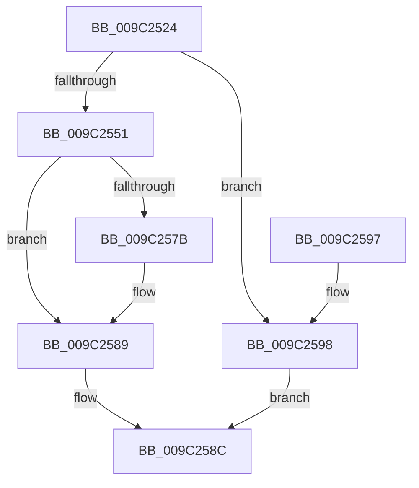

# EtwpAddEventToBuffer

- RVA: `0x009C2524`–`0x009C259C` (길이 `120` bytes)
- VA: `0x00000001409C2524`
- 실행 섹션: `PAGE`
- PDB 이름 있음: `예`; PDB Function 태그: `아니요`
- unwind 정보 RVA: `0x00065BB8`
- 디코드: `36`개 명령, `120/120` bytes 표시
- 미해석 바이트: `0` (있으면 어셈블리에 `.byte`로 보존)

> 이 문서는 커널 이미지의 기계어와 PDB 기호를 분석해 생성했습니다. 4번과 5번은 함수 원형과 자료형을 바이너리 사용 방식에서 추정한 C 해석이며 원본 소스 복구 결과는 아닙니다.

## 1. Dependencies

- 직접 호출 지점: **1**; 고유 호출 대상: **1**
- 직접 호출자로 확인된 함수: **2**
- RIP 상대 이미지 참조: **0**

### Outgoing calls
- `0x009C2584` → [memcpy](../../text/6C/memcpy_function_006C6840.md) (function, `0x006C6840`)

### Direct callers
- [EtwpAddLastDroppedEvent](../../text/3E/EtwpAddLastDroppedEvent_function_003EB8A4.md) at `0x003EB8F3`
- [EtwpAddDebugInfoEvents](EtwpAddDebugInfoEvents_function_009C22D0.md) at `0x009C23AF`
- [EtwpAddDebugInfoEvents](EtwpAddDebugInfoEvents_function_009C22D0.md) at `0x009C2420`

### Static image references
- 디코드된 RIP-relative 메모리 참조가 없습니다.

## 2. Other-region calls and transfers

- 다른 실행 섹션으로 향하는 call: **1**
  - `0x009C2584` → [memcpy](../../text/6C/memcpy_function_006C6840.md) (`PAGE` → `.text`)
- 별도 외부 분기/꼬리 이동을 확인하지 못했습니다.

## 3. Assembly (complete function range)

```asm
009C2524  48 89 5C 24 08                  mov qword ptr [rsp + 8], rbx
009C2529  57                              push rdi
009C252A  48 83 EC 20                     sub rsp, 0x20
009C252E  44 8B 5C 24 50                  mov r11d, dword ptr [rsp + 0x50]
009C2533  48 8B D9                        mov rbx, rcx
009C2536  48 8B 44 24 60                  mov rax, qword ptr [rsp + 0x60]
009C253B  41 8D 7B 10                     lea edi, [r11 + 0x10]
009C253F  44 8D 57 07                     lea r10d, [rdi + 7]
009C2543  41 83 E2 F8                     and r10d, 0xfffffff8
009C2547  44 89 10                        mov dword ptr [rax], r10d
009C254A  44 3B 54 24 58                  cmp r10d, dword ptr [rsp + 0x58]
009C254F  77 47                           ja 0x1409c2598
009C2551  8B 41 30                        mov eax, dword ptr [rcx + 0x30]
009C2554  48 03 C8                        add rcx, rax
009C2557  41 03 C2                        add eax, r10d
009C255A  89 43 30                        mov dword ptr [rbx + 0x30], eax
009C255D  66 89 79 04                     mov word ptr [rcx + 4], di
009C2561  48 8D 59 10                     lea rbx, [rcx + 0x10]
009C2565  C7 01 02 00 11 C0               mov dword ptr [rcx], 0xc0110002
009C256B  66 89 51 06                     mov word ptr [rcx + 6], dx
009C256F  49 8B 00                        mov rax, qword ptr [r8]
009C2572  48 89 41 08                     mov qword ptr [rcx + 8], rax
009C2576  4D 85 C9                        test r9, r9
009C2579  74 0E                           je 0x1409c2589
009C257B  45 8B C3                        mov r8d, r11d
009C257E  49 8B D1                        mov rdx, r9
009C2581  48 8B CB                        mov rcx, rbx
009C2584  E8 B7 42 D0 FF                  call 0x1406c6840
009C2589  48 8B C3                        mov rax, rbx
009C258C  48 8B 5C 24 30                  mov rbx, qword ptr [rsp + 0x30]
009C2591  48 83 C4 20                     add rsp, 0x20
009C2595  5F                              pop rdi
009C2596  C3                              ret
009C2597  CC                              int3
009C2598  33 C0                           xor eax, eax
009C259A  EB F0                           jmp 0x1409c258c
```

## 4. C-style interpretation (structured pseudocode)

```c
__int64 __fastcall EtwpAddEventToBuffer(__int64 a1, unsigned __int16 a2, __int64 a3, __int64 a4, unsigned int a5, unsigned int a6, __int64 a7)
{
    __int64 result;
    __int64 v_r10;
    __int64 v_rsp;
    unsigned __int64 v_stack_p8;

    v_stack_p8 = v_rbx;
    v_rsp = (v_rsp) - (32);
    v_r10 = (unsigned int)(((unsigned int)(a5) + 16 + 7) & (0xFFFFFFF8ULL));
    *(unsigned int *)(a7) = (unsigned int)(v_r10);
    if (((unsigned int)(v_r10)) > a6) goto loc_009C2598;
    a1 = (a1) + ((unsigned int)(*(unsigned int *)(a1 + 48)));
    result = (unsigned int)(((unsigned int)(*(unsigned int *)(a1 + 48))) + ((unsigned int)(v_r10)));
    *(unsigned int *)(a1 + 48) = (unsigned int)(result);
    *(unsigned __int16 *)(a1 + 4) = (unsigned __int16)((unsigned int)(a5) + 16);
    *(unsigned int *)(a1) = 0xC0110002ULL;
    *(unsigned __int16 *)(a1 + 6) = a2;
    *(unsigned __int64 *)(a1 + 8) = *(unsigned __int64 *)(a3);
    result = *(unsigned __int64 *)(a3);
    if (a4 != 0) {
        a3 = (unsigned int)((unsigned int)(a5));
        a2 = a4;
        a1 = a1 + 16;
        result = memcpy(a1, a2, a3, a4);
    }
loc_009C258C:
    v_rsp = (v_rsp) + (32);
    return a1 + 16;
loc_009C2598:
    result = 0;
    goto loc_009C258C;
}
```

## 5. (Beta) C Style

```c
void *EtwpAddEventToBuffer(void *Arg1, uint16_t Arg2, void *Arg3, int64_t Arg4, void *Arg5, uint32_t Arg6, void *Arg7)
{
    uint8_t *arg1 = (uint8_t *)Arg1;
    uint8_t *arg3 = (uint8_t *)Arg3;
    uint8_t *arg5 = (uint8_t *)Arg5;
    uint8_t *arg7 = (uint8_t *)Arg7;

    int64_t result;
    int64_t local_r10;
    int64_t local_rsp;
    uint64_t v_stack_p8;

    v_stack_p8 = local_rbx;
    local_rsp = (local_rsp) - (32);
    local_r10 = (uint32_t)(((uint32_t)(Arg5) + 16 + 7) & (0xFFFFFFF8ULL));
    *(uint32_t *)(arg7) = (uint32_t)(local_r10);
    if (((uint32_t)(local_r10)) > Arg6) goto loc_009C2598;
    Arg1 = (Arg1) + ((uint32_t)(*(uint32_t *)(arg1 + 0x30)));
    result = (uint32_t)(((uint32_t)(*(uint32_t *)(arg1 + 0x30))) + ((uint32_t)(local_r10)));
    *(uint32_t *)(arg1 + 0x30) = (uint32_t)(result);
    *(uint16_t *)(arg1 + 0x4) = (uint16_t)((uint32_t)(Arg5) + 16);
    *(uint32_t *)(arg1) = 0xC0110002ULL;
    *(uint16_t *)(arg1 + 0x6) = Arg2;
    *(uint64_t *)(arg1 + 0x8) = *(uint64_t *)(arg3);
    result = *(uint64_t *)(arg3);
    if (Arg4 != 0) {
        Arg3 = (uint32_t)((uint32_t)(Arg5));
        Arg2 = Arg4;
        Arg1 = Arg1 + 16;
        result = memcpy(Arg1, Arg2, Arg3, Arg4);
    }
loc_009C258C:
    local_rsp = (local_rsp) + (32);
    return Arg1 + 16;
loc_009C2598:
    result = 0;
    goto loc_009C258C;
}
```

### 관측된 메모리 오프셋

구조체 형식이 확인되지 않은 접근은 인자 기준의 오프셋으로만 기록했습니다.

| 기준 인자 | 오프셋 표현 | 폭 (bit) | 접근 |
|---|---:|---:|---|
| `Arg1` | `+ 0x0` | `32` | `W` |
| `Arg1` | `+ 0x4` | `16` | `W` |
| `Arg1` | `+ 0x6` | `16` | `W` |
| `Arg1` | `+ 0x8` | `64` | `W` |
| `Arg1` | `+ 0x10` | `64` | `R` |
| `Arg1` | `+ 0x30` | `32` | `R` |
| `Arg1` | `+ 0x30` | `32` | `W` |
| `Arg3` | `+ 0x0` | `64` | `R` |
| `Arg5` | `+ 0x7` | `32` | `R` |
| `Arg5` | `+ 0x10` | `32` | `R` |
| `Arg7` | `+ 0x0` | `32` | `W` |

## 6. Execution-region graph

[열기: 2D/3D 그래프와 함수 탐색 컨트롤 패널](../../../control-panel.html?section=page&rva=0x009C2524&view=graph)

- 2D 그래프는 위에서 아래로 흐르고, 3D 그래프는 빈 공간을 드래그해 회전합니다. Shift+드래그는 이동, 휠은 확대·축소, 함수 노드 선택은 대상 보고서 이동입니다.

### Static fallback


