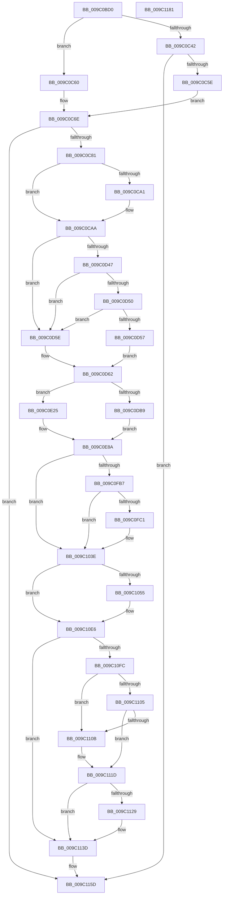

# EtwpAddLogHeader

- RVA: `0x009C0BD0`–`0x009C1182` (길이 `1,458` bytes)
- VA: `0x00000001409C0BD0`
- 실행 섹션: `PAGE`
- PDB 이름 있음: `예`; PDB Function 태그: `아니요`
- unwind 정보 RVA: `0x0009F5C4`
- 디코드: `344`개 명령, `1,458/1,458` bytes 표시
- 미해석 바이트: `0` (있으면 어셈블리에 `.byte`로 보존)

> 이 문서는 커널 이미지의 기계어와 PDB 기호를 분석해 생성했습니다. 4번과 5번은 함수 원형과 자료형을 바이너리 사용 방식에서 추정한 C 해석이며 원본 소스 복구 결과는 아닙니다.

## 1. Dependencies

- 직접 호출 지점: **14**; 고유 호출 대상: **12**
- 직접 호출자로 확인된 함수: **2**
- RIP 상대 이미지 참조: **7**

### Outgoing calls
- `0x009C0C0F` → [EtwpIsWow64Logger](EtwpIsWow64Logger_function_009C22AC.md) (function, `0x009C22AC`)
- `0x009C0C21` → [Feature_1899207995__private_IsEnabledDeviceUsageNoInline](../../text/64/Feature_1899207995__private_IsEnabledDeviceUsageNoInline_function_0064F398.md) (function, `0x0064F398`)
- `0x009C0C98` → [guard_dispatch_icall](../../text/6B/guard_dispatch_icall_function_006BAAD0.md) (function, `0x006BAAD0`)
- `0x009C0D0E` → [memset](../../text/6C/memset_function_006C6C40.md) (function, `0x006C6C40`)
- `0x009C0D2D` → [EtwpQueryUsedProcessorCount](../../text/3E/EtwpQueryUsedProcessorCount_function_003EB940.md) (function, `0x003EB940`)
- `0x009C0D96` → [KeQueryPerformanceCounter](../../text/37/KeQueryPerformanceCounter_function_0037E7E0.md) (function, `0x0037E7E0`)
- `0x009C0DA9` → [EtwpIsWow64Logger](EtwpIsWow64Logger_function_009C22AC.md) (function, `0x009C22AC`)
- `0x009C0E95` → [RtlpQueryTimeZoneInformationWorker](../A6/RtlpQueryTimeZoneInformationWorker_function_00A6BB6C.md) (function, `0x00A6BB6C`)
- `0x009C0F7A` → [memcpy](../../text/6C/memcpy_function_006C6840.md) (function, `0x006C6840`)
- `0x009C0F96` → [memcpy](../../text/6C/memcpy_function_006C6840.md) (function, `0x006C6840`)
- `0x009C1118` → [EtwpAddDebugInfoEvents](EtwpAddDebugInfoEvents_function_009C22D0.md) (function, `0x009C22D0`)
- `0x009C1138` → [EtwpAddBinaryInfoEvents](EtwpAddBinaryInfoEvents_function_009C25A4.md) (function, `0x009C25A4`)
- `0x009C1152` → [EtwpPrepareHeader](../9B/EtwpPrepareHeader_function_009BDD20.md) (function, `0x009BDD20`)
- `0x009C1164` → [_security_check_cookie](../../text/6A/_security_check_cookie_function_006AC640.md) (function, `0x006AC640`)

### Direct callers
- [EtwpPreserveLogger](../7B/EtwpPreserveLogger_function_007BEF4C.md) at `0x007BF068`
- [EtwpUpdateFileHeader](EtwpUpdateFileHeader_function_009C082C.md) at `0x009C08D1`

### Static image references
- `0x009C0BE7` → RVA `0x00E0A740` (`.data`; read)
- `0x009C0C81` → RVA `0x00E00638` (`.data`; read)
- `0x009C0D1E` → RVA `0x00E0A74C` (`.data`; read)
- `0x009C0D84` → RVA `0x00FC6AA0` (`ALMOSTRO`; read)
- `0x009C0D8D` → RVA `0x00EFF288` (`.data`; read)
- `0x009C0DA2` → RVA `0x00EFF258` (`.data`; read/write)
- `0x009C0DDC` → RVA `0x00EFF9E0` (`.data`; read)

## 2. Other-region calls and transfers

- 다른 실행 섹션으로 향하는 call: **8**
  - `0x009C0C21` → [Feature_1899207995__private_IsEnabledDeviceUsageNoInline](../../text/64/Feature_1899207995__private_IsEnabledDeviceUsageNoInline_function_0064F398.md) (`PAGE` → `.text`)
  - `0x009C0C98` → [guard_dispatch_icall](../../text/6B/guard_dispatch_icall_function_006BAAD0.md) (`PAGE` → `.text`)
  - `0x009C0D0E` → [memset](../../text/6C/memset_function_006C6C40.md) (`PAGE` → `.text`)
  - `0x009C0D2D` → [EtwpQueryUsedProcessorCount](../../text/3E/EtwpQueryUsedProcessorCount_function_003EB940.md) (`PAGE` → `.text`)
  - `0x009C0D96` → [KeQueryPerformanceCounter](../../text/37/KeQueryPerformanceCounter_function_0037E7E0.md) (`PAGE` → `.text`)
  - `0x009C0F7A` → [memcpy](../../text/6C/memcpy_function_006C6840.md) (`PAGE` → `.text`)
  - `0x009C0F96` → [memcpy](../../text/6C/memcpy_function_006C6840.md) (`PAGE` → `.text`)
  - `0x009C1164` → [_security_check_cookie](../../text/6A/_security_check_cookie_function_006AC640.md) (`PAGE` → `.text`)
- 별도 외부 분기/꼬리 이동을 확인하지 못했습니다.

## 3. Assembly (complete function range)

```asm
009C0BD0  48 89 5C 24 18                  mov qword ptr [rsp + 0x18], rbx
009C0BD5  55                              push rbp
009C0BD6  56                              push rsi
009C0BD7  57                              push rdi
009C0BD8  41 54                           push r12
009C0BDA  41 55                           push r13
009C0BDC  41 56                           push r14
009C0BDE  41 57                           push r15
009C0BE0  48 8B EC                        mov rbp, rsp
009C0BE3  48 83 EC 70                     sub rsp, 0x70
009C0BE7  48 8B 05 52 9B 44 00            mov rax, qword ptr [rip + 0x449b52]
009C0BEE  48 33 C4                        xor rax, rsp
009C0BF1  48 89 45 F8                     mov qword ptr [rbp - 8], rax
009C0BF5  45 33 E4                        xor r12d, r12d
009C0BF8  48 8B FA                        mov rdi, rdx
009C0BFB  33 C0                           xor eax, eax
009C0BFD  44 89 65 C8                     mov dword ptr [rbp - 0x38], r12d
009C0C01  48 89 45 E8                     mov qword ptr [rbp - 0x18], rax
009C0C05  48 8B F1                        mov rsi, rcx
009C0C08  89 45 F0                        mov dword ptr [rbp - 0x10], eax
009C0C0B  4C 89 65 C0                     mov qword ptr [rbp - 0x40], r12
009C0C0F  E8 98 16 00 00                  call 0x1409c22ac
009C0C14  F6 D8                           neg al
009C0C16  1B DB                           sbb ebx, ebx
009C0C18  83 E3 F8                        and ebx, 0xfffffff8
009C0C1B  81 C3 18 01 00 00               add ebx, 0x118
009C0C21  E8 72 E7 C8 FF                  call 0x14064f398
009C0C26  0F B7 8E 98 00 00 00            movzx ecx, word ptr [rsi + 0x98]
009C0C2D  45 8D 44 24 04                  lea r8d, [r12 + 4]
009C0C32  0F B7 96 88 00 00 00            movzx edx, word ptr [rsi + 0x88]
009C0C39  45 8D 4C 24 20                  lea r9d, [r12 + 0x20]
009C0C3E  85 C0                           test eax, eax
009C0C40  74 1E                           je 0x1409c0c60
009C0C42  44 8D 3C 0B                     lea r15d, [rbx + rcx]
009C0C46  8D 4A 04                        lea ecx, [rdx + 4]
009C0C49  44 03 F9                        add r15d, ecx
009C0C4C  41 8B C7                        mov eax, r15d
009C0C4F  49 03 C1                        add rax, r9
009C0C52  48 3D FF FF 00 00               cmp rax, 0xffff
009C0C58  0F 87 FF 04 00 00               ja 0x1409c115d
009C0C5E  EB 0E                           jmp 0x1409c0c6e
009C0C60  66 03 D9                        add bx, cx
009C0C63  66 03 DA                        add bx, dx
009C0C66  66 41 03 D8                     add bx, r8w
009C0C6A  44 0F B7 FB                     movzx r15d, bx
009C0C6E  8B 46 04                        mov eax, dword ptr [rsi + 4]
009C0C71  49 8D 4F 68                     lea rcx, [r15 + 0x68]
009C0C75  45 8B EF                        mov r13d, r15d
009C0C78  48 3B C1                        cmp rax, rcx
009C0C7B  0F 82 DC 04 00 00               jb 0x1409c115d
009C0C81  48 8B 05 B0 F9 43 00            mov rax, qword ptr [rip + 0x43f9b0]
009C0C88  4C 8D 4D C8                     lea r9, [rbp - 0x38]
009C0C8C  BA 0C 00 00 00                  mov edx, 0xc
009C0C91  4C 8D 45 E8                     lea r8, [rbp - 0x18]
009C0C95  8D 4A 0D                        lea ecx, [rdx + 0xd]
009C0C98  E8 33 9E CF FF                  call 0x1406baad0
009C0C9D  85 C0                           test eax, eax
009C0C9F  79 09                           jns 0x1409c0caa
009C0CA1  33 C0                           xor eax, eax
009C0CA3  48 89 45 E8                     mov qword ptr [rbp - 0x18], rax
009C0CA7  89 45 F0                        mov dword ptr [rbp - 0x10], eax
009C0CAA  65 4C 8B 34 25 88 01 00 00      mov r14, qword ptr gs:[0x188]
009C0CB3  48 8D 5F 68                     lea rbx, [rdi + 0x68]
009C0CB7  66 44 89 67 4E                  mov word ptr [rdi + 0x4e], r12w
009C0CBC  B8 20 00 00 00                  mov eax, 0x20
009C0CC1  41 03 C7                        add eax, r15d
009C0CC4  C7 47 48 02 00 02 C0            mov dword ptr [rdi + 0x48], 0xc0020002
009C0CCB  66 89 47 4C                     mov word ptr [rdi + 0x4c], ax
009C0CCF  4C 8D A6 38 01 00 00            lea r12, [rsi + 0x138]
009C0CD6  41 8B 86 10 05 00 00            mov eax, dword ptr [r14 + 0x510]
009C0CDD  4D 8B C5                        mov r8, r13
009C0CE0  89 47 50                        mov dword ptr [rdi + 0x50], eax
009C0CE3  33 D2                           xor edx, edx
009C0CE5  41 8B 86 08 05 00 00            mov eax, dword ptr [r14 + 0x508]
009C0CEC  48 8B CB                        mov rcx, rbx
009C0CEF  89 47 54                        mov dword ptr [rdi + 0x54], eax
009C0CF2  41 8B 86 8C 02 00 00            mov eax, dword ptr [r14 + 0x28c]
009C0CF9  89 47 60                        mov dword ptr [rdi + 0x60], eax
009C0CFC  41 8B 86 DC 02 00 00            mov eax, dword ptr [r14 + 0x2dc]
009C0D03  89 47 64                        mov dword ptr [rdi + 0x64], eax
009C0D06  49 8B 04 24                     mov rax, qword ptr [r12]
009C0D0A  48 89 47 58                     mov qword ptr [rdi + 0x58], rax
009C0D0E  E8 2D 5F D0 FF                  call 0x1406c6c40
009C0D13  8B 46 04                        mov eax, dword ptr [rsi + 4]
009C0D16  89 03                           mov dword ptr [rbx], eax
009C0D18  66 C7 43 04 0A 00               mov word ptr [rbx + 4], 0xa
009C0D1E  8B 05 28 9A 44 00               mov eax, dword ptr [rip + 0x449a28]
009C0D24  0F B7 C8                        movzx ecx, ax
009C0D27  89 4B 08                        mov dword ptr [rbx + 8], ecx
009C0D2A  48 8B CE                        mov rcx, rsi
009C0D2D  E8 0E AC A2 FF                  call 0x1403eb940
009C0D32  BA 05 00 00 00                  mov edx, 5
009C0D37  89 43 0C                        mov dword ptr [rbx + 0xc], eax
009C0D3A  F7 46 0C 00 00 00 04            test dword ptr [rsi + 0xc], 0x4000000
009C0D41  44 8D 6A FC                     lea r13d, [rdx - 4]
009C0D45  75 17                           jne 0x1409c0d5e
009C0D47  81 7E 04 00 00 10 00            cmp dword ptr [rsi + 4], 0x100000
009C0D4E  77 0E                           ja 0x1409c0d5e
009C0D50  3D 00 01 00 00                  cmp eax, 0x100
009C0D55  77 07                           ja 0x1409c0d5e
009C0D57  8A C2                           mov al, dl
009C0D59  41 8A CD                        mov cl, r13b
009C0D5C  EB 04                           jmp 0x1409c0d62
009C0D5E  32 C0                           xor al, al
009C0D60  B1 02                           mov cl, 2
009C0D62  88 4B 06                        mov byte ptr [rbx + 6], cl
009C0D65  48 8D 4D C0                     lea rcx, [rbp - 0x40]
009C0D69  88 43 07                        mov byte ptr [rbx + 7], al
009C0D6C  44 89 6B 28                     mov dword ptr [rbx + 0x28], r13d
009C0D70  8B 46 0C                        mov eax, dword ptr [rsi + 0xc]
009C0D73  25 FF FE 3F FF                  and eax, 0xff3ffeff
009C0D78  89 43 20                        mov dword ptr [rbx + 0x20], eax
009C0D7B  8B 86 24 01 00 00               mov eax, dword ptr [rsi + 0x124]
009C0D81  89 43 1C                        mov dword ptr [rbx + 0x1c], eax
009C0D84  8B 05 16 5D 60 00               mov eax, dword ptr [rip + 0x605d16]
009C0D8A  89 43 18                        mov dword ptr [rbx + 0x18], eax
009C0D8D  8B 05 F5 E4 53 00               mov eax, dword ptr [rip + 0x53e4f5]
009C0D93  89 43 34                        mov dword ptr [rbx + 0x34], eax
009C0D96  E8 45 DA 9B FF                  call 0x14037e7e0
009C0D9B  48 8B 45 C0                     mov rax, qword ptr [rbp - 0x40]
009C0D9F  48 8B CE                        mov rcx, rsi
009C0DA2  48 87 05 AF E4 53 00            xchg qword ptr [rip + 0x53e4af], rax
009C0DA9  E8 FE 14 00 00                  call 0x1409c22ac
009C0DAE  84 C0                           test al, al
009C0DB0  41 8B CD                        mov ecx, r13d
009C0DB3  48 8B 45 C0                     mov rax, qword ptr [rbp - 0x40]
009C0DB7  74 6C                           je 0x1409c0e25
009C0DB9  C7 47 48 02 00 01 C0            mov dword ptr [rdi + 0x48], 0xc0010002
009C0DC0  48 89 83 F8 00 00 00            mov qword ptr [rbx + 0xf8], rax
009C0DC7  C7 43 2C 04 00 00 00            mov dword ptr [rbx + 0x2c], 4
009C0DCE  48 8B 86 30 01 00 00            mov rax, qword ptr [rsi + 0x130]
009C0DD5  48 89 83 00 01 00 00            mov qword ptr [rbx + 0x100], rax
009C0DDC  48 8B 05 FD EB 53 00            mov rax, qword ptr [rip + 0x53ebfd]
009C0DE3  48 89 83 F0 00 00 00            mov qword ptr [rbx + 0xf0], rax
009C0DEA  8B 86 C8 00 00 00               mov eax, dword ptr [rsi + 0xc8]
009C0DF0  83 F8 04                        cmp eax, 4
009C0DF3  0F 45 C8                        cmovne ecx, eax
009C0DF6  89 8B 08 01 00 00               mov dword ptr [rbx + 0x108], ecx
009C0DFC  8B 45 EC                        mov eax, dword ptr [rbp - 0x14]
009C0DFF  89 43 38                        mov dword ptr [rbx + 0x38], eax
009C0E02  8B 45 F0                        mov eax, dword ptr [rbp - 0x10]
009C0E05  89 43 3C                        mov dword ptr [rbx + 0x3c], eax
009C0E08  48 8D 83 10 01 00 00            lea rax, [rbx + 0x110]
009C0E0F  44 0F B7 AE 88 00 00 00         movzx r13d, word ptr [rsi + 0x88]
009C0E17  48 89 45 D0                     mov qword ptr [rbp - 0x30], rax
009C0E1B  4C 03 E8                        add r13, rax
009C0E1E  B8 40 00 00 00                  mov eax, 0x40
009C0E23  EB 65                           jmp 0x1409c0e8a
009C0E25  48 89 83 00 01 00 00            mov qword ptr [rbx + 0x100], rax
009C0E2C  48 8B 86 30 01 00 00            mov rax, qword ptr [rsi + 0x130]
009C0E33  48 89 83 08 01 00 00            mov qword ptr [rbx + 0x108], rax
009C0E3A  48 8B 05 9F EB 53 00            mov rax, qword ptr [rip + 0x53eb9f]
009C0E41  48 89 83 F8 00 00 00            mov qword ptr [rbx + 0xf8], rax
009C0E48  C7 43 2C 08 00 00 00            mov dword ptr [rbx + 0x2c], 8
009C0E4F  8B 86 C8 00 00 00               mov eax, dword ptr [rsi + 0xc8]
009C0E55  83 F8 04                        cmp eax, 4
009C0E58  0F 45 C8                        cmovne ecx, eax
009C0E5B  89 8B 10 01 00 00               mov dword ptr [rbx + 0x110], ecx
009C0E61  8B 45 EC                        mov eax, dword ptr [rbp - 0x14]
009C0E64  48 89 43 38                     mov qword ptr [rbx + 0x38], rax
009C0E68  8B 45 F0                        mov eax, dword ptr [rbp - 0x10]
009C0E6B  48 89 43 40                     mov qword ptr [rbx + 0x40], rax
009C0E6F  48 8D 83 18 01 00 00            lea rax, [rbx + 0x118]
009C0E76  44 0F B7 AE 88 00 00 00         movzx r13d, word ptr [rsi + 0x88]
009C0E7E  48 89 45 D0                     mov qword ptr [rbp - 0x30], rax
009C0E82  4C 03 E8                        add r13, rax
009C0E85  B8 48 00 00 00                  mov eax, 0x48
009C0E8A  48 03 D8                        add rbx, rax
009C0E8D  BA AC 00 00 00                  mov edx, 0xac
009C0E92  48 8B CB                        mov rcx, rbx
009C0E95  E8 D2 AC 0A 00                  call 0x140a6bb6c
009C0E9A  0F 10 43 44                     movups xmm0, xmmword ptr [rbx + 0x44]
009C0E9E  66 48 0F 7E C2                  movq rdx, xmm0
009C0EA3  66 0F 73 D8 08                  psrldq xmm0, 8
009C0EA8  66 89 53 44                     mov word ptr [rbx + 0x44], dx
009C0EAC  66 48 0F 7E C1                  movq rcx, xmm0
009C0EB1  66 89 4B 4E                     mov word ptr [rbx + 0x4e], cx
009C0EB5  48 8B C2                        mov rax, rdx
009C0EB8  48 C1 E8 10                     shr rax, 0x10
009C0EBC  66 89 43 46                     mov word ptr [rbx + 0x46], ax
009C0EC0  48 8B C2                        mov rax, rdx
009C0EC3  48 C1 E8 20                     shr rax, 0x20
009C0EC7  66 89 43 4A                     mov word ptr [rbx + 0x4a], ax
009C0ECB  48 8B C1                        mov rax, rcx
009C0ECE  48 C1 E8 30                     shr rax, 0x30
009C0ED2  66 89 43 48                     mov word ptr [rbx + 0x48], ax
009C0ED6  48 8B C1                        mov rax, rcx
009C0ED9  48 C1 E8 10                     shr rax, 0x10
009C0EDD  66 89 43 50                     mov word ptr [rbx + 0x50], ax
009C0EE1  48 C1 EA 30                     shr rdx, 0x30
009C0EE5  66 89 53 4C                     mov word ptr [rbx + 0x4c], dx
009C0EE9  48 C1 E9 20                     shr rcx, 0x20
009C0EED  66 89 4B 52                     mov word ptr [rbx + 0x52], cx
009C0EF1  0F 10 83 98 00 00 00            movups xmm0, xmmword ptr [rbx + 0x98]
009C0EF8  66 48 0F 7E C2                  movq rdx, xmm0
009C0EFD  66 0F 73 D8 08                  psrldq xmm0, 8
009C0F02  66 48 0F 7E C1                  movq rcx, xmm0
009C0F07  66 89 93 98 00 00 00            mov word ptr [rbx + 0x98], dx
009C0F0E  66 89 8B A2 00 00 00            mov word ptr [rbx + 0xa2], cx
009C0F15  48 8B C2                        mov rax, rdx
009C0F18  48 C1 E8 10                     shr rax, 0x10
009C0F1C  66 89 83 9A 00 00 00            mov word ptr [rbx + 0x9a], ax
009C0F23  48 8B C2                        mov rax, rdx
009C0F26  48 C1 E8 20                     shr rax, 0x20
009C0F2A  66 89 83 9E 00 00 00            mov word ptr [rbx + 0x9e], ax
009C0F31  48 8B C1                        mov rax, rcx
009C0F34  48 C1 E8 30                     shr rax, 0x30
009C0F38  66 89 83 9C 00 00 00            mov word ptr [rbx + 0x9c], ax
009C0F3F  48 8B C1                        mov rax, rcx
009C0F42  48 C1 EA 30                     shr rdx, 0x30
009C0F46  48 C1 E9 20                     shr rcx, 0x20
009C0F4A  66 89 8B A6 00 00 00            mov word ptr [rbx + 0xa6], cx
009C0F51  48 8B 4D D0                     mov rcx, qword ptr [rbp - 0x30]
009C0F55  66 89 93 A0 00 00 00            mov word ptr [rbx + 0xa0], dx
009C0F5C  48 C1 E8 10                     shr rax, 0x10
009C0F60  66 89 83 A4 00 00 00            mov word ptr [rbx + 0xa4], ax
009C0F67  44 0F B7 86 88 00 00 00         movzx r8d, word ptr [rsi + 0x88]
009C0F6F  48 8B 96 90 00 00 00            mov rdx, qword ptr [rsi + 0x90]
009C0F76  49 83 C0 02                     add r8, 2
009C0F7A  E8 C1 58 D0 FF                  call 0x1406c6840
009C0F7F  44 0F B7 86 98 00 00 00         movzx r8d, word ptr [rsi + 0x98]
009C0F87  49 8D 4D 02                     lea rcx, [r13 + 2]
009C0F8B  48 8B 96 A0 00 00 00            mov rdx, qword ptr [rsi + 0xa0]
009C0F92  49 83 C0 02                     add r8, 2
009C0F96  E8 A5 58 D0 FF                  call 0x1406c6840
009C0F9B  8B 4F 08                        mov ecx, dword ptr [rdi + 8]
009C0F9E  41 8D 47 27                     lea eax, [r15 + 0x27]
009C0FA2  83 E0 F8                        and eax, 0xfffffff8
009C0FA5  03 C8                           add ecx, eax
009C0FA7  89 4F 08                        mov dword ptr [rdi + 8], ecx
009C0FAA  F7 46 0C 00 00 00 02            test dword ptr [rsi + 0xc], 0x2000000
009C0FB1  0F 84 87 00 00 00               je 0x1409c103e
009C0FB7  8B 47 08                        mov eax, dword ptr [rdi + 8]
009C0FBA  83 C0 44                        add eax, 0x44
009C0FBD  3B 07                           cmp eax, dword ptr [rdi]
009C0FBF  77 7D                           ja 0x1409c103e
009C0FC1  8B 57 08                        mov edx, dword ptr [rdi + 8]
009C0FC4  48 03 D7                        add rdx, rdi
009C0FC7  C7 42 04 44 00 05 00            mov dword ptr [rdx + 4], 0x50044
009C0FCE  C7 02 02 00 02 C0               mov dword ptr [rdx], 0xc0020002
009C0FD4  41 8B 86 10 05 00 00            mov eax, dword ptr [r14 + 0x510]
009C0FDB  89 42 08                        mov dword ptr [rdx + 8], eax
009C0FDE  41 8B 86 08 05 00 00            mov eax, dword ptr [r14 + 0x508]
009C0FE5  89 42 0C                        mov dword ptr [rdx + 0xc], eax
009C0FE8  41 8B 86 8C 02 00 00            mov eax, dword ptr [r14 + 0x28c]
009C0FEF  89 42 18                        mov dword ptr [rdx + 0x18], eax
009C0FF2  41 8B 86 DC 02 00 00            mov eax, dword ptr [r14 + 0x2dc]
009C0FF9  89 42 1C                        mov dword ptr [rdx + 0x1c], eax
009C0FFC  49 8B 04 24                     mov rax, qword ptr [r12]
009C1000  48 89 42 10                     mov qword ptr [rdx + 0x10], rax
009C1004  48 8B 86 50 05 00 00            mov rax, qword ptr [rsi + 0x550]
009C100B  0F B6 8E 32 03 00 00            movzx ecx, byte ptr [rsi + 0x332]
009C1012  48 C1 E1 05                     shl rcx, 5
009C1016  0F 10 84 01 CC 11 00 00         movups xmm0, xmmword ptr [rcx + rax + 0x11cc]
009C101E  0F 11 42 20                     movups xmmword ptr [rdx + 0x20], xmm0
009C1022  0F 10 8C 01 DC 11 00 00         movups xmm1, xmmword ptr [rcx + rax + 0x11dc]
009C102A  C7 42 40 55 00 00 00            mov dword ptr [rdx + 0x40], 0x55
009C1031  0F 11 4A 30                     movups xmmword ptr [rdx + 0x30], xmm1
009C1035  8B 47 08                        mov eax, dword ptr [rdi + 8]
009C1038  83 C0 48                        add eax, 0x48
009C103B  89 47 08                        mov dword ptr [rdi + 8], eax
009C103E  8B 47 08                        mov eax, dword ptr [rdi + 8]
009C1041  41 B8 50 00 00 00               mov r8d, 0x50
009C1047  41 03 C0                        add eax, r8d
009C104A  45 33 C9                        xor r9d, r9d
009C104D  3B 07                           cmp eax, dword ptr [rdi]
009C104F  0F 87 91 00 00 00               ja 0x1409c10e6
009C1055  8B 57 08                        mov edx, dword ptr [rdi + 8]
009C1058  48 03 D7                        add rdx, rdi
009C105B  C7 42 04 50 00 50 00            mov dword ptr [rdx + 4], 0x500050
009C1062  C7 02 02 00 02 C0               mov dword ptr [rdx], 0xc0020002
009C1068  41 8B 86 10 05 00 00            mov eax, dword ptr [r14 + 0x510]
009C106F  89 42 08                        mov dword ptr [rdx + 8], eax
009C1072  41 8B 86 08 05 00 00            mov eax, dword ptr [r14 + 0x508]
009C1079  89 42 0C                        mov dword ptr [rdx + 0xc], eax
009C107C  41 8B 86 8C 02 00 00            mov eax, dword ptr [r14 + 0x28c]
009C1083  89 42 18                        mov dword ptr [rdx + 0x18], eax
009C1086  41 8B 86 DC 02 00 00            mov eax, dword ptr [r14 + 0x2dc]
009C108D  89 42 1C                        mov dword ptr [rdx + 0x1c], eax
009C1090  49 8B 04 24                     mov rax, qword ptr [r12]
009C1094  48 89 42 10                     mov qword ptr [rdx + 0x10], rax
009C1098  44 89 4A 20                     mov dword ptr [rdx + 0x20], r9d
009C109C  48 8B 86 50 05 00 00            mov rax, qword ptr [rsi + 0x550]
009C10A3  8B 88 94 11 00 00               mov ecx, dword ptr [rax + 0x1194]
009C10A9  89 4A 24                        mov dword ptr [rdx + 0x24], ecx
009C10AC  48 8B 86 50 05 00 00            mov rax, qword ptr [rsi + 0x550]
009C10B3  0F 10 80 60 11 00 00            movups xmm0, xmmword ptr [rax + 0x1160]
009C10BA  F3 0F 7F 42 30                  movdqu xmmword ptr [rdx + 0x30], xmm0
009C10BF  48 8B 86 18 06 00 00            mov rax, qword ptr [rsi + 0x618]
009C10C6  48 89 42 28                     mov qword ptr [rdx + 0x28], rax
009C10CA  48 8B 86 50 05 00 00            mov rax, qword ptr [rsi + 0x550]
009C10D1  0F 10 80 70 11 00 00            movups xmm0, xmmword ptr [rax + 0x1170]
009C10D8  F3 0F 7F 42 40                  movdqu xmmword ptr [rdx + 0x40], xmm0
009C10DD  8B 47 08                        mov eax, dword ptr [rdi + 8]
009C10E0  41 03 C0                        add eax, r8d
009C10E3  89 47 08                        mov dword ptr [rdi + 8], eax
009C10E6  8B 47 08                        mov eax, dword ptr [rdi + 8]
009C10E9  BB 03 00 00 00                  mov ebx, 3
009C10EE  44 8B 07                        mov r8d, dword ptr [rdi]
009C10F1  89 47 30                        mov dword ptr [rdi + 0x30], eax
009C10F4  8B 47 08                        mov eax, dword ptr [rdi + 8]
009C10F7  41 3B C0                        cmp eax, r8d
009C10FA  73 41                           jae 0x1409c113d
009C10FC  48 8D 46 60                     lea rax, [rsi + 0x60]
009C1100  48 39 00                        cmp qword ptr [rax], rax
009C1103  75 06                           jne 0x1409c110b
009C1105  44 39 4E 78                     cmp dword ptr [rsi + 0x78], r9d
009C1109  74 12                           je 0x1409c111d
009C110B  4D 8B CC                        mov r9, r12
009C110E  89 5C 24 20                     mov dword ptr [rsp + 0x20], ebx
009C1112  48 8B D7                        mov rdx, rdi
009C1115  48 8B CE                        mov rcx, rsi
009C1118  E8 B3 11 00 00                  call 0x1409c22d0
009C111D  48 8D 86 18 05 00 00            lea rax, [rsi + 0x518]
009C1124  48 39 00                        cmp qword ptr [rax], rax
009C1127  74 14                           je 0x1409c113d
009C1129  44 8B 07                        mov r8d, dword ptr [rdi]
009C112C  41 B9 02 00 00 00               mov r9d, 2
009C1132  48 8B D7                        mov rdx, rdi
009C1135  48 8B CE                        mov rcx, rsi
009C1138  E8 67 14 00 00                  call 0x1409c25a4
009C113D  8B 47 30                        mov eax, dword ptr [rdi + 0x30]
009C1140  41 B8 01 00 00 00               mov r8d, 1
009C1146  48 8B D7                        mov rdx, rdi
009C1149  89 47 04                        mov dword ptr [rdi + 4], eax
009C114C  48 8B CE                        mov rcx, rsi
009C114F  89 5F 2C                        mov dword ptr [rdi + 0x2c], ebx
009C1152  E8 C9 CB FF FF                  call 0x1409bdd20
009C1157  8B 47 08                        mov eax, dword ptr [rdi + 8]
009C115A  89 47 04                        mov dword ptr [rdi + 4], eax
009C115D  48 8B 4D F8                     mov rcx, qword ptr [rbp - 8]
009C1161  48 33 CC                        xor rcx, rsp
009C1164  E8 D7 B4 CE FF                  call 0x1406ac640
009C1169  48 8B 9C 24 C0 00 00 00         mov rbx, qword ptr [rsp + 0xc0]
009C1171  48 83 C4 70                     add rsp, 0x70
009C1175  41 5F                           pop r15
009C1177  41 5E                           pop r14
009C1179  41 5D                           pop r13
009C117B  41 5C                           pop r12
009C117D  5F                              pop rdi
009C117E  5E                              pop rsi
009C117F  5D                              pop rbp
009C1180  C3                              ret
009C1181  CC                              int3
```

## 4. C-style interpretation (structured pseudocode)

```c
__int64 __fastcall EtwpAddLogHeader(__int64 a1, __int64 a2)
{
    __int64 result;
    __int64 v_r12;
    __int64 v_r13;
    __int64 v_r15;
    __int64 v_rbx;
    __int64 v_rsp;
    unsigned __int64 v_stack_m40;
    unsigned int v_stack_m48;
    unsigned int v_stack_m4C;
    unsigned __int64 v_stack_m50;
    unsigned __int64 v_stack_m68;
    unsigned int v_stack_m70;
    unsigned __int64 v_stack_m78;
    unsigned int v_stack_m88;
    unsigned __int64 v_stack_p18;

    v_stack_p18 = v_rbx;
    v_rsp = (v_rsp) - (112);
    result = (*(unsigned __int64 *)(v_rip + 4496210)) ^ (v_rsp);
    v_stack_m40 = result;
    v_r12 = 0;
    result = 0;
    v_stack_m70 = 0;
    v_stack_m50 = 0;
    v_stack_m48 = 0;
    v_stack_m78 = 0;
    result = EtwpIsWow64Logger(a1, a2, a3, a4);
    result = (unsigned __int8)(-(result));
    v_rbx = (unsigned int)((v_rbx) & (0xFFFFFFF8ULL));
    v_rbx = (unsigned int)((v_rbx) + (280));
    result = Feature_1899207995__private_IsEnabledDeviceUsageNoInline(a1, a2, a3, a4);
    if ((unsigned int)(result) == 0) goto loc_009C0C60;
    v_r15 = (unsigned int)((v_rbx + *(unsigned __int16 *)(a1 + 152) * 1) + ((unsigned int)(*(unsigned __int16 *)(a1 + 136) + 4)));
    result = ((unsigned int)((unsigned int)(v_r15))) + (v_r12 + 32);
    if (result > 0xFFFFULL) goto loc_009C115D;
    goto loc_009C0C6E;
loc_009C0C60:
    v_rbx = (unsigned __int16)((v_rbx) + ((unsigned __int16)(*(unsigned __int16 *)(a1 + 136) + 4)));
    v_rbx = (unsigned __int16)((v_rbx) + ((unsigned __int16)(*(unsigned __int16 *)(a1 + 136))));
    v_rbx = (unsigned __int16)((v_rbx) + ((unsigned __int16)(v_r12 + 4)));
loc_009C0C6E:
    if (((unsigned int)(*(unsigned int *)(a1 + 4))) < ((unsigned __int16)(v_rbx) + 104)) goto loc_009C115D;
    result = guard_dispatch_icall(12 + 13, 12, v_stack_m50, v_stack_m70);
    if (sign_flag) {
        result = 0;
        v_stack_m50 = 0;
        v_stack_m48 = 0;
    }
    *(unsigned __int16 *)(a2 + 78) = 0;
    result = (unsigned int)((32) + ((unsigned int)((unsigned __int16)(v_rbx))));
    *(unsigned int *)(a2 + 72) = 0xC0020002ULL;
    *(unsigned __int16 *)(a2 + 76) = (unsigned __int16)(result);
    *(unsigned int *)(a2 + 80) = (unsigned int)((unsigned int)(*(unsigned int *)(*(unsigned __int64 *)(gs_base + (0 + 392)) + 1296)));
    a2 = 0;
    *(unsigned int *)(a2 + 84) = (unsigned int)((unsigned int)(*(unsigned int *)(*(unsigned __int64 *)(gs_base + (0 + 392)) + 1288)));
    *(unsigned int *)(a2 + 96) = (unsigned int)((unsigned int)(*(unsigned int *)(*(unsigned __int64 *)(gs_base + (0 + 392)) + 652)));
    *(unsigned int *)(a2 + 100) = (unsigned int)((unsigned int)(*(unsigned int *)(*(unsigned __int64 *)(gs_base + (0 + 392)) + 732)));
    *(unsigned __int64 *)(a2 + 88) = *(unsigned __int64 *)(a1 + 312);
    result = memset(a2 + 104, a2, (unsigned int)((unsigned int)((unsigned __int16)(v_rbx))), v_stack_m70);
    *(unsigned int *)(a2 + 104) = (unsigned int)((unsigned int)(*(unsigned int *)(a1 + 4)));
    *(unsigned __int16 *)(a2 + 104 + 4) = 10;
    *(unsigned int *)(a2 + 104 + 8) = (unsigned int)((unsigned __int16)((unsigned int)(*(unsigned int *)(v_rip + 4495912))));
    result = EtwpQueryUsedProcessorCount(a1, a2, (unsigned int)((unsigned int)((unsigned __int16)(v_rbx))), v_stack_m70);
    *(unsigned int *)(a2 + 104 + 12) = (unsigned int)(result);
    if (((*(unsigned int *)(a1 + 12)) & (0x4000000ULL)) != 0) goto loc_009C0D5E;
    if ((*(unsigned int *)(a1 + 4)) > 0x100000ULL) goto loc_009C0D5E;
    if (((unsigned int)(result)) > 256) goto loc_009C0D5E;
    goto loc_009C0D62;
loc_009C0D5E:
    result = 0;
loc_009C0D62:
    *(unsigned __int8 *)(a2 + 104 + 6) = 2;
    *(unsigned __int8 *)(a2 + 104 + 7) = 0;
    *(unsigned int *)(a2 + 104 + 40) = (unsigned int)(5 - 4);
    result = (unsigned int)(((unsigned int)(*(unsigned int *)(a1 + 12))) & (0xFF3FFEFFULL));
    *(unsigned int *)(a2 + 104 + 32) = (unsigned int)(result);
    *(unsigned int *)(a2 + 104 + 28) = (unsigned int)((unsigned int)(*(unsigned int *)(a1 + 292)));
    *(unsigned int *)(a2 + 104 + 24) = (unsigned int)((unsigned int)(*(unsigned int *)(v_rip + 6315286)));
    *(unsigned int *)(a2 + 104 + 52) = (unsigned int)((unsigned int)(*(unsigned int *)(v_rip + 5498101)));
    result = KeQueryPerformanceCounter(v_stack_m78, 5, (unsigned int)((unsigned int)((unsigned __int16)(v_rbx))), v_stack_m70);
    result = EtwpIsWow64Logger(a1, 5, (unsigned int)((unsigned int)((unsigned __int16)(v_rbx))), v_stack_m70);
    if ((unsigned __int8)(result) == 0) goto loc_009C0E25;
    *(unsigned int *)(a2 + 72) = 0xC0010002ULL;
    *(unsigned __int64 *)(a2 + 104 + 248) = v_stack_m78;
    *(unsigned int *)(a2 + 104 + 44) = 4;
    *(unsigned __int64 *)(a2 + 104 + 256) = *(unsigned __int64 *)(a1 + 304);
    *(unsigned __int64 *)(a2 + 104 + 240) = *(unsigned __int64 *)(v_rip + 5499901);
    a1 = (unsigned int)((unsigned int)(5 - 4));
    if (((unsigned int)((unsigned int)(*(unsigned int *)(a1 + 200)))) != 4) { a1 = (unsigned int)((unsigned int)(*(unsigned int *)(a1 + 200))); }
    *(unsigned int *)(a2 + 104 + 264) = (unsigned int)(a1);
    *(unsigned int *)(a2 + 104 + 56) = (unsigned int)((unsigned int)(v_stack_m4C));
    *(unsigned int *)(a2 + 104 + 60) = (unsigned int)((unsigned int)(v_stack_m48));
    v_stack_m68 = a2 + 104 + 272;
    v_r13 = (*(unsigned __int16 *)(a1 + 136)) + (a2 + 104 + 272);
    goto loc_009C0E8A;
loc_009C0E25:
    *(unsigned __int64 *)(a2 + 104 + 256) = 64;
    *(unsigned __int64 *)(a2 + 104 + 264) = *(unsigned __int64 *)(a1 + 304);
    *(unsigned __int64 *)(a2 + 104 + 248) = *(unsigned __int64 *)(v_rip + 5499807);
    *(unsigned int *)(a2 + 104 + 44) = 8;
    if (((unsigned int)((unsigned int)(*(unsigned int *)(a1 + 200)))) != 4) { a1 = (unsigned int)((unsigned int)(*(unsigned int *)(a1 + 200))); }
    *(unsigned int *)(a2 + 104 + 272) = (unsigned int)(a1);
    *(unsigned __int64 *)(a2 + 104 + 56) = (unsigned int)(v_stack_m4C);
    *(unsigned __int64 *)(a2 + 104 + 64) = (unsigned int)(v_stack_m48);
    v_stack_m68 = a2 + 104 + 280;
    v_r13 = (*(unsigned __int16 *)(a1 + 136)) + (a2 + 104 + 280);
loc_009C0E8A:
    v_rbx = (a2 + 104) + (72);
    result = RtlpQueryTimeZoneInformationWorker(v_rbx, 172, (unsigned int)((unsigned int)((unsigned __int16)(v_rbx))), v_stack_m70);
    *(unsigned __int16 *)(v_rbx + 68) = 172;
    *(unsigned __int16 *)(v_rbx + 78) = (unsigned __int16)(v_rbx);
    result = (172) >> (16);
    *(unsigned __int16 *)(v_rbx + 70) = (unsigned __int16)(result);
    result = (172) >> (32);
    *(unsigned __int16 *)(v_rbx + 74) = (unsigned __int16)(result);
    result = (v_rbx) >> (48);
    *(unsigned __int16 *)(v_rbx + 72) = (unsigned __int16)(result);
    result = (v_rbx) >> (16);
    *(unsigned __int16 *)(v_rbx + 80) = (unsigned __int16)(result);
    a2 = (172) >> (48);
    *(unsigned __int16 *)(v_rbx + 76) = (unsigned __int16)(a2);
    a1 = (v_rbx) >> (32);
    *(unsigned __int16 *)(v_rbx + 82) = (unsigned __int16)(a1);
    *(unsigned __int16 *)(v_rbx + 152) = (unsigned __int16)(a2);
    *(unsigned __int16 *)(v_rbx + 162) = (unsigned __int16)(a1);
    result = (a2) >> (16);
    *(unsigned __int16 *)(v_rbx + 154) = (unsigned __int16)(result);
    result = (a2) >> (32);
    *(unsigned __int16 *)(v_rbx + 158) = (unsigned __int16)(result);
    result = (a1) >> (48);
    *(unsigned __int16 *)(v_rbx + 156) = (unsigned __int16)(result);
    a2 = (a2) >> (48);
    a1 = (a1) >> (32);
    *(unsigned __int16 *)(v_rbx + 166) = (unsigned __int16)(a1);
    *(unsigned __int16 *)(v_rbx + 160) = (unsigned __int16)(a2);
    result = (a1) >> (16);
    *(unsigned __int16 *)(v_rbx + 164) = (unsigned __int16)(result);
    a3 = (*(unsigned __int16 *)(a1 + 136)) + (2);
    result = memcpy(v_stack_m68, *(unsigned __int64 *)(a1 + 144), a3, v_stack_m70);
    a3 = (*(unsigned __int16 *)(a1 + 152)) + (2);
    result = memcpy(v_r13 + 2, *(unsigned __int64 *)(a1 + 160), a3, v_stack_m70);
    result = (unsigned int)(((unsigned __int16)(v_rbx) + 39) & (0xFFFFFFF8ULL));
    a1 = (unsigned int)(((unsigned int)(*(unsigned int *)(a2 + 8))) + ((unsigned int)(result)));
    *(unsigned int *)(a2 + 8) = (unsigned int)(a1);
    if (((*(unsigned int *)(a1 + 12)) & (0x2000000ULL)) == 0) goto loc_009C103E;
    result = (unsigned int)(((unsigned int)(*(unsigned int *)(a2 + 8))) + (68));
    if (((unsigned int)(result)) <= (*(unsigned int *)(a2))) {
        a2 = *(unsigned int *)(a2 + 8);
        a2 = (a2) + (a2);
        *(unsigned int *)(a2 + 4) = 0x50044ULL;
        *(unsigned int *)(a2) = 0xC0020002ULL;
        result = *(unsigned int *)(*(unsigned __int64 *)(gs_base + (0 + 392)) + 1296);
        *(unsigned int *)(a2 + 8) = (unsigned int)(result);
        result = *(unsigned int *)(*(unsigned __int64 *)(gs_base + (0 + 392)) + 1288);
        *(unsigned int *)(a2 + 12) = (unsigned int)(result);
        result = *(unsigned int *)(*(unsigned __int64 *)(gs_base + (0 + 392)) + 652);
        *(unsigned int *)(a2 + 24) = (unsigned int)(result);
        result = *(unsigned int *)(*(unsigned __int64 *)(gs_base + (0 + 392)) + 732);
        *(unsigned int *)(a2 + 28) = (unsigned int)(result);
        result = *(unsigned __int64 *)(a1 + 312);
        *(unsigned __int64 *)(a2 + 16) = result;
        result = *(unsigned __int64 *)(a1 + 1360);
        a1 = *(unsigned __int8 *)(a1 + 818);
        a1 = (a1) << (5);
        *(unsigned __int64 *)(a2 + 32) = v_xmm0;
        *(unsigned int *)(a2 + 64) = 85;
        *(unsigned __int64 *)(a2 + 48) = v_xmm1;
        result = *(unsigned int *)(a2 + 8);
        result = (unsigned int)((result) + (72));
        *(unsigned int *)(a2 + 8) = (unsigned int)(result);
    }
    result = (unsigned int)(((unsigned int)(*(unsigned int *)(a2 + 8))) + (80));
    a4 = 0;
    if (((unsigned int)(result)) <= (*(unsigned int *)(a2))) {
        a2 = *(unsigned int *)(a2 + 8);
        a2 = (a2) + (a2);
        *(unsigned int *)(a2 + 4) = 0x500050ULL;
        *(unsigned int *)(a2) = 0xC0020002ULL;
        result = *(unsigned int *)(*(unsigned __int64 *)(gs_base + (0 + 392)) + 1296);
        *(unsigned int *)(a2 + 8) = (unsigned int)(result);
        result = *(unsigned int *)(*(unsigned __int64 *)(gs_base + (0 + 392)) + 1288);
        *(unsigned int *)(a2 + 12) = (unsigned int)(result);
        result = *(unsigned int *)(*(unsigned __int64 *)(gs_base + (0 + 392)) + 652);
        *(unsigned int *)(a2 + 24) = (unsigned int)(result);
        result = *(unsigned int *)(*(unsigned __int64 *)(gs_base + (0 + 392)) + 732);
        *(unsigned int *)(a2 + 28) = (unsigned int)(result);
        result = *(unsigned __int64 *)(a1 + 312);
        *(unsigned __int64 *)(a2 + 16) = result;
        *(unsigned int *)(a2 + 32) = 0;
        result = *(unsigned __int64 *)(a1 + 1360);
        a1 = *(unsigned int *)(result + 4500);
        *(unsigned int *)(a2 + 36) = (unsigned int)(a1);
        result = *(unsigned __int64 *)(a1 + 1360);
        *(unsigned __int64 *)(a2 + 48) = v_xmm0;
        result = *(unsigned __int64 *)(a1 + 1560);
        *(unsigned __int64 *)(a2 + 40) = result;
        result = *(unsigned __int64 *)(a1 + 1360);
        *(unsigned __int64 *)(a2 + 64) = v_xmm0;
        result = *(unsigned int *)(a2 + 8);
        result = (unsigned int)((result) + (80));
        *(unsigned int *)(a2 + 8) = (unsigned int)(result);
    }
    *(unsigned int *)(a2 + 48) = (unsigned int)((unsigned int)(*(unsigned int *)(a2 + 8)));
    if (((unsigned int)((unsigned int)(*(unsigned int *)(a2 + 8)))) >= ((unsigned int)((unsigned int)(*(unsigned int *)(a2))))) goto loc_009C113D;
    if ((*(unsigned __int64 *)(a1 + 96)) != (a1 + 96)) goto loc_009C110B;
    result = a1 + 96;
    if ((*(unsigned int *)(a1 + 120)) != 0) {
        a4 = a1 + 312;
        v_stack_m88 = 3;
        a2 = a2;
        a1 = a1;
        result = EtwpAddDebugInfoEvents(a1, a2, (unsigned int)(*(unsigned int *)(a2)), a4);
    }
    result = a1 + 1304;
    if ((*(unsigned __int64 *)(a1 + 1304)) != (a1 + 1304)) {
        a3 = *(unsigned int *)(a2);
        a4 = 2;
        a2 = a2;
        a1 = a1;
        result = EtwpAddBinaryInfoEvents(a1, a2, a3, a4);
    }
    *(unsigned int *)(a2 + 4) = (unsigned int)((unsigned int)(*(unsigned int *)(a2 + 48)));
    *(unsigned int *)(a2 + 44) = 3;
    result = EtwpPrepareHeader(a1, a2, 1, a4);
    *(unsigned int *)(a2 + 4) = (unsigned int)((unsigned int)(*(unsigned int *)(a2 + 8)));
loc_009C115D:
    a1 = (v_stack_m40) ^ (v_rsp);
    result = _security_check_cookie(a1, a2, 1, a4);
    v_rsp = (v_rsp) + (112);
    return result;
}
```

## 5. (Beta) C Style

```c
int64_t EtwpAddLogHeader(void *Arg1, void *Arg2)
{
    uint8_t *arg1 = (uint8_t *)Arg1;
    uint8_t *arg2 = (uint8_t *)Arg2;

    int64_t result;
    int64_t local_r12;
    int64_t local_r13;
    int64_t local_r15;
    int64_t local_rbx;
    int64_t local_rsp;
    uint64_t v_stack_m40;
    uint32_t v_stack_m48;
    uint32_t v_stack_m4C;
    uint64_t v_stack_m50;
    uint64_t v_stack_m68;
    uint32_t v_stack_m70;
    uint64_t v_stack_m78;
    uint32_t v_stack_m88;
    uint64_t v_stack_p18;

    v_stack_p18 = local_rbx;
    local_rsp = (local_rsp) - (112);
    result = (*(uint64_t *)(v_rip + 0x449B52)) ^ (local_rsp);
    v_stack_m40 = result;
    local_r12 = 0;
    result = 0;
    v_stack_m70 = 0;
    v_stack_m50 = 0;
    v_stack_m48 = 0;
    v_stack_m78 = 0;
    result = EtwpIsWow64Logger(Arg1, Arg2, a3, a4);
    result = (uint8_t)(-(result));
    local_rbx = (uint32_t)((local_rbx) & (0xFFFFFFF8ULL));
    local_rbx = (uint32_t)((local_rbx) + (280));
    result = Feature_1899207995__private_IsEnabledDeviceUsageNoInline(Arg1, Arg2, a3, a4);
    if ((uint32_t)(result) == 0) goto loc_009C0C60;
    local_r15 = (uint32_t)((local_rbx + *(uint16_t *)(arg1 + 0x98) * 1) + ((uint32_t)(*(uint16_t *)(arg1 + 0x88) + 4)));
    result = ((uint32_t)((uint32_t)(local_r15))) + (local_r12 + 32);
    if (result > 0xFFFFULL) goto loc_009C115D;
    goto loc_009C0C6E;
loc_009C0C60:
    local_rbx = (uint16_t)((local_rbx) + ((uint16_t)(*(uint16_t *)(arg1 + 0x88) + 4)));
    local_rbx = (uint16_t)((local_rbx) + ((uint16_t)(*(uint16_t *)(arg1 + 0x88))));
    local_rbx = (uint16_t)((local_rbx) + ((uint16_t)(local_r12 + 4)));
loc_009C0C6E:
    if (((uint32_t)(*(uint32_t *)(arg1 + 0x4))) < ((uint16_t)(local_rbx) + 104)) goto loc_009C115D;
    result = guard_dispatch_icall(12 + 13, 12, v_stack_m50, v_stack_m70);
    if (sign_flag) {
        result = 0;
        v_stack_m50 = 0;
        v_stack_m48 = 0;
    }
    *(uint16_t *)(arg2 + 0x4E) = 0;
    result = (uint32_t)((32) + ((uint32_t)((uint16_t)(local_rbx))));
    *(uint32_t *)(arg2 + 0x48) = 0xC0020002ULL;
    *(uint16_t *)(arg2 + 0x4C) = (uint16_t)(result);
    *(uint32_t *)(arg2 + 0x50) = (uint32_t)((uint32_t)(*(uint32_t *)(*(uint64_t *)(gs_base + (0 + 0x188)) + 0x510)));
    Arg2 = 0;
    *(uint32_t *)(arg2 + 0x54) = (uint32_t)((uint32_t)(*(uint32_t *)(*(uint64_t *)(gs_base + (0 + 0x188)) + 0x508)));
    *(uint32_t *)(arg2 + 0x60) = (uint32_t)((uint32_t)(*(uint32_t *)(*(uint64_t *)(gs_base + (0 + 0x188)) + 0x28C)));
    *(uint32_t *)(arg2 + 0x64) = (uint32_t)((uint32_t)(*(uint32_t *)(*(uint64_t *)(gs_base + (0 + 0x188)) + 0x2DC)));
    *(uint64_t *)(arg2 + 0x58) = *(uint64_t *)(arg1 + 0x138);
    result = memset(Arg2 + 104, Arg2, (uint32_t)((uint32_t)((uint16_t)(local_rbx))), v_stack_m70);
    *(uint32_t *)(arg2 + 0x68) = (uint32_t)((uint32_t)(*(uint32_t *)(arg1 + 0x4)));
    *(uint16_t *)(arg2 + 0x68 + 0x4) = 10;
    *(uint32_t *)(arg2 + 0x68 + 0x8) = (uint32_t)((uint16_t)((uint32_t)(*(uint32_t *)(v_rip + 0x449A28))));
    result = EtwpQueryUsedProcessorCount(Arg1, Arg2, (uint32_t)((uint32_t)((uint16_t)(local_rbx))), v_stack_m70);
    *(uint32_t *)(arg2 + 0x68 + 0xC) = (uint32_t)(result);
    if (((*(uint32_t *)(arg1 + 0xC)) & (0x4000000ULL)) != 0) goto loc_009C0D5E;
    if ((*(uint32_t *)(arg1 + 0x4)) > 0x100000ULL) goto loc_009C0D5E;
    if (((uint32_t)(result)) > 256) goto loc_009C0D5E;
    goto loc_009C0D62;
loc_009C0D5E:
    result = 0;
loc_009C0D62:
    *(uint8_t *)(arg2 + 0x68 + 0x6) = 2;
    *(uint8_t *)(arg2 + 0x68 + 0x7) = 0;
    *(uint32_t *)(arg2 + 0x68 + 0x28) = (uint32_t)(5 - 4);
    result = (uint32_t)(((uint32_t)(*(uint32_t *)(arg1 + 0xC))) & (0xFF3FFEFFULL));
    *(uint32_t *)(arg2 + 0x68 + 0x20) = (uint32_t)(result);
    *(uint32_t *)(arg2 + 0x68 + 0x1C) = (uint32_t)((uint32_t)(*(uint32_t *)(arg1 + 0x124)));
    *(uint32_t *)(arg2 + 0x68 + 0x18) = (uint32_t)((uint32_t)(*(uint32_t *)(v_rip + 0x605D16)));
    *(uint32_t *)(arg2 + 0x68 + 0x34) = (uint32_t)((uint32_t)(*(uint32_t *)(v_rip + 0x53E4F5)));
    result = KeQueryPerformanceCounter(v_stack_m78, 5, (uint32_t)((uint32_t)((uint16_t)(local_rbx))), v_stack_m70);
    result = EtwpIsWow64Logger(Arg1, 5, (uint32_t)((uint32_t)((uint16_t)(local_rbx))), v_stack_m70);
    if ((uint8_t)(result) == 0) goto loc_009C0E25;
    *(uint32_t *)(arg2 + 0x48) = 0xC0010002ULL;
    *(uint64_t *)(arg2 + 0x68 + 0xF8) = v_stack_m78;
    *(uint32_t *)(arg2 + 0x68 + 0x2C) = 4;
    *(uint64_t *)(arg2 + 0x68 + 0x100) = *(uint64_t *)(arg1 + 0x130);
    *(uint64_t *)(arg2 + 0x68 + 0xF0) = *(uint64_t *)(v_rip + 0x53EBFD);
    Arg1 = (uint32_t)((uint32_t)(5 - 4));
    if (((uint32_t)((uint32_t)(*(uint32_t *)(arg1 + 0xC8)))) != 4) { Arg1 = (uint32_t)((uint32_t)(*(uint32_t *)(arg1 + 0xC8))); }
    *(uint32_t *)(arg2 + 0x68 + 0x108) = (uint32_t)(Arg1);
    *(uint32_t *)(arg2 + 0x68 + 0x38) = (uint32_t)((uint32_t)(v_stack_m4C));
    *(uint32_t *)(arg2 + 0x68 + 0x3C) = (uint32_t)((uint32_t)(v_stack_m48));
    v_stack_m68 = Arg2 + 104 + 272;
    local_r13 = (*(uint16_t *)(arg1 + 0x88)) + (Arg2 + 104 + 272);
    goto loc_009C0E8A;
loc_009C0E25:
    *(uint64_t *)(arg2 + 0x68 + 0x100) = 64;
    *(uint64_t *)(arg2 + 0x68 + 0x108) = *(uint64_t *)(arg1 + 0x130);
    *(uint64_t *)(arg2 + 0x68 + 0xF8) = *(uint64_t *)(v_rip + 0x53EB9F);
    *(uint32_t *)(arg2 + 0x68 + 0x2C) = 8;
    if (((uint32_t)((uint32_t)(*(uint32_t *)(arg1 + 0xC8)))) != 4) { Arg1 = (uint32_t)((uint32_t)(*(uint32_t *)(arg1 + 0xC8))); }
    *(uint32_t *)(arg2 + 0x68 + 0x110) = (uint32_t)(Arg1);
    *(uint64_t *)(arg2 + 0x68 + 0x38) = (uint32_t)(v_stack_m4C);
    *(uint64_t *)(arg2 + 0x68 + 0x40) = (uint32_t)(v_stack_m48);
    v_stack_m68 = Arg2 + 104 + 280;
    local_r13 = (*(uint16_t *)(arg1 + 0x88)) + (Arg2 + 104 + 280);
loc_009C0E8A:
    local_rbx = (Arg2 + 104) + (72);
    result = RtlpQueryTimeZoneInformationWorker(local_rbx, 172, (uint32_t)((uint32_t)((uint16_t)(local_rbx))), v_stack_m70);
    *(uint16_t *)(local_rbx + 0x44) = 172;
    *(uint16_t *)(local_rbx + 0x4E) = (uint16_t)(local_rbx);
    result = (172) >> (16);
    *(uint16_t *)(local_rbx + 0x46) = (uint16_t)(result);
    result = (172) >> (32);
    *(uint16_t *)(local_rbx + 0x4A) = (uint16_t)(result);
    result = (local_rbx) >> (48);
    *(uint16_t *)(local_rbx + 0x48) = (uint16_t)(result);
    result = (local_rbx) >> (16);
    *(uint16_t *)(local_rbx + 0x50) = (uint16_t)(result);
    Arg2 = (172) >> (48);
    *(uint16_t *)(local_rbx + 0x4C) = (uint16_t)(Arg2);
    Arg1 = (local_rbx) >> (32);
    *(uint16_t *)(local_rbx + 0x52) = (uint16_t)(Arg1);
    *(uint16_t *)(local_rbx + 0x98) = (uint16_t)(Arg2);
    *(uint16_t *)(local_rbx + 0xA2) = (uint16_t)(Arg1);
    result = (Arg2) >> (16);
    *(uint16_t *)(local_rbx + 0x9A) = (uint16_t)(result);
    result = (Arg2) >> (32);
    *(uint16_t *)(local_rbx + 0x9E) = (uint16_t)(result);
    result = (Arg1) >> (48);
    *(uint16_t *)(local_rbx + 0x9C) = (uint16_t)(result);
    Arg2 = (Arg2) >> (48);
    Arg1 = (Arg1) >> (32);
    *(uint16_t *)(local_rbx + 0xA6) = (uint16_t)(Arg1);
    *(uint16_t *)(local_rbx + 0xA0) = (uint16_t)(Arg2);
    result = (Arg1) >> (16);
    *(uint16_t *)(local_rbx + 0xA4) = (uint16_t)(result);
    a3 = (*(uint16_t *)(arg1 + 0x88)) + (2);
    result = memcpy(v_stack_m68, *(uint64_t *)(arg1 + 0x90), a3, v_stack_m70);
    a3 = (*(uint16_t *)(arg1 + 0x98)) + (2);
    result = memcpy(local_r13 + 2, *(uint64_t *)(arg1 + 0xA0), a3, v_stack_m70);
    result = (uint32_t)(((uint16_t)(local_rbx) + 39) & (0xFFFFFFF8ULL));
    Arg1 = (uint32_t)(((uint32_t)(*(uint32_t *)(arg2 + 0x8))) + ((uint32_t)(result)));
    *(uint32_t *)(arg2 + 0x8) = (uint32_t)(Arg1);
    if (((*(uint32_t *)(arg1 + 0xC)) & (0x2000000ULL)) == 0) goto loc_009C103E;
    result = (uint32_t)(((uint32_t)(*(uint32_t *)(arg2 + 0x8))) + (68));
    if (((uint32_t)(result)) <= (*(uint32_t *)(arg2))) {
        Arg2 = *(uint32_t *)(arg2 + 0x8);
        Arg2 = (Arg2) + (Arg2);
        *(uint32_t *)(arg2 + 0x4) = 0x50044ULL;
        *(uint32_t *)(arg2) = 0xC0020002ULL;
        result = *(uint32_t *)(*(uint64_t *)(gs_base + (0 + 0x188)) + 0x510);
        *(uint32_t *)(arg2 + 0x8) = (uint32_t)(result);
        result = *(uint32_t *)(*(uint64_t *)(gs_base + (0 + 0x188)) + 0x508);
        *(uint32_t *)(arg2 + 0xC) = (uint32_t)(result);
        result = *(uint32_t *)(*(uint64_t *)(gs_base + (0 + 0x188)) + 0x28C);
        *(uint32_t *)(arg2 + 0x18) = (uint32_t)(result);
        result = *(uint32_t *)(*(uint64_t *)(gs_base + (0 + 0x188)) + 0x2DC);
        *(uint32_t *)(arg2 + 0x1C) = (uint32_t)(result);
        result = *(uint64_t *)(arg1 + 0x138);
        *(uint64_t *)(arg2 + 0x10) = result;
        result = *(uint64_t *)(arg1 + 0x550);
        Arg1 = *(uint8_t *)(arg1 + 0x332);
        Arg1 = (Arg1) << (5);
        *(uint64_t *)(arg2 + 0x20) = v_xmm0;
        *(uint32_t *)(arg2 + 0x40) = 85;
        *(uint64_t *)(arg2 + 0x30) = v_xmm1;
        result = *(uint32_t *)(arg2 + 0x8);
        result = (uint32_t)((result) + (72));
        *(uint32_t *)(arg2 + 0x8) = (uint32_t)(result);
    }
    result = (uint32_t)(((uint32_t)(*(uint32_t *)(arg2 + 0x8))) + (80));
    a4 = 0;
    if (((uint32_t)(result)) <= (*(uint32_t *)(arg2))) {
        Arg2 = *(uint32_t *)(arg2 + 0x8);
        Arg2 = (Arg2) + (Arg2);
        *(uint32_t *)(arg2 + 0x4) = 0x500050ULL;
        *(uint32_t *)(arg2) = 0xC0020002ULL;
        result = *(uint32_t *)(*(uint64_t *)(gs_base + (0 + 0x188)) + 0x510);
        *(uint32_t *)(arg2 + 0x8) = (uint32_t)(result);
        result = *(uint32_t *)(*(uint64_t *)(gs_base + (0 + 0x188)) + 0x508);
        *(uint32_t *)(arg2 + 0xC) = (uint32_t)(result);
        result = *(uint32_t *)(*(uint64_t *)(gs_base + (0 + 0x188)) + 0x28C);
        *(uint32_t *)(arg2 + 0x18) = (uint32_t)(result);
        result = *(uint32_t *)(*(uint64_t *)(gs_base + (0 + 0x188)) + 0x2DC);
        *(uint32_t *)(arg2 + 0x1C) = (uint32_t)(result);
        result = *(uint64_t *)(arg1 + 0x138);
        *(uint64_t *)(arg2 + 0x10) = result;
        *(uint32_t *)(arg2 + 0x20) = 0;
        result = *(uint64_t *)(arg1 + 0x550);
        Arg1 = *(uint32_t *)(result + 0x1194);
        *(uint32_t *)(arg2 + 0x24) = (uint32_t)(Arg1);
        result = *(uint64_t *)(arg1 + 0x550);
        *(uint64_t *)(arg2 + 0x30) = v_xmm0;
        result = *(uint64_t *)(arg1 + 0x618);
        *(uint64_t *)(arg2 + 0x28) = result;
        result = *(uint64_t *)(arg1 + 0x550);
        *(uint64_t *)(arg2 + 0x40) = v_xmm0;
        result = *(uint32_t *)(arg2 + 0x8);
        result = (uint32_t)((result) + (80));
        *(uint32_t *)(arg2 + 0x8) = (uint32_t)(result);
    }
    *(uint32_t *)(arg2 + 0x30) = (uint32_t)((uint32_t)(*(uint32_t *)(arg2 + 0x8)));
    if (((uint32_t)((uint32_t)(*(uint32_t *)(arg2 + 0x8)))) >= ((uint32_t)((uint32_t)(*(uint32_t *)(arg2))))) goto loc_009C113D;
    if ((*(uint64_t *)(arg1 + 0x60)) != (Arg1 + 96)) goto loc_009C110B;
    result = Arg1 + 96;
    if ((*(uint32_t *)(arg1 + 0x78)) != 0) {
        a4 = Arg1 + 312;
        v_stack_m88 = 3;
        Arg2 = Arg2;
        Arg1 = Arg1;
        result = EtwpAddDebugInfoEvents(Arg1, Arg2, (uint32_t)(*(uint32_t *)(arg2)), a4);
    }
    result = Arg1 + 1304;
    if ((*(uint64_t *)(arg1 + 0x518)) != (Arg1 + 1304)) {
        a3 = *(uint32_t *)(arg2);
        a4 = 2;
        Arg2 = Arg2;
        Arg1 = Arg1;
        result = EtwpAddBinaryInfoEvents(Arg1, Arg2, a3, a4);
    }
    *(uint32_t *)(arg2 + 0x4) = (uint32_t)((uint32_t)(*(uint32_t *)(arg2 + 0x30)));
    *(uint32_t *)(arg2 + 0x2C) = 3;
    result = EtwpPrepareHeader(Arg1, Arg2, 1, a4);
    *(uint32_t *)(arg2 + 0x4) = (uint32_t)((uint32_t)(*(uint32_t *)(arg2 + 0x8)));
loc_009C115D:
    Arg1 = (v_stack_m40) ^ (local_rsp);
    result = _security_check_cookie(Arg1, Arg2, 1, a4);
    local_rsp = (local_rsp) + (112);
    return result;
}
```

### 관측된 메모리 오프셋

구조체 형식이 확인되지 않은 접근은 인자 기준의 오프셋으로만 기록했습니다.

| 기준 인자 | 오프셋 표현 | 폭 (bit) | 접근 |
|---|---:|---:|---|
| `Arg1` | `+ 0x0` | `64` | `R` |
| `Arg1` | `+ 0x4` | `32` | `R` |
| `Arg1` | `+ 0xC` | `32` | `R` |
| `Arg1` | `+ 0x60` | `64` | `R` |
| `Arg1` | `+ 0x78` | `32` | `R` |
| `Arg1` | `+ 0x88` | `16` | `R` |
| `Arg1` | `+ 0x90` | `64` | `R` |
| `Arg1` | `+ 0x98` | `16` | `R` |
| `Arg1` | `+ 0xA0` | `64` | `R` |
| `Arg1` | `+ 0xC8` | `32` | `R` |
| `Arg1` | `+ 0x124` | `32` | `R` |
| `Arg1` | `+ 0x130` | `64` | `R` |
| `Arg1` | `+ 0x138` | `64` | `R` |
| `Arg1` | `+ 0x332` | `8` | `R` |
| `Arg1` | `+ 0x518` | `64` | `R` |
| `Arg1` | `+ 0x550` | `64` | `R` |
| `Arg1` | `+ 0x618` | `64` | `R` |
| `Arg2` | `+ 0x0` | `32` | `R` |
| `Arg2` | `+ 0x0` | `32` | `W` |
| `Arg2` | `+ 0x4` | `16` | `W` |
| `Arg2` | `+ 0x4` | `32` | `W` |
| `Arg2` | `+ 0x6` | `8` | `W` |
| `Arg2` | `+ 0x7` | `8` | `W` |
| `Arg2` | `+ 0x8` | `32` | `R` |
| `Arg2` | `+ 0x8` | `32` | `W` |
| `Arg2` | `+ 0xC` | `32` | `W` |
| `Arg2` | `+ 0x18` | `32` | `W` |
| `Arg2` | `+ 0x1C` | `32` | `W` |
| `Arg2` | `+ 0x20` | `32` | `W` |
| `Arg2` | `+ 0x28` | `32` | `W` |
| `Arg2` | `+ 0x2C` | `32` | `W` |
| `Arg2` | `+ 0x30` | `32` | `R` |

추가 오프셋 39개는 표에서 생략했습니다.

## 6. Execution-region graph

[열기: 2D/3D 그래프와 함수 탐색 컨트롤 패널](../../../control-panel.html?section=page&rva=0x009C0BD0&view=graph)

- 2D 그래프는 위에서 아래로 흐르고, 3D 그래프는 빈 공간을 드래그해 회전합니다. Shift+드래그는 이동, 휠은 확대·축소, 함수 노드 선택은 대상 보고서 이동입니다.

### Static fallback


