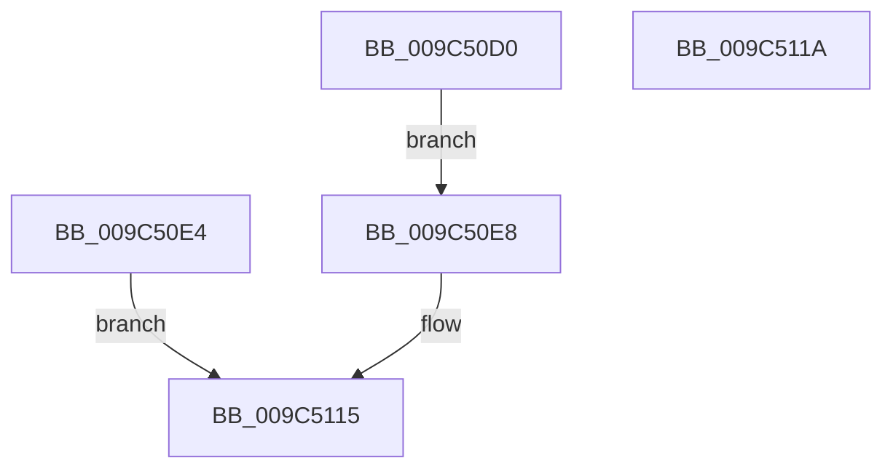

# EtwpApplyEventIdPayloadFilterOnUserEvent

- RVA: `0x009C50D0`–`0x009C511B` (길이 `75` bytes)
- VA: `0x00000001409C50D0`
- 실행 섹션: `PAGE`
- PDB 이름 있음: `예`; PDB Function 태그: `아니요`
- unwind 정보 RVA: `0x0009FE08`
- 디코드: `18`개 명령, `75/75` bytes 표시
- 미해석 바이트: `0` (있으면 어셈블리에 `.byte`로 보존)

> 이 문서는 커널 이미지의 기계어와 PDB 기호를 분석해 생성했습니다. 4번과 5번은 함수 원형과 자료형을 바이너리 사용 방식에서 추정한 C 해석이며 원본 소스 복구 결과는 아닙니다.

## 1. Dependencies

- 직접 호출 지점: **1**; 고유 호출 대상: **1**
- 직접 호출자로 확인된 함수: **1**
- RIP 상대 이미지 참조: **0**

### Outgoing calls
- `0x009C5110` → [EtwpApplyEventIdPayloadFilter](../../text/3F/EtwpApplyEventIdPayloadFilter_function_003F41A0.md) (function, `0x003F41A0`)

### Direct callers
- [EtwpWriteUserEvent](../AF/EtwpWriteUserEvent_function_00AF2FEC.md) at `0x00AF3338`

### Static image references
- 디코드된 RIP-relative 메모리 참조가 없습니다.

## 2. Other-region calls and transfers

- 다른 실행 섹션으로 향하는 call: **1**
  - `0x009C5110` → [EtwpApplyEventIdPayloadFilter](../../text/3F/EtwpApplyEventIdPayloadFilter_function_003F41A0.md) (`PAGE` → `.text`)
- 별도 외부 분기/꼬리 이동을 확인하지 못했습니다.

## 3. Assembly (complete function range)

```asm
009C50D0  48 83 EC 68                     sub rsp, 0x68
009C50D4  49 83 C1 28                     add r9, 0x28
009C50D8  45 0F B7 11                     movzx r10d, word ptr [r9]
009C50DC  66 44 89 54 24 50               mov word ptr [rsp + 0x50], r10w
009C50E2  EB 04                           jmp 0x1409c50e8
009C50E4  B0 01                           mov al, 1
009C50E6  EB 2D                           jmp 0x1409c5115
009C50E8  C6 44 24 40 00                  mov byte ptr [rsp + 0x40], 0
009C50ED  C6 44 24 38 01                  mov byte ptr [rsp + 0x38], 1
009C50F2  48 8B 84 24 98 00 00 00         mov rax, qword ptr [rsp + 0x98]
009C50FA  48 89 44 24 30                  mov qword ptr [rsp + 0x30], rax
009C50FF  8B 84 24 90 00 00 00            mov eax, dword ptr [rsp + 0x90]
009C5106  89 44 24 28                     mov dword ptr [rsp + 0x28], eax
009C510A  66 44 89 54 24 20               mov word ptr [rsp + 0x20], r10w
009C5110  E8 8B F0 A2 FF                  call 0x1403f41a0
009C5115  48 83 C4 68                     add rsp, 0x68
009C5119  C3                              ret
009C511A  CC                              int3
```

## 4. C-style interpretation (structured pseudocode)

```c
__int64 __fastcall EtwpApplyEventIdPayloadFilterOnUserEvent(__int64 a1, __int64 a2, __int64 a3, __int64 a4, unsigned int a5, __int64 a6)
{
    __int64 result;
    __int64 v_rsp;
    unsigned __int16 v_stack_m18;
    unsigned __int8 v_stack_m28;
    unsigned __int8 v_stack_m30;
    unsigned __int64 v_stack_m38;
    unsigned int v_stack_m40;
    unsigned __int16 v_stack_m48;

    v_rsp = (v_rsp) - (104);
    a4 = (a4) + (40);
    v_stack_m18 = (unsigned __int16)(*(unsigned __int16 *)(a4));
    goto loc_009C50E8;
loc_009C50E8:
    v_stack_m28 = 0;
    v_stack_m30 = 1;
    v_stack_m38 = a6;
    v_stack_m40 = (unsigned int)((unsigned int)(a5));
    v_stack_m48 = (unsigned __int16)(*(unsigned __int16 *)(a4));
    result = EtwpApplyEventIdPayloadFilter(a1, a2, a3, a4);
loc_009C5115:
    v_rsp = (v_rsp) + (104);
    return result;
}
```

## 5. (Beta) C Style

```c
int64_t EtwpApplyEventIdPayloadFilterOnUserEvent(int64_t Arg1, int64_t Arg2, int64_t Arg3, void *Arg4, uint32_t Arg5, int64_t Arg6)
{
    uint8_t *arg4 = (uint8_t *)Arg4;

    int64_t result;
    int64_t local_rsp;
    uint16_t v_stack_m18;
    uint8_t v_stack_m28;
    uint8_t v_stack_m30;
    uint64_t v_stack_m38;
    uint32_t v_stack_m40;
    uint16_t v_stack_m48;

    local_rsp = (local_rsp) - (104);
    Arg4 = (Arg4) + (40);
    v_stack_m18 = (uint16_t)(*(uint16_t *)(arg4));
    goto loc_009C50E8;
loc_009C50E8:
    v_stack_m28 = 0;
    v_stack_m30 = 1;
    v_stack_m38 = Arg6;
    v_stack_m40 = (uint32_t)((uint32_t)(Arg5));
    v_stack_m48 = (uint16_t)(*(uint16_t *)(arg4));
    result = EtwpApplyEventIdPayloadFilter(Arg1, Arg2, Arg3, Arg4);
loc_009C5115:
    local_rsp = (local_rsp) + (104);
    return result;
}
```

### 관측된 메모리 오프셋

구조체 형식이 확인되지 않은 접근은 인자 기준의 오프셋으로만 기록했습니다.

| 기준 인자 | 오프셋 표현 | 폭 (bit) | 접근 |
|---|---:|---:|---|
| `Arg4` | `+ 0x0` | `16` | `R` |

## 6. Execution-region graph

[열기: 2D/3D 그래프와 함수 탐색 컨트롤 패널](../../../control-panel.html?section=page&rva=0x009C50D0&view=graph)

- 2D 그래프는 위에서 아래로 흐르고, 3D 그래프는 빈 공간을 드래그해 회전합니다. Shift+드래그는 이동, 휠은 확대·축소, 함수 노드 선택은 대상 보고서 이동입니다.

### Static fallback


