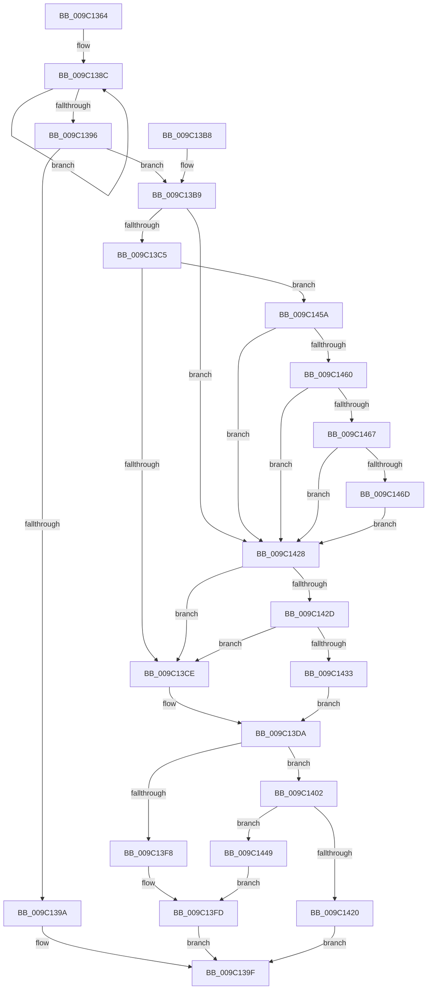

# EtwpCreateNtFileName

- RVA: `0x009C1364`–`0x009C1476` (길이 `274` bytes)
- VA: `0x00000001409C1364`
- 실행 섹션: `PAGE`
- PDB 이름 있음: `예`; PDB Function 태그: `아니요`
- unwind 정보 RVA: `0x0009F618`
- 디코드: `80`개 명령, `274/274` bytes 표시
- 미해석 바이트: `0` (있으면 어셈블리에 `.byte`로 보존)

> 이 문서는 커널 이미지의 기계어와 PDB 기호를 분석해 생성했습니다. 4번과 5번은 함수 원형과 자료형을 바이너리 사용 방식에서 추정한 C 해석이며 원본 소스 복구 결과는 아닙니다.

## 1. Dependencies

- 직접 호출 지점: **3**; 고유 호출 대상: **3**
- 직접 호출자로 확인된 함수: **1**
- RIP 상대 이미지 참조: **3**

### Outgoing calls
- `0x009C13EB` → [ExAllocatePool2](../../poolcode/B8/ExAllocatePool2_function_00B820F0.md) (function, `0x00B820F0`)
- `0x009C1417` → [RtlStringCbPrintfW](../../text/40/RtlStringCbPrintfW_function_0040FB40.md) (function, `0x0040FB40`)
- `0x009C144E` → [ExFreePoolWithTag](../../poolcode/B8/ExFreePoolWithTag_function_00B82870.md) (function, `0x00B82870`)

### Direct callers
- [EtwpDelayCreate](EtwpDelayCreate_function_009C1188.md) at `0x009C11D6`

### Static image references
- `0x009C13CE` → RVA `0x00AFCAF0` (` ?? ::NNGAKEGL::`string'`; read)
- `0x009C140A` → RVA `0x00B072B0` (` ?? ::NNGAKEGL::`string'`; read)
- `0x009C1433` → RVA `0x00B072C0` (` ?? ::NNGAKEGL::`string'`; read)

## 2. Other-region calls and transfers

- 다른 실행 섹션으로 향하는 call: **3**
  - `0x009C13EB` → [ExAllocatePool2](../../poolcode/B8/ExAllocatePool2_function_00B820F0.md) (`PAGE` → `POOLCODE`)
  - `0x009C1417` → [RtlStringCbPrintfW](../../text/40/RtlStringCbPrintfW_function_0040FB40.md) (`PAGE` → `.text`)
  - `0x009C144E` → [ExFreePoolWithTag](../../poolcode/B8/ExFreePoolWithTag_function_00B82870.md) (`PAGE` → `POOLCODE`)
- 별도 외부 분기/꼬리 이동을 확인하지 못했습니다.

## 3. Assembly (complete function range)

```asm
009C1364  48 89 5C 24 08                  mov qword ptr [rsp + 8], rbx
009C1369  48 89 6C 24 10                  mov qword ptr [rsp + 0x10], rbp
009C136E  48 89 74 24 18                  mov qword ptr [rsp + 0x18], rsi
009C1373  57                              push rdi
009C1374  41 56                           push r14
009C1376  41 57                           push r15
009C1378  48 83 EC 30                     sub rsp, 0x30
009C137C  45 33 FF                        xor r15d, r15d
009C137F  4C 8B F2                        mov r14, rdx
009C1382  45 88 38                        mov byte ptr [r8], r15b
009C1385  48 83 C8 FF                     or rax, 0xffffffffffffffff
009C1389  48 8B D9                        mov rbx, rcx
009C138C  48 FF C0                        inc rax
009C138F  66 44 39 3C 41                  cmp word ptr [rcx + rax*2], r15w
009C1394  75 F6                           jne 0x1409c138c
009C1396  03 C0                           add eax, eax
009C1398  75 1F                           jne 0x1409c13b9
009C139A  B8 33 00 00 C0                  mov eax, 0xc0000033
009C139F  48 8B 5C 24 50                  mov rbx, qword ptr [rsp + 0x50]
009C13A4  48 8B 6C 24 58                  mov rbp, qword ptr [rsp + 0x58]
009C13A9  48 8B 74 24 60                  mov rsi, qword ptr [rsp + 0x60]
009C13AE  48 83 C4 30                     add rsp, 0x30
009C13B2  41 5F                           pop r15
009C13B4  41 5E                           pop r14
009C13B6  5F                              pop rdi
009C13B7  C3                              ret
009C13B8  CC                              int3
009C13B9  83 C0 02                        add eax, 2
009C13BC  66 B9 5C 00                     mov cx, 0x5c
009C13C0  83 F8 0A                        cmp eax, 0xa
009C13C3  76 63                           jbe 0x1409c1428
009C13C5  66 39 0B                        cmp word ptr [rbx], cx
009C13C8  0F 84 8C 00 00 00               je 0x1409c145a
009C13CE  48 8D 35 1B B7 13 00            lea rsi, [rip + 0x13b71b]
009C13D5  B9 18 00 00 00                  mov ecx, 0x18
009C13DA  03 C1                           add eax, ecx
009C13DC  41 B8 45 74 77 50               mov r8d, 0x50777445
009C13E2  8B D0                           mov edx, eax
009C13E4  B9 00 01 00 00                  mov ecx, 0x100
009C13E9  8B E8                           mov ebp, eax
009C13EB  E8 00 0D 1C 00                  call 0x140b820f0
009C13F0  48 8B F8                        mov rdi, rax
009C13F3  48 85 C0                        test rax, rax
009C13F6  75 0A                           jne 0x1409c1402
009C13F8  B8 17 00 00 C0                  mov eax, 0xc0000017
009C13FD  4D 89 3E                        mov qword ptr [r14], r15
009C1400  EB 9D                           jmp 0x1409c139f
009C1402  4C 8B CE                        mov r9, rsi
009C1405  48 89 5C 24 20                  mov qword ptr [rsp + 0x20], rbx
009C140A  4C 8D 05 9F 5E 14 00            lea r8, [rip + 0x145e9f]
009C1411  48 8B D5                        mov rdx, rbp
009C1414  48 8B CF                        mov rcx, rdi
009C1417  E8 24 E7 A4 FF                  call 0x14040fb40
009C141C  85 C0                           test eax, eax
009C141E  75 29                           jne 0x1409c1449
009C1420  49 89 3E                        mov qword ptr [r14], rdi
009C1423  E9 77 FF FF FF                  jmp 0x1409c139f
009C1428  66 39 0B                        cmp word ptr [rbx], cx
009C142B  75 A1                           jne 0x1409c13ce
009C142D  66 39 4B 02                     cmp word ptr [rbx + 2], cx
009C1431  75 9B                           jne 0x1409c13ce
009C1433  48 8D 35 86 5E 14 00            lea rsi, [rip + 0x145e86]
009C143A  41 C6 00 01                     mov byte ptr [r8], 1
009C143E  48 83 C3 04                     add rbx, 4
009C1442  B9 0C 00 00 00                  mov ecx, 0xc
009C1447  EB 91                           jmp 0x1409c13da
009C1449  33 D2                           xor edx, edx
009C144B  48 8B CF                        mov rcx, rdi
009C144E  E8 1D 14 1C 00                  call 0x140b82870
009C1453  B8 0D 00 00 C0                  mov eax, 0xc000000d
009C1458  EB A3                           jmp 0x1409c13fd
009C145A  66 39 4B 02                     cmp word ptr [rbx + 2], cx
009C145E  75 C8                           jne 0x1409c1428
009C1460  66 83 7B 04 3F                  cmp word ptr [rbx + 4], 0x3f
009C1465  75 C1                           jne 0x1409c1428
009C1467  66 39 4B 06                     cmp word ptr [rbx + 6], cx
009C146B  75 BB                           jne 0x1409c1428
009C146D  83 C0 F8                        add eax, -8
009C1470  48 83 C3 08                     add rbx, 8
009C1474  EB B2                           jmp 0x1409c1428
```

## 4. C-style interpretation (structured pseudocode)

```c
__int64 __fastcall EtwpCreateNtFileName(__int64 a1, __int64 a2, __int64 a3)
{
    __int64 result;
    __int64 v_r15;
    __int64 v_rbx;
    __int64 v_rsp;
    unsigned __int64 v_stack_p10;
    unsigned __int64 v_stack_p18;
    unsigned __int64 v_stack_p20;
    unsigned __int64 v_stack_p8;

    v_stack_p8 = v_rbx;
    v_stack_p10 = v_rbp;
    v_stack_p18 = v_rsi;
    v_rsp = (v_rsp) - (48);
    v_r15 = 0;
    *(unsigned __int8 *)(a3) = 0;
    result = (result) | (-1);
loc_009C138C:
    result = (result) + 1;
    if ((*(unsigned __int16 *)(a1 + result * 2)) != 0) goto loc_009C138C;
    result = (unsigned int)((result) + ((unsigned int)(result)));
    if (condition_is_not_equal) goto loc_009C13B9;
loc_009C139F:
    v_rsp = (v_rsp) + (48);
    return (unsigned int)(0xC0000033ULL);
loc_009C13B9:
    result = (unsigned int)(((unsigned int)(0xC0000033ULL)) + (2));
    if (((unsigned int)(result)) <= 10) goto loc_009C1428;
    if ((*(unsigned __int16 *)(v_stack_p8)) == 92) goto loc_009C145A;
loc_009C13CE:
loc_009C13DA:
    result = (unsigned int)((result) + (24));
    result = ExAllocatePool2(256, (unsigned int)((unsigned int)(result)), (unsigned int)(0x50777445ULL), a4);
    if (result != 0) goto loc_009C1402;
loc_009C13FD:
    *(unsigned __int64 *)(a2) = 0;
    goto loc_009C139F;
loc_009C1402:
    v_stack_p20 = v_stack_p8;
    result = RtlStringCbPrintfW(result, (unsigned int)((unsigned int)(result)), v_rip + 1334943, v_rip + 1292059);
    if ((unsigned int)(result) != 0) goto loc_009C1449;
    *(unsigned __int64 *)(a2) = result;
    goto loc_009C139F;
loc_009C1428:
    if ((*(unsigned __int16 *)(v_stack_p8)) != ((unsigned __int16)(result))) goto loc_009C13CE;
    if ((*(unsigned __int16 *)(v_stack_p8 + 2)) != ((unsigned __int16)(result))) goto loc_009C13CE;
    *(unsigned __int8 *)(v_rip + 1334943) = 1;
    v_rbx = (v_stack_p8) + (4);
    goto loc_009C13DA;
loc_009C1449:
    a2 = 0;
    result = ExFreePoolWithTag(result, a2, v_rip + 1334943, v_rip + 1292059);
    goto loc_009C13FD;
loc_009C145A:
    if ((*(unsigned __int16 *)(v_rbx + 2)) != ((unsigned __int16)(result))) goto loc_009C1428;
    if ((*(unsigned __int16 *)(v_rbx + 4)) != 63) goto loc_009C1428;
    if ((*(unsigned __int16 *)(v_rbx + 6)) != ((unsigned __int16)(result))) goto loc_009C1428;
    result = (unsigned int)(((unsigned int)(0xC000000DULL)) + (-8));
    v_rbx = (v_rbx) + (8);
    goto loc_009C1428;
}
```

## 5. (Beta) C Style

```c
int64_t EtwpCreateNtFileName(void *Arg1, void *Arg2, void *Arg3)
{
    uint8_t *arg1 = (uint8_t *)Arg1;
    uint8_t *arg2 = (uint8_t *)Arg2;
    uint8_t *arg3 = (uint8_t *)Arg3;

    int64_t result;
    int64_t local_r15;
    int64_t local_rbx;
    int64_t local_rsp;
    uint64_t v_stack_p10;
    uint64_t v_stack_p18;
    uint64_t v_stack_p20;
    uint64_t v_stack_p8;

    v_stack_p8 = local_rbx;
    v_stack_p10 = local_rbp;
    v_stack_p18 = local_rsi;
    local_rsp = (local_rsp) - (48);
    local_r15 = 0;
    *(uint8_t *)(arg3) = 0;
    result = (result) | (-1);
loc_009C138C:
    result = (result) + 1;
    if ((*(uint16_t *)(arg1 + result * 2)) != 0) goto loc_009C138C;
    result = (uint32_t)((result) + ((uint32_t)(result)));
    if (condition_is_not_equal) goto loc_009C13B9;
loc_009C139F:
    local_rsp = (local_rsp) + (48);
    return (uint32_t)(0xC0000033ULL);
loc_009C13B9:
    result = (uint32_t)(((uint32_t)(0xC0000033ULL)) + (2));
    if (((uint32_t)(result)) <= 10) goto loc_009C1428;
    if ((*(uint16_t *)(v_stack_p8)) == 92) goto loc_009C145A;
loc_009C13CE:
loc_009C13DA:
    result = (uint32_t)((result) + (24));
    result = ExAllocatePool2(256, (uint32_t)((uint32_t)(result)), (uint32_t)(0x50777445ULL), a4);
    if (result != 0) goto loc_009C1402;
loc_009C13FD:
    *(uint64_t *)(arg2) = 0;
    goto loc_009C139F;
loc_009C1402:
    v_stack_p20 = v_stack_p8;
    result = RtlStringCbPrintfW(result, (uint32_t)((uint32_t)(result)), v_rip + 1334943, v_rip + 1292059);
    if ((uint32_t)(result) != 0) goto loc_009C1449;
    *(uint64_t *)(arg2) = result;
    goto loc_009C139F;
loc_009C1428:
    if ((*(uint16_t *)(v_stack_p8)) != ((uint16_t)(result))) goto loc_009C13CE;
    if ((*(uint16_t *)(v_stack_p8 + 0x2)) != ((uint16_t)(result))) goto loc_009C13CE;
    *(uint8_t *)(v_rip + 0x145E9F) = 1;
    local_rbx = (v_stack_p8) + (4);
    goto loc_009C13DA;
loc_009C1449:
    Arg2 = 0;
    result = ExFreePoolWithTag(result, Arg2, v_rip + 1334943, v_rip + 1292059);
    goto loc_009C13FD;
loc_009C145A:
    if ((*(uint16_t *)(local_rbx + 0x2)) != ((uint16_t)(result))) goto loc_009C1428;
    if ((*(uint16_t *)(local_rbx + 0x4)) != 63) goto loc_009C1428;
    if ((*(uint16_t *)(local_rbx + 0x6)) != ((uint16_t)(result))) goto loc_009C1428;
    result = (uint32_t)(((uint32_t)(0xC000000DULL)) + (-8));
    local_rbx = (local_rbx) + (8);
    goto loc_009C1428;
}
```

### 관측된 메모리 오프셋

구조체 형식이 확인되지 않은 접근은 인자 기준의 오프셋으로만 기록했습니다.

| 기준 인자 | 오프셋 표현 | 폭 (bit) | 접근 |
|---|---:|---:|---|
| `Arg1` | `+ 0x0` | `16` | `R` |
| `Arg1` | `+ 0x0 + rax*2` | `16` | `R` |
| `Arg1` | `+ 0x2` | `16` | `R` |
| `Arg1` | `+ 0x4` | `16` | `R` |
| `Arg1` | `+ 0x6` | `16` | `R` |
| `Arg2` | `+ 0x0` | `64` | `W` |
| `Arg3` | `+ 0x0` | `8` | `W` |

## 6. Execution-region graph

[열기: 2D/3D 그래프와 함수 탐색 컨트롤 패널](../../../control-panel.html?section=page&rva=0x009C1364&view=graph)

- 2D 그래프는 위에서 아래로 흐르고, 3D 그래프는 빈 공간을 드래그해 회전합니다. Shift+드래그는 이동, 휠은 확대·축소, 함수 노드 선택은 대상 보고서 이동입니다.

### Static fallback


