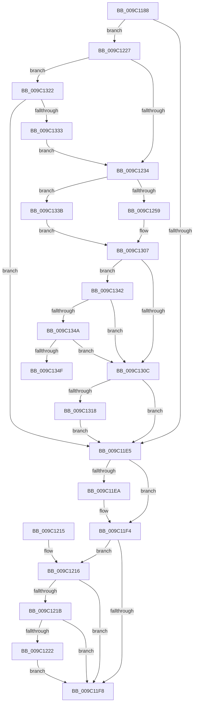

# EtwpDelayCreate

- RVA: `0x009C1188`–`0x009C135D` (길이 `469` bytes)
- VA: `0x00000001409C1188`
- 실행 섹션: `PAGE`
- PDB 이름 있음: `예`; PDB Function 태그: `예`
- unwind 정보 RVA: `0x0009F5E8`
- 디코드: `135`개 명령, `469/469` bytes 표시
- 미해석 바이트: `0` (있으면 어셈블리에 `.byte`로 보존)

> 이 문서는 커널 이미지의 기계어와 PDB 기호를 분석해 생성했습니다. 4번과 5번은 함수 원형과 자료형을 바이너리 사용 방식에서 추정한 C 해석이며 원본 소스 복구 결과는 아닙니다.

## 1. Dependencies

- 직접 호출 지점: **6**; 고유 호출 대상: **6**
- 직접 호출자로 확인된 함수: **3**
- RIP 상대 이미지 참조: **0**

### Outgoing calls
- `0x009C11D6` → [EtwpCreateNtFileName](EtwpCreateNtFileName_function_009C1364.md) (function, `0x009C1364`)
- `0x009C11EF` → [ExFreePoolWithTag](../../poolcode/B8/ExFreePoolWithTag_function_00B82870.md) (function, `0x00B82870`)
- `0x009C1260` → [RtlInitUnicodeString](../../text/42/RtlInitUnicodeString_function_0042A780.md) (function, `0x0042A780`)
- `0x009C12F6` → [ZwCreateFile](../../text/6A/ZwCreateFile_function_006ADB70.md) (function, `0x006ADB70`)
- `0x009C1318` → [PsRevertToSelf](../8C/PsRevertToSelf_function_008CD200.md) (function, `0x008CD200`)
- `0x009C1324` → [SeImpersonateClientEx](../8C/SeImpersonateClientEx_function_008CBDC0.md) (function, `0x008CBDC0`)

### Direct callers
- [EtwpSavePersistedLogger](../7B/EtwpSavePersistedLogger_function_007BF374.md) at `0x007BF55D`
- [EtwpRealtimeCreateLogfile](../9B/EtwpRealtimeCreateLogfile_function_009BE96C.md) at `0x009BEB59`
- [EtwpCreateLogFile](EtwpCreateLogFile_function_009C035C.md) at `0x009C06DD`

### Static image references
- 디코드된 RIP-relative 메모리 참조가 없습니다.

## 2. Other-region calls and transfers

- 다른 실행 섹션으로 향하는 call: **3**
  - `0x009C11EF` → [ExFreePoolWithTag](../../poolcode/B8/ExFreePoolWithTag_function_00B82870.md) (`PAGE` → `POOLCODE`)
  - `0x009C1260` → [RtlInitUnicodeString](../../text/42/RtlInitUnicodeString_function_0042A780.md) (`PAGE` → `.text`)
  - `0x009C12F6` → [ZwCreateFile](../../text/6A/ZwCreateFile_function_006ADB70.md) (`PAGE` → `.text`)
- call이 아닌 외부 분기/꼬리 이동: **1**
  - `0x009C1358` → [sub_00B2EC62 + 0x9](../B2/Unknown_function_00B2EC62.md) (`tail-transfer`)

## 3. Assembly (complete function range)

```asm
009C1188  48 89 5C 24 08                  mov qword ptr [rsp + 8], rbx
009C118D  44 88 4C 24 20                  mov byte ptr [rsp + 0x20], r9b
009C1192  55                              push rbp
009C1193  56                              push rsi
009C1194  57                              push rdi
009C1195  41 54                           push r12
009C1197  41 55                           push r13
009C1199  41 56                           push r14
009C119B  41 57                           push r15
009C119D  48 8D 6C 24 F1                  lea rbp, [rsp - 0xf]
009C11A2  48 81 EC C0 00 00 00            sub rsp, 0xc0
009C11A9  48 8B C2                        mov rax, rdx
009C11AC  45 33 FF                        xor r15d, r15d
009C11AF  4D 8B F0                        mov r14, r8
009C11B2  44 88 7D 57                     mov byte ptr [rbp + 0x57], r15b
009C11B6  4C 8B E9                        mov r13, rcx
009C11B9  4C 89 7D AF                     mov qword ptr [rbp - 0x51], r15
009C11BD  0F 57 C0                        xorps xmm0, xmm0
009C11C0  4C 8D 45 57                     lea r8, [rbp + 0x57]
009C11C4  48 8B 48 08                     mov rcx, qword ptr [rax + 8]
009C11C8  48 8D 55 AF                     lea rdx, [rbp - 0x51]
009C11CC  41 8A F9                        mov dil, r9b
009C11CF  45 8A E7                        mov r12b, r15b
009C11D2  0F 11 45 B7                     movups xmmword ptr [rbp - 0x49], xmm0
009C11D6  E8 89 01 00 00                  call 0x1409c1364
009C11DB  48 8B 75 AF                     mov rsi, qword ptr [rbp - 0x51]
009C11DF  8B D8                           mov ebx, eax
009C11E1  85 C0                           test eax, eax
009C11E3  79 42                           jns 0x1409c1227
009C11E5  48 85 F6                        test rsi, rsi
009C11E8  74 0A                           je 0x1409c11f4
009C11EA  33 D2                           xor edx, edx
009C11EC  48 8B CE                        mov rcx, rsi
009C11EF  E8 7C 16 1C 00                  call 0x140b82870
009C11F4  85 DB                           test ebx, ebx
009C11F6  79 1E                           jns 0x1409c1216
009C11F8  8B C3                           mov eax, ebx
009C11FA  48 8B 9C 24 00 01 00 00         mov rbx, qword ptr [rsp + 0x100]
009C1202  48 81 C4 C0 00 00 00            add rsp, 0xc0
009C1209  41 5F                           pop r15
009C120B  41 5E                           pop r14
009C120D  41 5D                           pop r13
009C120F  41 5C                           pop r12
009C1211  5F                              pop rdi
009C1212  5E                              pop rsi
009C1213  5D                              pop rbp
009C1214  C3                              ret
009C1215  CC                              int3
009C1216  45 38 3E                        cmp byte ptr [r14], r15b
009C1219  74 DD                           je 0x1409c11f8
009C121B  48 83 7D BF 02                  cmp qword ptr [rbp - 0x41], 2
009C1220  75 D6                           jne 0x1409c11f8
009C1222  45 88 3E                        mov byte ptr [r14], r15b
009C1225  EB D1                           jmp 0x1409c11f8
009C1227  48 8B 4D 7F                     mov rcx, qword ptr [rbp + 0x7f]
009C122B  48 85 C9                        test rcx, rcx
009C122E  0F 85 EE 00 00 00               jne 0x1409c1322
009C1234  41 8A 1E                        mov bl, byte ptr [r14]
009C1237  33 C9                           xor ecx, ecx
009C1239  44 89 7D DB                     mov dword ptr [rbp - 0x25], r15d
009C123D  0F 57 C0                        xorps xmm0, xmm0
009C1240  44 89 7D F3                     mov dword ptr [rbp - 0xd], r15d
009C1244  4C 89 7D AF                     mov qword ptr [rbp - 0x51], r15
009C1248  44 8A 7D 6F                     mov r15b, byte ptr [rbp + 0x6f]
009C124C  0F 11 45 C7                     movups xmmword ptr [rbp - 0x39], xmm0
009C1250  4D 85 ED                        test r13, r13
009C1253  0F 84 E2 00 00 00               je 0x1409c133b
009C1259  48 8B D6                        mov rdx, rsi
009C125C  48 8D 4D C7                     lea rcx, [rbp - 0x39]
009C1260  E8 1B 95 A6 FF                  call 0x14042a780
009C1265  45 33 C0                        xor r8d, r8d
009C1268  C7 45 D7 30 00 00 00            mov dword ptr [rbp - 0x29], 0x30
009C126F  44 89 44 24 50                  mov dword ptr [rsp + 0x50], r8d
009C1274  4C 8D 4D B7                     lea r9, [rbp - 0x49]
009C1278  4C 89 44 24 48                  mov qword ptr [rsp + 0x48], r8
009C127D  41 8A C7                        mov al, r15b
009C1280  F6 D8                           neg al
009C1282  4C 89 45 DF                     mov qword ptr [rbp - 0x21], r8
009C1286  48 8D 45 C7                     lea rax, [rbp - 0x39]
009C128A  0F 57 C0                        xorps xmm0, xmm0
009C128D  1B C9                           sbb ecx, ecx
009C128F  48 89 45 E7                     mov qword ptr [rbp - 0x19], rax
009C1293  81 E1 00 FC FF FF               and ecx, 0xfffffc00
009C1299  41 8A C7                        mov al, r15b
009C129C  81 C1 40 06 00 00               add ecx, 0x640
009C12A2  F6 D8                           neg al
009C12A4  89 4D EF                        mov dword ptr [rbp - 0x11], ecx
009C12A7  40 8A C7                        mov al, dil
009C12AA  1B D2                           sbb edx, edx
009C12AC  81 E2 00 00 01 00               and edx, 0x10000
009C12B2  81 C2 8B 00 12 00               add edx, 0x12008b
009C12B8  F6 D8                           neg al
009C12BA  F3 0F 7F 45 F7                  movdqu xmmword ptr [rbp - 9], xmm0
009C12BF  1B C9                           sbb ecx, ecx
009C12C1  83 E1 08                        and ecx, 8
009C12C4  83 C1 20                        add ecx, 0x20
009C12C7  89 4C 24 40                     mov dword ptr [rsp + 0x40], ecx
009C12CB  F6 DB                           neg bl
009C12CD  48 8D 4D AF                     lea rcx, [rbp - 0x51]
009C12D1  1B C0                           sbb eax, eax
009C12D3  83 E0 FE                        and eax, 0xfffffffe
009C12D6  83 C0 05                        add eax, 5
009C12D9  89 44 24 38                     mov dword ptr [rsp + 0x38], eax
009C12DD  C7 44 24 30 05 00 00 00         mov dword ptr [rsp + 0x30], 5
009C12E5  C7 44 24 28 80 00 00 00         mov dword ptr [rsp + 0x28], 0x80
009C12ED  4C 89 44 24 20                  mov qword ptr [rsp + 0x20], r8
009C12F2  4C 8D 45 D7                     lea r8, [rbp - 0x29]
009C12F6  E8 75 C8 CE FF                  call 0x1406adb70
009C12FB  8B D8                           mov ebx, eax
009C12FD  33 C9                           xor ecx, ecx
009C12FF  48 8B 45 AF                     mov rax, qword ptr [rbp - 0x51]
009C1303  49 89 45 00                     mov qword ptr [r13], rax
009C1307  38 4D 77                        cmp byte ptr [rbp + 0x77], cl
009C130A  75 36                           jne 0x1409c1342
009C130C  45 33 FF                        xor r15d, r15d
009C130F  45 84 E4                        test r12b, r12b
009C1312  0F 84 CD FE FF FF               je 0x1409c11e5
009C1318  E8 E3 BE F0 FF                  call 0x1408cd200
009C131D  E9 C3 FE FF FF                  jmp 0x1409c11e5
009C1322  33 D2                           xor edx, edx
009C1324  E8 97 AA F0 FF                  call 0x1408cbdc0
009C1329  8B D8                           mov ebx, eax
009C132B  85 C0                           test eax, eax
009C132D  0F 88 B2 FE FF FF               js 0x1409c11e5
009C1333  41 B4 01                        mov r12b, 1
009C1336  E9 F9 FE FF FF                  jmp 0x1409c1234
009C133B  BB 0D 00 00 C0                  mov ebx, 0xc000000d
009C1340  EB C5                           jmp 0x1409c1307
009C1342  81 FB 3A 00 00 C0               cmp ebx, 0xc000003a
009C1348  75 C2                           jne 0x1409c130c
009C134A  38 4D 57                        cmp byte ptr [rbp + 0x57], cl
009C134D  75 BD                           jne 0x1409c130c
009C134F  48 8D 7E 18                     lea rdi, [rsi + 0x18]
009C1353  BA 5C 00 00 00                  mov edx, 0x5c
009C1358  E9 0E D9 16 00                  jmp 0x140b2ec6b
```

## 4. C-style interpretation (structured pseudocode)

```c
__int64 __fastcall EtwpDelayCreate(__int64 a1, __int64 a2, __int64 a3, unsigned __int8 a4, unsigned __int8 a5, unsigned __int8 a6, __int64 a7)
{
    __int64 result;
    __int64 v_r15;
    __int64 v_rbx;
    __int64 v_rsp;
    unsigned __int64 v_stack_m47;
    unsigned __int64 v_stack_m50;
    unsigned int v_stack_m54;
    unsigned int v_stack_m58;
    unsigned __int64 v_stack_m60;
    unsigned __int64 v_stack_m68;
    unsigned int v_stack_m6C;
    unsigned int v_stack_m70;
    unsigned __int64 v_stack_m80;
    unsigned __int64 v_stack_m88;
    unsigned __int64 v_stack_m90;
    unsigned __int64 v_stack_m98;
    unsigned __int8 v_stack_p10;
    unsigned __int8 v_stack_p20;
    unsigned int v_stack_p28;
    unsigned int v_stack_p30;
    unsigned int v_stack_p38;
    unsigned int v_stack_p40;
    unsigned __int64 v_stack_p48;
    unsigned int v_stack_p50;
    unsigned __int64 v_stack_p8;

    v_stack_p8 = v_rbx;
    v_stack_p20 = a4;
    v_rsp = (v_rsp) - (192);
    v_r15 = 0;
    v_stack_p10 = 0;
    v_stack_m98 = 0;
    v_stack_m90 = v_xmm0;
    result = EtwpCreateNtFileName(*(unsigned __int64 *)(a2 + 8), v_stack_m98, v_stack_p10, a4);
    if (!sign_flag) goto loc_009C1227;
loc_009C11E5:
    if (v_stack_m98 != 0) {
        a2 = 0;
        a1 = v_stack_m98;
        result = ExFreePoolWithTag(a1, a2, v_stack_p10, a4);
    }
    if (!sign_flag) goto loc_009C1216;
loc_009C11F8:
    v_rsp = (v_rsp) + (192);
    return (unsigned int)((unsigned int)((unsigned int)((unsigned int)(result))));
loc_009C1216:
    if ((*(unsigned __int8 *)(a3)) == 0) goto loc_009C11F8;
    if (v_stack_m88 != 2) goto loc_009C11F8;
    *(unsigned __int8 *)(a3) = 0;
    goto loc_009C11F8;
loc_009C1227:
    if (a7 != 0) goto loc_009C1322;
loc_009C1234:
    a1 = 0;
    v_stack_m6C = 0;
    v_stack_m54 = 0;
    v_stack_m98 = 0;
    v_stack_m80 = v_xmm0;
    if (0 == 0) goto loc_009C133B;
    result = RtlInitUnicodeString(v_stack_m80, v_stack_m98, v_stack_p10, a4);
    a3 = 0;
    v_stack_m70 = 48;
    v_stack_p50 = 0;
    v_stack_p48 = 0;
    result = (unsigned __int8)(-(a5));
    v_stack_m68 = 0;
    v_stack_m60 = v_stack_m80;
    a1 = (unsigned int)((v_stack_m80) & (0xFFFFFC00ULL));
    a1 = (unsigned int)((a1) + (0x640ULL));
    result = (unsigned __int8)(-(a5));
    v_stack_m58 = (unsigned int)(a1);
    a2 = (unsigned int)((v_stack_m98) & (0x10000ULL));
    a2 = (unsigned int)((a2) + (0x12008BULL));
    result = (unsigned __int8)(-(a4));
    v_stack_m50 = v_xmm0;
    a1 = (unsigned int)((a1) & (8));
    a1 = (unsigned int)((a1) + (32));
    v_stack_p40 = (unsigned int)(a1);
    v_rbx = (unsigned __int8)(-(*(unsigned __int8 *)(a3)));
    result = (unsigned int)((result) & (0xFFFFFFFEULL));
    result = (unsigned int)((result) + (5));
    v_stack_p38 = (unsigned int)(result);
    v_stack_p30 = 5;
    v_stack_p28 = 128;
    v_stack_p20 = 0;
    result = ZwCreateFile(v_stack_m98, a2, v_stack_m70, v_stack_m90);
    a1 = 0;
    *(unsigned __int64 *)(a1) = v_stack_m98;
loc_009C1307:
    if (a6 != 0) goto loc_009C1342;
loc_009C130C:
    v_r15 = 0;
    if (0 == 0) goto loc_009C11E5;
    result = PsRevertToSelf(a1, a2, v_stack_m70, v_stack_m90);
    goto loc_009C11E5;
loc_009C1322:
    a2 = 0;
    result = SeImpersonateClientEx(a1, a2, v_stack_m70, v_stack_m90);
    if (sign_flag) goto loc_009C11E5;
    goto loc_009C1234;
loc_009C133B:
    goto loc_009C1307;
loc_009C1342:
    if (((unsigned int)((unsigned int)(0xC000000DULL))) != 0xC000003AULL) goto loc_009C130C;
    if (v_stack_p10 != 0) goto loc_009C130C;
}
```

## 5. (Beta) C Style

```c
int64_t EtwpDelayCreate(int64_t Arg1, void *Arg2, void *Arg3, uint8_t Arg4, uint8_t Arg5, uint8_t Arg6, int64_t Arg7)
{
    uint8_t *arg2 = (uint8_t *)Arg2;
    uint8_t *arg3 = (uint8_t *)Arg3;

    int64_t result;
    int64_t local_r15;
    int64_t local_rbx;
    int64_t local_rsp;
    uint64_t v_stack_m47;
    uint64_t v_stack_m50;
    uint32_t v_stack_m54;
    uint32_t v_stack_m58;
    uint64_t v_stack_m60;
    uint64_t v_stack_m68;
    uint32_t v_stack_m6C;
    uint32_t v_stack_m70;
    uint64_t v_stack_m80;
    uint64_t v_stack_m88;
    uint64_t v_stack_m90;
    uint64_t v_stack_m98;
    uint8_t v_stack_p10;
    uint8_t v_stack_p20;
    uint32_t v_stack_p28;
    uint32_t v_stack_p30;
    uint32_t v_stack_p38;
    uint32_t v_stack_p40;
    uint64_t v_stack_p48;
    uint32_t v_stack_p50;
    uint64_t v_stack_p8;

    v_stack_p8 = local_rbx;
    v_stack_p20 = Arg4;
    local_rsp = (local_rsp) - (192);
    local_r15 = 0;
    v_stack_p10 = 0;
    v_stack_m98 = 0;
    v_stack_m90 = v_xmm0;
    result = EtwpCreateNtFileName(*(uint64_t *)(arg2 + 0x8), v_stack_m98, v_stack_p10, Arg4);
    if (!sign_flag) goto loc_009C1227;
loc_009C11E5:
    if (v_stack_m98 != 0) {
        Arg2 = 0;
        Arg1 = v_stack_m98;
        result = ExFreePoolWithTag(Arg1, Arg2, v_stack_p10, Arg4);
    }
    if (!sign_flag) goto loc_009C1216;
loc_009C11F8:
    local_rsp = (local_rsp) + (192);
    return (uint32_t)((uint32_t)((uint32_t)((uint32_t)(result))));
loc_009C1216:
    if ((*(uint8_t *)(arg3)) == 0) goto loc_009C11F8;
    if (v_stack_m88 != 2) goto loc_009C11F8;
    *(uint8_t *)(arg3) = 0;
    goto loc_009C11F8;
loc_009C1227:
    if (Arg7 != 0) goto loc_009C1322;
loc_009C1234:
    Arg1 = 0;
    v_stack_m6C = 0;
    v_stack_m54 = 0;
    v_stack_m98 = 0;
    v_stack_m80 = v_xmm0;
    if (0 == 0) goto loc_009C133B;
    result = RtlInitUnicodeString(v_stack_m80, v_stack_m98, v_stack_p10, Arg4);
    Arg3 = 0;
    v_stack_m70 = 48;
    v_stack_p50 = 0;
    v_stack_p48 = 0;
    result = (uint8_t)(-(Arg5));
    v_stack_m68 = 0;
    v_stack_m60 = v_stack_m80;
    Arg1 = (uint32_t)((v_stack_m80) & (0xFFFFFC00ULL));
    Arg1 = (uint32_t)((Arg1) + (0x640ULL));
    result = (uint8_t)(-(Arg5));
    v_stack_m58 = (uint32_t)(Arg1);
    Arg2 = (uint32_t)((v_stack_m98) & (0x10000ULL));
    Arg2 = (uint32_t)((Arg2) + (0x12008BULL));
    result = (uint8_t)(-(Arg4));
    v_stack_m50 = v_xmm0;
    Arg1 = (uint32_t)((Arg1) & (8));
    Arg1 = (uint32_t)((Arg1) + (32));
    v_stack_p40 = (uint32_t)(Arg1);
    local_rbx = (uint8_t)(-(*(uint8_t *)(arg3)));
    result = (uint32_t)((result) & (0xFFFFFFFEULL));
    result = (uint32_t)((result) + (5));
    v_stack_p38 = (uint32_t)(result);
    v_stack_p30 = 5;
    v_stack_p28 = 128;
    v_stack_p20 = 0;
    result = ZwCreateFile(v_stack_m98, Arg2, v_stack_m70, v_stack_m90);
    Arg1 = 0;
    *(uint64_t *)(Arg1) = v_stack_m98;
loc_009C1307:
    if (Arg6 != 0) goto loc_009C1342;
loc_009C130C:
    local_r15 = 0;
    if (0 == 0) goto loc_009C11E5;
    result = PsRevertToSelf(Arg1, Arg2, v_stack_m70, v_stack_m90);
    goto loc_009C11E5;
loc_009C1322:
    Arg2 = 0;
    result = SeImpersonateClientEx(Arg1, Arg2, v_stack_m70, v_stack_m90);
    if (sign_flag) goto loc_009C11E5;
    goto loc_009C1234;
loc_009C133B:
    goto loc_009C1307;
loc_009C1342:
    if (((uint32_t)((uint32_t)(0xC000000DULL))) != 0xC000003AULL) goto loc_009C130C;
    if (v_stack_p10 != 0) goto loc_009C130C;
}
```

### 관측된 메모리 오프셋

구조체 형식이 확인되지 않은 접근은 인자 기준의 오프셋으로만 기록했습니다.

| 기준 인자 | 오프셋 표현 | 폭 (bit) | 접근 |
|---|---:|---:|---|
| `Arg2` | `+ 0x8` | `64` | `R` |
| `Arg3` | `+ 0x0` | `8` | `R` |
| `Arg3` | `+ 0x0` | `8` | `W` |

## 6. Execution-region graph

[열기: 2D/3D 그래프와 함수 탐색 컨트롤 패널](../../../control-panel.html?section=page&rva=0x009C1188&view=graph)

- 2D 그래프는 위에서 아래로 흐르고, 3D 그래프는 빈 공간을 드래그해 회전합니다. Shift+드래그는 이동, 휠은 확대·축소, 함수 노드 선택은 대상 보고서 이동입니다.

### Static fallback


