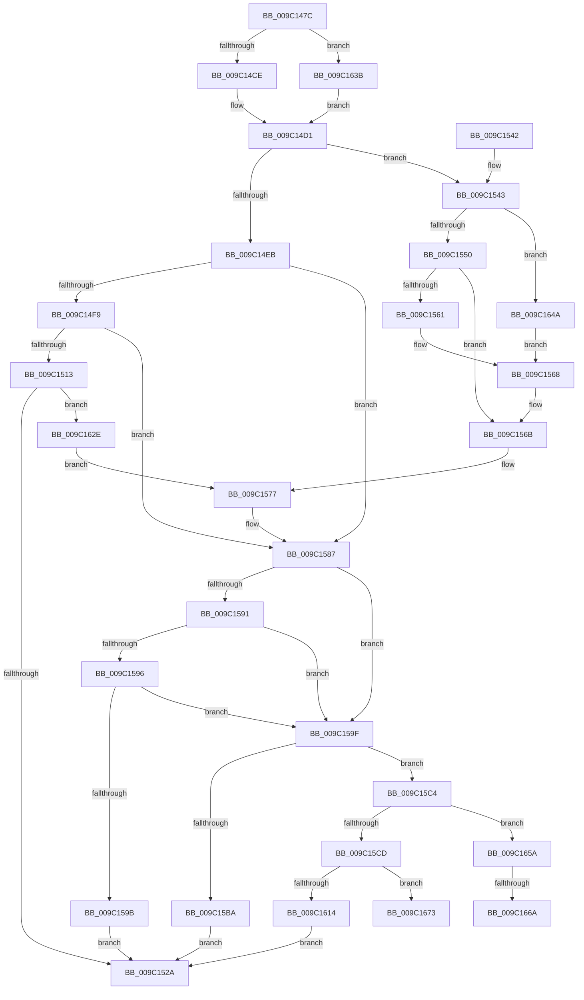

# EtwpExpandFileName

- RVA: `0x009C147C`–`0x009C167F` (길이 `515` bytes)
- VA: `0x00000001409C147C`
- 실행 섹션: `PAGE`
- PDB 이름 있음: `예`; PDB Function 태그: `예`
- unwind 정보 RVA: `0x0009F634`
- 디코드: `136`개 명령, `515/515` bytes 표시
- 미해석 바이트: `0` (있으면 어셈블리에 `.byte`로 보존)

> 이 문서는 커널 이미지의 기계어와 PDB 기호를 분석해 생성했습니다. 4번과 5번은 함수 원형과 자료형을 바이너리 사용 방식에서 추정한 C 해석이며 원본 소스 복구 결과는 아닙니다.

## 1. Dependencies

- 직접 호출 지점: **8**; 고유 호출 대상: **7**
- 직접 호출자로 확인된 함수: **3**
- RIP 상대 이미지 참조: **6**

### Outgoing calls
- `0x009C14E2` → [wcsnicmp](../../text/50/wcsnicmp_function_005001C0.md) (function, `0x005001C0`)
- `0x009C150A` → [wcsnicmp](../../text/50/wcsnicmp_function_005001C0.md) (function, `0x005001C0`)
- `0x009C151B` → [EtwpGetDriverDataDosPath](../../text/4D/EtwpGetDriverDataDosPath_function_004DDF10.md) (function, `0x004DDF10`)
- `0x009C156B` → [PsGetCurrentServerSiloGlobals](../../text/2F/PsGetCurrentServerSiloGlobals_function_002FE1F0.md) (function, `0x002FE1F0`)
- `0x009C15AD` → [ExAllocatePool2](../../poolcode/B8/ExAllocatePool2_function_00B820F0.md) (function, `0x00B820F0`)
- `0x009C15FF` → [RtlStringCbPrintfW](../../text/40/RtlStringCbPrintfW_function_0040FB40.md) (function, `0x0040FB40`)
- `0x009C1617` → [RtlFreeAnsiString](RtlFreeAnsiString_function_009C0800.md) (function, `0x009C0800`)
- `0x009C1622` → [RtlInitUnicodeString](../../text/42/RtlInitUnicodeString_function_0042A780.md) (function, `0x0042A780`)

### Direct callers
- [EtwpSavePersistedLogger](../7B/EtwpSavePersistedLogger_function_007BF374.md) at `0x007BF529`
- [EtwpRealtimeCreateLogfile](../9B/EtwpRealtimeCreateLogfile_function_009BE96C.md) at `0x009BEB18`
- [EtwpCreateLogFile](EtwpCreateLogFile_function_009C035C.md) at `0x009C047D`

### Static image references
- `0x009C14D5` → RVA `0x00B07260` (` ?? ::NNGAKEGL::`string'`; read)
- `0x009C14FD` → RVA `0x00B07290` (` ?? ::NNGAKEGL::`string'`; read)
- `0x009C15D1` → RVA `0x00B07280` (` ?? ::NNGAKEGL::`string'`; read)
- `0x009C15DD` → RVA `0x00B071E0` (` ?? ::NNGAKEGL::`string'`; read)
- `0x009C15F3` → RVA `0x00B07200` (` ?? ::NNGAKEGL::`string'`; read)
- `0x009C165A` → RVA `0x00AFCAD0` (` ?? ::NNGAKEGL::`string'`; read)

## 2. Other-region calls and transfers

- 다른 실행 섹션으로 향하는 call: **7**
  - `0x009C14E2` → [wcsnicmp](../../text/50/wcsnicmp_function_005001C0.md) (`PAGE` → `.text`)
  - `0x009C150A` → [wcsnicmp](../../text/50/wcsnicmp_function_005001C0.md) (`PAGE` → `.text`)
  - `0x009C151B` → [EtwpGetDriverDataDosPath](../../text/4D/EtwpGetDriverDataDosPath_function_004DDF10.md) (`PAGE` → `.text`)
  - `0x009C156B` → [PsGetCurrentServerSiloGlobals](../../text/2F/PsGetCurrentServerSiloGlobals_function_002FE1F0.md) (`PAGE` → `.text`)
  - `0x009C15AD` → [ExAllocatePool2](../../poolcode/B8/ExAllocatePool2_function_00B820F0.md) (`PAGE` → `POOLCODE`)
  - `0x009C15FF` → [RtlStringCbPrintfW](../../text/40/RtlStringCbPrintfW_function_0040FB40.md) (`PAGE` → `.text`)
  - `0x009C1622` → [RtlInitUnicodeString](../../text/42/RtlInitUnicodeString_function_0042A780.md) (`PAGE` → `.text`)
- call이 아닌 외부 분기/꼬리 이동: **3**
  - `0x009C1664` → [sub_00B2ECF6](../B2/Unknown_function_00B2ECF6.md) (`tail-transfer`)
  - `0x009C166E` → [sub_00B2ECF6 + 0x3](../B2/Unknown_function_00B2ECF6.md) (`tail-transfer`)
  - `0x009C167A` → [sub_00B2ECF6 + 0x36](../B2/Unknown_function_00B2ECF6.md) (`tail-transfer`)

## 3. Assembly (complete function range)

```asm
009C147C  4C 8B DC                        mov r11, rsp
009C147F  49 89 5B 08                     mov qword ptr [r11 + 8], rbx
009C1483  45 89 43 18                     mov dword ptr [r11 + 0x18], r8d
009C1487  55                              push rbp
009C1488  56                              push rsi
009C1489  57                              push rdi
009C148A  41 54                           push r12
009C148C  41 55                           push r13
009C148E  41 56                           push r14
009C1490  41 57                           push r15
009C1492  48 83 EC 40                     sub rsp, 0x40
009C1496  45 33 E4                        xor r12d, r12d
009C1499  4C 8B F2                        mov r14, rdx
009C149C  41 8B C0                        mov eax, r8d
009C149F  4D 89 63 10                     mov qword ptr [r11 + 0x10], r12
009C14A3  F7 D8                           neg eax
009C14A5  49 8B E9                        mov rbp, r9
009C14A8  45 8A FC                        mov r15b, r12b
009C14AB  45 8A EC                        mov r13b, r12b
009C14AE  41 0F B7 06                     movzx eax, word ptr [r14]
009C14B2  4D 1B D2                        sbb r10, r10
009C14B5  41 83 E2 08                     and r10d, 8
009C14B9  41 8B FC                        mov edi, r12d
009C14BC  41 8B F4                        mov esi, r12d
009C14BF  49 8D 52 02                     lea rdx, [r10 + 2]
009C14C3  48 03 D0                        add rdx, rax
009C14C6  84 C9                           test cl, cl
009C14C8  0F 85 6D 01 00 00               jne 0x1409c163b
009C14CE  48 8B DA                        mov rbx, rdx
009C14D1  49 8B 4E 08                     mov rcx, qword ptr [r14 + 8]
009C14D5  48 8D 15 84 5D 14 00            lea rdx, [rip + 0x145d84]
009C14DC  41 B8 0C 00 00 00               mov r8d, 0xc
009C14E2  E8 D9 EC B3 FF                  call 0x1405001c0
009C14E7  85 C0                           test eax, eax
009C14E9  74 58                           je 0x1409c1543
009C14EB  40 38 B4 24 A0 00 00 00         cmp byte ptr [rsp + 0xa0], sil
009C14F3  0F 84 8E 00 00 00               je 0x1409c1587
009C14F9  49 8B 4E 08                     mov rcx, qword ptr [r14 + 8]
009C14FD  48 8D 15 8C 5D 14 00            lea rdx, [rip + 0x145d8c]
009C1504  41 B8 0C 00 00 00               mov r8d, 0xc
009C150A  E8 B1 EC B3 FF                  call 0x1405001c0
009C150F  85 C0                           test eax, eax
009C1511  75 74                           jne 0x1409c1587
009C1513  48 8D 8C 24 88 00 00 00         lea rcx, [rsp + 0x88]
009C151B  E8 F0 C9 B1 FF                  call 0x1404ddf10
009C1520  8B F0                           mov esi, eax
009C1522  85 C0                           test eax, eax
009C1524  0F 89 04 01 00 00               jns 0x1409c162e
009C152A  48 8B 9C 24 80 00 00 00         mov rbx, qword ptr [rsp + 0x80]
009C1532  48 83 C4 40                     add rsp, 0x40
009C1536  41 5F                           pop r15
009C1538  41 5E                           pop r14
009C153A  41 5D                           pop r13
009C153C  41 5C                           pop r12
009C153E  5F                              pop rdi
009C153F  5E                              pop rsi
009C1540  5D                              pop rbp
009C1541  C3                              ret
009C1542  CC                              int3
009C1543  41 0F B7 06                     movzx eax, word ptr [r14]
009C1547  83 F8 18                        cmp eax, 0x18
009C154A  0F 84 FA 00 00 00               je 0x1409c164a
009C1550  8B C8                           mov ecx, eax
009C1552  49 8B 46 08                     mov rax, qword ptr [r14 + 8]
009C1556  48 D1 E9                        shr rcx, 1
009C1559  66 83 7C 48 FE 5C               cmp word ptr [rax + rcx*2 - 2], 0x5c
009C155F  75 0A                           jne 0x1409c156b
009C1561  0F B7 45 00                     movzx eax, word ptr [rbp]
009C1565  41 B7 01                        mov r15b, 1
009C1568  48 03 D8                        add rbx, rax
009C156B  E8 80 CC 93 FF                  call 0x1402fe1f0
009C1570  48 8D B8 D0 04 00 00            lea rdi, [rax + 0x4d0]
009C1577  0F B7 07                        movzx eax, word ptr [rdi]
009C157A  41 BC 0C 00 00 00               mov r12d, 0xc
009C1580  48 83 C0 E8                     add rax, -0x18
009C1584  48 03 D8                        add rbx, rax
009C1587  83 BC 24 90 00 00 00 00         cmp dword ptr [rsp + 0x90], 0
009C158F  75 0E                           jne 0x1409c159f
009C1591  45 84 FF                        test r15b, r15b
009C1594  75 09                           jne 0x1409c159f
009C1596  48 85 FF                        test rdi, rdi
009C1599  75 04                           jne 0x1409c159f
009C159B  8B C6                           mov eax, esi
009C159D  EB 8B                           jmp 0x1409c152a
009C159F  41 B8 45 74 77 50               mov r8d, 0x50777445
009C15A5  48 8B D3                        mov rdx, rbx
009C15A8  B9 00 01 00 00                  mov ecx, 0x100
009C15AD  E8 3E 0B 1C 00                  call 0x140b820f0
009C15B2  48 8B F0                        mov rsi, rax
009C15B5  48 85 C0                        test rax, rax
009C15B8  75 0A                           jne 0x1409c15c4
009C15BA  B8 17 00 00 C0                  mov eax, 0xc0000017
009C15BF  E9 66 FF FF FF                  jmp 0x1409c152a
009C15C4  45 84 ED                        test r13b, r13b
009C15C7  0F 84 8D 00 00 00               je 0x1409c165a
009C15CD  4C 8B 4F 08                     mov r9, qword ptr [rdi + 8]
009C15D1  48 8D 05 A8 5C 14 00            lea rax, [rip + 0x145ca8]
009C15D8  48 89 44 24 30                  mov qword ptr [rsp + 0x30], rax
009C15DD  4C 8D 05 FC 5B 14 00            lea r8, [rip + 0x145bfc]
009C15E4  48 8B 45 08                     mov rax, qword ptr [rbp + 8]
009C15E8  48 8B D3                        mov rdx, rbx
009C15EB  48 89 44 24 28                  mov qword ptr [rsp + 0x28], rax
009C15F0  48 8B CE                        mov rcx, rsi
009C15F3  48 8D 05 06 5C 14 00            lea rax, [rip + 0x145c06]
009C15FA  48 89 44 24 20                  mov qword ptr [rsp + 0x20], rax
009C15FF  E8 3C E5 A4 FF                  call 0x14040fb40
009C1604  8B 94 24 90 00 00 00            mov edx, dword ptr [rsp + 0x90]
009C160B  45 33 C0                        xor r8d, r8d
009C160E  8B F8                           mov edi, eax
009C1610  85 D2                           test edx, edx
009C1612  75 5F                           jne 0x1409c1673
009C1614  49 8B CE                        mov rcx, r14
009C1617  E8 E4 F1 FF FF                  call 0x1409c0800
009C161C  48 8B D6                        mov rdx, rsi
009C161F  49 8B CE                        mov rcx, r14
009C1622  E8 59 91 A6 FF                  call 0x14042a780
009C1627  8B C7                           mov eax, edi
009C1629  E9 FC FE FF FF                  jmp 0x1409c152a
009C162E  48 8B BC 24 88 00 00 00         mov rdi, qword ptr [rsp + 0x88]
009C1636  E9 3C FF FF FF                  jmp 0x1409c1577
009C163B  41 0F B7 19                     movzx ebx, word ptr [r9]
009C163F  41 B7 01                        mov r15b, 1
009C1642  48 03 DA                        add rbx, rdx
009C1645  E9 87 FE FF FF                  jmp 0x1409c14d1
009C164A  0F B7 45 00                     movzx eax, word ptr [rbp]
009C164E  41 B5 01                        mov r13b, 1
009C1651  48 83 C0 36                     add rax, 0x36
009C1655  E9 0E FF FF FF                  jmp 0x1409c1568
009C165A  4C 8D 0D 6F B4 13 00            lea r9, [rip + 0x13b46f]
009C1661  45 84 FF                        test r15b, r15b
009C1664  0F 84 8C D6 16 00               je 0x140b2ecf6
009C166A  48 8B 55 08                     mov rdx, qword ptr [rbp + 8]
009C166E  E9 86 D6 16 00                  jmp 0x140b2ecf9
009C1673  48 83 C9 FF                     or rcx, 0xffffffffffffffff
009C1677  48 8B C1                        mov rax, rcx
009C167A  E9 AD D6 16 00                  jmp 0x140b2ed2c
```

## 4. C-style interpretation (structured pseudocode)

```c
__int64 __fastcall EtwpExpandFileName(unsigned __int8 a1, __int64 a2, int a3, __int64 a4, unsigned __int8 a5)
{
    __int64 result;
    __int64 v_r10;
    __int64 v_r12;
    __int64 v_rbx;
    __int64 v_rsp;
    unsigned __int64 v_stack_p10;
    unsigned __int64 v_stack_p20;
    unsigned __int64 v_stack_p28;
    unsigned __int64 v_stack_p30;
    unsigned __int64 v_stack_p8;
    unsigned __int64 v_stack_p88;
    unsigned int v_stack_p90;

    *(unsigned __int64 *)(v_rsp + 8) = v_rbx;
    *(unsigned int *)(v_rsp + 24) = a3;
    v_rsp = (v_rsp) - (64);
    v_r12 = 0;
    *(unsigned __int64 *)(v_rsp + 16) = 0;
    result = (unsigned int)(-((unsigned int)(a3)));
    v_r10 = (unsigned int)((v_r10) & (8));
    a2 = (v_r10 + 2) + (*(unsigned __int16 *)(a2));
    if (a1 != 0) goto loc_009C163B;
loc_009C14D1:
    result = wcsnicmp(*(unsigned __int64 *)(a2 + 8), v_rip + 1334660, 12, a4);
    if ((unsigned int)(result) == 0) goto loc_009C1543;
    if (a5 == 0) goto loc_009C1587;
    result = wcsnicmp(*(unsigned __int64 *)(a2 + 8), v_rip + 1334668, 12, a4);
    if ((unsigned int)(result) != 0) goto loc_009C1587;
    result = EtwpGetDriverDataDosPath(v_stack_p10, v_rip + 1334668, 12, a4);
    if (!sign_flag) goto loc_009C162E;
loc_009C152A:
    v_rsp = (v_rsp) + (64);
    return result;
loc_009C1543:
    if (((unsigned int)(*(unsigned __int16 *)(a2))) == 24) goto loc_009C164A;
    a1 = ((unsigned int)((unsigned int)(*(unsigned __int16 *)(a2)))) >> (1);
    if ((*(unsigned __int16 *)(*(unsigned __int64 *)(a2 + 8) + a1 * 2 - 2)) != 92) goto loc_009C156B;
loc_009C1568:
    v_rbx = (v_stack_p8) + (*(unsigned __int16 *)(a4));
loc_009C156B:
    result = PsGetCurrentServerSiloGlobals(a1, v_rip + 1334668, 12, a4);
loc_009C1577:
    result = (*(unsigned __int16 *)(result + 1232)) + (-24);
    v_rbx = (v_rbx) + (result);
loc_009C1587:
    if (v_stack_p90 != 0) goto loc_009C159F;
    if (1 != 0) goto loc_009C159F;
    if (result + 1232 != 0) goto loc_009C159F;
    goto loc_009C152A;
loc_009C159F:
    result = ExAllocatePool2(256, v_rbx, (unsigned int)(0x50777445ULL), a4);
    if (result != 0) goto loc_009C15C4;
    goto loc_009C152A;
loc_009C15C4:
    if (0 == 0) goto loc_009C165A;
    v_stack_p30 = v_rip + 1334440;
    v_stack_p28 = *(unsigned __int64 *)(a4 + 8);
    v_stack_p20 = v_rip + 1334278;
    result = RtlStringCbPrintfW(result, v_rbx, v_rip + 1334268, *(unsigned __int64 *)(result + 1232 + 8));
    a3 = 0;
    if ((unsigned int)((unsigned int)(v_stack_p90)) != 0) goto loc_009C1673;
    result = RtlFreeAnsiString(a2, (unsigned int)(v_stack_p90), a3, *(unsigned __int64 *)(result + 1232 + 8));
    result = RtlInitUnicodeString(a2, result, a3, *(unsigned __int64 *)(result + 1232 + 8));
    goto loc_009C152A;
loc_009C162E:
    goto loc_009C1577;
loc_009C163B:
    v_rbx = (*(unsigned __int16 *)(*(unsigned __int64 *)(result + 1232 + 8))) + (result);
    goto loc_009C14D1;
loc_009C164A:
    result = (*(unsigned __int16 *)(a4)) + (54);
    goto loc_009C1568;
loc_009C165A:
loc_009C1673:
    a1 = (a2) | (-1);
}
```

## 5. (Beta) C Style

```c
int64_t EtwpExpandFileName(uint8_t Arg1, void *Arg2, int32_t Arg3, void *Arg4, uint8_t Arg5)
{
    uint8_t *arg2 = (uint8_t *)Arg2;
    uint8_t *arg4 = (uint8_t *)Arg4;

    int64_t result;
    int64_t local_r10;
    int64_t local_r12;
    int64_t local_rbx;
    int64_t local_rsp;
    uint64_t v_stack_p10;
    uint64_t v_stack_p20;
    uint64_t v_stack_p28;
    uint64_t v_stack_p30;
    uint64_t v_stack_p8;
    uint64_t v_stack_p88;
    uint32_t v_stack_p90;

    *(uint64_t *)(local_rsp + 0x8) = local_rbx;
    *(uint32_t *)(local_rsp + 0x18) = Arg3;
    local_rsp = (local_rsp) - (64);
    local_r12 = 0;
    *(uint64_t *)(local_rsp + 0x10) = 0;
    result = (uint32_t)(-((uint32_t)(Arg3)));
    local_r10 = (uint32_t)((local_r10) & (8));
    Arg2 = (local_r10 + 2) + (*(uint16_t *)(arg2));
    if (Arg1 != 0) goto loc_009C163B;
loc_009C14D1:
    result = wcsnicmp(*(uint64_t *)(arg2 + 0x8), v_rip + 1334660, 12, Arg4);
    if ((uint32_t)(result) == 0) goto loc_009C1543;
    if (Arg5 == 0) goto loc_009C1587;
    result = wcsnicmp(*(uint64_t *)(arg2 + 0x8), v_rip + 1334668, 12, Arg4);
    if ((uint32_t)(result) != 0) goto loc_009C1587;
    result = EtwpGetDriverDataDosPath(v_stack_p10, v_rip + 1334668, 12, Arg4);
    if (!sign_flag) goto loc_009C162E;
loc_009C152A:
    local_rsp = (local_rsp) + (64);
    return result;
loc_009C1543:
    if (((uint32_t)(*(uint16_t *)(arg2))) == 24) goto loc_009C164A;
    Arg1 = ((uint32_t)((uint32_t)(*(uint16_t *)(arg2)))) >> (1);
    if ((*(uint16_t *)(*(uint64_t *)(arg2 + 0x8) + Arg1 * 2 - 0x2)) != 92) goto loc_009C156B;
loc_009C1568:
    local_rbx = (v_stack_p8) + (*(uint16_t *)(arg4));
loc_009C156B:
    result = PsGetCurrentServerSiloGlobals(Arg1, v_rip + 1334668, 12, Arg4);
loc_009C1577:
    result = (*(uint16_t *)(result + 0x4D0)) + (-24);
    local_rbx = (local_rbx) + (result);
loc_009C1587:
    if (v_stack_p90 != 0) goto loc_009C159F;
    if (1 != 0) goto loc_009C159F;
    if (result + 1232 != 0) goto loc_009C159F;
    goto loc_009C152A;
loc_009C159F:
    result = ExAllocatePool2(256, local_rbx, (uint32_t)(0x50777445ULL), Arg4);
    if (result != 0) goto loc_009C15C4;
    goto loc_009C152A;
loc_009C15C4:
    if (0 == 0) goto loc_009C165A;
    v_stack_p30 = v_rip + 1334440;
    v_stack_p28 = *(uint64_t *)(arg4 + 0x8);
    v_stack_p20 = v_rip + 1334278;
    result = RtlStringCbPrintfW(result, local_rbx, v_rip + 1334268, *(uint64_t *)(result + 0x4D0 + 0x8));
    Arg3 = 0;
    if ((uint32_t)((uint32_t)(v_stack_p90)) != 0) goto loc_009C1673;
    result = RtlFreeAnsiString(Arg2, (uint32_t)(v_stack_p90), Arg3, *(uint64_t *)(result + 0x4D0 + 0x8));
    result = RtlInitUnicodeString(Arg2, result, Arg3, *(uint64_t *)(result + 0x4D0 + 0x8));
    goto loc_009C152A;
loc_009C162E:
    goto loc_009C1577;
loc_009C163B:
    local_rbx = (*(uint16_t *)(*(uint64_t *)(result + 0x4D0 + 0x8))) + (result);
    goto loc_009C14D1;
loc_009C164A:
    result = (*(uint16_t *)(arg4)) + (54);
    goto loc_009C1568;
loc_009C165A:
loc_009C1673:
    Arg1 = (Arg2) | (-1);
}
```

### 관측된 메모리 오프셋

구조체 형식이 확인되지 않은 접근은 인자 기준의 오프셋으로만 기록했습니다.

| 기준 인자 | 오프셋 표현 | 폭 (bit) | 접근 |
|---|---:|---:|---|
| `Arg2` | `+ 0x0` | `16` | `R` |
| `Arg2` | `+ 0x8` | `64` | `R` |
| `Arg4` | `+ 0x0` | `16` | `R` |
| `Arg4` | `+ 0x8` | `64` | `R` |

## 6. Execution-region graph

[열기: 2D/3D 그래프와 함수 탐색 컨트롤 패널](../../../control-panel.html?section=page&rva=0x009C147C&view=graph)

- 2D 그래프는 위에서 아래로 흐르고, 3D 그래프는 빈 공간을 드래그해 회전합니다. Shift+드래그는 이동, 휠은 확대·축소, 함수 노드 선택은 대상 보고서 이동입니다.

### Static fallback


