# EtwpFinalizeHeader

- RVA: `0x009C1EF0`–`0x009C22A5` (길이 `949` bytes)
- VA: `0x00000001409C1EF0`
- 실행 섹션: `PAGE`
- PDB 이름 있음: `예`; PDB Function 태그: `예`
- unwind 정보 RVA: `0x0009F690`
- 디코드: `234`개 명령, `949/949` bytes 표시
- 미해석 바이트: `0` (있으면 어셈블리에 `.byte`로 보존)

> 이 문서는 커널 이미지의 기계어와 PDB 기호를 분석해 생성했습니다. 4번과 5번은 함수 원형과 자료형을 바이너리 사용 방식에서 추정한 C 해석이며 원본 소스 복구 결과는 아닙니다.

## 1. Dependencies

- 직접 호출 지점: **13**; 고유 호출 대상: **12**
- 직접 호출자로 확인된 함수: **4**
- RIP 상대 이미지 참조: **2**

### Outgoing calls
- `0x009C1F69` → [ZwQueryVolumeInformationFile](../../text/6A/ZwQueryVolumeInformationFile_function_006AD9F0.md) (function, `0x006AD9F0`)
- `0x009C1FB4` → [ExAllocatePool2](../../poolcode/B8/ExAllocatePool2_function_00B820F0.md) (function, `0x00B820F0`)
- `0x009C1FF9` → [ZwReadFile](../../text/6A/ZwReadFile_function_006AD190.md) (function, `0x006AD190`)
- `0x009C2028` → [EtwpQueryUsedProcessorCount](../../text/3E/EtwpQueryUsedProcessorCount_function_003EB940.md) (function, `0x003EB940`)
- `0x009C2040` → [KeQuerySystemTimePrecise](../../text/37/KeQuerySystemTimePrecise_function_0037DA40.md) (function, `0x0037DA40`)
- `0x009C204E` → [EtwpIsWow64Logger](EtwpIsWow64Logger_function_009C22AC.md) (function, `0x009C22AC`)
- `0x009C20A7` → [EtwpAddLastDroppedEvent](../../text/3E/EtwpAddLastDroppedEvent_function_003EB8A4.md) (function, `0x003EB8A4`)
- `0x009C2115` → [ZwWriteFile](../../text/6A/ZwWriteFile_function_006AD1D0.md) (function, `0x006AD1D0`)
- `0x009C212C` → [ExFreePoolWithTag](../../poolcode/B8/ExFreePoolWithTag_function_00B82870.md) (function, `0x00B82870`)
- `0x009C213B` → [_security_check_cookie](../../text/6A/_security_check_cookie_function_006AC640.md) (function, `0x006AC640`)
- `0x009C21A6` → [EtwpAddDebugInfoEvents](EtwpAddDebugInfoEvents_function_009C22D0.md) (function, `0x009C22D0`)
- `0x009C21BF` → [EtwpAddBinaryInfoEvents](EtwpAddBinaryInfoEvents_function_009C25A4.md) (function, `0x009C25A4`)
- `0x009C2278` → [ZwReadFile](../../text/6A/ZwReadFile_function_006AD190.md) (function, `0x006AD190`)

### Direct callers
- [EtwpBufferingModeFlush](../9B/EtwpBufferingModeFlush_function_009BD8F4.md) at `0x009BDB95`
- [EtwpLogger](../9B/EtwpLogger_function_009BE310.md) at `0x009BE706`
- [EtwpLogger](../9B/EtwpLogger_function_009BE310.md) at `0x009BE7D6`
- [EtwpLogger](../9B/EtwpLogger_function_009BE310.md) at `0x009BE8A3`
- [EtwpCreateLogFile](EtwpCreateLogFile_function_009C035C.md) at `0x009C07C0`
- [sub_00B2E69A](../B2/Unknown_function_00B2E69A.md) at `0x00B2E7F5`

### Static image references
- `0x009C1F13` → RVA `0x00E0A740` (`.data`; read)
- `0x009C2061` → RVA `0x00E0A74C` (`.data`; read)

## 2. Other-region calls and transfers

- 다른 실행 섹션으로 향하는 call: **10**
  - `0x009C1F69` → [ZwQueryVolumeInformationFile](../../text/6A/ZwQueryVolumeInformationFile_function_006AD9F0.md) (`PAGE` → `.text`)
  - `0x009C1FB4` → [ExAllocatePool2](../../poolcode/B8/ExAllocatePool2_function_00B820F0.md) (`PAGE` → `POOLCODE`)
  - `0x009C1FF9` → [ZwReadFile](../../text/6A/ZwReadFile_function_006AD190.md) (`PAGE` → `.text`)
  - `0x009C2028` → [EtwpQueryUsedProcessorCount](../../text/3E/EtwpQueryUsedProcessorCount_function_003EB940.md) (`PAGE` → `.text`)
  - `0x009C2040` → [KeQuerySystemTimePrecise](../../text/37/KeQuerySystemTimePrecise_function_0037DA40.md) (`PAGE` → `.text`)
  - `0x009C20A7` → [EtwpAddLastDroppedEvent](../../text/3E/EtwpAddLastDroppedEvent_function_003EB8A4.md) (`PAGE` → `.text`)
  - `0x009C2115` → [ZwWriteFile](../../text/6A/ZwWriteFile_function_006AD1D0.md) (`PAGE` → `.text`)
  - `0x009C212C` → [ExFreePoolWithTag](../../poolcode/B8/ExFreePoolWithTag_function_00B82870.md) (`PAGE` → `POOLCODE`)
  - `0x009C213B` → [_security_check_cookie](../../text/6A/_security_check_cookie_function_006AC640.md) (`PAGE` → `.text`)
  - `0x009C2278` → [ZwReadFile](../../text/6A/ZwReadFile_function_006AD190.md) (`PAGE` → `.text`)
- call이 아닌 외부 분기/꼬리 이동: **3**
  - `0x009C220C` → [sub_00B2ED96](../B2/Unknown_function_00B2ED96.md) (`tail-transfer`)
  - `0x009C2215` → [sub_00B2ED96](../B2/Unknown_function_00B2ED96.md) (`tail-transfer`)
  - `0x009C2222` → [sub_00B2ED96 + 0xD](../B2/Unknown_function_00B2ED96.md) (`tail-transfer`)

## 3. Assembly (complete function range)

```asm
009C1EF0  48 8B C4                        mov rax, rsp
009C1EF3  48 89 58 10                     mov qword ptr [rax + 0x10], rbx
009C1EF7  48 89 70 18                     mov qword ptr [rax + 0x18], rsi
009C1EFB  48 89 78 20                     mov qword ptr [rax + 0x20], rdi
009C1EFF  55                              push rbp
009C1F00  41 54                           push r12
009C1F02  41 55                           push r13
009C1F04  41 56                           push r14
009C1F06  41 57                           push r15
009C1F08  48 8D 68 A1                     lea rbp, [rax - 0x5f]
009C1F0C  48 81 EC B0 00 00 00            sub rsp, 0xb0
009C1F13  48 8B 05 26 88 44 00            mov rax, qword ptr [rip + 0x448826]
009C1F1A  48 33 C4                        xor rax, rsp
009C1F1D  48 89 45 2F                     mov qword ptr [rbp + 0x2f], rax
009C1F21  33 C0                           xor eax, eax
009C1F23  88 55 D7                        mov byte ptr [rbp - 0x29], dl
009C1F26  0F 57 C0                        xorps xmm0, xmm0
009C1F29  48 89 45 27                     mov qword ptr [rbp + 0x27], rax
009C1F2D  4C 8D 69 60                     lea r13, [rcx + 0x60]
009C1F31  45 33 F6                        xor r14d, r14d
009C1F34  48 8B D9                        mov rbx, rcx
009C1F37  0F 11 45 17                     movups xmmword ptr [rbp + 0x17], xmm0
009C1F3B  0F 11 45 F7                     movups xmmword ptr [rbp - 9], xmm0
009C1F3F  4D 39 6D 00                     cmp qword ptr [r13], r13
009C1F43  0F 84 19 02 00 00               je 0x1409c2162
009C1F49  41 B4 01                        mov r12b, 1
009C1F4C  48 8B 89 20 03 00 00            mov rcx, qword ptr [rcx + 0x320]
009C1F53  4C 8D 45 17                     lea r8, [rbp + 0x17]
009C1F57  41 B9 18 00 00 00               mov r9d, 0x18
009C1F5D  C7 44 24 20 03 00 00 00         mov dword ptr [rsp + 0x20], 3
009C1F65  48 8D 55 F7                     lea rdx, [rbp - 9]
009C1F69  E8 82 BA CE FF                  call 0x1406ad9f0
009C1F6E  85 C0                           test eax, eax
009C1F70  0F 88 BE 01 00 00               js 0x1409c2134
009C1F76  8B 4D 2B                        mov ecx, dword ptr [rbp + 0x2b]
009C1F79  89 4D E7                        mov dword ptr [rbp - 0x19], ecx
009C1F7C  8D 41 FF                        lea eax, [rcx - 1]
009C1F7F  F7 D0                           not eax
009C1F81  44 8D B9 7F 01 00 00            lea r15d, [rcx + 0x17f]
009C1F88  44 23 F8                        and r15d, eax
009C1F8B  89 45 EF                        mov dword ptr [rbp - 0x11], eax
009C1F8E  41 8B F7                        mov esi, r15d
009C1F91  45 84 E4                        test r12b, r12b
009C1F94  74 03                           je 0x1409c1f99
009C1F96  8B 73 04                        mov esi, dword ptr [rbx + 4]
009C1F99  8B D6                           mov edx, esi
009C1F9B  B9 00 01 00 00                  mov ecx, 0x100
009C1FA0  48 81 C2 FF 0F 00 00            add rdx, 0xfff
009C1FA7  41 B8 45 74 77 50               mov r8d, 0x50777445
009C1FAD  48 81 E2 00 F0 FF FF            and rdx, 0xfffffffffffff000
009C1FB4  E8 37 01 1C 00                  call 0x140b820f0
009C1FB9  48 8B F8                        mov rdi, rax
009C1FBC  48 85 C0                        test rax, rax
009C1FBF  0F 84 D6 02 00 00               je 0x1409c229b
009C1FC5  48 8B 8B 20 03 00 00            mov rcx, qword ptr [rbx + 0x320]
009C1FCC  48 8D 45 DF                     lea rax, [rbp - 0x21]
009C1FD0  4C 89 74 24 40                  mov qword ptr [rsp + 0x40], r14
009C1FD5  45 33 C9                        xor r9d, r9d
009C1FD8  48 89 44 24 38                  mov qword ptr [rsp + 0x38], rax
009C1FDD  45 33 C0                        xor r8d, r8d
009C1FE0  44 89 7C 24 30                  mov dword ptr [rsp + 0x30], r15d
009C1FE5  48 8D 45 F7                     lea rax, [rbp - 9]
009C1FE9  48 89 7C 24 28                  mov qword ptr [rsp + 0x28], rdi
009C1FEE  33 D2                           xor edx, edx
009C1FF0  48 89 44 24 20                  mov qword ptr [rsp + 0x20], rax
009C1FF5  4C 89 75 DF                     mov qword ptr [rbp - 0x21], r14
009C1FF9  E8 92 B1 CE FF                  call 0x1406ad190
009C1FFE  44 8B F0                        mov r14d, eax
009C2001  85 C0                           test eax, eax
009C2003  0F 88 1E 01 00 00               js 0x1409c2127
009C2009  45 33 F6                        xor r14d, r14d
009C200C  41 8B C7                        mov eax, r15d
009C200F  48 89 45 DF                     mov qword ptr [rbp - 0x21], rax
009C2013  44 38 75 D7                     cmp byte ptr [rbp - 0x29], r14b
009C2017  75 58                           jne 0x1409c2071
009C2019  8B 83 F8 00 00 00               mov eax, dword ptr [rbx + 0xf8]
009C201F  48 8B CB                        mov rcx, rbx
009C2022  89 87 8C 00 00 00               mov dword ptr [rdi + 0x8c], eax
009C2028  E8 13 99 A2 FF                  call 0x1403eb940
009C202D  89 47 74                        mov dword ptr [rdi + 0x74], eax
009C2030  48 8D 4F 78                     lea rcx, [rdi + 0x78]
009C2034  8B 83 F0 00 00 00               mov eax, dword ptr [rbx + 0xf0]
009C203A  01 87 98 00 00 00               add dword ptr [rdi + 0x98], eax
009C2040  E8 FB B9 9B FF                  call 0x14037da40
009C2045  8B 93 FC 00 00 00               mov edx, dword ptr [rbx + 0xfc]
009C204B  48 8B CB                        mov rcx, rbx
009C204E  E8 59 02 00 00                  call 0x1409c22ac
009C2053  84 C0                           test al, al
009C2055  0F 85 35 02 00 00               jne 0x1409c2290
009C205B  01 97 7C 01 00 00               add dword ptr [rdi + 0x17c], edx
009C2061  8B 05 E5 86 44 00               mov eax, dword ptr [rip + 0x4486e5]
009C2067  0F B7 C8                        movzx ecx, ax
009C206A  89 4F 70                        mov dword ptr [rdi + 0x70], ecx
009C206D  48 8B 45 DF                     mov rax, qword ptr [rbp - 0x21]
009C2071  44 8B 7F 04                     mov r15d, dword ptr [rdi + 4]
009C2075  44 3B F8                        cmp r15d, eax
009C2078  0F 87 A9 01 00 00               ja 0x1409c2227
009C207E  45 84 E4                        test r12b, r12b
009C2081  74 4D                           je 0x1409c20d0
009C2083  44 3B FE                        cmp r15d, esi
009C2086  73 48                           jae 0x1409c20d0
009C2088  41 81 FF 78 01 00 00            cmp r15d, 0x178
009C208F  72 3F                           jb 0x1409c20d0
009C2091  44 89 7F 30                     mov dword ptr [rdi + 0x30], r15d
009C2095  4C 39 B3 30 06 00 00            cmp qword ptr [rbx + 0x630], r14
009C209C  74 0E                           je 0x1409c20ac
009C209E  44 8B C6                        mov r8d, esi
009C20A1  48 8B D7                        mov rdx, rdi
009C20A4  48 8B CB                        mov rcx, rbx
009C20A7  E8 F8 97 A2 FF                  call 0x1403eb8a4
009C20AC  4D 39 6D 00                     cmp qword ptr [r13], r13
009C20B0  0F 85 DB 00 00 00               jne 0x1409c2191
009C20B6  44 39 73 78                     cmp dword ptr [rbx + 0x78], r14d
009C20BA  0F 85 D1 00 00 00               jne 0x1409c2191
009C20C0  48 8D 83 18 05 00 00            lea rax, [rbx + 0x518]
009C20C7  48 39 00                        cmp qword ptr [rax], rax
009C20CA  0F 85 E0 00 00 00               jne 0x1409c21b0
009C20D0  8B 4D E7                        mov ecx, dword ptr [rbp - 0x19]
009C20D3  4C 89 74 24 40                  mov qword ptr [rsp + 0x40], r14
009C20D8  4C 89 75 DF                     mov qword ptr [rbp - 0x21], r14
009C20DC  8B 47 30                        mov eax, dword ptr [rdi + 0x30]
009C20DF  3B C6                           cmp eax, esi
009C20E1  0F 43 C6                        cmovae eax, esi
009C20E4  FF C9                           dec ecx
009C20E6  03 C8                           add ecx, eax
009C20E8  45 33 C9                        xor r9d, r9d
009C20EB  23 4D EF                        and ecx, dword ptr [rbp - 0x11]
009C20EE  48 8D 45 DF                     lea rax, [rbp - 0x21]
009C20F2  48 89 44 24 38                  mov qword ptr [rsp + 0x38], rax
009C20F7  45 33 C0                        xor r8d, r8d
009C20FA  89 4C 24 30                     mov dword ptr [rsp + 0x30], ecx
009C20FE  48 8D 45 F7                     lea rax, [rbp - 9]
009C2102  48 8B 8B 20 03 00 00            mov rcx, qword ptr [rbx + 0x320]
009C2109  33 D2                           xor edx, edx
009C210B  48 89 7C 24 28                  mov qword ptr [rsp + 0x28], rdi
009C2110  48 89 44 24 20                  mov qword ptr [rsp + 0x20], rax
009C2115  E8 B6 B0 CE FF                  call 0x1406ad1d0
009C211A  80 7D D7 00                     cmp byte ptr [rbp - 0x29], 0
009C211E  44 8B F0                        mov r14d, eax
009C2121  0F 84 A2 00 00 00               je 0x1409c21c9
009C2127  33 D2                           xor edx, edx
009C2129  48 8B CF                        mov rcx, rdi
009C212C  E8 3F 07 1C 00                  call 0x140b82870
009C2131  41 8B C6                        mov eax, r14d
009C2134  48 8B 4D 2F                     mov rcx, qword ptr [rbp + 0x2f]
009C2138  48 33 CC                        xor rcx, rsp
009C213B  E8 00 A5 CE FF                  call 0x1406ac640
009C2140  4C 8D 9C 24 B0 00 00 00         lea r11, [rsp + 0xb0]
009C2148  49 8B 5B 38                     mov rbx, qword ptr [r11 + 0x38]
009C214C  49 8B 73 40                     mov rsi, qword ptr [r11 + 0x40]
009C2150  49 8B 7B 48                     mov rdi, qword ptr [r11 + 0x48]
009C2154  49 8B E3                        mov rsp, r11
009C2157  41 5F                           pop r15
009C2159  41 5E                           pop r14
009C215B  41 5D                           pop r13
009C215D  41 5C                           pop r12
009C215F  5D                              pop rbp
009C2160  C3                              ret
009C2161  CC                              int3
009C2162  48 8D 81 18 05 00 00            lea rax, [rcx + 0x518]
009C2169  48 39 00                        cmp qword ptr [rax], rax
009C216C  0F 85 D7 FD FF FF               jne 0x1409c1f49
009C2172  44 39 71 78                     cmp dword ptr [rcx + 0x78], r14d
009C2176  0F 85 CD FD FF FF               jne 0x1409c1f49
009C217C  45 8A E6                        mov r12b, r14b
009C217F  4C 39 B1 30 06 00 00            cmp qword ptr [rcx + 0x630], r14
009C2186  0F 84 C0 FD FF FF               je 0x1409c1f4c
009C218C  E9 B8 FD FF FF                  jmp 0x1409c1f49
009C2191  4C 8D 4F 58                     lea r9, [rdi + 0x58]
009C2195  C7 44 24 20 03 00 00 00         mov dword ptr [rsp + 0x20], 3
009C219D  44 8B C6                        mov r8d, esi
009C21A0  48 8B D7                        mov rdx, rdi
009C21A3  48 8B CB                        mov rcx, rbx
009C21A6  E8 25 01 00 00                  call 0x1409c22d0
009C21AB  E9 10 FF FF FF                  jmp 0x1409c20c0
009C21B0  41 B9 02 00 00 00               mov r9d, 2
009C21B6  44 8B C6                        mov r8d, esi
009C21B9  48 8B D7                        mov rdx, rdi
009C21BC  48 8B CB                        mov rcx, rbx
009C21BF  E8 E0 03 00 00                  call 0x1409c25a4
009C21C4  E9 07 FF FF FF                  jmp 0x1409c20d0
009C21C9  85 C0                           test eax, eax
009C21CB  0F 88 56 FF FF FF               js 0x1409c2127
009C21D1  8B 53 0C                        mov edx, dword ptr [rbx + 0xc]
009C21D4  F6 C2 20                        test dl, 0x20
009C21D7  0F 84 4A FF FF FF               je 0x1409c2127
009C21DD  8B C2                           mov eax, edx
009C21DF  0F 57 C0                        xorps xmm0, xmm0
009C21E2  25 00 20 00 00                  and eax, 0x2000
009C21E7  F7 D8                           neg eax
009C21E9  8B 83 24 01 00 00               mov eax, dword ptr [rbx + 0x124]
009C21EF  48 1B C9                        sbb rcx, rcx
009C21F2  48 81 E1 00 04 F0 FF            and rcx, 0xfffffffffff00400
009C21F9  48 81 C1 00 00 10 00            add rcx, 0x100000
009C2200  48 0F AF C8                     imul rcx, rax
009C2204  0F 11 45 07                     movups xmmword ptr [rbp + 7], xmm0
009C2208  0F BA E2 1A                     bt edx, 0x1a
009C220C  0F 83 84 CB 16 00               jae 0x140b2ed96
009C2212  F6 C2 01                        test dl, 1
009C2215  0F 84 7B CB 16 00               je 0x140b2ed96
009C221B  48 8B 93 D8 00 00 00            mov rdx, qword ptr [rbx + 0xd8]
009C2222  E9 7C CB 16 00                  jmp 0x140b2eda3
009C2227  45 84 E4                        test r12b, r12b
009C222A  0F 84 A0 FE FF FF               je 0x1409c20d0
009C2230  8B 55 E7                        mov edx, dword ptr [rbp - 0x19]
009C2233  41 8B CF                        mov ecx, r15d
009C2236  4C 89 74 24 40                  mov qword ptr [rsp + 0x40], r14
009C223B  44 3B FE                        cmp r15d, esi
009C223E  0F 43 CE                        cmovae ecx, esi
009C2241  FF CA                           dec edx
009C2243  2B C8                           sub ecx, eax
009C2245  45 33 C9                        xor r9d, r9d
009C2248  03 D1                           add edx, ecx
009C224A  45 33 C0                        xor r8d, r8d
009C224D  23 55 EF                        and edx, dword ptr [rbp - 0x11]
009C2250  48 8D 0C 07                     lea rcx, [rdi + rax]
009C2254  48 8D 45 DF                     lea rax, [rbp - 0x21]
009C2258  48 89 44 24 38                  mov qword ptr [rsp + 0x38], rax
009C225D  48 8D 45 F7                     lea rax, [rbp - 9]
009C2261  89 54 24 30                     mov dword ptr [rsp + 0x30], edx
009C2265  33 D2                           xor edx, edx
009C2267  48 89 4C 24 28                  mov qword ptr [rsp + 0x28], rcx
009C226C  48 8B 8B 20 03 00 00            mov rcx, qword ptr [rbx + 0x320]
009C2273  48 89 44 24 20                  mov qword ptr [rsp + 0x20], rax
009C2278  E8 13 AF CE FF                  call 0x1406ad190
009C227D  44 8B F0                        mov r14d, eax
009C2280  85 C0                           test eax, eax
009C2282  0F 88 9F FE FF FF               js 0x1409c2127
009C2288  45 33 F6                        xor r14d, r14d
009C228B  E9 EE FD FF FF                  jmp 0x1409c207e
009C2290  01 97 74 01 00 00               add dword ptr [rdi + 0x174], edx
009C2296  E9 C6 FD FF FF                  jmp 0x1409c2061
009C229B  B8 17 00 00 C0                  mov eax, 0xc0000017
009C22A0  E9 8F FE FF FF                  jmp 0x1409c2134
```

## 4. C-style interpretation (structured pseudocode)

```c
__int64 __fastcall EtwpFinalizeHeader(__int64 a1, unsigned __int8 a2)
{
    __int64 result;
    __int64 v_r14;
    __int64 v_r15;
    __int64 v_rsi;
    __int64 v_rsp;
    unsigned __int64 v_stack_m28;
    unsigned __int64 v_stack_m70;
    unsigned __int64 v_stack_m78;
    unsigned int v_stack_m80;
    unsigned __int64 v_stack_m88;
    unsigned int v_stack_m90;
    unsigned __int64 v_stack_m98;
    unsigned __int64 v_stack_mA0;
    unsigned int v_stack_mA8;
    unsigned __int64 v_stack_mB0;
    unsigned int v_stack_mB8;

    *(unsigned __int64 *)(v_rsp + 16) = v_rbx;
    *(unsigned __int64 *)(v_rsp + 24) = v_rsi;
    *(unsigned __int64 *)(v_rsp + 32) = v_rdi;
    v_rsp = (v_rsp) - (176);
    result = (*(unsigned __int64 *)(v_rip + 4491302)) ^ (v_rsp);
    *(unsigned __int64 *)(v_rsp - 95 + 47) = result;
    result = 0;
    *(unsigned __int8 *)(v_rsp - 95 - 41) = a2;
    *(unsigned __int64 *)(v_rsp - 95 + 39) = 0;
    v_r14 = 0;
    *(unsigned __int64 *)(v_rsp - 95 + 23) = v_xmm0;
    *(unsigned __int64 *)(v_rsp - 95 - 9) = v_xmm0;
    if ((*(unsigned __int64 *)(a1 + 96)) == (a1 + 96)) goto loc_009C2162;
loc_009C1F49:
loc_009C1F4C:
    v_stack_mB8 = 3;
    result = ZwQueryVolumeInformationFile(*(unsigned __int64 *)(a1 + 800), v_rsp - 95 - 9, v_rsp - 95 + 23, 24);
    if (sign_flag) goto loc_009C2134;
    *(unsigned int *)(v_rsp - 95 - 25) = (unsigned int)((unsigned int)(*(unsigned int *)(v_rsp - 95 + 43)));
    result = (unsigned int)(~((unsigned int)(*(unsigned int *)(v_rsp - 95 + 43)) - 1));
    v_r15 = (unsigned int)(((unsigned int)(*(unsigned int *)(v_rsp - 95 + 43)) + 383) & ((unsigned int)(result)));
    *(unsigned int *)(v_rsp - 95 - 17) = (unsigned int)(result);
    v_rsi = (unsigned int)((unsigned int)(v_r15));
    if (1 != 0) {
        v_rsi = *(unsigned int *)(a1 + 4);
    }
    a2 = ((unsigned int)((unsigned int)(v_rsi))) + (0xFFFULL);
    a2 = (a2) & (0xFFFFFFFFFFFFF000ULL);
    result = ExAllocatePool2(256, a2, (unsigned int)(0x50777445ULL), 24);
    if (result == 0) goto loc_009C229B;
    v_stack_m98 = 0;
    a4 = 0;
    v_stack_mA0 = v_rsp - 95 - 33;
    a3 = 0;
    v_stack_mA8 = (unsigned int)(v_r15);
    v_stack_mB0 = result;
    a2 = 0;
    v_stack_mB8 = v_rsp - 95 - 9;
    *(unsigned __int64 *)(v_rsp - 95 - 33) = 0;
    result = ZwReadFile(*(unsigned __int64 *)(a1 + 800), a2, a3, a4);
    if (sign_flag) goto loc_009C2127;
    v_r14 = 0;
    *(unsigned __int64 *)(v_rsp - 95 - 33) = (unsigned int)((unsigned int)(v_r15));
    if ((*(unsigned __int8 *)(v_rsp - 95 - 41)) != 0) goto loc_009C2071;
    *(unsigned int *)(result + 140) = (unsigned int)((unsigned int)(*(unsigned int *)(a1 + 248)));
    result = EtwpQueryUsedProcessorCount(a1, a2, a3, a4);
    *(unsigned int *)(result + 116) = (unsigned int)(result);
    result = KeQuerySystemTimePrecise(result + 120, a2, a3, a4);
    result = EtwpIsWow64Logger(a1, (unsigned int)(*(unsigned int *)(a1 + 252)), a3, a4);
    if ((unsigned __int8)(result) != 0) goto loc_009C2290;
loc_009C2061:
    *(unsigned int *)(result + 112) = (unsigned int)((unsigned __int16)((unsigned int)(*(unsigned int *)(v_rip + 4490981))));
loc_009C2071:
    if (((unsigned int)((unsigned int)(*(unsigned int *)(result + 4)))) > ((unsigned int)(*(unsigned __int64 *)(v_rsp - 95 - 33)))) goto loc_009C2227;
loc_009C207E:
    if (1 == 0) goto loc_009C20D0;
    if (((unsigned int)((unsigned int)(*(unsigned int *)(result + 4)))) >= ((unsigned int)(v_rsi))) goto loc_009C20D0;
    if (((unsigned int)((unsigned int)(*(unsigned int *)(result + 4)))) < 376) goto loc_009C20D0;
    *(unsigned int *)(result + 48) = (unsigned int)((unsigned int)(*(unsigned int *)(result + 4)));
    result = *(unsigned __int64 *)(v_rsp - 95 - 33);
    if ((*(unsigned __int64 *)(a1 + 1584)) != 0) {
        a3 = (unsigned int)(v_rsi);
        a2 = result;
        a1 = a1;
        result = EtwpAddLastDroppedEvent(a1, a2, a3, a4);
    }
    if ((*(unsigned __int64 *)(a1 + 96)) != (a1 + 96)) goto loc_009C2191;
    if ((*(unsigned int *)(a1 + 120)) != 0) goto loc_009C2191;
loc_009C20C0:
    if ((*(unsigned __int64 *)(a1 + 1304)) != (a1 + 1304)) goto loc_009C21B0;
loc_009C20D0:
    v_stack_m98 = 0;
    *(unsigned __int64 *)(v_rsp - 95 - 33) = 0;
    result = (unsigned int)(*(unsigned int *)(result + 48));
    if (((unsigned int)((unsigned int)(*(unsigned int *)(result + 48)))) >= ((unsigned int)(v_rsi))) { result = (unsigned int)(v_rsi); }
    a1 = (unsigned int)(((unsigned int)(*(unsigned int *)(v_rsp - 95 - 25))) - 1);
    a1 = (unsigned int)((a1) + ((unsigned int)(result)));
    a4 = 0;
    a1 = (unsigned int)((a1) & (*(unsigned int *)(v_rsp - 95 - 17)));
    v_stack_mA0 = v_rsp - 95 - 33;
    a3 = 0;
    v_stack_mA8 = (unsigned int)(a1);
    a2 = 0;
    v_stack_mB0 = result;
    v_stack_mB8 = v_rsp - 95 - 9;
    result = ZwWriteFile(*(unsigned __int64 *)(a1 + 800), a2, a3, a4);
    if ((*(unsigned __int8 *)(v_rsp - 95 - 41)) == 0) goto loc_009C21C9;
loc_009C2127:
    a2 = 0;
    result = ExFreePoolWithTag(result, a2, a3, a4);
loc_009C2134:
    a1 = (*(unsigned __int64 *)(v_rsp - 95 + 47)) ^ (v_rsp);
    result = _security_check_cookie(a1, a2, a3, a4);
    return result;
loc_009C2162:
    if ((*(unsigned __int64 *)(a1 + 1304)) != (a1 + 1304)) goto loc_009C1F49;
    if ((*(unsigned int *)(a1 + 120)) != ((unsigned int)((unsigned int)((unsigned int)(result))))) goto loc_009C1F49;
    if ((*(unsigned __int64 *)(a1 + 1584)) == ((unsigned int)((unsigned int)(result)))) goto loc_009C1F4C;
    goto loc_009C1F49;
loc_009C2191:
    v_stack_m90 = 3;
    result = EtwpAddDebugInfoEvents(*(unsigned __int64 *)(v_stack_m28 + 56), *(unsigned __int64 *)(v_stack_m28 + 72), (unsigned int)((unsigned int)(*(unsigned __int64 *)(v_stack_m28 + 64))), *(unsigned __int64 *)(v_stack_m28 + 72) + 88);
    goto loc_009C20C0;
loc_009C21B0:
    result = EtwpAddBinaryInfoEvents(*(unsigned __int64 *)(v_stack_m28 + 56), *(unsigned __int64 *)(v_stack_m28 + 72), (unsigned int)((unsigned int)(*(unsigned __int64 *)(v_stack_m28 + 64))), 2);
    goto loc_009C20D0;
loc_009C21C9:
    if (sign_flag) goto loc_009C2127;
    if ((((unsigned __int8)((unsigned int)(*(unsigned int *)(*(unsigned __int64 *)(v_stack_m28 + 56) + 12)))) & (32)) == 0) goto loc_009C2127;
    result = (unsigned int)(((unsigned int)((unsigned int)((unsigned int)(*(unsigned int *)(*(unsigned __int64 *)(v_stack_m28 + 56) + 12))))) & (0x2000ULL));
    result = (unsigned int)(-(result));
    a1 = (*(unsigned __int64 *)(v_stack_m28 + 56)) & (0xFFFFFFFFFFF00400ULL);
    a1 = (a1) + (0x100000ULL);
    a1 = (a1) * ((unsigned int)(*(unsigned int *)(*(unsigned __int64 *)(v_stack_m28 + 56) + 292)));
    *(unsigned __int64 *)(v_rsp - 95 + 7) = v_xmm0;
loc_009C2227:
    if ((unsigned __int8)((unsigned __int8)((unsigned int)((unsigned int)(result)))) == 0) goto loc_009C20D0;
    v_stack_m70 = (unsigned int)((unsigned int)(result));
    a1 = (unsigned int)((unsigned int)((unsigned int)(*(unsigned int *)(result + 4))));
    if (((unsigned int)((unsigned int)(*(unsigned int *)(result + 4)))) >= ((unsigned int)(*(unsigned __int64 *)(v_stack_m28 + 64)))) { a1 = (unsigned int)(*(unsigned __int64 *)(v_stack_m28 + 64)); }
    a2 = (unsigned int)(((unsigned int)(*(unsigned int *)(v_rsp - 95 - 25))) - 1);
    a1 = (unsigned int)((a1) - ((unsigned int)((unsigned int)(*(unsigned int *)(*(unsigned __int64 *)(v_stack_m28 + 56) + 292)))));
    a4 = 0;
    a2 = (unsigned int)((a2) + ((unsigned int)(a1)));
    a3 = 0;
    a2 = (unsigned int)((a2) & (*(unsigned int *)(v_rsp - 95 - 17)));
    v_stack_m78 = v_rsp - 95 - 33;
    v_stack_m80 = a2;
    a2 = 0;
    v_stack_m88 = *(unsigned __int64 *)(v_stack_m28 + 72) + (unsigned int)(*(unsigned int *)(*(unsigned __int64 *)(v_stack_m28 + 56) + 292)) * 1;
    v_stack_m90 = v_rsp - 95 - 9;
    result = ZwReadFile(*(unsigned __int64 *)(*(unsigned __int64 *)(v_stack_m28 + 56) + 800), a2, a3, a4);
    if (sign_flag) goto loc_009C2127;
    v_r14 = 0;
    goto loc_009C207E;
loc_009C2290:
    goto loc_009C2061;
loc_009C229B:
    goto loc_009C2134;
}
```

## 5. (Beta) C Style

```c
int64_t EtwpFinalizeHeader(void *Arg1, uint8_t Arg2)
{
    uint8_t *arg1 = (uint8_t *)Arg1;

    int64_t result;
    int64_t local_r14;
    int64_t local_r15;
    int64_t local_rsi;
    int64_t local_rsp;
    uint64_t v_stack_m28;
    uint64_t v_stack_m70;
    uint64_t v_stack_m78;
    uint32_t v_stack_m80;
    uint64_t v_stack_m88;
    uint32_t v_stack_m90;
    uint64_t v_stack_m98;
    uint64_t v_stack_mA0;
    uint32_t v_stack_mA8;
    uint64_t v_stack_mB0;
    uint32_t v_stack_mB8;

    *(uint64_t *)(local_rsp + 0x10) = local_rbx;
    *(uint64_t *)(local_rsp + 0x18) = local_rsi;
    *(uint64_t *)(local_rsp + 0x20) = local_rdi;
    local_rsp = (local_rsp) - (176);
    result = (*(uint64_t *)(v_rip + 0x448826)) ^ (local_rsp);
    *(uint64_t *)(local_rsp - 0x5F + 0x2F) = result;
    result = 0;
    *(uint8_t *)(local_rsp - 0x5F - 0x29) = Arg2;
    *(uint64_t *)(local_rsp - 0x5F + 0x27) = 0;
    local_r14 = 0;
    *(uint64_t *)(local_rsp - 0x5F + 0x17) = v_xmm0;
    *(uint64_t *)(local_rsp - 0x5F - 0x9) = v_xmm0;
    if ((*(uint64_t *)(arg1 + 0x60)) == (Arg1 + 96)) goto loc_009C2162;
loc_009C1F49:
loc_009C1F4C:
    v_stack_mB8 = 3;
    result = ZwQueryVolumeInformationFile(*(uint64_t *)(arg1 + 0x320), local_rsp - 95 - 9, local_rsp - 95 + 23, 24);
    if (sign_flag) goto loc_009C2134;
    *(uint32_t *)(local_rsp - 0x5F - 0x19) = (uint32_t)((uint32_t)(*(uint32_t *)(local_rsp - 0x5F + 0x2B)));
    result = (uint32_t)(~((uint32_t)(*(uint32_t *)(local_rsp - 0x5F + 0x2B)) - 1));
    local_r15 = (uint32_t)(((uint32_t)(*(uint32_t *)(local_rsp - 0x5F + 0x2B)) + 383) & ((uint32_t)(result)));
    *(uint32_t *)(local_rsp - 0x5F - 0x11) = (uint32_t)(result);
    local_rsi = (uint32_t)((uint32_t)(local_r15));
    if (1 != 0) {
        local_rsi = *(uint32_t *)(arg1 + 0x4);
    }
    Arg2 = ((uint32_t)((uint32_t)(local_rsi))) + (0xFFFULL);
    Arg2 = (Arg2) & (0xFFFFFFFFFFFFF000ULL);
    result = ExAllocatePool2(256, Arg2, (uint32_t)(0x50777445ULL), 24);
    if (result == 0) goto loc_009C229B;
    v_stack_m98 = 0;
    a4 = 0;
    v_stack_mA0 = local_rsp - 95 - 33;
    a3 = 0;
    v_stack_mA8 = (uint32_t)(local_r15);
    v_stack_mB0 = result;
    Arg2 = 0;
    v_stack_mB8 = local_rsp - 95 - 9;
    *(uint64_t *)(local_rsp - 0x5F - 0x21) = 0;
    result = ZwReadFile(*(uint64_t *)(arg1 + 0x320), Arg2, a3, a4);
    if (sign_flag) goto loc_009C2127;
    local_r14 = 0;
    *(uint64_t *)(local_rsp - 0x5F - 0x21) = (uint32_t)((uint32_t)(local_r15));
    if ((*(uint8_t *)(local_rsp - 0x5F - 0x29)) != 0) goto loc_009C2071;
    *(uint32_t *)(result + 0x8C) = (uint32_t)((uint32_t)(*(uint32_t *)(arg1 + 0xF8)));
    result = EtwpQueryUsedProcessorCount(Arg1, Arg2, a3, a4);
    *(uint32_t *)(result + 0x74) = (uint32_t)(result);
    result = KeQuerySystemTimePrecise(result + 120, Arg2, a3, a4);
    result = EtwpIsWow64Logger(Arg1, (uint32_t)(*(uint32_t *)(arg1 + 0xFC)), a3, a4);
    if ((uint8_t)(result) != 0) goto loc_009C2290;
loc_009C2061:
    *(uint32_t *)(result + 0x70) = (uint32_t)((uint16_t)((uint32_t)(*(uint32_t *)(v_rip + 0x4486E5))));
loc_009C2071:
    if (((uint32_t)((uint32_t)(*(uint32_t *)(result + 0x4)))) > ((uint32_t)(*(uint64_t *)(local_rsp - 0x5F - 0x21)))) goto loc_009C2227;
loc_009C207E:
    if (1 == 0) goto loc_009C20D0;
    if (((uint32_t)((uint32_t)(*(uint32_t *)(result + 0x4)))) >= ((uint32_t)(local_rsi))) goto loc_009C20D0;
    if (((uint32_t)((uint32_t)(*(uint32_t *)(result + 0x4)))) < 376) goto loc_009C20D0;
    *(uint32_t *)(result + 0x30) = (uint32_t)((uint32_t)(*(uint32_t *)(result + 0x4)));
    result = *(uint64_t *)(local_rsp - 0x5F - 0x21);
    if ((*(uint64_t *)(arg1 + 0x630)) != 0) {
        a3 = (uint32_t)(local_rsi);
        Arg2 = result;
        Arg1 = Arg1;
        result = EtwpAddLastDroppedEvent(Arg1, Arg2, a3, a4);
    }
    if ((*(uint64_t *)(arg1 + 0x60)) != (Arg1 + 96)) goto loc_009C2191;
    if ((*(uint32_t *)(arg1 + 0x78)) != 0) goto loc_009C2191;
loc_009C20C0:
    if ((*(uint64_t *)(arg1 + 0x518)) != (Arg1 + 1304)) goto loc_009C21B0;
loc_009C20D0:
    v_stack_m98 = 0;
    *(uint64_t *)(local_rsp - 0x5F - 0x21) = 0;
    result = (uint32_t)(*(uint32_t *)(result + 0x30));
    if (((uint32_t)((uint32_t)(*(uint32_t *)(result + 0x30)))) >= ((uint32_t)(local_rsi))) { result = (uint32_t)(local_rsi); }
    Arg1 = (uint32_t)(((uint32_t)(*(uint32_t *)(local_rsp - 0x5F - 0x19))) - 1);
    Arg1 = (uint32_t)((Arg1) + ((uint32_t)(result)));
    a4 = 0;
    Arg1 = (uint32_t)((Arg1) & (*(uint32_t *)(local_rsp - 0x5F - 0x11)));
    v_stack_mA0 = local_rsp - 95 - 33;
    a3 = 0;
    v_stack_mA8 = (uint32_t)(Arg1);
    Arg2 = 0;
    v_stack_mB0 = result;
    v_stack_mB8 = local_rsp - 95 - 9;
    result = ZwWriteFile(*(uint64_t *)(arg1 + 0x320), Arg2, a3, a4);
    if ((*(uint8_t *)(local_rsp - 0x5F - 0x29)) == 0) goto loc_009C21C9;
loc_009C2127:
    Arg2 = 0;
    result = ExFreePoolWithTag(result, Arg2, a3, a4);
loc_009C2134:
    Arg1 = (*(uint64_t *)(local_rsp - 0x5F + 0x2F)) ^ (local_rsp);
    result = _security_check_cookie(Arg1, Arg2, a3, a4);
    return result;
loc_009C2162:
    if ((*(uint64_t *)(arg1 + 0x518)) != (Arg1 + 1304)) goto loc_009C1F49;
    if ((*(uint32_t *)(arg1 + 0x78)) != ((uint32_t)((uint32_t)((uint32_t)(result))))) goto loc_009C1F49;
    if ((*(uint64_t *)(arg1 + 0x630)) == ((uint32_t)((uint32_t)(result)))) goto loc_009C1F4C;
    goto loc_009C1F49;
loc_009C2191:
    v_stack_m90 = 3;
    result = EtwpAddDebugInfoEvents(*(uint64_t *)(v_stack_m28 + 0x38), *(uint64_t *)(v_stack_m28 + 0x48), (uint32_t)((uint32_t)(*(uint64_t *)(v_stack_m28 + 0x40))), *(uint64_t *)(v_stack_m28 + 0x48) + 88);
    goto loc_009C20C0;
loc_009C21B0:
    result = EtwpAddBinaryInfoEvents(*(uint64_t *)(v_stack_m28 + 0x38), *(uint64_t *)(v_stack_m28 + 0x48), (uint32_t)((uint32_t)(*(uint64_t *)(v_stack_m28 + 0x40))), 2);
    goto loc_009C20D0;
loc_009C21C9:
    if (sign_flag) goto loc_009C2127;
    if ((((uint8_t)((uint32_t)(*(uint32_t *)(*(uint64_t *)(v_stack_m28 + 0x38) + 0xC)))) & (32)) == 0) goto loc_009C2127;
    result = (uint32_t)(((uint32_t)((uint32_t)((uint32_t)(*(uint32_t *)(*(uint64_t *)(v_stack_m28 + 0x38) + 0xC))))) & (0x2000ULL));
    result = (uint32_t)(-(result));
    Arg1 = (*(uint64_t *)(v_stack_m28 + 0x38)) & (0xFFFFFFFFFFF00400ULL);
    Arg1 = (Arg1) + (0x100000ULL);
    Arg1 = (Arg1) * ((uint32_t)(*(uint32_t *)(*(uint64_t *)(v_stack_m28 + 0x38) + 0x124)));
    *(uint64_t *)(local_rsp - 0x5F + 0x7) = v_xmm0;
loc_009C2227:
    if ((uint8_t)((uint8_t)((uint32_t)((uint32_t)(result)))) == 0) goto loc_009C20D0;
    v_stack_m70 = (uint32_t)((uint32_t)(result));
    Arg1 = (uint32_t)((uint32_t)((uint32_t)(*(uint32_t *)(result + 0x4))));
    if (((uint32_t)((uint32_t)(*(uint32_t *)(result + 0x4)))) >= ((uint32_t)(*(uint64_t *)(v_stack_m28 + 0x40)))) { Arg1 = (uint32_t)(*(uint64_t *)(v_stack_m28 + 0x40)); }
    Arg2 = (uint32_t)(((uint32_t)(*(uint32_t *)(local_rsp - 0x5F - 0x19))) - 1);
    Arg1 = (uint32_t)((Arg1) - ((uint32_t)((uint32_t)(*(uint32_t *)(*(uint64_t *)(v_stack_m28 + 0x38) + 0x124)))));
    a4 = 0;
    Arg2 = (uint32_t)((Arg2) + ((uint32_t)(Arg1)));
    a3 = 0;
    Arg2 = (uint32_t)((Arg2) & (*(uint32_t *)(local_rsp - 0x5F - 0x11)));
    v_stack_m78 = local_rsp - 95 - 33;
    v_stack_m80 = Arg2;
    Arg2 = 0;
    v_stack_m88 = *(uint64_t *)(v_stack_m28 + 0x48) + (uint32_t)(*(uint32_t *)(*(uint64_t *)(v_stack_m28 + 0x38) + 0x124)) * 1;
    v_stack_m90 = local_rsp - 95 - 9;
    result = ZwReadFile(*(uint64_t *)(*(uint64_t *)(v_stack_m28 + 0x38) + 0x320), Arg2, a3, a4);
    if (sign_flag) goto loc_009C2127;
    local_r14 = 0;
    goto loc_009C207E;
loc_009C2290:
    goto loc_009C2061;
loc_009C229B:
    goto loc_009C2134;
}
```

### 관측된 메모리 오프셋

구조체 형식이 확인되지 않은 접근은 인자 기준의 오프셋으로만 기록했습니다.

| 기준 인자 | 오프셋 표현 | 폭 (bit) | 접근 |
|---|---:|---:|---|
| `Arg1` | `+ 0x0` | `64` | `R` |
| `Arg1` | `+ 0x4` | `32` | `R` |
| `Arg1` | `+ 0xC` | `32` | `R` |
| `Arg1` | `+ 0x60` | `64` | `R` |
| `Arg1` | `+ 0x78` | `32` | `R` |
| `Arg1` | `+ 0xD8` | `64` | `R` |
| `Arg1` | `+ 0xF0` | `32` | `R` |
| `Arg1` | `+ 0xF8` | `32` | `R` |
| `Arg1` | `+ 0xFC` | `32` | `R` |
| `Arg1` | `+ 0x124` | `32` | `R` |
| `Arg1` | `+ 0x320` | `64` | `R` |
| `Arg1` | `+ 0x518` | `64` | `R` |
| `Arg1` | `+ 0x630` | `64` | `R` |

## 6. Execution-region graph

[열기: 2D/3D 그래프와 함수 탐색 컨트롤 패널](../../../control-panel.html?section=page&rva=0x009C1EF0&view=graph)

- 2D 그래프는 위에서 아래로 흐르고, 3D 그래프는 빈 공간을 드래그해 회전합니다. Shift+드래그는 이동, 휠은 확대·축소, 함수 노드 선택은 대상 보고서 이동입니다.

### Static fallback

```mermaid
flowchart TD
  bb_009C1EF0[BB_009C1EF0]
  bb_009C1F49[BB_009C1F49]
  bb_009C1F4C[BB_009C1F4C]
  bb_009C1F76[BB_009C1F76]
  bb_009C1F96[BB_009C1F96]
  bb_009C1F99[BB_009C1F99]
  bb_009C1FC5[BB_009C1FC5]
  bb_009C2009[BB_009C2009]
  bb_009C2019[BB_009C2019]
  bb_009C205B[BB_009C205B]
  bb_009C2061[BB_009C2061]
  bb_009C2071[BB_009C2071]
  bb_009C207E[BB_009C207E]
  bb_009C2083[BB_009C2083]
  bb_009C2088[BB_009C2088]
  bb_009C2091[BB_009C2091]
  bb_009C209E[BB_009C209E]
  bb_009C20AC[BB_009C20AC]
  bb_009C20B6[BB_009C20B6]
  bb_009C20C0[BB_009C20C0]
  bb_009C20D0[BB_009C20D0]
  bb_009C2127[BB_009C2127]
  bb_009C2134[BB_009C2134]
  bb_009C2161[BB_009C2161]
  bb_009C2162[BB_009C2162]
  bb_009C2172[BB_009C2172]
  bb_009C217C[BB_009C217C]
  bb_009C218C[BB_009C218C]
  bb_009C2191[BB_009C2191]
  bb_009C21B0[BB_009C21B0]
  bb_009C21C9[BB_009C21C9]
  bb_009C21D1[BB_009C21D1]
  bb_009C21DD[BB_009C21DD]
  bb_009C2212[BB_009C2212]
  bb_009C221B[BB_009C221B]
  bb_009C2227[BB_009C2227]
  bb_009C2230[BB_009C2230]
  bb_009C2288[BB_009C2288]
  bb_009C2290[BB_009C2290]
  bb_009C229B[BB_009C229B]
  bb_009C1EF0 -->|branch| bb_009C2162
  bb_009C1EF0 -->|fallthrough| bb_009C1F49
  bb_009C1F49 -->|flow| bb_009C1F4C
  bb_009C1F4C -->|branch| bb_009C2134
  bb_009C1F4C -->|fallthrough| bb_009C1F76
  bb_009C1F76 -->|branch| bb_009C1F99
  bb_009C1F76 -->|fallthrough| bb_009C1F96
  bb_009C1F96 -->|flow| bb_009C1F99
  bb_009C1F99 -->|branch| bb_009C229B
  bb_009C1F99 -->|fallthrough| bb_009C1FC5
  bb_009C1FC5 -->|branch| bb_009C2127
  bb_009C1FC5 -->|fallthrough| bb_009C2009
  bb_009C2009 -->|branch| bb_009C2071
  bb_009C2009 -->|fallthrough| bb_009C2019
  bb_009C2019 -->|branch| bb_009C2290
  bb_009C2019 -->|fallthrough| bb_009C205B
  bb_009C205B -->|flow| bb_009C2061
  bb_009C2061 -->|flow| bb_009C2071
  bb_009C2071 -->|branch| bb_009C2227
  bb_009C2071 -->|fallthrough| bb_009C207E
  bb_009C207E -->|branch| bb_009C20D0
  bb_009C207E -->|fallthrough| bb_009C2083
  bb_009C2083 -->|branch| bb_009C20D0
  bb_009C2083 -->|fallthrough| bb_009C2088
  bb_009C2088 -->|branch| bb_009C20D0
  bb_009C2088 -->|fallthrough| bb_009C2091
  bb_009C2091 -->|branch| bb_009C20AC
  bb_009C2091 -->|fallthrough| bb_009C209E
  bb_009C209E -->|flow| bb_009C20AC
  bb_009C20AC -->|branch| bb_009C2191
  bb_009C20AC -->|fallthrough| bb_009C20B6
  bb_009C20B6 -->|branch| bb_009C2191
  bb_009C20B6 -->|fallthrough| bb_009C20C0
  bb_009C20C0 -->|branch| bb_009C21B0
  bb_009C20C0 -->|fallthrough| bb_009C20D0
  bb_009C20D0 -->|branch| bb_009C21C9
  bb_009C20D0 -->|fallthrough| bb_009C2127
  bb_009C2127 -->|flow| bb_009C2134
  bb_009C2161 -->|flow| bb_009C2162
  bb_009C2162 -->|branch| bb_009C1F49
  bb_009C2162 -->|fallthrough| bb_009C2172
  bb_009C2172 -->|branch| bb_009C1F49
  bb_009C2172 -->|fallthrough| bb_009C217C
  bb_009C217C -->|branch| bb_009C1F4C
  bb_009C217C -->|fallthrough| bb_009C218C
  bb_009C218C -->|branch| bb_009C1F49
  bb_009C2191 -->|branch| bb_009C20C0
  bb_009C21B0 -->|branch| bb_009C20D0
  bb_009C21C9 -->|branch| bb_009C2127
  bb_009C21C9 -->|fallthrough| bb_009C21D1
  bb_009C21D1 -->|branch| bb_009C2127
  bb_009C21D1 -->|fallthrough| bb_009C21DD
  bb_009C21DD -->|fallthrough| bb_009C2212
  bb_009C2212 -->|fallthrough| bb_009C221B
  bb_009C2227 -->|branch| bb_009C20D0
  bb_009C2227 -->|fallthrough| bb_009C2230
  bb_009C2230 -->|branch| bb_009C2127
  bb_009C2230 -->|fallthrough| bb_009C2288
  bb_009C2288 -->|branch| bb_009C207E
  bb_009C2290 -->|branch| bb_009C2061
  bb_009C229B -->|branch| bb_009C2134
```


