# EtwpFreeLoggerContext

- RVA: `0x009C1688`–`0x009C1A6E` (길이 `998` bytes)
- VA: `0x00000001409C1688`
- 실행 섹션: `PAGE`
- PDB 이름 있음: `예`; PDB Function 태그: `예`
- unwind 정보 RVA: `0x0009F660`
- 디코드: `216`개 명령, `998/998` bytes 표시
- 미해석 바이트: `0` (있으면 어셈블리에 `.byte`로 보존)

> 이 문서는 커널 이미지의 기계어와 PDB 기호를 분석해 생성했습니다. 4번과 5번은 함수 원형과 자료형을 바이너리 사용 방식에서 추정한 C 해석이며 원본 소스 복구 결과는 아닙니다.

## 1. Dependencies

- 직접 호출 지점: **36**; 고유 호출 대상: **23**
- 직접 호출자로 확인된 함수: **3**
- RIP 상대 이미지 참조: **4**

### Outgoing calls
- `0x009C16AF` → [EtwpShutdownConsumers](EtwpShutdownConsumers_function_009C1C94.md) (function, `0x009C1C94`)
- `0x009C16C0` → [EtwpCancelPendingApcs](../../text/49/EtwpCancelPendingApcs_function_00497D88.md) (function, `0x00497D88`)
- `0x009C16E6` → [ExReleaseRundownProtectionCacheAwareEx](../../text/25/ExReleaseRundownProtectionCacheAwareEx_function_0025F050.md) (function, `0x0025F050`)
- `0x009C16F6` → [ExWaitForRundownProtectionReleaseCacheAware](../../text/46/ExWaitForRundownProtectionReleaseCacheAware_function_004643A0.md) (function, `0x004643A0`)
- `0x009C172E` → [KeGenericCallDpc](../../text/49/KeGenericCallDpc_function_0049F980.md) (function, `0x0049F980`)
- `0x009C1736` → [EtwpFreeCompression](../../text/46/EtwpFreeCompression_function_0046CCD8.md) (function, `0x0046CCD8`)
- `0x009C1742` → [KeCancelTimer](../../text/23/KeCancelTimer_function_002327E0.md) (function, `0x002327E0`)
- `0x009C174E` → [KeRemoveQueueDpc](../../text/46/KeRemoveQueueDpc_function_0046CDA0.md) (function, `0x0046CDA0`)
- `0x009C1756` → [EtwpFreeSoftRestartContext](EtwpFreeSoftRestartContext_function_009C1D94.md) (function, `0x009C1D94`)
- `0x009C175E` → [EtwpFreeTraceBufferPool](EtwpFreeTraceBufferPool_function_009C1A74.md) (function, `0x009C1A74`)
- `0x009C1786` → [KeGetPrcb](../../text/2D/KeGetPrcb_function_002D85D0.md) (function, `0x002D85D0`)
- `0x009C17AD` → [RtlFreeAnsiString](RtlFreeAnsiString_function_009C0800.md) (function, `0x009C0800`)
- `0x009C17B9` → [RtlFreeAnsiString](RtlFreeAnsiString_function_009C0800.md) (function, `0x009C0800`)
- `0x009C17C5` → [RtlFreeAnsiString](RtlFreeAnsiString_function_009C0800.md) (function, `0x009C0800`)
- `0x009C17D1` → [RtlFreeAnsiString](RtlFreeAnsiString_function_009C0800.md) (function, `0x009C0800`)
- `0x009C17E6` → [SeDeleteClientSecurity](../92/SeDeleteClientSecurity_function_00923F90.md) (function, `0x00923F90`)
- `0x009C1810` → [ObDereferenceSecurityDescriptor](../87/ObDereferenceSecurityDescriptor_function_008740A0.md) (function, `0x008740A0`)
- `0x009C1818` → [EtwpFreeApcPool](../../text/4A/EtwpFreeApcPool_function_004A5998.md) (function, `0x004A5998`)
- `0x009C1830` → [ExFreePoolWithTag](../../poolcode/B8/ExFreePoolWithTag_function_00B82870.md) (function, `0x00B82870`)
- `0x009C18BB` → [ExFreePoolWithTag](../../poolcode/B8/ExFreePoolWithTag_function_00B82870.md) (function, `0x00B82870`)
- `0x009C18EC` → [EtwpClearPartitionContext](../../text/4C/EtwpClearPartitionContext_function_004C4208.md) (function, `0x004C4208`)
- `0x009C190C` → [ExReInitializeRundownProtectionCacheAware](../../text/46/ExReInitializeRundownProtectionCacheAware_function_00464310.md) (function, `0x00464310`)
- `0x009C1925` → [ExFreePoolWithTag](../../poolcode/B8/ExFreePoolWithTag_function_00B82870.md) (function, `0x00B82870`)
- `0x009C196A` → [EtwpCancelPendingApcs](../../text/49/EtwpCancelPendingApcs_function_00497D88.md) (function, `0x00497D88`)
- `0x009C1985` → [ExFreePoolWithTag](../../poolcode/B8/ExFreePoolWithTag_function_00B82870.md) (function, `0x00B82870`)
- `0x009C19BD` → [ExDeleteTimer](../../text/39/ExDeleteTimer_function_0039F2E0.md) (function, `0x0039F2E0`)
- `0x009C19CA` → [ExFreePoolWithTag](../../poolcode/B8/ExFreePoolWithTag_function_00B82870.md) (function, `0x00B82870`)
- `0x009C19DB` → [EtwpFreeStackCache](../A5/EtwpFreeStackCache_function_00A53FF4.md) (function, `0x00A53FF4`)
- `0x009C19FC` → [EtwpFreePmcData](../7B/EtwpFreePmcData_function_007B6758.md) (function, `0x007B6758`)
- `0x009C1A09` → [EtwpFreeLbrData](../7C/EtwpFreeLbrData_function_007C0DA4.md) (function, `0x007C0DA4`)
- `0x009C1A16` → [EtwpDestructIptData](../7C/EtwpDestructIptData_function_007C10DC.md) (function, `0x007C10DC`)
- `0x009C1A27` → [EtwpFreeApcPool](../../text/4A/EtwpFreeApcPool_function_004A5998.md) (function, `0x004A5998`)
- `0x009C1A33` → [ExFreePoolWithTag](../../poolcode/B8/ExFreePoolWithTag_function_00B82870.md) (function, `0x00B82870`)
- `0x009C1A45` → [ExFreePoolWithTag](../../poolcode/B8/ExFreePoolWithTag_function_00B82870.md) (function, `0x00B82870`)
- `0x009C1A58` → [ExFreePoolWithTag](../../poolcode/B8/ExFreePoolWithTag_function_00B82870.md) (function, `0x00B82870`)
- `0x009C1A64` → [ExFreePoolWithTag](../../poolcode/B8/ExFreePoolWithTag_function_00B82870.md) (function, `0x00B82870`)

### Direct callers
- [EtwpStopTrace](../9B/EtwpStopTrace_function_009BCE84.md) at `0x009BD110`
- [EtwpLogger](../9B/EtwpLogger_function_009BE310.md) at `0x009BE74A`
- [EtwpStartLogger](../A9/EtwpStartLogger_function_00A99D80.md) at `0x00A9ACE5`

### Static image references
- `0x009C1727` → RVA `0x004A6860` (`EtwpSynchronizationDpc`; read)
- `0x009C1763` → RVA `0x00FC6A80` (`ALMOSTRO`; read)
- `0x009C1777` → RVA `0x00FC6AA8` (`ALMOSTRO`; read)
- `0x009C1841` → RVA `0x00E28F90` (`.data`; read/write)

## 2. Other-region calls and transfers

- 다른 실행 섹션으로 향하는 call: **23**
  - `0x009C16C0` → [EtwpCancelPendingApcs](../../text/49/EtwpCancelPendingApcs_function_00497D88.md) (`PAGE` → `.text`)
  - `0x009C16E6` → [ExReleaseRundownProtectionCacheAwareEx](../../text/25/ExReleaseRundownProtectionCacheAwareEx_function_0025F050.md) (`PAGE` → `.text`)
  - `0x009C16F6` → [ExWaitForRundownProtectionReleaseCacheAware](../../text/46/ExWaitForRundownProtectionReleaseCacheAware_function_004643A0.md) (`PAGE` → `.text`)
  - `0x009C172E` → [KeGenericCallDpc](../../text/49/KeGenericCallDpc_function_0049F980.md) (`PAGE` → `.text`)
  - `0x009C1736` → [EtwpFreeCompression](../../text/46/EtwpFreeCompression_function_0046CCD8.md) (`PAGE` → `.text`)
  - `0x009C1742` → [KeCancelTimer](../../text/23/KeCancelTimer_function_002327E0.md) (`PAGE` → `.text`)
  - `0x009C174E` → [KeRemoveQueueDpc](../../text/46/KeRemoveQueueDpc_function_0046CDA0.md) (`PAGE` → `.text`)
  - `0x009C1786` → [KeGetPrcb](../../text/2D/KeGetPrcb_function_002D85D0.md) (`PAGE` → `.text`)
  - `0x009C1818` → [EtwpFreeApcPool](../../text/4A/EtwpFreeApcPool_function_004A5998.md) (`PAGE` → `.text`)
  - `0x009C1830` → [ExFreePoolWithTag](../../poolcode/B8/ExFreePoolWithTag_function_00B82870.md) (`PAGE` → `POOLCODE`)
  - `0x009C18BB` → [ExFreePoolWithTag](../../poolcode/B8/ExFreePoolWithTag_function_00B82870.md) (`PAGE` → `POOLCODE`)
  - `0x009C18EC` → [EtwpClearPartitionContext](../../text/4C/EtwpClearPartitionContext_function_004C4208.md) (`PAGE` → `.text`)
  - `0x009C190C` → [ExReInitializeRundownProtectionCacheAware](../../text/46/ExReInitializeRundownProtectionCacheAware_function_00464310.md) (`PAGE` → `.text`)
  - `0x009C1925` → [ExFreePoolWithTag](../../poolcode/B8/ExFreePoolWithTag_function_00B82870.md) (`PAGE` → `POOLCODE`)
  - `0x009C196A` → [EtwpCancelPendingApcs](../../text/49/EtwpCancelPendingApcs_function_00497D88.md) (`PAGE` → `.text`)
  - `0x009C1985` → [ExFreePoolWithTag](../../poolcode/B8/ExFreePoolWithTag_function_00B82870.md) (`PAGE` → `POOLCODE`)
  - `0x009C19BD` → [ExDeleteTimer](../../text/39/ExDeleteTimer_function_0039F2E0.md) (`PAGE` → `.text`)
  - `0x009C19CA` → [ExFreePoolWithTag](../../poolcode/B8/ExFreePoolWithTag_function_00B82870.md) (`PAGE` → `POOLCODE`)
  - `0x009C1A27` → [EtwpFreeApcPool](../../text/4A/EtwpFreeApcPool_function_004A5998.md) (`PAGE` → `.text`)
  - `0x009C1A33` → [ExFreePoolWithTag](../../poolcode/B8/ExFreePoolWithTag_function_00B82870.md) (`PAGE` → `POOLCODE`)
  - `0x009C1A45` → [ExFreePoolWithTag](../../poolcode/B8/ExFreePoolWithTag_function_00B82870.md) (`PAGE` → `POOLCODE`)
  - `0x009C1A58` → [ExFreePoolWithTag](../../poolcode/B8/ExFreePoolWithTag_function_00B82870.md) (`PAGE` → `POOLCODE`)
  - `0x009C1A64` → [ExFreePoolWithTag](../../poolcode/B8/ExFreePoolWithTag_function_00B82870.md) (`PAGE` → `POOLCODE`)
- call이 아닌 외부 분기/꼬리 이동: **2**
  - `0x009C199D` → [sub_00B2ED64](../B2/Unknown_function_00B2ED64.md) (`tail-transfer`)
  - `0x009C19C3` → [sub_00B2ED64](../B2/Unknown_function_00B2ED64.md) (`tail-transfer`)

## 3. Assembly (complete function range)

```asm
009C1688  48 8B C4                        mov rax, rsp
009C168B  48 89 58 08                     mov qword ptr [rax + 8], rbx
009C168F  48 89 68 10                     mov qword ptr [rax + 0x10], rbp
009C1693  48 89 70 18                     mov qword ptr [rax + 0x18], rsi
009C1697  48 89 78 20                     mov qword ptr [rax + 0x20], rdi
009C169B  41 54                           push r12
009C169D  41 56                           push r14
009C169F  41 57                           push r15
009C16A1  48 83 EC 40                     sub rsp, 0x40
009C16A5  48 8B A9 50 05 00 00            mov rbp, qword ptr [rcx + 0x550]
009C16AC  48 8B D9                        mov rbx, rcx
009C16AF  E8 E0 05 00 00                  call 0x1409c1c94
009C16B4  8B 3B                           mov edi, dword ptr [rbx]
009C16B6  4C 8D B3 40 03 00 00            lea r14, [rbx + 0x340]
009C16BD  49 8B CE                        mov rcx, r14
009C16C0  E8 C3 66 AD FF                  call 0x140497d88
009C16C5  8B 83 34 03 00 00               mov eax, dword ptr [rbx + 0x334]
009C16CB  A8 02                           test al, 2
009C16CD  0F 85 90 02 00 00               jne 0x1409c1963
009C16D3  48 8B 8D C0 02 00 00            mov rcx, qword ptr [rbp + 0x2c0]
009C16DA  BA 01 00 00 00                  mov edx, 1
009C16DF  4C 8B FF                        mov r15, rdi
009C16E2  48 8B 0C F9                     mov rcx, qword ptr [rcx + rdi*8]
009C16E6  E8 65 D9 89 FF                  call 0x14025f050
009C16EB  48 8B 8D C0 02 00 00            mov rcx, qword ptr [rbp + 0x2c0]
009C16F2  48 8B 0C F9                     mov rcx, qword ptr [rcx + rdi*8]
009C16F6  E8 A5 2C AA FF                  call 0x1404643a0
009C16FB  45 33 E4                        xor r12d, r12d
009C16FE  66 44 39 A3 30 05 00 00         cmp word ptr [rbx + 0x530], r12w
009C1706  0F 85 68 02 00 00               jne 0x1409c1974
009C170C  48 8B 83 40 05 00 00            mov rax, qword ptr [rbx + 0x540]
009C1713  48 85 C0                        test rax, rax
009C1716  0F 85 7A 02 00 00               jne 0x1409c1996
009C171C  83 BB 2C 01 00 00 01            cmp dword ptr [rbx + 0x12c], 1
009C1723  74 0E                           je 0x1409c1733
009C1725  33 D2                           xor edx, edx
009C1727  48 8D 0D 32 51 AE FF            lea rcx, [rip - 0x51aece]
009C172E  E8 4D E2 AD FF                  call 0x14049f980
009C1733  48 8B CB                        mov rcx, rbx
009C1736  E8 9D B5 AA FF                  call 0x14046ccd8
009C173B  48 8D 8B F8 01 00 00            lea rcx, [rbx + 0x1f8]
009C1742  E8 99 10 87 FF                  call 0x1402327e0
009C1747  48 8D 8B 38 02 00 00            lea rcx, [rbx + 0x238]
009C174E  E8 4D B6 AA FF                  call 0x14046cda0
009C1753  48 8B CB                        mov rcx, rbx
009C1756  E8 39 06 00 00                  call 0x1409c1d94
009C175B  48 8B CB                        mov rcx, rbx
009C175E  E8 11 03 00 00                  call 0x1409c1a74
009C1763  8B 35 17 53 60 00               mov esi, dword ptr [rip + 0x605317]
009C1769  41 8B FC                        mov edi, r12d
009C176C  85 F6                           test esi, esi
009C176E  74 36                           je 0x1409c17a6
009C1770  48 8B 8B 50 05 00 00            mov rcx, qword ptr [rbx + 0x550]
009C1777  48 3B 0D 2A 53 60 00            cmp rcx, qword ptr [rip + 0x60532a]
009C177E  0F 85 CD 01 00 00               jne 0x1409c1951
009C1784  8B CF                           mov ecx, edi
009C1786  E8 45 6E 91 FF                  call 0x1402d85d0
009C178B  48 8B 80 A8 8B 00 00            mov rax, qword ptr [rax + 0x8ba8]
009C1792  48 05 40 01 00 00               add rax, 0x140
009C1798  48 8B 40 08                     mov rax, qword ptr [rax + 8]
009C179C  FF C7                           inc edi
009C179E  4E 89 24 F8                     mov qword ptr [rax + r15*8], r12
009C17A2  3B FE                           cmp edi, esi
009C17A4  72 CA                           jb 0x1409c1770
009C17A6  48 8D 8B 98 00 00 00            lea rcx, [rbx + 0x98]
009C17AD  E8 4E F0 FF FF                  call 0x1409c0800
009C17B2  48 8D 8B A8 00 00 00            lea rcx, [rbx + 0xa8]
009C17B9  E8 42 F0 FF FF                  call 0x1409c0800
009C17BE  48 8D 8B B8 00 00 00            lea rcx, [rbx + 0xb8]
009C17C5  E8 36 F0 FF FF                  call 0x1409c0800
009C17CA  48 8D 8B 70 01 00 00            lea rcx, [rbx + 0x170]
009C17D1  E8 2A F0 FF FF                  call 0x1409c0800
009C17D6  4C 39 A3 D0 02 00 00            cmp qword ptr [rbx + 0x2d0], r12
009C17DD  74 0C                           je 0x1409c17eb
009C17DF  48 8D 8B C0 02 00 00            lea rcx, [rbx + 0x2c0]
009C17E6  E8 A5 27 F6 FF                  call 0x140923f90
009C17EB  48 8B 8B 08 03 00 00            mov rcx, qword ptr [rbx + 0x308]
009C17F2  48 85 C9                        test rcx, rcx
009C17F5  0F 85 CD 01 00 00               jne 0x1409c19c8
009C17FB  49 8B CC                        mov rcx, r12
009C17FE  48 87 8B 10 03 00 00            xchg qword ptr [rbx + 0x310], rcx
009C1805  8B D1                           mov edx, ecx
009C1807  48 83 E1 F0                     and rcx, 0xfffffffffffffff0
009C180B  83 E2 0F                        and edx, 0xf
009C180E  FF C2                           inc edx
009C1810  E8 8B 28 EB FF                  call 0x1408740a0
009C1815  49 8B CE                        mov rcx, r14
009C1818  E8 7B 41 AE FF                  call 0x1404a5998
009C181D  8B 83 30 03 00 00               mov eax, dword ptr [rbx + 0x330]
009C1823  84 C0                           test al, al
009C1825  79 0E                           jns 0x1409c1835
009C1827  48 8B 8B 18 04 00 00            mov rcx, qword ptr [rbx + 0x418]
009C182E  33 D2                           xor edx, edx
009C1830  E8 3B 10 1C 00                  call 0x140b82870
009C1835  F7 83 30 03 00 00 00 20 00 00   test dword ptr [rbx + 0x330], 0x2000
009C183F  74 07                           je 0x1409c1848
009C1841  F0 FF 0D 48 77 46 00            lock dec dword ptr [rip + 0x467748]
009C1848  F7 83 30 03 00 00 00 00 00 01   test dword ptr [rbx + 0x330], 0x1000000
009C1852  0F 85 7C 01 00 00               jne 0x1409c19d4
009C1858  F7 43 0C 00 00 00 02            test dword ptr [rbx + 0xc], 0x2000000
009C185F  0F 85 80 01 00 00               jne 0x1409c19e5
009C1865  4C 39 A3 28 04 00 00            cmp qword ptr [rbx + 0x428], r12
009C186C  0F 85 87 01 00 00               jne 0x1409c19f9
009C1872  4C 39 A3 30 04 00 00            cmp qword ptr [rbx + 0x430], r12
009C1879  0F 85 87 01 00 00               jne 0x1409c1a06
009C187F  4C 39 A3 38 04 00 00            cmp qword ptr [rbx + 0x438], r12
009C1886  0F 85 87 01 00 00               jne 0x1409c1a13
009C188C  8B 83 34 03 00 00               mov eax, dword ptr [rbx + 0x334]
009C1892  A8 02                           test al, 2
009C1894  0F 85 86 01 00 00               jne 0x1409c1a20
009C189A  48 8B 8B 20 06 00 00            mov rcx, qword ptr [rbx + 0x620]
009C18A1  48 85 C9                        test rcx, rcx
009C18A4  0F 85 87 01 00 00               jne 0x1409c1a31
009C18AA  48 8D 73 60                     lea rsi, [rbx + 0x60]
009C18AE  48 8B 3E                        mov rdi, qword ptr [rsi]
009C18B1  EB 0D                           jmp 0x1409c18c0
009C18B3  48 8B CF                        mov rcx, rdi
009C18B6  33 D2                           xor edx, edx
009C18B8  48 8B 3F                        mov rdi, qword ptr [rdi]
009C18BB  E8 B0 0F 1C 00                  call 0x140b82870
009C18C0  48 3B FE                        cmp rdi, rsi
009C18C3  75 EE                           jne 0x1409c18b3
009C18C5  48 8D B3 18 05 00 00            lea rsi, [rbx + 0x518]
009C18CC  48 8B 3E                        mov rdi, qword ptr [rsi]
009C18CF  48 3B FE                        cmp rdi, rsi
009C18D2  0F 85 65 01 00 00               jne 0x1409c1a3d
009C18D8  48 8B 4B 70                     mov rcx, qword ptr [rbx + 0x70]
009C18DC  48 85 C9                        test rcx, rcx
009C18DF  0F 85 6A 01 00 00               jne 0x1409c1a4f
009C18E5  48 8D 8B 40 06 00 00            lea rcx, [rbx + 0x640]
009C18EC  E8 17 29 B0 FF                  call 0x1404c4208
009C18F1  48 8B 8B 48 06 00 00            mov rcx, qword ptr [rbx + 0x648]
009C18F8  48 85 C9                        test rcx, rcx
009C18FB  0F 85 61 01 00 00               jne 0x1409c1a62
009C1901  48 8B 8D C0 02 00 00            mov rcx, qword ptr [rbp + 0x2c0]
009C1908  4A 8B 0C F9                     mov rcx, qword ptr [rcx + r15*8]
009C190C  E8 FF 29 AA FF                  call 0x140464310
009C1911  48 8B 85 C8 02 00 00            mov rax, qword ptr [rbp + 0x2c8]
009C1918  33 D2                           xor edx, edx
009C191A  48 8B CB                        mov rcx, rbx
009C191D  4A C7 04 F8 01 00 00 00         mov qword ptr [rax + r15*8], 1
009C1925  E8 46 0F 1C 00                  call 0x140b82870
009C192A  F0 FF 8D 34 11 00 00            lock dec dword ptr [rbp + 0x1134]
009C1931  48 8B 6C 24 68                  mov rbp, qword ptr [rsp + 0x68]
009C1936  48 8B 5C 24 60                  mov rbx, qword ptr [rsp + 0x60]
009C193B  48 8B 74 24 70                  mov rsi, qword ptr [rsp + 0x70]
009C1940  48 8B 7C 24 78                  mov rdi, qword ptr [rsp + 0x78]
009C1945  48 83 C4 40                     add rsp, 0x40
009C1949  41 5F                           pop r15
009C194B  41 5E                           pop r14
009C194D  41 5C                           pop r12
009C194F  C3                              ret
009C1950  CC                              int3
009C1951  8B C7                           mov eax, edi
009C1953  48 C1 E0 06                     shl rax, 6
009C1957  48 03 81 40 11 00 00            add rax, qword ptr [rcx + 0x1140]
009C195E  E9 35 FE FF FF                  jmp 0x1409c1798
009C1963  48 8D 8B 40 04 00 00            lea rcx, [rbx + 0x440]
009C196A  E8 19 64 AD FF                  call 0x140497d88
009C196F  E9 5F FD FF FF                  jmp 0x1409c16d3
009C1974  48 8B 8B 38 05 00 00            mov rcx, qword ptr [rbx + 0x538]
009C197B  33 D2                           xor edx, edx
009C197D  66 44 89 A3 30 05 00 00         mov word ptr [rbx + 0x530], r12w
009C1985  E8 E6 0E 1C 00                  call 0x140b82870
009C198A  4C 89 A3 38 05 00 00            mov qword ptr [rbx + 0x538], r12
009C1991  E9 76 FD FF FF                  jmp 0x1409c170c
009C1996  48 8B 48 08                     mov rcx, qword ptr [rax + 8]
009C199A  48 85 C9                        test rcx, rcx
009C199D  0F 84 C1 D3 16 00               je 0x140b2ed64
009C19A3  41 B0 01                        mov r8b, 1
009C19A6  4C 8D 4C 24 20                  lea r9, [rsp + 0x20]
009C19AB  0F 57 C0                        xorps xmm0, xmm0
009C19AE  33 C0                           xor eax, eax
009C19B0  41 8A D0                        mov dl, r8b
009C19B3  48 89 44 24 30                  mov qword ptr [rsp + 0x30], rax
009C19B8  0F 11 44 24 20                  movups xmmword ptr [rsp + 0x20], xmm0
009C19BD  E8 1E D9 9D FF                  call 0x14039f2e0
009C19C2  90                              nop
009C19C3  E9 9C D3 16 00                  jmp 0x140b2ed64
009C19C8  33 D2                           xor edx, edx
009C19CA  E8 A1 0E 1C 00                  call 0x140b82870
009C19CF  E9 27 FE FF FF                  jmp 0x1409c17fb
009C19D4  48 8B 8B 20 04 00 00            mov rcx, qword ptr [rbx + 0x420]
009C19DB  E8 14 26 09 00                  call 0x140a53ff4
009C19E0  E9 73 FE FF FF                  jmp 0x1409c1858
009C19E5  0F B6 83 32 03 00 00            movzx eax, byte ptr [rbx + 0x332]
009C19EC  F0 0F B3 85 A8 11 00 00         lock btr dword ptr [rbp + 0x11a8], eax
009C19F4  E9 6C FE FF FF                  jmp 0x1409c1865
009C19F9  48 8B CB                        mov rcx, rbx
009C19FC  E8 57 4D DF FF                  call 0x1407b6758
009C1A01  E9 6C FE FF FF                  jmp 0x1409c1872
009C1A06  48 8B CB                        mov rcx, rbx
009C1A09  E8 96 F3 DF FF                  call 0x1407c0da4
009C1A0E  E9 6C FE FF FF                  jmp 0x1409c187f
009C1A13  48 8B CB                        mov rcx, rbx
009C1A16  E8 C1 F6 DF FF                  call 0x1407c10dc
009C1A1B  E9 6C FE FF FF                  jmp 0x1409c188c
009C1A20  48 8D 8B 40 04 00 00            lea rcx, [rbx + 0x440]
009C1A27  E8 6C 3F AE FF                  call 0x1404a5998
009C1A2C  E9 69 FE FF FF                  jmp 0x1409c189a
009C1A31  33 D2                           xor edx, edx
009C1A33  E8 38 0E 1C 00                  call 0x140b82870
009C1A38  E9 6D FE FF FF                  jmp 0x1409c18aa
009C1A3D  48 8B CF                        mov rcx, rdi
009C1A40  33 D2                           xor edx, edx
009C1A42  48 8B 3F                        mov rdi, qword ptr [rdi]
009C1A45  E8 26 0E 1C 00                  call 0x140b82870
009C1A4A  E9 80 FE FF FF                  jmp 0x1409c18cf
009C1A4F  48 8B 01                        mov rax, qword ptr [rcx]
009C1A52  33 D2                           xor edx, edx
009C1A54  48 89 43 70                     mov qword ptr [rbx + 0x70], rax
009C1A58  E8 13 0E 1C 00                  call 0x140b82870
009C1A5D  E9 76 FE FF FF                  jmp 0x1409c18d8
009C1A62  33 D2                           xor edx, edx
009C1A64  E8 07 0E 1C 00                  call 0x140b82870
009C1A69  E9 93 FE FF FF                  jmp 0x1409c1901
```

## 4. C-style interpretation (structured pseudocode)

```c
__int64 __fastcall EtwpFreeLoggerContext(__int64 a1)
{
    __int64 result;
    __int64 v_r12;
    __int64 v_rdi;
    __int64 v_rsp;
    unsigned __int64 v_stack_p10;
    unsigned __int64 v_stack_p18;
    unsigned __int64 v_stack_p20;
    unsigned __int64 v_stack_p30;
    unsigned __int64 v_stack_p8;

    *(unsigned __int64 *)(v_rsp + 8) = v_rbx;
    *(unsigned __int64 *)(v_rsp + 16) = v_rbp;
    *(unsigned __int64 *)(v_rsp + 24) = v_rsi;
    *(unsigned __int64 *)(v_rsp + 32) = v_rdi;
    v_rsp = (v_rsp) - (64);
    result = EtwpShutdownConsumers(a1, a2, a3, a4);
    result = EtwpCancelPendingApcs(a1 + 832, a2, a3, a4);
    if ((((unsigned __int8)((unsigned int)(*(unsigned int *)(a1 + 820)))) & (2)) != 0) goto loc_009C1963;
loc_009C16D3:
    result = ExReleaseRundownProtectionCacheAwareEx(*(unsigned __int64 *)(*(unsigned __int64 *)(*(unsigned __int64 *)(a1 + 1360) + 704) + (unsigned int)(*(unsigned int *)(a1)) * 8), 1, a3, a4);
    result = ExWaitForRundownProtectionReleaseCacheAware(*(unsigned __int64 *)(*(unsigned __int64 *)(*(unsigned __int64 *)(a1 + 1360) + 704) + (unsigned int)(*(unsigned int *)(a1)) * 8), 1, a3, a4);
    v_r12 = 0;
    if ((*(unsigned __int16 *)(a1 + 1328)) != 0) goto loc_009C1974;
loc_009C170C:
    if (*(unsigned __int64 *)(a1 + 1344) != 0) goto loc_009C1996;
    result = *(unsigned __int64 *)(a1 + 1344);
    if ((*(unsigned int *)(a1 + 300)) != 1) {
        a2 = 0;
        a1 = v_rip - 5353166;
        result = KeGenericCallDpc(a1, a2, a3, a4);
    }
    result = EtwpFreeCompression(a1, a2, a3, a4);
    result = KeCancelTimer(a1 + 504, a2, a3, a4);
    result = KeRemoveQueueDpc(a1 + 568, a2, a3, a4);
    result = EtwpFreeSoftRestartContext(a1, a2, a3, a4);
    result = EtwpFreeTraceBufferPool(a1, a2, a3, a4);
    if ((unsigned int)((unsigned int)(*(unsigned int *)(v_rip + 6312727))) == 0) goto loc_009C17A6;
loc_009C1770:
    if ((*(unsigned __int64 *)(a1 + 1360)) != (*(unsigned __int64 *)(v_rip + 6312746))) goto loc_009C1951;
    result = KeGetPrcb(0, a2, a3, a4);
    result = (*(unsigned __int64 *)(result + 35752)) + (320);
loc_009C1798:
    v_rdi = (unsigned int)((0) + 1);
    *(unsigned __int64 *)(*(unsigned __int64 *)(result + 8) + (unsigned int)(*(unsigned int *)(a1)) * 8) = 0;
    if (((unsigned int)(v_rdi)) < ((unsigned int)((unsigned int)(*(unsigned int *)(v_rip + 6312727))))) goto loc_009C1770;
loc_009C17A6:
    result = RtlFreeAnsiString(a1 + 152, a2, a3, a4);
    result = RtlFreeAnsiString(a1 + 168, a2, a3, a4);
    result = RtlFreeAnsiString(a1 + 184, a2, a3, a4);
    result = RtlFreeAnsiString(a1 + 368, a2, a3, a4);
    if ((*(unsigned __int64 *)(a1 + 720)) != 0) {
        a1 = a1 + 704;
        result = SeDeleteClientSecurity(a1, a2, a3, a4);
    }
    if (*(unsigned __int64 *)(a1 + 776) != 0) goto loc_009C19C8;
loc_009C17FB:
    a1 = (0) & (-16);
    a2 = (unsigned int)((0) & (15));
    a2 = (unsigned int)((a2) + 1);
    result = ObDereferenceSecurityDescriptor(a1, a2, a3, a4);
    result = EtwpFreeApcPool(a1 + 832, a2, a3, a4);
    result = (unsigned int)(*(unsigned int *)(a1 + 816));
    if (sign_flag) {
        a1 = *(unsigned __int64 *)(a1 + 1048);
        a2 = 0;
        result = ExFreePoolWithTag(a1, a2, a3, a4);
    }
    if (((*(unsigned int *)(a1 + 816)) & (0x2000ULL)) != 0) {
    }
    if (((*(unsigned int *)(a1 + 816)) & (0x1000000ULL)) != 0) goto loc_009C19D4;
loc_009C1858:
    if (((*(unsigned int *)(a1 + 12)) & (0x2000000ULL)) != 0) goto loc_009C19E5;
loc_009C1865:
    if ((*(unsigned __int64 *)(a1 + 1064)) != 0) goto loc_009C19F9;
loc_009C1872:
    if ((*(unsigned __int64 *)(a1 + 1072)) != 0) goto loc_009C1A06;
loc_009C187F:
    if ((*(unsigned __int64 *)(a1 + 1080)) != 0) goto loc_009C1A13;
loc_009C188C:
    if ((((unsigned __int8)((unsigned int)(*(unsigned int *)(a1 + 820)))) & (2)) != 0) goto loc_009C1A20;
loc_009C189A:
    if (*(unsigned __int64 *)(a1 + 1568) != 0) goto loc_009C1A31;
loc_009C18AA:
    goto loc_009C18C0;
loc_009C18B3:
    a2 = 0;
    result = ExFreePoolWithTag(*(unsigned __int64 *)(a1 + 96), a2, a3, a4);
loc_009C18C0:
    if ((*(unsigned __int64 *)(*(unsigned __int64 *)(a1 + 96))) != (a1 + 96)) goto loc_009C18B3;
loc_009C18CF:
    if ((*(unsigned __int64 *)(a1 + 1304)) != (a1 + 1304)) goto loc_009C1A3D;
loc_009C18D8:
    if (*(unsigned __int64 *)(a1 + 112) != 0) goto loc_009C1A4F;
    result = EtwpClearPartitionContext(a1 + 1600, a2, a3, a4);
    if (*(unsigned __int64 *)(a1 + 1608) != 0) goto loc_009C1A62;
loc_009C1901:
    result = ExReInitializeRundownProtectionCacheAware(*(unsigned __int64 *)(*(unsigned __int64 *)(*(unsigned __int64 *)(a1 + 1360) + 704) + (unsigned int)(*(unsigned int *)(a1)) * 8), a2, a3, a4);
    a2 = 0;
    *(unsigned __int64 *)(*(unsigned __int64 *)(*(unsigned __int64 *)(a1 + 1360) + 712) + (unsigned int)(*(unsigned int *)(a1)) * 8) = 1;
    result = ExFreePoolWithTag(a1, a2, a3, a4);
    v_rsp = (v_rsp) + (64);
    return result;
loc_009C1951:
    result = ((unsigned int)((unsigned int)(v_stack_p20))) << (6);
    result = (result) + (*(unsigned __int64 *)(a1 + 4416));
    goto loc_009C1798;
loc_009C1963:
    result = EtwpCancelPendingApcs(v_stack_p8 + 1088, a2, a3, a4);
    goto loc_009C16D3;
loc_009C1974:
    a2 = 0;
    *(unsigned __int16 *)(v_stack_p8 + 1328) = 0;
    result = ExFreePoolWithTag(*(unsigned __int64 *)(v_stack_p8 + 1336), a2, a3, a4);
    *(unsigned __int64 *)(v_stack_p8 + 1336) = 0;
    goto loc_009C170C;
loc_009C1996:
    result = 0;
    v_stack_p30 = 0;
    v_stack_p20 = v_xmm0;
    result = ExDeleteTimer(*(unsigned __int64 *)(result + 8), 1, 1, v_stack_p20);
loc_009C19C8:
    a2 = 0;
    result = ExFreePoolWithTag(*(unsigned __int64 *)(result + 8), a2, 1, v_stack_p20);
    goto loc_009C17FB;
loc_009C19D4:
    result = EtwpFreeStackCache(*(unsigned __int64 *)(v_stack_p8 + 1056), a2, 1, v_stack_p20);
    goto loc_009C1858;
loc_009C19E5:
    goto loc_009C1865;
loc_009C19F9:
    result = EtwpFreePmcData(v_stack_p8, a2, 1, v_stack_p20);
    goto loc_009C1872;
loc_009C1A06:
    result = EtwpFreeLbrData(v_stack_p8, a2, 1, v_stack_p20);
    goto loc_009C187F;
loc_009C1A13:
    result = EtwpDestructIptData(v_stack_p8, a2, 1, v_stack_p20);
    goto loc_009C188C;
loc_009C1A20:
    result = EtwpFreeApcPool(v_stack_p8 + 1088, a2, 1, v_stack_p20);
    goto loc_009C189A;
loc_009C1A31:
    a2 = 0;
    result = ExFreePoolWithTag(v_stack_p8 + 1088, a2, 1, v_stack_p20);
    goto loc_009C18AA;
loc_009C1A3D:
    a2 = 0;
    result = ExFreePoolWithTag(v_stack_p20, a2, 1, v_stack_p20);
    goto loc_009C18CF;
loc_009C1A4F:
    a2 = 0;
    *(unsigned __int64 *)(v_stack_p8 + 112) = *(unsigned __int64 *)(v_stack_p20);
    result = ExFreePoolWithTag(v_stack_p20, a2, 1, v_stack_p20);
    goto loc_009C18D8;
loc_009C1A62:
    a2 = 0;
    result = ExFreePoolWithTag(v_stack_p20, a2, 1, v_stack_p20);
    goto loc_009C1901;
}
```

## 5. (Beta) C Style

```c
int64_t EtwpFreeLoggerContext(void *Arg1)
{
    uint8_t *arg1 = (uint8_t *)Arg1;

    int64_t result;
    int64_t local_r12;
    int64_t local_rdi;
    int64_t local_rsp;
    uint64_t v_stack_p10;
    uint64_t v_stack_p18;
    uint64_t v_stack_p20;
    uint64_t v_stack_p30;
    uint64_t v_stack_p8;

    *(uint64_t *)(local_rsp + 0x8) = local_rbx;
    *(uint64_t *)(local_rsp + 0x10) = local_rbp;
    *(uint64_t *)(local_rsp + 0x18) = local_rsi;
    *(uint64_t *)(local_rsp + 0x20) = local_rdi;
    local_rsp = (local_rsp) - (64);
    result = EtwpShutdownConsumers(Arg1, a2, a3, a4);
    result = EtwpCancelPendingApcs(Arg1 + 832, a2, a3, a4);
    if ((((uint8_t)((uint32_t)(*(uint32_t *)(arg1 + 0x334)))) & (2)) != 0) goto loc_009C1963;
loc_009C16D3:
    result = ExReleaseRundownProtectionCacheAwareEx(*(uint64_t *)(*(uint64_t *)(*(uint64_t *)(arg1 + 0x550) + 0x2C0) + (uint32_t)(*(uint32_t *)(arg1)) * 8), 1, a3, a4);
    result = ExWaitForRundownProtectionReleaseCacheAware(*(uint64_t *)(*(uint64_t *)(*(uint64_t *)(arg1 + 0x550) + 0x2C0) + (uint32_t)(*(uint32_t *)(arg1)) * 8), 1, a3, a4);
    local_r12 = 0;
    if ((*(uint16_t *)(arg1 + 0x530)) != 0) goto loc_009C1974;
loc_009C170C:
    if (*(uint64_t *)(arg1 + 0x540) != 0) goto loc_009C1996;
    result = *(uint64_t *)(arg1 + 0x540);
    if ((*(uint32_t *)(arg1 + 0x12C)) != 1) {
        a2 = 0;
        Arg1 = v_rip - 5353166;
        result = KeGenericCallDpc(Arg1, a2, a3, a4);
    }
    result = EtwpFreeCompression(Arg1, a2, a3, a4);
    result = KeCancelTimer(Arg1 + 504, a2, a3, a4);
    result = KeRemoveQueueDpc(Arg1 + 568, a2, a3, a4);
    result = EtwpFreeSoftRestartContext(Arg1, a2, a3, a4);
    result = EtwpFreeTraceBufferPool(Arg1, a2, a3, a4);
    if ((uint32_t)((uint32_t)(*(uint32_t *)(v_rip + 0x605317))) == 0) goto loc_009C17A6;
loc_009C1770:
    if ((*(uint64_t *)(arg1 + 0x550)) != (*(uint64_t *)(v_rip + 0x60532A))) goto loc_009C1951;
    result = KeGetPrcb(0, a2, a3, a4);
    result = (*(uint64_t *)(result + 0x8BA8)) + (320);
loc_009C1798:
    local_rdi = (uint32_t)((0) + 1);
    *(uint64_t *)(*(uint64_t *)(result + 0x8) + (uint32_t)(*(uint32_t *)(arg1)) * 8) = 0;
    if (((uint32_t)(local_rdi)) < ((uint32_t)((uint32_t)(*(uint32_t *)(v_rip + 0x605317))))) goto loc_009C1770;
loc_009C17A6:
    result = RtlFreeAnsiString(Arg1 + 152, a2, a3, a4);
    result = RtlFreeAnsiString(Arg1 + 168, a2, a3, a4);
    result = RtlFreeAnsiString(Arg1 + 184, a2, a3, a4);
    result = RtlFreeAnsiString(Arg1 + 368, a2, a3, a4);
    if ((*(uint64_t *)(arg1 + 0x2D0)) != 0) {
        Arg1 = Arg1 + 704;
        result = SeDeleteClientSecurity(Arg1, a2, a3, a4);
    }
    if (*(uint64_t *)(arg1 + 0x308) != 0) goto loc_009C19C8;
loc_009C17FB:
    Arg1 = (0) & (-16);
    a2 = (uint32_t)((0) & (15));
    a2 = (uint32_t)((a2) + 1);
    result = ObDereferenceSecurityDescriptor(Arg1, a2, a3, a4);
    result = EtwpFreeApcPool(Arg1 + 832, a2, a3, a4);
    result = (uint32_t)(*(uint32_t *)(arg1 + 0x330));
    if (sign_flag) {
        Arg1 = *(uint64_t *)(arg1 + 0x418);
        a2 = 0;
        result = ExFreePoolWithTag(Arg1, a2, a3, a4);
    }
    if (((*(uint32_t *)(arg1 + 0x330)) & (0x2000ULL)) != 0) {
    }
    if (((*(uint32_t *)(arg1 + 0x330)) & (0x1000000ULL)) != 0) goto loc_009C19D4;
loc_009C1858:
    if (((*(uint32_t *)(arg1 + 0xC)) & (0x2000000ULL)) != 0) goto loc_009C19E5;
loc_009C1865:
    if ((*(uint64_t *)(arg1 + 0x428)) != 0) goto loc_009C19F9;
loc_009C1872:
    if ((*(uint64_t *)(arg1 + 0x430)) != 0) goto loc_009C1A06;
loc_009C187F:
    if ((*(uint64_t *)(arg1 + 0x438)) != 0) goto loc_009C1A13;
loc_009C188C:
    if ((((uint8_t)((uint32_t)(*(uint32_t *)(arg1 + 0x334)))) & (2)) != 0) goto loc_009C1A20;
loc_009C189A:
    if (*(uint64_t *)(arg1 + 0x620) != 0) goto loc_009C1A31;
loc_009C18AA:
    goto loc_009C18C0;
loc_009C18B3:
    a2 = 0;
    result = ExFreePoolWithTag(*(uint64_t *)(arg1 + 0x60), a2, a3, a4);
loc_009C18C0:
    if ((*(uint64_t *)(*(uint64_t *)(arg1 + 0x60))) != (Arg1 + 96)) goto loc_009C18B3;
loc_009C18CF:
    if ((*(uint64_t *)(arg1 + 0x518)) != (Arg1 + 1304)) goto loc_009C1A3D;
loc_009C18D8:
    if (*(uint64_t *)(arg1 + 0x70) != 0) goto loc_009C1A4F;
    result = EtwpClearPartitionContext(Arg1 + 1600, a2, a3, a4);
    if (*(uint64_t *)(arg1 + 0x648) != 0) goto loc_009C1A62;
loc_009C1901:
    result = ExReInitializeRundownProtectionCacheAware(*(uint64_t *)(*(uint64_t *)(*(uint64_t *)(arg1 + 0x550) + 0x2C0) + (uint32_t)(*(uint32_t *)(arg1)) * 8), a2, a3, a4);
    a2 = 0;
    *(uint64_t *)(*(uint64_t *)(*(uint64_t *)(arg1 + 0x550) + 0x2C8) + (uint32_t)(*(uint32_t *)(arg1)) * 8) = 1;
    result = ExFreePoolWithTag(Arg1, a2, a3, a4);
    local_rsp = (local_rsp) + (64);
    return result;
loc_009C1951:
    result = ((uint32_t)((uint32_t)(v_stack_p20))) << (6);
    result = (result) + (*(uint64_t *)(arg1 + 0x1140));
    goto loc_009C1798;
loc_009C1963:
    result = EtwpCancelPendingApcs(v_stack_p8 + 1088, a2, a3, a4);
    goto loc_009C16D3;
loc_009C1974:
    a2 = 0;
    *(uint16_t *)(v_stack_p8 + 0x530) = 0;
    result = ExFreePoolWithTag(*(uint64_t *)(v_stack_p8 + 0x538), a2, a3, a4);
    *(uint64_t *)(v_stack_p8 + 0x538) = 0;
    goto loc_009C170C;
loc_009C1996:
    result = 0;
    v_stack_p30 = 0;
    v_stack_p20 = v_xmm0;
    result = ExDeleteTimer(*(uint64_t *)(result + 0x8), 1, 1, v_stack_p20);
loc_009C19C8:
    a2 = 0;
    result = ExFreePoolWithTag(*(uint64_t *)(result + 0x8), a2, 1, v_stack_p20);
    goto loc_009C17FB;
loc_009C19D4:
    result = EtwpFreeStackCache(*(uint64_t *)(v_stack_p8 + 0x420), a2, 1, v_stack_p20);
    goto loc_009C1858;
loc_009C19E5:
    goto loc_009C1865;
loc_009C19F9:
    result = EtwpFreePmcData(v_stack_p8, a2, 1, v_stack_p20);
    goto loc_009C1872;
loc_009C1A06:
    result = EtwpFreeLbrData(v_stack_p8, a2, 1, v_stack_p20);
    goto loc_009C187F;
loc_009C1A13:
    result = EtwpDestructIptData(v_stack_p8, a2, 1, v_stack_p20);
    goto loc_009C188C;
loc_009C1A20:
    result = EtwpFreeApcPool(v_stack_p8 + 1088, a2, 1, v_stack_p20);
    goto loc_009C189A;
loc_009C1A31:
    a2 = 0;
    result = ExFreePoolWithTag(v_stack_p8 + 1088, a2, 1, v_stack_p20);
    goto loc_009C18AA;
loc_009C1A3D:
    a2 = 0;
    result = ExFreePoolWithTag(v_stack_p20, a2, 1, v_stack_p20);
    goto loc_009C18CF;
loc_009C1A4F:
    a2 = 0;
    *(uint64_t *)(v_stack_p8 + 0x70) = *(uint64_t *)(v_stack_p20);
    result = ExFreePoolWithTag(v_stack_p20, a2, 1, v_stack_p20);
    goto loc_009C18D8;
loc_009C1A62:
    a2 = 0;
    result = ExFreePoolWithTag(v_stack_p20, a2, 1, v_stack_p20);
    goto loc_009C1901;
}
```

### 관측된 메모리 오프셋

구조체 형식이 확인되지 않은 접근은 인자 기준의 오프셋으로만 기록했습니다.

| 기준 인자 | 오프셋 표현 | 폭 (bit) | 접근 |
|---|---:|---:|---|
| `Arg1` | `+ 0x0` | `32` | `R` |
| `Arg1` | `+ 0x0` | `64` | `R` |
| `Arg1` | `+ 0xC` | `32` | `R` |
| `Arg1` | `+ 0x60` | `64` | `R` |
| `Arg1` | `+ 0x70` | `64` | `R` |
| `Arg1` | `+ 0x70` | `64` | `W` |
| `Arg1` | `+ 0x98` | `64` | `R` |
| `Arg1` | `+ 0xA8` | `64` | `R` |
| `Arg1` | `+ 0xB8` | `64` | `R` |
| `Arg1` | `+ 0x12C` | `32` | `R` |
| `Arg1` | `+ 0x170` | `64` | `R` |
| `Arg1` | `+ 0x1F8` | `64` | `R` |
| `Arg1` | `+ 0x238` | `64` | `R` |
| `Arg1` | `+ 0x2C0` | `64` | `R` |
| `Arg1` | `+ 0x2D0` | `64` | `R` |
| `Arg1` | `+ 0x308` | `64` | `R` |
| `Arg1` | `+ 0x310` | `64` | `R/W` |
| `Arg1` | `+ 0x330` | `32` | `R` |
| `Arg1` | `+ 0x332` | `8` | `R` |
| `Arg1` | `+ 0x334` | `32` | `R` |
| `Arg1` | `+ 0x340` | `64` | `R` |
| `Arg1` | `+ 0x418` | `64` | `R` |
| `Arg1` | `+ 0x420` | `64` | `R` |
| `Arg1` | `+ 0x428` | `64` | `R` |
| `Arg1` | `+ 0x430` | `64` | `R` |
| `Arg1` | `+ 0x438` | `64` | `R` |
| `Arg1` | `+ 0x440` | `64` | `R` |
| `Arg1` | `+ 0x518` | `64` | `R` |
| `Arg1` | `+ 0x530` | `16` | `R` |
| `Arg1` | `+ 0x530` | `16` | `W` |
| `Arg1` | `+ 0x538` | `64` | `R` |
| `Arg1` | `+ 0x538` | `64` | `W` |

추가 오프셋 5개는 표에서 생략했습니다.

## 6. Execution-region graph

[열기: 2D/3D 그래프와 함수 탐색 컨트롤 패널](../../../control-panel.html?section=page&rva=0x009C1688&view=graph)

- 2D 그래프는 위에서 아래로 흐르고, 3D 그래프는 빈 공간을 드래그해 회전합니다. Shift+드래그는 이동, 휠은 확대·축소, 함수 노드 선택은 대상 보고서 이동입니다.

### Static fallback

```mermaid
flowchart TD
  bb_009C1688[BB_009C1688]
  bb_009C16D3[BB_009C16D3]
  bb_009C170C[BB_009C170C]
  bb_009C171C[BB_009C171C]
  bb_009C1725[BB_009C1725]
  bb_009C1733[BB_009C1733]
  bb_009C1770[BB_009C1770]
  bb_009C1784[BB_009C1784]
  bb_009C1798[BB_009C1798]
  bb_009C17A6[BB_009C17A6]
  bb_009C17DF[BB_009C17DF]
  bb_009C17EB[BB_009C17EB]
  bb_009C17FB[BB_009C17FB]
  bb_009C1827[BB_009C1827]
  bb_009C1835[BB_009C1835]
  bb_009C1841[BB_009C1841]
  bb_009C1848[BB_009C1848]
  bb_009C1858[BB_009C1858]
  bb_009C1865[BB_009C1865]
  bb_009C1872[BB_009C1872]
  bb_009C187F[BB_009C187F]
  bb_009C188C[BB_009C188C]
  bb_009C189A[BB_009C189A]
  bb_009C18AA[BB_009C18AA]
  bb_009C18B3[BB_009C18B3]
  bb_009C18C0[BB_009C18C0]
  bb_009C18C5[BB_009C18C5]
  bb_009C18CF[BB_009C18CF]
  bb_009C18D8[BB_009C18D8]
  bb_009C18E5[BB_009C18E5]
  bb_009C1901[BB_009C1901]
  bb_009C1950[BB_009C1950]
  bb_009C1951[BB_009C1951]
  bb_009C1963[BB_009C1963]
  bb_009C1974[BB_009C1974]
  bb_009C1996[BB_009C1996]
  bb_009C19A3[BB_009C19A3]
  bb_009C19C8[BB_009C19C8]
  bb_009C19D4[BB_009C19D4]
  bb_009C19E5[BB_009C19E5]
  bb_009C19F9[BB_009C19F9]
  bb_009C1A06[BB_009C1A06]
  bb_009C1A13[BB_009C1A13]
  bb_009C1A20[BB_009C1A20]
  bb_009C1A31[BB_009C1A31]
  bb_009C1A3D[BB_009C1A3D]
  bb_009C1A4F[BB_009C1A4F]
  bb_009C1A62[BB_009C1A62]
  bb_009C1688 -->|branch| bb_009C1963
  bb_009C1688 -->|fallthrough| bb_009C16D3
  bb_009C16D3 -->|branch| bb_009C1974
  bb_009C16D3 -->|fallthrough| bb_009C170C
  bb_009C170C -->|branch| bb_009C1996
  bb_009C170C -->|fallthrough| bb_009C171C
  bb_009C171C -->|branch| bb_009C1733
  bb_009C171C -->|fallthrough| bb_009C1725
  bb_009C1725 -->|flow| bb_009C1733
  bb_009C1733 -->|branch| bb_009C17A6
  bb_009C1733 -->|fallthrough| bb_009C1770
  bb_009C1770 -->|branch| bb_009C1951
  bb_009C1770 -->|fallthrough| bb_009C1784
  bb_009C1784 -->|flow| bb_009C1798
  bb_009C1798 -->|branch| bb_009C1770
  bb_009C1798 -->|fallthrough| bb_009C17A6
  bb_009C17A6 -->|branch| bb_009C17EB
  bb_009C17A6 -->|fallthrough| bb_009C17DF
  bb_009C17DF -->|flow| bb_009C17EB
  bb_009C17EB -->|branch| bb_009C19C8
  bb_009C17EB -->|fallthrough| bb_009C17FB
  bb_009C17FB -->|branch| bb_009C1835
  bb_009C17FB -->|fallthrough| bb_009C1827
  bb_009C1827 -->|flow| bb_009C1835
  bb_009C1835 -->|branch| bb_009C1848
  bb_009C1835 -->|fallthrough| bb_009C1841
  bb_009C1841 -->|flow| bb_009C1848
  bb_009C1848 -->|branch| bb_009C19D4
  bb_009C1848 -->|fallthrough| bb_009C1858
  bb_009C1858 -->|branch| bb_009C19E5
  bb_009C1858 -->|fallthrough| bb_009C1865
  bb_009C1865 -->|branch| bb_009C19F9
  bb_009C1865 -->|fallthrough| bb_009C1872
  bb_009C1872 -->|branch| bb_009C1A06
  bb_009C1872 -->|fallthrough| bb_009C187F
  bb_009C187F -->|branch| bb_009C1A13
  bb_009C187F -->|fallthrough| bb_009C188C
  bb_009C188C -->|branch| bb_009C1A20
  bb_009C188C -->|fallthrough| bb_009C189A
  bb_009C189A -->|branch| bb_009C1A31
  bb_009C189A -->|fallthrough| bb_009C18AA
  bb_009C18AA -->|branch| bb_009C18C0
  bb_009C18B3 -->|flow| bb_009C18C0
  bb_009C18C0 -->|branch| bb_009C18B3
  bb_009C18C0 -->|fallthrough| bb_009C18C5
  bb_009C18C5 -->|flow| bb_009C18CF
  bb_009C18CF -->|branch| bb_009C1A3D
  bb_009C18CF -->|fallthrough| bb_009C18D8
  bb_009C18D8 -->|branch| bb_009C1A4F
  bb_009C18D8 -->|fallthrough| bb_009C18E5
  bb_009C18E5 -->|branch| bb_009C1A62
  bb_009C18E5 -->|fallthrough| bb_009C1901
  bb_009C1950 -->|flow| bb_009C1951
  bb_009C1951 -->|branch| bb_009C1798
  bb_009C1963 -->|branch| bb_009C16D3
  bb_009C1974 -->|branch| bb_009C170C
  bb_009C1996 -->|fallthrough| bb_009C19A3
  bb_009C19C8 -->|branch| bb_009C17FB
  bb_009C19D4 -->|branch| bb_009C1858
  bb_009C19E5 -->|branch| bb_009C1865
  bb_009C19F9 -->|branch| bb_009C1872
  bb_009C1A06 -->|branch| bb_009C187F
  bb_009C1A13 -->|branch| bb_009C188C
  bb_009C1A20 -->|branch| bb_009C189A
  bb_009C1A31 -->|branch| bb_009C18AA
  bb_009C1A3D -->|branch| bb_009C18CF
  bb_009C1A4F -->|branch| bb_009C18D8
  bb_009C1A62 -->|branch| bb_009C1901
```


