# EtwpFreeTraceBufferPool

- RVA: `0x009C1A74`–`0x009C1C8B` (길이 `535` bytes)
- VA: `0x00000001409C1A74`
- 실행 섹션: `PAGE`
- PDB 이름 있음: `예`; PDB Function 태그: `아니요`
- unwind 정보 RVA: `0x00075C18`
- 디코드: `145`개 명령, `535/535` bytes 표시
- 미해석 바이트: `0` (있으면 어셈블리에 `.byte`로 보존)

> 이 문서는 커널 이미지의 기계어와 PDB 기호를 분석해 생성했습니다. 4번과 5번은 함수 원형과 자료형을 바이너리 사용 방식에서 추정한 C 해석이며 원본 소스 복구 결과는 아닙니다.

## 1. Dependencies

- 직접 호출 지점: **12**; 고유 호출 대상: **7**
- 직접 호출자로 확인된 함수: **2**
- RIP 상대 이미지 참조: **1**

### Outgoing calls
- `0x009C1AC0` → [EtwpDequeueBuffer](../../text/3E/EtwpDequeueBuffer_function_003EB434.md) (function, `0x003EB434`)
- `0x009C1AE7` → [EtwpFreeTraceBuffer](../../text/3E/EtwpFreeTraceBuffer_function_003EB978.md) (function, `0x003EB978`)
- `0x009C1AF5` → [EtwpDequeueBuffer](../../text/3E/EtwpDequeueBuffer_function_003EB434.md) (function, `0x003EB434`)
- `0x009C1B0E` → [EtwpFreeTraceBuffer](../../text/3E/EtwpFreeTraceBuffer_function_003EB978.md) (function, `0x003EB978`)
- `0x009C1B1B` → [EtwpQueryUsedProcessorCount](../../text/3E/EtwpQueryUsedProcessorCount_function_003EB940.md) (function, `0x003EB940`)
- `0x009C1B56` → [KeGetPrcb](../../text/2D/KeGetPrcb_function_002D85D0.md) (function, `0x002D85D0`)
- `0x009C1BA2` → [EtwpFreeTraceBuffer](../../text/3E/EtwpFreeTraceBuffer_function_003EB978.md) (function, `0x003EB978`)
- `0x009C1BE2` → [EtwpFreeTraceBuffer](../../text/3E/EtwpFreeTraceBuffer_function_003EB978.md) (function, `0x003EB978`)
- `0x009C1BE7` → [Feature_218004792__private_IsEnabledDeviceUsageNoInline](../../text/64/Feature_218004792__private_IsEnabledDeviceUsageNoInline_function_0064F3EC.md) (function, `0x0064F3EC`)
- `0x009C1C0C` → [ExFreePoolWithTag](../../poolcode/B8/ExFreePoolWithTag_function_00B82870.md) (function, `0x00B82870`)
- `0x009C1C16` → [EtwpFreePlaceholderList](../../text/46/EtwpFreePlaceholderList_function_0046CF3C.md) (function, `0x0046CF3C`)
- `0x009C1C3F` → [ExFreePoolWithTag](../../poolcode/B8/ExFreePoolWithTag_function_00B82870.md) (function, `0x00B82870`)

### Direct callers
- [EtwpFreeLoggerContext](EtwpFreeLoggerContext_function_009C1688.md) at `0x009C175E`
- [EtwpStartLogger](../A9/EtwpStartLogger_function_00A99D80.md) at `0x00A9ABE2`

### Static image references
- `0x009C1B4A` → RVA `0x00FC6AA8` (`ALMOSTRO`; read)

## 2. Other-region calls and transfers

- 다른 실행 섹션으로 향하는 call: **12**
  - `0x009C1AC0` → [EtwpDequeueBuffer](../../text/3E/EtwpDequeueBuffer_function_003EB434.md) (`PAGE` → `.text`)
  - `0x009C1AE7` → [EtwpFreeTraceBuffer](../../text/3E/EtwpFreeTraceBuffer_function_003EB978.md) (`PAGE` → `.text`)
  - `0x009C1AF5` → [EtwpDequeueBuffer](../../text/3E/EtwpDequeueBuffer_function_003EB434.md) (`PAGE` → `.text`)
  - `0x009C1B0E` → [EtwpFreeTraceBuffer](../../text/3E/EtwpFreeTraceBuffer_function_003EB978.md) (`PAGE` → `.text`)
  - `0x009C1B1B` → [EtwpQueryUsedProcessorCount](../../text/3E/EtwpQueryUsedProcessorCount_function_003EB940.md) (`PAGE` → `.text`)
  - `0x009C1B56` → [KeGetPrcb](../../text/2D/KeGetPrcb_function_002D85D0.md) (`PAGE` → `.text`)
  - `0x009C1BA2` → [EtwpFreeTraceBuffer](../../text/3E/EtwpFreeTraceBuffer_function_003EB978.md) (`PAGE` → `.text`)
  - `0x009C1BE2` → [EtwpFreeTraceBuffer](../../text/3E/EtwpFreeTraceBuffer_function_003EB978.md) (`PAGE` → `.text`)
  - `0x009C1BE7` → [Feature_218004792__private_IsEnabledDeviceUsageNoInline](../../text/64/Feature_218004792__private_IsEnabledDeviceUsageNoInline_function_0064F3EC.md) (`PAGE` → `.text`)
  - `0x009C1C0C` → [ExFreePoolWithTag](../../poolcode/B8/ExFreePoolWithTag_function_00B82870.md) (`PAGE` → `POOLCODE`)
  - `0x009C1C16` → [EtwpFreePlaceholderList](../../text/46/EtwpFreePlaceholderList_function_0046CF3C.md) (`PAGE` → `.text`)
  - `0x009C1C3F` → [ExFreePoolWithTag](../../poolcode/B8/ExFreePoolWithTag_function_00B82870.md) (`PAGE` → `POOLCODE`)
- 별도 외부 분기/꼬리 이동을 확인하지 못했습니다.

## 3. Assembly (complete function range)

```asm
009C1A74  48 89 5C 24 08                  mov qword ptr [rsp + 8], rbx
009C1A79  48 89 6C 24 10                  mov qword ptr [rsp + 0x10], rbp
009C1A7E  48 89 74 24 18                  mov qword ptr [rsp + 0x18], rsi
009C1A83  57                              push rdi
009C1A84  41 54                           push r12
009C1A86  41 55                           push r13
009C1A88  41 56                           push r14
009C1A8A  41 57                           push r15
009C1A8C  48 83 EC 20                     sub rsp, 0x20
009C1A90  44 8B 29                        mov r13d, dword ptr [rcx]
009C1A93  33 F6                           xor esi, esi
009C1A95  F7 41 0C 00 00 04 00            test dword ptr [rcx + 0xc], 0x40000
009C1A9C  48 8B F9                        mov rdi, rcx
009C1A9F  0F 85 C6 01 00 00               jne 0x1409c1c6b
009C1AA5  4C 8D B1 E8 00 00 00            lea r14, [rcx + 0xe8]
009C1AAC  4C 8D B9 E4 00 00 00            lea r15, [rcx + 0xe4]
009C1AB3  49 8B EE                        mov rbp, r14
009C1AB6  49 8B DF                        mov rbx, r15
009C1AB9  48 8D 57 30                     lea rdx, [rdi + 0x30]
009C1ABD  48 8B CF                        mov rcx, rdi
009C1AC0  E8 6F 99 A2 FF                  call 0x1403eb434
009C1AC5  48 85 C0                        test rax, rax
009C1AC8  74 24                           je 0x1409c1aee
009C1ACA  48 8D AF E8 00 00 00            lea rbp, [rdi + 0xe8]
009C1AD1  FF C6                           inc esi
009C1AD3  F0 FF 4D 00                     lock dec dword ptr [rbp]
009C1AD7  48 8D 9F E4 00 00 00            lea rbx, [rdi + 0xe4]
009C1ADE  F0 FF 0B                        lock dec dword ptr [rbx]
009C1AE1  48 8B D0                        mov rdx, rax
009C1AE4  48 8B CF                        mov rcx, rdi
009C1AE7  E8 8C 9E A2 FF                  call 0x1403eb978
009C1AEC  EB CB                           jmp 0x1409c1ab9
009C1AEE  48 8D 57 40                     lea rdx, [rdi + 0x40]
009C1AF2  48 8B CF                        mov rcx, rdi
009C1AF5  E8 3A 99 A2 FF                  call 0x1403eb434
009C1AFA  48 8B CF                        mov rcx, rdi
009C1AFD  48 85 C0                        test rax, rax
009C1B00  74 19                           je 0x1409c1b1b
009C1B02  F0 FF 4D 00                     lock dec dword ptr [rbp]
009C1B06  FF C6                           inc esi
009C1B08  F0 FF 0B                        lock dec dword ptr [rbx]
009C1B0B  48 8B D0                        mov rdx, rax
009C1B0E  E8 65 9E A2 FF                  call 0x1403eb978
009C1B13  49 8B EE                        mov rbp, r14
009C1B16  49 8B DF                        mov rbx, r15
009C1B19  EB D3                           jmp 0x1409c1aee
009C1B1B  E8 20 9E A2 FF                  call 0x1403eb940
009C1B20  45 33 F6                        xor r14d, r14d
009C1B23  44 8B E0                        mov r12d, eax
009C1B26  85 C0                           test eax, eax
009C1B28  0F 84 91 00 00 00               je 0x1409c1bbf
009C1B2E  45 33 FF                        xor r15d, r15d
009C1B31  F7 47 0C 00 00 00 10            test dword ptr [rdi + 0xc], 0x10000000
009C1B38  74 09                           je 0x1409c1b43
009C1B3A  48 8D 8F 80 00 00 00            lea rcx, [rdi + 0x80]
009C1B41  EB 3B                           jmp 0x1409c1b7e
009C1B43  48 8B 87 50 05 00 00            mov rax, qword ptr [rdi + 0x550]
009C1B4A  48 3B 05 57 4F 60 00            cmp rax, qword ptr [rip + 0x604f57]
009C1B51  75 1C                           jne 0x1409c1b6f
009C1B53  41 8B CE                        mov ecx, r14d
009C1B56  E8 75 6A 91 FF                  call 0x1402d85d0
009C1B5B  48 8B 88 A8 8B 00 00            mov rcx, qword ptr [rax + 0x8ba8]
009C1B62  48 8B 81 40 01 00 00            mov rax, qword ptr [rcx + 0x140]
009C1B69  4A 8D 0C E8                     lea rcx, [rax + r13*8]
009C1B6D  EB 0F                           jmp 0x1409c1b7e
009C1B6F  48 8B 80 40 11 00 00            mov rax, qword ptr [rax + 0x1140]
009C1B76  4A 8B 0C 38                     mov rcx, qword ptr [rax + r15]
009C1B7A  4A 8D 0C E9                     lea rcx, [rcx + r13*8]
009C1B7E  33 C0                           xor eax, eax
009C1B80  48 87 01                        xchg qword ptr [rcx], rax
009C1B83  48 8B D0                        mov rdx, rax
009C1B86  48 83 E2 F0                     and rdx, 0xfffffffffffffff0
009C1B8A  74 23                           je 0x1409c1baf
009C1B8C  83 E0 0F                        and eax, 0xf
009C1B8F  F7 D8                           neg eax
009C1B91  F0 01 42 0C                     lock add dword ptr [rdx + 0xc], eax
009C1B95  48 8B 5A 20                     mov rbx, qword ptr [rdx + 0x20]
009C1B99  48 8B CF                        mov rcx, rdi
009C1B9C  F0 FF 4D 00                     lock dec dword ptr [rbp]
009C1BA0  FF C6                           inc esi
009C1BA2  E8 D1 9D A2 FF                  call 0x1403eb978
009C1BA7  48 8B D3                        mov rdx, rbx
009C1BAA  48 85 DB                        test rbx, rbx
009C1BAD  75 E6                           jne 0x1409c1b95
009C1BAF  41 FF C6                        inc r14d
009C1BB2  49 83 C7 40                     add r15, 0x40
009C1BB6  45 3B F4                        cmp r14d, r12d
009C1BB9  0F 82 72 FF FF FF               jb 0x1409c1b31
009C1BBF  48 83 BF 88 05 00 00 00         cmp qword ptr [rdi + 0x588], 0
009C1BC7  74 1E                           je 0x1409c1be7
009C1BC9  F7 47 0C 00 04 00 00            test dword ptr [rdi + 0xc], 0x400
009C1BD0  74 15                           je 0x1409c1be7
009C1BD2  F0 FF 4D 00                     lock dec dword ptr [rbp]
009C1BD6  FF C6                           inc esi
009C1BD8  48 8B 97 88 05 00 00            mov rdx, qword ptr [rdi + 0x588]
009C1BDF  48 8B CF                        mov rcx, rdi
009C1BE2  E8 91 9D A2 FF                  call 0x1403eb978
009C1BE7  E8 00 D8 C8 FF                  call 0x14064f3ec
009C1BEC  85 C0                           test eax, eax
009C1BEE  75 23                           jne 0x1409c1c13
009C1BF0  48 8B 8F A8 05 00 00            mov rcx, qword ptr [rdi + 0x5a8]
009C1BF7  48 85 C9                        test rcx, rcx
009C1BFA  74 1F                           je 0x1409c1c1b
009C1BFC  48 8B 01                        mov rax, qword ptr [rcx]
009C1BFF  33 D2                           xor edx, edx
009C1C01  48 83 C1 E0                     add rcx, -0x20
009C1C05  48 89 87 A8 05 00 00            mov qword ptr [rdi + 0x5a8], rax
009C1C0C  E8 5F 0C 1C 00                  call 0x140b82870
009C1C11  EB DD                           jmp 0x1409c1bf0
009C1C13  48 8B CF                        mov rcx, rdi
009C1C16  E8 21 B3 AA FF                  call 0x14046cf3c
009C1C1B  48 8D 5F 50                     lea rbx, [rdi + 0x50]
009C1C1F  48 8B 0B                        mov rcx, qword ptr [rbx]
009C1C22  48 3B CB                        cmp rcx, rbx
009C1C25  74 26                           je 0x1409c1c4d
009C1C27  48 39 59 08                     cmp qword ptr [rcx + 8], rbx
009C1C2B  75 19                           jne 0x1409c1c46
009C1C2D  48 8B 01                        mov rax, qword ptr [rcx]
009C1C30  48 39 48 08                     cmp qword ptr [rax + 8], rcx
009C1C34  75 10                           jne 0x1409c1c46
009C1C36  48 89 03                        mov qword ptr [rbx], rax
009C1C39  33 D2                           xor edx, edx
009C1C3B  48 89 58 08                     mov qword ptr [rax + 8], rbx
009C1C3F  E8 2C 0C 1C 00                  call 0x140b82870
009C1C44  EB D9                           jmp 0x1409c1c1f
009C1C46  B9 03 00 00 00                  mov ecx, 3
009C1C4B  CD 29                           int 0x29
009C1C4D  0F AF 77 04                     imul esi, dword ptr [rdi + 4]
009C1C51  8B 8F 2C 01 00 00               mov ecx, dword ptr [rdi + 0x12c]
009C1C57  48 8B 87 50 05 00 00            mov rax, qword ptr [rdi + 0x550]
009C1C5E  F7 DE                           neg esi
009C1C60  83 E1 01                        and ecx, 1
009C1C63  F0 01 B4 88 2C 11 00 00         lock add dword ptr [rax + rcx*4 + 0x112c], esi
009C1C6B  48 8B 5C 24 50                  mov rbx, qword ptr [rsp + 0x50]
009C1C70  33 C0                           xor eax, eax
009C1C72  48 8B 6C 24 58                  mov rbp, qword ptr [rsp + 0x58]
009C1C77  48 8B 74 24 60                  mov rsi, qword ptr [rsp + 0x60]
009C1C7C  48 83 C4 20                     add rsp, 0x20
009C1C80  41 5F                           pop r15
009C1C82  41 5E                           pop r14
009C1C84  41 5D                           pop r13
009C1C86  41 5C                           pop r12
009C1C88  5F                              pop rdi
009C1C89  C3                              ret
009C1C8A  CC                              int3
```

## 4. C-style interpretation (structured pseudocode)

```c
__int64 __fastcall EtwpFreeTraceBufferPool(__int64 a1)
{
    __int64 result;
    __int64 v_r14;
    __int64 v_r15;
    __int64 v_rsi;
    __int64 v_rsp;
    unsigned __int64 v_stack_p10;
    unsigned __int64 v_stack_p18;
    unsigned __int64 v_stack_p8;

    v_stack_p8 = v_rbx;
    v_stack_p10 = v_rbp;
    v_stack_p18 = v_rsi;
    v_rsp = (v_rsp) - (32);
    v_rsi = 0;
    if (((*(unsigned int *)(a1 + 12)) & (0x40000ULL)) != 0) goto loc_009C1C6B;
loc_009C1AB9:
    result = EtwpDequeueBuffer(a1, a1 + 48, a3, a4);
    if (result == 0) goto loc_009C1AEE;
    v_rsi = (unsigned int)((v_rsi) + 1);
    result = EtwpFreeTraceBuffer(a1, result, a3, a4);
    goto loc_009C1AB9;
loc_009C1AEE:
    result = EtwpDequeueBuffer(a1, a1 + 64, a3, a4);
    if (result == 0) goto loc_009C1B1B;
    v_rsi = (unsigned int)((v_rsi) + 1);
    result = EtwpFreeTraceBuffer(a1, result, a3, a4);
    goto loc_009C1AEE;
loc_009C1B1B:
    result = EtwpQueryUsedProcessorCount(a1, result, a3, a4);
    v_r14 = 0;
    if ((unsigned int)(result) == 0) goto loc_009C1BBF;
    v_r15 = 0;
loc_009C1B31:
    if (((*(unsigned int *)(a1 + 12)) & (0x10000000ULL)) == 0) goto loc_009C1B43;
    goto loc_009C1B7E;
loc_009C1B43:
    if ((*(unsigned __int64 *)(a1 + 1360)) != (*(unsigned __int64 *)(v_rip + 6311767))) goto loc_009C1B6F;
    result = KeGetPrcb(0, result, a3, a4);
    goto loc_009C1B7E;
loc_009C1B6F:
loc_009C1B7E:
    result = 0;
    a2 = (0) & (-16);
    if (condition_is_equal) goto loc_009C1BAF;
    result = (unsigned int)((result) & (15));
    result = (unsigned int)(-(result));
loc_009C1B95:
    v_rsi = (unsigned int)((v_rsi) + 1);
    result = EtwpFreeTraceBuffer(a1, a2, a3, a4);
    if (*(unsigned __int64 *)(a2 + 32) != 0) goto loc_009C1B95;
loc_009C1BAF:
    v_r14 = (unsigned int)((v_r14) + 1);
    v_r15 = (v_r15) + (64);
    if (((unsigned int)(v_r14)) < ((unsigned int)((unsigned int)((unsigned int)(result))))) goto loc_009C1B31;
loc_009C1BBF:
    if ((*(unsigned __int64 *)(a1 + 1416)) == 0) goto loc_009C1BE7;
    if (((*(unsigned int *)(a1 + 12)) & (0x400ULL)) != 0) {
        v_rsi = (unsigned int)((v_rsi) + 1);
        a2 = *(unsigned __int64 *)(a1 + 1416);
        a1 = a1;
        result = EtwpFreeTraceBuffer(a1, a2, a3, a4);
    }
    result = Feature_218004792__private_IsEnabledDeviceUsageNoInline(a1, a2, a3, a4);
    if ((unsigned int)(result) != 0) goto loc_009C1C13;
loc_009C1BF0:
    if (*(unsigned __int64 *)(a1 + 1448) == 0) goto loc_009C1C1B;
    a2 = 0;
    a1 = (*(unsigned __int64 *)(a1 + 1448)) + (-32);
    *(unsigned __int64 *)(a1 + 1448) = *(unsigned __int64 *)(*(unsigned __int64 *)(a1 + 1448));
    result = ExFreePoolWithTag(a1, a2, a3, a4);
    goto loc_009C1BF0;
loc_009C1C13:
    result = EtwpFreePlaceholderList(a1, a2, a3, a4);
loc_009C1C1B:
loc_009C1C1F:
    if ((*(unsigned __int64 *)(a1 + 80)) == (a1 + 80)) goto loc_009C1C4D;
    if ((*(unsigned __int64 *)(*(unsigned __int64 *)(a1 + 80) + 8)) != (a1 + 80)) goto loc_009C1C46;
    if ((*(unsigned __int64 *)(*(unsigned __int64 *)(*(unsigned __int64 *)(a1 + 80)) + 8)) != (*(unsigned __int64 *)(a1 + 80))) goto loc_009C1C46;
    *(unsigned __int64 *)(a1 + 80) = *(unsigned __int64 *)(*(unsigned __int64 *)(a1 + 80));
    a2 = 0;
    *(unsigned __int64 *)(*(unsigned __int64 *)(*(unsigned __int64 *)(a1 + 80)) + 8) = a1 + 80;
    result = ExFreePoolWithTag(*(unsigned __int64 *)(a1 + 80), a2, a3, a4);
    goto loc_009C1C1F;
loc_009C1C46:
loc_009C1C4D:
    v_rsi = (unsigned int)((v_rsi) * (*(unsigned int *)(a1 + 4)));
    v_rsi = (unsigned int)(-(v_rsi));
    a1 = (unsigned int)(((unsigned int)(*(unsigned int *)(a1 + 300))) & (1));
loc_009C1C6B:
    result = 0;
    v_rsp = (v_rsp) + (32);
    return result;
}
```

## 5. (Beta) C Style

```c
int64_t EtwpFreeTraceBufferPool(void *Arg1)
{
    uint8_t *arg1 = (uint8_t *)Arg1;

    int64_t result;
    int64_t local_r14;
    int64_t local_r15;
    int64_t local_rsi;
    int64_t local_rsp;
    uint64_t v_stack_p10;
    uint64_t v_stack_p18;
    uint64_t v_stack_p8;

    v_stack_p8 = local_rbx;
    v_stack_p10 = local_rbp;
    v_stack_p18 = local_rsi;
    local_rsp = (local_rsp) - (32);
    local_rsi = 0;
    if (((*(uint32_t *)(arg1 + 0xC)) & (0x40000ULL)) != 0) goto loc_009C1C6B;
loc_009C1AB9:
    result = EtwpDequeueBuffer(Arg1, Arg1 + 48, a3, a4);
    if (result == 0) goto loc_009C1AEE;
    local_rsi = (uint32_t)((local_rsi) + 1);
    result = EtwpFreeTraceBuffer(Arg1, result, a3, a4);
    goto loc_009C1AB9;
loc_009C1AEE:
    result = EtwpDequeueBuffer(Arg1, Arg1 + 64, a3, a4);
    if (result == 0) goto loc_009C1B1B;
    local_rsi = (uint32_t)((local_rsi) + 1);
    result = EtwpFreeTraceBuffer(Arg1, result, a3, a4);
    goto loc_009C1AEE;
loc_009C1B1B:
    result = EtwpQueryUsedProcessorCount(Arg1, result, a3, a4);
    local_r14 = 0;
    if ((uint32_t)(result) == 0) goto loc_009C1BBF;
    local_r15 = 0;
loc_009C1B31:
    if (((*(uint32_t *)(arg1 + 0xC)) & (0x10000000ULL)) == 0) goto loc_009C1B43;
    goto loc_009C1B7E;
loc_009C1B43:
    if ((*(uint64_t *)(arg1 + 0x550)) != (*(uint64_t *)(v_rip + 0x604F57))) goto loc_009C1B6F;
    result = KeGetPrcb(0, result, a3, a4);
    goto loc_009C1B7E;
loc_009C1B6F:
loc_009C1B7E:
    result = 0;
    a2 = (0) & (-16);
    if (condition_is_equal) goto loc_009C1BAF;
    result = (uint32_t)((result) & (15));
    result = (uint32_t)(-(result));
loc_009C1B95:
    local_rsi = (uint32_t)((local_rsi) + 1);
    result = EtwpFreeTraceBuffer(Arg1, a2, a3, a4);
    if (*(uint64_t *)(a2 + 0x20) != 0) goto loc_009C1B95;
loc_009C1BAF:
    local_r14 = (uint32_t)((local_r14) + 1);
    local_r15 = (local_r15) + (64);
    if (((uint32_t)(local_r14)) < ((uint32_t)((uint32_t)((uint32_t)(result))))) goto loc_009C1B31;
loc_009C1BBF:
    if ((*(uint64_t *)(arg1 + 0x588)) == 0) goto loc_009C1BE7;
    if (((*(uint32_t *)(arg1 + 0xC)) & (0x400ULL)) != 0) {
        local_rsi = (uint32_t)((local_rsi) + 1);
        a2 = *(uint64_t *)(arg1 + 0x588);
        Arg1 = Arg1;
        result = EtwpFreeTraceBuffer(Arg1, a2, a3, a4);
    }
    result = Feature_218004792__private_IsEnabledDeviceUsageNoInline(Arg1, a2, a3, a4);
    if ((uint32_t)(result) != 0) goto loc_009C1C13;
loc_009C1BF0:
    if (*(uint64_t *)(arg1 + 0x5A8) == 0) goto loc_009C1C1B;
    a2 = 0;
    Arg1 = (*(uint64_t *)(arg1 + 0x5A8)) + (-32);
    *(uint64_t *)(arg1 + 0x5A8) = *(uint64_t *)(*(uint64_t *)(arg1 + 0x5A8));
    result = ExFreePoolWithTag(Arg1, a2, a3, a4);
    goto loc_009C1BF0;
loc_009C1C13:
    result = EtwpFreePlaceholderList(Arg1, a2, a3, a4);
loc_009C1C1B:
loc_009C1C1F:
    if ((*(uint64_t *)(arg1 + 0x50)) == (Arg1 + 80)) goto loc_009C1C4D;
    if ((*(uint64_t *)(*(uint64_t *)(arg1 + 0x50) + 0x8)) != (Arg1 + 80)) goto loc_009C1C46;
    if ((*(uint64_t *)(*(uint64_t *)(*(uint64_t *)(arg1 + 0x50)) + 0x8)) != (*(uint64_t *)(arg1 + 0x50))) goto loc_009C1C46;
    *(uint64_t *)(arg1 + 0x50) = *(uint64_t *)(*(uint64_t *)(arg1 + 0x50));
    a2 = 0;
    *(void **)(*(uint64_t *)(*(uint64_t *)(arg1 + 0x50)) + 0x8) = Arg1 + 80;
    result = ExFreePoolWithTag(*(uint64_t *)(arg1 + 0x50), a2, a3, a4);
    goto loc_009C1C1F;
loc_009C1C46:
loc_009C1C4D:
    local_rsi = (uint32_t)((local_rsi) * (*(uint32_t *)(arg1 + 0x4)));
    local_rsi = (uint32_t)(-(local_rsi));
    Arg1 = (uint32_t)(((uint32_t)(*(uint32_t *)(arg1 + 0x12C))) & (1));
loc_009C1C6B:
    result = 0;
    local_rsp = (local_rsp) + (32);
    return result;
}
```

### 관측된 메모리 오프셋

구조체 형식이 확인되지 않은 접근은 인자 기준의 오프셋으로만 기록했습니다.

| 기준 인자 | 오프셋 표현 | 폭 (bit) | 접근 |
|---|---:|---:|---|
| `Arg1` | `+ 0x0` | `32` | `R` |
| `Arg1` | `+ 0x0` | `32` | `R/W` |
| `Arg1` | `+ 0x0` | `64` | `R` |
| `Arg1` | `+ 0x0` | `64` | `W` |
| `Arg1` | `+ 0x4` | `32` | `R` |
| `Arg1` | `+ 0xC` | `32` | `R` |
| `Arg1` | `+ 0x30` | `64` | `R` |
| `Arg1` | `+ 0x40` | `64` | `R` |
| `Arg1` | `+ 0x50` | `64` | `R` |
| `Arg1` | `+ 0x80` | `64` | `R` |
| `Arg1` | `+ 0xE4` | `64` | `R` |
| `Arg1` | `+ 0xE8` | `64` | `R` |
| `Arg1` | `+ 0x12C` | `32` | `R` |
| `Arg1` | `+ 0x550` | `64` | `R` |
| `Arg1` | `+ 0x588` | `64` | `R` |
| `Arg1` | `+ 0x5A8` | `64` | `R` |
| `Arg1` | `+ 0x5A8` | `64` | `W` |

## 6. Execution-region graph

[열기: 2D/3D 그래프와 함수 탐색 컨트롤 패널](../../../control-panel.html?section=page&rva=0x009C1A74&view=graph)

- 2D 그래프는 위에서 아래로 흐르고, 3D 그래프는 빈 공간을 드래그해 회전합니다. Shift+드래그는 이동, 휠은 확대·축소, 함수 노드 선택은 대상 보고서 이동입니다.

### Static fallback

```mermaid
flowchart TD
  bb_009C1A74[BB_009C1A74]
  bb_009C1AA5[BB_009C1AA5]
  bb_009C1AB9[BB_009C1AB9]
  bb_009C1ACA[BB_009C1ACA]
  bb_009C1AEE[BB_009C1AEE]
  bb_009C1B02[BB_009C1B02]
  bb_009C1B1B[BB_009C1B1B]
  bb_009C1B2E[BB_009C1B2E]
  bb_009C1B31[BB_009C1B31]
  bb_009C1B3A[BB_009C1B3A]
  bb_009C1B43[BB_009C1B43]
  bb_009C1B53[BB_009C1B53]
  bb_009C1B6F[BB_009C1B6F]
  bb_009C1B7E[BB_009C1B7E]
  bb_009C1B8C[BB_009C1B8C]
  bb_009C1B95[BB_009C1B95]
  bb_009C1BAF[BB_009C1BAF]
  bb_009C1BBF[BB_009C1BBF]
  bb_009C1BC9[BB_009C1BC9]
  bb_009C1BD2[BB_009C1BD2]
  bb_009C1BE7[BB_009C1BE7]
  bb_009C1BF0[BB_009C1BF0]
  bb_009C1BFC[BB_009C1BFC]
  bb_009C1C13[BB_009C1C13]
  bb_009C1C1B[BB_009C1C1B]
  bb_009C1C1F[BB_009C1C1F]
  bb_009C1C27[BB_009C1C27]
  bb_009C1C2D[BB_009C1C2D]
  bb_009C1C36[BB_009C1C36]
  bb_009C1C46[BB_009C1C46]
  bb_009C1C4D[BB_009C1C4D]
  bb_009C1C6B[BB_009C1C6B]
  bb_009C1C8A[BB_009C1C8A]
  bb_009C1A74 -->|branch| bb_009C1C6B
  bb_009C1A74 -->|fallthrough| bb_009C1AA5
  bb_009C1AA5 -->|flow| bb_009C1AB9
  bb_009C1AB9 -->|branch| bb_009C1AEE
  bb_009C1AB9 -->|fallthrough| bb_009C1ACA
  bb_009C1ACA -->|branch| bb_009C1AB9
  bb_009C1AEE -->|branch| bb_009C1B1B
  bb_009C1AEE -->|fallthrough| bb_009C1B02
  bb_009C1B02 -->|branch| bb_009C1AEE
  bb_009C1B1B -->|branch| bb_009C1BBF
  bb_009C1B1B -->|fallthrough| bb_009C1B2E
  bb_009C1B2E -->|flow| bb_009C1B31
  bb_009C1B31 -->|branch| bb_009C1B43
  bb_009C1B31 -->|fallthrough| bb_009C1B3A
  bb_009C1B3A -->|branch| bb_009C1B7E
  bb_009C1B43 -->|branch| bb_009C1B6F
  bb_009C1B43 -->|fallthrough| bb_009C1B53
  bb_009C1B53 -->|branch| bb_009C1B7E
  bb_009C1B6F -->|flow| bb_009C1B7E
  bb_009C1B7E -->|branch| bb_009C1BAF
  bb_009C1B7E -->|fallthrough| bb_009C1B8C
  bb_009C1B8C -->|flow| bb_009C1B95
  bb_009C1B95 -->|branch| bb_009C1B95
  bb_009C1B95 -->|fallthrough| bb_009C1BAF
  bb_009C1BAF -->|branch| bb_009C1B31
  bb_009C1BAF -->|fallthrough| bb_009C1BBF
  bb_009C1BBF -->|branch| bb_009C1BE7
  bb_009C1BBF -->|fallthrough| bb_009C1BC9
  bb_009C1BC9 -->|branch| bb_009C1BE7
  bb_009C1BC9 -->|fallthrough| bb_009C1BD2
  bb_009C1BD2 -->|flow| bb_009C1BE7
  bb_009C1BE7 -->|branch| bb_009C1C13
  bb_009C1BE7 -->|fallthrough| bb_009C1BF0
  bb_009C1BF0 -->|branch| bb_009C1C1B
  bb_009C1BF0 -->|fallthrough| bb_009C1BFC
  bb_009C1BFC -->|branch| bb_009C1BF0
  bb_009C1C13 -->|flow| bb_009C1C1B
  bb_009C1C1B -->|flow| bb_009C1C1F
  bb_009C1C1F -->|branch| bb_009C1C4D
  bb_009C1C1F -->|fallthrough| bb_009C1C27
  bb_009C1C27 -->|branch| bb_009C1C46
  bb_009C1C27 -->|fallthrough| bb_009C1C2D
  bb_009C1C2D -->|branch| bb_009C1C46
  bb_009C1C2D -->|fallthrough| bb_009C1C36
  bb_009C1C36 -->|branch| bb_009C1C1F
  bb_009C1C46 -->|flow| bb_009C1C4D
  bb_009C1C4D -->|flow| bb_009C1C6B
```


