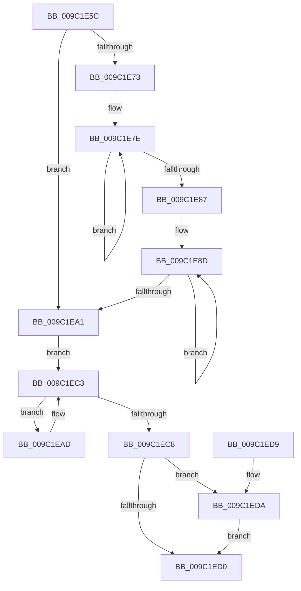

# EtwpGetMaxTrackingEventBufferSize

- RVA: `0x009C1E5C`–`0x009C1EE7` (길이 `139` bytes)
- VA: `0x00000001409C1E5C`
- 실행 섹션: `PAGE`
- PDB 이름 있음: `예`; PDB Function 태그: `아니요`
- unwind 정보 RVA: `0x000DB714`
- 디코드: `46`개 명령, `139/139` bytes 표시
- 미해석 바이트: `0` (있으면 어셈블리에 `.byte`로 보존)

> 이 문서는 커널 이미지의 기계어와 PDB 기호를 분석해 생성했습니다. 4번과 5번은 함수 원형과 자료형을 바이너리 사용 방식에서 추정한 C 해석이며 원본 소스 복구 결과는 아닙니다.

## 1. Dependencies

- 직접 호출 지점: **0**; 고유 호출 대상: **0**
- 직접 호출자로 확인된 함수: **2**
- RIP 상대 이미지 참조: **1**

### Outgoing calls
- 직접 디코드된 call 명령이 없습니다.

### Direct callers
- [EtwpSendDbgId](../7B/EtwpSendDbgId_function_007BC1C0.md) at `0x007BC247`
- [EtwpRealtimeNotifyConsumers](EtwpRealtimeNotifyConsumers_function_009C019C.md) at `0x009C01F4`

### Static image references
- `0x009C1E73` → RVA `0x00FC41E0` (`.data`; read)

## 2. Other-region calls and transfers

- 다른 실행 섹션으로 향하는 call: **0**
- 별도 외부 분기/꼬리 이동을 확인하지 못했습니다.

## 3. Assembly (complete function range)

```asm
009C1E5C  4C 8B D1                        mov r10, rcx
009C1E5F  33 D2                           xor edx, edx
009C1E61  48 83 C1 60                     add rcx, 0x60
009C1E65  41 BB F8 FF FF FF               mov r11d, 0xfffffff8
009C1E6B  4C 8B 01                        mov r8, qword ptr [rcx]
009C1E6E  4C 3B C1                        cmp r8, rcx
009C1E71  74 2E                           je 0x1409c1ea1
009C1E73  48 8D 05 66 23 60 00            lea rax, [rip + 0x602366]
009C1E7A  48 83 CA FF                     or rdx, 0xffffffffffffffff
009C1E7E  48 FF C2                        inc rdx
009C1E81  80 3C 10 00                     cmp byte ptr [rax + rdx], 0
009C1E85  75 F7                           jne 0x1409c1e7e
009C1E87  83 C2 18                        add edx, 0x18
009C1E8A  41 23 D3                        and edx, r11d
009C1E8D  41 8B 40 14                     mov eax, dword ptr [r8 + 0x14]
009C1E91  4D 8B 00                        mov r8, qword ptr [r8]
009C1E94  83 C0 13                        add eax, 0x13
009C1E97  41 23 C3                        and eax, r11d
009C1E9A  03 D0                           add edx, eax
009C1E9C  4C 3B C1                        cmp r8, rcx
009C1E9F  75 EC                           jne 0x1409c1e8d
009C1EA1  4D 8D 8A 18 05 00 00            lea r9, [r10 + 0x518]
009C1EA8  4D 8B 01                        mov r8, qword ptr [r9]
009C1EAB  EB 16                           jmp 0x1409c1ec3
009C1EAD  41 8B 48 18                     mov ecx, dword ptr [r8 + 0x18]
009C1EB1  C1 E1 04                        shl ecx, 4
009C1EB4  83 C1 1B                        add ecx, 0x1b
009C1EB7  41 03 48 10                     add ecx, dword ptr [r8 + 0x10]
009C1EBB  4D 8B 00                        mov r8, qword ptr [r8]
009C1EBE  41 23 CB                        and ecx, r11d
009C1EC1  03 D1                           add edx, ecx
009C1EC3  4D 3B C1                        cmp r8, r9
009C1EC6  75 E5                           jne 0x1409c1ead
009C1EC8  41 8B 42 78                     mov eax, dword ptr [r10 + 0x78]
009C1ECC  85 C0                           test eax, eax
009C1ECE  75 0A                           jne 0x1409c1eda
009C1ED0  85 D2                           test edx, edx
009C1ED2  8D 42 48                        lea eax, [rdx + 0x48]
009C1ED5  0F 44 C2                        cmove eax, edx
009C1ED8  C3                              ret
009C1ED9  CC                              int3
009C1EDA  C1 E0 05                        shl eax, 5
009C1EDD  83 C0 17                        add eax, 0x17
009C1EE0  41 23 C3                        and eax, r11d
009C1EE3  03 D0                           add edx, eax
009C1EE5  EB E9                           jmp 0x1409c1ed0
```

## 4. C-style interpretation (structured pseudocode)

```c
__int64 __fastcall EtwpGetMaxTrackingEventBufferSize(__int64 a1, int a2)
{
    __int64 result;

    a2 = 0;
    a1 = (a1) + (96);
    if ((*(unsigned __int64 *)(a1)) == a1) goto loc_009C1EA1;
    a2 = (a2) | (-1);
loc_009C1E7E:
    a2 = (a2) + 1;
    if ((*(unsigned __int8 *)(v_rip + 6300518 + a2 * 1)) != 0) goto loc_009C1E7E;
    a2 = (unsigned int)((a2) + (24));
    a2 = (unsigned int)((a2) & ((unsigned int)((unsigned int)(0xFFFFFFF8ULL))));
loc_009C1E8D:
    result = (unsigned int)(((unsigned int)(*(unsigned int *)(*(unsigned __int64 *)(a1) + 20))) + (19));
    result = (unsigned int)((result) & ((unsigned int)((unsigned int)(0xFFFFFFF8ULL))));
    a2 = (unsigned int)((a2) + ((unsigned int)(result)));
    if ((*(unsigned __int64 *)(*(unsigned __int64 *)(a1))) != a1) goto loc_009C1E8D;
loc_009C1EA1:
    goto loc_009C1EC3;
loc_009C1EAD:
    a1 = (unsigned int)(((unsigned int)(*(unsigned int *)(*(unsigned __int64 *)(a1 + 1304) + 24))) << (4));
    a1 = (unsigned int)((a1) + (27));
    a1 = (unsigned int)((a1) + (*(unsigned int *)(*(unsigned __int64 *)(a1 + 1304) + 16)));
    a1 = (unsigned int)((a1) & ((unsigned int)((unsigned int)(0xFFFFFFF8ULL))));
    a2 = (unsigned int)((a2) + ((unsigned int)(a1)));
loc_009C1EC3:
    if ((*(unsigned __int64 *)(*(unsigned __int64 *)(a1 + 1304))) != (a1 + 1304)) goto loc_009C1EAD;
    if ((unsigned int)((unsigned int)(*(unsigned int *)(a1 + 120))) != 0) goto loc_009C1EDA;
loc_009C1ED0:
    result = a2 + 72;
    if (a2 == 0) { result = a2; }
    return result;
loc_009C1EDA:
    result = (unsigned int)((result) << (5));
    result = (unsigned int)((result) + (23));
    result = (unsigned int)((result) & ((unsigned int)((unsigned int)(0xFFFFFFF8ULL))));
    a2 = (unsigned int)((a2) + ((unsigned int)(result)));
    goto loc_009C1ED0;
}
```

## 5. (Beta) C Style

```c
int64_t EtwpGetMaxTrackingEventBufferSize(void *Arg1, int32_t Arg2)
{
    uint8_t *arg1 = (uint8_t *)Arg1;

    int64_t result;

    Arg2 = 0;
    Arg1 = (Arg1) + (96);
    if ((*(uint64_t *)(arg1)) == Arg1) goto loc_009C1EA1;
    Arg2 = (Arg2) | (-1);
loc_009C1E7E:
    Arg2 = (Arg2) + 1;
    if ((*(uint8_t *)(v_rip + 0x602366 + Arg2 * 1)) != 0) goto loc_009C1E7E;
    Arg2 = (uint32_t)((Arg2) + (24));
    Arg2 = (uint32_t)((Arg2) & ((uint32_t)((uint32_t)(0xFFFFFFF8ULL))));
loc_009C1E8D:
    result = (uint32_t)(((uint32_t)(*(uint32_t *)(*(uint64_t *)(arg1) + 0x14))) + (19));
    result = (uint32_t)((result) & ((uint32_t)((uint32_t)(0xFFFFFFF8ULL))));
    Arg2 = (uint32_t)((Arg2) + ((uint32_t)(result)));
    if ((*(uint64_t *)(*(uint64_t *)(arg1))) != Arg1) goto loc_009C1E8D;
loc_009C1EA1:
    goto loc_009C1EC3;
loc_009C1EAD:
    Arg1 = (uint32_t)(((uint32_t)(*(uint32_t *)(*(uint64_t *)(arg1 + 0x518) + 0x18))) << (4));
    Arg1 = (uint32_t)((Arg1) + (27));
    Arg1 = (uint32_t)((Arg1) + (*(uint32_t *)(*(uint64_t *)(arg1 + 0x518) + 0x10)));
    Arg1 = (uint32_t)((Arg1) & ((uint32_t)((uint32_t)(0xFFFFFFF8ULL))));
    Arg2 = (uint32_t)((Arg2) + ((uint32_t)(Arg1)));
loc_009C1EC3:
    if ((*(uint64_t *)(*(uint64_t *)(arg1 + 0x518))) != (Arg1 + 1304)) goto loc_009C1EAD;
    if ((uint32_t)((uint32_t)(*(uint32_t *)(arg1 + 0x78))) != 0) goto loc_009C1EDA;
loc_009C1ED0:
    result = Arg2 + 72;
    if (Arg2 == 0) { result = Arg2; }
    return result;
loc_009C1EDA:
    result = (uint32_t)((result) << (5));
    result = (uint32_t)((result) + (23));
    result = (uint32_t)((result) & ((uint32_t)((uint32_t)(0xFFFFFFF8ULL))));
    Arg2 = (uint32_t)((Arg2) + ((uint32_t)(result)));
    goto loc_009C1ED0;
}
```

### 관측된 메모리 오프셋

구조체 형식이 확인되지 않은 접근은 인자 기준의 오프셋으로만 기록했습니다.

| 기준 인자 | 오프셋 표현 | 폭 (bit) | 접근 |
|---|---:|---:|---|
| `Arg1` | `+ 0x0` | `64` | `R` |
| `Arg1` | `+ 0x78` | `32` | `R` |
| `Arg1` | `+ 0x518` | `64` | `R` |

## 6. Execution-region graph

[열기: 2D/3D 그래프와 함수 탐색 컨트롤 패널](../../../control-panel.html?section=page&rva=0x009C1E5C&view=graph)

- 2D 그래프는 위에서 아래로 흐르고, 3D 그래프는 빈 공간을 드래그해 회전합니다. Shift+드래그는 이동, 휠은 확대·축소, 함수 노드 선택은 대상 보고서 이동입니다.

### Static fallback


