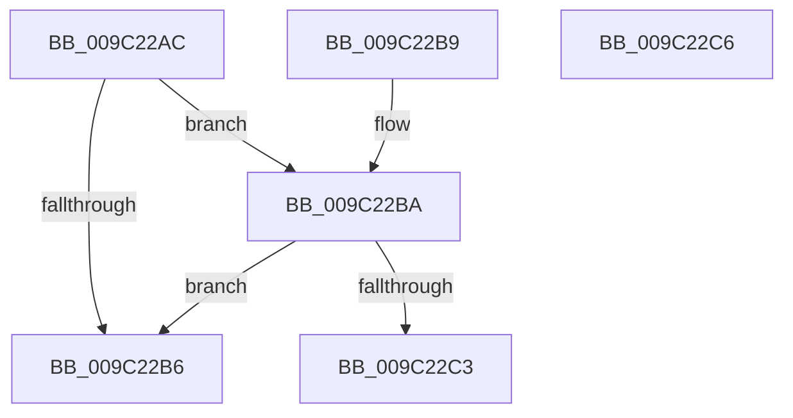

# EtwpIsWow64Logger

- RVA: `0x009C22AC`–`0x009C22C7` (길이 `27` bytes)
- VA: `0x00000001409C22AC`
- 실행 섹션: `PAGE`
- PDB 이름 있음: `예`; PDB Function 태그: `아니요`
- unwind 정보 RVA: `0x000DB714`
- 디코드: `11`개 명령, `27/27` bytes 표시
- 미해석 바이트: `0` (있으면 어셈블리에 `.byte`로 보존)

> 이 문서는 커널 이미지의 기계어와 PDB 기호를 분석해 생성했습니다. 4번과 5번은 함수 원형과 자료형을 바이너리 사용 방식에서 추정한 C 해석이며 원본 소스 복구 결과는 아닙니다.

## 1. Dependencies

- 직접 호출 지점: **0**; 고유 호출 대상: **0**
- 직접 호출자로 확인된 함수: **3**
- RIP 상대 이미지 참조: **0**

### Outgoing calls
- 직접 디코드된 call 명령이 없습니다.

### Direct callers
- [EtwpUpdateFileHeader](EtwpUpdateFileHeader_function_009C082C.md) at `0x009C0A38`
- [EtwpAddLogHeader](EtwpAddLogHeader_function_009C0BD0.md) at `0x009C0C0F`
- [EtwpAddLogHeader](EtwpAddLogHeader_function_009C0BD0.md) at `0x009C0DA9`
- [EtwpFinalizeHeader](EtwpFinalizeHeader_function_009C1EF0.md) at `0x009C204E`

### Static image references
- 디코드된 RIP-relative 메모리 참조가 없습니다.

## 2. Other-region calls and transfers

- 다른 실행 섹션으로 향하는 call: **0**
- 별도 외부 분기/꼬리 이동을 확인하지 못했습니다.

## 3. Assembly (complete function range)

```asm
009C22AC  8B 81 30 03 00 00               mov eax, dword ptr [rcx + 0x330]
009C22B2  A8 10                           test al, 0x10
009C22B4  75 04                           jne 0x1409c22ba
009C22B6  32 C0                           xor al, al
009C22B8  C3                              ret
009C22B9  CC                              int3
009C22BA  F7 41 0C 00 00 00 02            test dword ptr [rcx + 0xc], 0x2000000
009C22C1  75 F3                           jne 0x1409c22b6
009C22C3  B0 01                           mov al, 1
009C22C5  C3                              ret
009C22C6  CC                              int3
```

## 4. C-style interpretation (structured pseudocode)

```c
__int64 __fastcall EtwpIsWow64Logger(__int64 a1)
{
    __int64 result;

    if ((((unsigned __int8)((unsigned int)(*(unsigned int *)(a1 + 816)))) & (16)) != 0) goto loc_009C22BA;
loc_009C22B6:
    result = 0;
    return result;
loc_009C22BA:
    if (((*(unsigned int *)(a1 + 12)) & (0x2000000ULL)) != 0) goto loc_009C22B6;
    return 1;
}
```

## 5. (Beta) C Style

```c
int64_t EtwpIsWow64Logger(void *Arg1)
{
    uint8_t *arg1 = (uint8_t *)Arg1;

    int64_t result;

    if ((((uint8_t)((uint32_t)(*(uint32_t *)(arg1 + 0x330)))) & (16)) != 0) goto loc_009C22BA;
loc_009C22B6:
    result = 0;
    return result;
loc_009C22BA:
    if (((*(uint32_t *)(arg1 + 0xC)) & (0x2000000ULL)) != 0) goto loc_009C22B6;
    return 1;
}
```

### 관측된 메모리 오프셋

구조체 형식이 확인되지 않은 접근은 인자 기준의 오프셋으로만 기록했습니다.

| 기준 인자 | 오프셋 표현 | 폭 (bit) | 접근 |
|---|---:|---:|---|
| `Arg1` | `+ 0xC` | `32` | `R` |
| `Arg1` | `+ 0x330` | `32` | `R` |

## 6. Execution-region graph

[열기: 2D/3D 그래프와 함수 탐색 컨트롤 패널](../../../control-panel.html?section=page&rva=0x009C22AC&view=graph)

- 2D 그래프는 위에서 아래로 흐르고, 3D 그래프는 빈 공간을 드래그해 회전합니다. Shift+드래그는 이동, 휠은 확대·축소, 함수 노드 선택은 대상 보고서 이동입니다.

### Static fallback


