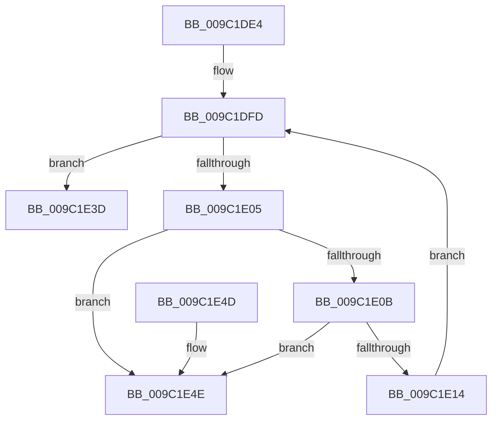

# EtwpRealtimeDisconnectAllConsumers

- RVA: `0x009C1DE4`–`0x009C1E55` (길이 `113` bytes)
- VA: `0x00000001409C1DE4`
- 실행 섹션: `PAGE`
- PDB 이름 있음: `예`; PDB Function 태그: `아니요`
- unwind 정보 RVA: `0x0006383C`
- 디코드: `33`개 명령, `113/113` bytes 표시
- 미해석 바이트: `0` (있으면 어셈블리에 `.byte`로 보존)

> 이 문서는 커널 이미지의 기계어와 PDB 기호를 분석해 생성했습니다. 4번과 5번은 함수 원형과 자료형을 바이너리 사용 방식에서 추정한 C 해석이며 원본 소스 복구 결과는 아닙니다.

## 1. Dependencies

- 직접 호출 지점: **2**; 고유 호출 대상: **2**
- 직접 호출자로 확인된 함수: **2**
- RIP 상대 이미지 참조: **0**

### Outgoing calls
- `0x009C1E2E` → [KeSetEvent](../../text/33/KeSetEvent_function_0033F310.md) (function, `0x0033F310`)
- `0x009C1E36` → [ObfDereferenceObject](../../text/2F/ObfDereferenceObject_function_002F9350.md) (function, `0x002F9350`)

### Direct callers
- [EtwpLogger](../9B/EtwpLogger_function_009BE310.md) at `0x009BE82A`
- [EtwpShutdownConsumers](EtwpShutdownConsumers_function_009C1C94.md) at `0x009C1CAB`

### Static image references
- 디코드된 RIP-relative 메모리 참조가 없습니다.

## 2. Other-region calls and transfers

- 다른 실행 섹션으로 향하는 call: **2**
  - `0x009C1E2E` → [KeSetEvent](../../text/33/KeSetEvent_function_0033F310.md) (`PAGE` → `.text`)
  - `0x009C1E36` → [ObfDereferenceObject](../../text/2F/ObfDereferenceObject_function_002F9350.md) (`PAGE` → `.text`)
- 별도 외부 분기/꼬리 이동을 확인하지 못했습니다.

## 3. Assembly (complete function range)

```asm
009C1DE4  48 89 5C 24 08                  mov qword ptr [rsp + 8], rbx
009C1DE9  48 89 74 24 10                  mov qword ptr [rsp + 0x10], rsi
009C1DEE  57                              push rdi
009C1DEF  48 83 EC 20                     sub rsp, 0x20
009C1DF3  48 8B F1                        mov rsi, rcx
009C1DF6  48 8D B9 48 01 00 00            lea rdi, [rcx + 0x148]
009C1DFD  48 8B 1F                        mov rbx, qword ptr [rdi]
009C1E00  48 3B DF                        cmp rbx, rdi
009C1E03  74 38                           je 0x1409c1e3d
009C1E05  48 39 7B 08                     cmp qword ptr [rbx + 8], rdi
009C1E09  75 43                           jne 0x1409c1e4e
009C1E0B  48 8B 03                        mov rax, qword ptr [rbx]
009C1E0E  48 39 58 08                     cmp qword ptr [rax + 8], rbx
009C1E12  75 3A                           jne 0x1409c1e4e
009C1E14  48 89 07                        mov qword ptr [rdi], rax
009C1E17  45 33 C0                        xor r8d, r8d
009C1E1A  48 89 78 08                     mov qword ptr [rax + 8], rdi
009C1E1E  33 D2                           xor edx, edx
009C1E20  FF 8E 58 01 00 00               dec dword ptr [rsi + 0x158]
009C1E26  48 8B 4B 30                     mov rcx, qword ptr [rbx + 0x30]
009C1E2A  80 4B 5A 04                     or byte ptr [rbx + 0x5a], 4
009C1E2E  E8 DD D4 97 FF                  call 0x14033f310
009C1E33  48 8B CB                        mov rcx, rbx
009C1E36  E8 15 75 93 FF                  call 0x1402f9350
009C1E3B  EB C0                           jmp 0x1409c1dfd
009C1E3D  48 8B 5C 24 30                  mov rbx, qword ptr [rsp + 0x30]
009C1E42  48 8B 74 24 38                  mov rsi, qword ptr [rsp + 0x38]
009C1E47  48 83 C4 20                     add rsp, 0x20
009C1E4B  5F                              pop rdi
009C1E4C  C3                              ret
009C1E4D  CC                              int3
009C1E4E  B9 03 00 00 00                  mov ecx, 3
009C1E53  CD 29                           int 0x29
```

## 4. C-style interpretation (structured pseudocode)

```c
__int64 __fastcall EtwpRealtimeDisconnectAllConsumers(__int64 a1, int a2, int a3)
{
    __int64 result;
    __int64 v_rsp;
    unsigned __int64 v_stack_p10;
    unsigned __int64 v_stack_p8;

    v_stack_p8 = v_rbx;
    v_stack_p10 = v_rsi;
    v_rsp = (v_rsp) - (32);
loc_009C1DFD:
    if ((*(unsigned __int64 *)(a1 + 328)) == (a1 + 328)) goto loc_009C1E3D;
    if ((*(unsigned __int64 *)(*(unsigned __int64 *)(a1 + 328) + 8)) != (a1 + 328)) goto loc_009C1E4E;
    if ((*(unsigned __int64 *)(*(unsigned __int64 *)(*(unsigned __int64 *)(a1 + 328)) + 8)) != (*(unsigned __int64 *)(a1 + 328))) goto loc_009C1E4E;
    *(unsigned __int64 *)(a1 + 328) = *(unsigned __int64 *)(*(unsigned __int64 *)(a1 + 328));
    a3 = 0;
    *(unsigned __int64 *)(*(unsigned __int64 *)(*(unsigned __int64 *)(a1 + 328)) + 8) = a1 + 328;
    a2 = 0;
    result = KeSetEvent(*(unsigned __int64 *)(*(unsigned __int64 *)(a1 + 328) + 48), a2, a3, a4);
    result = ObfDereferenceObject(*(unsigned __int64 *)(a1 + 328), a2, a3, a4);
    goto loc_009C1DFD;
loc_009C1E3D:
    v_rsp = (v_rsp) + (32);
    return result;
loc_009C1E4E:
    return result;
}
```

## 5. (Beta) C Style

```c
int64_t EtwpRealtimeDisconnectAllConsumers(void *Arg1, int32_t Arg2, int32_t Arg3)
{
    uint8_t *arg1 = (uint8_t *)Arg1;

    int64_t result;
    int64_t local_rsp;
    uint64_t v_stack_p10;
    uint64_t v_stack_p8;

    v_stack_p8 = local_rbx;
    v_stack_p10 = local_rsi;
    local_rsp = (local_rsp) - (32);
loc_009C1DFD:
    if ((*(uint64_t *)(arg1 + 0x148)) == (Arg1 + 328)) goto loc_009C1E3D;
    if ((*(uint64_t *)(*(uint64_t *)(arg1 + 0x148) + 0x8)) != (Arg1 + 328)) goto loc_009C1E4E;
    if ((*(uint64_t *)(*(uint64_t *)(*(uint64_t *)(arg1 + 0x148)) + 0x8)) != (*(uint64_t *)(arg1 + 0x148))) goto loc_009C1E4E;
    *(uint64_t *)(arg1 + 0x148) = *(uint64_t *)(*(uint64_t *)(arg1 + 0x148));
    Arg3 = 0;
    *(void **)(*(uint64_t *)(*(uint64_t *)(arg1 + 0x148)) + 0x8) = Arg1 + 328;
    Arg2 = 0;
    result = KeSetEvent(*(uint64_t *)(*(uint64_t *)(arg1 + 0x148) + 0x30), Arg2, Arg3, a4);
    result = ObfDereferenceObject(*(uint64_t *)(arg1 + 0x148), Arg2, Arg3, a4);
    goto loc_009C1DFD;
loc_009C1E3D:
    local_rsp = (local_rsp) + (32);
    return result;
loc_009C1E4E:
    return result;
}
```

### 관측된 메모리 오프셋

구조체 형식이 확인되지 않은 접근은 인자 기준의 오프셋으로만 기록했습니다.

| 기준 인자 | 오프셋 표현 | 폭 (bit) | 접근 |
|---|---:|---:|---|
| `Arg1` | `+ 0x0` | `64` | `R` |
| `Arg1` | `+ 0x0` | `64` | `W` |
| `Arg1` | `+ 0x148` | `64` | `R` |
| `Arg1` | `+ 0x158` | `32` | `R/W` |

## 6. Execution-region graph

[열기: 2D/3D 그래프와 함수 탐색 컨트롤 패널](../../../control-panel.html?section=page&rva=0x009C1DE4&view=graph)

- 2D 그래프는 위에서 아래로 흐르고, 3D 그래프는 빈 공간을 드래그해 회전합니다. Shift+드래그는 이동, 휠은 확대·축소, 함수 노드 선택은 대상 보고서 이동입니다.

### Static fallback


