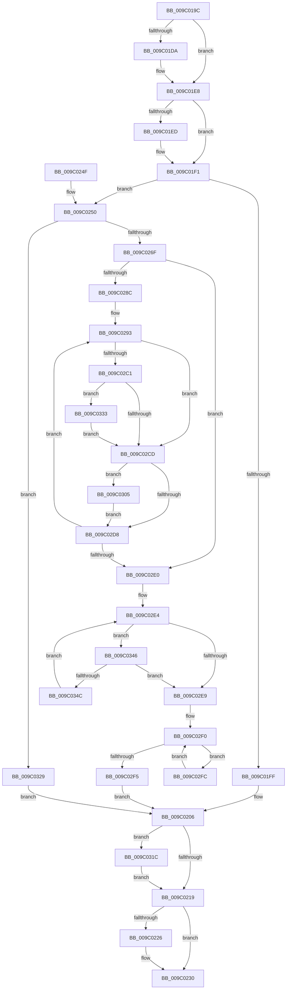

# EtwpRealtimeNotifyConsumers

- RVA: `0x009C019C`–`0x009C0355` (길이 `441` bytes)
- VA: `0x00000001409C019C`
- 실행 섹션: `PAGE`
- PDB 이름 있음: `예`; PDB Function 태그: `아니요`
- unwind 정보 RVA: `0x0009F534`
- 디코드: `128`개 명령, `441/441` bytes 표시
- 미해석 바이트: `0` (있으면 어셈블리에 `.byte`로 보존)

> 이 문서는 커널 이미지의 기계어와 PDB 기호를 분석해 생성했습니다. 4번과 5번은 함수 원형과 자료형을 바이너리 사용 방식에서 추정한 C 해석이며 원본 소스 복구 결과는 아닙니다.

## 1. Dependencies

- 직접 호출 지점: **11**; 고유 호출 대상: **11**
- 직접 호출자로 확인된 함수: **1**
- RIP 상대 이미지 참조: **0**

### Outgoing calls
- `0x009C01CA` → [KeAbPreAcquire](../../text/21/KeAbPreAcquire_function_00210230.md) (function, `0x00210230`)
- `0x009C01E3` → [ExfAcquirePushLockExclusiveEx](../../text/20/ExfAcquirePushLockExclusiveEx_function_0020FC90.md) (function, `0x0020FC90`)
- `0x009C01F4` → [EtwpGetMaxTrackingEventBufferSize](EtwpGetMaxTrackingEventBufferSize_function_009C1E5C.md) (function, `0x009C1E5C`)
- `0x009C021C` → [KeAbPostRelease](../../text/2E/KeAbPostRelease_function_002E1600.md) (function, `0x002E1600`)
- `0x009C022B` → [ExFreePoolWithTag](../../poolcode/B8/ExFreePoolWithTag_function_00B82870.md) (function, `0x00B82870`)
- `0x009C025E` → [ExAllocatePool2](../../poolcode/B8/ExAllocatePool2_function_00B820F0.md) (function, `0x00B820F0`)
- `0x009C0278` → [EtwpInitializeProviderInfoBuffer](../AA/EtwpInitializeProviderInfoBuffer_function_00AACE3C.md) (function, `0x00AACE3C`)
- `0x009C02B6` → [EtwpAddDebugInfoEvents](EtwpAddDebugInfoEvents_function_009C22D0.md) (function, `0x009C22D0`)
- `0x009C030E` → [EtwpRealtimeInjectEtwBuffer](../9B/EtwpRealtimeInjectEtwBuffer_function_009BF910.md) (function, `0x009BF910`)
- `0x009C031F` → [ExfTryToWakePushLock](../../text/26/ExfTryToWakePushLock_function_00265DD0.md) (function, `0x00265DD0`)
- `0x009C033F` → [EtwpAddBinaryInfoEvents](EtwpAddBinaryInfoEvents_function_009C25A4.md) (function, `0x009C25A4`)

### Direct callers
- [EtwpLogger](../9B/EtwpLogger_function_009BE310.md) at `0x009BE61C`

### Static image references
- 디코드된 RIP-relative 메모리 참조가 없습니다.

## 2. Other-region calls and transfers

- 다른 실행 섹션으로 향하는 call: **6**
  - `0x009C01CA` → [KeAbPreAcquire](../../text/21/KeAbPreAcquire_function_00210230.md) (`PAGE` → `.text`)
  - `0x009C01E3` → [ExfAcquirePushLockExclusiveEx](../../text/20/ExfAcquirePushLockExclusiveEx_function_0020FC90.md) (`PAGE` → `.text`)
  - `0x009C021C` → [KeAbPostRelease](../../text/2E/KeAbPostRelease_function_002E1600.md) (`PAGE` → `.text`)
  - `0x009C022B` → [ExFreePoolWithTag](../../poolcode/B8/ExFreePoolWithTag_function_00B82870.md) (`PAGE` → `POOLCODE`)
  - `0x009C025E` → [ExAllocatePool2](../../poolcode/B8/ExAllocatePool2_function_00B820F0.md) (`PAGE` → `POOLCODE`)
  - `0x009C031F` → [ExfTryToWakePushLock](../../text/26/ExfTryToWakePushLock_function_00265DD0.md) (`PAGE` → `.text`)
- 별도 외부 분기/꼬리 이동을 확인하지 못했습니다.

## 3. Assembly (complete function range)

```asm
009C019C  48 89 5C 24 08                  mov qword ptr [rsp + 8], rbx
009C01A1  48 89 6C 24 10                  mov qword ptr [rsp + 0x10], rbp
009C01A6  48 89 74 24 18                  mov qword ptr [rsp + 0x18], rsi
009C01AB  57                              push rdi
009C01AC  41 54                           push r12
009C01AE  41 55                           push r13
009C01B0  41 56                           push r14
009C01B2  41 57                           push r15
009C01B4  48 83 EC 30                     sub rsp, 0x30
009C01B8  48 8D B9 B0 02 00 00            lea rdi, [rcx + 0x2b0]
009C01BF  48 8B D9                        mov rbx, rcx
009C01C2  48 8B CF                        mov rcx, rdi
009C01C5  45 33 C0                        xor r8d, r8d
009C01C8  33 D2                           xor edx, edx
009C01CA  E8 61 00 85 FF                  call 0x140210230
009C01CF  F0 48 0F BA 2F 00               lock bts qword ptr [rdi], 0
009C01D5  48 8B F0                        mov rsi, rax
009C01D8  73 0E                           jae 0x1409c01e8
009C01DA  4C 8B C7                        mov r8, rdi
009C01DD  48 8B D0                        mov rdx, rax
009C01E0  48 8B CF                        mov rcx, rdi
009C01E3  E8 A8 FA 84 FF                  call 0x14020fc90
009C01E8  48 85 F6                        test rsi, rsi
009C01EB  74 04                           je 0x1409c01f1
009C01ED  C6 46 0A 01                     mov byte ptr [rsi + 0xa], 1
009C01F1  48 8B CB                        mov rcx, rbx
009C01F4  E8 63 1C 00 00                  call 0x1409c1e5c
009C01F9  8B E8                           mov ebp, eax
009C01FB  85 C0                           test eax, eax
009C01FD  75 51                           jne 0x1409c0250
009C01FF  33 F6                           xor esi, esi
009C0201  BB 1A 00 00 80                  mov ebx, 0x8000001a
009C0206  48 83 C8 FF                     or rax, 0xffffffffffffffff
009C020A  F0 48 0F C1 07                  lock xadd qword ptr [rdi], rax
009C020F  24 06                           and al, 6
009C0211  3C 02                           cmp al, 2
009C0213  0F 84 03 01 00 00               je 0x1409c031c
009C0219  48 8B CF                        mov rcx, rdi
009C021C  E8 DF 13 92 FF                  call 0x1402e1600
009C0221  48 85 F6                        test rsi, rsi
009C0224  74 0A                           je 0x1409c0230
009C0226  33 D2                           xor edx, edx
009C0228  48 8B CE                        mov rcx, rsi
009C022B  E8 40 26 1C 00                  call 0x140b82870
009C0230  48 8B 6C 24 68                  mov rbp, qword ptr [rsp + 0x68]
009C0235  8B C3                           mov eax, ebx
009C0237  48 8B 5C 24 60                  mov rbx, qword ptr [rsp + 0x60]
009C023C  48 8B 74 24 70                  mov rsi, qword ptr [rsp + 0x70]
009C0241  48 83 C4 30                     add rsp, 0x30
009C0245  41 5F                           pop r15
009C0247  41 5E                           pop r14
009C0249  41 5D                           pop r13
009C024B  41 5C                           pop r12
009C024D  5F                              pop rdi
009C024E  C3                              ret
009C024F  CC                              int3
009C0250  48 8B D5                        mov rdx, rbp
009C0253  B9 00 01 00 00                  mov ecx, 0x100
009C0258  41 B8 45 74 77 62               mov r8d, 0x62777445
009C025E  E8 8D 1E 1C 00                  call 0x140b820f0
009C0263  48 8B F0                        mov rsi, rax
009C0266  48 85 C0                        test rax, rax
009C0269  0F 84 BA 00 00 00               je 0x1409c0329
009C026F  44 8B C5                        mov r8d, ebp
009C0272  48 8B D0                        mov rdx, rax
009C0275  48 8B CB                        mov rcx, rbx
009C0278  E8 BF CB 0E 00                  call 0x140aace3c
009C027D  4C 8D BB 48 01 00 00            lea r15, [rbx + 0x148]
009C0284  4D 8B 37                        mov r14, qword ptr [r15]
009C0287  4D 3B F7                        cmp r14, r15
009C028A  74 54                           je 0x1409c02e0
009C028C  4C 8D AB 18 05 00 00            lea r13, [rbx + 0x518]
009C0293  41 8A 46 5A                     mov al, byte ptr [r14 + 0x5a]
009C0297  44 8B C5                        mov r8d, ebp
009C029A  24 08                           and al, 8
009C029C  48 8B D6                        mov rdx, rsi
009C029F  F6 D8                           neg al
009C02A1  48 8B CB                        mov rcx, rbx
009C02A4  45 1B E4                        sbb r12d, r12d
009C02A7  45 33 C9                        xor r9d, r9d
009C02AA  41 83 E4 03                     and r12d, 3
009C02AE  41 FF C4                        inc r12d
009C02B1  44 89 64 24 20                  mov dword ptr [rsp + 0x20], r12d
009C02B6  E8 15 20 00 00                  call 0x1409c22d0
009C02BB  4D 39 6D 00                     cmp qword ptr [r13], r13
009C02BF  74 0C                           je 0x1409c02cd
009C02C1  F7 83 30 03 00 00 00 00 00 02   test dword ptr [rbx + 0x330], 0x2000000
009C02CB  75 66                           jne 0x1409c0333
009C02CD  41 80 4E 5A 08                  or byte ptr [r14 + 0x5a], 8
009C02D2  83 7E 30 48                     cmp dword ptr [rsi + 0x30], 0x48
009C02D6  77 2D                           ja 0x1409c0305
009C02D8  4D 8B 36                        mov r14, qword ptr [r14]
009C02DB  4D 3B F7                        cmp r14, r15
009C02DE  75 B3                           jne 0x1409c0293
009C02E0  48 8B 43 70                     mov rax, qword ptr [rbx + 0x70]
009C02E4  48 85 C0                        test rax, rax
009C02E7  75 5D                           jne 0x1409c0346
009C02E9  48 83 C3 60                     add rbx, 0x60
009C02ED  48 8B 03                        mov rax, qword ptr [rbx]
009C02F0  48 3B C3                        cmp rax, rbx
009C02F3  75 07                           jne 0x1409c02fc
009C02F5  33 DB                           xor ebx, ebx
009C02F7  E9 0A FF FF FF                  jmp 0x1409c0206
009C02FC  C6 40 10 01                     mov byte ptr [rax + 0x10], 1
009C0300  48 8B 00                        mov rax, qword ptr [rax]
009C0303  EB EB                           jmp 0x1409c02f0
009C0305  4C 8B C6                        mov r8, rsi
009C0308  49 8B D6                        mov rdx, r14
009C030B  48 8B CB                        mov rcx, rbx
009C030E  E8 FD F5 FF FF                  call 0x1409bf910
009C0313  C7 46 30 48 00 00 00            mov dword ptr [rsi + 0x30], 0x48
009C031A  EB BC                           jmp 0x1409c02d8
009C031C  48 8B CF                        mov rcx, rdi
009C031F  E8 AC 5A 8A FF                  call 0x140265dd0
009C0324  E9 F0 FE FF FF                  jmp 0x1409c0219
009C0329  BB 17 00 00 C0                  mov ebx, 0xc0000017
009C032E  E9 D3 FE FF FF                  jmp 0x1409c0206
009C0333  45 8B CC                        mov r9d, r12d
009C0336  44 8B C5                        mov r8d, ebp
009C0339  48 8B D6                        mov rdx, rsi
009C033C  48 8B CB                        mov rcx, rbx
009C033F  E8 60 22 00 00                  call 0x1409c25a4
009C0344  EB 87                           jmp 0x1409c02cd
009C0346  80 78 28 00                     cmp byte ptr [rax + 0x28], 0
009C034A  75 9D                           jne 0x1409c02e9
009C034C  C6 40 28 01                     mov byte ptr [rax + 0x28], 1
009C0350  48 8B 00                        mov rax, qword ptr [rax]
009C0353  EB 8F                           jmp 0x1409c02e4
```

## 4. C-style interpretation (structured pseudocode)

```c
__int64 __fastcall EtwpRealtimeNotifyConsumers(__int64 a1, int a2, int a3, int a4)
{
    __int64 result;
    __int64 v_r12;
    __int64 v_rbx;
    __int64 v_rsi;
    __int64 v_rsp;
    unsigned __int64 v_stack_p10;
    unsigned __int64 v_stack_p18;
    unsigned int v_stack_p20;
    unsigned __int64 v_stack_p8;

    v_stack_p8 = v_rbx;
    v_stack_p10 = v_rbp;
    v_stack_p18 = v_rsi;
    v_rsp = (v_rsp) - (48);
    a3 = 0;
    a2 = 0;
    result = KeAbPreAcquire(a1 + 688, a2, a3, a4);
    if (!(condition_is_above_or_equal)) {
        a3 = a1 + 688;
        a2 = result;
        a1 = a1 + 688;
        result = ExfAcquirePushLockExclusiveEx(a1, a2, a3, a4);
    }
    if (result != 0) {
        *(unsigned __int8 *)(result + 10) = 1;
    }
    result = EtwpGetMaxTrackingEventBufferSize(a1, a2, a3, a4);
    if ((unsigned int)(result) != 0) goto loc_009C0250;
    v_rsi = 0;
loc_009C0206:
    result = (result) | (-1);
    result = (unsigned __int8)((result) & (6));
    if (((unsigned __int8)(result)) == 2) goto loc_009C031C;
loc_009C0219:
    result = KeAbPostRelease(a1 + 688, a2, a3, a4);
    if (0 != 0) {
        a2 = 0;
        a1 = 0;
        result = ExFreePoolWithTag(a1, a2, a3, a4);
    }
    v_rsp = (v_rsp) + (48);
    return (unsigned int)((unsigned int)((unsigned int)(0x8000001AULL)));
loc_009C0250:
    result = ExAllocatePool2(256, v_stack_p10, (unsigned int)(0x62777445ULL), a4);
    if (result == 0) goto loc_009C0329;
    result = EtwpInitializeProviderInfoBuffer(v_stack_p8, result, (unsigned int)((unsigned int)(v_stack_p10)), a4);
    if ((*(unsigned __int64 *)(v_stack_p8 + 328)) == (v_stack_p8 + 328)) goto loc_009C02E0;
loc_009C0293:
    result = (unsigned __int8)((*(unsigned __int8 *)(*(unsigned __int64 *)(v_stack_p8 + 328) + 90)) & (8));
    result = (unsigned __int8)(-(result));
    a4 = 0;
    v_r12 = (unsigned int)((v_r12) & (3));
    v_r12 = (unsigned int)((v_r12) + 1);
    v_stack_p20 = (unsigned int)(v_r12);
    result = EtwpAddDebugInfoEvents(v_stack_p8, result, (unsigned int)((unsigned int)(v_stack_p10)), a4);
    if ((*(unsigned __int64 *)(v_stack_p8 + 1304)) == (v_stack_p8 + 1304)) goto loc_009C02CD;
    if (((*(unsigned int *)(v_stack_p8 + 816)) & (0x2000000ULL)) != 0) goto loc_009C0333;
loc_009C02CD:
    if ((*(unsigned int *)(result + 48)) > 72) goto loc_009C0305;
loc_009C02D8:
    if ((*(unsigned __int64 *)(*(unsigned __int64 *)(v_stack_p8 + 328))) != (v_stack_p8 + 328)) goto loc_009C0293;
loc_009C02E0:
loc_009C02E4:
    if (*(unsigned __int64 *)(v_stack_p8 + 112) != 0) goto loc_009C0346;
loc_009C02E9:
    v_rbx = (v_stack_p8) + (96);
loc_009C02F0:
    if ((*(unsigned __int64 *)(v_rbx)) != v_rbx) goto loc_009C02FC;
    v_rbx = 0;
    goto loc_009C0206;
loc_009C02FC:
    *(unsigned __int8 *)(*(unsigned __int64 *)(v_rbx) + 16) = 1;
    goto loc_009C02F0;
loc_009C0305:
    result = EtwpRealtimeInjectEtwBuffer(0, *(unsigned __int64 *)(*(unsigned __int64 *)(v_stack_p8 + 328)), result, a4);
    *(unsigned int *)(result + 48) = 72;
    goto loc_009C02D8;
loc_009C031C:
    result = ExfTryToWakePushLock(a1 + 688, *(unsigned __int64 *)(*(unsigned __int64 *)(v_stack_p8 + 328)), result, a4);
    goto loc_009C0219;
loc_009C0329:
    goto loc_009C0206;
loc_009C0333:
    result = EtwpAddBinaryInfoEvents((unsigned int)(0xC0000017ULL), result, (unsigned int)((unsigned int)(v_stack_p10)), (unsigned int)((unsigned int)(v_r12)));
    goto loc_009C02CD;
loc_009C0346:
    if ((*(unsigned __int8 *)(result + 40)) != 0) goto loc_009C02E9;
    *(unsigned __int8 *)(result + 40) = 1;
    goto loc_009C02E4;
}
```

## 5. (Beta) C Style

```c
int64_t EtwpRealtimeNotifyConsumers(void *Arg1, int32_t Arg2, int32_t Arg3, int32_t Arg4)
{
    uint8_t *arg1 = (uint8_t *)Arg1;

    int64_t result;
    int64_t local_r12;
    int64_t local_rbx;
    int64_t local_rsi;
    int64_t local_rsp;
    uint64_t v_stack_p10;
    uint64_t v_stack_p18;
    uint32_t v_stack_p20;
    uint64_t v_stack_p8;

    v_stack_p8 = local_rbx;
    v_stack_p10 = local_rbp;
    v_stack_p18 = local_rsi;
    local_rsp = (local_rsp) - (48);
    Arg3 = 0;
    Arg2 = 0;
    result = KeAbPreAcquire(Arg1 + 688, Arg2, Arg3, Arg4);
    if (!(condition_is_above_or_equal)) {
        Arg3 = Arg1 + 688;
        Arg2 = result;
        Arg1 = Arg1 + 688;
        result = ExfAcquirePushLockExclusiveEx(Arg1, Arg2, Arg3, Arg4);
    }
    if (result != 0) {
        *(uint8_t *)(result + 0xA) = 1;
    }
    result = EtwpGetMaxTrackingEventBufferSize(Arg1, Arg2, Arg3, Arg4);
    if ((uint32_t)(result) != 0) goto loc_009C0250;
    local_rsi = 0;
loc_009C0206:
    result = (result) | (-1);
    result = (uint8_t)((result) & (6));
    if (((uint8_t)(result)) == 2) goto loc_009C031C;
loc_009C0219:
    result = KeAbPostRelease(Arg1 + 688, Arg2, Arg3, Arg4);
    if (0 != 0) {
        Arg2 = 0;
        Arg1 = 0;
        result = ExFreePoolWithTag(Arg1, Arg2, Arg3, Arg4);
    }
    local_rsp = (local_rsp) + (48);
    return (uint32_t)((uint32_t)((uint32_t)(0x8000001AULL)));
loc_009C0250:
    result = ExAllocatePool2(256, v_stack_p10, (uint32_t)(0x62777445ULL), Arg4);
    if (result == 0) goto loc_009C0329;
    result = EtwpInitializeProviderInfoBuffer(v_stack_p8, result, (uint32_t)((uint32_t)(v_stack_p10)), Arg4);
    if ((*(uint64_t *)(v_stack_p8 + 0x148)) == (v_stack_p8 + 328)) goto loc_009C02E0;
loc_009C0293:
    result = (uint8_t)((*(uint8_t *)(*(uint64_t *)(v_stack_p8 + 0x148) + 0x5A)) & (8));
    result = (uint8_t)(-(result));
    Arg4 = 0;
    local_r12 = (uint32_t)((local_r12) & (3));
    local_r12 = (uint32_t)((local_r12) + 1);
    v_stack_p20 = (uint32_t)(local_r12);
    result = EtwpAddDebugInfoEvents(v_stack_p8, result, (uint32_t)((uint32_t)(v_stack_p10)), Arg4);
    if ((*(uint64_t *)(v_stack_p8 + 0x518)) == (v_stack_p8 + 1304)) goto loc_009C02CD;
    if (((*(uint32_t *)(v_stack_p8 + 0x330)) & (0x2000000ULL)) != 0) goto loc_009C0333;
loc_009C02CD:
    if ((*(uint32_t *)(result + 0x30)) > 72) goto loc_009C0305;
loc_009C02D8:
    if ((*(uint64_t *)(*(uint64_t *)(v_stack_p8 + 0x148))) != (v_stack_p8 + 328)) goto loc_009C0293;
loc_009C02E0:
loc_009C02E4:
    if (*(uint64_t *)(v_stack_p8 + 0x70) != 0) goto loc_009C0346;
loc_009C02E9:
    local_rbx = (v_stack_p8) + (96);
loc_009C02F0:
    if ((*(uint64_t *)(local_rbx)) != local_rbx) goto loc_009C02FC;
    local_rbx = 0;
    goto loc_009C0206;
loc_009C02FC:
    *(uint8_t *)(*(uint64_t *)(local_rbx) + 0x10) = 1;
    goto loc_009C02F0;
loc_009C0305:
    result = EtwpRealtimeInjectEtwBuffer(0, *(uint64_t *)(*(uint64_t *)(v_stack_p8 + 0x148)), result, Arg4);
    *(uint32_t *)(result + 0x30) = 72;
    goto loc_009C02D8;
loc_009C031C:
    result = ExfTryToWakePushLock(Arg1 + 688, *(uint64_t *)(*(uint64_t *)(v_stack_p8 + 0x148)), result, Arg4);
    goto loc_009C0219;
loc_009C0329:
    goto loc_009C0206;
loc_009C0333:
    result = EtwpAddBinaryInfoEvents((uint32_t)(0xC0000017ULL), result, (uint32_t)((uint32_t)(v_stack_p10)), (uint32_t)((uint32_t)(local_r12)));
    goto loc_009C02CD;
loc_009C0346:
    if ((*(uint8_t *)(result + 0x28)) != 0) goto loc_009C02E9;
    *(uint8_t *)(result + 0x28) = 1;
    goto loc_009C02E4;
}
```

### 관측된 메모리 오프셋

구조체 형식이 확인되지 않은 접근은 인자 기준의 오프셋으로만 기록했습니다.

| 기준 인자 | 오프셋 표현 | 폭 (bit) | 접근 |
|---|---:|---:|---|
| `Arg1` | `+ 0x0` | `64` | `R` |
| `Arg1` | `+ 0x0` | `64` | `R/W` |
| `Arg1` | `+ 0x70` | `64` | `R` |
| `Arg1` | `+ 0x148` | `64` | `R` |
| `Arg1` | `+ 0x2B0` | `64` | `R` |
| `Arg1` | `+ 0x330` | `32` | `R` |
| `Arg1` | `+ 0x518` | `64` | `R` |

## 6. Execution-region graph

[열기: 2D/3D 그래프와 함수 탐색 컨트롤 패널](../../../control-panel.html?section=page&rva=0x009C019C&view=graph)

- 2D 그래프는 위에서 아래로 흐르고, 3D 그래프는 빈 공간을 드래그해 회전합니다. Shift+드래그는 이동, 휠은 확대·축소, 함수 노드 선택은 대상 보고서 이동입니다.

### Static fallback


