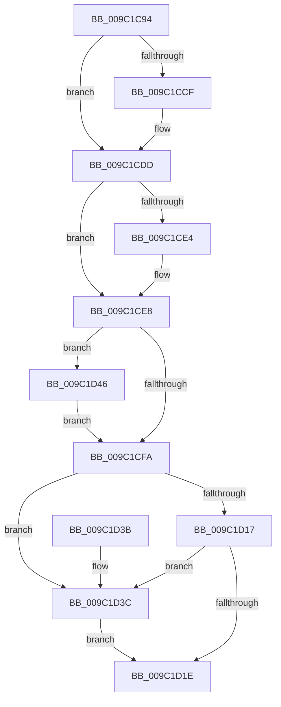

# EtwpShutdownConsumers

- RVA: `0x009C1C94`–`0x009C1D8B` (길이 `247` bytes)
- VA: `0x00000001409C1C94`
- 실행 섹션: `PAGE`
- PDB 이름 있음: `예`; PDB Function 태그: `아니요`
- unwind 정보 RVA: `0x0006E40C`
- 디코드: `65`개 명령, `247/247` bytes 표시
- 미해석 바이트: `0` (있으면 어셈블리에 `.byte`로 보존)

> 이 문서는 커널 이미지의 기계어와 PDB 기호를 분석해 생성했습니다. 4번과 5번은 함수 원형과 자료형을 바이너리 사용 방식에서 추정한 C 해석이며 원본 소스 복구 결과는 아닙니다.

## 1. Dependencies

- 직접 호출 지점: **8**; 고유 호출 대상: **7**
- 직접 호출자로 확인된 함수: **1**
- RIP 상대 이미지 참조: **0**

### Outgoing calls
- `0x009C1CAB` → [EtwpRealtimeDisconnectAllConsumers](EtwpRealtimeDisconnectAllConsumers_function_009C1DE4.md) (function, `0x009C1DE4`)
- `0x009C1CBF` → [KeAbPreAcquire](../../text/21/KeAbPreAcquire_function_00210230.md) (function, `0x00210230`)
- `0x009C1CD8` → [ExfAcquirePushLockExclusiveEx](../../text/20/ExfAcquirePushLockExclusiveEx_function_0020FC90.md) (function, `0x0020FC90`)
- `0x009C1D21` → [KeAbPostRelease](../../text/2E/KeAbPostRelease_function_002E1600.md) (function, `0x002E1600`)
- `0x009C1D3F` → [ExfReleasePushLock](../../text/26/ExfReleasePushLock_function_002638D0.md) (function, `0x002638D0`)
- `0x009C1D6B` → [KeSetEvent](../../text/33/KeSetEvent_function_0033F310.md) (function, `0x0033F310`)
- `0x009C1D79` → [KeSetEvent](../../text/33/KeSetEvent_function_0033F310.md) (function, `0x0033F310`)
- `0x009C1D81` → [ObfDereferenceObject](../../text/2F/ObfDereferenceObject_function_002F9350.md) (function, `0x002F9350`)

### Direct callers
- [EtwpFreeLoggerContext](EtwpFreeLoggerContext_function_009C1688.md) at `0x009C16AF`

### Static image references
- 디코드된 RIP-relative 메모리 참조가 없습니다.

## 2. Other-region calls and transfers

- 다른 실행 섹션으로 향하는 call: **7**
  - `0x009C1CBF` → [KeAbPreAcquire](../../text/21/KeAbPreAcquire_function_00210230.md) (`PAGE` → `.text`)
  - `0x009C1CD8` → [ExfAcquirePushLockExclusiveEx](../../text/20/ExfAcquirePushLockExclusiveEx_function_0020FC90.md) (`PAGE` → `.text`)
  - `0x009C1D21` → [KeAbPostRelease](../../text/2E/KeAbPostRelease_function_002E1600.md) (`PAGE` → `.text`)
  - `0x009C1D3F` → [ExfReleasePushLock](../../text/26/ExfReleasePushLock_function_002638D0.md) (`PAGE` → `.text`)
  - `0x009C1D6B` → [KeSetEvent](../../text/33/KeSetEvent_function_0033F310.md) (`PAGE` → `.text`)
  - `0x009C1D79` → [KeSetEvent](../../text/33/KeSetEvent_function_0033F310.md) (`PAGE` → `.text`)
  - `0x009C1D81` → [ObfDereferenceObject](../../text/2F/ObfDereferenceObject_function_002F9350.md) (`PAGE` → `.text`)
- 별도 외부 분기/꼬리 이동을 확인하지 못했습니다.

## 3. Assembly (complete function range)

```asm
009C1C94  48 89 5C 24 08                  mov qword ptr [rsp + 8], rbx
009C1C99  48 89 6C 24 10                  mov qword ptr [rsp + 0x10], rbp
009C1C9E  48 89 74 24 18                  mov qword ptr [rsp + 0x18], rsi
009C1CA3  57                              push rdi
009C1CA4  48 83 EC 20                     sub rsp, 0x20
009C1CA8  48 8B F1                        mov rsi, rcx
009C1CAB  E8 34 01 00 00                  call 0x1409c1de4
009C1CB0  48 8D BE B0 02 00 00            lea rdi, [rsi + 0x2b0]
009C1CB7  45 33 C0                        xor r8d, r8d
009C1CBA  48 8B CF                        mov rcx, rdi
009C1CBD  33 D2                           xor edx, edx
009C1CBF  E8 6C E5 84 FF                  call 0x140210230
009C1CC4  F0 48 0F BA 2F 00               lock bts qword ptr [rdi], 0
009C1CCA  48 8B D8                        mov rbx, rax
009C1CCD  73 0E                           jae 0x1409c1cdd
009C1CCF  4C 8B C7                        mov r8, rdi
009C1CD2  48 8B D0                        mov rdx, rax
009C1CD5  48 8B CF                        mov rcx, rdi
009C1CD8  E8 B3 DF 84 FF                  call 0x14020fc90
009C1CDD  33 ED                           xor ebp, ebp
009C1CDF  48 85 DB                        test rbx, rbx
009C1CE2  74 04                           je 0x1409c1ce8
009C1CE4  C6 43 0A 01                     mov byte ptr [rbx + 0xa], 1
009C1CE8  0F BA AE 30 03 00 00 09         bts dword ptr [rsi + 0x330], 9
009C1CF0  8B 86 38 03 00 00               mov eax, dword ptr [rsi + 0x338]
009C1CF6  A8 20                           test al, 0x20
009C1CF8  75 4C                           jne 0x1409c1d46
009C1CFA  0F 0D 0F                        prefetchw byte ptr [rdi]
009C1CFD  48 8B 07                        mov rax, qword ptr [rdi]
009C1D00  48 8B C8                        mov rcx, rax
009C1D03  48 83 E1 F0                     and rcx, 0xfffffffffffffff0
009C1D07  48 83 F9 10                     cmp rcx, 0x10
009C1D0B  48 8D 50 F0                     lea rdx, [rax - 0x10]
009C1D0F  48 0F 46 D5                     cmovbe rdx, rbp
009C1D13  A8 02                           test al, 2
009C1D15  75 25                           jne 0x1409c1d3c
009C1D17  F0 48 0F B1 17                  lock cmpxchg qword ptr [rdi], rdx
009C1D1C  75 1E                           jne 0x1409c1d3c
009C1D1E  48 8B CF                        mov rcx, rdi
009C1D21  E8 DA F8 91 FF                  call 0x1402e1600
009C1D26  48 8B 5C 24 30                  mov rbx, qword ptr [rsp + 0x30]
009C1D2B  48 8B 6C 24 38                  mov rbp, qword ptr [rsp + 0x38]
009C1D30  48 8B 74 24 40                  mov rsi, qword ptr [rsp + 0x40]
009C1D35  48 83 C4 20                     add rsp, 0x20
009C1D39  5F                              pop rdi
009C1D3A  C3                              ret
009C1D3B  CC                              int3
009C1D3C  48 8B CF                        mov rcx, rdi
009C1D3F  E8 8C 1B 8A FF                  call 0x1402638d0
009C1D44  EB D8                           jmp 0x1409c1d1e
009C1D46  48 8B 9E 60 01 00 00            mov rbx, qword ptr [rsi + 0x160]
009C1D4D  48 89 AE 60 01 00 00            mov qword ptr [rsi + 0x160], rbp
009C1D54  89 6E 28                        mov dword ptr [rsi + 0x28], ebp
009C1D57  F0 83 A6 38 03 00 00 DF         lock and dword ptr [rsi + 0x338], 0xffffffdf
009C1D5F  48 8D 8E C8 01 00 00            lea rcx, [rsi + 0x1c8]
009C1D66  45 33 C0                        xor r8d, r8d
009C1D69  33 D2                           xor edx, edx
009C1D6B  E8 A0 D5 97 FF                  call 0x14033f310
009C1D70  48 8B 4B 30                     mov rcx, qword ptr [rbx + 0x30]
009C1D74  45 33 C0                        xor r8d, r8d
009C1D77  33 D2                           xor edx, edx
009C1D79  E8 92 D5 97 FF                  call 0x14033f310
009C1D7E  48 8B CB                        mov rcx, rbx
009C1D81  E8 CA 75 93 FF                  call 0x1402f9350
009C1D86  E9 6F FF FF FF                  jmp 0x1409c1cfa
```

## 4. C-style interpretation (structured pseudocode)

```c
__int64 __fastcall EtwpShutdownConsumers(__int64 a1, int a2, int a3)
{
    __int64 result;
    __int64 v_rbp;
    __int64 v_rsp;
    unsigned __int64 v_stack_p10;
    unsigned __int64 v_stack_p18;
    unsigned __int64 v_stack_p8;

    v_stack_p8 = v_rbx;
    v_stack_p10 = v_rbp;
    v_stack_p18 = v_rsi;
    v_rsp = (v_rsp) - (32);
    result = EtwpRealtimeDisconnectAllConsumers(a1, a2, a3, a4);
    a3 = 0;
    a2 = 0;
    result = KeAbPreAcquire(a1 + 688, a2, a3, a4);
    if (!(condition_is_above_or_equal)) {
        a3 = a1 + 688;
        a2 = result;
        a1 = a1 + 688;
        result = ExfAcquirePushLockExclusiveEx(a1, a2, a3, a4);
    }
    v_rbp = 0;
    if (result != 0) {
        *(unsigned __int8 *)(result + 10) = 1;
    }
    if ((((unsigned __int8)((unsigned int)(*(unsigned int *)(a1 + 824)))) & (32)) != 0) goto loc_009C1D46;
loc_009C1CFA:
    a1 = (*(unsigned __int64 *)(a1 + 688)) & (-16);
    a2 = *(unsigned __int64 *)(a1 + 688) - 16;
    if (a1 <= 16) { a2 = 0; }
    if ((((unsigned __int8)(*(unsigned __int64 *)(a1 + 688))) & (2)) != 0) goto loc_009C1D3C;
    if ((((unsigned __int8)(*(unsigned __int64 *)(a1 + 688))) & (2)) != 0) goto loc_009C1D3C;
loc_009C1D1E:
    result = KeAbPostRelease(a1 + 688, a2, a3, a4);
    v_rsp = (v_rsp) + (32);
    return result;
loc_009C1D3C:
    result = ExfReleasePushLock(a1 + 688, a2, a3, a4);
    goto loc_009C1D1E;
loc_009C1D46:
    *(unsigned __int64 *)(v_stack_p18 + 352) = v_stack_p10;
    *(unsigned int *)(v_stack_p18 + 40) = (unsigned int)(v_stack_p10);
    a3 = 0;
    a2 = 0;
    result = KeSetEvent(v_stack_p18 + 456, a2, a3, a4);
    a3 = 0;
    a2 = 0;
    result = KeSetEvent(*(unsigned __int64 *)(*(unsigned __int64 *)(v_stack_p18 + 352) + 48), a2, a3, a4);
    result = ObfDereferenceObject(*(unsigned __int64 *)(v_stack_p18 + 352), a2, a3, a4);
    goto loc_009C1CFA;
}
```

## 5. (Beta) C Style

```c
int64_t EtwpShutdownConsumers(void *Arg1, int32_t Arg2, int32_t Arg3)
{
    uint8_t *arg1 = (uint8_t *)Arg1;

    int64_t result;
    int64_t local_rbp;
    int64_t local_rsp;
    uint64_t v_stack_p10;
    uint64_t v_stack_p18;
    uint64_t v_stack_p8;

    v_stack_p8 = local_rbx;
    v_stack_p10 = local_rbp;
    v_stack_p18 = local_rsi;
    local_rsp = (local_rsp) - (32);
    result = EtwpRealtimeDisconnectAllConsumers(Arg1, Arg2, Arg3, a4);
    Arg3 = 0;
    Arg2 = 0;
    result = KeAbPreAcquire(Arg1 + 688, Arg2, Arg3, a4);
    if (!(condition_is_above_or_equal)) {
        Arg3 = Arg1 + 688;
        Arg2 = result;
        Arg1 = Arg1 + 688;
        result = ExfAcquirePushLockExclusiveEx(Arg1, Arg2, Arg3, a4);
    }
    local_rbp = 0;
    if (result != 0) {
        *(uint8_t *)(result + 0xA) = 1;
    }
    if ((((uint8_t)((uint32_t)(*(uint32_t *)(arg1 + 0x338)))) & (32)) != 0) goto loc_009C1D46;
loc_009C1CFA:
    Arg1 = (*(uint64_t *)(arg1 + 0x2B0)) & (-16);
    Arg2 = *(uint64_t *)(arg1 + 0x2B0) - 16;
    if (Arg1 <= 16) { Arg2 = 0; }
    if ((((uint8_t)(*(uint64_t *)(arg1 + 0x2B0))) & (2)) != 0) goto loc_009C1D3C;
    if ((((uint8_t)(*(uint64_t *)(arg1 + 0x2B0))) & (2)) != 0) goto loc_009C1D3C;
loc_009C1D1E:
    result = KeAbPostRelease(Arg1 + 688, Arg2, Arg3, a4);
    local_rsp = (local_rsp) + (32);
    return result;
loc_009C1D3C:
    result = ExfReleasePushLock(Arg1 + 688, Arg2, Arg3, a4);
    goto loc_009C1D1E;
loc_009C1D46:
    *(uint64_t *)(v_stack_p18 + 0x160) = v_stack_p10;
    *(uint32_t *)(v_stack_p18 + 0x28) = (uint32_t)(v_stack_p10);
    Arg3 = 0;
    Arg2 = 0;
    result = KeSetEvent(v_stack_p18 + 456, Arg2, Arg3, a4);
    Arg3 = 0;
    Arg2 = 0;
    result = KeSetEvent(*(uint64_t *)(*(uint64_t *)(v_stack_p18 + 0x160) + 0x30), Arg2, Arg3, a4);
    result = ObfDereferenceObject(*(uint64_t *)(v_stack_p18 + 0x160), Arg2, Arg3, a4);
    goto loc_009C1CFA;
}
```

### 관측된 메모리 오프셋

구조체 형식이 확인되지 않은 접근은 인자 기준의 오프셋으로만 기록했습니다.

| 기준 인자 | 오프셋 표현 | 폭 (bit) | 접근 |
|---|---:|---:|---|
| `Arg1` | `+ 0x0` | `8` | `R` |
| `Arg1` | `+ 0x0` | `64` | `R` |
| `Arg1` | `+ 0x0` | `64` | `R/W` |
| `Arg1` | `+ 0x28` | `32` | `W` |
| `Arg1` | `+ 0x160` | `64` | `R` |
| `Arg1` | `+ 0x160` | `64` | `W` |
| `Arg1` | `+ 0x1C8` | `64` | `R` |
| `Arg1` | `+ 0x2B0` | `64` | `R` |
| `Arg1` | `+ 0x330` | `32` | `R/W` |
| `Arg1` | `+ 0x338` | `32` | `R` |
| `Arg1` | `+ 0x338` | `32` | `R/W` |

## 6. Execution-region graph

[열기: 2D/3D 그래프와 함수 탐색 컨트롤 패널](../../../control-panel.html?section=page&rva=0x009C1C94&view=graph)

- 2D 그래프는 위에서 아래로 흐르고, 3D 그래프는 빈 공간을 드래그해 회전합니다. Shift+드래그는 이동, 휠은 확대·축소, 함수 노드 선택은 대상 보고서 이동입니다.

### Static fallback


