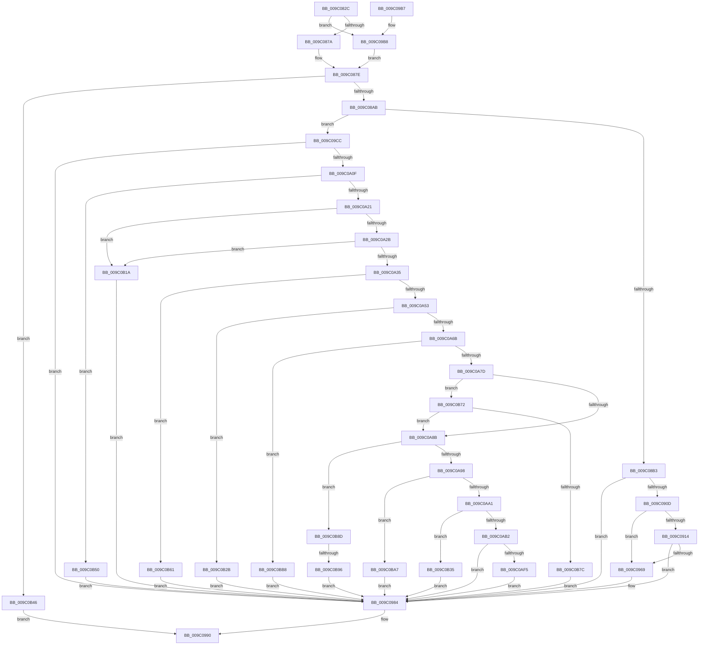

# EtwpUpdateFileHeader

- RVA: `0x009C082C`–`0x009C0BC9` (길이 `925` bytes)
- VA: `0x00000001409C082C`
- 실행 섹션: `PAGE`
- PDB 이름 있음: `예`; PDB Function 태그: `예`
- unwind 정보 RVA: `0x0009F58C`
- 디코드: `213`개 명령, `925/925` bytes 표시
- 미해석 바이트: `0` (있으면 어셈블리에 `.byte`로 보존)

> 이 문서는 커널 이미지의 기계어와 PDB 기호를 분석해 생성했습니다. 4번과 5번은 함수 원형과 자료형을 바이너리 사용 방식에서 추정한 C 해석이며 원본 소스 복구 결과는 아닙니다.

## 1. Dependencies

- 직접 호출 지점: **12**; 고유 호출 대상: **11**
- 직접 호출자로 확인된 함수: **1**
- RIP 상대 이미지 참조: **1**

### Outgoing calls
- `0x009C089A` → [ExAllocatePool2](../../poolcode/B8/ExAllocatePool2_function_00B820F0.md) (function, `0x00B820F0`)
- `0x009C08B9` → [EtwpInitializeBufferHeader](../../text/3E/EtwpInitializeBufferHeader_function_003EB010.md) (function, `0x003EB010`)
- `0x009C08C6` → [EtwpResetBufferHeader](../../text/3E/EtwpResetBufferHeader_function_003EB558.md) (function, `0x003EB558`)
- `0x009C08D1` → [EtwpAddLogHeader](EtwpAddLogHeader_function_009C0BD0.md) (function, `0x009C0BD0`)
- `0x009C0902` → [ZwWriteFile](../../text/6A/ZwWriteFile_function_006AD1D0.md) (function, `0x006AD1D0`)
- `0x009C095E` → [ZwSetInformationFile](../../text/6A/ZwSetInformationFile_function_006AD5B0.md) (function, `0x006AD5B0`)
- `0x009C0989` → [ExFreePoolWithTag](../../poolcode/B8/ExFreePoolWithTag_function_00B82870.md) (function, `0x00B82870`)
- `0x009C0997` → [_security_check_cookie](../../text/6A/_security_check_cookie_function_006AC640.md) (function, `0x006AC640`)
- `0x009C0A00` → [ZwReadFile](../../text/6A/ZwReadFile_function_006AD190.md) (function, `0x006AD190`)
- `0x009C0A38` → [EtwpIsWow64Logger](EtwpIsWow64Logger_function_009C22AC.md) (function, `0x009C22AC`)
- `0x009C0AA4` → [EtwpQueryUsedProcessorCount](../../text/3E/EtwpQueryUsedProcessorCount_function_003EB940.md) (function, `0x003EB940`)
- `0x009C0AE6` → [ZwWriteFile](../../text/6A/ZwWriteFile_function_006AD1D0.md) (function, `0x006AD1D0`)

### Direct callers
- [EtwpCreateLogFile](EtwpCreateLogFile_function_009C035C.md) at `0x009C05E1`

### Static image references
- `0x009C0848` → RVA `0x00E0A740` (`.data`; read)

## 2. Other-region calls and transfers

- 다른 실행 섹션으로 향하는 call: **10**
  - `0x009C089A` → [ExAllocatePool2](../../poolcode/B8/ExAllocatePool2_function_00B820F0.md) (`PAGE` → `POOLCODE`)
  - `0x009C08B9` → [EtwpInitializeBufferHeader](../../text/3E/EtwpInitializeBufferHeader_function_003EB010.md) (`PAGE` → `.text`)
  - `0x009C08C6` → [EtwpResetBufferHeader](../../text/3E/EtwpResetBufferHeader_function_003EB558.md) (`PAGE` → `.text`)
  - `0x009C0902` → [ZwWriteFile](../../text/6A/ZwWriteFile_function_006AD1D0.md) (`PAGE` → `.text`)
  - `0x009C095E` → [ZwSetInformationFile](../../text/6A/ZwSetInformationFile_function_006AD5B0.md) (`PAGE` → `.text`)
  - `0x009C0989` → [ExFreePoolWithTag](../../poolcode/B8/ExFreePoolWithTag_function_00B82870.md) (`PAGE` → `POOLCODE`)
  - `0x009C0997` → [_security_check_cookie](../../text/6A/_security_check_cookie_function_006AC640.md) (`PAGE` → `.text`)
  - `0x009C0A00` → [ZwReadFile](../../text/6A/ZwReadFile_function_006AD190.md) (`PAGE` → `.text`)
  - `0x009C0AA4` → [EtwpQueryUsedProcessorCount](../../text/3E/EtwpQueryUsedProcessorCount_function_003EB940.md) (`PAGE` → `.text`)
  - `0x009C0AE6` → [ZwWriteFile](../../text/6A/ZwWriteFile_function_006AD1D0.md) (`PAGE` → `.text`)
- call이 아닌 외부 분기/꼬리 이동: **1**
  - `0x009C0B90` → [sub_00B2EBDC](../B2/Unknown_function_00B2EBDC.md) (`tail-transfer`)

## 3. Assembly (complete function range)

```asm
009C082C  48 89 5C 24 10                  mov qword ptr [rsp + 0x10], rbx
009C0831  55                              push rbp
009C0832  56                              push rsi
009C0833  57                              push rdi
009C0834  41 54                           push r12
009C0836  41 55                           push r13
009C0838  41 56                           push r14
009C083A  41 57                           push r15
009C083C  48 8D 6C 24 D9                  lea rbp, [rsp - 0x27]
009C0841  48 81 EC A0 00 00 00            sub rsp, 0xa0
009C0848  48 8B 05 F1 9E 44 00            mov rax, qword ptr [rip + 0x449ef1]
009C084F  48 33 C4                        xor rax, rsp
009C0852  48 89 45 17                     mov qword ptr [rbp + 0x17], rax
009C0856  33 C0                           xor eax, eax
009C0858  0F 57 C0                        xorps xmm0, xmm0
009C085B  45 33 FF                        xor r15d, r15d
009C085E  48 89 45 0F                     mov qword ptr [rbp + 0xf], rax
009C0862  45 8B E8                        mov r13d, r8d
009C0865  8A DA                           mov bl, dl
009C0867  48 8B F9                        mov rdi, rcx
009C086A  0F 11 45 FF                     movups xmmword ptr [rbp - 1], xmm0
009C086E  0F 11 45 DF                     movups xmmword ptr [rbp - 0x21], xmm0
009C0872  84 D2                           test dl, dl
009C0874  0F 85 3E 01 00 00               jne 0x1409c09b8
009C087A  44 8B 61 04                     mov r12d, dword ptr [rcx + 4]
009C087E  45 8B F4                        mov r14d, r12d
009C0881  B9 00 01 00 00                  mov ecx, 0x100
009C0886  41 B8 45 74 77 50               mov r8d, 0x50777445
009C088C  49 8D 96 FF 0F 00 00            lea rdx, [r14 + 0xfff]
009C0893  48 81 E2 00 F0 FF FF            and rdx, 0xfffffffffffff000
009C089A  E8 51 18 1C 00                  call 0x140b820f0
009C089F  48 8B F0                        mov rsi, rax
009C08A2  48 85 C0                        test rax, rax
009C08A5  0F 84 9B 02 00 00               je 0x1409c0b46
009C08AB  84 DB                           test bl, bl
009C08AD  0F 85 19 01 00 00               jne 0x1409c09cc
009C08B3  48 8B D0                        mov rdx, rax
009C08B6  48 8B CF                        mov rcx, rdi
009C08B9  E8 52 A7 A2 FF                  call 0x1403eb010
009C08BE  BA 04 00 00 00                  mov edx, 4
009C08C3  48 8B CE                        mov rcx, rsi
009C08C6  E8 8D AC A2 FF                  call 0x1403eb558
009C08CB  48 8B D6                        mov rdx, rsi
009C08CE  48 8B CF                        mov rcx, rdi
009C08D1  E8 FA 02 00 00                  call 0x1409c0bd0
009C08D6  48 8B 8F 20 03 00 00            mov rcx, qword ptr [rdi + 0x320]
009C08DD  48 8D 45 DF                     lea rax, [rbp - 0x21]
009C08E1  4C 89 7C 24 40                  mov qword ptr [rsp + 0x40], r15
009C08E6  45 33 C9                        xor r9d, r9d
009C08E9  4C 89 7C 24 38                  mov qword ptr [rsp + 0x38], r15
009C08EE  45 33 C0                        xor r8d, r8d
009C08F1  44 89 64 24 30                  mov dword ptr [rsp + 0x30], r12d
009C08F6  33 D2                           xor edx, edx
009C08F8  48 89 74 24 28                  mov qword ptr [rsp + 0x28], rsi
009C08FD  48 89 44 24 20                  mov qword ptr [rsp + 0x20], rax
009C0902  E8 C9 C8 CE FF                  call 0x1406ad1d0
009C0907  8B D8                           mov ebx, eax
009C0909  85 C0                           test eax, eax
009C090B  78 77                           js 0x1409c0984
009C090D  8B 47 0C                        mov eax, dword ptr [rdi + 0xc]
009C0910  A8 20                           test al, 0x20
009C0912  74 55                           je 0x1409c0969
009C0914  25 00 20 00 00                  and eax, 0x2000
009C0919  C7 44 24 20 14 00 00 00         mov dword ptr [rsp + 0x20], 0x14
009C0921  F7 D8                           neg eax
009C0923  4C 8D 45 D7                     lea r8, [rbp - 0x29]
009C0927  8B 87 24 01 00 00               mov eax, dword ptr [rdi + 0x124]
009C092D  48 8D 55 EF                     lea rdx, [rbp - 0x11]
009C0931  48 1B C9                        sbb rcx, rcx
009C0934  0F 57 C0                        xorps xmm0, xmm0
009C0937  48 81 E1 00 04 F0 FF            and rcx, 0xfffffffffff00400
009C093E  41 B9 08 00 00 00               mov r9d, 8
009C0944  48 81 C1 00 00 10 00            add rcx, 0x100000
009C094B  48 0F AF C8                     imul rcx, rax
009C094F  0F 11 45 EF                     movups xmmword ptr [rbp - 0x11], xmm0
009C0953  48 89 4D D7                     mov qword ptr [rbp - 0x29], rcx
009C0957  48 8B 8F 20 03 00 00            mov rcx, qword ptr [rdi + 0x320]
009C095E  E8 4D CC CE FF                  call 0x1406ad5b0
009C0963  8B D8                           mov ebx, eax
009C0965  85 C0                           test eax, eax
009C0967  78 1B                           js 0x1409c0984
009C0969  C7 87 F8 00 00 00 01 00 00 00   mov dword ptr [rdi + 0xf8], 1
009C0973  C7 87 CC 00 00 00 01 00 00 00   mov dword ptr [rdi + 0xcc], 1
009C097D  4C 89 B7 D8 00 00 00            mov qword ptr [rdi + 0xd8], r14
009C0984  33 D2                           xor edx, edx
009C0986  48 8B CE                        mov rcx, rsi
009C0989  E8 E2 1E 1C 00                  call 0x140b82870
009C098E  8B C3                           mov eax, ebx
009C0990  48 8B 4D 17                     mov rcx, qword ptr [rbp + 0x17]
009C0994  48 33 CC                        xor rcx, rsp
009C0997  E8 A4 BC CE FF                  call 0x1406ac640
009C099C  48 8B 9C 24 E8 00 00 00         mov rbx, qword ptr [rsp + 0xe8]
009C09A4  48 81 C4 A0 00 00 00            add rsp, 0xa0
009C09AB  41 5F                           pop r15
009C09AD  41 5E                           pop r14
009C09AF  41 5D                           pop r13
009C09B1  41 5C                           pop r12
009C09B3  5F                              pop rdi
009C09B4  5E                              pop rsi
009C09B5  5D                              pop rbp
009C09B6  C3                              ret
009C09B7  CC                              int3
009C09B8  41 8B C5                        mov eax, r13d
009C09BB  45 8D A0 7F 01 00 00            lea r12d, [r8 + 0x17f]
009C09C2  F7 D8                           neg eax
009C09C4  44 23 E0                        and r12d, eax
009C09C7  E9 B2 FE FF FF                  jmp 0x1409c087e
009C09CC  48 8B 8F 20 03 00 00            mov rcx, qword ptr [rdi + 0x320]
009C09D3  48 8D 45 D7                     lea rax, [rbp - 0x29]
009C09D7  4C 89 7C 24 40                  mov qword ptr [rsp + 0x40], r15
009C09DC  45 33 C9                        xor r9d, r9d
009C09DF  48 89 44 24 38                  mov qword ptr [rsp + 0x38], rax
009C09E4  45 33 C0                        xor r8d, r8d
009C09E7  44 89 64 24 30                  mov dword ptr [rsp + 0x30], r12d
009C09EC  48 8D 45 DF                     lea rax, [rbp - 0x21]
009C09F0  48 89 74 24 28                  mov qword ptr [rsp + 0x28], rsi
009C09F5  33 D2                           xor edx, edx
009C09F7  48 89 44 24 20                  mov qword ptr [rsp + 0x20], rax
009C09FC  4C 89 7D D7                     mov qword ptr [rbp - 0x29], r15
009C0A00  E8 8B C7 CE FF                  call 0x1406ad190
009C0A05  8B D8                           mov ebx, eax
009C0A07  85 C0                           test eax, eax
009C0A09  0F 88 75 FF FF FF               js 0x1409c0984
009C0A0F  8B 96 88 00 00 00               mov edx, dword ptr [rsi + 0x88]
009C0A15  F7 C2 02 04 00 04               test edx, 0x4000402
009C0A1B  0F 85 2F 01 00 00               jne 0x1409c0b50
009C0A21  80 7E 6C 0A                     cmp byte ptr [rsi + 0x6c], 0xa
009C0A25  0F 85 EF 00 00 00               jne 0x1409c0b1a
009C0A2B  44 38 7E 6D                     cmp byte ptr [rsi + 0x6d], r15b
009C0A2F  0F 85 E5 00 00 00               jne 0x1409c0b1a
009C0A35  48 8B CF                        mov rcx, rdi
009C0A38  E8 6F 18 00 00                  call 0x1409c22ac
009C0A3D  F6 D8                           neg al
009C0A3F  1B C9                           sbb ecx, ecx
009C0A41  83 E1 FC                        and ecx, 0xfffffffc
009C0A44  83 C1 08                        add ecx, 8
009C0A47  39 8E 94 00 00 00               cmp dword ptr [rsi + 0x94], ecx
009C0A4D  0F 85 0E 01 00 00               jne 0x1409c0b61
009C0A53  44 8B 7E 68                     mov r15d, dword ptr [rsi + 0x68]
009C0A57  41 8D 45 FF                     lea eax, [r13 - 1]
009C0A5B  44 8B B6 8C 00 00 00            mov r14d, dword ptr [rsi + 0x8c]
009C0A62  41 85 C7                        test r15d, eax
009C0A65  0F 85 C0 00 00 00               jne 0x1409c0b2b
009C0A6B  41 8D 87 00 FC FF FF            lea eax, [r15 - 0x400]
009C0A72  3D 00 FC FF 00                  cmp eax, 0xfffc00
009C0A77  0F 87 3B 01 00 00               ja 0x1409c0bb8
009C0A7D  8B 87 30 03 00 00               mov eax, dword ptr [rdi + 0x330]
009C0A83  A8 02                           test al, 2
009C0A85  0F 85 E7 00 00 00               jne 0x1409c0b72
009C0A8B  45 33 ED                        xor r13d, r13d
009C0A8E  4C 39 6E 78                     cmp qword ptr [rsi + 0x78], r13
009C0A92  0F 84 F5 00 00 00               je 0x1409c0b8d
009C0A98  45 85 F6                        test r14d, r14d
009C0A9B  0F 84 06 01 00 00               je 0x1409c0ba7
009C0AA1  48 8B CF                        mov rcx, rdi
009C0AA4  E8 97 AE A2 FF                  call 0x1403eb940
009C0AA9  39 46 74                        cmp dword ptr [rsi + 0x74], eax
009C0AAC  0F 85 83 00 00 00               jne 0x1409c0b35
009C0AB2  4C 89 6C 24 40                  mov qword ptr [rsp + 0x40], r13
009C0AB7  48 8D 45 D7                     lea rax, [rbp - 0x29]
009C0ABB  48 89 44 24 38                  mov qword ptr [rsp + 0x38], rax
009C0AC0  45 33 C9                        xor r9d, r9d
009C0AC3  44 89 64 24 30                  mov dword ptr [rsp + 0x30], r12d
009C0AC8  48 8D 45 DF                     lea rax, [rbp - 0x21]
009C0ACC  4C 89 6E 78                     mov qword ptr [rsi + 0x78], r13
009C0AD0  45 33 C0                        xor r8d, r8d
009C0AD3  48 8B 8F 20 03 00 00            mov rcx, qword ptr [rdi + 0x320]
009C0ADA  33 D2                           xor edx, edx
009C0ADC  48 89 74 24 28                  mov qword ptr [rsp + 0x28], rsi
009C0AE1  48 89 44 24 20                  mov qword ptr [rsp + 0x20], rax
009C0AE6  E8 E5 C6 CE FF                  call 0x1406ad1d0
009C0AEB  8B D8                           mov ebx, eax
009C0AED  85 C0                           test eax, eax
009C0AEF  0F 88 8F FE FF FF               js 0x1409c0984
009C0AF5  44 89 B7 F8 00 00 00            mov dword ptr [rdi + 0xf8], r14d
009C0AFC  44 89 B7 CC 00 00 00            mov dword ptr [rdi + 0xcc], r14d
009C0B03  45 0F AF F7                     imul r14d, r15d
009C0B07  44 89 7F 04                     mov dword ptr [rdi + 4], r15d
009C0B0B  41 8B C6                        mov eax, r14d
009C0B0E  48 89 87 D8 00 00 00            mov qword ptr [rdi + 0xd8], rax
009C0B15  E9 6A FE FF FF                  jmp 0x1409c0984
009C0B1A  BB 0D 00 00 C0                  mov ebx, 0xc000000d
009C0B1F  C7 47 2C 02 00 00 00            mov dword ptr [rdi + 0x2c], 2
009C0B26  E9 59 FE FF FF                  jmp 0x1409c0984
009C0B2B  BB 06 02 00 C0                  mov ebx, 0xc0000206
009C0B30  E9 4F FE FF FF                  jmp 0x1409c0984
009C0B35  BB 0D 00 00 C0                  mov ebx, 0xc000000d
009C0B3A  C7 47 2C 0A 00 00 00            mov dword ptr [rdi + 0x2c], 0xa
009C0B41  E9 3E FE FF FF                  jmp 0x1409c0984
009C0B46  B8 17 00 00 C0                  mov eax, 0xc0000017
009C0B4B  E9 40 FE FF FF                  jmp 0x1409c0990
009C0B50  BB 0D 00 00 C0                  mov ebx, 0xc000000d
009C0B55  C7 47 2C 01 00 00 00            mov dword ptr [rdi + 0x2c], 1
009C0B5C  E9 23 FE FF FF                  jmp 0x1409c0984
009C0B61  BB 0D 00 00 C0                  mov ebx, 0xc000000d
009C0B66  C7 47 2C 03 00 00 00            mov dword ptr [rdi + 0x2c], 3
009C0B6D  E9 12 FE FF FF                  jmp 0x1409c0984
009C0B72  44 39 7F 04                     cmp dword ptr [rdi + 4], r15d
009C0B76  0F 84 0F FF FF FF               je 0x1409c0a8b
009C0B7C  BB 06 02 00 C0                  mov ebx, 0xc0000206
009C0B81  C7 47 2C 05 00 00 00            mov dword ptr [rdi + 0x2c], 5
009C0B88  E9 F7 FD FF FF                  jmp 0x1409c0984
009C0B8D  F6 C2 20                        test dl, 0x20
009C0B90  0F 84 46 E0 16 00               je 0x140b2ebdc
009C0B96  BB 0D 00 00 C0                  mov ebx, 0xc000000d
009C0B9B  C7 47 2C 06 00 00 00            mov dword ptr [rdi + 0x2c], 6
009C0BA2  E9 DD FD FF FF                  jmp 0x1409c0984
009C0BA7  BB 0D 00 00 C0                  mov ebx, 0xc000000d
009C0BAC  C7 47 2C 09 00 00 00            mov dword ptr [rdi + 0x2c], 9
009C0BB3  E9 CC FD FF FF                  jmp 0x1409c0984
009C0BB8  BB 0D 00 00 C0                  mov ebx, 0xc000000d
009C0BBD  C7 47 2C 04 00 00 00            mov dword ptr [rdi + 0x2c], 4
009C0BC4  E9 BB FD FF FF                  jmp 0x1409c0984
```

## 4. C-style interpretation (structured pseudocode)

```c
__int64 __fastcall EtwpUpdateFileHeader(__int64 a1, unsigned __int8 a2, int a3, int a4)
{
    __int64 result;
    __int64 v_r12;
    __int64 v_r13;
    __int64 v_r14;
    __int64 v_r15;
    __int64 v_rsp;
    unsigned __int64 v_stack_m48;
    unsigned __int64 v_stack_m50;
    unsigned __int64 v_stack_m5F;
    unsigned __int64 v_stack_m60;
    unsigned __int64 v_stack_m70;
    unsigned __int64 v_stack_m80;
    unsigned __int64 v_stack_m88;
    unsigned __int64 v_stack_m98;
    unsigned __int64 v_stack_mA0;
    unsigned int v_stack_mA8;
    unsigned __int64 v_stack_mB0;
    unsigned __int64 v_stack_mB8;
    unsigned __int64 v_stack_p10;
    unsigned __int64 v_stack_p20;
    unsigned __int64 v_stack_p28;
    unsigned int v_stack_p30;
    unsigned __int64 v_stack_p38;
    unsigned __int64 v_stack_p40;

    v_stack_p10 = v_rbx;
    v_rsp = (v_rsp) - (160);
    result = (*(unsigned __int64 *)(v_rip + 4497137)) ^ (v_rsp);
    v_stack_m48 = result;
    result = 0;
    v_r15 = 0;
    v_stack_m50 = 0;
    v_stack_m60 = v_xmm0;
    v_stack_m80 = v_xmm0;
    if (a2 != 0) goto loc_009C09B8;
loc_009C087E:
    a2 = ((unsigned int)((unsigned int)((unsigned int)(*(unsigned int *)(a1 + 4)))) + 4095) & (0xFFFFFFFFFFFFF000ULL);
    result = ExAllocatePool2(256, a2, (unsigned int)(0x50777445ULL), a4);
    if (result == 0) goto loc_009C0B46;
    if (a2 != 0) goto loc_009C09CC;
    result = EtwpInitializeBufferHeader(a1, result, (unsigned int)(0x50777445ULL), a4);
    result = EtwpResetBufferHeader(result, 4, (unsigned int)(0x50777445ULL), a4);
    result = EtwpAddLogHeader(a1, result, (unsigned int)(0x50777445ULL), a4);
    v_stack_m98 = 0;
    a4 = 0;
    v_stack_mA0 = 0;
    a3 = 0;
    v_stack_mA8 = (unsigned int)((unsigned int)(*(unsigned int *)(a1 + 4)));
    a2 = 0;
    v_stack_mB0 = result;
    v_stack_mB8 = v_stack_m80;
    result = ZwWriteFile(*(unsigned __int64 *)(a1 + 800), a2, a3, a4);
    if (sign_flag) goto loc_009C0984;
    if ((((unsigned __int8)((unsigned int)(*(unsigned int *)(a1 + 12)))) & (32)) == 0) goto loc_009C0969;
    result = (unsigned int)(((unsigned int)(*(unsigned int *)(a1 + 12))) & (0x2000ULL));
    v_stack_mB8 = 20;
    result = (unsigned int)(-(result));
    a1 = (*(unsigned __int64 *)(a1 + 800)) & (0xFFFFFFFFFFF00400ULL);
    a1 = (a1) + (0x100000ULL);
    a1 = (a1) * ((unsigned int)(*(unsigned int *)(a1 + 292)));
    v_stack_m70 = v_xmm0;
    v_stack_m88 = a1;
    result = ZwSetInformationFile(*(unsigned __int64 *)(a1 + 800), v_stack_m70, v_stack_m88, 8);
    if (!(sign_flag)) {
        *(unsigned int *)(a1 + 248) = 1;
        *(unsigned int *)(a1 + 204) = 1;
        *(unsigned __int64 *)(a1 + 216) = (unsigned int)((unsigned int)((unsigned int)(*(unsigned int *)(a1 + 4))));
    }
    a2 = 0;
    result = ExFreePoolWithTag(result, a2, v_stack_m88, 8);
loc_009C0990:
    a1 = (v_stack_m48) ^ (v_rsp);
    result = _security_check_cookie(a1, a2, v_stack_m88, 8);
    v_rsp = (v_rsp) + (160);
    return result;
loc_009C09B8:
    result = (unsigned int)(-((unsigned int)((unsigned int)((unsigned int)(a3)))));
    v_r12 = (unsigned int)((v_stack_m88 + 383) & ((unsigned int)(result)));
    goto loc_009C087E;
loc_009C09CC:
    v_stack_p40 = 0;
    a4 = 0;
    v_stack_p38 = v_stack_m88;
    a3 = 0;
    v_stack_p30 = (unsigned int)(v_r12);
    v_stack_p28 = result;
    a2 = 0;
    v_stack_p20 = v_stack_m80;
    v_stack_m88 = 0;
    result = ZwReadFile(*(unsigned __int64 *)(a1 + 800), a2, a3, a4);
    if (sign_flag) goto loc_009C0984;
    if ((((unsigned int)((unsigned int)(*(unsigned int *)(result + 136)))) & (0x4000402ULL)) != 0) goto loc_009C0B50;
    if ((*(unsigned __int8 *)(result + 108)) != 10) goto loc_009C0B1A;
    if ((*(unsigned __int8 *)(result + 109)) != 0) goto loc_009C0B1A;
    result = EtwpIsWow64Logger(a1, (unsigned int)(*(unsigned int *)(result + 136)), a3, a4);
    result = (unsigned __int8)(-(result));
    a1 = (unsigned int)((a1) & (0xFFFFFFFCULL));
    a1 = (unsigned int)((a1) + (8));
    if ((*(unsigned int *)(result + 148)) != ((unsigned int)(a1))) goto loc_009C0B61;
    if ((((unsigned int)((unsigned int)(*(unsigned int *)(result + 104)))) & ((unsigned int)((unsigned int)(a3) - 1))) != 0) goto loc_009C0B2B;
    if (((unsigned int)((unsigned int)(*(unsigned int *)(result + 104)) - 1024)) > 0xFFFC00ULL) goto loc_009C0BB8;
    if ((((unsigned __int8)((unsigned int)(*(unsigned int *)(a1 + 816)))) & (2)) != 0) goto loc_009C0B72;
loc_009C0A8B:
    v_r13 = 0;
    if ((*(unsigned __int64 *)(result + 120)) == 0) goto loc_009C0B8D;
    if ((unsigned int)((unsigned int)(*(unsigned int *)(result + 140))) == 0) goto loc_009C0BA7;
    result = EtwpQueryUsedProcessorCount(a1, (unsigned int)(*(unsigned int *)(result + 136)), a3, a4);
    if ((*(unsigned int *)(result + 116)) != ((unsigned int)(result))) goto loc_009C0B35;
    v_stack_p40 = 0;
    v_stack_p38 = v_stack_m88;
    a4 = 0;
    v_stack_p30 = (unsigned int)(v_r12);
    *(unsigned __int64 *)(result + 120) = 0;
    a3 = 0;
    a2 = 0;
    v_stack_p28 = result;
    v_stack_p20 = v_stack_m80;
    result = ZwWriteFile(*(unsigned __int64 *)(a1 + 800), a2, a3, a4);
    if (sign_flag) goto loc_009C0984;
    *(unsigned int *)(a1 + 248) = (unsigned int)((unsigned int)(*(unsigned int *)(result + 140)));
    *(unsigned int *)(a1 + 204) = (unsigned int)((unsigned int)(*(unsigned int *)(result + 140)));
    v_r14 = (unsigned int)(((unsigned int)(*(unsigned int *)(result + 140))) * ((unsigned int)((unsigned int)(*(unsigned int *)(result + 104)))));
    *(unsigned int *)(a1 + 4) = (unsigned int)((unsigned int)(*(unsigned int *)(result + 104)));
    *(unsigned __int64 *)(a1 + 216) = (unsigned int)((unsigned int)(v_r14));
    goto loc_009C0984;
loc_009C0B1A:
    *(unsigned int *)(a1 + 44) = 2;
    goto loc_009C0984;
loc_009C0B2B:
    goto loc_009C0984;
loc_009C0B35:
    *(unsigned int *)(a1 + 44) = 10;
    goto loc_009C0984;
loc_009C0B46:
    goto loc_009C0990;
loc_009C0B50:
    *(unsigned int *)(a1 + 44) = 1;
    goto loc_009C0984;
loc_009C0B61:
    *(unsigned int *)(a1 + 44) = 3;
    goto loc_009C0984;
loc_009C0B72:
    if ((*(unsigned int *)(a1 + 4)) == ((unsigned int)((unsigned int)(*(unsigned int *)(result + 104))))) goto loc_009C0A8B;
    *(unsigned int *)(a1 + 44) = 5;
    goto loc_009C0984;
loc_009C0B8D:
    *(unsigned int *)(a1 + 44) = 6;
    goto loc_009C0984;
loc_009C0BA7:
    *(unsigned int *)(a1 + 44) = 9;
    goto loc_009C0984;
loc_009C0BB8:
    *(unsigned int *)(a1 + 44) = 4;
    goto loc_009C0984;
}
```

## 5. (Beta) C Style

```c
int64_t EtwpUpdateFileHeader(void *Arg1, uint8_t Arg2, void *Arg3, int32_t Arg4)
{
    uint8_t *arg1 = (uint8_t *)Arg1;
    uint8_t *arg3 = (uint8_t *)Arg3;

    int64_t result;
    int64_t local_r12;
    int64_t local_r13;
    int64_t local_r14;
    int64_t local_r15;
    int64_t local_rsp;
    uint64_t v_stack_m48;
    uint64_t v_stack_m50;
    uint64_t v_stack_m5F;
    uint64_t v_stack_m60;
    uint64_t v_stack_m70;
    uint64_t v_stack_m80;
    uint64_t v_stack_m88;
    uint64_t v_stack_m98;
    uint64_t v_stack_mA0;
    uint32_t v_stack_mA8;
    uint64_t v_stack_mB0;
    uint64_t v_stack_mB8;
    uint64_t v_stack_p10;
    uint64_t v_stack_p20;
    uint64_t v_stack_p28;
    uint32_t v_stack_p30;
    uint64_t v_stack_p38;
    uint64_t v_stack_p40;

    v_stack_p10 = local_rbx;
    local_rsp = (local_rsp) - (160);
    result = (*(uint64_t *)(v_rip + 0x449EF1)) ^ (local_rsp);
    v_stack_m48 = result;
    result = 0;
    local_r15 = 0;
    v_stack_m50 = 0;
    v_stack_m60 = v_xmm0;
    v_stack_m80 = v_xmm0;
    if (Arg2 != 0) goto loc_009C09B8;
loc_009C087E:
    Arg2 = ((uint32_t)((uint32_t)((uint32_t)(*(uint32_t *)(arg1 + 0x4)))) + 4095) & (0xFFFFFFFFFFFFF000ULL);
    result = ExAllocatePool2(256, Arg2, (uint32_t)(0x50777445ULL), Arg4);
    if (result == 0) goto loc_009C0B46;
    if (Arg2 != 0) goto loc_009C09CC;
    result = EtwpInitializeBufferHeader(Arg1, result, (uint32_t)(0x50777445ULL), Arg4);
    result = EtwpResetBufferHeader(result, 4, (uint32_t)(0x50777445ULL), Arg4);
    result = EtwpAddLogHeader(Arg1, result, (uint32_t)(0x50777445ULL), Arg4);
    v_stack_m98 = 0;
    Arg4 = 0;
    v_stack_mA0 = 0;
    Arg3 = 0;
    v_stack_mA8 = (uint32_t)((uint32_t)(*(uint32_t *)(arg1 + 0x4)));
    Arg2 = 0;
    v_stack_mB0 = result;
    v_stack_mB8 = v_stack_m80;
    result = ZwWriteFile(*(uint64_t *)(arg1 + 0x320), Arg2, Arg3, Arg4);
    if (sign_flag) goto loc_009C0984;
    if ((((uint8_t)((uint32_t)(*(uint32_t *)(arg1 + 0xC)))) & (32)) == 0) goto loc_009C0969;
    result = (uint32_t)(((uint32_t)(*(uint32_t *)(arg1 + 0xC))) & (0x2000ULL));
    v_stack_mB8 = 20;
    result = (uint32_t)(-(result));
    Arg1 = (*(uint64_t *)(arg1 + 0x320)) & (0xFFFFFFFFFFF00400ULL);
    Arg1 = (Arg1) + (0x100000ULL);
    Arg1 = (Arg1) * ((uint32_t)(*(uint32_t *)(arg1 + 0x124)));
    v_stack_m70 = v_xmm0;
    v_stack_m88 = Arg1;
    result = ZwSetInformationFile(*(uint64_t *)(arg1 + 0x320), v_stack_m70, v_stack_m88, 8);
    if (!(sign_flag)) {
        *(uint32_t *)(arg1 + 0xF8) = 1;
        *(uint32_t *)(arg1 + 0xCC) = 1;
        *(uint64_t *)(arg1 + 0xD8) = (uint32_t)((uint32_t)((uint32_t)(*(uint32_t *)(arg1 + 0x4))));
    }
    Arg2 = 0;
    result = ExFreePoolWithTag(result, Arg2, v_stack_m88, 8);
loc_009C0990:
    Arg1 = (v_stack_m48) ^ (local_rsp);
    result = _security_check_cookie(Arg1, Arg2, v_stack_m88, 8);
    local_rsp = (local_rsp) + (160);
    return result;
loc_009C09B8:
    result = (uint32_t)(-((uint32_t)((uint32_t)((uint32_t)(Arg3)))));
    local_r12 = (uint32_t)((v_stack_m88 + 383) & ((uint32_t)(result)));
    goto loc_009C087E;
loc_009C09CC:
    v_stack_p40 = 0;
    Arg4 = 0;
    v_stack_p38 = v_stack_m88;
    Arg3 = 0;
    v_stack_p30 = (uint32_t)(local_r12);
    v_stack_p28 = result;
    Arg2 = 0;
    v_stack_p20 = v_stack_m80;
    v_stack_m88 = 0;
    result = ZwReadFile(*(uint64_t *)(arg1 + 0x320), Arg2, Arg3, Arg4);
    if (sign_flag) goto loc_009C0984;
    if ((((uint32_t)((uint32_t)(*(uint32_t *)(result + 0x88)))) & (0x4000402ULL)) != 0) goto loc_009C0B50;
    if ((*(uint8_t *)(result + 0x6C)) != 10) goto loc_009C0B1A;
    if ((*(uint8_t *)(result + 0x6D)) != 0) goto loc_009C0B1A;
    result = EtwpIsWow64Logger(Arg1, (uint32_t)(*(uint32_t *)(result + 0x88)), Arg3, Arg4);
    result = (uint8_t)(-(result));
    Arg1 = (uint32_t)((Arg1) & (0xFFFFFFFCULL));
    Arg1 = (uint32_t)((Arg1) + (8));
    if ((*(uint32_t *)(result + 0x94)) != ((uint32_t)(Arg1))) goto loc_009C0B61;
    if ((((uint32_t)((uint32_t)(*(uint32_t *)(result + 0x68)))) & ((uint32_t)((uint32_t)(Arg3) - 1))) != 0) goto loc_009C0B2B;
    if (((uint32_t)((uint32_t)(*(uint32_t *)(result + 0x68)) - 1024)) > 0xFFFC00ULL) goto loc_009C0BB8;
    if ((((uint8_t)((uint32_t)(*(uint32_t *)(arg1 + 0x330)))) & (2)) != 0) goto loc_009C0B72;
loc_009C0A8B:
    local_r13 = 0;
    if ((*(uint64_t *)(result + 0x78)) == 0) goto loc_009C0B8D;
    if ((uint32_t)((uint32_t)(*(uint32_t *)(result + 0x8C))) == 0) goto loc_009C0BA7;
    result = EtwpQueryUsedProcessorCount(Arg1, (uint32_t)(*(uint32_t *)(result + 0x88)), Arg3, Arg4);
    if ((*(uint32_t *)(result + 0x74)) != ((uint32_t)(result))) goto loc_009C0B35;
    v_stack_p40 = 0;
    v_stack_p38 = v_stack_m88;
    Arg4 = 0;
    v_stack_p30 = (uint32_t)(local_r12);
    *(uint64_t *)(result + 0x78) = 0;
    Arg3 = 0;
    Arg2 = 0;
    v_stack_p28 = result;
    v_stack_p20 = v_stack_m80;
    result = ZwWriteFile(*(uint64_t *)(arg1 + 0x320), Arg2, Arg3, Arg4);
    if (sign_flag) goto loc_009C0984;
    *(uint32_t *)(arg1 + 0xF8) = (uint32_t)((uint32_t)(*(uint32_t *)(result + 0x8C)));
    *(uint32_t *)(arg1 + 0xCC) = (uint32_t)((uint32_t)(*(uint32_t *)(result + 0x8C)));
    local_r14 = (uint32_t)(((uint32_t)(*(uint32_t *)(result + 0x8C))) * ((uint32_t)((uint32_t)(*(uint32_t *)(result + 0x68)))));
    *(uint32_t *)(arg1 + 0x4) = (uint32_t)((uint32_t)(*(uint32_t *)(result + 0x68)));
    *(uint64_t *)(arg1 + 0xD8) = (uint32_t)((uint32_t)(local_r14));
    goto loc_009C0984;
loc_009C0B1A:
    *(uint32_t *)(arg1 + 0x2C) = 2;
    goto loc_009C0984;
loc_009C0B2B:
    goto loc_009C0984;
loc_009C0B35:
    *(uint32_t *)(arg1 + 0x2C) = 10;
    goto loc_009C0984;
loc_009C0B46:
    goto loc_009C0990;
loc_009C0B50:
    *(uint32_t *)(arg1 + 0x2C) = 1;
    goto loc_009C0984;
loc_009C0B61:
    *(uint32_t *)(arg1 + 0x2C) = 3;
    goto loc_009C0984;
loc_009C0B72:
    if ((*(uint32_t *)(arg1 + 0x4)) == ((uint32_t)((uint32_t)(*(uint32_t *)(result + 0x68))))) goto loc_009C0A8B;
    *(uint32_t *)(arg1 + 0x2C) = 5;
    goto loc_009C0984;
loc_009C0B8D:
    *(uint32_t *)(arg1 + 0x2C) = 6;
    goto loc_009C0984;
loc_009C0BA7:
    *(uint32_t *)(arg1 + 0x2C) = 9;
    goto loc_009C0984;
loc_009C0BB8:
    *(uint32_t *)(arg1 + 0x2C) = 4;
    goto loc_009C0984;
}
```

### 관측된 메모리 오프셋

구조체 형식이 확인되지 않은 접근은 인자 기준의 오프셋으로만 기록했습니다.

| 기준 인자 | 오프셋 표현 | 폭 (bit) | 접근 |
|---|---:|---:|---|
| `Arg1` | `+ 0x4` | `32` | `R` |
| `Arg1` | `+ 0x4` | `32` | `W` |
| `Arg1` | `+ 0xC` | `32` | `R` |
| `Arg1` | `+ 0x2C` | `32` | `W` |
| `Arg1` | `+ 0xCC` | `32` | `W` |
| `Arg1` | `+ 0xD8` | `64` | `W` |
| `Arg1` | `+ 0xF8` | `32` | `W` |
| `Arg1` | `+ 0x124` | `32` | `R` |
| `Arg1` | `+ 0x320` | `64` | `R` |
| `Arg1` | `+ 0x330` | `32` | `R` |
| `Arg3` | `- 0x1` | `32` | `R` |
| `Arg3` | `+ 0x17F` | `32` | `R` |

## 6. Execution-region graph

[열기: 2D/3D 그래프와 함수 탐색 컨트롤 패널](../../../control-panel.html?section=page&rva=0x009C082C&view=graph)

- 2D 그래프는 위에서 아래로 흐르고, 3D 그래프는 빈 공간을 드래그해 회전합니다. Shift+드래그는 이동, 휠은 확대·축소, 함수 노드 선택은 대상 보고서 이동입니다.

### Static fallback


