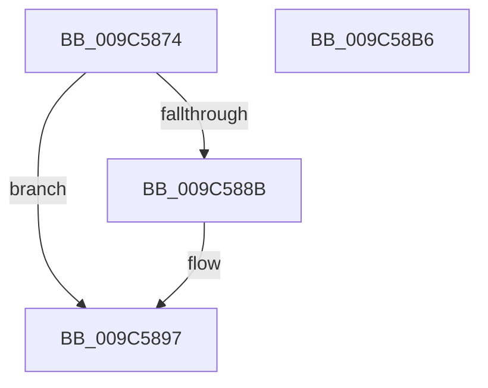

# ExReleaseTimeRefreshLockExclusive

- RVA: `0x009C5874`–`0x009C58B7` (길이 `67` bytes)
- VA: `0x00000001409C5874`
- 실행 섹션: `PAGE`
- PDB 이름 있음: `예`; PDB Function 태그: `아니요`
- unwind 정보 RVA: `0x0005C788`
- 디코드: `15`개 명령, `67/67` bytes 표시
- 미해석 바이트: `0` (있으면 어셈블리에 `.byte`로 보존)

> 이 문서는 커널 이미지의 기계어와 PDB 기호를 분석해 생성했습니다. 4번과 5번은 함수 원형과 자료형을 바이너리 사용 방식에서 추정한 C 해석이며 원본 소스 복구 결과는 아닙니다.

## 1. Dependencies

- 직접 호출 지점: **3**; 고유 호출 대상: **3**
- 직접 호출자로 확인된 함수: **13**
- RIP 상대 이미지 참조: **2**

### Outgoing calls
- `0x009C5892` → [ExfTryToWakePushLock](../../text/26/ExfTryToWakePushLock_function_00265DD0.md) (function, `0x00265DD0`)
- `0x009C589E` → [KeAbPostRelease](../../text/2E/KeAbPostRelease_function_002E1600.md) (function, `0x002E1600`)
- `0x009C58AC` → [KeLeaveCriticalRegionThread](../../text/25/KeLeaveCriticalRegionThread_function_0025EFF0.md) (function, `0x0025EFF0`)

### Direct callers
- [ExCleanTimerResolutionRequest](../../text/4B/ExCleanTimerResolutionRequest_function_004B0C58.md) at `0x004B0CD8`
- [ExpReadLeapSecondData](../7C/ExpReadLeapSecondData_function_007C5EAC.md) at `0x007C60D1`
- [ExpRefreshSystemTime](../7C/ExpRefreshSystemTime_function_007C6264.md) at `0x007C6350`
- [ExpTimeZoneInitSiloState](../7C/ExpTimeZoneInitSiloState_function_007C6430.md) at `0x007C64BD`
- [NtSetSystemTime](../7C/NtSetSystemTime_function_007C65F0.md) at `0x007C674C`
- [NtSetSystemTime](../7C/NtSetSystemTime_function_007C65F0.md) at `0x007C6862`
- [NtSetSystemTime](../7C/NtSetSystemTime_function_007C65F0.md) at `0x007C6898`
- [NtSetTimerResolution](NtSetTimerResolution_function_009C5170.md) at `0x009C540C`
- [ExUpdateTimerResolutionPolicy](ExUpdateTimerResolutionPolicy_function_009C579C.md) at `0x009C57E9`
- [NtSetSystemInformation](../AF/NtSetSystemInformation_function_00AF4A60.md) at `0x00AF4DA7`
- [ExpTimeRefreshWork](../../pagelk/B7/ExpTimeRefreshWork_function_00B72A80.md) at `0x00B72A9B`
- [PoBroadcastSystemState](../../pagelk/B7/PoBroadcastSystemState_function_00B761B0.md) at `0x00B76481`
- [PopTransitionSystemPowerStateEx](../../pagelk/B7/PopTransitionSystemPowerStateEx_function_00B7E8C0.md) at `0x00B7F644`
- [KdpTimeSlipWork](../../pagekd/B8/KdpTimeSlipWork_function_00B88650.md) at `0x00B88668`
- [Phase1InitializationDiscard](../../init/C1/Phase1InitializationDiscard_function_00C1C728.md) at `0x00C1D6C9`

### Static image references
- `0x009C587C` → RVA `0x00EFEFC8` (`.data`; read/write)
- `0x009C588B` → RVA `0x00EFEFC8` (`.data`; read)

## 2. Other-region calls and transfers

- 다른 실행 섹션으로 향하는 call: **3**
  - `0x009C5892` → [ExfTryToWakePushLock](../../text/26/ExfTryToWakePushLock_function_00265DD0.md) (`PAGE` → `.text`)
  - `0x009C589E` → [KeAbPostRelease](../../text/2E/KeAbPostRelease_function_002E1600.md) (`PAGE` → `.text`)
  - `0x009C58AC` → [KeLeaveCriticalRegionThread](../../text/25/KeLeaveCriticalRegionThread_function_0025EFF0.md) (`PAGE` → `.text`)
- 별도 외부 분기/꼬리 이동을 확인하지 못했습니다.

## 3. Assembly (complete function range)

```asm
009C5874  48 83 EC 28                     sub rsp, 0x28
009C5878  48 83 C8 FF                     or rax, 0xffffffffffffffff
009C587C  F0 48 0F C1 05 43 97 53 00      lock xadd qword ptr [rip + 0x539743], rax
009C5885  24 06                           and al, 6
009C5887  3C 02                           cmp al, 2
009C5889  75 0C                           jne 0x1409c5897
009C588B  48 8D 0D 36 97 53 00            lea rcx, [rip + 0x539736]
009C5892  E8 39 05 8A FF                  call 0x140265dd0
009C5897  48 8D 0D 2A 97 53 00            lea rcx, [rip + 0x53972a]
009C589E  E8 5D BD 91 FF                  call 0x1402e1600
009C58A3  65 48 8B 0C 25 88 01 00 00      mov rcx, qword ptr gs:[0x188]
009C58AC  E8 3F 97 89 FF                  call 0x14025eff0
009C58B1  48 83 C4 28                     add rsp, 0x28
009C58B5  C3                              ret
009C58B6  CC                              int3
```

## 4. C-style interpretation (structured pseudocode)

```c
__int64 __fastcall ExReleaseTimeRefreshLockExclusive(void)
{
    __int64 result;
    __int64 v_rsp;

    v_rsp = (v_rsp) - (40);
    result = (result) | (-1);
    result = (unsigned __int8)((result) & (6));
    if (((unsigned __int8)(result)) == 2) {
        a1 = v_rip + 5478198;
        result = ExfTryToWakePushLock(a1, a2, a3, a4);
    }
    result = KeAbPostRelease(v_rip + 5478186, a2, a3, a4);
    result = KeLeaveCriticalRegionThread(*(unsigned __int64 *)(gs_base + (0 + 392)), a2, a3, a4);
    v_rsp = (v_rsp) + (40);
    return result;
}
```

## 5. (Beta) C Style

```c
void ExReleaseTimeRefreshLockExclusive(void)
{
    int64_t result;
    int64_t local_rsp;

    local_rsp = (local_rsp) - (40);
    result = (result) | (-1);
    result = (uint8_t)((result) & (6));
    if (((uint8_t)(result)) == 2) {
        a1 = v_rip + 5478198;
        result = ExfTryToWakePushLock(a1, a2, a3, a4);
    }
    result = KeAbPostRelease(v_rip + 5478186, a2, a3, a4);
    result = KeLeaveCriticalRegionThread(*(uint64_t *)(gs_base + (0 + 0x188)), a2, a3, a4);
    local_rsp = (local_rsp) + (40);
    return result;
}
```

## 6. Execution-region graph

[열기: 2D/3D 그래프와 함수 탐색 컨트롤 패널](../../../control-panel.html?section=page&rva=0x009C5874&view=graph)

- 2D 그래프는 위에서 아래로 흐르고, 3D 그래프는 빈 공간을 드래그해 회전합니다. Shift+드래그는 이동, 휠은 확대·축소, 함수 노드 선택은 대상 보고서 이동입니다.

### Static fallback


