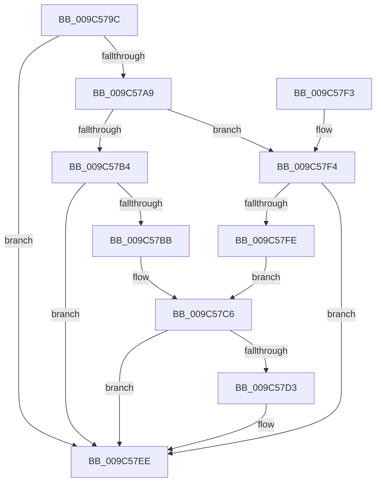

# ExUpdateTimerResolutionPolicy

- RVA: `0x009C579C`–`0x009C5807` (길이 `107` bytes)
- VA: `0x00000001409C579C`
- 실행 섹션: `PAGE`
- PDB 이름 있음: `예`; PDB Function 태그: `아니요`
- unwind 정보 RVA: `0x00068D6C`
- 디코드: `28`개 명령, `107/107` bytes 표시
- 미해석 바이트: `0` (있으면 어셈블리에 `.byte`로 보존)

> 이 문서는 커널 이미지의 기계어와 PDB 기호를 분석해 생성했습니다. 4번과 5번은 함수 원형과 자료형을 바이너리 사용 방식에서 추정한 C 해석이며 원본 소스 복구 결과는 아닙니다.

## 1. Dependencies

- 직접 호출 지점: **4**; 고유 호출 대상: **4**
- 직접 호출자로 확인된 함수: **1**
- RIP 상대 이미지 참조: **1**

### Outgoing calls
- `0x009C57D3` → [PoTraceSystemTimerResolutionIgnore](../../text/4B/PoTraceSystemTimerResolutionIgnore_function_004B8A28.md) (function, `0x004B8A28`)
- `0x009C57D8` → [ExAcquireTimeRefreshLockExclusive](ExAcquireTimeRefreshLockExclusive_function_009C5810.md) (function, `0x009C5810`)
- `0x009C57E4` → [ExpUpdateTimerResolution](../../text/39/ExpUpdateTimerResolution_function_003914A0.md) (function, `0x003914A0`)
- `0x009C57E9` → [ExReleaseTimeRefreshLockExclusive](ExReleaseTimeRefreshLockExclusive_function_009C5874.md) (function, `0x009C5874`)

### Direct callers
- [PspSetProcessTimerResolutionPolicy](PspSetProcessTimerResolutionPolicy_function_009C5780.md) at `0x009C5789`

### Static image references
- `0x009C57A0` → RVA `0x00FC5065` (`ALMOSTRO`; read)

## 2. Other-region calls and transfers

- 다른 실행 섹션으로 향하는 call: **2**
  - `0x009C57D3` → [PoTraceSystemTimerResolutionIgnore](../../text/4B/PoTraceSystemTimerResolutionIgnore_function_004B8A28.md) (`PAGE` → `.text`)
  - `0x009C57E4` → [ExpUpdateTimerResolution](../../text/39/ExpUpdateTimerResolution_function_003914A0.md) (`PAGE` → `.text`)
- 별도 외부 분기/꼬리 이동을 확인하지 못했습니다.

## 3. Assembly (complete function range)

```asm
009C579C  48 83 EC 28                     sub rsp, 0x28
009C57A0  80 3D BE F8 5F 00 00            cmp byte ptr [rip + 0x5ff8be], 0
009C57A7  74 45                           je 0x1409c57ee
009C57A9  44 8B 81 FC 05 00 00            mov r8d, dword ptr [rcx + 0x5fc]
009C57B0  84 D2                           test dl, dl
009C57B2  75 40                           jne 0x1409c57f4
009C57B4  41 0F BA E0 1A                  bt r8d, 0x1a
009C57B9  73 33                           jae 0x1409c57ee
009C57BB  F0 81 A1 FC 05 00 00 FF FF FF FB  lock and dword ptr [rcx + 0x5fc], 0xfbffffff
009C57C6  8B 81 F4 01 00 00               mov eax, dword ptr [rcx + 0x1f4]
009C57CC  C1 E8 0C                        shr eax, 0xc
009C57CF  A8 01                           test al, 1
009C57D1  74 1B                           je 0x1409c57ee
009C57D3  E8 50 32 AF FF                  call 0x1404b8a28
009C57D8  E8 33 00 00 00                  call 0x1409c5810
009C57DD  45 33 C0                        xor r8d, r8d
009C57E0  33 D2                           xor edx, edx
009C57E2  33 C9                           xor ecx, ecx
009C57E4  E8 B7 BC 9C FF                  call 0x1403914a0
009C57E9  E8 86 00 00 00                  call 0x1409c5874
009C57EE  48 83 C4 28                     add rsp, 0x28
009C57F2  C3                              ret
009C57F3  CC                              int3
009C57F4  B8 00 00 00 04                  mov eax, 0x4000000
009C57F9  44 85 C0                        test eax, r8d
009C57FC  75 F0                           jne 0x1409c57ee
009C57FE  F0 09 81 FC 05 00 00            lock or dword ptr [rcx + 0x5fc], eax
009C5805  EB BF                           jmp 0x1409c57c6
```

## 4. C-style interpretation (structured pseudocode)

```c
__int64 __fastcall ExUpdateTimerResolutionPolicy(__int64 a1, int a2)
{
    __int64 result;
    __int64 v_rsp;

    v_rsp = (v_rsp) - (40);
    if ((*(unsigned __int8 *)(v_rip + 6289598)) == 0) goto loc_009C57EE;
    if ((unsigned __int8)(a2) != 0) goto loc_009C57F4;
    if (condition_is_above_or_equal) goto loc_009C57EE;
loc_009C57C6:
    result = (unsigned int)(((unsigned int)(*(unsigned int *)(a1 + 500))) >> (12));
    if ((((unsigned __int8)(result)) & (1)) != 0) {
        result = PoTraceSystemTimerResolutionIgnore(a1, a2, (unsigned int)(*(unsigned int *)(a1 + 1532)), a4);
        result = ExAcquireTimeRefreshLockExclusive(a1, a2, (unsigned int)(*(unsigned int *)(a1 + 1532)), a4);
        a3 = 0;
        a2 = 0;
        a1 = 0;
        result = ExpUpdateTimerResolution(a1, a2, a3, a4);
        result = ExReleaseTimeRefreshLockExclusive(a1, a2, a3, a4);
    }
    v_rsp = (v_rsp) + (40);
    return result;
loc_009C57F4:
    if ((((unsigned int)((unsigned int)(0x4000000ULL))) & (0)) != 0) goto loc_009C57EE;
    goto loc_009C57C6;
}
```

## 5. (Beta) C Style

```c
int64_t ExUpdateTimerResolutionPolicy(void *Arg1, int32_t Arg2)
{
    uint8_t *arg1 = (uint8_t *)Arg1;

    int64_t result;
    int64_t local_rsp;

    local_rsp = (local_rsp) - (40);
    if ((*(uint8_t *)(v_rip + 0x5FF8BE)) == 0) goto loc_009C57EE;
    if ((uint8_t)(Arg2) != 0) goto loc_009C57F4;
    if (condition_is_above_or_equal) goto loc_009C57EE;
loc_009C57C6:
    result = (uint32_t)(((uint32_t)(*(uint32_t *)(arg1 + 0x1F4))) >> (12));
    if ((((uint8_t)(result)) & (1)) != 0) {
        result = PoTraceSystemTimerResolutionIgnore(Arg1, Arg2, (uint32_t)(*(uint32_t *)(arg1 + 0x5FC)), a4);
        result = ExAcquireTimeRefreshLockExclusive(Arg1, Arg2, (uint32_t)(*(uint32_t *)(arg1 + 0x5FC)), a4);
        a3 = 0;
        Arg2 = 0;
        Arg1 = 0;
        result = ExpUpdateTimerResolution(Arg1, Arg2, a3, a4);
        result = ExReleaseTimeRefreshLockExclusive(Arg1, Arg2, a3, a4);
    }
    local_rsp = (local_rsp) + (40);
    return result;
loc_009C57F4:
    if ((((uint32_t)((uint32_t)(0x4000000ULL))) & (0)) != 0) goto loc_009C57EE;
    goto loc_009C57C6;
}
```

### 관측된 메모리 오프셋

구조체 형식이 확인되지 않은 접근은 인자 기준의 오프셋으로만 기록했습니다.

| 기준 인자 | 오프셋 표현 | 폭 (bit) | 접근 |
|---|---:|---:|---|
| `Arg1` | `+ 0x1F4` | `32` | `R` |
| `Arg1` | `+ 0x5FC` | `32` | `R` |
| `Arg1` | `+ 0x5FC` | `32` | `R/W` |

## 6. Execution-region graph

[열기: 2D/3D 그래프와 함수 탐색 컨트롤 패널](../../../control-panel.html?section=page&rva=0x009C579C&view=graph)

- 2D 그래프는 위에서 아래로 흐르고, 3D 그래프는 빈 공간을 드래그해 회전합니다. Shift+드래그는 이동, 휠은 확대·축소, 함수 노드 선택은 대상 보고서 이동입니다.

### Static fallback


