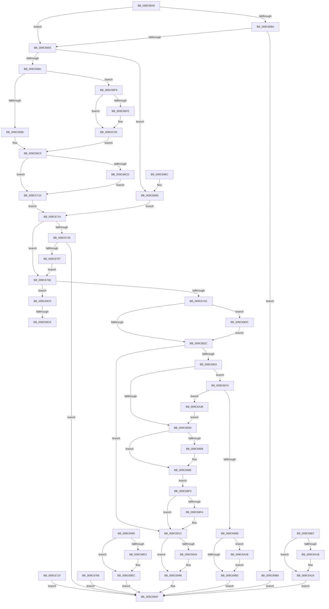

# NtAdjustGroupsToken

- RVA: `0x009C6640`–`0x009C6A51` (길이 `1,041` bytes)
- VA: `0x00000001409C6640`
- 실행 섹션: `PAGE`
- PDB 이름 있음: `예`; PDB Function 태그: `예`
- unwind 정보 RVA: `0x000A0734`
- 디코드: `253`개 명령, `1,041/1,041` bytes 표시
- 미해석 바이트: `0` (있으면 어셈블리에 `.byte`로 보존)

> 이 문서는 커널 이미지의 기계어와 PDB 기호를 분석해 생성했습니다. 4번과 5번은 함수 원형과 자료형을 바이너리 사용 방식에서 추정한 C 해석이며 원본 소스 복구 결과는 아닙니다.

## 1. Dependencies

- 직접 호출 지점: **24**; 고유 호출 대상: **10**
- 직접 호출자로 확인된 함수: **0**
- RIP 상대 이미지 참조: **3**

### Outgoing calls
- `0x009C66D9` → [ProbeForWrite](../8E/ProbeForWrite_function_008E91C0.md) (function, `0x008E91C0`)
- `0x009C66FE` → [ExRaiseDatatypeMisalignment](../89/ExRaiseDatatypeMisalignment_function_00899FD0.md) (function, `0x00899FD0`)
- `0x009C6753` → [SeCaptureSidAndAttributesArray](SeCaptureSidAndAttributesArray_function_009C9D70.md) (function, `0x009C9D70`)
- `0x009C679D` → [ObReferenceObjectByHandle](../86/ObReferenceObjectByHandle_function_00868DB0.md) (function, `0x00868DB0`)
- `0x009C67C8` → [ExAcquireResourceExclusiveLite](../../text/21/ExAcquireResourceExclusiveLite_function_00214E20.md) (function, `0x00214E20`)
- `0x009C681A` → [SepAdjustGroups](SepAdjustGroups_function_009C63A8.md) (function, `0x009C63A8`)
- `0x009C687A` → [SepAdjustGroups](SepAdjustGroups_function_009C63A8.md) (function, `0x009C63A8`)
- `0x009C68C7` → [ExReleaseResourceLite](../../text/25/ExReleaseResourceLite_function_0025FA10.md) (function, `0x0025FA10`)
- `0x009C68CC` → [KeLeaveCriticalRegion](../../text/25/KeLeaveCriticalRegion_function_0025D8B0.md) (function, `0x0025D8B0`)
- `0x009C68D4` → [ObfDereferenceObject](../../text/2F/ObfDereferenceObject_function_002F9350.md) (function, `0x002F9350`)
- `0x009C68E7` → [SeReleaseLuidAndAttributesArray](SeReleaseLuidAndAttributesArray_function_009C7C40.md) (function, `0x009C7C40`)
- `0x009C6925` → [ExReleaseResourceLite](../../text/25/ExReleaseResourceLite_function_0025FA10.md) (function, `0x0025FA10`)
- `0x009C692A` → [KeLeaveCriticalRegion](../../text/25/KeLeaveCriticalRegion_function_0025D8B0.md) (function, `0x0025D8B0`)
- `0x009C6934` → [ObfDereferenceObject](../../text/2F/ObfDereferenceObject_function_002F9350.md) (function, `0x002F9350`)
- `0x009C6946` → [SeReleaseLuidAndAttributesArray](SeReleaseLuidAndAttributesArray_function_009C7C40.md) (function, `0x009C7C40`)
- `0x009C6994` → [ExReleaseResourceLite](../../text/25/ExReleaseResourceLite_function_0025FA10.md) (function, `0x0025FA10`)
- `0x009C6999` → [KeLeaveCriticalRegion](../../text/25/KeLeaveCriticalRegion_function_0025D8B0.md) (function, `0x0025D8B0`)
- `0x009C69A3` → [ObfDereferenceObject](../../text/2F/ObfDereferenceObject_function_002F9350.md) (function, `0x002F9350`)
- `0x009C69D1` → [SeReleaseLuidAndAttributesArray](SeReleaseLuidAndAttributesArray_function_009C7C40.md) (function, `0x009C7C40`)
- `0x009C69FF` → [ExReleaseResourceLite](../../text/25/ExReleaseResourceLite_function_0025FA10.md) (function, `0x0025FA10`)
- `0x009C6A04` → [KeLeaveCriticalRegion](../../text/25/KeLeaveCriticalRegion_function_0025D8B0.md) (function, `0x0025D8B0`)
- `0x009C6A0C` → [ObfDereferenceObject](../../text/2F/ObfDereferenceObject_function_002F9350.md) (function, `0x002F9350`)
- `0x009C6A1F` → [SeReleaseLuidAndAttributesArray](SeReleaseLuidAndAttributesArray_function_009C7C40.md) (function, `0x009C7C40`)
- `0x009C6A2E` → [SeReleaseLuidAndAttributesArray](SeReleaseLuidAndAttributesArray_function_009C7C40.md) (function, `0x009C7C40`)

### Direct callers
- 이 함수 시작 RVA로 연결되는 직접 call은 확인되지 않았습니다. 간접 호출은 완전히 역산할 수 없습니다.

### Static image references
- `0x009C676E` → RVA `0x00FD8020` (`PAGEDATA`; read)
- `0x009C6897` → RVA `0x00012D08` (`.rdata`; read)
- `0x009C68A1` → RVA `0x00E0EBF0` (`.data`; read/write)

## 2. Other-region calls and transfers

- 다른 실행 섹션으로 향하는 call: **13**
  - `0x009C67C8` → [ExAcquireResourceExclusiveLite](../../text/21/ExAcquireResourceExclusiveLite_function_00214E20.md) (`PAGE` → `.text`)
  - `0x009C68C7` → [ExReleaseResourceLite](../../text/25/ExReleaseResourceLite_function_0025FA10.md) (`PAGE` → `.text`)
  - `0x009C68CC` → [KeLeaveCriticalRegion](../../text/25/KeLeaveCriticalRegion_function_0025D8B0.md) (`PAGE` → `.text`)
  - `0x009C68D4` → [ObfDereferenceObject](../../text/2F/ObfDereferenceObject_function_002F9350.md) (`PAGE` → `.text`)
  - `0x009C6925` → [ExReleaseResourceLite](../../text/25/ExReleaseResourceLite_function_0025FA10.md) (`PAGE` → `.text`)
  - `0x009C692A` → [KeLeaveCriticalRegion](../../text/25/KeLeaveCriticalRegion_function_0025D8B0.md) (`PAGE` → `.text`)
  - `0x009C6934` → [ObfDereferenceObject](../../text/2F/ObfDereferenceObject_function_002F9350.md) (`PAGE` → `.text`)
  - `0x009C6994` → [ExReleaseResourceLite](../../text/25/ExReleaseResourceLite_function_0025FA10.md) (`PAGE` → `.text`)
  - `0x009C6999` → [KeLeaveCriticalRegion](../../text/25/KeLeaveCriticalRegion_function_0025D8B0.md) (`PAGE` → `.text`)
  - `0x009C69A3` → [ObfDereferenceObject](../../text/2F/ObfDereferenceObject_function_002F9350.md) (`PAGE` → `.text`)
  - `0x009C69FF` → [ExReleaseResourceLite](../../text/25/ExReleaseResourceLite_function_0025FA10.md) (`PAGE` → `.text`)
  - `0x009C6A04` → [KeLeaveCriticalRegion](../../text/25/KeLeaveCriticalRegion_function_0025D8B0.md) (`PAGE` → `.text`)
  - `0x009C6A0C` → [ObfDereferenceObject](../../text/2F/ObfDereferenceObject_function_002F9350.md) (`PAGE` → `.text`)
- call이 아닌 외부 분기/꼬리 이동: **2**
  - `0x009C69C8` → [sub_00B2F540](../B2/Unknown_function_00B2F540.md) (`tail-transfer`)
  - `0x009C69D7` → [sub_00B2F540](../B2/Unknown_function_00B2F540.md) (`tail-transfer`)

## 3. Assembly (complete function range)

```asm
009C6640  48 8B C4                        mov rax, rsp
009C6643  48 89 58 08                     mov qword ptr [rax + 8], rbx
009C6647  48 89 70 18                     mov qword ptr [rax + 0x18], rsi
009C664B  44 89 48 20                     mov dword ptr [rax + 0x20], r9d
009C664F  57                              push rdi
009C6650  41 54                           push r12
009C6652  41 55                           push r13
009C6654  41 56                           push r14
009C6656  41 57                           push r15
009C6658  48 81 EC 80 00 00 00            sub rsp, 0x80
009C665F  4D 8B F0                        mov r14, r8
009C6662  44 8A FA                        mov r15b, dl
009C6665  4C 8B E9                        mov r13, rcx
009C6668  45 33 D2                        xor r10d, r10d
009C666B  44 89 50 B8                     mov dword ptr [rax - 0x48], r10d
009C666F  4C 89 50 C8                     mov qword ptr [rax - 0x38], r10
009C6673  44 89 50 BC                     mov dword ptr [rax - 0x44], r10d
009C6677  44 89 50 AC                     mov dword ptr [rax - 0x54], r10d
009C667B  44 89 50 B0                     mov dword ptr [rax - 0x50], r10d
009C667F  44 88 50 10                     mov byte ptr [rax + 0x10], r10b
009C6683  45 8B E2                        mov r12d, r10d
009C6686  84 D2                           test dl, dl
009C6688  75 09                           jne 0x1409c6693
009C668A  4D 85 C0                        test r8, r8
009C668D  0F 84 26 03 00 00               je 0x1409c69b9
009C6693  65 48 8B 04 25 88 01 00 00      mov rax, qword ptr gs:[0x188]
009C669C  40 8A B8 32 02 00 00            mov dil, byte ptr [rax + 0x232]
009C66A3  40 88 7C 24 50                  mov byte ptr [rsp + 0x50], dil
009C66A8  40 84 FF                        test dil, dil
009C66AB  0F 84 BC 02 00 00               je 0x1409c696d
009C66B1  45 84 FF                        test r15b, r15b
009C66B4  74 42                           je 0x1409c66f8
009C66B6  48 BE 00 00 FF FF FF 7F 00 00   movabs rsi, 0x7fffffff0000
009C66C0  48 8B 9C 24 D0 00 00 00         mov rbx, qword ptr [rsp + 0xd0]
009C66C8  48 85 DB                        test rbx, rbx
009C66CB  74 50                           je 0x1409c671d
009C66CD  41 8B D1                        mov edx, r9d
009C66D0  41 B8 04 00 00 00               mov r8d, 4
009C66D6  48 8B CB                        mov rcx, rbx
009C66D9  E8 E2 2A F2 FF                  call 0x1408e91c0
009C66DE  48 39 B4 24 D8 00 00 00         cmp qword ptr [rsp + 0xd8], rsi
009C66E6  48 0F 42 B4 24 D8 00 00 00      cmovb rsi, qword ptr [rsp + 0xd8]
009C66EF  8B 06                           mov eax, dword ptr [rsi]
009C66F1  89 06                           mov dword ptr [rsi], eax
009C66F3  45 33 D2                        xor r10d, r10d
009C66F6  EB 25                           jmp 0x1409c671d
009C66F8  41 F6 C6 03                     test r14b, 3
009C66FC  74 06                           je 0x1409c6704
009C66FE  E8 CD 38 ED FF                  call 0x140899fd0
009C6703  CC                              int3
009C6704  48 BE 00 00 FF FF FF 7F 00 00   movabs rsi, 0x7fffffff0000
009C670E  48 8B C6                        mov rax, rsi
009C6711  4C 3B F6                        cmp r14, rsi
009C6714  49 0F 42 C6                     cmovb rax, r14
009C6718  90                              nop
009C6719  8A 00                           mov al, byte ptr [rax]
009C671B  EB A3                           jmp 0x1409c66c0
009C671D  EB 05                           jmp 0x1409c6724
009C671F  E9 2B 02 00 00                  jmp 0x1409c694f
009C6724  45 84 FF                        test r15b, r15b
009C6727  75 45                           jne 0x1409c676e
009C6729  41 8B 16                        mov edx, dword ptr [r14]
009C672C  89 54 24 60                     mov dword ptr [rsp + 0x60], edx
009C6730  49 8D 4E 08                     lea rcx, [r14 + 8]
009C6734  48 8D 44 24 64                  lea rax, [rsp + 0x64]
009C6739  48 89 44 24 40                  mov qword ptr [rsp + 0x40], rax
009C673E  48 8D 44 24 70                  lea rax, [rsp + 0x70]
009C6743  48 89 44 24 38                  mov qword ptr [rsp + 0x38], rax
009C6748  44 89 54 24 20                  mov dword ptr [rsp + 0x20], r10d
009C674D  45 33 C9                        xor r9d, r9d
009C6750  44 8A C7                        mov r8b, dil
009C6753  E8 18 36 00 00                  call 0x1409c9d70
009C6758  89 44 24 5C                     mov dword ptr [rsp + 0x5c], eax
009C675C  45 33 D2                        xor r10d, r10d
009C675F  85 C0                           test eax, eax
009C6761  0F 88 E8 01 00 00               js 0x1409c694f
009C6767  EB 05                           jmp 0x1409c676e
009C6769  E9 E1 01 00 00                  jmp 0x1409c694f
009C676E  4C 8B 05 AB 18 61 00            mov r8, qword ptr [rip + 0x6118ab]
009C6775  4C 89 54 24 68                  mov qword ptr [rsp + 0x68], r10
009C677A  48 8B C3                        mov rax, rbx
009C677D  48 F7 D8                        neg rax
009C6780  1B D2                           sbb edx, edx
009C6782  83 E2 08                        and edx, 8
009C6785  83 C2 40                        add edx, 0x40
009C6788  4C 89 54 24 28                  mov qword ptr [rsp + 0x28], r10
009C678D  48 8D 44 24 68                  lea rax, [rsp + 0x68]
009C6792  48 89 44 24 20                  mov qword ptr [rsp + 0x20], rax
009C6797  44 8A CF                        mov r9b, dil
009C679A  49 8B CD                        mov rcx, r13
009C679D  E8 0E 26 EA FF                  call 0x140868db0
009C67A2  8B F0                           mov esi, eax
009C67A4  85 C0                           test eax, eax
009C67A6  0F 88 14 02 00 00               js 0x1409c69c0
009C67AC  65 48 8B 04 25 88 01 00 00      mov rax, qword ptr gs:[0x188]
009C67B5  66 FF 88 E4 01 00 00            dec word ptr [rax + 0x1e4]
009C67BC  90                              nop
009C67BD  48 8B 74 24 68                  mov rsi, qword ptr [rsp + 0x68]
009C67C2  B2 01                           mov dl, 1
009C67C4  48 8B 4E 30                     mov rcx, qword ptr [rsi + 0x30]
009C67C8  E8 53 E6 84 FF                  call 0x140214e20
009C67CD  F0 83 0C 24 00                  lock or dword ptr [rsp], 0
009C67D2  48 8D 84 24 B8 00 00 00         lea rax, [rsp + 0xb8]
009C67DA  48 89 44 24 48                  mov qword ptr [rsp + 0x48], rax
009C67DF  48 8D 44 24 58                  lea rax, [rsp + 0x58]
009C67E4  48 89 44 24 40                  mov qword ptr [rsp + 0x40], rax
009C67E9  48 8D 44 24 54                  lea rax, [rsp + 0x54]
009C67EE  48 89 44 24 38                  mov qword ptr [rsp + 0x38], rax
009C67F3  48 83 64 24 30 00               and qword ptr [rsp + 0x30], 0
009C67F9  48 89 5C 24 28                  mov qword ptr [rsp + 0x28], rbx
009C67FE  4C 8B 6C 24 70                  mov r13, qword ptr [rsp + 0x70]
009C6803  4C 89 6C 24 20                  mov qword ptr [rsp + 0x20], r13
009C6808  44 8B 4C 24 60                  mov r9d, dword ptr [rsp + 0x60]
009C680D  45 8A C7                        mov r8b, r15b
009C6810  33 D2                           xor edx, edx
009C6812  4C 8B 74 24 68                  mov r14, qword ptr [rsp + 0x68]
009C6817  49 8B CE                        mov rcx, r14
009C681A  E8 89 FB FF FF                  call 0x1409c63a8
009C681F  89 44 24 5C                     mov dword ptr [rsp + 0x5c], eax
009C6823  48 85 DB                        test rbx, rbx
009C6826  0F 85 B0 01 00 00               jne 0x1409c69dc
009C682C  85 C0                           test eax, eax
009C682E  0F 88 E8 00 00 00               js 0x1409c691c
009C6834  48 85 DB                        test rbx, rbx
009C6837  0F 85 3D 01 00 00               jne 0x1409c697a
009C683D  48 8D 84 24 B8 00 00 00         lea rax, [rsp + 0xb8]
009C6845  48 89 44 24 48                  mov qword ptr [rsp + 0x48], rax
009C684A  48 8D 44 24 58                  lea rax, [rsp + 0x58]
009C684F  48 89 44 24 40                  mov qword ptr [rsp + 0x40], rax
009C6854  48 8D 44 24 54                  lea rax, [rsp + 0x54]
009C6859  48 89 44 24 38                  mov qword ptr [rsp + 0x38], rax
009C685E  4C 89 64 24 30                  mov qword ptr [rsp + 0x30], r12
009C6863  48 89 5C 24 28                  mov qword ptr [rsp + 0x28], rbx
009C6868  4C 89 6C 24 20                  mov qword ptr [rsp + 0x20], r13
009C686D  44 8B 4C 24 60                  mov r9d, dword ptr [rsp + 0x60]
009C6872  45 8A C7                        mov r8b, r15b
009C6875  B2 01                           mov dl, 1
009C6877  49 8B CE                        mov rcx, r14
009C687A  E8 29 FB FF FF                  call 0x1409c63a8
009C687F  89 44 24 5C                     mov dword ptr [rsp + 0x5c], eax
009C6883  48 85 DB                        test rbx, rbx
009C6886  74 06                           je 0x1409c688e
009C6888  8B 44 24 58                     mov eax, dword ptr [rsp + 0x58]
009C688C  89 03                           mov dword ptr [rbx], eax
009C688E  EB 60                           jmp 0x1409c68f0
009C6890  8B F8                           mov edi, eax
009C6892  4C 8B 44 24 68                  mov r8, qword ptr [rsp + 0x68]
009C6897  48 8B 15 6A C4 64 FF            mov rdx, qword ptr [rip - 0x9b3b96]
009C689E  48 8B CA                        mov rcx, rdx
009C68A1  F0 48 0F C1 0D 46 83 44 00      lock xadd qword ptr [rip + 0x448346], rcx
009C68AA  48 03 CA                        add rcx, rdx
009C68AD  41 89 48 38                     mov dword ptr [r8 + 0x38], ecx
009C68B1  48 C1 E9 20                     shr rcx, 0x20
009C68B5  41 89 48 3C                     mov dword ptr [r8 + 0x3c], ecx
009C68B9  F0 83 0C 24 00                  lock or dword ptr [rsp], 0
009C68BE  48 8B 5C 24 68                  mov rbx, qword ptr [rsp + 0x68]
009C68C3  48 8B 4B 30                     mov rcx, qword ptr [rbx + 0x30]
009C68C7  E8 44 91 89 FF                  call 0x14025fa10
009C68CC  E8 DF 6F 89 FF                  call 0x14025d8b0
009C68D1  48 8B CB                        mov rcx, rbx
009C68D4  E8 77 2A 93 FF                  call 0x1402f9350
009C68D9  48 8B 4C 24 70                  mov rcx, qword ptr [rsp + 0x70]
009C68DE  48 85 C9                        test rcx, rcx
009C68E1  74 09                           je 0x1409c68ec
009C68E3  8A 54 24 50                     mov dl, byte ptr [rsp + 0x50]
009C68E7  E8 54 13 00 00                  call 0x1409c7c40
009C68EC  8B C7                           mov eax, edi
009C68EE  EB 5F                           jmp 0x1409c694f
009C68F0  80 BC 24 B8 00 00 00 00         cmp byte ptr [rsp + 0xb8], 0
009C68F8  74 22                           je 0x1409c691c
009C68FA  48 8B 0D 07 C4 64 FF            mov rcx, qword ptr [rip - 0x9b3bf9]
009C6901  48 8B C1                        mov rax, rcx
009C6904  F0 48 0F C1 05 E3 82 44 00      lock xadd qword ptr [rip + 0x4482e3], rax
009C690D  48 03 C1                        add rax, rcx
009C6910  41 89 46 38                     mov dword ptr [r14 + 0x38], eax
009C6914  48 C1 E8 20                     shr rax, 0x20
009C6918  41 89 46 3C                     mov dword ptr [r14 + 0x3c], eax
009C691C  F0 83 0C 24 00                  lock or dword ptr [rsp], 0
009C6921  48 8B 4E 30                     mov rcx, qword ptr [rsi + 0x30]
009C6925  E8 E6 90 89 FF                  call 0x14025fa10
009C692A  E8 81 6F 89 FF                  call 0x14025d8b0
009C692F  48 8B 4C 24 68                  mov rcx, qword ptr [rsp + 0x68]
009C6934  E8 17 2A 93 FF                  call 0x1402f9350
009C6939  48 8B 4C 24 70                  mov rcx, qword ptr [rsp + 0x70]
009C693E  48 85 C9                        test rcx, rcx
009C6941  74 08                           je 0x1409c694b
009C6943  40 8A D7                        mov dl, dil
009C6946  E8 F5 12 00 00                  call 0x1409c7c40
009C694B  8B 44 24 5C                     mov eax, dword ptr [rsp + 0x5c]
009C694F  4C 8D 9C 24 80 00 00 00         lea r11, [rsp + 0x80]
009C6957  49 8B 5B 30                     mov rbx, qword ptr [r11 + 0x30]
009C695B  49 8B 73 40                     mov rsi, qword ptr [r11 + 0x40]
009C695F  49 8B E3                        mov rsp, r11
009C6962  41 5F                           pop r15
009C6964  41 5E                           pop r14
009C6966  41 5D                           pop r13
009C6968  41 5C                           pop r12
009C696A  5F                              pop rdi
009C696B  C3                              ret
009C696C  CC                              int3
009C696D  48 8B 9C 24 D0 00 00 00         mov rbx, qword ptr [rsp + 0xd0]
009C6975  E9 AA FD FF FF                  jmp 0x1409c6724
009C697A  8B 84 24 C8 00 00 00            mov eax, dword ptr [rsp + 0xc8]
009C6981  39 44 24 54                     cmp dword ptr [rsp + 0x54], eax
009C6985  0F 86 AD 00 00 00               jbe 0x1409c6a38
009C698B  F0 83 0C 24 00                  lock or dword ptr [rsp], 0
009C6990  48 8B 4E 30                     mov rcx, qword ptr [rsi + 0x30]
009C6994  E8 77 90 89 FF                  call 0x14025fa10
009C6999  E8 12 6F 89 FF                  call 0x14025d8b0
009C699E  48 8B 4C 24 68                  mov rcx, qword ptr [rsp + 0x68]
009C69A3  E8 A8 29 93 FF                  call 0x1402f9350
009C69A8  48 8B 4C 24 70                  mov rcx, qword ptr [rsp + 0x70]
009C69AD  48 85 C9                        test rcx, rcx
009C69B0  75 79                           jne 0x1409c6a2b
009C69B2  B8 23 00 00 C0                  mov eax, 0xc0000023
009C69B7  EB 96                           jmp 0x1409c694f
009C69B9  B8 0D 00 00 C0                  mov eax, 0xc000000d
009C69BE  EB 8F                           jmp 0x1409c694f
009C69C0  48 8B 4C 24 70                  mov rcx, qword ptr [rsp + 0x70]
009C69C5  48 85 C9                        test rcx, rcx
009C69C8  0F 84 72 8B 16 00               je 0x140b2f540
009C69CE  40 8A D7                        mov dl, dil
009C69D1  E8 6A 12 00 00                  call 0x1409c7c40
009C69D6  90                              nop
009C69D7  E9 64 8B 16 00                  jmp 0x140b2f540
009C69DC  48 8B 94 24 D8 00 00 00         mov rdx, qword ptr [rsp + 0xd8]
009C69E4  8B 4C 24 54                     mov ecx, dword ptr [rsp + 0x54]
009C69E8  89 0A                           mov dword ptr [rdx], ecx
009C69EA  E9 3D FE FF FF                  jmp 0x1409c682c
009C69EF  8B F8                           mov edi, eax
009C69F1  F0 83 0C 24 00                  lock or dword ptr [rsp], 0
009C69F6  48 8B 5C 24 68                  mov rbx, qword ptr [rsp + 0x68]
009C69FB  48 8B 4B 30                     mov rcx, qword ptr [rbx + 0x30]
009C69FF  E8 0C 90 89 FF                  call 0x14025fa10
009C6A04  E8 A7 6E 89 FF                  call 0x14025d8b0
009C6A09  48 8B CB                        mov rcx, rbx
009C6A0C  E8 3F 29 93 FF                  call 0x1402f9350
009C6A11  48 8B 4C 24 70                  mov rcx, qword ptr [rsp + 0x70]
009C6A16  48 85 C9                        test rcx, rcx
009C6A19  74 09                           je 0x1409c6a24
009C6A1B  8A 54 24 50                     mov dl, byte ptr [rsp + 0x50]
009C6A1F  E8 1C 12 00 00                  call 0x1409c7c40
009C6A24  8B C7                           mov eax, edi
009C6A26  E9 24 FF FF FF                  jmp 0x1409c694f
009C6A2B  40 8A D7                        mov dl, dil
009C6A2E  E8 0D 12 00 00                  call 0x1409c7c40
009C6A33  E9 7A FF FF FF                  jmp 0x1409c69b2
009C6A38  44 8B 64 24 58                  mov r12d, dword ptr [rsp + 0x58]
009C6A3D  41 C1 E4 04                     shl r12d, 4
009C6A41  49 83 C4 0B                     add r12, 0xb
009C6A45  4C 03 E3                        add r12, rbx
009C6A48  49 83 E4 FC                     and r12, 0xfffffffffffffffc
009C6A4C  E9 EC FD FF FF                  jmp 0x1409c683d
```

## 4. C-style interpretation (structured pseudocode)

```c
__int64 __fastcall NtAdjustGroupsToken(__int64 a1, unsigned __int8 a2, __int64 a3, int a4, __int64 a5, __int64 a6)
{
    __int64 result;
    __int64 v_r10;
    __int64 v_r12;
    __int64 v_rsi;
    __int64 v_rsp;
    unsigned __int64 v_stack_m10;
    unsigned __int64 v_stack_m18;
    unsigned __int64 v_stack_m28;
    unsigned int v_stack_m2C;
    unsigned __int8 v_stack_m30;
    unsigned __int64 v_stack_m38;
    unsigned __int64 v_stack_m40;
    unsigned __int64 v_stack_m44;
    unsigned int v_stack_m48;
    unsigned int v_stack_m4C;
    unsigned __int64 v_stack_m50;
    unsigned __int64 v_stack_m54;
    unsigned __int8 v_stack_m58;
    unsigned __int64 v_stack_m60;
    unsigned __int64 v_stack_m68;
    unsigned __int64 v_stack_m70;
    unsigned __int64 v_stack_m78;
    unsigned __int64 v_stack_m80;
    unsigned int v_stack_m88;
    unsigned int v_stack_mA8;
    unsigned __int64 v_stack_p10;
    unsigned int v_stack_p48;

    *(unsigned __int64 *)(v_rsp + 8) = v_rbx;
    *(unsigned __int64 *)(v_rsp + 24) = v_rsi;
    *(unsigned int *)(v_rsp + 32) = a4;
    v_rsp = (v_rsp) - (128);
    v_r10 = 0;
    *(unsigned int *)(v_rsp - 72) = 0;
    *(unsigned __int64 *)(v_rsp - 56) = 0;
    *(unsigned int *)(v_rsp - 68) = 0;
    *(unsigned int *)(v_rsp - 84) = 0;
    *(unsigned int *)(v_rsp - 80) = 0;
    *(unsigned __int8 *)(v_rsp + 16) = 0;
    if (a2 != 0) goto loc_009C6693;
    if (a3 == 0) goto loc_009C69B9;
loc_009C6693:
    v_stack_m58 = (unsigned __int8)(*(unsigned __int8 *)(*(unsigned __int64 *)(gs_base + (0 + 392)) + 562));
    if ((unsigned __int8)(*(unsigned __int8 *)(*(unsigned __int64 *)(gs_base + (0 + 392)) + 562)) == 0) goto loc_009C696D;
    if (a2 == 0) goto loc_009C66F8;
loc_009C66C0:
    if (a5 == 0) goto loc_009C671D;
    result = ProbeForWrite(a5, (unsigned int)(a4), 4, a4);
    if (a6 < v_rsi) { v_rsi = a6; }
    *(unsigned int *)(v_rsi) = (unsigned int)((unsigned int)(*(unsigned int *)(v_rsi)));
    v_r10 = 0;
    goto loc_009C671D;
loc_009C66F8:
    result = (unsigned int)(*(unsigned int *)(v_rsi));
    if ((((unsigned __int8)(a3)) & (3)) != 0) {
        result = ExRaiseDatatypeMisalignment(a5, (unsigned int)(a4), 4, a4);
    }
    result = v_rsi;
    if (a3 < v_rsi) { result = a3; }
    goto loc_009C66C0;
loc_009C671D:
    goto loc_009C6724;
loc_009C6724:
    if (a2 != 0) goto loc_009C676E;
    v_stack_m48 = (unsigned int)((unsigned int)(*(unsigned int *)(a3)));
    v_stack_m68 = v_stack_m44;
    v_stack_m70 = v_stack_m38;
    v_stack_m88 = 0;
    a4 = 0;
    result = SeCaptureSidAndAttributesArray(a3 + 8, (unsigned int)(*(unsigned int *)(a3)), (unsigned __int8)(*(unsigned __int8 *)(*(unsigned __int64 *)(gs_base + (0 + 392)) + 562)), a4);
    v_stack_m4C = (unsigned int)(result);
    v_r10 = 0;
    if (sign_flag) goto loc_009C694F;
    goto loc_009C676E;
loc_009C676E:
    v_stack_m40 = 0;
    result = -(a5);
    a2 = (unsigned int)(((unsigned int)(*(unsigned int *)(a3))) & (8));
    a2 = (unsigned int)((a2) + (64));
    v_stack_m80 = 0;
    v_stack_m88 = v_stack_m40;
    result = ObReferenceObjectByHandle(a1, a2, *(unsigned __int64 *)(v_rip + 6363307), (unsigned __int8)(*(unsigned __int8 *)(*(unsigned __int64 *)(gs_base + (0 + 392)) + 562)));
    if (sign_flag) goto loc_009C69C0;
    result = ExAcquireResourceExclusiveLite(*(unsigned __int64 *)(v_stack_m40 + 48), 1, *(unsigned __int64 *)(v_rip + 6363307), (unsigned __int8)(*(unsigned __int8 *)(*(unsigned __int64 *)(gs_base + (0 + 392)) + 562)));
    v_stack_m60 = v_stack_p10;
    v_stack_m68 = v_stack_m50;
    v_stack_m70 = v_stack_m54;
    v_stack_m80 = a5;
    v_stack_m88 = v_stack_m38;
    a2 = 0;
    result = SepAdjustGroups(v_stack_m40, a2, a2, (unsigned int)(v_stack_m48));
    v_stack_m4C = (unsigned int)(result);
    if (a5 != 0) goto loc_009C69DC;
loc_009C682C:
    if (sign_flag) goto loc_009C691C;
    if (a5 != 0) goto loc_009C697A;
loc_009C683D:
    v_stack_m60 = v_stack_p10;
    v_stack_m68 = v_stack_m50;
    v_stack_m70 = v_stack_m54;
    v_stack_m78 = 0;
    v_stack_m80 = a5;
    v_stack_m88 = v_stack_m38;
    result = SepAdjustGroups(v_stack_m40, 1, 0, (unsigned int)(v_stack_m48));
    v_stack_m4C = (unsigned int)(result);
    if (a5 != 0) {
        result = v_stack_m50;
        *(unsigned int *)(a5) = (unsigned int)(result);
    }
    goto loc_009C68F0;
loc_009C68F0:
    if (v_stack_p10 != 0) {
        a1 = *(unsigned __int64 *)(v_rip - 10173433);
        result = a1;
        result = (result) + (a1);
        *(unsigned int *)(v_stack_m40 + 56) = (unsigned int)(result);
        result = (result) >> (32);
        *(unsigned int *)(v_stack_m40 + 60) = (unsigned int)(result);
    }
    result = ExReleaseResourceLite(*(unsigned __int64 *)(v_stack_m40 + 48), 1, 0, (unsigned int)(v_stack_m48));
    result = KeLeaveCriticalRegion(*(unsigned __int64 *)(v_stack_m40 + 48), 1, 0, (unsigned int)(v_stack_m48));
    result = ObfDereferenceObject(v_stack_m40, 1, 0, (unsigned int)(v_stack_m48));
    if (v_stack_m38 != 0) {
        a2 = (unsigned __int8)(*(unsigned __int8 *)(*(unsigned __int64 *)(gs_base + (0 + 392)) + 562));
        result = SeReleaseLuidAndAttributesArray(v_stack_m38, a2, 0, (unsigned int)(v_stack_m48));
    }
loc_009C694F:
    return (unsigned int)(v_stack_m4C);
loc_009C696D:
    goto loc_009C6724;
loc_009C697A:
    if (v_stack_m2C <= ((unsigned int)((unsigned int)(v_stack_p48)))) goto loc_009C6A38;
    result = ExReleaseResourceLite(*(unsigned __int64 *)(*(unsigned __int64 *)(v_stack_m28 + 64) + 48), a2, 0, (unsigned int)(v_stack_m48));
    result = KeLeaveCriticalRegion(*(unsigned __int64 *)(*(unsigned __int64 *)(v_stack_m28 + 64) + 48), a2, 0, (unsigned int)(v_stack_m48));
    result = ObfDereferenceObject(v_stack_m18, a2, 0, (unsigned int)(v_stack_m48));
    if (v_stack_m10 != 0) goto loc_009C6A2B;
loc_009C69B2:
    goto loc_009C694F;
loc_009C69B9:
    goto loc_009C694F;
loc_009C69C0:
    result = SeReleaseLuidAndAttributesArray(v_stack_m10, (unsigned __int8)(*(unsigned __int8 *)(*(unsigned __int64 *)(gs_base + (0 + 392)) + 562)), 0, (unsigned int)(v_stack_m48));
loc_009C69DC:
    *(unsigned int *)(a6) = (unsigned int)((unsigned int)(v_stack_m2C));
    goto loc_009C682C;
loc_009C6A2B:
    result = SeReleaseLuidAndAttributesArray((unsigned int)(v_stack_m2C), (unsigned __int8)(*(unsigned __int8 *)(*(unsigned __int64 *)(gs_base + (0 + 392)) + 562)), 0, (unsigned int)(v_stack_m48));
    goto loc_009C69B2;
loc_009C6A38:
    v_r12 = (unsigned int)(((unsigned int)(v_stack_m28)) << (4));
    v_r12 = (v_r12) + (11);
    v_r12 = (v_r12) + (a5);
    v_r12 = (v_r12) & (-4);
    goto loc_009C683D;
}
```

## 5. (Beta) C Style

```c
int64_t NtAdjustGroupsToken(int64_t Arg1, uint8_t Arg2, int64_t Arg3, int32_t Arg4, int64_t Arg5, void *Arg6)
{
    uint8_t *arg6 = (uint8_t *)Arg6;

    int64_t result;
    int64_t local_r10;
    int64_t local_r12;
    int64_t local_rsi;
    int64_t local_rsp;
    uint64_t v_stack_m10;
    uint64_t v_stack_m18;
    uint64_t v_stack_m28;
    uint32_t v_stack_m2C;
    uint8_t v_stack_m30;
    uint64_t v_stack_m38;
    uint64_t v_stack_m40;
    uint64_t v_stack_m44;
    uint32_t v_stack_m48;
    uint32_t v_stack_m4C;
    uint64_t v_stack_m50;
    uint64_t v_stack_m54;
    uint8_t v_stack_m58;
    uint64_t v_stack_m60;
    uint64_t v_stack_m68;
    uint64_t v_stack_m70;
    uint64_t v_stack_m78;
    uint64_t v_stack_m80;
    uint32_t v_stack_m88;
    uint32_t v_stack_mA8;
    uint64_t v_stack_p10;
    uint32_t v_stack_p48;

    *(uint64_t *)(local_rsp + 0x8) = local_rbx;
    *(uint64_t *)(local_rsp + 0x18) = local_rsi;
    *(uint32_t *)(local_rsp + 0x20) = Arg4;
    local_rsp = (local_rsp) - (128);
    local_r10 = 0;
    *(uint32_t *)(local_rsp - 0x48) = 0;
    *(uint64_t *)(local_rsp - 0x38) = 0;
    *(uint32_t *)(local_rsp - 0x44) = 0;
    *(uint32_t *)(local_rsp - 0x54) = 0;
    *(uint32_t *)(local_rsp - 0x50) = 0;
    *(uint8_t *)(local_rsp + 0x10) = 0;
    if (Arg2 != 0) goto loc_009C6693;
    if (Arg3 == 0) goto loc_009C69B9;
loc_009C6693:
    v_stack_m58 = (uint8_t)(*(uint8_t *)(*(uint64_t *)(gs_base + (0 + 0x188)) + 0x232));
    if ((uint8_t)(*(uint8_t *)(*(uint64_t *)(gs_base + (0 + 0x188)) + 0x232)) == 0) goto loc_009C696D;
    if (Arg2 == 0) goto loc_009C66F8;
loc_009C66C0:
    if (Arg5 == 0) goto loc_009C671D;
    result = ProbeForWrite(Arg5, (uint32_t)(Arg4), 4, Arg4);
    if (Arg6 < local_rsi) { local_rsi = Arg6; }
    *(uint32_t *)(local_rsi) = (uint32_t)((uint32_t)(*(uint32_t *)(local_rsi)));
    local_r10 = 0;
    goto loc_009C671D;
loc_009C66F8:
    result = (uint32_t)(*(uint32_t *)(local_rsi));
    if ((((uint8_t)(Arg3)) & (3)) != 0) {
        result = ExRaiseDatatypeMisalignment(Arg5, (uint32_t)(Arg4), 4, Arg4);
    }
    result = local_rsi;
    if (Arg3 < local_rsi) { result = Arg3; }
    goto loc_009C66C0;
loc_009C671D:
    goto loc_009C6724;
loc_009C6724:
    if (Arg2 != 0) goto loc_009C676E;
    v_stack_m48 = (uint32_t)((uint32_t)(*(uint32_t *)(Arg3)));
    v_stack_m68 = v_stack_m44;
    v_stack_m70 = v_stack_m38;
    v_stack_m88 = 0;
    Arg4 = 0;
    result = SeCaptureSidAndAttributesArray(Arg3 + 8, (uint32_t)(*(uint32_t *)(Arg3)), (uint8_t)(*(uint8_t *)(*(uint64_t *)(gs_base + (0 + 0x188)) + 0x232)), Arg4);
    v_stack_m4C = (uint32_t)(result);
    local_r10 = 0;
    if (sign_flag) goto loc_009C694F;
    goto loc_009C676E;
loc_009C676E:
    v_stack_m40 = 0;
    result = -(Arg5);
    Arg2 = (uint32_t)(((uint32_t)(*(uint32_t *)(Arg3))) & (8));
    Arg2 = (uint32_t)((Arg2) + (64));
    v_stack_m80 = 0;
    v_stack_m88 = v_stack_m40;
    result = ObReferenceObjectByHandle(Arg1, Arg2, *(uint64_t *)(v_rip + 0x6118AB), (uint8_t)(*(uint8_t *)(*(uint64_t *)(gs_base + (0 + 0x188)) + 0x232)));
    if (sign_flag) goto loc_009C69C0;
    result = ExAcquireResourceExclusiveLite(*(uint64_t *)(v_stack_m40 + 0x30), 1, *(uint64_t *)(v_rip + 0x6118AB), (uint8_t)(*(uint8_t *)(*(uint64_t *)(gs_base + (0 + 0x188)) + 0x232)));
    v_stack_m60 = v_stack_p10;
    v_stack_m68 = v_stack_m50;
    v_stack_m70 = v_stack_m54;
    v_stack_m80 = Arg5;
    v_stack_m88 = v_stack_m38;
    Arg2 = 0;
    result = SepAdjustGroups(v_stack_m40, Arg2, Arg2, (uint32_t)(v_stack_m48));
    v_stack_m4C = (uint32_t)(result);
    if (Arg5 != 0) goto loc_009C69DC;
loc_009C682C:
    if (sign_flag) goto loc_009C691C;
    if (Arg5 != 0) goto loc_009C697A;
loc_009C683D:
    v_stack_m60 = v_stack_p10;
    v_stack_m68 = v_stack_m50;
    v_stack_m70 = v_stack_m54;
    v_stack_m78 = 0;
    v_stack_m80 = Arg5;
    v_stack_m88 = v_stack_m38;
    result = SepAdjustGroups(v_stack_m40, 1, 0, (uint32_t)(v_stack_m48));
    v_stack_m4C = (uint32_t)(result);
    if (Arg5 != 0) {
        result = v_stack_m50;
        *(uint32_t *)(Arg5) = (uint32_t)(result);
    }
    goto loc_009C68F0;
loc_009C68F0:
    if (v_stack_p10 != 0) {
        Arg1 = *(uint64_t *)(v_rip - 0x9B3BF9);
        result = Arg1;
        result = (result) + (Arg1);
        *(uint32_t *)(v_stack_m40 + 0x38) = (uint32_t)(result);
        result = (result) >> (32);
        *(uint32_t *)(v_stack_m40 + 0x3C) = (uint32_t)(result);
    }
    result = ExReleaseResourceLite(*(uint64_t *)(v_stack_m40 + 0x30), 1, 0, (uint32_t)(v_stack_m48));
    result = KeLeaveCriticalRegion(*(uint64_t *)(v_stack_m40 + 0x30), 1, 0, (uint32_t)(v_stack_m48));
    result = ObfDereferenceObject(v_stack_m40, 1, 0, (uint32_t)(v_stack_m48));
    if (v_stack_m38 != 0) {
        Arg2 = (uint8_t)(*(uint8_t *)(*(uint64_t *)(gs_base + (0 + 0x188)) + 0x232));
        result = SeReleaseLuidAndAttributesArray(v_stack_m38, Arg2, 0, (uint32_t)(v_stack_m48));
    }
loc_009C694F:
    return (uint32_t)(v_stack_m4C);
loc_009C696D:
    goto loc_009C6724;
loc_009C697A:
    if (v_stack_m2C <= ((uint32_t)((uint32_t)(v_stack_p48)))) goto loc_009C6A38;
    result = ExReleaseResourceLite(*(uint64_t *)(*(uint64_t *)(v_stack_m28 + 0x40) + 0x30), Arg2, 0, (uint32_t)(v_stack_m48));
    result = KeLeaveCriticalRegion(*(uint64_t *)(*(uint64_t *)(v_stack_m28 + 0x40) + 0x30), Arg2, 0, (uint32_t)(v_stack_m48));
    result = ObfDereferenceObject(v_stack_m18, Arg2, 0, (uint32_t)(v_stack_m48));
    if (v_stack_m10 != 0) goto loc_009C6A2B;
loc_009C69B2:
    goto loc_009C694F;
loc_009C69B9:
    goto loc_009C694F;
loc_009C69C0:
    result = SeReleaseLuidAndAttributesArray(v_stack_m10, (uint8_t)(*(uint8_t *)(*(uint64_t *)(gs_base + (0 + 0x188)) + 0x232)), 0, (uint32_t)(v_stack_m48));
loc_009C69DC:
    *(uint32_t *)(arg6) = (uint32_t)((uint32_t)(v_stack_m2C));
    goto loc_009C682C;
loc_009C6A2B:
    result = SeReleaseLuidAndAttributesArray((uint32_t)(v_stack_m2C), (uint8_t)(*(uint8_t *)(*(uint64_t *)(gs_base + (0 + 0x188)) + 0x232)), 0, (uint32_t)(v_stack_m48));
    goto loc_009C69B2;
loc_009C6A38:
    local_r12 = (uint32_t)(((uint32_t)(v_stack_m28)) << (4));
    local_r12 = (local_r12) + (11);
    local_r12 = (local_r12) + (Arg5);
    local_r12 = (local_r12) & (-4);
    goto loc_009C683D;
}
```

### 관측된 메모리 오프셋

구조체 형식이 확인되지 않은 접근은 인자 기준의 오프셋으로만 기록했습니다.

| 기준 인자 | 오프셋 표현 | 폭 (bit) | 접근 |
|---|---:|---:|---|
| `Arg6` | `+ 0x0` | `32` | `W` |

## 6. Execution-region graph

[열기: 2D/3D 그래프와 함수 탐색 컨트롤 패널](../../../control-panel.html?section=page&rva=0x009C6640&view=graph)

- 2D 그래프는 위에서 아래로 흐르고, 3D 그래프는 빈 공간을 드래그해 회전합니다. Shift+드래그는 이동, 휠은 확대·축소, 함수 노드 선택은 대상 보고서 이동입니다.

### Static fallback


