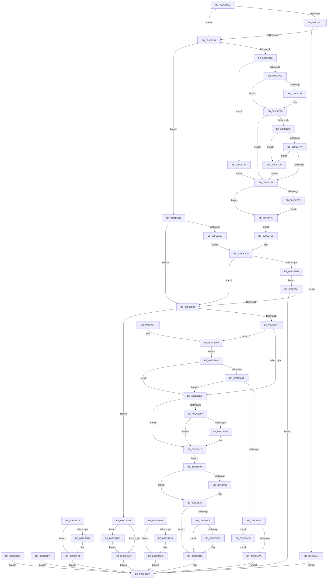

# NtAdjustPrivilegesToken

- RVA: `0x009C86C0`–`0x009C8AD2` (길이 `1,042` bytes)
- VA: `0x00000001409C86C0`
- 실행 섹션: `PAGE`
- PDB 이름 있음: `예`; PDB Function 태그: `아니요`
- unwind 정보 RVA: `0x000A08A8`
- 디코드: `263`개 명령, `1,042/1,042` bytes 표시
- 미해석 바이트: `0` (있으면 어셈블리에 `.byte`로 보존)

> 이 문서는 커널 이미지의 기계어와 PDB 기호를 분석해 생성했습니다. 4번과 5번은 함수 원형과 자료형을 바이너리 사용 방식에서 추정한 C 해석이며 원본 소스 복구 결과는 아닙니다.

## 1. Dependencies

- 직접 호출 지점: **24**; 고유 호출 대상: **11**
- 직접 호출자로 확인된 함수: **1**
- RIP 상대 이미지 참조: **3**

### Outgoing calls
- `0x009C8737` → [ExRaiseDatatypeMisalignment](../89/ExRaiseDatatypeMisalignment_function_00899FD0.md) (function, `0x00899FD0`)
- `0x009C8798` → [ProbeForWrite](../8E/ProbeForWrite_function_008E91C0.md) (function, `0x008E91C0`)
- `0x009C87F1` → [SeCaptureLuidAndAttributesArray](SeCaptureLuidAndAttributesArray_function_009C8D18.md) (function, `0x009C8D18`)
- `0x009C8838` → [ObReferenceObjectByHandle](../86/ObReferenceObjectByHandle_function_00868DB0.md) (function, `0x00868DB0`)
- `0x009C8863` → [ExAcquireResourceExclusiveLite](../../text/21/ExAcquireResourceExclusiveLite_function_00214E20.md) (function, `0x00214E20`)
- `0x009C88AF` → [SepAdjustPrivileges](SepAdjustPrivileges_function_009C8DFC.md) (function, `0x009C8DFC`)
- `0x009C88F5` → [SepAdjustPrivileges](SepAdjustPrivileges_function_009C8DFC.md) (function, `0x009C8DFC`)
- `0x009C894F` → [ExReleaseResourceLite](../../text/25/ExReleaseResourceLite_function_0025FA10.md) (function, `0x0025FA10`)
- `0x009C8954` → [KeLeaveCriticalRegion](../../text/25/KeLeaveCriticalRegion_function_0025D8B0.md) (function, `0x0025D8B0`)
- `0x009C895C` → [ObfDereferenceObject](../../text/2F/ObfDereferenceObject_function_002F9350.md) (function, `0x002F9350`)
- `0x009C896F` → [SeReleaseLuidAndAttributesArray](SeReleaseLuidAndAttributesArray_function_009C7C40.md) (function, `0x009C7C40`)
- `0x009C89AB` → [ExReleaseResourceLite](../../text/25/ExReleaseResourceLite_function_0025FA10.md) (function, `0x0025FA10`)
- `0x009C89B0` → [KeLeaveCriticalRegion](../../text/25/KeLeaveCriticalRegion_function_0025D8B0.md) (function, `0x0025D8B0`)
- `0x009C89BA` → [ObfDereferenceObject](../../text/2F/ObfDereferenceObject_function_002F9350.md) (function, `0x002F9350`)
- `0x009C89D1` → [ExFreePoolWithTag](../../poolcode/B8/ExFreePoolWithTag_function_00B82870.md) (function, `0x00B82870`)
- `0x009C8A18` → [ExReleaseResourceLite](../../text/25/ExReleaseResourceLite_function_0025FA10.md) (function, `0x0025FA10`)
- `0x009C8A1D` → [KeLeaveCriticalRegion](../../text/25/KeLeaveCriticalRegion_function_0025D8B0.md) (function, `0x0025D8B0`)
- `0x009C8A25` → [ObfDereferenceObject](../../text/2F/ObfDereferenceObject_function_002F9350.md) (function, `0x002F9350`)
- `0x009C8A38` → [SeReleaseLuidAndAttributesArray](SeReleaseLuidAndAttributesArray_function_009C7C40.md) (function, `0x009C7C40`)
- `0x009C8A5E` → [ExReleaseResourceLite](../../text/25/ExReleaseResourceLite_function_0025FA10.md) (function, `0x0025FA10`)
- `0x009C8A63` → [KeLeaveCriticalRegion](../../text/25/KeLeaveCriticalRegion_function_0025D8B0.md) (function, `0x0025D8B0`)
- `0x009C8A6D` → [ObfDereferenceObject](../../text/2F/ObfDereferenceObject_function_002F9350.md) (function, `0x002F9350`)
- `0x009C8AC1` → [SeReleaseLuidAndAttributesArray](SeReleaseLuidAndAttributesArray_function_009C7C40.md) (function, `0x009C7C40`)
- `0x009C8ACB` → [SeReleaseLuidAndAttributesArray](SeReleaseLuidAndAttributesArray_function_009C7C40.md) (function, `0x009C7C40`)

### Direct callers
- [RtlpSysVolTakeOwnership](../79/RtlpSysVolTakeOwnership_function_007917C8.md) at `0x0079186C`

### Static image references
- `0x009C8809` → RVA `0x00FD8020` (`PAGEDATA`; read)
- `0x009C891F` → RVA `0x00012D08` (`.rdata`; read)
- `0x009C8929` → RVA `0x00E0EBF0` (`.data`; read/write)

## 2. Other-region calls and transfers

- 다른 실행 섹션으로 향하는 call: **14**
  - `0x009C8863` → [ExAcquireResourceExclusiveLite](../../text/21/ExAcquireResourceExclusiveLite_function_00214E20.md) (`PAGE` → `.text`)
  - `0x009C894F` → [ExReleaseResourceLite](../../text/25/ExReleaseResourceLite_function_0025FA10.md) (`PAGE` → `.text`)
  - `0x009C8954` → [KeLeaveCriticalRegion](../../text/25/KeLeaveCriticalRegion_function_0025D8B0.md) (`PAGE` → `.text`)
  - `0x009C895C` → [ObfDereferenceObject](../../text/2F/ObfDereferenceObject_function_002F9350.md) (`PAGE` → `.text`)
  - `0x009C89AB` → [ExReleaseResourceLite](../../text/25/ExReleaseResourceLite_function_0025FA10.md) (`PAGE` → `.text`)
  - `0x009C89B0` → [KeLeaveCriticalRegion](../../text/25/KeLeaveCriticalRegion_function_0025D8B0.md) (`PAGE` → `.text`)
  - `0x009C89BA` → [ObfDereferenceObject](../../text/2F/ObfDereferenceObject_function_002F9350.md) (`PAGE` → `.text`)
  - `0x009C89D1` → [ExFreePoolWithTag](../../poolcode/B8/ExFreePoolWithTag_function_00B82870.md) (`PAGE` → `POOLCODE`)
  - `0x009C8A18` → [ExReleaseResourceLite](../../text/25/ExReleaseResourceLite_function_0025FA10.md) (`PAGE` → `.text`)
  - `0x009C8A1D` → [KeLeaveCriticalRegion](../../text/25/KeLeaveCriticalRegion_function_0025D8B0.md) (`PAGE` → `.text`)
  - `0x009C8A25` → [ObfDereferenceObject](../../text/2F/ObfDereferenceObject_function_002F9350.md) (`PAGE` → `.text`)
  - `0x009C8A5E` → [ExReleaseResourceLite](../../text/25/ExReleaseResourceLite_function_0025FA10.md) (`PAGE` → `.text`)
  - `0x009C8A63` → [KeLeaveCriticalRegion](../../text/25/KeLeaveCriticalRegion_function_0025D8B0.md) (`PAGE` → `.text`)
  - `0x009C8A6D` → [ObfDereferenceObject](../../text/2F/ObfDereferenceObject_function_002F9350.md) (`PAGE` → `.text`)
- 별도 외부 분기/꼬리 이동을 확인하지 못했습니다.

## 3. Assembly (complete function range)

```asm
009C86C0  48 8B C4                        mov rax, rsp
009C86C3  48 89 58 08                     mov qword ptr [rax + 8], rbx
009C86C7  48 89 70 18                     mov qword ptr [rax + 0x18], rsi
009C86CB  57                              push rdi
009C86CC  41 54                           push r12
009C86CE  41 55                           push r13
009C86D0  41 56                           push r14
009C86D2  41 57                           push r15
009C86D4  48 81 EC 90 00 00 00            sub rsp, 0x90
009C86DB  45 8B E9                        mov r13d, r9d
009C86DE  49 8B F8                        mov rdi, r8
009C86E1  44 8A FA                        mov r15b, dl
009C86E4  4C 8B E1                        mov r12, rcx
009C86E7  33 F6                           xor esi, esi
009C86E9  89 70 9C                        mov dword ptr [rax - 0x64], esi
009C86EC  48 89 70 B8                     mov qword ptr [rax - 0x48], rsi
009C86F0  89 70 C4                        mov dword ptr [rax - 0x3c], esi
009C86F3  89 70 A0                        mov dword ptr [rax - 0x60], esi
009C86F6  89 70 B0                        mov dword ptr [rax - 0x50], esi
009C86F9  40 88 70 10                     mov byte ptr [rax + 0x10], sil
009C86FD  84 D2                           test dl, dl
009C86FF  75 09                           jne 0x1409c870a
009C8701  4D 85 C0                        test r8, r8
009C8704  0F 84 AA 03 00 00               je 0x1409c8ab4
009C870A  65 48 8B 04 25 88 01 00 00      mov rax, qword ptr gs:[0x188]
009C8713  44 8A B0 32 02 00 00            mov r14b, byte ptr [rax + 0x232]
009C871A  44 88 74 24 50                  mov byte ptr [rsp + 0x50], r14b
009C871F  45 84 F6                        test r14b, r14b
009C8722  0F 84 5E 03 00 00               je 0x1409c8a86
009C8728  45 84 FF                        test r15b, r15b
009C872B  0F 85 83 00 00 00               jne 0x1409c87b4
009C8731  40 F6 C7 03                     test dil, 3
009C8735  74 06                           je 0x1409c873d
009C8737  E8 94 18 ED FF                  call 0x140899fd0
009C873C  CC                              int3
009C873D  48 BE 00 00 FF FF FF 7F 00 00   movabs rsi, 0x7fffffff0000
009C8747  48 8B C6                        mov rax, rsi
009C874A  48 3B FE                        cmp rdi, rsi
009C874D  48 0F 42 C7                     cmovb rax, rdi
009C8751  90                              nop
009C8752  8A 00                           mov al, byte ptr [rax]
009C8754  41 8B 00                        mov eax, dword ptr [r8]
009C8757  89 44 24 54                     mov dword ptr [rsp + 0x54], eax
009C875B  FF C8                           dec eax
009C875D  8D 0C 40                        lea ecx, [rax + rax*2]
009C8760  8D 0C 8D 10 00 00 00            lea ecx, [rcx*4 + 0x10]
009C8767  89 8C 24 80 00 00 00            mov dword ptr [rsp + 0x80], ecx
009C876E  85 C9                           test ecx, ecx
009C8770  74 0D                           je 0x1409c877f
009C8772  48 03 CF                        add rcx, rdi
009C8775  48 3B CE                        cmp rcx, rsi
009C8778  77 46                           ja 0x1409c87c0
009C877A  48 3B CF                        cmp rcx, rdi
009C877D  72 41                           jb 0x1409c87c0
009C877F  48 8B 9C 24 E0 00 00 00         mov rbx, qword ptr [rsp + 0xe0]
009C8787  48 85 DB                        test rbx, rbx
009C878A  74 38                           je 0x1409c87c4
009C878C  49 8B D5                        mov rdx, r13
009C878F  41 B8 04 00 00 00               mov r8d, 4
009C8795  48 8B CB                        mov rcx, rbx
009C8798  E8 23 0A F2 FF                  call 0x1408e91c0
009C879D  48 39 B4 24 E8 00 00 00         cmp qword ptr [rsp + 0xe8], rsi
009C87A5  48 0F 42 B4 24 E8 00 00 00      cmovb rsi, qword ptr [rsp + 0xe8]
009C87AE  8B 06                           mov eax, dword ptr [rsi]
009C87B0  89 06                           mov dword ptr [rsi], eax
009C87B2  EB 10                           jmp 0x1409c87c4
009C87B4  48 BE 00 00 FF FF FF 7F 00 00   movabs rsi, 0x7fffffff0000
009C87BE  EB BF                           jmp 0x1409c877f
009C87C0  8A 06                           mov al, byte ptr [rsi]
009C87C2  EB BB                           jmp 0x1409c877f
009C87C4  EB 05                           jmp 0x1409c87cb
009C87C6  E9 0F 02 00 00                  jmp 0x1409c89da
009C87CB  33 F6                           xor esi, esi
009C87CD  45 84 FF                        test r15b, r15b
009C87D0  75 37                           jne 0x1409c8809
009C87D2  48 8D 4F 04                     lea rcx, [rdi + 4]
009C87D6  48 8D 44 24 7C                  lea rax, [rsp + 0x7c]
009C87DB  48 89 44 24 40                  mov qword ptr [rsp + 0x40], rax
009C87E0  48 8D 44 24 70                  lea rax, [rsp + 0x70]
009C87E5  48 89 44 24 38                  mov qword ptr [rsp + 0x38], rax
009C87EA  45 8A C6                        mov r8b, r14b
009C87ED  8B 54 24 54                     mov edx, dword ptr [rsp + 0x54]
009C87F1  E8 22 05 00 00                  call 0x1409c8d18
009C87F6  89 44 24 78                     mov dword ptr [rsp + 0x78], eax
009C87FA  EB 05                           jmp 0x1409c8801
009C87FC  E9 D9 01 00 00                  jmp 0x1409c89da
009C8801  85 C0                           test eax, eax
009C8803  0F 88 D1 01 00 00               js 0x1409c89da
009C8809  4C 8B 05 10 F8 60 00            mov r8, qword ptr [rip + 0x60f810]
009C8810  48 89 74 24 60                  mov qword ptr [rsp + 0x60], rsi
009C8815  48 8B C3                        mov rax, rbx
009C8818  48 F7 D8                        neg rax
009C881B  1B D2                           sbb edx, edx
009C881D  83 E2 08                        and edx, 8
009C8820  83 C2 20                        add edx, 0x20
009C8823  48 89 74 24 28                  mov qword ptr [rsp + 0x28], rsi
009C8828  48 8D 44 24 60                  lea rax, [rsp + 0x60]
009C882D  48 89 44 24 20                  mov qword ptr [rsp + 0x20], rax
009C8832  45 8A CE                        mov r9b, r14b
009C8835  49 8B CC                        mov rcx, r12
009C8838  E8 73 05 EA FF                  call 0x140868db0
009C883D  8B F8                           mov edi, eax
009C883F  85 C0                           test eax, eax
009C8841  0F 88 5C 02 00 00               js 0x1409c8aa3
009C8847  65 48 8B 04 25 88 01 00 00      mov rax, qword ptr gs:[0x188]
009C8850  66 FF 88 E4 01 00 00            dec word ptr [rax + 0x1e4]
009C8857  90                              nop
009C8858  48 8B 74 24 60                  mov rsi, qword ptr [rsp + 0x60]
009C885D  B2 01                           mov dl, 1
009C885F  48 8B 4E 30                     mov rcx, qword ptr [rsi + 0x30]
009C8863  E8 B8 C5 84 FF                  call 0x140214e20
009C8868  F0 83 0C 24 00                  lock or dword ptr [rsp], 0
009C886D  48 8D 84 24 C8 00 00 00         lea rax, [rsp + 0xc8]
009C8875  48 89 44 24 40                  mov qword ptr [rsp + 0x40], rax
009C887A  48 8D 44 24 68                  lea rax, [rsp + 0x68]
009C887F  48 89 44 24 38                  mov qword ptr [rsp + 0x38], rax
009C8884  48 8D 44 24 58                  lea rax, [rsp + 0x58]
009C8889  48 89 44 24 30                  mov qword ptr [rsp + 0x30], rax
009C888E  48 89 5C 24 28                  mov qword ptr [rsp + 0x28], rbx
009C8893  4C 8B 64 24 70                  mov r12, qword ptr [rsp + 0x70]
009C8898  4C 89 64 24 20                  mov qword ptr [rsp + 0x20], r12
009C889D  44 8B 4C 24 54                  mov r9d, dword ptr [rsp + 0x54]
009C88A2  45 8A C7                        mov r8b, r15b
009C88A5  33 D2                           xor edx, edx
009C88A7  48 8B 7C 24 60                  mov rdi, qword ptr [rsp + 0x60]
009C88AC  48 8B CF                        mov rcx, rdi
009C88AF  E8 48 05 00 00                  call 0x1409c8dfc
009C88B4  48 85 DB                        test rbx, rbx
009C88B7  0F 85 3B 01 00 00               jne 0x1409c89f8
009C88BD  48 8D 84 24 C8 00 00 00         lea rax, [rsp + 0xc8]
009C88C5  48 89 44 24 40                  mov qword ptr [rsp + 0x40], rax
009C88CA  48 8D 44 24 68                  lea rax, [rsp + 0x68]
009C88CF  48 89 44 24 38                  mov qword ptr [rsp + 0x38], rax
009C88D4  48 8D 44 24 58                  lea rax, [rsp + 0x58]
009C88D9  48 89 44 24 30                  mov qword ptr [rsp + 0x30], rax
009C88DE  48 89 5C 24 28                  mov qword ptr [rsp + 0x28], rbx
009C88E3  4C 89 64 24 20                  mov qword ptr [rsp + 0x20], r12
009C88E8  44 8B 4C 24 54                  mov r9d, dword ptr [rsp + 0x54]
009C88ED  45 8A C7                        mov r8b, r15b
009C88F0  B2 01                           mov dl, 1
009C88F2  48 8B CF                        mov rcx, rdi
009C88F5  E8 02 05 00 00                  call 0x1409c8dfc
009C88FA  89 44 24 78                     mov dword ptr [rsp + 0x78], eax
009C88FE  48 85 DB                        test rbx, rbx
009C8901  74 13                           je 0x1409c8916
009C8903  8B 44 24 68                     mov eax, dword ptr [rsp + 0x68]
009C8907  89 03                           mov dword ptr [rbx], eax
009C8909  85 C0                           test eax, eax
009C890B  75 09                           jne 0x1409c8916
009C890D  33 C0                           xor eax, eax
009C890F  48 89 43 04                     mov qword ptr [rbx + 4], rax
009C8913  89 43 0C                        mov dword ptr [rbx + 0xc], eax
009C8916  EB 60                           jmp 0x1409c8978
009C8918  8B F8                           mov edi, eax
009C891A  4C 8B 44 24 60                  mov r8, qword ptr [rsp + 0x60]
009C891F  48 8B 15 E2 A3 64 FF            mov rdx, qword ptr [rip - 0x9b5c1e]
009C8926  48 8B CA                        mov rcx, rdx
009C8929  F0 48 0F C1 0D BE 62 44 00      lock xadd qword ptr [rip + 0x4462be], rcx
009C8932  48 03 CA                        add rcx, rdx
009C8935  41 89 48 38                     mov dword ptr [r8 + 0x38], ecx
009C8939  48 C1 E9 20                     shr rcx, 0x20
009C893D  41 89 48 3C                     mov dword ptr [r8 + 0x3c], ecx
009C8941  F0 83 0C 24 00                  lock or dword ptr [rsp], 0
009C8946  48 8B 5C 24 60                  mov rbx, qword ptr [rsp + 0x60]
009C894B  48 8B 4B 30                     mov rcx, qword ptr [rbx + 0x30]
009C894F  E8 BC 70 89 FF                  call 0x14025fa10
009C8954  E8 57 4F 89 FF                  call 0x14025d8b0
009C8959  48 8B CB                        mov rcx, rbx
009C895C  E8 EF 09 93 FF                  call 0x1402f9350
009C8961  48 8B 4C 24 70                  mov rcx, qword ptr [rsp + 0x70]
009C8966  48 85 C9                        test rcx, rcx
009C8969  74 09                           je 0x1409c8974
009C896B  8A 54 24 50                     mov dl, byte ptr [rsp + 0x50]
009C896F  E8 CC F2 FF FF                  call 0x1409c7c40
009C8974  8B C7                           mov eax, edi
009C8976  EB 62                           jmp 0x1409c89da
009C8978  80 BC 24 C8 00 00 00 00         cmp byte ptr [rsp + 0xc8], 0
009C8980  74 20                           je 0x1409c89a2
009C8982  48 8B 0D 7F A3 64 FF            mov rcx, qword ptr [rip - 0x9b5c81]
009C8989  48 8B C1                        mov rax, rcx
009C898C  F0 48 0F C1 05 5B 62 44 00      lock xadd qword ptr [rip + 0x44625b], rax
009C8995  48 03 C1                        add rax, rcx
009C8998  89 47 38                        mov dword ptr [rdi + 0x38], eax
009C899B  48 C1 E8 20                     shr rax, 0x20
009C899F  89 47 3C                        mov dword ptr [rdi + 0x3c], eax
009C89A2  F0 83 0C 24 00                  lock or dword ptr [rsp], 0
009C89A7  48 8B 4E 30                     mov rcx, qword ptr [rsi + 0x30]
009C89AB  E8 60 70 89 FF                  call 0x14025fa10
009C89B0  E8 FB 4E 89 FF                  call 0x14025d8b0
009C89B5  48 8B 4C 24 60                  mov rcx, qword ptr [rsp + 0x60]
009C89BA  E8 91 09 93 FF                  call 0x1402f9350
009C89BF  48 8B 4C 24 70                  mov rcx, qword ptr [rsp + 0x70]
009C89C4  48 85 C9                        test rcx, rcx
009C89C7  74 0D                           je 0x1409c89d6
009C89C9  41 80 FE 01                     cmp r14b, 1
009C89CD  77 07                           ja 0x1409c89d6
009C89CF  33 D2                           xor edx, edx
009C89D1  E8 9A 9E 1B 00                  call 0x140b82870
009C89D6  8B 44 24 78                     mov eax, dword ptr [rsp + 0x78]
009C89DA  4C 8D 9C 24 90 00 00 00         lea r11, [rsp + 0x90]
009C89E2  49 8B 5B 30                     mov rbx, qword ptr [r11 + 0x30]
009C89E6  49 8B 73 40                     mov rsi, qword ptr [r11 + 0x40]
009C89EA  49 8B E3                        mov rsp, r11
009C89ED  41 5F                           pop r15
009C89EF  41 5E                           pop r14
009C89F1  41 5D                           pop r13
009C89F3  41 5C                           pop r12
009C89F5  5F                              pop rdi
009C89F6  C3                              ret
009C89F7  CC                              int3
009C89F8  48 8B 8C 24 E8 00 00 00         mov rcx, qword ptr [rsp + 0xe8]
009C8A00  8B 44 24 58                     mov eax, dword ptr [rsp + 0x58]
009C8A04  89 01                           mov dword ptr [rcx], eax
009C8A06  EB 39                           jmp 0x1409c8a41
009C8A08  8B F8                           mov edi, eax
009C8A0A  F0 83 0C 24 00                  lock or dword ptr [rsp], 0
009C8A0F  48 8B 5C 24 60                  mov rbx, qword ptr [rsp + 0x60]
009C8A14  48 8B 4B 30                     mov rcx, qword ptr [rbx + 0x30]
009C8A18  E8 F3 6F 89 FF                  call 0x14025fa10
009C8A1D  E8 8E 4E 89 FF                  call 0x14025d8b0
009C8A22  48 8B CB                        mov rcx, rbx
009C8A25  E8 26 09 93 FF                  call 0x1402f9350
009C8A2A  48 8B 4C 24 70                  mov rcx, qword ptr [rsp + 0x70]
009C8A2F  48 85 C9                        test rcx, rcx
009C8A32  74 09                           je 0x1409c8a3d
009C8A34  8A 54 24 50                     mov dl, byte ptr [rsp + 0x50]
009C8A38  E8 03 F2 FF FF                  call 0x1409c7c40
009C8A3D  8B C7                           mov eax, edi
009C8A3F  EB 99                           jmp 0x1409c89da
009C8A41  48 85 DB                        test rbx, rbx
009C8A44  0F 84 73 FE FF FF               je 0x1409c88bd
009C8A4A  44 39 6C 24 58                  cmp dword ptr [rsp + 0x58], r13d
009C8A4F  0F 86 68 FE FF FF               jbe 0x1409c88bd
009C8A55  F0 83 0C 24 00                  lock or dword ptr [rsp], 0
009C8A5A  48 8B 4E 30                     mov rcx, qword ptr [rsi + 0x30]
009C8A5E  E8 AD 6F 89 FF                  call 0x14025fa10
009C8A63  E8 48 4E 89 FF                  call 0x14025d8b0
009C8A68  48 8B 4C 24 60                  mov rcx, qword ptr [rsp + 0x60]
009C8A6D  E8 DE 08 93 FF                  call 0x1402f9350
009C8A72  48 8B 4C 24 70                  mov rcx, qword ptr [rsp + 0x70]
009C8A77  48 85 C9                        test rcx, rcx
009C8A7A  75 4C                           jne 0x1409c8ac8
009C8A7C  B8 23 00 00 C0                  mov eax, 0xc0000023
009C8A81  E9 54 FF FF FF                  jmp 0x1409c89da
009C8A86  48 8B 9C 24 E0 00 00 00         mov rbx, qword ptr [rsp + 0xe0]
009C8A8E  45 84 FF                        test r15b, r15b
009C8A91  0F 85 72 FD FF FF               jne 0x1409c8809
009C8A97  41 8B 00                        mov eax, dword ptr [r8]
009C8A9A  89 44 24 54                     mov dword ptr [rsp + 0x54], eax
009C8A9E  E9 2A FD FF FF                  jmp 0x1409c87cd
009C8AA3  48 8B 4C 24 70                  mov rcx, qword ptr [rsp + 0x70]
009C8AA8  48 85 C9                        test rcx, rcx
009C8AAB  75 11                           jne 0x1409c8abe
009C8AAD  8B C7                           mov eax, edi
009C8AAF  E9 26 FF FF FF                  jmp 0x1409c89da
009C8AB4  B8 0D 00 00 C0                  mov eax, 0xc000000d
009C8AB9  E9 1C FF FF FF                  jmp 0x1409c89da
009C8ABE  41 8A D6                        mov dl, r14b
009C8AC1  E8 7A F1 FF FF                  call 0x1409c7c40
009C8AC6  EB E5                           jmp 0x1409c8aad
009C8AC8  41 8A D6                        mov dl, r14b
009C8ACB  E8 70 F1 FF FF                  call 0x1409c7c40
009C8AD0  EB AA                           jmp 0x1409c8a7c
```

## 4. C-style interpretation (structured pseudocode)

```c
__int64 __fastcall NtAdjustPrivilegesToken(__int64 a1, unsigned __int8 a2, __int64 a3, int a4, __int64 a5, __int64 a6)
{
    __int64 result;
    __int64 v_rsi;
    __int64 v_rsp;
    unsigned __int64 v_stack_m20;
    unsigned __int64 v_stack_m28;
    unsigned __int64 v_stack_m30;
    unsigned int v_stack_m38;
    unsigned __int64 v_stack_m3C;
    unsigned int v_stack_m40;
    unsigned __int64 v_stack_m48;
    unsigned __int64 v_stack_m50;
    unsigned __int64 v_stack_m58;
    unsigned __int64 v_stack_m60;
    unsigned int v_stack_m64;
    unsigned __int8 v_stack_m68;
    unsigned __int64 v_stack_m78;
    unsigned __int64 v_stack_m80;
    unsigned __int64 v_stack_m88;
    unsigned __int64 v_stack_m90;
    unsigned __int64 v_stack_m98;
    unsigned int v_stack_mB8;
    unsigned __int64 v_stack_p10;

    *(unsigned __int64 *)(v_rsp + 8) = v_rbx;
    *(unsigned __int64 *)(v_rsp + 24) = v_rsi;
    v_rsp = (v_rsp) - (144);
    v_rsi = 0;
    *(unsigned int *)(v_rsp - 100) = 0;
    *(unsigned __int64 *)(v_rsp - 72) = 0;
    *(unsigned int *)(v_rsp - 60) = 0;
    *(unsigned int *)(v_rsp - 96) = 0;
    *(unsigned int *)(v_rsp - 80) = 0;
    *(unsigned __int8 *)(v_rsp + 16) = 0;
    if (a2 != 0) goto loc_009C870A;
    if (a3 == 0) goto loc_009C8AB4;
loc_009C870A:
    v_stack_m68 = (unsigned __int8)(*(unsigned __int8 *)(*(unsigned __int64 *)(gs_base + (0 + 392)) + 562));
    if ((unsigned __int8)(*(unsigned __int8 *)(*(unsigned __int64 *)(gs_base + (0 + 392)) + 562)) == 0) goto loc_009C8A86;
    if (a2 != 0) goto loc_009C87B4;
    result = *(unsigned __int64 *)(gs_base + (0 + 392));
    if ((((unsigned __int8)(a3)) & (3)) != 0) {
        result = ExRaiseDatatypeMisalignment(a1, a2, a3, a4);
    }
    result = 0;
    if (a3 < 0) { result = a3; }
    v_stack_m64 = (unsigned int)((unsigned int)(*(unsigned int *)(a3)));
    result = (unsigned int)(((unsigned int)(*(unsigned int *)(a3))) - 1);
    v_stack_m38 = (unsigned int)(result + result * 2 * 4 + 16);
    if ((unsigned int)(result + result * 2 * 4 + 16) == 0) goto loc_009C877F;
    a1 = (result + result * 2 * 4 + 16) + (a3);
    if (a1 > 0) goto loc_009C87C0;
    if (a1 < a3) goto loc_009C87C0;
loc_009C877F:
    if (a5 == 0) goto loc_009C87C4;
    result = ProbeForWrite(a5, (unsigned int)(a4), 4, a4);
    if (a6 < 0) { v_rsi = a6; }
    *(unsigned int *)(v_rsi) = (unsigned int)((unsigned int)(*(unsigned int *)(v_rsi)));
    goto loc_009C87C4;
loc_009C87B4:
    goto loc_009C877F;
loc_009C87C0:
    goto loc_009C877F;
loc_009C87C4:
    goto loc_009C87CB;
loc_009C87CB:
    v_rsi = 0;
loc_009C87CD:
    if (a2 != 0) goto loc_009C8809;
    v_stack_m78 = v_stack_m3C;
    v_stack_m80 = v_stack_m48;
    result = SeCaptureLuidAndAttributesArray(a3 + 4, (unsigned int)(v_stack_m64), (unsigned __int8)(*(unsigned __int8 *)(*(unsigned __int64 *)(gs_base + (0 + 392)) + 562)), a4);
    v_stack_m40 = (unsigned int)(result);
    goto loc_009C8801;
loc_009C8801:
    if (sign_flag) goto loc_009C89DA;
loc_009C8809:
    v_stack_m58 = 0;
    result = -(a5);
    a2 = (unsigned int)(((unsigned int)(v_stack_m64)) & (8));
    a2 = (unsigned int)((a2) + (32));
    v_stack_m90 = 0;
    v_stack_m98 = v_stack_m58;
    result = ObReferenceObjectByHandle(a1, a2, *(unsigned __int64 *)(v_rip + 6354960), (unsigned __int8)(*(unsigned __int8 *)(*(unsigned __int64 *)(gs_base + (0 + 392)) + 562)));
    if (sign_flag) goto loc_009C8AA3;
    result = ExAcquireResourceExclusiveLite(*(unsigned __int64 *)(v_stack_m58 + 48), 1, *(unsigned __int64 *)(v_rip + 6354960), (unsigned __int8)(*(unsigned __int8 *)(*(unsigned __int64 *)(gs_base + (0 + 392)) + 562)));
    v_stack_m78 = v_stack_p10;
    v_stack_m80 = v_stack_m50;
    v_stack_m88 = v_stack_m60;
    v_stack_m90 = a5;
    v_stack_m98 = v_stack_m48;
    a2 = 0;
    result = SepAdjustPrivileges(v_stack_m58, a2, a2, (unsigned int)(v_stack_m64));
    if (a5 != 0) goto loc_009C89F8;
loc_009C88BD:
    v_stack_m78 = v_stack_p10;
    v_stack_m80 = v_stack_m50;
    v_stack_m88 = v_stack_m60;
    v_stack_m90 = a5;
    v_stack_m98 = v_stack_m48;
    result = SepAdjustPrivileges(v_stack_m58, 1, 0, (unsigned int)(v_stack_m64));
    v_stack_m40 = (unsigned int)(result);
    if (a5 == 0) goto loc_009C8916;
    *(unsigned int *)(a5) = (unsigned int)((unsigned int)(v_stack_m50));
    result = (unsigned int)(v_stack_m50);
    if ((unsigned int)((unsigned int)(v_stack_m50)) == 0) {
        result = 0;
        *(unsigned __int64 *)(a5 + 4) = 0;
        *(unsigned int *)(a5 + 12) = 0;
    }
    goto loc_009C8978;
loc_009C8978:
    if (v_stack_p10 != 0) {
        a1 = *(unsigned __int64 *)(v_rip - 10181761);
        result = a1;
        result = (result) + (a1);
        *(unsigned int *)(v_stack_m58 + 56) = (unsigned int)(result);
        result = (result) >> (32);
        *(unsigned int *)(v_stack_m58 + 60) = (unsigned int)(result);
    }
    result = ExReleaseResourceLite(*(unsigned __int64 *)(v_stack_m58 + 48), 1, 0, (unsigned int)(v_stack_m64));
    result = KeLeaveCriticalRegion(*(unsigned __int64 *)(v_stack_m58 + 48), 1, 0, (unsigned int)(v_stack_m64));
    result = ObfDereferenceObject(v_stack_m58, 1, 0, (unsigned int)(v_stack_m64));
    if (v_stack_m48 == 0) goto loc_009C89D6;
    if (((unsigned __int8)(*(unsigned __int8 *)(*(unsigned __int64 *)(gs_base + (0 + 392)) + 562))) <= 1) {
        a2 = 0;
        result = ExFreePoolWithTag(v_stack_m48, a2, 0, (unsigned int)(v_stack_m64));
    }
loc_009C89DA:
    return (unsigned int)(v_stack_m40);
loc_009C89F8:
    *(unsigned int *)(a6) = (unsigned int)((unsigned int)(v_stack_m38));
    goto loc_009C8A41;
loc_009C8A41:
    if (*(unsigned __int64 *)(v_stack_m28 + 48) == 0) goto loc_009C88BD;
    if (v_stack_m38 <= ((unsigned int)((unsigned int)(a4)))) goto loc_009C88BD;
    result = ExReleaseResourceLite(*(unsigned __int64 *)(*(unsigned __int64 *)(v_stack_m28 + 64) + 48), a2, 0, (unsigned int)(v_stack_m64));
    result = KeLeaveCriticalRegion(*(unsigned __int64 *)(*(unsigned __int64 *)(v_stack_m28 + 64) + 48), a2, 0, (unsigned int)(v_stack_m64));
    result = ObfDereferenceObject(v_stack_m30, a2, 0, (unsigned int)(v_stack_m64));
    if (v_stack_m20 != 0) goto loc_009C8AC8;
loc_009C8A7C:
    goto loc_009C89DA;
loc_009C8A86:
    if (0 != 0) goto loc_009C8809;
    v_stack_m3C = (unsigned int)((unsigned int)(*(unsigned int *)(0)));
    goto loc_009C87CD;
loc_009C8AA3:
    if (v_stack_m20 != 0) goto loc_009C8ABE;
loc_009C8AAD:
    goto loc_009C89DA;
loc_009C8AB4:
    goto loc_009C89DA;
loc_009C8ABE:
    result = SeReleaseLuidAndAttributesArray(v_stack_m20, (unsigned __int8)(*(unsigned __int8 *)(*(unsigned __int64 *)(gs_base + (0 + 392)) + 562)), 0, (unsigned int)(v_stack_m64));
    goto loc_009C8AAD;
loc_009C8AC8:
    result = SeReleaseLuidAndAttributesArray(v_stack_m20, (unsigned __int8)(*(unsigned __int8 *)(*(unsigned __int64 *)(gs_base + (0 + 392)) + 562)), 0, (unsigned int)(v_stack_m64));
    goto loc_009C8A7C;
}
```

## 5. (Beta) C Style

```c
int64_t NtAdjustPrivilegesToken(int64_t Arg1, uint8_t Arg2, int64_t Arg3, int32_t Arg4, int64_t Arg5, void *Arg6)
{
    uint8_t *arg6 = (uint8_t *)Arg6;

    int64_t result;
    int64_t local_rsi;
    int64_t local_rsp;
    uint64_t v_stack_m20;
    uint64_t v_stack_m28;
    uint64_t v_stack_m30;
    uint32_t v_stack_m38;
    uint64_t v_stack_m3C;
    uint32_t v_stack_m40;
    uint64_t v_stack_m48;
    uint64_t v_stack_m50;
    uint64_t v_stack_m58;
    uint64_t v_stack_m60;
    uint32_t v_stack_m64;
    uint8_t v_stack_m68;
    uint64_t v_stack_m78;
    uint64_t v_stack_m80;
    uint64_t v_stack_m88;
    uint64_t v_stack_m90;
    uint64_t v_stack_m98;
    uint32_t v_stack_mB8;
    uint64_t v_stack_p10;

    *(uint64_t *)(local_rsp + 0x8) = local_rbx;
    *(uint64_t *)(local_rsp + 0x18) = local_rsi;
    local_rsp = (local_rsp) - (144);
    local_rsi = 0;
    *(uint32_t *)(local_rsp - 0x64) = 0;
    *(uint64_t *)(local_rsp - 0x48) = 0;
    *(uint32_t *)(local_rsp - 0x3C) = 0;
    *(uint32_t *)(local_rsp - 0x60) = 0;
    *(uint32_t *)(local_rsp - 0x50) = 0;
    *(uint8_t *)(local_rsp + 0x10) = 0;
    if (Arg2 != 0) goto loc_009C870A;
    if (Arg3 == 0) goto loc_009C8AB4;
loc_009C870A:
    v_stack_m68 = (uint8_t)(*(uint8_t *)(*(uint64_t *)(gs_base + (0 + 0x188)) + 0x232));
    if ((uint8_t)(*(uint8_t *)(*(uint64_t *)(gs_base + (0 + 0x188)) + 0x232)) == 0) goto loc_009C8A86;
    if (Arg2 != 0) goto loc_009C87B4;
    result = *(uint64_t *)(gs_base + (0 + 0x188));
    if ((((uint8_t)(Arg3)) & (3)) != 0) {
        result = ExRaiseDatatypeMisalignment(Arg1, Arg2, Arg3, Arg4);
    }
    result = 0;
    if (Arg3 < 0) { result = Arg3; }
    v_stack_m64 = (uint32_t)((uint32_t)(*(uint32_t *)(Arg3)));
    result = (uint32_t)(((uint32_t)(*(uint32_t *)(Arg3))) - 1);
    v_stack_m38 = (uint32_t)(result + result * 2 * 4 + 16);
    if ((uint32_t)(result + result * 2 * 4 + 16) == 0) goto loc_009C877F;
    Arg1 = (result + result * 2 * 4 + 16) + (Arg3);
    if (Arg1 > 0) goto loc_009C87C0;
    if (Arg1 < Arg3) goto loc_009C87C0;
loc_009C877F:
    if (Arg5 == 0) goto loc_009C87C4;
    result = ProbeForWrite(Arg5, (uint32_t)(Arg4), 4, Arg4);
    if (Arg6 < 0) { local_rsi = Arg6; }
    *(uint32_t *)(local_rsi) = (uint32_t)((uint32_t)(*(uint32_t *)(local_rsi)));
    goto loc_009C87C4;
loc_009C87B4:
    goto loc_009C877F;
loc_009C87C0:
    goto loc_009C877F;
loc_009C87C4:
    goto loc_009C87CB;
loc_009C87CB:
    local_rsi = 0;
loc_009C87CD:
    if (Arg2 != 0) goto loc_009C8809;
    v_stack_m78 = v_stack_m3C;
    v_stack_m80 = v_stack_m48;
    result = SeCaptureLuidAndAttributesArray(Arg3 + 4, (uint32_t)(v_stack_m64), (uint8_t)(*(uint8_t *)(*(uint64_t *)(gs_base + (0 + 0x188)) + 0x232)), Arg4);
    v_stack_m40 = (uint32_t)(result);
    goto loc_009C8801;
loc_009C8801:
    if (sign_flag) goto loc_009C89DA;
loc_009C8809:
    v_stack_m58 = 0;
    result = -(Arg5);
    Arg2 = (uint32_t)(((uint32_t)(v_stack_m64)) & (8));
    Arg2 = (uint32_t)((Arg2) + (32));
    v_stack_m90 = 0;
    v_stack_m98 = v_stack_m58;
    result = ObReferenceObjectByHandle(Arg1, Arg2, *(uint64_t *)(v_rip + 0x60F810), (uint8_t)(*(uint8_t *)(*(uint64_t *)(gs_base + (0 + 0x188)) + 0x232)));
    if (sign_flag) goto loc_009C8AA3;
    result = ExAcquireResourceExclusiveLite(*(uint64_t *)(v_stack_m58 + 0x30), 1, *(uint64_t *)(v_rip + 0x60F810), (uint8_t)(*(uint8_t *)(*(uint64_t *)(gs_base + (0 + 0x188)) + 0x232)));
    v_stack_m78 = v_stack_p10;
    v_stack_m80 = v_stack_m50;
    v_stack_m88 = v_stack_m60;
    v_stack_m90 = Arg5;
    v_stack_m98 = v_stack_m48;
    Arg2 = 0;
    result = SepAdjustPrivileges(v_stack_m58, Arg2, Arg2, (uint32_t)(v_stack_m64));
    if (Arg5 != 0) goto loc_009C89F8;
loc_009C88BD:
    v_stack_m78 = v_stack_p10;
    v_stack_m80 = v_stack_m50;
    v_stack_m88 = v_stack_m60;
    v_stack_m90 = Arg5;
    v_stack_m98 = v_stack_m48;
    result = SepAdjustPrivileges(v_stack_m58, 1, 0, (uint32_t)(v_stack_m64));
    v_stack_m40 = (uint32_t)(result);
    if (Arg5 == 0) goto loc_009C8916;
    *(uint32_t *)(Arg5) = (uint32_t)((uint32_t)(v_stack_m50));
    result = (uint32_t)(v_stack_m50);
    if ((uint32_t)((uint32_t)(v_stack_m50)) == 0) {
        result = 0;
        *(uint64_t *)(Arg5 + 0x4) = 0;
        *(uint32_t *)(Arg5 + 0xC) = 0;
    }
    goto loc_009C8978;
loc_009C8978:
    if (v_stack_p10 != 0) {
        Arg1 = *(uint64_t *)(v_rip - 0x9B5C81);
        result = Arg1;
        result = (result) + (Arg1);
        *(uint32_t *)(v_stack_m58 + 0x38) = (uint32_t)(result);
        result = (result) >> (32);
        *(uint32_t *)(v_stack_m58 + 0x3C) = (uint32_t)(result);
    }
    result = ExReleaseResourceLite(*(uint64_t *)(v_stack_m58 + 0x30), 1, 0, (uint32_t)(v_stack_m64));
    result = KeLeaveCriticalRegion(*(uint64_t *)(v_stack_m58 + 0x30), 1, 0, (uint32_t)(v_stack_m64));
    result = ObfDereferenceObject(v_stack_m58, 1, 0, (uint32_t)(v_stack_m64));
    if (v_stack_m48 == 0) goto loc_009C89D6;
    if (((uint8_t)(*(uint8_t *)(*(uint64_t *)(gs_base + (0 + 0x188)) + 0x232))) <= 1) {
        Arg2 = 0;
        result = ExFreePoolWithTag(v_stack_m48, Arg2, 0, (uint32_t)(v_stack_m64));
    }
loc_009C89DA:
    return (uint32_t)(v_stack_m40);
loc_009C89F8:
    *(uint32_t *)(arg6) = (uint32_t)((uint32_t)(v_stack_m38));
    goto loc_009C8A41;
loc_009C8A41:
    if (*(uint64_t *)(v_stack_m28 + 0x30) == 0) goto loc_009C88BD;
    if (v_stack_m38 <= ((uint32_t)((uint32_t)(Arg4)))) goto loc_009C88BD;
    result = ExReleaseResourceLite(*(uint64_t *)(*(uint64_t *)(v_stack_m28 + 0x40) + 0x30), Arg2, 0, (uint32_t)(v_stack_m64));
    result = KeLeaveCriticalRegion(*(uint64_t *)(*(uint64_t *)(v_stack_m28 + 0x40) + 0x30), Arg2, 0, (uint32_t)(v_stack_m64));
    result = ObfDereferenceObject(v_stack_m30, Arg2, 0, (uint32_t)(v_stack_m64));
    if (v_stack_m20 != 0) goto loc_009C8AC8;
loc_009C8A7C:
    goto loc_009C89DA;
loc_009C8A86:
    if (0 != 0) goto loc_009C8809;
    v_stack_m3C = (uint32_t)((uint32_t)(*(uint32_t *)(0)));
    goto loc_009C87CD;
loc_009C8AA3:
    if (v_stack_m20 != 0) goto loc_009C8ABE;
loc_009C8AAD:
    goto loc_009C89DA;
loc_009C8AB4:
    goto loc_009C89DA;
loc_009C8ABE:
    result = SeReleaseLuidAndAttributesArray(v_stack_m20, (uint8_t)(*(uint8_t *)(*(uint64_t *)(gs_base + (0 + 0x188)) + 0x232)), 0, (uint32_t)(v_stack_m64));
    goto loc_009C8AAD;
loc_009C8AC8:
    result = SeReleaseLuidAndAttributesArray(v_stack_m20, (uint8_t)(*(uint8_t *)(*(uint64_t *)(gs_base + (0 + 0x188)) + 0x232)), 0, (uint32_t)(v_stack_m64));
    goto loc_009C8A7C;
}
```

### 관측된 메모리 오프셋

구조체 형식이 확인되지 않은 접근은 인자 기준의 오프셋으로만 기록했습니다.

| 기준 인자 | 오프셋 표현 | 폭 (bit) | 접근 |
|---|---:|---:|---|
| `Arg6` | `+ 0x0` | `32` | `W` |

## 6. Execution-region graph

[열기: 2D/3D 그래프와 함수 탐색 컨트롤 패널](../../../control-panel.html?section=page&rva=0x009C86C0&view=graph)

- 2D 그래프는 위에서 아래로 흐르고, 3D 그래프는 빈 공간을 드래그해 회전합니다. Shift+드래그는 이동, 휠은 확대·축소, 함수 노드 선택은 대상 보고서 이동입니다.

### Static fallback


