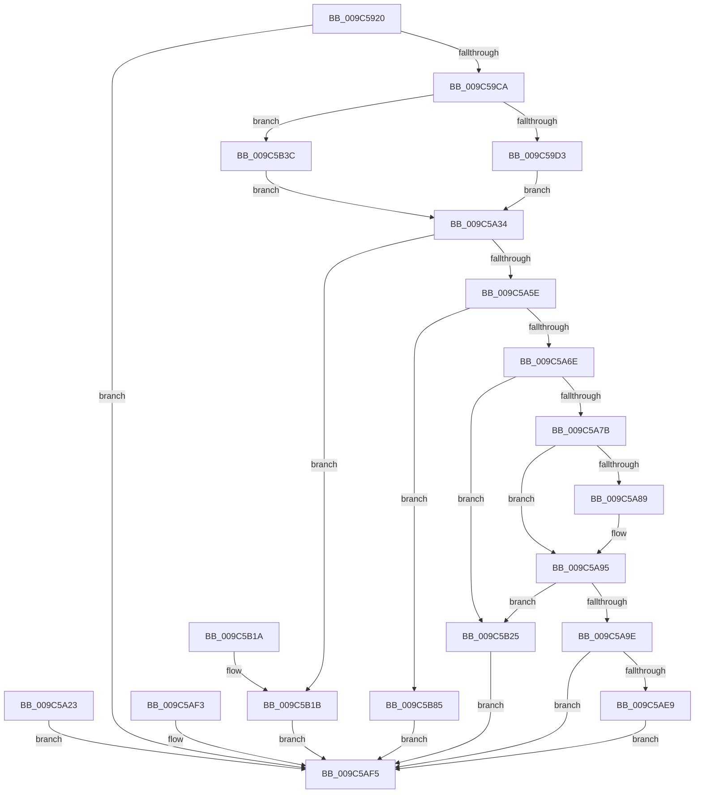

# NtAlpcOpenSenderThread

- RVA: `0x009C5920`–`0x009C5B9F` (길이 `639` bytes)
- VA: `0x00000001409C5920`
- 실행 섹션: `PAGE`
- PDB 이름 있음: `예`; PDB Function 태그: `아니요`
- unwind 정보 RVA: `0x000A0028`
- 디코드: `148`개 명령, `639/639` bytes 표시
- 미해석 바이트: `0` (있으면 어셈블리에 `.byte`로 보존)

> 이 문서는 커널 이미지의 기계어와 PDB 기호를 분석해 생성했습니다. 4번과 5번은 함수 원형과 자료형을 바이너리 사용 방식에서 추정한 C 해석이며 원본 소스 복구 결과는 아닙니다.

## 1. Dependencies

- 직접 호출 지점: **16**; 고유 호출 대상: **9**
- 직접 호출자로 확인된 함수: **0**
- RIP 상대 이미지 참조: **1**

### Outgoing calls
- `0x009C59BB` → [ObReferenceObjectByHandle](../86/ObReferenceObjectByHandle_function_00868DB0.md) (function, `0x00868DB0`)
- `0x009C59F8` → [AlpcpProbeAndCaptureMessageHeader](AlpcpProbeAndCaptureMessageHeader_function_009C5BB0.md) (function, `0x009C5BB0`)
- `0x009C5A1C` → [RtlCopyVolatileMemory](../../text/6B/RtlCopyVolatileMemory_function_006BC9D0.md) (function, `0x006BC9D0`)
- `0x009C5A2A` → [ObfDereferenceObject](../../text/2F/ObfDereferenceObject_function_002F9350.md) (function, `0x002F9350`)
- `0x009C5A4F` → [AlpcpLookupMessage](../89/AlpcpLookupMessage_function_00895A40.md) (function, `0x00895A40`)
- `0x009C5AA1` → [ObfReferenceObject](../../text/20/ObfReferenceObject_function_0020FA20.md) (function, `0x0020FA20`)
- `0x009C5AA9` → [AlpcpUnlockMessage](../89/AlpcpUnlockMessage_function_00897AE0.md) (function, `0x00897AE0`)
- `0x009C5ACE` → [PsOpenThread](PsOpenThread_function_009C5CC0.md) (function, `0x009C5CC0`)
- `0x009C5AD8` → [ObfDereferenceObject](../../text/2F/ObfDereferenceObject_function_002F9350.md) (function, `0x002F9350`)
- `0x009C5AE0` → [ObfDereferenceObject](../../text/2F/ObfDereferenceObject_function_002F9350.md) (function, `0x002F9350`)
- `0x009C5AF5` → [KeLeaveCriticalRegion](../../text/25/KeLeaveCriticalRegion_function_0025D8B0.md) (function, `0x0025D8B0`)
- `0x009C5B1E` → [ObfDereferenceObject](../../text/2F/ObfDereferenceObject_function_002F9350.md) (function, `0x002F9350`)
- `0x009C5B28` → [AlpcpUnlockMessage](../89/AlpcpUnlockMessage_function_00897AE0.md) (function, `0x00897AE0`)
- `0x009C5B30` → [ObfDereferenceObject](../../text/2F/ObfDereferenceObject_function_002F9350.md) (function, `0x002F9350`)
- `0x009C5B88` → [AlpcpUnlockMessage](../89/AlpcpUnlockMessage_function_00897AE0.md) (function, `0x00897AE0`)
- `0x009C5B90` → [ObfDereferenceObject](../../text/2F/ObfDereferenceObject_function_002F9350.md) (function, `0x002F9350`)

### Direct callers
- 이 함수 시작 RVA로 연결되는 직접 call은 확인되지 않았습니다. 간접 호출은 완전히 역산할 수 없습니다.

### Static image references
- `0x009C5996` → RVA `0x00FC6C18` (`ALMOSTRO`; read)

## 2. Other-region calls and transfers

- 다른 실행 섹션으로 향하는 call: **9**
  - `0x009C5A1C` → [RtlCopyVolatileMemory](../../text/6B/RtlCopyVolatileMemory_function_006BC9D0.md) (`PAGE` → `.text`)
  - `0x009C5A2A` → [ObfDereferenceObject](../../text/2F/ObfDereferenceObject_function_002F9350.md) (`PAGE` → `.text`)
  - `0x009C5AA1` → [ObfReferenceObject](../../text/20/ObfReferenceObject_function_0020FA20.md) (`PAGE` → `.text`)
  - `0x009C5AD8` → [ObfDereferenceObject](../../text/2F/ObfDereferenceObject_function_002F9350.md) (`PAGE` → `.text`)
  - `0x009C5AE0` → [ObfDereferenceObject](../../text/2F/ObfDereferenceObject_function_002F9350.md) (`PAGE` → `.text`)
  - `0x009C5AF5` → [KeLeaveCriticalRegion](../../text/25/KeLeaveCriticalRegion_function_0025D8B0.md) (`PAGE` → `.text`)
  - `0x009C5B1E` → [ObfDereferenceObject](../../text/2F/ObfDereferenceObject_function_002F9350.md) (`PAGE` → `.text`)
  - `0x009C5B30` → [ObfDereferenceObject](../../text/2F/ObfDereferenceObject_function_002F9350.md) (`PAGE` → `.text`)
  - `0x009C5B90` → [ObfDereferenceObject](../../text/2F/ObfDereferenceObject_function_002F9350.md) (`PAGE` → `.text`)
- 별도 외부 분기/꼬리 이동을 확인하지 못했습니다.

## 3. Assembly (complete function range)

```asm
009C5920  4C 8B DC                        mov r11, rsp
009C5923  49 89 5B 08                     mov qword ptr [r11 + 8], rbx
009C5927  49 89 73 10                     mov qword ptr [r11 + 0x10], rsi
009C592B  49 89 7B 18                     mov qword ptr [r11 + 0x18], rdi
009C592F  4D 89 73 20                     mov qword ptr [r11 + 0x20], r14
009C5933  41 57                           push r15
009C5935  48 81 EC A0 00 00 00            sub rsp, 0xa0
009C593C  41 8B F1                        mov esi, r9d
009C593F  49 8B F8                        mov rdi, r8
009C5942  4C 8B D2                        mov r10, rdx
009C5945  4C 8B F1                        mov r14, rcx
009C5948  0F 57 C0                        xorps xmm0, xmm0
009C594B  33 C0                           xor eax, eax
009C594D  0F 11 44 24 48                  movups xmmword ptr [rsp + 0x48], xmm0
009C5952  0F 11 44 24 58                  movups xmmword ptr [rsp + 0x58], xmm0
009C5957  49 89 43 C0                     mov qword ptr [r11 - 0x40], rax
009C595B  0F 11 44 24 70                  movups xmmword ptr [rsp + 0x70], xmm0
009C5960  41 0F 11 43 D8                  movups xmmword ptr [r11 - 0x28], xmm0
009C5965  49 89 43 E8                     mov qword ptr [r11 - 0x18], rax
009C5969  41 89 43 F0                     mov dword ptr [r11 - 0x10], eax
009C596D  49 21 43 98                     and qword ptr [r11 - 0x68], rax
009C5971  49 21 43 90                     and qword ptr [r11 - 0x70], rax
009C5975  65 48 8B 04 25 88 01 00 00      mov rax, qword ptr gs:[0x188]
009C597E  66 FF 88 E4 01 00 00            dec word ptr [rax + 0x1e4]
009C5985  90                              nop
009C5986  65 48 8B 04 25 88 01 00 00      mov rax, qword ptr gs:[0x188]
009C598F  44 8A B8 32 02 00 00            mov r15b, byte ptr [rax + 0x232]
009C5996  4C 8B 05 7B 12 60 00            mov r8, qword ptr [rip + 0x60127b]
009C599D  49 83 63 88 00                  and qword ptr [r11 - 0x78], 0
009C59A2  49 83 63 80 00                  and qword ptr [r11 - 0x80], 0
009C59A7  49 8D 43 88                     lea rax, [r11 - 0x78]
009C59AB  48 89 44 24 20                  mov qword ptr [rsp + 0x20], rax
009C59B0  45 8A CF                        mov r9b, r15b
009C59B3  BA 00 00 02 00                  mov edx, 0x20000
009C59B8  49 8B CA                        mov rcx, r10
009C59BB  E8 F0 33 EA FF                  call 0x140868db0
009C59C0  8B D8                           mov ebx, eax
009C59C2  85 C0                           test eax, eax
009C59C4  0F 88 2B 01 00 00               js 0x1409c5af5
009C59CA  45 84 FF                        test r15b, r15b
009C59CD  0F 84 69 01 00 00               je 0x1409c5b3c
009C59D3  48 BB 00 00 FF FF FF 7F 00 00   movabs rbx, 0x7fffffff0000
009C59DD  48 8B CB                        mov rcx, rbx
009C59E0  4C 3B F3                        cmp r14, rbx
009C59E3  49 0F 42 CE                     cmovb rcx, r14
009C59E7  48 8B 01                        mov rax, qword ptr [rcx]
009C59EA  48 89 01                        mov qword ptr [rcx], rax
009C59ED  44 8B C6                        mov r8d, esi
009C59F0  48 8D 54 24 48                  lea rdx, [rsp + 0x48]
009C59F5  48 8B CF                        mov rcx, rdi
009C59F8  E8 B3 01 00 00                  call 0x1409c5bb0
009C59FD  48 39 9C 24 D8 00 00 00         cmp qword ptr [rsp + 0xd8], rbx
009C5A05  48 0F 42 9C 24 D8 00 00 00      cmovb rbx, qword ptr [rsp + 0xd8]
009C5A0E  41 B8 30 00 00 00               mov r8d, 0x30
009C5A14  48 8B D3                        mov rdx, rbx
009C5A17  48 8D 4C 24 70                  lea rcx, [rsp + 0x70]
009C5A1C  E8 AF 6F CF FF                  call 0x1406bc9d0
009C5A21  EB 11                           jmp 0x1409c5a34
009C5A23  8B D8                           mov ebx, eax
009C5A25  48 8B 4C 24 30                  mov rcx, qword ptr [rsp + 0x30]
009C5A2A  E8 21 39 93 FF                  call 0x1402f9350
009C5A2F  E9 C1 00 00 00                  jmp 0x1409c5af5
009C5A34  48 8D 44 24 38                  lea rax, [rsp + 0x38]
009C5A39  48 89 44 24 20                  mov qword ptr [rsp + 0x20], rax
009C5A3E  44 8B 44 24 68                  mov r8d, dword ptr [rsp + 0x68]
009C5A43  8B 54 24 60                     mov edx, dword ptr [rsp + 0x60]
009C5A47  48 8B 7C 24 30                  mov rdi, qword ptr [rsp + 0x30]
009C5A4C  48 8B CF                        mov rcx, rdi
009C5A4F  E8 EC FF EC FF                  call 0x140895a40
009C5A54  8B D8                           mov ebx, eax
009C5A56  85 C0                           test eax, eax
009C5A58  0F 88 BD 00 00 00               js 0x1409c5b1b
009C5A5E  48 8B 5C 24 38                  mov rbx, qword ptr [rsp + 0x38]
009C5A63  8B 43 28                        mov eax, dword ptr [rbx + 0x28]
009C5A66  84 C0                           test al, al
009C5A68  0F 88 17 01 00 00               js 0x1409c5b85
009C5A6E  48 8B 73 20                     mov rsi, qword ptr [rbx + 0x20]
009C5A72  48 85 F6                        test rsi, rsi
009C5A75  0F 84 AA 00 00 00               je 0x1409c5b25
009C5A7B  48 8B 86 08 05 00 00            mov rax, qword ptr [rsi + 0x508]
009C5A82  48 2B 44 24 50                  sub rax, qword ptr [rsp + 0x50]
009C5A87  75 0C                           jne 0x1409c5a95
009C5A89  48 8B 86 10 05 00 00            mov rax, qword ptr [rsi + 0x510]
009C5A90  48 2B 44 24 58                  sub rax, qword ptr [rsp + 0x58]
009C5A95  48 85 C0                        test rax, rax
009C5A98  0F 85 87 00 00 00               jne 0x1409c5b25
009C5A9E  48 8B CE                        mov rcx, rsi
009C5AA1  E8 7A 9F 84 FF                  call 0x14020fa20
009C5AA6  48 8B CB                        mov rcx, rbx
009C5AA9  E8 32 20 ED FF                  call 0x140897ae0
009C5AAE  44 88 7C 24 28                  mov byte ptr [rsp + 0x28], r15b
009C5AB3  C6 44 24 20 00                  mov byte ptr [rsp + 0x20], 0
009C5AB8  4C 8D 4C 24 50                  lea r9, [rsp + 0x50]
009C5ABD  4C 8D 44 24 70                  lea r8, [rsp + 0x70]
009C5AC2  8B 94 24 D0 00 00 00            mov edx, dword ptr [rsp + 0xd0]
009C5AC9  48 8D 4C 24 40                  lea rcx, [rsp + 0x40]
009C5ACE  E8 ED 01 00 00                  call 0x1409c5cc0
009C5AD3  8B D8                           mov ebx, eax
009C5AD5  48 8B CE                        mov rcx, rsi
009C5AD8  E8 73 38 93 FF                  call 0x1402f9350
009C5ADD  48 8B CF                        mov rcx, rdi
009C5AE0  E8 6B 38 93 FF                  call 0x1402f9350
009C5AE5  85 DB                           test ebx, ebx
009C5AE7  78 0C                           js 0x1409c5af5
009C5AE9  48 8B 44 24 40                  mov rax, qword ptr [rsp + 0x40]
009C5AEE  49 89 06                        mov qword ptr [r14], rax
009C5AF1  EB 02                           jmp 0x1409c5af5
009C5AF3  8B D8                           mov ebx, eax
009C5AF5  E8 B6 7D 89 FF                  call 0x14025d8b0
009C5AFA  8B C3                           mov eax, ebx
009C5AFC  4C 8D 9C 24 A0 00 00 00         lea r11, [rsp + 0xa0]
009C5B04  49 8B 5B 10                     mov rbx, qword ptr [r11 + 0x10]
009C5B08  49 8B 73 18                     mov rsi, qword ptr [r11 + 0x18]
009C5B0C  49 8B 7B 20                     mov rdi, qword ptr [r11 + 0x20]
009C5B10  4D 8B 73 28                     mov r14, qword ptr [r11 + 0x28]
009C5B14  49 8B E3                        mov rsp, r11
009C5B17  41 5F                           pop r15
009C5B19  C3                              ret
009C5B1A  CC                              int3
009C5B1B  48 8B CF                        mov rcx, rdi
009C5B1E  E8 2D 38 93 FF                  call 0x1402f9350
009C5B23  EB D0                           jmp 0x1409c5af5
009C5B25  48 8B CB                        mov rcx, rbx
009C5B28  E8 B3 1F ED FF                  call 0x140897ae0
009C5B2D  48 8B CF                        mov rcx, rdi
009C5B30  E8 1B 38 93 FF                  call 0x1402f9350
009C5B35  BB 22 00 00 C0                  mov ebx, 0xc0000022
009C5B3A  EB B9                           jmp 0x1409c5af5
009C5B3C  0F 10 07                        movups xmm0, xmmword ptr [rdi]
009C5B3F  0F 11 44 24 48                  movups xmmword ptr [rsp + 0x48], xmm0
009C5B44  0F 10 4F 10                     movups xmm1, xmmword ptr [rdi + 0x10]
009C5B48  0F 11 4C 24 58                  movups xmmword ptr [rsp + 0x58], xmm1
009C5B4D  F2 0F 10 47 20                  movsd xmm0, qword ptr [rdi + 0x20]
009C5B52  F2 0F 11 44 24 68               movsd qword ptr [rsp + 0x68], xmm0
009C5B58  48 8B 84 24 D8 00 00 00         mov rax, qword ptr [rsp + 0xd8]
009C5B60  0F 10 08                        movups xmm1, xmmword ptr [rax]
009C5B63  0F 11 4C 24 70                  movups xmmword ptr [rsp + 0x70], xmm1
009C5B68  0F 10 40 10                     movups xmm0, xmmword ptr [rax + 0x10]
009C5B6C  0F 11 84 24 80 00 00 00         movups xmmword ptr [rsp + 0x80], xmm0
009C5B74  0F 10 48 20                     movups xmm1, xmmword ptr [rax + 0x20]
009C5B78  0F 11 8C 24 90 00 00 00         movups xmmword ptr [rsp + 0x90], xmm1
009C5B80  E9 AF FE FF FF                  jmp 0x1409c5a34
009C5B85  48 8B CB                        mov rcx, rbx
009C5B88  E8 53 1F ED FF                  call 0x140897ae0
009C5B8D  48 8B CF                        mov rcx, rdi
009C5B90  E8 BB 37 93 FF                  call 0x1402f9350
009C5B95  BB 03 07 00 C0                  mov ebx, 0xc0000703
009C5B9A  E9 56 FF FF FF                  jmp 0x1409c5af5
```

## 4. C-style interpretation (structured pseudocode)

```c
__int64 __fastcall NtAlpcOpenSenderThread(__int64 a1, __int64 a2, __int64 a3, int a4, unsigned int a5, __int64 a6)
{
    __int64 result;
    __int64 v_rbx;
    __int64 v_rsp;
    unsigned __int64 v_stack_m10;
    unsigned __int64 v_stack_m20;
    unsigned __int64 v_stack_m30;
    unsigned __int64 v_stack_m38;
    unsigned int v_stack_m40;
    unsigned int v_stack_m48;
    unsigned __int64 v_stack_m50;
    unsigned __int64 v_stack_m58;
    unsigned __int64 v_stack_m60;
    unsigned __int64 v_stack_m68;
    unsigned __int64 v_stack_m70;
    unsigned __int64 v_stack_m78;
    unsigned __int64 v_stack_m8;
    unsigned __int8 v_stack_m80;
    unsigned __int64 v_stack_m88;

    *(unsigned __int64 *)(v_rsp + 8) = v_rbx;
    *(unsigned __int64 *)(v_rsp + 16) = v_rsi;
    *(unsigned __int64 *)(v_rsp + 24) = v_rdi;
    *(unsigned __int64 *)(v_rsp + 32) = v_r14;
    v_rsp = (v_rsp) - (160);
    result = 0;
    v_stack_m60 = v_xmm0;
    v_stack_m50 = v_xmm0;
    *(unsigned __int64 *)(v_rsp - 64) = 0;
    v_stack_m38 = v_xmm0;
    *(unsigned __int64 *)(v_rsp - 40) = v_xmm0;
    *(unsigned __int64 *)(v_rsp - 24) = 0;
    *(unsigned int *)(v_rsp - 16) = 0;
    v_stack_m88 = v_rsp - 120;
    result = ObReferenceObjectByHandle(a2, (unsigned int)(0x20000ULL), *(unsigned __int64 *)(v_rip + 6296187), (unsigned __int8)(*(unsigned __int8 *)(*(unsigned __int64 *)(gs_base + (0 + 392)) + 562)));
    if (sign_flag) goto loc_009C5AF5;
    if ((unsigned __int8)(*(unsigned __int8 *)(*(unsigned __int64 *)(gs_base + (0 + 392)) + 562)) == 0) goto loc_009C5B3C;
    a1 = (unsigned int)((unsigned int)(result));
    if (a1 < ((unsigned int)((unsigned int)(result)))) { a1 = a1; }
    *(unsigned __int64 *)(a1) = *(unsigned __int64 *)(a1);
    result = AlpcpProbeAndCaptureMessageHeader(a3, v_stack_m60, (unsigned int)((unsigned int)((unsigned int)(a4))), (unsigned __int8)(*(unsigned __int8 *)(*(unsigned __int64 *)(gs_base + (0 + 392)) + 562)));
    v_rbx = (unsigned int)((unsigned int)(result));
    if (a6 < ((unsigned int)((unsigned int)(result)))) { v_rbx = a6; }
    result = RtlCopyVolatileMemory(v_stack_m38, v_rbx, 48, (unsigned __int8)(*(unsigned __int8 *)(*(unsigned __int64 *)(gs_base + (0 + 392)) + 562)));
    goto loc_009C5A34;
loc_009C5A34:
    v_stack_m88 = v_stack_m70;
    result = AlpcpLookupMessage(v_stack_m78, (unsigned int)(v_stack_m48), (unsigned int)(v_stack_m40), (unsigned __int8)(*(unsigned __int8 *)(*(unsigned __int64 *)(gs_base + (0 + 392)) + 562)));
    if (sign_flag) goto loc_009C5B1B;
    if (sign_flag) goto loc_009C5B85;
    if (*(unsigned __int64 *)(v_stack_m70 + 32) == 0) goto loc_009C5B25;
    result = (*(unsigned __int64 *)(*(unsigned __int64 *)(v_stack_m70 + 32) + 1288)) - (v_stack_m58);
    if (!(condition_is_not_equal)) {
        result = *(unsigned __int64 *)(*(unsigned __int64 *)(v_stack_m70 + 32) + 1296);
        result = (result) - (v_stack_m50);
    }
    if (result != 0) goto loc_009C5B25;
    result = ObfReferenceObject(*(unsigned __int64 *)(v_stack_m70 + 32), (unsigned int)(v_stack_m48), (unsigned int)(v_stack_m40), (unsigned __int8)(*(unsigned __int8 *)(*(unsigned __int64 *)(gs_base + (0 + 392)) + 562)));
    result = AlpcpUnlockMessage(v_stack_m70, (unsigned int)(v_stack_m48), (unsigned int)(v_stack_m40), (unsigned __int8)(*(unsigned __int8 *)(*(unsigned __int64 *)(gs_base + (0 + 392)) + 562)));
    v_stack_m80 = (unsigned __int8)(*(unsigned __int8 *)(*(unsigned __int64 *)(gs_base + (0 + 392)) + 562));
    v_stack_m88 = 0;
    result = PsOpenThread(v_stack_m68, (unsigned int)(a5), v_stack_m38, v_stack_m58);
    result = ObfDereferenceObject(*(unsigned __int64 *)(v_stack_m70 + 32), (unsigned int)(a5), v_stack_m38, v_stack_m58);
    result = ObfDereferenceObject(v_stack_m78, (unsigned int)(a5), v_stack_m38, v_stack_m58);
    if (sign_flag) goto loc_009C5AF5;
    *(unsigned __int64 *)(a1) = v_stack_m68;
    goto loc_009C5AF5;
loc_009C5AF5:
    result = KeLeaveCriticalRegion(v_stack_m78, (unsigned int)(a5), v_stack_m38, v_stack_m58);
    return (unsigned int)((unsigned int)((unsigned int)((unsigned int)(result))));
loc_009C5B1B:
    result = ObfDereferenceObject(*(unsigned __int64 *)(v_stack_m8 + 32), (unsigned int)(a5), v_stack_m38, v_stack_m58);
    goto loc_009C5AF5;
loc_009C5B25:
    result = AlpcpUnlockMessage(*(unsigned __int64 *)(v_stack_m8 + 16), (unsigned int)(a5), v_stack_m38, v_stack_m58);
    result = ObfDereferenceObject(*(unsigned __int64 *)(v_stack_m8 + 32), (unsigned int)(a5), v_stack_m38, v_stack_m58);
    goto loc_009C5AF5;
loc_009C5B3C:
    v_stack_m58 = v_xmm0;
    v_stack_m48 = v_xmm1;
    v_stack_m38 = v_xmm0;
    v_stack_m30 = v_xmm1;
    v_stack_m20 = v_xmm0;
    v_stack_m10 = v_xmm1;
    goto loc_009C5A34;
loc_009C5B85:
    result = AlpcpUnlockMessage((unsigned int)(0xC0000022ULL), (unsigned int)(a5), v_stack_m38, v_stack_m58);
    result = ObfDereferenceObject(*(unsigned __int64 *)(v_stack_m8 + 32), (unsigned int)(a5), v_stack_m38, v_stack_m58);
    goto loc_009C5AF5;
}
```

## 5. (Beta) C Style

```c
int64_t NtAlpcOpenSenderThread(int64_t Arg1, int64_t Arg2, void *Arg3, int32_t Arg4, uint32_t Arg5, void *Arg6)
{
    uint8_t *arg3 = (uint8_t *)Arg3;
    uint8_t *arg6 = (uint8_t *)Arg6;

    int64_t result;
    int64_t local_rbx;
    int64_t local_rsp;
    uint64_t v_stack_m10;
    uint64_t v_stack_m20;
    uint64_t v_stack_m30;
    uint64_t v_stack_m38;
    uint32_t v_stack_m40;
    uint32_t v_stack_m48;
    uint64_t v_stack_m50;
    uint64_t v_stack_m58;
    uint64_t v_stack_m60;
    uint64_t v_stack_m68;
    uint64_t v_stack_m70;
    uint64_t v_stack_m78;
    uint64_t v_stack_m8;
    uint8_t v_stack_m80;
    uint64_t v_stack_m88;

    *(uint64_t *)(local_rsp + 0x8) = local_rbx;
    *(uint64_t *)(local_rsp + 0x10) = local_rsi;
    *(uint64_t *)(local_rsp + 0x18) = local_rdi;
    *(uint64_t *)(local_rsp + 0x20) = local_r14;
    local_rsp = (local_rsp) - (160);
    result = 0;
    v_stack_m60 = v_xmm0;
    v_stack_m50 = v_xmm0;
    *(uint64_t *)(local_rsp - 0x40) = 0;
    v_stack_m38 = v_xmm0;
    *(uint64_t *)(local_rsp - 0x28) = v_xmm0;
    *(uint64_t *)(local_rsp - 0x18) = 0;
    *(uint32_t *)(local_rsp - 0x10) = 0;
    v_stack_m88 = local_rsp - 120;
    result = ObReferenceObjectByHandle(Arg2, (uint32_t)(0x20000ULL), *(uint64_t *)(v_rip + 0x60127B), (uint8_t)(*(uint8_t *)(*(uint64_t *)(gs_base + (0 + 0x188)) + 0x232)));
    if (sign_flag) goto loc_009C5AF5;
    if ((uint8_t)(*(uint8_t *)(*(uint64_t *)(gs_base + (0 + 0x188)) + 0x232)) == 0) goto loc_009C5B3C;
    Arg1 = (uint32_t)((uint32_t)(result));
    if (Arg1 < ((uint32_t)((uint32_t)(result)))) { Arg1 = Arg1; }
    *(uint64_t *)(Arg1) = *(uint64_t *)(Arg1);
    result = AlpcpProbeAndCaptureMessageHeader(Arg3, v_stack_m60, (uint32_t)((uint32_t)((uint32_t)(Arg4))), (uint8_t)(*(uint8_t *)(*(uint64_t *)(gs_base + (0 + 0x188)) + 0x232)));
    local_rbx = (uint32_t)((uint32_t)(result));
    if (Arg6 < ((uint32_t)((uint32_t)(result)))) { local_rbx = Arg6; }
    result = RtlCopyVolatileMemory(v_stack_m38, local_rbx, 48, (uint8_t)(*(uint8_t *)(*(uint64_t *)(gs_base + (0 + 0x188)) + 0x232)));
    goto loc_009C5A34;
loc_009C5A34:
    v_stack_m88 = v_stack_m70;
    result = AlpcpLookupMessage(v_stack_m78, (uint32_t)(v_stack_m48), (uint32_t)(v_stack_m40), (uint8_t)(*(uint8_t *)(*(uint64_t *)(gs_base + (0 + 0x188)) + 0x232)));
    if (sign_flag) goto loc_009C5B1B;
    if (sign_flag) goto loc_009C5B85;
    if (*(uint64_t *)(v_stack_m70 + 0x20) == 0) goto loc_009C5B25;
    result = (*(uint64_t *)(*(uint64_t *)(v_stack_m70 + 0x20) + 0x508)) - (v_stack_m58);
    if (!(condition_is_not_equal)) {
        result = *(uint64_t *)(*(uint64_t *)(v_stack_m70 + 0x20) + 0x510);
        result = (result) - (v_stack_m50);
    }
    if (result != 0) goto loc_009C5B25;
    result = ObfReferenceObject(*(uint64_t *)(v_stack_m70 + 0x20), (uint32_t)(v_stack_m48), (uint32_t)(v_stack_m40), (uint8_t)(*(uint8_t *)(*(uint64_t *)(gs_base + (0 + 0x188)) + 0x232)));
    result = AlpcpUnlockMessage(v_stack_m70, (uint32_t)(v_stack_m48), (uint32_t)(v_stack_m40), (uint8_t)(*(uint8_t *)(*(uint64_t *)(gs_base + (0 + 0x188)) + 0x232)));
    v_stack_m80 = (uint8_t)(*(uint8_t *)(*(uint64_t *)(gs_base + (0 + 0x188)) + 0x232));
    v_stack_m88 = 0;
    result = PsOpenThread(v_stack_m68, (uint32_t)(Arg5), v_stack_m38, v_stack_m58);
    result = ObfDereferenceObject(*(uint64_t *)(v_stack_m70 + 0x20), (uint32_t)(Arg5), v_stack_m38, v_stack_m58);
    result = ObfDereferenceObject(v_stack_m78, (uint32_t)(Arg5), v_stack_m38, v_stack_m58);
    if (sign_flag) goto loc_009C5AF5;
    *(uint64_t *)(Arg1) = v_stack_m68;
    goto loc_009C5AF5;
loc_009C5AF5:
    result = KeLeaveCriticalRegion(v_stack_m78, (uint32_t)(Arg5), v_stack_m38, v_stack_m58);
    return (uint32_t)((uint32_t)((uint32_t)((uint32_t)(result))));
loc_009C5B1B:
    result = ObfDereferenceObject(*(uint64_t *)(v_stack_m8 + 0x20), (uint32_t)(Arg5), v_stack_m38, v_stack_m58);
    goto loc_009C5AF5;
loc_009C5B25:
    result = AlpcpUnlockMessage(*(uint64_t *)(v_stack_m8 + 0x10), (uint32_t)(Arg5), v_stack_m38, v_stack_m58);
    result = ObfDereferenceObject(*(uint64_t *)(v_stack_m8 + 0x20), (uint32_t)(Arg5), v_stack_m38, v_stack_m58);
    goto loc_009C5AF5;
loc_009C5B3C:
    v_stack_m58 = v_xmm0;
    v_stack_m48 = v_xmm1;
    v_stack_m38 = v_xmm0;
    v_stack_m30 = v_xmm1;
    v_stack_m20 = v_xmm0;
    v_stack_m10 = v_xmm1;
    goto loc_009C5A34;
loc_009C5B85:
    result = AlpcpUnlockMessage((uint32_t)(0xC0000022ULL), (uint32_t)(Arg5), v_stack_m38, v_stack_m58);
    result = ObfDereferenceObject(*(uint64_t *)(v_stack_m8 + 0x20), (uint32_t)(Arg5), v_stack_m38, v_stack_m58);
    goto loc_009C5AF5;
}
```

### 관측된 메모리 오프셋

구조체 형식이 확인되지 않은 접근은 인자 기준의 오프셋으로만 기록했습니다.

| 기준 인자 | 오프셋 표현 | 폭 (bit) | 접근 |
|---|---:|---:|---|
| `Arg3` | `+ 0x0` | `128` | `R` |
| `Arg3` | `+ 0x10` | `128` | `R` |
| `Arg3` | `+ 0x20` | `64` | `R` |
| `Arg6` | `+ 0x0` | `128` | `R` |
| `Arg6` | `+ 0x10` | `128` | `R` |
| `Arg6` | `+ 0x20` | `128` | `R` |

## 6. Execution-region graph

[열기: 2D/3D 그래프와 함수 탐색 컨트롤 패널](../../../control-panel.html?section=page&rva=0x009C5920&view=graph)

- 2D 그래프는 위에서 아래로 흐르고, 3D 그래프는 빈 공간을 드래그해 회전합니다. Shift+드래그는 이동, 휠은 확대·축소, 함수 노드 선택은 대상 보고서 이동입니다.

### Static fallback


