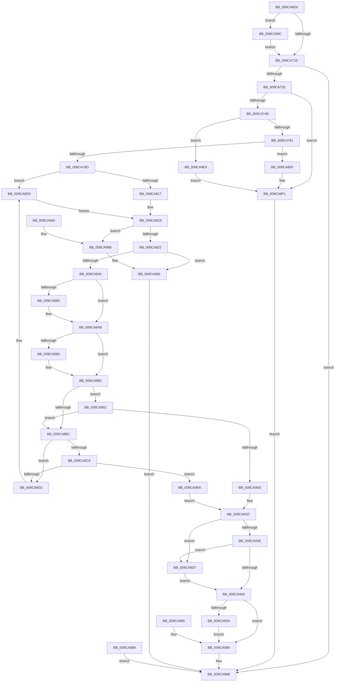

# NtCreatePrivateNamespace

- RVA: `0x009CA6D0`–`0x009CA9EE` (길이 `798` bytes)
- VA: `0x00000001409CA6D0`
- 실행 섹션: `PAGE`
- PDB 이름 있음: `예`; PDB Function 태그: `아니요`
- unwind 정보 RVA: `0x000A0B0C`
- 디코드: `202`개 명령, `798/798` bytes 표시
- 미해석 바이트: `0` (있으면 어셈블리에 `.byte`로 보존)

> 이 문서는 커널 이미지의 기계어와 PDB 기호를 분석해 생성했습니다. 4번과 5번은 함수 원형과 자료형을 바이너리 사용 방식에서 추정한 C 해석이며 원본 소스 복구 결과는 아닙니다.

## 1. Dependencies

- 직접 호출 지점: **18**; 고유 호출 대상: **16**
- 직접 호출자로 확인된 함수: **0**
- RIP 상대 이미지 참조: **2**

### Outgoing calls
- `0x009CA725` → [ObpCaptureBoundaryDescriptor](ObpCaptureBoundaryDescriptor_function_009C9738.md) (function, `0x009C9738`)
- `0x009CA73B` → [ObpVerifyCreatorAccessCheck](ObpVerifyCreatorAccessCheck_function_009CA524.md) (function, `0x009CA524`)
- `0x009CA78E` → [ObCreateObjectEx](../89/ObCreateObjectEx_function_0089B1E0.md) (function, `0x0089B1E0`)
- `0x009CA7AA` → [memset](../../text/6C/memset_function_006C6C40.md) (function, `0x006C6C40`)
- `0x009CA7DB` → [memcpy](../../text/6C/memcpy_function_006C6840.md) (function, `0x006C6840`)
- `0x009CA7E8` → [ExFreePoolWithTag](../../poolcode/B8/ExFreePoolWithTag_function_00B82870.md) (function, `0x00B82870`)
- `0x009CA825` → [ObpRegisterPrivateNamespace](ObpRegisterPrivateNamespace_function_009CA9F4.md) (function, `0x009CA9F4`)
- `0x009CA837` → [ObfReferenceObject](../../text/20/ObfReferenceObject_function_0020FA20.md) (function, `0x0020FA20`)
- `0x009CA85A` → [ObInsertObjectEx](../8B/ObInsertObjectEx_function_008B97A0.md) (function, `0x008B97A0`)
- `0x009CA865` → [PsGetCurrentServerSiloGlobals](../../text/2F/PsGetCurrentServerSiloGlobals_function_002FE1F0.md) (function, `0x002FE1F0`)
- `0x009CA88D` → [KeAbPreAcquire](../../text/21/KeAbPreAcquire_function_00210230.md) (function, `0x00210230`)
- `0x009CA8A6` → [ExfAcquirePushLockExclusiveEx](../../text/20/ExfAcquirePushLockExclusiveEx_function_0020FC90.md) (function, `0x0020FC90`)
- `0x009CA8F9` → [ExFreePoolWithTag](../../poolcode/B8/ExFreePoolWithTag_function_00B82870.md) (function, `0x00B82870`)
- `0x009CA94C` → [KeAbPostRelease](../../text/2E/KeAbPostRelease_function_002E1600.md) (function, `0x002E1600`)
- `0x009CA951` → [KeLeaveCriticalRegion](../../text/25/KeLeaveCriticalRegion_function_0025D8B0.md) (function, `0x0025D8B0`)
- `0x009CA993` → [ObfDereferenceObject](../../text/2F/ObfDereferenceObject_function_002F9350.md) (function, `0x002F9350`)
- `0x009CA9CD` → [ObfDereferenceObject](../../text/2F/ObfDereferenceObject_function_002F9350.md) (function, `0x002F9350`)
- `0x009CA9DA` → [ExfReleasePushLock](../../text/26/ExfReleasePushLock_function_002638D0.md) (function, `0x002638D0`)

### Direct callers
- 이 함수 시작 RVA로 연결되는 직접 call은 확인되지 않았습니다. 간접 호출은 완전히 역산할 수 없습니다.

### Static image references
- `0x009CA761` → RVA `0x00F0F650` (`.data`; read)
- `0x009CA8DC` → RVA `0x00F0FF80` (`.data`; read)

## 2. Other-region calls and transfers

- 다른 실행 섹션으로 향하는 call: **13**
  - `0x009CA7AA` → [memset](../../text/6C/memset_function_006C6C40.md) (`PAGE` → `.text`)
  - `0x009CA7DB` → [memcpy](../../text/6C/memcpy_function_006C6840.md) (`PAGE` → `.text`)
  - `0x009CA7E8` → [ExFreePoolWithTag](../../poolcode/B8/ExFreePoolWithTag_function_00B82870.md) (`PAGE` → `POOLCODE`)
  - `0x009CA837` → [ObfReferenceObject](../../text/20/ObfReferenceObject_function_0020FA20.md) (`PAGE` → `.text`)
  - `0x009CA865` → [PsGetCurrentServerSiloGlobals](../../text/2F/PsGetCurrentServerSiloGlobals_function_002FE1F0.md) (`PAGE` → `.text`)
  - `0x009CA88D` → [KeAbPreAcquire](../../text/21/KeAbPreAcquire_function_00210230.md) (`PAGE` → `.text`)
  - `0x009CA8A6` → [ExfAcquirePushLockExclusiveEx](../../text/20/ExfAcquirePushLockExclusiveEx_function_0020FC90.md) (`PAGE` → `.text`)
  - `0x009CA8F9` → [ExFreePoolWithTag](../../poolcode/B8/ExFreePoolWithTag_function_00B82870.md) (`PAGE` → `POOLCODE`)
  - `0x009CA94C` → [KeAbPostRelease](../../text/2E/KeAbPostRelease_function_002E1600.md) (`PAGE` → `.text`)
  - `0x009CA951` → [KeLeaveCriticalRegion](../../text/25/KeLeaveCriticalRegion_function_0025D8B0.md) (`PAGE` → `.text`)
  - `0x009CA993` → [ObfDereferenceObject](../../text/2F/ObfDereferenceObject_function_002F9350.md) (`PAGE` → `.text`)
  - `0x009CA9CD` → [ObfDereferenceObject](../../text/2F/ObfDereferenceObject_function_002F9350.md) (`PAGE` → `.text`)
  - `0x009CA9DA` → [ExfReleasePushLock](../../text/26/ExfReleasePushLock_function_002638D0.md) (`PAGE` → `.text`)
- 별도 외부 분기/꼬리 이동을 확인하지 못했습니다.

## 3. Assembly (complete function range)

```asm
009CA6D0  48 8B C4                        mov rax, rsp
009CA6D3  48 89 58 08                     mov qword ptr [rax + 8], rbx
009CA6D7  48 89 70 10                     mov qword ptr [rax + 0x10], rsi
009CA6DB  48 89 78 18                     mov qword ptr [rax + 0x18], rdi
009CA6DF  4C 89 60 20                     mov qword ptr [rax + 0x20], r12
009CA6E3  41 55                           push r13
009CA6E5  41 56                           push r14
009CA6E7  41 57                           push r15
009CA6E9  48 83 EC 70                     sub rsp, 0x70
009CA6ED  4D 8B F8                        mov r15, r8
009CA6F0  44 8B EA                        mov r13d, edx
009CA6F3  4C 8B E1                        mov r12, rcx
009CA6F6  33 DB                           xor ebx, ebx
009CA6F8  48 89 58 D0                     mov qword ptr [rax - 0x30], rbx
009CA6FC  48 89 58 E0                     mov qword ptr [rax - 0x20], rbx
009CA700  48 89 58 D8                     mov qword ptr [rax - 0x28], rbx
009CA704  65 48 8B 04 25 88 01 00 00      mov rax, qword ptr gs:[0x188]
009CA70D  40 8A B0 32 02 00 00            mov sil, byte ptr [rax + 0x232]
009CA714  40 84 F6                        test sil, sil
009CA717  0F 85 7F 02 00 00               jne 0x1409ca99c
009CA71D  48 8D 54 24 60                  lea rdx, [rsp + 0x60]
009CA722  49 8B C9                        mov rcx, r9
009CA725  E8 0E F0 FF FF                  call 0x1409c9738
009CA72A  85 C0                           test eax, eax
009CA72C  0F 88 39 02 00 00               js 0x1409ca96b
009CA732  48 8B 7C 24 60                  mov rdi, qword ptr [rsp + 0x60]
009CA737  48 8D 4F 30                     lea rcx, [rdi + 0x30]
009CA73B  E8 E4 FD FF FF                  call 0x1409ca524
009CA740  8B D8                           mov ebx, eax
009CA742  45 33 C0                        xor r8d, r8d
009CA745  85 C0                           test eax, eax
009CA747  0F 88 A4 01 00 00               js 0x1409ca8f1
009CA74D  8B 47 18                        mov eax, dword ptr [rdi + 0x18]
009CA750  05 88 01 00 00                  add eax, 0x188
009CA755  8B D8                           mov ebx, eax
009CA757  48 3B 5F 18                     cmp rbx, qword ptr [rdi + 0x18]
009CA75B  0F 82 83 02 00 00               jb 0x1409ca9e4
009CA761  48 8B 15 E8 4E 54 00            mov rdx, qword ptr [rip + 0x544ee8]
009CA768  4C 89 44 24 48                  mov qword ptr [rsp + 0x48], r8
009CA76D  48 8D 4C 24 58                  lea rcx, [rsp + 0x58]
009CA772  48 89 4C 24 40                  mov qword ptr [rsp + 0x40], rcx
009CA777  44 89 44 24 38                  mov dword ptr [rsp + 0x38], r8d
009CA77C  44 89 44 24 30                  mov dword ptr [rsp + 0x30], r8d
009CA781  89 44 24 28                     mov dword ptr [rsp + 0x28], eax
009CA785  44 8A CE                        mov r9b, sil
009CA788  4D 8B C7                        mov r8, r15
009CA78B  40 8A CE                        mov cl, sil
009CA78E  E8 4D 0A ED FF                  call 0x14089b1e0
009CA793  33 F6                           xor esi, esi
009CA795  85 C0                           test eax, eax
009CA797  0F 88 52 01 00 00               js 0x1409ca8ef
009CA79D  44 8B C3                        mov r8d, ebx
009CA7A0  33 D2                           xor edx, edx
009CA7A2  4C 8B 7C 24 58                  mov r15, qword ptr [rsp + 0x58]
009CA7A7  49 8B CF                        mov rcx, r15
009CA7AA  E8 91 C4 CF FF                  call 0x1406c6c40
009CA7AF  49 8D 9F 5F 01 00 00            lea rbx, [r15 + 0x15f]
009CA7B6  48 83 E3 F8                     and rbx, 0xfffffffffffffff8
009CA7BA  48 89 5B 08                     mov qword ptr [rbx + 8], rbx
009CA7BE  48 89 1B                        mov qword ptr [rbx], rbx
009CA7C1  4C 8B 47 18                     mov r8, qword ptr [rdi + 0x18]
009CA7C5  4C 89 43 18                     mov qword ptr [rbx + 0x18], r8
009CA7C9  48 89 73 10                     mov qword ptr [rbx + 0x10], rsi
009CA7CD  8A 47 28                        mov al, byte ptr [rdi + 0x28]
009CA7D0  88 43 28                        mov byte ptr [rbx + 0x28], al
009CA7D3  48 8D 4B 30                     lea rcx, [rbx + 0x30]
009CA7D7  48 8D 57 30                     lea rdx, [rdi + 0x30]
009CA7DB  E8 60 C0 CF FF                  call 0x1406c6840
009CA7E0  BA 4F 62 4E 53                  mov edx, 0x534e624f
009CA7E5  48 8B CF                        mov rcx, rdi
009CA7E8  E8 83 80 1B 00                  call 0x140b82870
009CA7ED  49 89 B7 28 01 00 00            mov qword ptr [r15 + 0x128], rsi
009CA7F4  41 83 8F 54 01 00 00 FF         or dword ptr [r15 + 0x154], 0xffffffff
009CA7FC  41 C7 87 50 01 00 00 01 00 00 00  mov dword ptr [r15 + 0x150], 1
009CA807  49 8D 4F D0                     lea rcx, [r15 - 0x30]
009CA80B  0F B6 41 1A                     movzx eax, byte ptr [rcx + 0x1a]
009CA80F  A8 02                           test al, 2
009CA811  0F 85 C2 00 00 00               jne 0x1409ca8d9
009CA817  8B CE                           mov ecx, esi
009CA819  48 85 C9                        test rcx, rcx
009CA81C  0F 85 69 01 00 00               jne 0x1409ca98b
009CA822  48 8B CB                        mov rcx, rbx
009CA825  E8 CA 01 00 00                  call 0x1409ca9f4
009CA82A  8B F8                           mov edi, eax
009CA82C  85 C0                           test eax, eax
009CA82E  0F 88 5C 01 00 00               js 0x1409ca990
009CA834  49 8B CF                        mov rcx, r15
009CA837  E8 E4 51 84 FF                  call 0x14020fa20
009CA83C  48 8D 44 24 68                  lea rax, [rsp + 0x68]
009CA841  48 89 44 24 30                  mov qword ptr [rsp + 0x30], rax
009CA846  48 89 74 24 28                  mov qword ptr [rsp + 0x28], rsi
009CA84B  89 74 24 20                     mov dword ptr [rsp + 0x20], esi
009CA84F  45 33 C9                        xor r9d, r9d
009CA852  45 8B C5                        mov r8d, r13d
009CA855  33 D2                           xor edx, edx
009CA857  49 8B CF                        mov rcx, r15
009CA85A  E8 41 EF EE FF                  call 0x1408b97a0
009CA85F  8B F0                           mov esi, eax
009CA861  89 44 24 50                     mov dword ptr [rsp + 0x50], eax
009CA865  E8 86 39 93 FF                  call 0x1402fe1f0
009CA86A  4C 8B F0                        mov r14, rax
009CA86D  65 48 8B 0C 25 88 01 00 00      mov rcx, qword ptr gs:[0x188]
009CA876  66 FF 89 E4 01 00 00            dec word ptr [rcx + 0x1e4]
009CA87D  90                              nop
009CA87E  48 8D B8 D0 02 00 00            lea rdi, [rax + 0x2d0]
009CA885  45 33 C0                        xor r8d, r8d
009CA888  33 D2                           xor edx, edx
009CA88A  48 8B CF                        mov rcx, rdi
009CA88D  E8 9E 59 84 FF                  call 0x140210230
009CA892  4C 8B E8                        mov r13, rax
009CA895  F0 48 0F BA 2F 00               lock bts qword ptr [rdi], 0
009CA89B  73 0E                           jae 0x1409ca8ab
009CA89D  4C 8B C7                        mov r8, rdi
009CA8A0  48 8B D0                        mov rdx, rax
009CA8A3  48 8B CF                        mov rcx, rdi
009CA8A6  E8 E5 53 84 FF                  call 0x14020fc90
009CA8AB  4D 85 ED                        test r13, r13
009CA8AE  74 05                           je 0x1409ca8b5
009CA8B0  41 C6 45 0A 01                  mov byte ptr [r13 + 0xa], 1
009CA8B5  45 33 ED                        xor r13d, r13d
009CA8B8  85 F6                           test esi, esi
009CA8BA  79 46                           jns 0x1409ca902
009CA8BC  48 8B 0B                        mov rcx, qword ptr [rbx]
009CA8BF  48 39 59 08                     cmp qword ptr [rcx + 8], rbx
009CA8C3  48 8B 43 08                     mov rax, qword ptr [rbx + 8]
009CA8C7  75 09                           jne 0x1409ca8d2
009CA8C9  48 39 18                        cmp qword ptr [rax], rbx
009CA8CC  0F 84 E8 00 00 00               je 0x1409ca9ba
009CA8D2  B9 03 00 00 00                  mov ecx, 3
009CA8D7  CD 29                           int 0x29
009CA8D9  83 E0 03                        and eax, 3
009CA8DC  48 8D 15 9D 56 54 00            lea rdx, [rip + 0x54569d]
009CA8E3  0F B6 04 10                     movzx eax, byte ptr [rax + rdx]
009CA8E7  48 2B C8                        sub rcx, rax
009CA8EA  E9 2A FF FF FF                  jmp 0x1409ca819
009CA8EF  8B D8                           mov ebx, eax
009CA8F1  BA 4F 62 4E 53                  mov edx, 0x534e624f
009CA8F6  48 8B CF                        mov rcx, rdi
009CA8F9  E8 72 7F 1B 00                  call 0x140b82870
009CA8FE  8B C3                           mov eax, ebx
009CA900  EB 69                           jmp 0x1409ca96b
009CA902  41 8B 87 50 01 00 00            mov eax, dword ptr [r15 + 0x150]
009CA909  A8 02                           test al, 2
009CA90B  75 AF                           jne 0x1409ca8bc
009CA90D  48 8B 44 24 58                  mov rax, qword ptr [rsp + 0x58]
009CA912  48 89 43 10                     mov qword ptr [rbx + 0x10], rax
009CA916  48 89 98 40 01 00 00            mov qword ptr [rax + 0x140], rbx
009CA91D  0F 0D 0F                        prefetchw byte ptr [rdi]
009CA920  48 8B 07                        mov rax, qword ptr [rdi]
009CA923  48 8B C8                        mov rcx, rax
009CA926  48 83 E1 F0                     and rcx, 0xfffffffffffffff0
009CA92A  48 8D 50 F0                     lea rdx, [rax - 0x10]
009CA92E  48 83 F9 10                     cmp rcx, 0x10
009CA932  49 0F 46 D5                     cmovbe rdx, r13
009CA936  A8 02                           test al, 2
009CA938  0F 85 99 00 00 00               jne 0x1409ca9d7
009CA93E  F0 48 0F B1 17                  lock cmpxchg qword ptr [rdi], rdx
009CA943  0F 85 8E 00 00 00               jne 0x1409ca9d7
009CA949  48 8B CF                        mov rcx, rdi
009CA94C  E8 AF 6C 91 FF                  call 0x1402e1600
009CA951  E8 5A 2F 89 FF                  call 0x14025d8b0
009CA956  85 F6                           test esi, esi
009CA958  78 0F                           js 0x1409ca969
009CA95A  48 8B 44 24 68                  mov rax, qword ptr [rsp + 0x68]
009CA95F  49 89 04 24                     mov qword ptr [r12], rax
009CA963  EB 04                           jmp 0x1409ca969
009CA965  8B 74 24 50                     mov esi, dword ptr [rsp + 0x50]
009CA969  8B C6                           mov eax, esi
009CA96B  4C 8D 5C 24 70                  lea r11, [rsp + 0x70]
009CA970  49 8B 5B 20                     mov rbx, qword ptr [r11 + 0x20]
009CA974  49 8B 73 28                     mov rsi, qword ptr [r11 + 0x28]
009CA978  49 8B 7B 30                     mov rdi, qword ptr [r11 + 0x30]
009CA97C  4D 8B 63 38                     mov r12, qword ptr [r11 + 0x38]
009CA980  49 8B E3                        mov rsp, r11
009CA983  41 5F                           pop r15
009CA985  41 5E                           pop r14
009CA987  41 5D                           pop r13
009CA989  C3                              ret
009CA98A  CC                              int3
009CA98B  BF 33 00 00 C0                  mov edi, 0xc0000033
009CA990  49 8B CF                        mov rcx, r15
009CA993  E8 B8 E9 92 FF                  call 0x1402f9350
009CA998  8B C7                           mov eax, edi
009CA99A  EB CF                           jmp 0x1409ca96b
009CA99C  48 B9 00 00 FF FF FF 7F 00 00   movabs rcx, 0x7fffffff0000
009CA9A6  4C 3B E1                        cmp r12, rcx
009CA9A9  49 0F 42 CC                     cmovb rcx, r12
009CA9AD  48 8B 01                        mov rax, qword ptr [rcx]
009CA9B0  48 89 01                        mov qword ptr [rcx], rax
009CA9B3  E9 65 FD FF FF                  jmp 0x1409ca71d
009CA9B8  EB B1                           jmp 0x1409ca96b
009CA9BA  48 89 08                        mov qword ptr [rax], rcx
009CA9BD  48 89 41 08                     mov qword ptr [rcx + 8], rax
009CA9C1  41 FF 8E D8 02 00 00            dec dword ptr [r14 + 0x2d8]
009CA9C8  48 8B 4C 24 58                  mov rcx, qword ptr [rsp + 0x58]
009CA9CD  E8 7E E9 92 FF                  call 0x1402f9350
009CA9D2  E9 46 FF FF FF                  jmp 0x1409ca91d
009CA9D7  48 8B CF                        mov rcx, rdi
009CA9DA  E8 F1 8E 89 FF                  call 0x1402638d0
009CA9DF  E9 65 FF FF FF                  jmp 0x1409ca949
009CA9E4  BB 0D 00 00 C0                  mov ebx, 0xc000000d
009CA9E9  E9 03 FF FF FF                  jmp 0x1409ca8f1
```

## 4. C-style interpretation (structured pseudocode)

```c
__int64 __fastcall NtCreatePrivateNamespace(__int64 a1, int a2, __int64 a3, __int64 a4)
{
    __int64 result;
    __int64 v_r13;
    __int64 v_rbx;
    __int64 v_rsi;
    __int64 v_rsp;
    unsigned __int64 v_stack_m18;
    unsigned __int64 v_stack_m20;
    unsigned __int64 v_stack_m28;
    unsigned __int64 v_stack_m30;
    unsigned int v_stack_m38;
    unsigned __int64 v_stack_m40;
    unsigned __int64 v_stack_m48;
    unsigned int v_stack_m50;
    unsigned int v_stack_m58;
    unsigned int v_stack_m60;
    unsigned int v_stack_m68;

    *(unsigned __int64 *)(v_rsp + 8) = v_rbx;
    *(unsigned __int64 *)(v_rsp + 16) = v_rsi;
    *(unsigned __int64 *)(v_rsp + 24) = v_rdi;
    *(unsigned __int64 *)(v_rsp + 32) = v_r12;
    v_rsp = (v_rsp) - (112);
    v_rbx = 0;
    *(unsigned __int64 *)(v_rsp - 48) = 0;
    *(unsigned __int64 *)(v_rsp - 32) = 0;
    *(unsigned __int64 *)(v_rsp - 40) = 0;
    if ((unsigned __int8)(*(unsigned __int8 *)(*(unsigned __int64 *)(gs_base + (0 + 392)) + 562)) != 0) goto loc_009CA99C;
loc_009CA71D:
    result = ObpCaptureBoundaryDescriptor(a4, v_stack_m28, a3, a4);
    if (sign_flag) goto loc_009CA96B;
    result = ObpVerifyCreatorAccessCheck(v_stack_m28 + 48, v_stack_m28, a3, a4);
    a3 = 0;
    if (sign_flag) goto loc_009CA8F1;
    result = (unsigned int)(((unsigned int)(*(unsigned int *)(v_stack_m28 + 24))) + (392));
    if (((unsigned int)((unsigned int)(result))) < (*(unsigned __int64 *)(v_stack_m28 + 24))) goto loc_009CA9E4;
    v_stack_m40 = 0;
    v_stack_m48 = v_stack_m30;
    v_stack_m50 = 0;
    v_stack_m58 = 0;
    v_stack_m60 = (unsigned int)(result);
    result = ObCreateObjectEx((unsigned __int8)(*(unsigned __int8 *)(*(unsigned __int64 *)(gs_base + (0 + 392)) + 562)), *(unsigned __int64 *)(v_rip + 5525224), 0, (unsigned __int8)(*(unsigned __int8 *)(*(unsigned __int64 *)(gs_base + (0 + 392)) + 562)));
    v_rsi = 0;
    if (sign_flag) goto loc_009CA8EF;
    a2 = 0;
    result = memset(v_stack_m30, a2, (unsigned int)((unsigned int)((unsigned int)((unsigned int)(result)))), (unsigned __int8)(*(unsigned __int8 *)(*(unsigned __int64 *)(gs_base + (0 + 392)) + 562)));
    v_rbx = (v_stack_m30 + 351) & (-8);
    *(unsigned __int64 *)(v_rbx + 8) = v_rbx;
    *(unsigned __int64 *)(v_rbx) = v_rbx;
    *(unsigned __int64 *)(v_rbx + 24) = *(unsigned __int64 *)(v_stack_m28 + 24);
    *(unsigned __int64 *)(v_rbx + 16) = 0;
    *(unsigned __int8 *)(v_rbx + 40) = (unsigned __int8)(*(unsigned __int8 *)(v_stack_m28 + 40));
    result = memcpy(v_rbx + 48, v_stack_m28 + 48, *(unsigned __int64 *)(v_stack_m28 + 24), (unsigned __int8)(*(unsigned __int8 *)(*(unsigned __int64 *)(gs_base + (0 + 392)) + 562)));
    result = ExFreePoolWithTag(v_stack_m28, (unsigned int)(0x534E624FULL), *(unsigned __int64 *)(v_stack_m28 + 24), (unsigned __int8)(*(unsigned __int8 *)(*(unsigned __int64 *)(gs_base + (0 + 392)) + 562)));
    *(unsigned __int64 *)(v_stack_m30 + 296) = 0;
    *(unsigned int *)(v_stack_m30 + 336) = 1;
    if ((((unsigned __int8)(*(unsigned __int8 *)(v_stack_m30 - 48 + 26))) & (2)) != 0) goto loc_009CA8D9;
loc_009CA819:
    if (0 != 0) goto loc_009CA98B;
    result = ObpRegisterPrivateNamespace(v_rbx, (unsigned int)(0x534E624FULL), *(unsigned __int64 *)(v_stack_m28 + 24), (unsigned __int8)(*(unsigned __int8 *)(*(unsigned __int64 *)(gs_base + (0 + 392)) + 562)));
    if (sign_flag) goto loc_009CA990;
    result = ObfReferenceObject(v_stack_m30, (unsigned int)(0x534E624FULL), *(unsigned __int64 *)(v_stack_m28 + 24), (unsigned __int8)(*(unsigned __int8 *)(*(unsigned __int64 *)(gs_base + (0 + 392)) + 562)));
    v_stack_m58 = v_stack_m20;
    v_stack_m60 = 0;
    v_stack_m68 = 0;
    a4 = 0;
    a2 = 0;
    result = ObInsertObjectEx(v_stack_m30, a2, (unsigned int)((unsigned int)((unsigned int)(a2))), a4);
    v_stack_m38 = (unsigned int)(result);
    result = PsGetCurrentServerSiloGlobals(v_stack_m30, a2, (unsigned int)((unsigned int)((unsigned int)(a2))), a4);
    a3 = 0;
    a2 = 0;
    result = KeAbPreAcquire(result + 720, a2, a3, a4);
    if (!(condition_is_above_or_equal)) {
        a3 = result + 720;
        a2 = result;
        a1 = result + 720;
        result = ExfAcquirePushLockExclusiveEx(a1, a2, a3, a4);
    }
    if (result != 0) {
        *(unsigned __int8 *)(result + 10) = 1;
    }
    v_r13 = 0;
    if (!sign_flag) goto loc_009CA902;
loc_009CA8BC:
    if ((*(unsigned __int64 *)(*(unsigned __int64 *)(v_rbx) + 8)) != v_rbx) goto loc_009CA8D2;
    if ((*(unsigned __int64 *)(*(unsigned __int64 *)(v_rbx + 8))) == v_rbx) goto loc_009CA9BA;
loc_009CA8D2:
loc_009CA8D9:
    result = (unsigned int)((*(unsigned __int64 *)(v_rbx + 8)) & (3));
    a1 = (3) - (*(unsigned __int8 *)(result + v_rip + 5527197 * 1));
    goto loc_009CA819;
loc_009CA8EF:
loc_009CA8F1:
    result = ExFreePoolWithTag(result + 720, (unsigned int)(0x534E624FULL), a3, a4);
    goto loc_009CA96B;
loc_009CA902:
    if ((((unsigned __int8)((unsigned int)(*(unsigned int *)(v_stack_m30 + 336)))) & (2)) != 0) goto loc_009CA8BC;
    *(unsigned __int64 *)((unsigned int)((unsigned int)(*(unsigned __int8 *)(result + v_rip + 5527197 * 1))) + 16) = v_stack_m30;
    *(unsigned __int64 *)(v_stack_m30 + 320) = (unsigned int)((unsigned int)(*(unsigned __int8 *)(result + v_rip + 5527197 * 1)));
loc_009CA91D:
    a1 = (*(unsigned __int64 *)(result + 720)) & (-16);
    a2 = *(unsigned __int64 *)(result + 720) - 16;
    if (a1 <= 16) { a2 = 0; }
    if ((((unsigned __int8)(*(unsigned __int64 *)(result + 720))) & (2)) != 0) goto loc_009CA9D7;
    if ((((unsigned __int8)(*(unsigned __int64 *)(result + 720))) & (2)) != 0) goto loc_009CA9D7;
loc_009CA949:
    result = KeAbPostRelease(result + 720, a2, a3, a4);
    result = KeLeaveCriticalRegion(result + 720, a2, a3, a4);
    if (sign_flag) goto loc_009CA969;
    *(unsigned __int64 *)(a1) = v_stack_m20;
    goto loc_009CA969;
loc_009CA969:
loc_009CA96B:
    return (unsigned int)((unsigned int)((unsigned int)((unsigned int)(result))));
loc_009CA98B:
loc_009CA990:
    result = ObfDereferenceObject(v_stack_m30, a2, a3, a4);
    goto loc_009CA96B;
loc_009CA99C:
    a1 = v_stack_m30;
    if ((*(unsigned __int64 *)(v_stack_m18 + 56)) < v_stack_m30) { a1 = *(unsigned __int64 *)(v_stack_m18 + 56); }
    *(unsigned __int64 *)(a1) = *(unsigned __int64 *)(a1);
    goto loc_009CA71D;
loc_009CA9BA:
    *(unsigned __int64 *)(*(unsigned __int64 *)(a1)) = a1;
    *(unsigned __int64 *)(a1 + 8) = *(unsigned __int64 *)(a1);
    result = ObfDereferenceObject(v_stack_m18, a2, a3, a4);
    goto loc_009CA91D;
loc_009CA9D7:
    result = ExfReleasePushLock((unsigned int)(0xC0000033ULL), a2, a3, a4);
    goto loc_009CA949;
loc_009CA9E4:
    goto loc_009CA8F1;
}
```

## 5. (Beta) C Style

```c
int64_t NtCreatePrivateNamespace(int64_t Arg1, int32_t Arg2, int64_t Arg3, int64_t Arg4)
{
    int64_t result;
    int64_t local_r13;
    int64_t local_rbx;
    int64_t local_rsi;
    int64_t local_rsp;
    uint64_t v_stack_m18;
    uint64_t v_stack_m20;
    uint64_t v_stack_m28;
    uint64_t v_stack_m30;
    uint32_t v_stack_m38;
    uint64_t v_stack_m40;
    uint64_t v_stack_m48;
    uint32_t v_stack_m50;
    uint32_t v_stack_m58;
    uint32_t v_stack_m60;
    uint32_t v_stack_m68;

    *(uint64_t *)(local_rsp + 0x8) = local_rbx;
    *(uint64_t *)(local_rsp + 0x10) = local_rsi;
    *(uint64_t *)(local_rsp + 0x18) = local_rdi;
    *(uint64_t *)(local_rsp + 0x20) = local_r12;
    local_rsp = (local_rsp) - (112);
    local_rbx = 0;
    *(uint64_t *)(local_rsp - 0x30) = 0;
    *(uint64_t *)(local_rsp - 0x20) = 0;
    *(uint64_t *)(local_rsp - 0x28) = 0;
    if ((uint8_t)(*(uint8_t *)(*(uint64_t *)(gs_base + (0 + 0x188)) + 0x232)) != 0) goto loc_009CA99C;
loc_009CA71D:
    result = ObpCaptureBoundaryDescriptor(Arg4, v_stack_m28, Arg3, Arg4);
    if (sign_flag) goto loc_009CA96B;
    result = ObpVerifyCreatorAccessCheck(v_stack_m28 + 48, v_stack_m28, Arg3, Arg4);
    Arg3 = 0;
    if (sign_flag) goto loc_009CA8F1;
    result = (uint32_t)(((uint32_t)(*(uint32_t *)(v_stack_m28 + 0x18))) + (392));
    if (((uint32_t)((uint32_t)(result))) < (*(uint64_t *)(v_stack_m28 + 0x18))) goto loc_009CA9E4;
    v_stack_m40 = 0;
    v_stack_m48 = v_stack_m30;
    v_stack_m50 = 0;
    v_stack_m58 = 0;
    v_stack_m60 = (uint32_t)(result);
    result = ObCreateObjectEx((uint8_t)(*(uint8_t *)(*(uint64_t *)(gs_base + (0 + 0x188)) + 0x232)), *(uint64_t *)(v_rip + 0x544EE8), 0, (uint8_t)(*(uint8_t *)(*(uint64_t *)(gs_base + (0 + 0x188)) + 0x232)));
    local_rsi = 0;
    if (sign_flag) goto loc_009CA8EF;
    Arg2 = 0;
    result = memset(v_stack_m30, Arg2, (uint32_t)((uint32_t)((uint32_t)((uint32_t)(result)))), (uint8_t)(*(uint8_t *)(*(uint64_t *)(gs_base + (0 + 0x188)) + 0x232)));
    local_rbx = (v_stack_m30 + 351) & (-8);
    *(uint64_t *)(local_rbx + 0x8) = local_rbx;
    *(uint64_t *)(local_rbx) = local_rbx;
    *(uint64_t *)(local_rbx + 0x18) = *(uint64_t *)(v_stack_m28 + 0x18);
    *(uint64_t *)(local_rbx + 0x10) = 0;
    *(uint8_t *)(local_rbx + 0x28) = (uint8_t)(*(uint8_t *)(v_stack_m28 + 0x28));
    result = memcpy(local_rbx + 48, v_stack_m28 + 48, *(uint64_t *)(v_stack_m28 + 0x18), (uint8_t)(*(uint8_t *)(*(uint64_t *)(gs_base + (0 + 0x188)) + 0x232)));
    result = ExFreePoolWithTag(v_stack_m28, (uint32_t)(0x534E624FULL), *(uint64_t *)(v_stack_m28 + 0x18), (uint8_t)(*(uint8_t *)(*(uint64_t *)(gs_base + (0 + 0x188)) + 0x232)));
    *(uint64_t *)(v_stack_m30 + 0x128) = 0;
    *(uint32_t *)(v_stack_m30 + 0x150) = 1;
    if ((((uint8_t)(*(uint8_t *)(v_stack_m30 - 0x30 + 0x1A))) & (2)) != 0) goto loc_009CA8D9;
loc_009CA819:
    if (0 != 0) goto loc_009CA98B;
    result = ObpRegisterPrivateNamespace(local_rbx, (uint32_t)(0x534E624FULL), *(uint64_t *)(v_stack_m28 + 0x18), (uint8_t)(*(uint8_t *)(*(uint64_t *)(gs_base + (0 + 0x188)) + 0x232)));
    if (sign_flag) goto loc_009CA990;
    result = ObfReferenceObject(v_stack_m30, (uint32_t)(0x534E624FULL), *(uint64_t *)(v_stack_m28 + 0x18), (uint8_t)(*(uint8_t *)(*(uint64_t *)(gs_base + (0 + 0x188)) + 0x232)));
    v_stack_m58 = v_stack_m20;
    v_stack_m60 = 0;
    v_stack_m68 = 0;
    Arg4 = 0;
    Arg2 = 0;
    result = ObInsertObjectEx(v_stack_m30, Arg2, (uint32_t)((uint32_t)((uint32_t)(Arg2))), Arg4);
    v_stack_m38 = (uint32_t)(result);
    result = PsGetCurrentServerSiloGlobals(v_stack_m30, Arg2, (uint32_t)((uint32_t)((uint32_t)(Arg2))), Arg4);
    Arg3 = 0;
    Arg2 = 0;
    result = KeAbPreAcquire(result + 720, Arg2, Arg3, Arg4);
    if (!(condition_is_above_or_equal)) {
        Arg3 = result + 720;
        Arg2 = result;
        Arg1 = result + 720;
        result = ExfAcquirePushLockExclusiveEx(Arg1, Arg2, Arg3, Arg4);
    }
    if (result != 0) {
        *(uint8_t *)(result + 0xA) = 1;
    }
    local_r13 = 0;
    if (!sign_flag) goto loc_009CA902;
loc_009CA8BC:
    if ((*(uint64_t *)(*(uint64_t *)(local_rbx) + 0x8)) != local_rbx) goto loc_009CA8D2;
    if ((*(uint64_t *)(*(uint64_t *)(local_rbx + 0x8))) == local_rbx) goto loc_009CA9BA;
loc_009CA8D2:
loc_009CA8D9:
    result = (uint32_t)((*(uint64_t *)(local_rbx + 0x8)) & (3));
    Arg1 = (3) - (*(uint8_t *)(result + v_rip + 0x54569D * 1));
    goto loc_009CA819;
loc_009CA8EF:
loc_009CA8F1:
    result = ExFreePoolWithTag(result + 720, (uint32_t)(0x534E624FULL), Arg3, Arg4);
    goto loc_009CA96B;
loc_009CA902:
    if ((((uint8_t)((uint32_t)(*(uint32_t *)(v_stack_m30 + 0x150)))) & (2)) != 0) goto loc_009CA8BC;
    *(uint64_t *)((uint32_t)((uint32_t)(*(uint8_t *)(result + v_rip + 0x54569D * 1))) + 0x10) = v_stack_m30;
    *(uint64_t *)(v_stack_m30 + 0x140) = (uint32_t)((uint32_t)(*(uint8_t *)(result + v_rip + 0x54569D * 1)));
loc_009CA91D:
    Arg1 = (*(uint64_t *)(result + 0x2D0)) & (-16);
    Arg2 = *(uint64_t *)(result + 0x2D0) - 16;
    if (Arg1 <= 16) { Arg2 = 0; }
    if ((((uint8_t)(*(uint64_t *)(result + 0x2D0))) & (2)) != 0) goto loc_009CA9D7;
    if ((((uint8_t)(*(uint64_t *)(result + 0x2D0))) & (2)) != 0) goto loc_009CA9D7;
loc_009CA949:
    result = KeAbPostRelease(result + 720, Arg2, Arg3, Arg4);
    result = KeLeaveCriticalRegion(result + 720, Arg2, Arg3, Arg4);
    if (sign_flag) goto loc_009CA969;
    *(uint64_t *)(Arg1) = v_stack_m20;
    goto loc_009CA969;
loc_009CA969:
loc_009CA96B:
    return (uint32_t)((uint32_t)((uint32_t)((uint32_t)(result))));
loc_009CA98B:
loc_009CA990:
    result = ObfDereferenceObject(v_stack_m30, Arg2, Arg3, Arg4);
    goto loc_009CA96B;
loc_009CA99C:
    Arg1 = v_stack_m30;
    if ((*(uint64_t *)(v_stack_m18 + 0x38)) < v_stack_m30) { Arg1 = *(uint64_t *)(v_stack_m18 + 0x38); }
    *(uint64_t *)(Arg1) = *(uint64_t *)(Arg1);
    goto loc_009CA71D;
loc_009CA9BA:
    *(uint64_t *)(*(uint64_t *)(Arg1)) = Arg1;
    *(uint64_t *)(Arg1 + 0x8) = *(uint64_t *)(Arg1);
    result = ObfDereferenceObject(v_stack_m18, Arg2, Arg3, Arg4);
    goto loc_009CA91D;
loc_009CA9D7:
    result = ExfReleasePushLock((uint32_t)(0xC0000033ULL), Arg2, Arg3, Arg4);
    goto loc_009CA949;
loc_009CA9E4:
    goto loc_009CA8F1;
}
```

## 6. Execution-region graph

[열기: 2D/3D 그래프와 함수 탐색 컨트롤 패널](../../../control-panel.html?section=page&rva=0x009CA6D0&view=graph)

- 2D 그래프는 위에서 아래로 흐르고, 3D 그래프는 빈 공간을 드래그해 회전합니다. Shift+드래그는 이동, 휠은 확대·축소, 함수 노드 선택은 대상 보고서 이동입니다.

### Static fallback


