# NtFilterToken

- RVA: `0x009C7890`–`0x009C7C38` (길이 `936` bytes)
- VA: `0x00000001409C7890`
- 실행 섹션: `PAGE`
- PDB 이름 있음: `예`; PDB Function 태그: `아니요`
- unwind 정보 RVA: `0x000A0808`
- 디코드: `229`개 명령, `936/936` bytes 표시
- 미해석 바이트: `0` (있으면 어셈블리에 `.byte`로 보존)

> 이 문서는 커널 이미지의 기계어와 PDB 기호를 분석해 생성했습니다. 4번과 5번은 함수 원형과 자료형을 바이너리 사용 방식에서 추정한 C 해석이며 원본 소스 복구 결과는 아닙니다.

## 1. Dependencies

- 직접 호출 지점: **13**; 고유 호출 대상: **9**
- 직접 호출자로 확인된 함수: **0**
- RIP 상대 이미지 참조: **1**

### Outgoing calls
- `0x009C797B` → [SeCaptureLuidAndAttributesArray](SeCaptureLuidAndAttributesArray_function_009C8D18.md) (function, `0x009C8D18`)
- `0x009C79A1` → [ExRaiseDatatypeMisalignment](../89/ExRaiseDatatypeMisalignment_function_00899FD0.md) (function, `0x00899FD0`)
- `0x009C79F0` → [SeCaptureSidAndAttributesArray](SeCaptureSidAndAttributesArray_function_009C9D70.md) (function, `0x009C9D70`)
- `0x009C7A5C` → [SeCaptureSidAndAttributesArray](SeCaptureSidAndAttributesArray_function_009C9D70.md) (function, `0x009C9D70`)
- `0x009C7AE2` → [ObReferenceObjectByHandle](../86/ObReferenceObjectByHandle_function_00868DB0.md) (function, `0x00868DB0`)
- `0x009C7B57` → [SepFilterToken](SepFilterToken_function_009C6B80.md) (function, `0x009C6B80`)
- `0x009C7B8D` → [ObInsertObjectEx](../8B/ObInsertObjectEx_function_008B97A0.md) (function, `0x008B97A0`)
- `0x009C7B9D` → [SepFinalizeTokenAcls](../8B/SepFinalizeTokenAcls_function_008B63F4.md) (function, `0x008B63F4`)
- `0x009C7BA7` → [ObfDereferenceObject](../../text/2F/ObfDereferenceObject_function_002F9350.md) (function, `0x002F9350`)
- `0x009C7BB4` → [ObfDereferenceObject](../../text/2F/ObfDereferenceObject_function_002F9350.md) (function, `0x002F9350`)
- `0x009C7BE2` → [SeReleaseLuidAndAttributesArray](SeReleaseLuidAndAttributesArray_function_009C7C40.md) (function, `0x009C7C40`)
- `0x009C7BF7` → [SeReleaseLuidAndAttributesArray](SeReleaseLuidAndAttributesArray_function_009C7C40.md) (function, `0x009C7C40`)
- `0x009C7C0C` → [SeReleaseLuidAndAttributesArray](SeReleaseLuidAndAttributesArray_function_009C7C40.md) (function, `0x009C7C40`)

### Direct callers
- 이 함수 시작 RVA로 연결되는 직접 call은 확인되지 않았습니다. 간접 호출은 완전히 역산할 수 없습니다.

### Static image references
- `0x009C7AA9` → RVA `0x00FD8020` (`PAGEDATA`; read)

## 2. Other-region calls and transfers

- 다른 실행 섹션으로 향하는 call: **2**
  - `0x009C7BA7` → [ObfDereferenceObject](../../text/2F/ObfDereferenceObject_function_002F9350.md) (`PAGE` → `.text`)
  - `0x009C7BB4` → [ObfDereferenceObject](../../text/2F/ObfDereferenceObject_function_002F9350.md) (`PAGE` → `.text`)
- 별도 외부 분기/꼬리 이동을 확인하지 못했습니다.

## 3. Assembly (complete function range)

```asm
009C7890  48 8B C4                        mov rax, rsp
009C7893  48 89 58 18                     mov qword ptr [rax + 0x18], rbx
009C7897  48 89 70 20                     mov qword ptr [rax + 0x20], rsi
009C789B  89 50 10                        mov dword ptr [rax + 0x10], edx
009C789E  48 89 48 08                     mov qword ptr [rax + 8], rcx
009C78A2  57                              push rdi
009C78A3  41 54                           push r12
009C78A5  41 55                           push r13
009C78A7  41 56                           push r14
009C78A9  41 57                           push r15
009C78AB  48 81 EC C0 00 00 00            sub rsp, 0xc0
009C78B2  4D 8B E1                        mov r12, r9
009C78B5  4C 8B BC 24 10 01 00 00         mov r15, qword ptr [rsp + 0x110]
009C78BD  33 DB                           xor ebx, ebx
009C78BF  48 89 58 90                     mov qword ptr [rax - 0x70], rbx
009C78C3  89 5C 24 64                     mov dword ptr [rsp + 0x64], ebx
009C78C7  89 58 84                        mov dword ptr [rax - 0x7c], ebx
009C78CA  48 89 58 98                     mov qword ptr [rax - 0x68], rbx
009C78CE  89 58 88                        mov dword ptr [rax - 0x78], ebx
009C78D1  89 58 80                        mov dword ptr [rax - 0x80], ebx
009C78D4  48 89 58 B8                     mov qword ptr [rax - 0x48], rbx
009C78D8  89 58 A4                        mov dword ptr [rax - 0x5c], ebx
009C78DB  89 58 8C                        mov dword ptr [rax - 0x74], ebx
009C78DE  48 89 58 C0                     mov qword ptr [rax - 0x40], rbx
009C78E2  89 58 A8                        mov dword ptr [rax - 0x58], ebx
009C78E5  48 89 58 D0                     mov qword ptr [rax - 0x30], rbx
009C78E9  48 89 58 C8                     mov qword ptr [rax - 0x38], rbx
009C78ED  65 48 8B 04 25 88 01 00 00      mov rax, qword ptr gs:[0x188]
009C78F6  40 8A B0 32 02 00 00            mov sil, byte ptr [rax + 0x232]
009C78FD  40 88 74 24 60                  mov byte ptr [rsp + 0x60], sil
009C7902  49 BE 00 00 FF FF FF 7F 00 00   movabs r14, 0x7fffffff0000
009C790C  49 8B CE                        mov rcx, r14
009C790F  4C 8B AC 24 18 01 00 00         mov r13, qword ptr [rsp + 0x118]
009C7917  4D 3B EE                        cmp r13, r14
009C791A  49 0F 42 CD                     cmovb rcx, r13
009C791E  48 8B 01                        mov rax, qword ptr [rcx]
009C7921  48 89 01                        mov qword ptr [rcx], rax
009C7924  4D 85 C0                        test r8, r8
009C7927  0F 85 D3 00 00 00               jne 0x1409c7a00
009C792D  8B 7C 24 64                     mov edi, dword ptr [rsp + 0x64]
009C7931  85 FF                           test edi, edi
009C7933  0F 88 2E 01 00 00               js 0x1409c7a67
009C7939  4D 85 E4                        test r12, r12
009C793C  74 48                           je 0x1409c7986
009C793E  41 F6 C4 03                     test r12b, 3
009C7942  75 5D                           jne 0x1409c79a1
009C7944  49 8B C6                        mov rax, r14
009C7947  4D 3B E6                        cmp r12, r14
009C794A  49 0F 42 C4                     cmovb rax, r12
009C794E  90                              nop
009C794F  8A 00                           mov al, byte ptr [rax]
009C7951  41 8B 14 24                     mov edx, dword ptr [r12]
009C7955  89 54 24 74                     mov dword ptr [rsp + 0x74], edx
009C7959  49 8D 4C 24 04                  lea rcx, [r12 + 4]
009C795E  48 8D 84 24 90 00 00 00         lea rax, [rsp + 0x90]
009C7966  48 89 44 24 40                  mov qword ptr [rsp + 0x40], rax
009C796B  48 8D 84 24 A8 00 00 00         lea rax, [rsp + 0xa8]
009C7973  48 89 44 24 38                  mov qword ptr [rsp + 0x38], rax
009C7978  44 8A C6                        mov r8b, sil
009C797B  E8 98 13 00 00                  call 0x1409c8d18
009C7980  8B F8                           mov edi, eax
009C7982  89 44 24 64                     mov dword ptr [rsp + 0x64], eax
009C7986  85 FF                           test edi, edi
009C7988  0F 88 D9 00 00 00               js 0x1409c7a67
009C798E  4D 85 FF                        test r15, r15
009C7991  0F 84 D0 00 00 00               je 0x1409c7a67
009C7997  41 F6 C7 03                     test r15b, 3
009C799B  0F 84 84 00 00 00               je 0x1409c7a25
009C79A1  E8 2A 26 ED FF                  call 0x140899fd0
009C79A6  CC                              int3
009C79A7  3B 4C 24 68                     cmp ecx, dword ptr [rsp + 0x68]
009C79AB  73 17                           jae 0x1409c79c4
009C79AD  8B C1                           mov eax, ecx
009C79AF  48 FF C0                        inc rax
009C79B2  48 03 C0                        add rax, rax
009C79B5  41 89 1C C0                     mov dword ptr [r8 + rax*8], ebx
009C79B9  FF C1                           inc ecx
009C79BB  89 8C 24 88 00 00 00            mov dword ptr [rsp + 0x88], ecx
009C79C2  EB E3                           jmp 0x1409c79a7
009C79C4  49 8D 48 08                     lea rcx, [r8 + 8]
009C79C8  48 8D 84 24 8C 00 00 00         lea rax, [rsp + 0x8c]
009C79D0  48 89 44 24 40                  mov qword ptr [rsp + 0x40], rax
009C79D5  48 8D 84 24 A0 00 00 00         lea rax, [rsp + 0xa0]
009C79DD  48 89 44 24 38                  mov qword ptr [rsp + 0x38], rax
009C79E2  89 5C 24 20                     mov dword ptr [rsp + 0x20], ebx
009C79E6  45 33 C9                        xor r9d, r9d
009C79E9  44 8A C6                        mov r8b, sil
009C79EC  8B 54 24 68                     mov edx, dword ptr [rsp + 0x68]
009C79F0  E8 7B 23 00 00                  call 0x1409c9d70
009C79F5  8B F8                           mov edi, eax
009C79F7  89 44 24 64                     mov dword ptr [rsp + 0x64], eax
009C79FB  E9 31 FF FF FF                  jmp 0x1409c7931
009C7A00  41 F6 C0 03                     test r8b, 3
009C7A04  75 9B                           jne 0x1409c79a1
009C7A06  49 8B C6                        mov rax, r14
009C7A09  4D 3B C6                        cmp r8, r14
009C7A0C  49 0F 42 C0                     cmovb rax, r8
009C7A10  90                              nop
009C7A11  8A 00                           mov al, byte ptr [rax]
009C7A13  41 8B 00                        mov eax, dword ptr [r8]
009C7A16  89 44 24 68                     mov dword ptr [rsp + 0x68], eax
009C7A1A  8B CB                           mov ecx, ebx
009C7A1C  89 9C 24 88 00 00 00            mov dword ptr [rsp + 0x88], ebx
009C7A23  EB 82                           jmp 0x1409c79a7
009C7A25  4D 3B FE                        cmp r15, r14
009C7A28  4D 0F 42 F7                     cmovb r14, r15
009C7A2C  90                              nop
009C7A2D  41 8A 06                        mov al, byte ptr [r14]
009C7A30  41 8B 17                        mov edx, dword ptr [r15]
009C7A33  89 54 24 6C                     mov dword ptr [rsp + 0x6c], edx
009C7A37  49 8D 4F 08                     lea rcx, [r15 + 8]
009C7A3B  48 8D 44 24 70                  lea rax, [rsp + 0x70]
009C7A40  48 89 44 24 40                  mov qword ptr [rsp + 0x40], rax
009C7A45  48 8D 84 24 80 00 00 00         lea rax, [rsp + 0x80]
009C7A4D  48 89 44 24 38                  mov qword ptr [rsp + 0x38], rax
009C7A52  89 5C 24 20                     mov dword ptr [rsp + 0x20], ebx
009C7A56  45 33 C9                        xor r9d, r9d
009C7A59  44 8A C6                        mov r8b, sil
009C7A5C  E8 0F 23 00 00                  call 0x1409c9d70
009C7A61  8B F8                           mov edi, eax
009C7A63  89 44 24 64                     mov dword ptr [rsp + 0x64], eax
009C7A67  EB 15                           jmp 0x1409c7a7e
009C7A69  8B F8                           mov edi, eax
009C7A6B  89 44 24 64                     mov dword ptr [rsp + 0x64], eax
009C7A6F  33 DB                           xor ebx, ebx
009C7A71  4C 8B AC 24 18 01 00 00         mov r13, qword ptr [rsp + 0x118]
009C7A79  40 8A 74 24 60                  mov sil, byte ptr [rsp + 0x60]
009C7A7E  85 FF                           test edi, edi
009C7A80  0F 88 4C 01 00 00               js 0x1409c7bd2
009C7A86  8B D3                           mov edx, ebx
009C7A88  3B 54 24 6C                     cmp edx, dword ptr [rsp + 0x6c]
009C7A8C  73 1B                           jae 0x1409c7aa9
009C7A8E  8B CA                           mov ecx, edx
009C7A90  48 03 C9                        add rcx, rcx
009C7A93  48 8B 84 24 80 00 00 00         mov rax, qword ptr [rsp + 0x80]
009C7A9B  39 5C C8 08                     cmp dword ptr [rax + rcx*8 + 8], ebx
009C7A9F  0F 85 8C 01 00 00               jne 0x1409c7c31
009C7AA5  FF C2                           inc edx
009C7AA7  EB DF                           jmp 0x1409c7a88
009C7AA9  4C 8B 05 70 05 61 00            mov r8, qword ptr [rip + 0x610570]
009C7AB0  48 89 9C 24 98 00 00 00         mov qword ptr [rsp + 0x98], rbx
009C7AB8  48 8D 84 24 B0 00 00 00         lea rax, [rsp + 0xb0]
009C7AC0  48 89 44 24 28                  mov qword ptr [rsp + 0x28], rax
009C7AC5  48 8D 84 24 98 00 00 00         lea rax, [rsp + 0x98]
009C7ACD  48 89 44 24 20                  mov qword ptr [rsp + 0x20], rax
009C7AD2  44 8A CE                        mov r9b, sil
009C7AD5  BA 02 00 00 00                  mov edx, 2
009C7ADA  48 8B 8C 24 F0 00 00 00         mov rcx, qword ptr [rsp + 0xf0]
009C7AE2  E8 C9 12 EA FF                  call 0x140868db0
009C7AE7  8B F8                           mov edi, eax
009C7AE9  85 C0                           test eax, eax
009C7AEB  0F 88 E1 00 00 00               js 0x1409c7bd2
009C7AF1  48 89 5C 24 78                  mov qword ptr [rsp + 0x78], rbx
009C7AF6  48 8D 44 24 78                  lea rax, [rsp + 0x78]
009C7AFB  48 89 44 24 50                  mov qword ptr [rsp + 0x50], rax
009C7B00  8B 44 24 70                     mov eax, dword ptr [rsp + 0x70]
009C7B04  89 44 24 48                     mov dword ptr [rsp + 0x48], eax
009C7B08  48 8B 84 24 80 00 00 00         mov rax, qword ptr [rsp + 0x80]
009C7B10  48 89 44 24 40                  mov qword ptr [rsp + 0x40], rax
009C7B15  8B 44 24 6C                     mov eax, dword ptr [rsp + 0x6c]
009C7B19  89 44 24 38                     mov dword ptr [rsp + 0x38], eax
009C7B1D  48 8B 84 24 A8 00 00 00         mov rax, qword ptr [rsp + 0xa8]
009C7B25  48 89 44 24 30                  mov qword ptr [rsp + 0x30], rax
009C7B2A  8B 44 24 74                     mov eax, dword ptr [rsp + 0x74]
009C7B2E  89 44 24 28                     mov dword ptr [rsp + 0x28], eax
009C7B32  48 8B 84 24 A0 00 00 00         mov rax, qword ptr [rsp + 0xa0]
009C7B3A  48 89 44 24 20                  mov qword ptr [rsp + 0x20], rax
009C7B3F  44 8B 4C 24 68                  mov r9d, dword ptr [rsp + 0x68]
009C7B44  44 8B 84 24 F8 00 00 00         mov r8d, dword ptr [rsp + 0xf8]
009C7B4C  40 8A D6                        mov dl, sil
009C7B4F  48 8B 8C 24 98 00 00 00         mov rcx, qword ptr [rsp + 0x98]
009C7B57  E8 24 F0 FF FF                  call 0x1409c6b80
009C7B5C  8B F8                           mov edi, eax
009C7B5E  85 C0                           test eax, eax
009C7B60  78 4A                           js 0x1409c7bac
009C7B62  48 8D 84 24 B8 00 00 00         lea rax, [rsp + 0xb8]
009C7B6A  48 89 44 24 30                  mov qword ptr [rsp + 0x30], rax
009C7B6F  48 89 5C 24 28                  mov qword ptr [rsp + 0x28], rbx
009C7B74  89 5C 24 20                     mov dword ptr [rsp + 0x20], ebx
009C7B78  41 B9 01 00 00 00               mov r9d, 1
009C7B7E  44 8B 84 24 B4 00 00 00         mov r8d, dword ptr [rsp + 0xb4]
009C7B86  33 D2                           xor edx, edx
009C7B88  48 8B 4C 24 78                  mov rcx, qword ptr [rsp + 0x78]
009C7B8D  E8 0E 1C EF FF                  call 0x1408b97a0
009C7B92  8B F8                           mov edi, eax
009C7B94  85 C0                           test eax, eax
009C7B96  78 14                           js 0x1409c7bac
009C7B98  48 8B 4C 24 78                  mov rcx, qword ptr [rsp + 0x78]
009C7B9D  E8 52 E8 EE FF                  call 0x1408b63f4
009C7BA2  48 8B 4C 24 78                  mov rcx, qword ptr [rsp + 0x78]
009C7BA7  E8 A4 17 93 FF                  call 0x1402f9350
009C7BAC  48 8B 8C 24 98 00 00 00         mov rcx, qword ptr [rsp + 0x98]
009C7BB4  E8 97 17 93 FF                  call 0x1402f9350
009C7BB9  85 FF                           test edi, edi
009C7BBB  78 15                           js 0x1409c7bd2
009C7BBD  48 8B 84 24 B8 00 00 00         mov rax, qword ptr [rsp + 0xb8]
009C7BC5  49 89 45 00                     mov qword ptr [r13], rax
009C7BC9  EB 07                           jmp 0x1409c7bd2
009C7BCB  8B F8                           mov edi, eax
009C7BCD  40 8A 74 24 60                  mov sil, byte ptr [rsp + 0x60]
009C7BD2  48 8B 8C 24 A0 00 00 00         mov rcx, qword ptr [rsp + 0xa0]
009C7BDA  48 85 C9                        test rcx, rcx
009C7BDD  74 08                           je 0x1409c7be7
009C7BDF  40 8A D6                        mov dl, sil
009C7BE2  E8 59 00 00 00                  call 0x1409c7c40
009C7BE7  48 8B 8C 24 A8 00 00 00         mov rcx, qword ptr [rsp + 0xa8]
009C7BEF  48 85 C9                        test rcx, rcx
009C7BF2  74 08                           je 0x1409c7bfc
009C7BF4  40 8A D6                        mov dl, sil
009C7BF7  E8 44 00 00 00                  call 0x1409c7c40
009C7BFC  48 8B 8C 24 80 00 00 00         mov rcx, qword ptr [rsp + 0x80]
009C7C04  48 85 C9                        test rcx, rcx
009C7C07  74 08                           je 0x1409c7c11
009C7C09  40 8A D6                        mov dl, sil
009C7C0C  E8 2F 00 00 00                  call 0x1409c7c40
009C7C11  8B C7                           mov eax, edi
009C7C13  4C 8D 9C 24 C0 00 00 00         lea r11, [rsp + 0xc0]
009C7C1B  49 8B 5B 40                     mov rbx, qword ptr [r11 + 0x40]
009C7C1F  49 8B 73 48                     mov rsi, qword ptr [r11 + 0x48]
009C7C23  49 8B E3                        mov rsp, r11
009C7C26  41 5F                           pop r15
009C7C28  41 5E                           pop r14
009C7C2A  41 5D                           pop r13
009C7C2C  41 5C                           pop r12
009C7C2E  5F                              pop rdi
009C7C2F  C3                              ret
009C7C30  CC                              int3
009C7C31  BF 0D 00 00 C0                  mov edi, 0xc000000d
009C7C36  EB 9A                           jmp 0x1409c7bd2
```

## 4. C-style interpretation (structured pseudocode)

```c
__int64 __fastcall NtFilterToken(__int64 a1, int a2, __int64 a3, __int64 a4, __int64 a5, __int64 a6)
{
    __int64 result;
    __int64 v_r14;
    __int64 v_rbx;
    __int64 v_rsp;
    unsigned __int64 v_stack_m28;
    unsigned __int64 v_stack_m30;
    unsigned int v_stack_m34;
    unsigned __int64 v_stack_m38;
    unsigned __int64 v_stack_m40;
    unsigned __int64 v_stack_m48;
    unsigned __int64 v_stack_m50;
    unsigned __int64 v_stack_m58;
    unsigned __int64 v_stack_m5C;
    unsigned int v_stack_m60;
    unsigned __int64 v_stack_m68;
    unsigned __int64 v_stack_m70;
    unsigned int v_stack_m74;
    unsigned __int64 v_stack_m78;
    unsigned int v_stack_m7C;
    unsigned int v_stack_m80;
    unsigned int v_stack_m84;
    unsigned __int8 v_stack_m88;
    unsigned __int64 v_stack_m98;
    unsigned int v_stack_mA0;
    unsigned __int64 v_stack_mA8;
    unsigned __int64 v_stack_mB0;
    unsigned __int64 v_stack_mB8;
    unsigned __int64 v_stack_mC0;
    unsigned int v_stack_mC8;
    unsigned int v_stack_p10;
    unsigned __int64 v_stack_p30;
    unsigned __int64 v_stack_p8;

    *(unsigned __int64 *)(v_rsp + 24) = v_rbx;
    *(unsigned __int64 *)(v_rsp + 32) = v_rsi;
    *(unsigned int *)(v_rsp + 16) = a2;
    *(unsigned __int64 *)(v_rsp + 8) = a1;
    v_rsp = (v_rsp) - (192);
    v_rbx = 0;
    *(unsigned __int64 *)(v_rsp - 112) = 0;
    v_stack_m84 = 0;
    *(unsigned int *)(v_rsp - 124) = 0;
    *(unsigned __int64 *)(v_rsp - 104) = 0;
    *(unsigned int *)(v_rsp - 120) = 0;
    *(unsigned int *)(v_rsp - 128) = 0;
    *(unsigned __int64 *)(v_rsp - 72) = 0;
    *(unsigned int *)(v_rsp - 92) = 0;
    *(unsigned int *)(v_rsp - 116) = 0;
    *(unsigned __int64 *)(v_rsp - 64) = 0;
    *(unsigned int *)(v_rsp - 88) = 0;
    *(unsigned __int64 *)(v_rsp - 48) = 0;
    *(unsigned __int64 *)(v_rsp - 56) = 0;
    v_stack_m88 = (unsigned __int8)(*(unsigned __int8 *)(*(unsigned __int64 *)(gs_base + (0 + 392)) + 562));
    a1 = v_r14;
    if (a6 < v_r14) { a1 = a6; }
    *(unsigned __int64 *)(a1) = *(unsigned __int64 *)(a1);
    if (a3 != 0) goto loc_009C7A00;
loc_009C7931:
    if (sign_flag) goto loc_009C7A67;
    if (a4 == 0) goto loc_009C7986;
    if ((((unsigned __int8)(a4)) & (3)) != 0) goto loc_009C79A1;
    result = v_r14;
    if (a4 < v_r14) { result = a4; }
    v_stack_m74 = (unsigned int)((unsigned int)(*(unsigned int *)(a4)));
    v_stack_mA8 = v_stack_m58;
    v_stack_mB0 = v_stack_m40;
    result = SeCaptureLuidAndAttributesArray(a4 + 4, (unsigned int)(*(unsigned int *)(a4)), (unsigned __int8)(*(unsigned __int8 *)(*(unsigned __int64 *)(gs_base + (0 + 392)) + 562)), a4);
    v_stack_m84 = (unsigned int)(result);
loc_009C7986:
    if (sign_flag) goto loc_009C7A67;
    if (a5 == 0) goto loc_009C7A67;
    if ((((unsigned __int8)(a5)) & (3)) == 0) goto loc_009C7A25;
loc_009C79A1:
    result = ExRaiseDatatypeMisalignment(a4 + 4, (unsigned int)(*(unsigned int *)(a4)), (unsigned __int8)(*(unsigned __int8 *)(*(unsigned __int64 *)(gs_base + (0 + 392)) + 562)), a4);
loc_009C79A7:
    if (((unsigned int)(a4 + 4)) >= v_stack_m80) goto loc_009C79C4;
    result = ((unsigned int)((unsigned int)(a4 + 4))) + 1;
    result = (result) + (result);
    *(unsigned int *)((unsigned __int8)(*(unsigned __int8 *)(*(unsigned __int64 *)(gs_base + (0 + 392)) + 562)) + result * 8) = 0;
    a1 = (unsigned int)((a4 + 4) + 1);
    v_stack_m60 = (unsigned int)(a1);
    goto loc_009C79A7;
loc_009C79C4:
    v_stack_mA8 = v_stack_m5C;
    v_stack_mB0 = v_stack_m48;
    v_stack_mC8 = 0;
    a4 = 0;
    result = SeCaptureSidAndAttributesArray((unsigned __int8)(*(unsigned __int8 *)(*(unsigned __int64 *)(gs_base + (0 + 392)) + 562)) + 8, (unsigned int)(v_stack_m80), (unsigned __int8)(*(unsigned __int8 *)(*(unsigned __int64 *)(gs_base + (0 + 392)) + 562)), a4);
    v_stack_m84 = (unsigned int)(result);
    goto loc_009C7931;
loc_009C7A00:
    if ((((unsigned __int8)((unsigned __int8)(*(unsigned __int8 *)(*(unsigned __int64 *)(gs_base + (0 + 392)) + 562)))) & (3)) != 0) goto loc_009C79A1;
    result = v_r14;
    if (((unsigned __int8)(*(unsigned __int8 *)(*(unsigned __int64 *)(gs_base + (0 + 392)) + 562))) < v_r14) { result = (unsigned __int8)(*(unsigned __int8 *)(*(unsigned __int64 *)(gs_base + (0 + 392)) + 562)); }
    v_stack_m80 = (unsigned int)((unsigned int)(*(unsigned int *)((unsigned __int8)(*(unsigned __int8 *)(*(unsigned __int64 *)(gs_base + (0 + 392)) + 562)))));
    v_stack_m60 = 0;
    goto loc_009C79A7;
loc_009C7A25:
    if (a5 < v_r14) { v_r14 = a5; }
    v_stack_m7C = (unsigned int)((unsigned int)(*(unsigned int *)(a5)));
    v_stack_mA8 = v_stack_m78;
    v_stack_mB0 = v_stack_m68;
    v_stack_mC8 = 0;
    a4 = 0;
    result = SeCaptureSidAndAttributesArray(a5 + 8, (unsigned int)(*(unsigned int *)(a5)), (unsigned __int8)(*(unsigned __int8 *)(*(unsigned __int64 *)(gs_base + (0 + 392)) + 562)), a4);
    v_stack_m84 = (unsigned int)(result);
loc_009C7A67:
    goto loc_009C7A7E;
loc_009C7A7E:
    if (sign_flag) goto loc_009C7BD2;
loc_009C7A88:
    if (0 >= v_stack_m7C) goto loc_009C7AA9;
    a1 = (0) + (0);
    if ((*(unsigned int *)(v_stack_m68 + a1 * 8 + 8)) != 0) goto loc_009C7C31;
    a2 = (unsigned int)((0) + 1);
    goto loc_009C7A88;
loc_009C7AA9:
    v_stack_m50 = 0;
    v_stack_mC0 = v_stack_m38;
    v_stack_mC8 = v_stack_m50;
    result = ObReferenceObjectByHandle(v_stack_p8, 2, *(unsigned __int64 *)(v_rip + 6358384), (unsigned __int8)(*(unsigned __int8 *)(*(unsigned __int64 *)(gs_base + (0 + 392)) + 562)));
    if (sign_flag) goto loc_009C7BD2;
    v_stack_m70 = 0;
    v_stack_m98 = v_stack_m70;
    v_stack_mA0 = (unsigned int)((unsigned int)(v_stack_m78));
    v_stack_mA8 = v_stack_m68;
    v_stack_mB0 = (unsigned int)((unsigned int)(v_stack_m7C));
    v_stack_mB8 = v_stack_m40;
    v_stack_mC0 = (unsigned int)((unsigned int)(v_stack_m74));
    v_stack_mC8 = v_stack_m48;
    result = SepFilterToken(v_stack_m50, (unsigned __int8)(*(unsigned __int8 *)(*(unsigned __int64 *)(gs_base + (0 + 392)) + 562)), (unsigned int)(v_stack_p10), (unsigned int)(v_stack_m80));
    if (sign_flag) goto loc_009C7BAC;
    v_stack_mB8 = v_stack_m30;
    v_stack_mC0 = 0;
    v_stack_mC8 = 0;
    a2 = 0;
    result = ObInsertObjectEx(v_stack_m70, a2, (unsigned int)(v_stack_m34), 1);
    if (!(sign_flag)) {
        a1 = v_stack_m70;
        result = SepFinalizeTokenAcls(a1, a2, (unsigned int)(v_stack_m34), 1);
        a1 = v_stack_m70;
        result = ObfDereferenceObject(a1, a2, (unsigned int)(v_stack_m34), 1);
    }
    result = ObfDereferenceObject(v_stack_m50, a2, (unsigned int)(v_stack_m34), 1);
    if (sign_flag) goto loc_009C7BD2;
    *(unsigned __int64 *)(a6) = v_stack_m30;
    goto loc_009C7BD2;
loc_009C7BD2:
    result = v_stack_m30;
    if (v_stack_m48 != 0) {
        a2 = (unsigned __int8)(*(unsigned __int8 *)(*(unsigned __int64 *)(gs_base + (0 + 392)) + 562));
        result = SeReleaseLuidAndAttributesArray(v_stack_m48, a2, (unsigned int)(v_stack_m34), 1);
    }
    if (v_stack_m40 != 0) {
        a2 = (unsigned __int8)(*(unsigned __int8 *)(*(unsigned __int64 *)(gs_base + (0 + 392)) + 562));
        result = SeReleaseLuidAndAttributesArray(v_stack_m40, a2, (unsigned int)(v_stack_m34), 1);
    }
    if (v_stack_m68 != 0) {
        a2 = (unsigned __int8)(*(unsigned __int8 *)(*(unsigned __int64 *)(gs_base + (0 + 392)) + 562));
        result = SeReleaseLuidAndAttributesArray(v_stack_m68, a2, (unsigned int)(v_stack_m34), 1);
    }
    return (unsigned int)((unsigned int)((unsigned int)((unsigned int)(result))));
loc_009C7C31:
    goto loc_009C7BD2;
}
```

## 5. (Beta) C Style

```c
int64_t NtFilterToken(int64_t Arg1, int32_t Arg2, int64_t Arg3, int64_t Arg4, int64_t Arg5, int64_t Arg6)
{
    int64_t result;
    int64_t local_r14;
    int64_t local_rbx;
    int64_t local_rsp;
    uint64_t v_stack_m28;
    uint64_t v_stack_m30;
    uint32_t v_stack_m34;
    uint64_t v_stack_m38;
    uint64_t v_stack_m40;
    uint64_t v_stack_m48;
    uint64_t v_stack_m50;
    uint64_t v_stack_m58;
    uint64_t v_stack_m5C;
    uint32_t v_stack_m60;
    uint64_t v_stack_m68;
    uint64_t v_stack_m70;
    uint32_t v_stack_m74;
    uint64_t v_stack_m78;
    uint32_t v_stack_m7C;
    uint32_t v_stack_m80;
    uint32_t v_stack_m84;
    uint8_t v_stack_m88;
    uint64_t v_stack_m98;
    uint32_t v_stack_mA0;
    uint64_t v_stack_mA8;
    uint64_t v_stack_mB0;
    uint64_t v_stack_mB8;
    uint64_t v_stack_mC0;
    uint32_t v_stack_mC8;
    uint32_t v_stack_p10;
    uint64_t v_stack_p30;
    uint64_t v_stack_p8;

    *(uint64_t *)(local_rsp + 0x18) = local_rbx;
    *(uint64_t *)(local_rsp + 0x20) = local_rsi;
    *(uint32_t *)(local_rsp + 0x10) = Arg2;
    *(uint64_t *)(local_rsp + 0x8) = Arg1;
    local_rsp = (local_rsp) - (192);
    local_rbx = 0;
    *(uint64_t *)(local_rsp - 0x70) = 0;
    v_stack_m84 = 0;
    *(uint32_t *)(local_rsp - 0x7C) = 0;
    *(uint64_t *)(local_rsp - 0x68) = 0;
    *(uint32_t *)(local_rsp - 0x78) = 0;
    *(uint32_t *)(local_rsp - 0x80) = 0;
    *(uint64_t *)(local_rsp - 0x48) = 0;
    *(uint32_t *)(local_rsp - 0x5C) = 0;
    *(uint32_t *)(local_rsp - 0x74) = 0;
    *(uint64_t *)(local_rsp - 0x40) = 0;
    *(uint32_t *)(local_rsp - 0x58) = 0;
    *(uint64_t *)(local_rsp - 0x30) = 0;
    *(uint64_t *)(local_rsp - 0x38) = 0;
    v_stack_m88 = (uint8_t)(*(uint8_t *)(*(uint64_t *)(gs_base + (0 + 0x188)) + 0x232));
    Arg1 = local_r14;
    if (Arg6 < local_r14) { Arg1 = Arg6; }
    *(uint64_t *)(Arg1) = *(uint64_t *)(Arg1);
    if (Arg3 != 0) goto loc_009C7A00;
loc_009C7931:
    if (sign_flag) goto loc_009C7A67;
    if (Arg4 == 0) goto loc_009C7986;
    if ((((uint8_t)(Arg4)) & (3)) != 0) goto loc_009C79A1;
    result = local_r14;
    if (Arg4 < local_r14) { result = Arg4; }
    v_stack_m74 = (uint32_t)((uint32_t)(*(uint32_t *)(Arg4)));
    v_stack_mA8 = v_stack_m58;
    v_stack_mB0 = v_stack_m40;
    result = SeCaptureLuidAndAttributesArray(Arg4 + 4, (uint32_t)(*(uint32_t *)(Arg4)), (uint8_t)(*(uint8_t *)(*(uint64_t *)(gs_base + (0 + 0x188)) + 0x232)), Arg4);
    v_stack_m84 = (uint32_t)(result);
loc_009C7986:
    if (sign_flag) goto loc_009C7A67;
    if (Arg5 == 0) goto loc_009C7A67;
    if ((((uint8_t)(Arg5)) & (3)) == 0) goto loc_009C7A25;
loc_009C79A1:
    result = ExRaiseDatatypeMisalignment(Arg4 + 4, (uint32_t)(*(uint32_t *)(Arg4)), (uint8_t)(*(uint8_t *)(*(uint64_t *)(gs_base + (0 + 0x188)) + 0x232)), Arg4);
loc_009C79A7:
    if (((uint32_t)(Arg4 + 4)) >= v_stack_m80) goto loc_009C79C4;
    result = ((uint32_t)((uint32_t)(Arg4 + 4))) + 1;
    result = (result) + (result);
    *(uint32_t *)((uint8_t)(*(uint8_t *)(*(uint64_t *)(gs_base + (0 + 0x188)) + 0x232)) + result * 8) = 0;
    Arg1 = (uint32_t)((Arg4 + 4) + 1);
    v_stack_m60 = (uint32_t)(Arg1);
    goto loc_009C79A7;
loc_009C79C4:
    v_stack_mA8 = v_stack_m5C;
    v_stack_mB0 = v_stack_m48;
    v_stack_mC8 = 0;
    Arg4 = 0;
    result = SeCaptureSidAndAttributesArray((uint8_t)(*(uint8_t *)(*(uint64_t *)(gs_base + (0 + 0x188)) + 0x232)) + 8, (uint32_t)(v_stack_m80), (uint8_t)(*(uint8_t *)(*(uint64_t *)(gs_base + (0 + 0x188)) + 0x232)), Arg4);
    v_stack_m84 = (uint32_t)(result);
    goto loc_009C7931;
loc_009C7A00:
    if ((((uint8_t)((uint8_t)(*(uint8_t *)(*(uint64_t *)(gs_base + (0 + 0x188)) + 0x232)))) & (3)) != 0) goto loc_009C79A1;
    result = local_r14;
    if (((uint8_t)(*(uint8_t *)(*(uint64_t *)(gs_base + (0 + 0x188)) + 0x232))) < local_r14) { result = (uint8_t)(*(uint8_t *)(*(uint64_t *)(gs_base + (0 + 0x188)) + 0x232)); }
    v_stack_m80 = (uint32_t)((uint32_t)(*(uint32_t *)((uint8_t)(*(uint8_t *)(*(uint64_t *)(gs_base + (0 + 0x188)) + 0x232)))));
    v_stack_m60 = 0;
    goto loc_009C79A7;
loc_009C7A25:
    if (Arg5 < local_r14) { local_r14 = Arg5; }
    v_stack_m7C = (uint32_t)((uint32_t)(*(uint32_t *)(Arg5)));
    v_stack_mA8 = v_stack_m78;
    v_stack_mB0 = v_stack_m68;
    v_stack_mC8 = 0;
    Arg4 = 0;
    result = SeCaptureSidAndAttributesArray(Arg5 + 8, (uint32_t)(*(uint32_t *)(Arg5)), (uint8_t)(*(uint8_t *)(*(uint64_t *)(gs_base + (0 + 0x188)) + 0x232)), Arg4);
    v_stack_m84 = (uint32_t)(result);
loc_009C7A67:
    goto loc_009C7A7E;
loc_009C7A7E:
    if (sign_flag) goto loc_009C7BD2;
loc_009C7A88:
    if (0 >= v_stack_m7C) goto loc_009C7AA9;
    Arg1 = (0) + (0);
    if ((*(uint32_t *)(v_stack_m68 + Arg1 * 8 + 0x8)) != 0) goto loc_009C7C31;
    Arg2 = (uint32_t)((0) + 1);
    goto loc_009C7A88;
loc_009C7AA9:
    v_stack_m50 = 0;
    v_stack_mC0 = v_stack_m38;
    v_stack_mC8 = v_stack_m50;
    result = ObReferenceObjectByHandle(v_stack_p8, 2, *(uint64_t *)(v_rip + 0x610570), (uint8_t)(*(uint8_t *)(*(uint64_t *)(gs_base + (0 + 0x188)) + 0x232)));
    if (sign_flag) goto loc_009C7BD2;
    v_stack_m70 = 0;
    v_stack_m98 = v_stack_m70;
    v_stack_mA0 = (uint32_t)((uint32_t)(v_stack_m78));
    v_stack_mA8 = v_stack_m68;
    v_stack_mB0 = (uint32_t)((uint32_t)(v_stack_m7C));
    v_stack_mB8 = v_stack_m40;
    v_stack_mC0 = (uint32_t)((uint32_t)(v_stack_m74));
    v_stack_mC8 = v_stack_m48;
    result = SepFilterToken(v_stack_m50, (uint8_t)(*(uint8_t *)(*(uint64_t *)(gs_base + (0 + 0x188)) + 0x232)), (uint32_t)(v_stack_p10), (uint32_t)(v_stack_m80));
    if (sign_flag) goto loc_009C7BAC;
    v_stack_mB8 = v_stack_m30;
    v_stack_mC0 = 0;
    v_stack_mC8 = 0;
    Arg2 = 0;
    result = ObInsertObjectEx(v_stack_m70, Arg2, (uint32_t)(v_stack_m34), 1);
    if (!(sign_flag)) {
        Arg1 = v_stack_m70;
        result = SepFinalizeTokenAcls(Arg1, Arg2, (uint32_t)(v_stack_m34), 1);
        Arg1 = v_stack_m70;
        result = ObfDereferenceObject(Arg1, Arg2, (uint32_t)(v_stack_m34), 1);
    }
    result = ObfDereferenceObject(v_stack_m50, Arg2, (uint32_t)(v_stack_m34), 1);
    if (sign_flag) goto loc_009C7BD2;
    *(uint64_t *)(Arg6) = v_stack_m30;
    goto loc_009C7BD2;
loc_009C7BD2:
    result = v_stack_m30;
    if (v_stack_m48 != 0) {
        Arg2 = (uint8_t)(*(uint8_t *)(*(uint64_t *)(gs_base + (0 + 0x188)) + 0x232));
        result = SeReleaseLuidAndAttributesArray(v_stack_m48, Arg2, (uint32_t)(v_stack_m34), 1);
    }
    if (v_stack_m40 != 0) {
        Arg2 = (uint8_t)(*(uint8_t *)(*(uint64_t *)(gs_base + (0 + 0x188)) + 0x232));
        result = SeReleaseLuidAndAttributesArray(v_stack_m40, Arg2, (uint32_t)(v_stack_m34), 1);
    }
    if (v_stack_m68 != 0) {
        Arg2 = (uint8_t)(*(uint8_t *)(*(uint64_t *)(gs_base + (0 + 0x188)) + 0x232));
        result = SeReleaseLuidAndAttributesArray(v_stack_m68, Arg2, (uint32_t)(v_stack_m34), 1);
    }
    return (uint32_t)((uint32_t)((uint32_t)((uint32_t)(result))));
loc_009C7C31:
    goto loc_009C7BD2;
}
```

## 6. Execution-region graph

[열기: 2D/3D 그래프와 함수 탐색 컨트롤 패널](../../../control-panel.html?section=page&rva=0x009C7890&view=graph)

- 2D 그래프는 위에서 아래로 흐르고, 3D 그래프는 빈 공간을 드래그해 회전합니다. Shift+드래그는 이동, 휠은 확대·축소, 함수 노드 선택은 대상 보고서 이동입니다.

### Static fallback

```mermaid
flowchart TD
  bb_009C7890[BB_009C7890]
  bb_009C792D[BB_009C792D]
  bb_009C7931[BB_009C7931]
  bb_009C7939[BB_009C7939]
  bb_009C793E[BB_009C793E]
  bb_009C7944[BB_009C7944]
  bb_009C7986[BB_009C7986]
  bb_009C798E[BB_009C798E]
  bb_009C7997[BB_009C7997]
  bb_009C79A1[BB_009C79A1]
  bb_009C79A7[BB_009C79A7]
  bb_009C79AD[BB_009C79AD]
  bb_009C79C4[BB_009C79C4]
  bb_009C7A00[BB_009C7A00]
  bb_009C7A06[BB_009C7A06]
  bb_009C7A25[BB_009C7A25]
  bb_009C7A67[BB_009C7A67]
  bb_009C7A69[BB_009C7A69]
  bb_009C7A7E[BB_009C7A7E]
  bb_009C7A86[BB_009C7A86]
  bb_009C7A88[BB_009C7A88]
  bb_009C7A8E[BB_009C7A8E]
  bb_009C7AA5[BB_009C7AA5]
  bb_009C7AA9[BB_009C7AA9]
  bb_009C7AF1[BB_009C7AF1]
  bb_009C7B62[BB_009C7B62]
  bb_009C7B98[BB_009C7B98]
  bb_009C7BAC[BB_009C7BAC]
  bb_009C7BBD[BB_009C7BBD]
  bb_009C7BCB[BB_009C7BCB]
  bb_009C7BD2[BB_009C7BD2]
  bb_009C7BDF[BB_009C7BDF]
  bb_009C7BE7[BB_009C7BE7]
  bb_009C7BF4[BB_009C7BF4]
  bb_009C7BFC[BB_009C7BFC]
  bb_009C7C09[BB_009C7C09]
  bb_009C7C11[BB_009C7C11]
  bb_009C7C30[BB_009C7C30]
  bb_009C7C31[BB_009C7C31]
  bb_009C7890 -->|branch| bb_009C7A00
  bb_009C7890 -->|fallthrough| bb_009C792D
  bb_009C792D -->|flow| bb_009C7931
  bb_009C7931 -->|branch| bb_009C7A67
  bb_009C7931 -->|fallthrough| bb_009C7939
  bb_009C7939 -->|branch| bb_009C7986
  bb_009C7939 -->|fallthrough| bb_009C793E
  bb_009C793E -->|branch| bb_009C79A1
  bb_009C793E -->|fallthrough| bb_009C7944
  bb_009C7944 -->|flow| bb_009C7986
  bb_009C7986 -->|branch| bb_009C7A67
  bb_009C7986 -->|fallthrough| bb_009C798E
  bb_009C798E -->|branch| bb_009C7A67
  bb_009C798E -->|fallthrough| bb_009C7997
  bb_009C7997 -->|branch| bb_009C7A25
  bb_009C7997 -->|fallthrough| bb_009C79A1
  bb_009C79A1 -->|flow| bb_009C79A7
  bb_009C79A7 -->|branch| bb_009C79C4
  bb_009C79A7 -->|fallthrough| bb_009C79AD
  bb_009C79AD -->|branch| bb_009C79A7
  bb_009C79C4 -->|branch| bb_009C7931
  bb_009C7A00 -->|branch| bb_009C79A1
  bb_009C7A00 -->|fallthrough| bb_009C7A06
  bb_009C7A06 -->|branch| bb_009C79A7
  bb_009C7A25 -->|flow| bb_009C7A67
  bb_009C7A67 -->|branch| bb_009C7A7E
  bb_009C7A69 -->|flow| bb_009C7A7E
  bb_009C7A7E -->|branch| bb_009C7BD2
  bb_009C7A7E -->|fallthrough| bb_009C7A86
  bb_009C7A86 -->|flow| bb_009C7A88
  bb_009C7A88 -->|branch| bb_009C7AA9
  bb_009C7A88 -->|fallthrough| bb_009C7A8E
  bb_009C7A8E -->|branch| bb_009C7C31
  bb_009C7A8E -->|fallthrough| bb_009C7AA5
  bb_009C7AA5 -->|branch| bb_009C7A88
  bb_009C7AA9 -->|branch| bb_009C7BD2
  bb_009C7AA9 -->|fallthrough| bb_009C7AF1
  bb_009C7AF1 -->|branch| bb_009C7BAC
  bb_009C7AF1 -->|fallthrough| bb_009C7B62
  bb_009C7B62 -->|branch| bb_009C7BAC
  bb_009C7B62 -->|fallthrough| bb_009C7B98
  bb_009C7B98 -->|flow| bb_009C7BAC
  bb_009C7BAC -->|branch| bb_009C7BD2
  bb_009C7BAC -->|fallthrough| bb_009C7BBD
  bb_009C7BBD -->|branch| bb_009C7BD2
  bb_009C7BCB -->|flow| bb_009C7BD2
  bb_009C7BD2 -->|branch| bb_009C7BE7
  bb_009C7BD2 -->|fallthrough| bb_009C7BDF
  bb_009C7BDF -->|flow| bb_009C7BE7
  bb_009C7BE7 -->|branch| bb_009C7BFC
  bb_009C7BE7 -->|fallthrough| bb_009C7BF4
  bb_009C7BF4 -->|flow| bb_009C7BFC
  bb_009C7BFC -->|branch| bb_009C7C11
  bb_009C7BFC -->|fallthrough| bb_009C7C09
  bb_009C7C09 -->|flow| bb_009C7C11
  bb_009C7C30 -->|flow| bb_009C7C31
  bb_009C7C31 -->|branch| bb_009C7BD2
```


