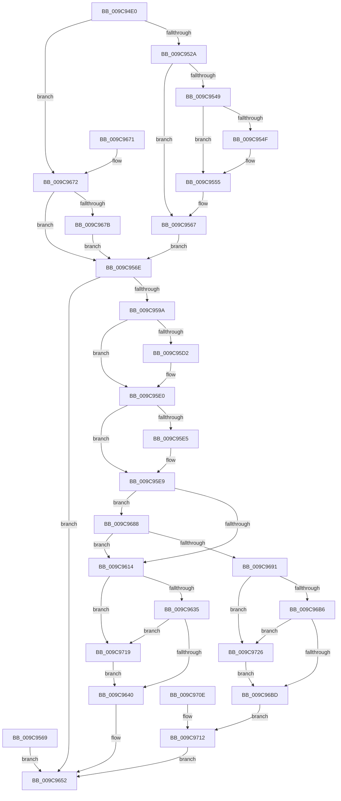

# NtOpenPrivateNamespace

- RVA: `0x009C94E0`–`0x009C9730` (길이 `592` bytes)
- VA: `0x00000001409C94E0`
- 실행 섹션: `PAGE`
- PDB 이름 있음: `예`; PDB Function 태그: `아니요`
- unwind 정보 RVA: `0x000A09BC`
- 디코드: `157`개 명령, `592/592` bytes 표시
- 미해석 바이트: `0` (있으면 어셈블리에 `.byte`로 보존)

> 이 문서는 커널 이미지의 기계어와 PDB 기호를 분석해 생성했습니다. 4번과 5번은 함수 원형과 자료형을 바이너리 사용 방식에서 추정한 C 해석이며 원본 소스 복구 결과는 아닙니다.

## 1. Dependencies

- 직접 호출 지점: **16**; 고유 호출 대상: **13**
- 직접 호출자로 확인된 함수: **0**
- RIP 상대 이미지 참조: **1**

### Outgoing calls
- `0x009C954F` → [ExRaiseDatatypeMisalignment](../89/ExRaiseDatatypeMisalignment_function_00899FD0.md) (function, `0x00899FD0`)
- `0x009C958D` → [ObpCaptureBoundaryDescriptor](ObpCaptureBoundaryDescriptor_function_009C9738.md) (function, `0x009C9738`)
- `0x009C959A` → [PsGetCurrentServerSiloGlobals](../../text/2F/PsGetCurrentServerSiloGlobals_function_002FE1F0.md) (function, `0x002FE1F0`)
- `0x009C95C2` → [KeAbPreAcquire](../../text/21/KeAbPreAcquire_function_00210230.md) (function, `0x00210230`)
- `0x009C95DB` → [ExfAcquirePushLockExclusiveEx](../../text/20/ExfAcquirePushLockExclusiveEx_function_0020FC90.md) (function, `0x0020FC90`)
- `0x009C95F5` → [ObpLookupNamespaceEntry](ObpLookupNamespaceEntry_function_009C9408.md) (function, `0x009C9408`)
- `0x009C9607` → [ExFreePoolWithTag](../../poolcode/B8/ExFreePoolWithTag_function_00B82870.md) (function, `0x00B82870`)
- `0x009C9643` → [KeAbPostRelease](../../text/2E/KeAbPostRelease_function_002E1600.md) (function, `0x002E1600`)
- `0x009C9648` → [KeLeaveCriticalRegion](../../text/25/KeLeaveCriticalRegion_function_0025D8B0.md) (function, `0x0025D8B0`)
- `0x009C9694` → [ObfReferenceObject](../../text/20/ObfReferenceObject_function_0020FA20.md) (function, `0x0020FA20`)
- `0x009C96C0` → [KeAbPostRelease](../../text/2E/KeAbPostRelease_function_002E1600.md) (function, `0x002E1600`)
- `0x009C96C5` → [KeLeaveCriticalRegion](../../text/25/KeLeaveCriticalRegion_function_0025D8B0.md) (function, `0x0025D8B0`)
- `0x009C96F0` → [ObOpenObjectByPointer](../8B/ObOpenObjectByPointer_function_008B7420.md) (function, `0x008B7420`)
- `0x009C96FE` → [ObfDereferenceObject](../../text/2F/ObfDereferenceObject_function_002F9350.md) (function, `0x002F9350`)
- `0x009C971C` → [ExfReleasePushLock](../../text/26/ExfReleasePushLock_function_002638D0.md) (function, `0x002638D0`)
- `0x009C9729` → [ExfReleasePushLock](../../text/26/ExfReleasePushLock_function_002638D0.md) (function, `0x002638D0`)

### Direct callers
- 이 함수 시작 RVA로 연결되는 직접 call은 확인되지 않았습니다. 간접 호출은 완전히 역산할 수 없습니다.

### Static image references
- `0x009C96D9` → RVA `0x00F0F650` (`.data`; read)

## 2. Other-region calls and transfers

- 다른 실행 섹션으로 향하는 call: **12**
  - `0x009C959A` → [PsGetCurrentServerSiloGlobals](../../text/2F/PsGetCurrentServerSiloGlobals_function_002FE1F0.md) (`PAGE` → `.text`)
  - `0x009C95C2` → [KeAbPreAcquire](../../text/21/KeAbPreAcquire_function_00210230.md) (`PAGE` → `.text`)
  - `0x009C95DB` → [ExfAcquirePushLockExclusiveEx](../../text/20/ExfAcquirePushLockExclusiveEx_function_0020FC90.md) (`PAGE` → `.text`)
  - `0x009C9607` → [ExFreePoolWithTag](../../poolcode/B8/ExFreePoolWithTag_function_00B82870.md) (`PAGE` → `POOLCODE`)
  - `0x009C9643` → [KeAbPostRelease](../../text/2E/KeAbPostRelease_function_002E1600.md) (`PAGE` → `.text`)
  - `0x009C9648` → [KeLeaveCriticalRegion](../../text/25/KeLeaveCriticalRegion_function_0025D8B0.md) (`PAGE` → `.text`)
  - `0x009C9694` → [ObfReferenceObject](../../text/20/ObfReferenceObject_function_0020FA20.md) (`PAGE` → `.text`)
  - `0x009C96C0` → [KeAbPostRelease](../../text/2E/KeAbPostRelease_function_002E1600.md) (`PAGE` → `.text`)
  - `0x009C96C5` → [KeLeaveCriticalRegion](../../text/25/KeLeaveCriticalRegion_function_0025D8B0.md) (`PAGE` → `.text`)
  - `0x009C96FE` → [ObfDereferenceObject](../../text/2F/ObfDereferenceObject_function_002F9350.md) (`PAGE` → `.text`)
  - `0x009C971C` → [ExfReleasePushLock](../../text/26/ExfReleasePushLock_function_002638D0.md) (`PAGE` → `.text`)
  - `0x009C9729` → [ExfReleasePushLock](../../text/26/ExfReleasePushLock_function_002638D0.md) (`PAGE` → `.text`)
- 별도 외부 분기/꼬리 이동을 확인하지 못했습니다.

## 3. Assembly (complete function range)

```asm
009C94E0  48 8B C4                        mov rax, rsp
009C94E3  48 89 58 08                     mov qword ptr [rax + 8], rbx
009C94E7  48 89 70 10                     mov qword ptr [rax + 0x10], rsi
009C94EB  48 89 78 18                     mov qword ptr [rax + 0x18], rdi
009C94EF  4C 89 60 20                     mov qword ptr [rax + 0x20], r12
009C94F3  41 55                           push r13
009C94F5  41 56                           push r14
009C94F7  41 57                           push r15
009C94F9  48 83 EC 60                     sub rsp, 0x60
009C94FD  44 8B E2                        mov r12d, edx
009C9500  4C 8B F1                        mov r14, rcx
009C9503  33 DB                           xor ebx, ebx
009C9505  48 89 58 D0                     mov qword ptr [rax - 0x30], rbx
009C9509  48 89 58 D8                     mov qword ptr [rax - 0x28], rbx
009C950D  65 48 8B 04 25 88 01 00 00      mov rax, qword ptr gs:[0x188]
009C9516  44 8A B8 32 02 00 00            mov r15b, byte ptr [rax + 0x232]
009C951D  89 5C 24 40                     mov dword ptr [rsp + 0x40], ebx
009C9521  45 84 FF                        test r15b, r15b
009C9524  0F 84 48 01 00 00               je 0x1409c9672
009C952A  48 BA 00 00 FF FF FF 7F 00 00   movabs rdx, 0x7fffffff0000
009C9534  48 8B CA                        mov rcx, rdx
009C9537  4C 3B F2                        cmp r14, rdx
009C953A  49 0F 42 CE                     cmovb rcx, r14
009C953E  48 8B 01                        mov rax, qword ptr [rcx]
009C9541  48 89 01                        mov qword ptr [rcx], rax
009C9544  4D 85 C0                        test r8, r8
009C9547  74 1E                           je 0x1409c9567
009C9549  41 F6 C0 07                     test r8b, 7
009C954D  74 06                           je 0x1409c9555
009C954F  E8 7C 0A ED FF                  call 0x140899fd0
009C9554  CC                              int3
009C9555  4C 3B C2                        cmp r8, rdx
009C9558  49 0F 42 D0                     cmovb rdx, r8
009C955C  90                              nop
009C955D  8A 02                           mov al, byte ptr [rdx]
009C955F  41 8B 40 18                     mov eax, dword ptr [r8 + 0x18]
009C9563  89 44 24 40                     mov dword ptr [rsp + 0x40], eax
009C9567  EB 05                           jmp 0x1409c956e
009C9569  E9 E4 00 00 00                  jmp 0x1409c9652
009C956E  41 8A C7                        mov al, r15b
009C9571  F6 D8                           neg al
009C9573  1B FF                           sbb edi, edi
009C9575  81 E7 00 FE FE FF               and edi, 0xfffefe00
009C957B  81 C7 F2 1F 01 00               add edi, 0x11ff2
009C9581  23 7C 24 40                     and edi, dword ptr [rsp + 0x40]
009C9585  48 8D 54 24 48                  lea rdx, [rsp + 0x48]
009C958A  49 8B C9                        mov rcx, r9
009C958D  E8 A6 01 00 00                  call 0x1409c9738
009C9592  85 C0                           test eax, eax
009C9594  0F 88 B8 00 00 00               js 0x1409c9652
009C959A  E8 51 4C 93 FF                  call 0x1402fe1f0
009C959F  4C 8B E8                        mov r13, rax
009C95A2  65 48 8B 0C 25 88 01 00 00      mov rcx, qword ptr gs:[0x188]
009C95AB  66 FF 89 E4 01 00 00            dec word ptr [rcx + 0x1e4]
009C95B2  90                              nop
009C95B3  48 8D 98 D0 02 00 00            lea rbx, [rax + 0x2d0]
009C95BA  45 33 C0                        xor r8d, r8d
009C95BD  33 D2                           xor edx, edx
009C95BF  48 8B CB                        mov rcx, rbx
009C95C2  E8 69 6C 84 FF                  call 0x140210230
009C95C7  48 8B F0                        mov rsi, rax
009C95CA  F0 48 0F BA 2B 00               lock bts qword ptr [rbx], 0
009C95D0  73 0E                           jae 0x1409c95e0
009C95D2  4C 8B C3                        mov r8, rbx
009C95D5  48 8B D0                        mov rdx, rax
009C95D8  48 8B CB                        mov rcx, rbx
009C95DB  E8 B0 66 84 FF                  call 0x14020fc90
009C95E0  48 85 F6                        test rsi, rsi
009C95E3  74 04                           je 0x1409c95e9
009C95E5  C6 46 0A 01                     mov byte ptr [rsi + 0xa], 1
009C95E9  49 8D 8D 80 00 00 00            lea rcx, [r13 + 0x80]
009C95F0  48 8B 54 24 48                  mov rdx, qword ptr [rsp + 0x48]
009C95F5  E8 0E FE FF FF                  call 0x1409c9408
009C95FA  48 8B F0                        mov rsi, rax
009C95FD  BA 4F 62 4E 53                  mov edx, 0x534e624f
009C9602  48 8B 4C 24 48                  mov rcx, qword ptr [rsp + 0x48]
009C9607  E8 64 92 1B 00                  call 0x140b82870
009C960C  45 33 ED                        xor r13d, r13d
009C960F  48 85 F6                        test rsi, rsi
009C9612  75 74                           jne 0x1409c9688
009C9614  48 8B 03                        mov rax, qword ptr [rbx]
009C9617  48 8B C8                        mov rcx, rax
009C961A  48 83 E1 F0                     and rcx, 0xfffffffffffffff0
009C961E  48 8D 50 F0                     lea rdx, [rax - 0x10]
009C9622  48 83 F9 10                     cmp rcx, 0x10
009C9626  49 0F 46 D5                     cmovbe rdx, r13
009C962A  A8 02                           test al, 2
009C962C  0F 0D 0B                        prefetchw byte ptr [rbx]
009C962F  0F 85 E4 00 00 00               jne 0x1409c9719
009C9635  F0 48 0F B1 13                  lock cmpxchg qword ptr [rbx], rdx
009C963A  0F 85 D9 00 00 00               jne 0x1409c9719
009C9640  48 8B CB                        mov rcx, rbx
009C9643  E8 B8 7F 91 FF                  call 0x1402e1600
009C9648  E8 63 42 89 FF                  call 0x14025d8b0
009C964D  B8 3A 00 00 C0                  mov eax, 0xc000003a
009C9652  4C 8D 5C 24 60                  lea r11, [rsp + 0x60]
009C9657  49 8B 5B 20                     mov rbx, qword ptr [r11 + 0x20]
009C965B  49 8B 73 28                     mov rsi, qword ptr [r11 + 0x28]
009C965F  49 8B 7B 30                     mov rdi, qword ptr [r11 + 0x30]
009C9663  4D 8B 63 38                     mov r12, qword ptr [r11 + 0x38]
009C9667  49 8B E3                        mov rsp, r11
009C966A  41 5F                           pop r15
009C966C  41 5E                           pop r14
009C966E  41 5D                           pop r13
009C9670  C3                              ret
009C9671  CC                              int3
009C9672  4D 85 C0                        test r8, r8
009C9675  0F 84 F3 FE FF FF               je 0x1409c956e
009C967B  41 8B 40 18                     mov eax, dword ptr [r8 + 0x18]
009C967F  89 44 24 40                     mov dword ptr [rsp + 0x40], eax
009C9683  E9 E6 FE FF FF                  jmp 0x1409c956e
009C9688  48 8B 76 10                     mov rsi, qword ptr [rsi + 0x10]
009C968C  48 85 F6                        test rsi, rsi
009C968F  74 83                           je 0x1409c9614
009C9691  48 8B CE                        mov rcx, rsi
009C9694  E8 87 63 84 FF                  call 0x14020fa20
009C9699  0F 0D 0B                        prefetchw byte ptr [rbx]
009C969C  48 8B 03                        mov rax, qword ptr [rbx]
009C969F  48 8B C8                        mov rcx, rax
009C96A2  48 83 E1 F0                     and rcx, 0xfffffffffffffff0
009C96A6  48 8D 50 F0                     lea rdx, [rax - 0x10]
009C96AA  48 83 F9 10                     cmp rcx, 0x10
009C96AE  49 0F 46 D5                     cmovbe rdx, r13
009C96B2  A8 02                           test al, 2
009C96B4  75 70                           jne 0x1409c9726
009C96B6  F0 48 0F B1 13                  lock cmpxchg qword ptr [rbx], rdx
009C96BB  75 69                           jne 0x1409c9726
009C96BD  48 8B CB                        mov rcx, rbx
009C96C0  E8 3B 7F 91 FF                  call 0x1402e1600
009C96C5  E8 E6 41 89 FF                  call 0x14025d8b0
009C96CA  48 8D 44 24 50                  lea rax, [rsp + 0x50]
009C96CF  48 89 44 24 30                  mov qword ptr [rsp + 0x30], rax
009C96D4  44 88 7C 24 28                  mov byte ptr [rsp + 0x28], r15b
009C96D9  48 8B 05 70 5F 54 00            mov rax, qword ptr [rip + 0x545f70]
009C96E0  48 89 44 24 20                  mov qword ptr [rsp + 0x20], rax
009C96E5  45 8B CC                        mov r9d, r12d
009C96E8  45 33 C0                        xor r8d, r8d
009C96EB  8B D7                           mov edx, edi
009C96ED  48 8B CE                        mov rcx, rsi
009C96F0  E8 2B DD EE FF                  call 0x1408b7420
009C96F5  8B D8                           mov ebx, eax
009C96F7  89 44 24 48                     mov dword ptr [rsp + 0x48], eax
009C96FB  48 8B CE                        mov rcx, rsi
009C96FE  E8 4D FC 92 FF                  call 0x1402f9350
009C9703  90                              nop
009C9704  48 8B 4C 24 50                  mov rcx, qword ptr [rsp + 0x50]
009C9709  49 89 0E                        mov qword ptr [r14], rcx
009C970C  EB 04                           jmp 0x1409c9712
009C970E  8B 5C 24 48                     mov ebx, dword ptr [rsp + 0x48]
009C9712  8B C3                           mov eax, ebx
009C9714  E9 39 FF FF FF                  jmp 0x1409c9652
009C9719  48 8B CB                        mov rcx, rbx
009C971C  E8 AF A1 89 FF                  call 0x1402638d0
009C9721  E9 1A FF FF FF                  jmp 0x1409c9640
009C9726  48 8B CB                        mov rcx, rbx
009C9729  E8 A2 A1 89 FF                  call 0x1402638d0
009C972E  EB 8D                           jmp 0x1409c96bd
```

## 4. C-style interpretation (structured pseudocode)

```c
__int64 __fastcall NtOpenPrivateNamespace(__int64 a1, int a2, __int64 a3, __int64 a4)
{
    __int64 result;
    __int64 v_r13;
    __int64 v_rbx;
    __int64 v_rdi;
    __int64 v_rsp;
    unsigned __int64 v_stack_m10;
    unsigned __int64 v_stack_m18;
    unsigned int v_stack_m20;
    unsigned __int64 v_stack_m30;
    unsigned int v_stack_m38;
    unsigned __int64 v_stack_m40;

    *(unsigned __int64 *)(v_rsp + 8) = v_rbx;
    *(unsigned __int64 *)(v_rsp + 16) = v_rsi;
    *(unsigned __int64 *)(v_rsp + 24) = v_rdi;
    *(unsigned __int64 *)(v_rsp + 32) = v_r12;
    v_rsp = (v_rsp) - (96);
    v_rbx = 0;
    *(unsigned __int64 *)(v_rsp - 48) = 0;
    *(unsigned __int64 *)(v_rsp - 40) = 0;
    v_stack_m38 = 0;
    if ((unsigned __int8)(*(unsigned __int8 *)(*(unsigned __int64 *)(gs_base + (0 + 392)) + 562)) == 0) goto loc_009C9672;
    if (a1 < a2) { a2 = a1; }
    *(unsigned __int64 *)(a2) = *(unsigned __int64 *)(a2);
    if (a3 == 0) goto loc_009C9567;
    result = *(unsigned __int64 *)(a2);
    if ((((unsigned __int8)(a3)) & (7)) != 0) {
        result = ExRaiseDatatypeMisalignment(a2, a2, a3, a4);
    }
    if (a3 < a2) { a2 = a3; }
    v_stack_m38 = (unsigned int)((unsigned int)(*(unsigned int *)(a3 + 24)));
loc_009C9567:
    goto loc_009C956E;
loc_009C956E:
    result = (unsigned __int8)(-((unsigned __int8)(*(unsigned __int8 *)(*(unsigned __int64 *)(gs_base + (0 + 392)) + 562))));
    v_rdi = (unsigned int)((v_rdi) & (0xFFFEFE00ULL));
    v_rdi = (unsigned int)((v_rdi) + (0x11FF2ULL));
    v_rdi = (unsigned int)((v_rdi) & (v_stack_m38));
    result = ObpCaptureBoundaryDescriptor(a4, v_stack_m30, a3, a4);
    if (sign_flag) goto loc_009C9652;
    result = PsGetCurrentServerSiloGlobals(a4, v_stack_m30, a3, a4);
    a3 = 0;
    a2 = 0;
    result = KeAbPreAcquire(result + 720, a2, a3, a4);
    if (!(condition_is_above_or_equal)) {
        a3 = result + 720;
        a2 = result;
        a1 = result + 720;
        result = ExfAcquirePushLockExclusiveEx(a1, a2, a3, a4);
    }
    if (result != 0) {
        *(unsigned __int8 *)(result + 10) = 1;
    }
    result = ObpLookupNamespaceEntry(result + 128, v_stack_m30, a3, a4);
    result = ExFreePoolWithTag(v_stack_m30, (unsigned int)(0x534E624FULL), a3, a4);
    v_r13 = 0;
    if (result != 0) goto loc_009C9688;
loc_009C9614:
    a1 = (*(unsigned __int64 *)(result + 720)) & (-16);
    a2 = *(unsigned __int64 *)(result + 720) - 16;
    if (a1 <= 16) { a2 = 0; }
    if ((((unsigned __int8)(*(unsigned __int64 *)(result + 720))) & (2)) != 0) goto loc_009C9719;
    if ((((unsigned __int8)(*(unsigned __int64 *)(result + 720))) & (2)) != 0) goto loc_009C9719;
loc_009C9640:
    result = KeAbPostRelease(result + 720, a2, a3, a4);
    result = KeLeaveCriticalRegion(result + 720, a2, a3, a4);
loc_009C9652:
    return (unsigned int)(0xC000003AULL);
loc_009C9672:
    if (a3 == 0) goto loc_009C956E;
    v_stack_m20 = (unsigned int)((unsigned int)(*(unsigned int *)(a3 + 24)));
    goto loc_009C956E;
loc_009C9688:
    if (*(unsigned __int64 *)(*(unsigned __int64 *)(v_stack_m18 + 40) + 16) == 0) goto loc_009C9614;
    result = ObfReferenceObject(*(unsigned __int64 *)(*(unsigned __int64 *)(v_stack_m18 + 40) + 16), a2, a3, a4);
    a1 = (*(unsigned __int64 *)(*(unsigned __int64 *)(v_stack_m18 + 32))) & (-16);
    a2 = *(unsigned __int64 *)(*(unsigned __int64 *)(v_stack_m18 + 32)) - 16;
    if (a1 <= 16) { a2 = 0; }
    if ((((unsigned __int8)(*(unsigned __int64 *)(*(unsigned __int64 *)(v_stack_m18 + 32)))) & (2)) != 0) goto loc_009C9726;
    if ((((unsigned __int8)(*(unsigned __int64 *)(*(unsigned __int64 *)(v_stack_m18 + 32)))) & (2)) != 0) goto loc_009C9726;
loc_009C96BD:
    result = KeAbPostRelease(*(unsigned __int64 *)(v_stack_m18 + 32), a2, a3, a4);
    result = KeLeaveCriticalRegion(*(unsigned __int64 *)(v_stack_m18 + 32), a2, a3, a4);
    v_stack_m30 = v_stack_m10;
    v_stack_m38 = (unsigned __int8)(*(unsigned __int8 *)(*(unsigned __int64 *)(gs_base + (0 + 392)) + 562));
    v_stack_m40 = *(unsigned __int64 *)(v_rip + 5529456);
    a3 = 0;
    result = ObOpenObjectByPointer(*(unsigned __int64 *)(*(unsigned __int64 *)(v_stack_m18 + 40) + 16), (unsigned int)((unsigned int)(*(unsigned __int64 *)(v_stack_m18 + 48))), a3, (unsigned int)((unsigned int)(*(unsigned __int64 *)(v_stack_m18 + 56))));
    v_stack_m18 = (unsigned int)(result);
    result = ObfDereferenceObject(*(unsigned __int64 *)(*(unsigned __int64 *)(v_stack_m18 + 40) + 16), (unsigned int)((unsigned int)(*(unsigned __int64 *)(v_stack_m18 + 48))), a3, (unsigned int)((unsigned int)(*(unsigned __int64 *)(v_stack_m18 + 56))));
    *(unsigned __int64 *)(a1) = v_stack_m10;
    goto loc_009C9712;
loc_009C9712:
    goto loc_009C9652;
loc_009C9719:
    result = ExfReleasePushLock((unsigned int)((unsigned int)(result)), (unsigned int)((unsigned int)(*(unsigned __int64 *)(v_stack_m18 + 48))), a3, (unsigned int)((unsigned int)(*(unsigned __int64 *)(v_stack_m18 + 56))));
    goto loc_009C9640;
loc_009C9726:
    result = ExfReleasePushLock((unsigned int)((unsigned int)(result)), (unsigned int)((unsigned int)(*(unsigned __int64 *)(v_stack_m18 + 48))), a3, (unsigned int)((unsigned int)(*(unsigned __int64 *)(v_stack_m18 + 56))));
    goto loc_009C96BD;
}
```

## 5. (Beta) C Style

```c
int64_t NtOpenPrivateNamespace(int64_t Arg1, int32_t Arg2, int64_t Arg3, int64_t Arg4)
{
    int64_t result;
    int64_t local_r13;
    int64_t local_rbx;
    int64_t local_rdi;
    int64_t local_rsp;
    uint64_t v_stack_m10;
    uint64_t v_stack_m18;
    uint32_t v_stack_m20;
    uint64_t v_stack_m30;
    uint32_t v_stack_m38;
    uint64_t v_stack_m40;

    *(uint64_t *)(local_rsp + 0x8) = local_rbx;
    *(uint64_t *)(local_rsp + 0x10) = local_rsi;
    *(uint64_t *)(local_rsp + 0x18) = local_rdi;
    *(uint64_t *)(local_rsp + 0x20) = local_r12;
    local_rsp = (local_rsp) - (96);
    local_rbx = 0;
    *(uint64_t *)(local_rsp - 0x30) = 0;
    *(uint64_t *)(local_rsp - 0x28) = 0;
    v_stack_m38 = 0;
    if ((uint8_t)(*(uint8_t *)(*(uint64_t *)(gs_base + (0 + 0x188)) + 0x232)) == 0) goto loc_009C9672;
    if (Arg1 < Arg2) { Arg2 = Arg1; }
    *(uint64_t *)(Arg2) = *(uint64_t *)(Arg2);
    if (Arg3 == 0) goto loc_009C9567;
    result = *(uint64_t *)(Arg2);
    if ((((uint8_t)(Arg3)) & (7)) != 0) {
        result = ExRaiseDatatypeMisalignment(Arg2, Arg2, Arg3, Arg4);
    }
    if (Arg3 < Arg2) { Arg2 = Arg3; }
    v_stack_m38 = (uint32_t)((uint32_t)(*(uint32_t *)(Arg3 + 0x18)));
loc_009C9567:
    goto loc_009C956E;
loc_009C956E:
    result = (uint8_t)(-((uint8_t)(*(uint8_t *)(*(uint64_t *)(gs_base + (0 + 0x188)) + 0x232))));
    local_rdi = (uint32_t)((local_rdi) & (0xFFFEFE00ULL));
    local_rdi = (uint32_t)((local_rdi) + (0x11FF2ULL));
    local_rdi = (uint32_t)((local_rdi) & (v_stack_m38));
    result = ObpCaptureBoundaryDescriptor(Arg4, v_stack_m30, Arg3, Arg4);
    if (sign_flag) goto loc_009C9652;
    result = PsGetCurrentServerSiloGlobals(Arg4, v_stack_m30, Arg3, Arg4);
    Arg3 = 0;
    Arg2 = 0;
    result = KeAbPreAcquire(result + 720, Arg2, Arg3, Arg4);
    if (!(condition_is_above_or_equal)) {
        Arg3 = result + 720;
        Arg2 = result;
        Arg1 = result + 720;
        result = ExfAcquirePushLockExclusiveEx(Arg1, Arg2, Arg3, Arg4);
    }
    if (result != 0) {
        *(uint8_t *)(result + 0xA) = 1;
    }
    result = ObpLookupNamespaceEntry(result + 128, v_stack_m30, Arg3, Arg4);
    result = ExFreePoolWithTag(v_stack_m30, (uint32_t)(0x534E624FULL), Arg3, Arg4);
    local_r13 = 0;
    if (result != 0) goto loc_009C9688;
loc_009C9614:
    Arg1 = (*(uint64_t *)(result + 0x2D0)) & (-16);
    Arg2 = *(uint64_t *)(result + 0x2D0) - 16;
    if (Arg1 <= 16) { Arg2 = 0; }
    if ((((uint8_t)(*(uint64_t *)(result + 0x2D0))) & (2)) != 0) goto loc_009C9719;
    if ((((uint8_t)(*(uint64_t *)(result + 0x2D0))) & (2)) != 0) goto loc_009C9719;
loc_009C9640:
    result = KeAbPostRelease(result + 720, Arg2, Arg3, Arg4);
    result = KeLeaveCriticalRegion(result + 720, Arg2, Arg3, Arg4);
loc_009C9652:
    return (uint32_t)(0xC000003AULL);
loc_009C9672:
    if (Arg3 == 0) goto loc_009C956E;
    v_stack_m20 = (uint32_t)((uint32_t)(*(uint32_t *)(Arg3 + 0x18)));
    goto loc_009C956E;
loc_009C9688:
    if (*(uint64_t *)(*(uint64_t *)(v_stack_m18 + 0x28) + 0x10) == 0) goto loc_009C9614;
    result = ObfReferenceObject(*(uint64_t *)(*(uint64_t *)(v_stack_m18 + 0x28) + 0x10), Arg2, Arg3, Arg4);
    Arg1 = (*(uint64_t *)(*(uint64_t *)(v_stack_m18 + 0x20))) & (-16);
    Arg2 = *(uint64_t *)(*(uint64_t *)(v_stack_m18 + 0x20)) - 16;
    if (Arg1 <= 16) { Arg2 = 0; }
    if ((((uint8_t)(*(uint64_t *)(*(uint64_t *)(v_stack_m18 + 0x20)))) & (2)) != 0) goto loc_009C9726;
    if ((((uint8_t)(*(uint64_t *)(*(uint64_t *)(v_stack_m18 + 0x20)))) & (2)) != 0) goto loc_009C9726;
loc_009C96BD:
    result = KeAbPostRelease(*(uint64_t *)(v_stack_m18 + 0x20), Arg2, Arg3, Arg4);
    result = KeLeaveCriticalRegion(*(uint64_t *)(v_stack_m18 + 0x20), Arg2, Arg3, Arg4);
    v_stack_m30 = v_stack_m10;
    v_stack_m38 = (uint8_t)(*(uint8_t *)(*(uint64_t *)(gs_base + (0 + 0x188)) + 0x232));
    v_stack_m40 = *(uint64_t *)(v_rip + 0x545F70);
    Arg3 = 0;
    result = ObOpenObjectByPointer(*(uint64_t *)(*(uint64_t *)(v_stack_m18 + 0x28) + 0x10), (uint32_t)((uint32_t)(*(uint64_t *)(v_stack_m18 + 0x30))), Arg3, (uint32_t)((uint32_t)(*(uint64_t *)(v_stack_m18 + 0x38))));
    v_stack_m18 = (uint32_t)(result);
    result = ObfDereferenceObject(*(uint64_t *)(*(uint64_t *)(v_stack_m18 + 0x28) + 0x10), (uint32_t)((uint32_t)(*(uint64_t *)(v_stack_m18 + 0x30))), Arg3, (uint32_t)((uint32_t)(*(uint64_t *)(v_stack_m18 + 0x38))));
    *(uint64_t *)(Arg1) = v_stack_m10;
    goto loc_009C9712;
loc_009C9712:
    goto loc_009C9652;
loc_009C9719:
    result = ExfReleasePushLock((uint32_t)((uint32_t)(result)), (uint32_t)((uint32_t)(*(uint64_t *)(v_stack_m18 + 0x30))), Arg3, (uint32_t)((uint32_t)(*(uint64_t *)(v_stack_m18 + 0x38))));
    goto loc_009C9640;
loc_009C9726:
    result = ExfReleasePushLock((uint32_t)((uint32_t)(result)), (uint32_t)((uint32_t)(*(uint64_t *)(v_stack_m18 + 0x30))), Arg3, (uint32_t)((uint32_t)(*(uint64_t *)(v_stack_m18 + 0x38))));
    goto loc_009C96BD;
}
```

## 6. Execution-region graph

[열기: 2D/3D 그래프와 함수 탐색 컨트롤 패널](../../../control-panel.html?section=page&rva=0x009C94E0&view=graph)

- 2D 그래프는 위에서 아래로 흐르고, 3D 그래프는 빈 공간을 드래그해 회전합니다. Shift+드래그는 이동, 휠은 확대·축소, 함수 노드 선택은 대상 보고서 이동입니다.

### Static fallback


