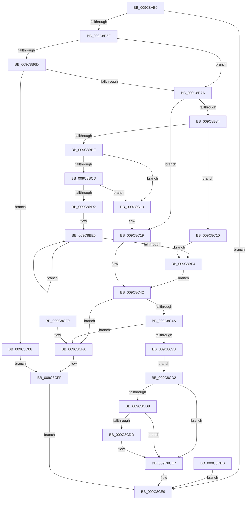

# NtPrivilegeCheck

- RVA: `0x009C8AE0`–`0x009C8D0F` (길이 `559` bytes)
- VA: `0x00000001409C8AE0`
- 실행 섹션: `PAGE`
- PDB 이름 있음: `예`; PDB Function 태그: `아니요`
- unwind 정보 RVA: `0x000A0910`
- 디코드: `148`개 명령, `559/559` bytes 표시
- 미해석 바이트: `0` (있으면 어셈블리에 `.byte`로 보존)

> 이 문서는 커널 이미지의 기계어와 PDB 기호를 분석해 생성했습니다. 4번과 5번은 함수 원형과 자료형을 바이너리 사용 방식에서 추정한 C 해석이며 원본 소스 복구 결과는 아닙니다.

## 1. Dependencies

- 직접 호출 지점: **10**; 고유 호출 대상: **9**
- 직접 호출자로 확인된 함수: **0**
- RIP 상대 이미지 참조: **1**

### Outgoing calls
- `0x009C8B4E` → [ObReferenceObjectByHandle](../86/ObReferenceObjectByHandle_function_00868DB0.md) (function, `0x00868DB0`)
- `0x009C8C13` → [ExRaiseAccessViolation](../8E/ExRaiseAccessViolation_function_008E9240.md) (function, `0x008E9240`)
- `0x009C8C19` → [ExRaiseDatatypeMisalignment](../89/ExRaiseDatatypeMisalignment_function_00899FD0.md) (function, `0x00899FD0`)
- `0x009C8C69` → [SeCaptureLuidAndAttributesArray](SeCaptureLuidAndAttributesArray_function_009C8D18.md) (function, `0x009C8D18`)
- `0x009C8C92` → [SepPrivilegeCheck](../../text/40/SepPrivilegeCheck_function_0040B6B0.md) (function, `0x0040B6B0`)
- `0x009C8C9F` → [ObfDereferenceObject](../../text/2F/ObfDereferenceObject_function_002F9350.md) (function, `0x002F9350`)
- `0x009C8CB1` → [memcpy](../../text/6C/memcpy_function_006C6840.md) (function, `0x006C6840`)
- `0x009C8CC9` → [SeReleaseLuidAndAttributesArray](SeReleaseLuidAndAttributesArray_function_009C7C40.md) (function, `0x009C7C40`)
- `0x009C8CE2` → [ExFreePoolWithTag](../../poolcode/B8/ExFreePoolWithTag_function_00B82870.md) (function, `0x00B82870`)
- `0x009C8CFF` → [ObfDereferenceObject](../../text/2F/ObfDereferenceObject_function_002F9350.md) (function, `0x002F9350`)

### Direct callers
- 이 함수 시작 RVA로 연결되는 직접 call은 확인되지 않았습니다. 간접 호출은 완전히 역산할 수 없습니다.

### Static image references
- `0x009C8B29` → RVA `0x00FD8020` (`PAGEDATA`; read)

## 2. Other-region calls and transfers

- 다른 실행 섹션으로 향하는 call: **5**
  - `0x009C8C92` → [SepPrivilegeCheck](../../text/40/SepPrivilegeCheck_function_0040B6B0.md) (`PAGE` → `.text`)
  - `0x009C8C9F` → [ObfDereferenceObject](../../text/2F/ObfDereferenceObject_function_002F9350.md) (`PAGE` → `.text`)
  - `0x009C8CB1` → [memcpy](../../text/6C/memcpy_function_006C6840.md) (`PAGE` → `.text`)
  - `0x009C8CE2` → [ExFreePoolWithTag](../../poolcode/B8/ExFreePoolWithTag_function_00B82870.md) (`PAGE` → `POOLCODE`)
  - `0x009C8CFF` → [ObfDereferenceObject](../../text/2F/ObfDereferenceObject_function_002F9350.md) (`PAGE` → `.text`)
- 별도 외부 분기/꼬리 이동을 확인하지 못했습니다.

## 3. Assembly (complete function range)

```asm
009C8AE0  48 8B C4                        mov rax, rsp
009C8AE3  4C 89 40 18                     mov qword ptr [rax + 0x18], r8
009C8AE7  48 89 50 10                     mov qword ptr [rax + 0x10], rdx
009C8AEB  53                              push rbx
009C8AEC  57                              push rdi
009C8AED  41 54                           push r12
009C8AEF  41 56                           push r14
009C8AF1  41 57                           push r15
009C8AF3  48 81 EC 80 00 00 00            sub rsp, 0x80
009C8AFA  4D 8B F8                        mov r15, r8
009C8AFD  48 8B FA                        mov rdi, rdx
009C8B00  48 83 60 C8 00                  and qword ptr [rax - 0x38], 0
009C8B05  83 60 A8 00                     and dword ptr [rax - 0x58], 0
009C8B09  83 60 B4 00                     and dword ptr [rax - 0x4c], 0
009C8B0D  83 60 B0 00                     and dword ptr [rax - 0x50], 0
009C8B11  65 48 8B 04 25 88 01 00 00      mov rax, qword ptr gs:[0x188]
009C8B1A  44 8A A0 32 02 00 00            mov r12b, byte ptr [rax + 0x232]
009C8B21  44 88 A4 24 C8 00 00 00         mov byte ptr [rsp + 0xc8], r12b
009C8B29  4C 8B 05 F0 F4 60 00            mov r8, qword ptr [rip + 0x60f4f0]
009C8B30  48 83 64 24 68 00               and qword ptr [rsp + 0x68], 0
009C8B36  48 83 64 24 28 00               and qword ptr [rsp + 0x28], 0
009C8B3C  48 8D 44 24 68                  lea rax, [rsp + 0x68]
009C8B41  48 89 44 24 20                  mov qword ptr [rsp + 0x20], rax
009C8B46  45 8A CC                        mov r9b, r12b
009C8B49  BA 08 00 00 00                  mov edx, 8
009C8B4E  E8 5D 02 EA FF                  call 0x140868db0
009C8B53  89 44 24 54                     mov dword ptr [rsp + 0x54], eax
009C8B57  85 C0                           test eax, eax
009C8B59  0F 88 8A 01 00 00               js 0x1409c8ce9
009C8B5F  48 8B 4C 24 68                  mov rcx, qword ptr [rsp + 0x68]
009C8B64  83 B9 C0 00 00 00 02            cmp dword ptr [rcx + 0xc0], 2
009C8B6B  75 0D                           jne 0x1409c8b7a
009C8B6D  83 B9 C4 00 00 00 01            cmp dword ptr [rcx + 0xc4], 1
009C8B74  0F 8C 8E 01 00 00               jl 0x1409c8d08
009C8B7A  40 F6 C7 03                     test dil, 3
009C8B7E  0F 85 95 00 00 00               jne 0x1409c8c19
009C8B84  49 B8 00 00 FF FF FF 7F 00 00   movabs r8, 0x7fffffff0000
009C8B8E  49 8B C8                        mov rcx, r8
009C8B91  49 3B F8                        cmp rdi, r8
009C8B94  48 0F 42 CF                     cmovb rcx, rdi
009C8B98  8A 01                           mov al, byte ptr [rcx]
009C8B9A  88 01                           mov byte ptr [rcx], al
009C8B9C  8A 41 13                        mov al, byte ptr [rcx + 0x13]
009C8B9F  88 41 13                        mov byte ptr [rcx + 0x13], al
009C8BA2  8B 07                           mov eax, dword ptr [rdi]
009C8BA4  89 44 24 50                     mov dword ptr [rsp + 0x50], eax
009C8BA8  FF C8                           dec eax
009C8BAA  8D 0C 40                        lea ecx, [rax + rax*2]
009C8BAD  8D 0C 8D 14 00 00 00            lea ecx, [rcx*4 + 0x14]
009C8BB4  89 4C 24 60                     mov dword ptr [rsp + 0x60], ecx
009C8BB8  8B C1                           mov eax, ecx
009C8BBA  85 C9                           test ecx, ecx
009C8BBC  74 52                           je 0x1409c8c10
009C8BBE  48 8B CF                        mov rcx, rdi
009C8BC1  48 8D 57 FF                     lea rdx, [rdi - 1]
009C8BC5  48 03 D0                        add rdx, rax
009C8BC8  48 3B FA                        cmp rdi, rdx
009C8BCB  77 46                           ja 0x1409c8c13
009C8BCD  49 3B D0                        cmp rdx, r8
009C8BD0  73 41                           jae 0x1409c8c13
009C8BD2  49 C7 C1 00 F0 FF FF            mov r9, 0xfffffffffffff000
009C8BD9  49 23 D1                        and rdx, r9
009C8BDC  41 BA 00 10 00 00               mov r10d, 0x1000
009C8BE2  49 03 D2                        add rdx, r10
009C8BE5  8A 01                           mov al, byte ptr [rcx]
009C8BE7  88 01                           mov byte ptr [rcx], al
009C8BE9  49 23 C9                        and rcx, r9
009C8BEC  49 03 CA                        add rcx, r10
009C8BEF  48 3B CA                        cmp rcx, rdx
009C8BF2  75 F1                           jne 0x1409c8be5
009C8BF4  4D 3B F8                        cmp r15, r8
009C8BF7  4D 0F 42 C7                     cmovb r8, r15
009C8BFB  41 8A 00                        mov al, byte ptr [r8]
009C8BFE  41 88 00                        mov byte ptr [r8], al
009C8C01  44 8B 77 04                     mov r14d, dword ptr [rdi + 4]
009C8C05  44 89 74 24 58                  mov dword ptr [rsp + 0x58], r14d
009C8C0A  8B 5C 24 54                     mov ebx, dword ptr [rsp + 0x54]
009C8C0E  EB 32                           jmp 0x1409c8c42
009C8C10  90                              nop
009C8C11  EB E1                           jmp 0x1409c8bf4
009C8C13  E8 28 06 F2 FF                  call 0x1408e9240
009C8C18  CC                              int3
009C8C19  E8 B2 13 ED FF                  call 0x140899fd0
009C8C1E  90                              nop
009C8C1F  8B D8                           mov ebx, eax
009C8C21  89 44 24 54                     mov dword ptr [rsp + 0x54], eax
009C8C25  4C 8B BC 24 C0 00 00 00         mov r15, qword ptr [rsp + 0xc0]
009C8C2D  48 8B BC 24 B8 00 00 00         mov rdi, qword ptr [rsp + 0xb8]
009C8C35  44 8A A4 24 C8 00 00 00         mov r12b, byte ptr [rsp + 0xc8]
009C8C3D  44 8B 74 24 58                  mov r14d, dword ptr [rsp + 0x58]
009C8C42  85 DB                           test ebx, ebx
009C8C44  0F 88 B0 00 00 00               js 0x1409c8cfa
009C8C4A  48 8D 44 24 5C                  lea rax, [rsp + 0x5c]
009C8C4F  48 89 44 24 40                  mov qword ptr [rsp + 0x40], rax
009C8C54  48 8D 44 24 70                  lea rax, [rsp + 0x70]
009C8C59  48 89 44 24 38                  mov qword ptr [rsp + 0x38], rax
009C8C5E  41 B0 01                        mov r8b, 1
009C8C61  8B 54 24 50                     mov edx, dword ptr [rsp + 0x50]
009C8C65  48 8D 4F 08                     lea rcx, [rdi + 8]
009C8C69  E8 AA 00 00 00                  call 0x1409c8d18
009C8C6E  8B D8                           mov ebx, eax
009C8C70  85 C0                           test eax, eax
009C8C72  0F 88 82 00 00 00               js 0x1409c8cfa
009C8C78  44 88 64 24 20                  mov byte ptr [rsp + 0x20], r12b
009C8C7D  45 8B CE                        mov r9d, r14d
009C8C80  44 8B 44 24 50                  mov r8d, dword ptr [rsp + 0x50]
009C8C85  48 8B 5C 24 70                  mov rbx, qword ptr [rsp + 0x70]
009C8C8A  48 8B D3                        mov rdx, rbx
009C8C8D  48 8B 4C 24 68                  mov rcx, qword ptr [rsp + 0x68]
009C8C92  E8 19 2A A4 FF                  call 0x14040b6b0
009C8C97  44 8A F0                        mov r14b, al
009C8C9A  48 8B 4C 24 68                  mov rcx, qword ptr [rsp + 0x68]
009C8C9F  E8 AC 06 93 FF                  call 0x1402f9350
009C8CA4  90                              nop
009C8CA5  44 8B 44 24 5C                  mov r8d, dword ptr [rsp + 0x5c]
009C8CAA  48 8B D3                        mov rdx, rbx
009C8CAD  48 8D 4F 08                     lea rcx, [rdi + 8]
009C8CB1  E8 8A DB CF FF                  call 0x1406c6840
009C8CB6  45 88 37                        mov byte ptr [r15], r14b
009C8CB9  EB 17                           jmp 0x1409c8cd2
009C8CBB  8B D8                           mov ebx, eax
009C8CBD  8A 94 24 C8 00 00 00            mov dl, byte ptr [rsp + 0xc8]
009C8CC4  48 8B 4C 24 70                  mov rcx, qword ptr [rsp + 0x70]
009C8CC9  E8 72 EF FF FF                  call 0x1409c7c40
009C8CCE  8B C3                           mov eax, ebx
009C8CD0  EB 17                           jmp 0x1409c8ce9
009C8CD2  41 80 FC 01                     cmp r12b, 1
009C8CD6  77 0F                           ja 0x1409c8ce7
009C8CD8  48 85 DB                        test rbx, rbx
009C8CDB  74 0A                           je 0x1409c8ce7
009C8CDD  33 D2                           xor edx, edx
009C8CDF  48 8B CB                        mov rcx, rbx
009C8CE2  E8 89 9B 1B 00                  call 0x140b82870
009C8CE7  33 C0                           xor eax, eax
009C8CE9  48 81 C4 80 00 00 00            add rsp, 0x80
009C8CF0  41 5F                           pop r15
009C8CF2  41 5E                           pop r14
009C8CF4  41 5C                           pop r12
009C8CF6  5F                              pop rdi
009C8CF7  5B                              pop rbx
009C8CF8  C3                              ret
009C8CF9  CC                              int3
009C8CFA  48 8B 4C 24 68                  mov rcx, qword ptr [rsp + 0x68]
009C8CFF  E8 4C 06 93 FF                  call 0x1402f9350
009C8D04  8B C3                           mov eax, ebx
009C8D06  EB E1                           jmp 0x1409c8ce9
009C8D08  BB A5 00 00 C0                  mov ebx, 0xc00000a5
009C8D0D  EB F0                           jmp 0x1409c8cff
```

## 4. C-style interpretation (structured pseudocode)

```c
__int64 __fastcall NtPrivilegeCheck(__int64 a1, __int64 a2, __int64 a3)
{
    __int64 result;
    __int64 v_rsp;
    unsigned __int64 v_stack_m38;
    unsigned __int64 v_stack_m40;
    unsigned int v_stack_m48;
    unsigned __int64 v_stack_m4C;
    unsigned int v_stack_m50;
    unsigned int v_stack_m54;
    unsigned int v_stack_m58;
    unsigned __int64 v_stack_m68;
    unsigned __int64 v_stack_m70;
    unsigned __int64 v_stack_m80;
    unsigned __int64 v_stack_m88;
    unsigned __int64 v_stack_p10;
    unsigned __int64 v_stack_p18;
    unsigned __int8 v_stack_p20;
    unsigned __int64 v_stack_p68;

    *(unsigned __int64 *)(v_rsp + 24) = a3;
    *(unsigned __int64 *)(v_rsp + 16) = a2;
    v_rsp = (v_rsp) - (128);
    v_stack_p20 = (unsigned __int8)(*(unsigned __int8 *)(*(unsigned __int64 *)(gs_base + (0 + 392)) + 562));
    v_stack_m88 = v_stack_m40;
    result = ObReferenceObjectByHandle(a1, 8, *(unsigned __int64 *)(v_rip + 6354160), (unsigned __int8)(*(unsigned __int8 *)(*(unsigned __int64 *)(gs_base + (0 + 392)) + 562)));
    v_stack_m54 = (unsigned int)(result);
    if (sign_flag) goto loc_009C8CE9;
    if ((*(unsigned int *)(v_stack_m40 + 192)) != 2) goto loc_009C8B7A;
    if ((*(unsigned int *)(v_stack_m40 + 196)) < 1) goto loc_009C8D08;
loc_009C8B7A:
    if ((((unsigned __int8)(a2)) & (3)) != 0) goto loc_009C8C19;
    a1 = *(unsigned __int64 *)(v_rip + 6354160);
    if (a2 < (*(unsigned __int64 *)(v_rip + 6354160))) { a1 = a2; }
    *(unsigned __int8 *)(a1) = (unsigned __int8)(*(unsigned __int8 *)(a1));
    *(unsigned __int8 *)(a1 + 19) = (unsigned __int8)(*(unsigned __int8 *)(a1 + 19));
    v_stack_m58 = (unsigned int)((unsigned int)(*(unsigned int *)(a2)));
    result = (unsigned int)(((unsigned int)(*(unsigned int *)(a2))) - 1);
    v_stack_m48 = (unsigned int)(result + result * 2 * 4 + 20);
    if ((unsigned int)(result + result * 2 * 4 + 20) == 0) goto loc_009C8C10;
    a2 = (a2 - 1) + ((unsigned int)((unsigned int)(result + result * 2 * 4 + 20)));
    if (a2 > a2) goto loc_009C8C13;
    if (a2 >= (*(unsigned __int64 *)(v_rip + 6354160))) goto loc_009C8C13;
    a2 = (a2) & (0xFFFFFFFFFFFFF000ULL);
    a2 = (a2) + ((unsigned int)(0x1000ULL));
loc_009C8BE5:
    *(unsigned __int8 *)(a2) = (unsigned __int8)(*(unsigned __int8 *)(a2));
    a1 = (a2) & (0xFFFFFFFFFFFFF000ULL);
    a1 = (a1) + ((unsigned int)(0x1000ULL));
    if (a1 != a2) goto loc_009C8BE5;
loc_009C8BF4:
    a3 = *(unsigned __int64 *)(v_rip + 6354160);
    if (a3 < (*(unsigned __int64 *)(v_rip + 6354160))) { a3 = a3; }
    *(unsigned __int8 *)(a3) = (unsigned __int8)(*(unsigned __int8 *)(a3));
    v_stack_m50 = (unsigned int)((unsigned int)(*(unsigned int *)(a2 + 4)));
    goto loc_009C8C42;
loc_009C8C10:
    goto loc_009C8BF4;
loc_009C8C13:
    result = ExRaiseAccessViolation(a1, a2, a3, 0xFFFFFFFFFFFFF000ULL);
loc_009C8C19:
    result = ExRaiseDatatypeMisalignment(a1, a2, a3, 0xFFFFFFFFFFFFF000ULL);
    v_stack_m54 = (unsigned int)(result);
loc_009C8C42:
    if (sign_flag) goto loc_009C8CFA;
    v_stack_m68 = v_stack_m4C;
    v_stack_m70 = v_stack_m38;
    result = SeCaptureLuidAndAttributesArray(v_stack_p10 + 8, (unsigned int)(v_stack_m58), 1, 0xFFFFFFFFFFFFF000ULL);
    if (sign_flag) goto loc_009C8CFA;
    v_stack_m88 = (unsigned __int8)(v_stack_p20);
    result = SepPrivilegeCheck(v_stack_m40, v_stack_m38, (unsigned int)(v_stack_m58), (unsigned int)((unsigned int)((unsigned int)(v_stack_m50))));
    result = ObfDereferenceObject(v_stack_m40, v_stack_m38, (unsigned int)(v_stack_m58), (unsigned int)((unsigned int)((unsigned int)(v_stack_m50))));
    result = memcpy(v_stack_p10 + 8, v_stack_m38, (unsigned int)(v_stack_m4C), (unsigned int)((unsigned int)((unsigned int)(v_stack_m50))));
    *(unsigned __int8 *)(v_stack_p18) = (unsigned __int8)((unsigned __int8)(result));
    goto loc_009C8CD2;
loc_009C8CD2:
    if (((unsigned __int8)(v_stack_p20)) > 1) goto loc_009C8CE7;
    if (v_stack_m38 != 0) {
        a2 = 0;
        a1 = v_stack_m38;
        result = ExFreePoolWithTag(a1, a2, (unsigned int)(v_stack_m4C), (unsigned int)((unsigned int)((unsigned int)(v_stack_m50))));
    }
    result = 0;
loc_009C8CE9:
    v_rsp = (v_rsp) + (128);
    return result;
loc_009C8CFA:
loc_009C8CFF:
    result = ObfDereferenceObject(v_stack_p68, a2, (unsigned int)(v_stack_m4C), (unsigned int)((unsigned int)((unsigned int)(v_stack_m50))));
    goto loc_009C8CE9;
loc_009C8D08:
    goto loc_009C8CFF;
}
```

## 5. (Beta) C Style

```c
int64_t NtPrivilegeCheck(int64_t Arg1, int64_t Arg2, int64_t Arg3)
{
    int64_t result;
    int64_t local_rsp;
    uint64_t v_stack_m38;
    uint64_t v_stack_m40;
    uint32_t v_stack_m48;
    uint64_t v_stack_m4C;
    uint32_t v_stack_m50;
    uint32_t v_stack_m54;
    uint32_t v_stack_m58;
    uint64_t v_stack_m68;
    uint64_t v_stack_m70;
    uint64_t v_stack_m80;
    uint64_t v_stack_m88;
    uint64_t v_stack_p10;
    uint64_t v_stack_p18;
    uint8_t v_stack_p20;
    uint64_t v_stack_p68;

    *(uint64_t *)(local_rsp + 0x18) = Arg3;
    *(uint64_t *)(local_rsp + 0x10) = Arg2;
    local_rsp = (local_rsp) - (128);
    v_stack_p20 = (uint8_t)(*(uint8_t *)(*(uint64_t *)(gs_base + (0 + 0x188)) + 0x232));
    v_stack_m88 = v_stack_m40;
    result = ObReferenceObjectByHandle(Arg1, 8, *(uint64_t *)(v_rip + 0x60F4F0), (uint8_t)(*(uint8_t *)(*(uint64_t *)(gs_base + (0 + 0x188)) + 0x232)));
    v_stack_m54 = (uint32_t)(result);
    if (sign_flag) goto loc_009C8CE9;
    if ((*(uint32_t *)(v_stack_m40 + 0xC0)) != 2) goto loc_009C8B7A;
    if ((*(uint32_t *)(v_stack_m40 + 0xC4)) < 1) goto loc_009C8D08;
loc_009C8B7A:
    if ((((uint8_t)(Arg2)) & (3)) != 0) goto loc_009C8C19;
    Arg1 = *(uint64_t *)(v_rip + 0x60F4F0);
    if (Arg2 < (*(uint64_t *)(v_rip + 0x60F4F0))) { Arg1 = Arg2; }
    *(uint8_t *)(Arg1) = (uint8_t)(*(uint8_t *)(Arg1));
    *(uint8_t *)(Arg1 + 0x13) = (uint8_t)(*(uint8_t *)(Arg1 + 0x13));
    v_stack_m58 = (uint32_t)((uint32_t)(*(uint32_t *)(Arg2)));
    result = (uint32_t)(((uint32_t)(*(uint32_t *)(Arg2))) - 1);
    v_stack_m48 = (uint32_t)(result + result * 2 * 4 + 20);
    if ((uint32_t)(result + result * 2 * 4 + 20) == 0) goto loc_009C8C10;
    Arg2 = (Arg2 - 1) + ((uint32_t)((uint32_t)(result + result * 2 * 4 + 20)));
    if (Arg2 > Arg2) goto loc_009C8C13;
    if (Arg2 >= (*(uint64_t *)(v_rip + 0x60F4F0))) goto loc_009C8C13;
    Arg2 = (Arg2) & (0xFFFFFFFFFFFFF000ULL);
    Arg2 = (Arg2) + ((uint32_t)(0x1000ULL));
loc_009C8BE5:
    *(uint8_t *)(Arg2) = (uint8_t)(*(uint8_t *)(Arg2));
    Arg1 = (Arg2) & (0xFFFFFFFFFFFFF000ULL);
    Arg1 = (Arg1) + ((uint32_t)(0x1000ULL));
    if (Arg1 != Arg2) goto loc_009C8BE5;
loc_009C8BF4:
    Arg3 = *(uint64_t *)(v_rip + 0x60F4F0);
    if (Arg3 < (*(uint64_t *)(v_rip + 0x60F4F0))) { Arg3 = Arg3; }
    *(uint8_t *)(Arg3) = (uint8_t)(*(uint8_t *)(Arg3));
    v_stack_m50 = (uint32_t)((uint32_t)(*(uint32_t *)(Arg2 + 0x4)));
    goto loc_009C8C42;
loc_009C8C10:
    goto loc_009C8BF4;
loc_009C8C13:
    result = ExRaiseAccessViolation(Arg1, Arg2, Arg3, 0xFFFFFFFFFFFFF000ULL);
loc_009C8C19:
    result = ExRaiseDatatypeMisalignment(Arg1, Arg2, Arg3, 0xFFFFFFFFFFFFF000ULL);
    v_stack_m54 = (uint32_t)(result);
loc_009C8C42:
    if (sign_flag) goto loc_009C8CFA;
    v_stack_m68 = v_stack_m4C;
    v_stack_m70 = v_stack_m38;
    result = SeCaptureLuidAndAttributesArray(v_stack_p10 + 8, (uint32_t)(v_stack_m58), 1, 0xFFFFFFFFFFFFF000ULL);
    if (sign_flag) goto loc_009C8CFA;
    v_stack_m88 = (uint8_t)(v_stack_p20);
    result = SepPrivilegeCheck(v_stack_m40, v_stack_m38, (uint32_t)(v_stack_m58), (uint32_t)((uint32_t)((uint32_t)(v_stack_m50))));
    result = ObfDereferenceObject(v_stack_m40, v_stack_m38, (uint32_t)(v_stack_m58), (uint32_t)((uint32_t)((uint32_t)(v_stack_m50))));
    result = memcpy(v_stack_p10 + 8, v_stack_m38, (uint32_t)(v_stack_m4C), (uint32_t)((uint32_t)((uint32_t)(v_stack_m50))));
    *(uint8_t *)(v_stack_p18) = (uint8_t)((uint8_t)(result));
    goto loc_009C8CD2;
loc_009C8CD2:
    if (((uint8_t)(v_stack_p20)) > 1) goto loc_009C8CE7;
    if (v_stack_m38 != 0) {
        Arg2 = 0;
        Arg1 = v_stack_m38;
        result = ExFreePoolWithTag(Arg1, Arg2, (uint32_t)(v_stack_m4C), (uint32_t)((uint32_t)((uint32_t)(v_stack_m50))));
    }
    result = 0;
loc_009C8CE9:
    local_rsp = (local_rsp) + (128);
    return result;
loc_009C8CFA:
loc_009C8CFF:
    result = ObfDereferenceObject(v_stack_p68, Arg2, (uint32_t)(v_stack_m4C), (uint32_t)((uint32_t)((uint32_t)(v_stack_m50))));
    goto loc_009C8CE9;
loc_009C8D08:
    goto loc_009C8CFF;
}
```

## 6. Execution-region graph

[열기: 2D/3D 그래프와 함수 탐색 컨트롤 패널](../../../control-panel.html?section=page&rva=0x009C8AE0&view=graph)

- 2D 그래프는 위에서 아래로 흐르고, 3D 그래프는 빈 공간을 드래그해 회전합니다. Shift+드래그는 이동, 휠은 확대·축소, 함수 노드 선택은 대상 보고서 이동입니다.

### Static fallback


