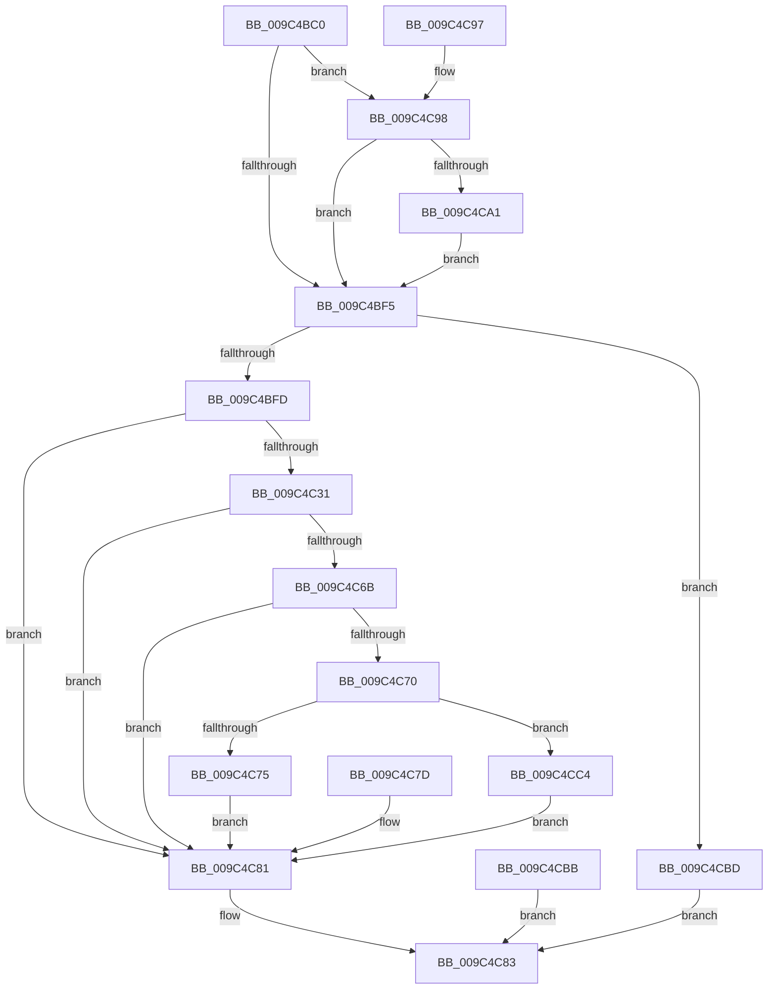

# NtReleaseSemaphore

- RVA: `0x009C4BC0`–`0x009C4CCC` (길이 `268` bytes)
- VA: `0x00000001409C4BC0`
- 실행 섹션: `PAGE`
- PDB 이름 있음: `예`; PDB Function 태그: `아니요`
- unwind 정보 RVA: `0x0009FD30`
- 디코드: `74`개 명령, `268/268` bytes 표시
- 미해석 바이트: `0` (있으면 어셈블리에 `.byte`로 보존)

> 이 문서는 커널 이미지의 기계어와 PDB 기호를 분석해 생성했습니다. 4번과 5번은 함수 원형과 자료형을 바이너리 사용 방식에서 추정한 C 해석이며 원본 소스 복구 결과는 아닙니다.

## 1. Dependencies

- 직접 호출 지점: **3**; 고유 호출 대상: **3**
- 직접 호출자로 확인된 함수: **0**
- RIP 상대 이미지 참조: **1**

### Outgoing calls
- `0x009C4C26` → [ObReferenceObjectByHandle](../86/ObReferenceObjectByHandle_function_00868DB0.md) (function, `0x00868DB0`)
- `0x009C4C54` → [KeReleaseSemaphoreEx](../../text/34/KeReleaseSemaphoreEx_function_003468C0.md) (function, `0x003468C0`)
- `0x009C4C62` → [ObfDereferenceObject](../../text/2F/ObfDereferenceObject_function_002F9350.md) (function, `0x002F9350`)

### Direct callers
- 이 함수 시작 RVA로 연결되는 직접 call은 확인되지 않았습니다. 간접 호출은 완전히 역산할 수 없습니다.

### Static image references
- `0x009C4BFD` → RVA `0x00FC52C0` (`ALMOSTRO`; read)

## 2. Other-region calls and transfers

- 다른 실행 섹션으로 향하는 call: **2**
  - `0x009C4C54` → [KeReleaseSemaphoreEx](../../text/34/KeReleaseSemaphoreEx_function_003468C0.md) (`PAGE` → `.text`)
  - `0x009C4C62` → [ObfDereferenceObject](../../text/2F/ObfDereferenceObject_function_002F9350.md) (`PAGE` → `.text`)
- 별도 외부 분기/꼬리 이동을 확인하지 못했습니다.

## 3. Assembly (complete function range)

```asm
009C4BC0  48 89 5C 24 08                  mov qword ptr [rsp + 8], rbx
009C4BC5  48 89 74 24 10                  mov qword ptr [rsp + 0x10], rsi
009C4BCA  57                              push rdi
009C4BCB  41 56                           push r14
009C4BCD  41 57                           push r15
009C4BCF  48 83 EC 30                     sub rsp, 0x30
009C4BD3  49 8B F0                        mov rsi, r8
009C4BD6  8B FA                           mov edi, edx
009C4BD8  4C 8B D1                        mov r10, rcx
009C4BDB  65 48 8B 04 25 88 01 00 00      mov rax, qword ptr gs:[0x188]
009C4BE4  44 0F B6 B0 32 02 00 00         movzx r14d, byte ptr [rax + 0x232]
009C4BEC  4D 85 C0                        test r8, r8
009C4BEF  0F 85 A3 00 00 00               jne 0x1409c4c98
009C4BF5  85 FF                           test edi, edi
009C4BF7  0F 8E C0 00 00 00               jle 0x1409c4cbd
009C4BFD  4C 8B 05 BC 06 60 00            mov r8, qword ptr [rip + 0x6006bc]
009C4C04  45 33 FF                        xor r15d, r15d
009C4C07  4C 89 7C 24 68                  mov qword ptr [rsp + 0x68], r15
009C4C0C  4C 89 7C 24 28                  mov qword ptr [rsp + 0x28], r15
009C4C11  48 8D 44 24 68                  lea rax, [rsp + 0x68]
009C4C16  48 89 44 24 20                  mov qword ptr [rsp + 0x20], rax
009C4C1B  45 0F B6 CE                     movzx r9d, r14b
009C4C1F  41 8D 57 02                     lea edx, [r15 + 2]
009C4C23  49 8B CA                        mov rcx, r10
009C4C26  E8 85 41 EA FF                  call 0x140868db0
009C4C2B  8B D8                           mov ebx, eax
009C4C2D  85 C0                           test eax, eax
009C4C2F  78 50                           js 0x1409c4c81
009C4C31  44 89 7C 24 60                  mov dword ptr [rsp + 0x60], r15d
009C4C36  48 8D 44 24 60                  lea rax, [rsp + 0x60]
009C4C3B  48 89 44 24 28                  mov qword ptr [rsp + 0x28], rax
009C4C40  44 89 7C 24 20                  mov dword ptr [rsp + 0x20], r15d
009C4C45  44 8B C7                        mov r8d, edi
009C4C48  41 8D 57 01                     lea edx, [r15 + 1]
009C4C4C  48 8B 7C 24 68                  mov rdi, qword ptr [rsp + 0x68]
009C4C51  48 8B CF                        mov rcx, rdi
009C4C54  E8 67 1C 98 FF                  call 0x1403468c0
009C4C59  8B D8                           mov ebx, eax
009C4C5B  89 44 24 68                     mov dword ptr [rsp + 0x68], eax
009C4C5F  48 8B CF                        mov rcx, rdi
009C4C62  E8 E9 46 93 FF                  call 0x1402f9350
009C4C67  85 DB                           test ebx, ebx
009C4C69  78 16                           js 0x1409c4c81
009C4C6B  48 85 F6                        test rsi, rsi
009C4C6E  74 11                           je 0x1409c4c81
009C4C70  45 84 F6                        test r14b, r14b
009C4C73  74 4F                           je 0x1409c4cc4
009C4C75  8B 44 24 60                     mov eax, dword ptr [rsp + 0x60]
009C4C79  89 06                           mov dword ptr [rsi], eax
009C4C7B  EB 04                           jmp 0x1409c4c81
009C4C7D  8B 5C 24 68                     mov ebx, dword ptr [rsp + 0x68]
009C4C81  8B C3                           mov eax, ebx
009C4C83  48 8B 5C 24 50                  mov rbx, qword ptr [rsp + 0x50]
009C4C88  48 8B 74 24 58                  mov rsi, qword ptr [rsp + 0x58]
009C4C8D  48 83 C4 30                     add rsp, 0x30
009C4C91  41 5F                           pop r15
009C4C93  41 5E                           pop r14
009C4C95  5F                              pop rdi
009C4C96  C3                              ret
009C4C97  CC                              int3
009C4C98  45 84 F6                        test r14b, r14b
009C4C9B  0F 84 54 FF FF FF               je 0x1409c4bf5
009C4CA1  48 B9 00 00 FF FF FF 7F 00 00   movabs rcx, 0x7fffffff0000
009C4CAB  48 3B F1                        cmp rsi, rcx
009C4CAE  48 0F 42 CE                     cmovb rcx, rsi
009C4CB2  8B 01                           mov eax, dword ptr [rcx]
009C4CB4  89 01                           mov dword ptr [rcx], eax
009C4CB6  E9 3A FF FF FF                  jmp 0x1409c4bf5
009C4CBB  EB C6                           jmp 0x1409c4c83
009C4CBD  B8 0D 00 00 C0                  mov eax, 0xc000000d
009C4CC2  EB BF                           jmp 0x1409c4c83
009C4CC4  8B 44 24 60                     mov eax, dword ptr [rsp + 0x60]
009C4CC8  89 06                           mov dword ptr [rsi], eax
009C4CCA  EB B5                           jmp 0x1409c4c81
```

## 4. C-style interpretation (structured pseudocode)

```c
__int64 __fastcall NtReleaseSemaphore(__int64 a1, int a2, __int64 a3)
{
    __int64 result;
    __int64 v_r15;
    __int64 v_rsp;
    unsigned __int64 v_stack_m20;
    unsigned __int64 v_stack_m28;
    unsigned __int64 v_stack_p10;
    unsigned int v_stack_p18;
    unsigned __int64 v_stack_p20;
    unsigned int v_stack_p60;
    unsigned __int64 v_stack_p8;

    v_stack_p8 = v_rbx;
    v_stack_p10 = v_rsi;
    v_rsp = (v_rsp) - (48);
    if (a3 != 0) goto loc_009C4C98;
loc_009C4BF5:
    if (condition_is_less_or_equal) goto loc_009C4CBD;
    v_r15 = 0;
    v_stack_p20 = 0;
    v_stack_m20 = 0;
    v_stack_m28 = v_stack_p20;
    result = ObReferenceObjectByHandle(a1, v_r15 + 2, *(unsigned __int64 *)(v_rip + 6293180), (unsigned __int8)(*(unsigned __int8 *)(*(unsigned __int64 *)(gs_base + (0 + 392)) + 562)));
    if (sign_flag) goto loc_009C4C81;
    v_stack_p18 = 0;
    v_stack_m20 = v_stack_p18;
    v_stack_m28 = 0;
    result = KeReleaseSemaphoreEx(v_stack_p20, v_r15 + 1, (unsigned int)((unsigned int)((unsigned int)(a2))), (unsigned __int8)(*(unsigned __int8 *)(*(unsigned __int64 *)(gs_base + (0 + 392)) + 562)));
    v_stack_p20 = (unsigned int)(result);
    result = ObfDereferenceObject(v_stack_p20, v_r15 + 1, (unsigned int)((unsigned int)((unsigned int)(a2))), (unsigned __int8)(*(unsigned __int8 *)(*(unsigned __int64 *)(gs_base + (0 + 392)) + 562)));
    if (sign_flag) goto loc_009C4C81;
    if (a3 == 0) goto loc_009C4C81;
    if ((unsigned __int8)(*(unsigned __int8 *)(*(unsigned __int64 *)(gs_base + (0 + 392)) + 562)) == 0) goto loc_009C4CC4;
    *(unsigned int *)(a3) = (unsigned int)((unsigned int)(v_stack_p18));
    goto loc_009C4C81;
loc_009C4C81:
loc_009C4C83:
    v_rsp = (v_rsp) + (48);
    return (unsigned int)((unsigned int)((unsigned int)((unsigned int)(result))));
loc_009C4C98:
    if ((unsigned __int8)(*(unsigned __int8 *)(*(unsigned __int64 *)(gs_base + (0 + 392)) + 562)) == 0) goto loc_009C4BF5;
    a1 = v_stack_p20;
    if (v_stack_p10 < v_stack_p20) { a1 = v_stack_p10; }
    *(unsigned int *)(a1) = (unsigned int)((unsigned int)(*(unsigned int *)(a1)));
    goto loc_009C4BF5;
loc_009C4CBD:
    goto loc_009C4C83;
loc_009C4CC4:
    *(unsigned int *)(v_stack_p10) = (unsigned int)((unsigned int)(v_stack_p60));
    goto loc_009C4C81;
}
```

## 5. (Beta) C Style

```c
int64_t NtReleaseSemaphore(int64_t Arg1, int32_t Arg2, int64_t Arg3)
{
    int64_t result;
    int64_t local_r15;
    int64_t local_rsp;
    uint64_t v_stack_m20;
    uint64_t v_stack_m28;
    uint64_t v_stack_p10;
    uint32_t v_stack_p18;
    uint64_t v_stack_p20;
    uint32_t v_stack_p60;
    uint64_t v_stack_p8;

    v_stack_p8 = local_rbx;
    v_stack_p10 = local_rsi;
    local_rsp = (local_rsp) - (48);
    if (Arg3 != 0) goto loc_009C4C98;
loc_009C4BF5:
    if (condition_is_less_or_equal) goto loc_009C4CBD;
    local_r15 = 0;
    v_stack_p20 = 0;
    v_stack_m20 = 0;
    v_stack_m28 = v_stack_p20;
    result = ObReferenceObjectByHandle(Arg1, local_r15 + 2, *(uint64_t *)(v_rip + 0x6006BC), (uint8_t)(*(uint8_t *)(*(uint64_t *)(gs_base + (0 + 0x188)) + 0x232)));
    if (sign_flag) goto loc_009C4C81;
    v_stack_p18 = 0;
    v_stack_m20 = v_stack_p18;
    v_stack_m28 = 0;
    result = KeReleaseSemaphoreEx(v_stack_p20, local_r15 + 1, (uint32_t)((uint32_t)((uint32_t)(Arg2))), (uint8_t)(*(uint8_t *)(*(uint64_t *)(gs_base + (0 + 0x188)) + 0x232)));
    v_stack_p20 = (uint32_t)(result);
    result = ObfDereferenceObject(v_stack_p20, local_r15 + 1, (uint32_t)((uint32_t)((uint32_t)(Arg2))), (uint8_t)(*(uint8_t *)(*(uint64_t *)(gs_base + (0 + 0x188)) + 0x232)));
    if (sign_flag) goto loc_009C4C81;
    if (Arg3 == 0) goto loc_009C4C81;
    if ((uint8_t)(*(uint8_t *)(*(uint64_t *)(gs_base + (0 + 0x188)) + 0x232)) == 0) goto loc_009C4CC4;
    *(uint32_t *)(Arg3) = (uint32_t)((uint32_t)(v_stack_p18));
    goto loc_009C4C81;
loc_009C4C81:
loc_009C4C83:
    local_rsp = (local_rsp) + (48);
    return (uint32_t)((uint32_t)((uint32_t)((uint32_t)(result))));
loc_009C4C98:
    if ((uint8_t)(*(uint8_t *)(*(uint64_t *)(gs_base + (0 + 0x188)) + 0x232)) == 0) goto loc_009C4BF5;
    Arg1 = v_stack_p20;
    if (v_stack_p10 < v_stack_p20) { Arg1 = v_stack_p10; }
    *(uint32_t *)(Arg1) = (uint32_t)((uint32_t)(*(uint32_t *)(Arg1)));
    goto loc_009C4BF5;
loc_009C4CBD:
    goto loc_009C4C83;
loc_009C4CC4:
    *(uint32_t *)(v_stack_p10) = (uint32_t)((uint32_t)(v_stack_p60));
    goto loc_009C4C81;
}
```

## 6. Execution-region graph

[열기: 2D/3D 그래프와 함수 탐색 컨트롤 패널](../../../control-panel.html?section=page&rva=0x009C4BC0&view=graph)

- 2D 그래프는 위에서 아래로 흐르고, 3D 그래프는 빈 공간을 드래그해 회전합니다. Shift+드래그는 이동, 휠은 확대·축소, 함수 노드 선택은 대상 보고서 이동입니다.

### Static fallback


