# NtSetTimerResolution

- RVA: `0x009C5170`–`0x009C5474` (길이 `772` bytes)
- VA: `0x00000001409C5170`
- 실행 섹션: `PAGE`
- PDB 이름 있음: `예`; PDB Function 태그: `아니요`
- unwind 정보 RVA: `0x0009FFA4`
- 디코드: `176`개 명령, `772/772` bytes 표시
- 미해석 바이트: `0` (있으면 어셈블리에 `.byte`로 보존)

> 이 문서는 커널 이미지의 기계어와 PDB 기호를 분석해 생성했습니다. 4번과 5번은 함수 원형과 자료형을 바이너리 사용 방식에서 추정한 C 해석이며 원본 소스 복구 결과는 아닙니다.

## 1. Dependencies

- 직접 호출 지점: **15**; 고유 호출 대상: **12**
- 직접 호출자로 확인된 함수: **0**
- RIP 상대 이미지 참조: **5**

### Outgoing calls
- `0x009C51FE` → [KeAbPreAcquire](../../text/21/KeAbPreAcquire_function_00210230.md) (function, `0x00210230`)
- `0x009C5223` → [ExfAcquirePushLockExclusiveEx](../../text/20/ExfAcquirePushLockExclusiveEx_function_0020FC90.md) (function, `0x0020FC90`)
- `0x009C5279` → [PoTraceSystemTimerResolution](PoTraceSystemTimerResolution_function_009C5480.md) (function, `0x009C5480`)
- `0x009C5285` → [ExpUpdateTimerResolution](../../text/39/ExpUpdateTimerResolution_function_003914A0.md) (function, `0x003914A0`)
- `0x009C52BD` → [KeAbPostRelease](../../text/2E/KeAbPostRelease_function_002E1600.md) (function, `0x002E1600`)
- `0x009C52CB` → [KeLeaveCriticalRegionThread](../../text/25/KeLeaveCriticalRegionThread_function_0025EFF0.md) (function, `0x0025EFF0`)
- `0x009C534F` → [ExpInsertTimerResolutionEntry](../../text/4B/ExpInsertTimerResolutionEntry_function_004B1898.md) (function, `0x004B1898`)
- `0x009C5387` → [PoTraceSystemTimerResolution](PoTraceSystemTimerResolution_function_009C5480.md) (function, `0x009C5480`)
- `0x009C53A2` → [ExpUpdateTimerResolution](../../text/39/ExpUpdateTimerResolution_function_003914A0.md) (function, `0x003914A0`)
- `0x009C53C0` → [ExfTryToWakePushLock](../../text/26/ExfTryToWakePushLock_function_00265DD0.md) (function, `0x00265DD0`)
- `0x009C53D4` → [PoDiagCaptureUsermodeStack](PoDiagCaptureUsermodeStack_function_009C58C0.md) (function, `0x009C58C0`)
- `0x009C53E5` → [ExAcquireTimeRefreshLockExclusive](ExAcquireTimeRefreshLockExclusive_function_009C5810.md) (function, `0x009C5810`)
- `0x009C540C` → [ExReleaseTimeRefreshLockExclusive](ExReleaseTimeRefreshLockExclusive_function_009C5874.md) (function, `0x009C5874`)
- `0x009C5451` → [ExFreePoolWithTag](../../poolcode/B8/ExFreePoolWithTag_function_00B82870.md) (function, `0x00B82870`)
- `0x009C5463` → [ExFreePoolWithTag](../../poolcode/B8/ExFreePoolWithTag_function_00B82870.md) (function, `0x00B82870`)

### Direct callers
- 이 함수 시작 RVA로 연결되는 직접 call은 확인되지 않았습니다. 간접 호출은 완전히 역산할 수 없습니다.

### Static image references
- `0x009C51F7` → RVA `0x00EFEFC8` (`.data`; read)
- `0x009C5206` → RVA `0x00EFEFC8` (`.data`; read/write)
- `0x009C5231` → RVA `0x00FC6B7C` (`ALMOSTRO`; read)
- `0x009C5267` → RVA `0x00FD9E0C` (`PAGEDATA`; read/write)
- `0x009C53AE` → RVA `0x00FC6BB8` (`ALMOSTRO`; read)

## 2. Other-region calls and transfers

- 다른 실행 섹션으로 향하는 call: **10**
  - `0x009C51FE` → [KeAbPreAcquire](../../text/21/KeAbPreAcquire_function_00210230.md) (`PAGE` → `.text`)
  - `0x009C5223` → [ExfAcquirePushLockExclusiveEx](../../text/20/ExfAcquirePushLockExclusiveEx_function_0020FC90.md) (`PAGE` → `.text`)
  - `0x009C5285` → [ExpUpdateTimerResolution](../../text/39/ExpUpdateTimerResolution_function_003914A0.md) (`PAGE` → `.text`)
  - `0x009C52BD` → [KeAbPostRelease](../../text/2E/KeAbPostRelease_function_002E1600.md) (`PAGE` → `.text`)
  - `0x009C52CB` → [KeLeaveCriticalRegionThread](../../text/25/KeLeaveCriticalRegionThread_function_0025EFF0.md) (`PAGE` → `.text`)
  - `0x009C534F` → [ExpInsertTimerResolutionEntry](../../text/4B/ExpInsertTimerResolutionEntry_function_004B1898.md) (`PAGE` → `.text`)
  - `0x009C53A2` → [ExpUpdateTimerResolution](../../text/39/ExpUpdateTimerResolution_function_003914A0.md) (`PAGE` → `.text`)
  - `0x009C53C0` → [ExfTryToWakePushLock](../../text/26/ExfTryToWakePushLock_function_00265DD0.md) (`PAGE` → `.text`)
  - `0x009C5451` → [ExFreePoolWithTag](../../poolcode/B8/ExFreePoolWithTag_function_00B82870.md) (`PAGE` → `POOLCODE`)
  - `0x009C5463` → [ExFreePoolWithTag](../../poolcode/B8/ExFreePoolWithTag_function_00B82870.md) (`PAGE` → `POOLCODE`)
- 별도 외부 분기/꼬리 이동을 확인하지 못했습니다.

## 3. Assembly (complete function range)

```asm
009C5170  48 89 5C 24 08                  mov qword ptr [rsp + 8], rbx
009C5175  48 89 74 24 10                  mov qword ptr [rsp + 0x10], rsi
009C517A  57                              push rdi
009C517B  41 54                           push r12
009C517D  41 55                           push r13
009C517F  41 56                           push r14
009C5181  41 57                           push r15
009C5183  48 83 EC 40                     sub rsp, 0x40
009C5187  49 8B F8                        mov rdi, r8
009C518A  44 0F B6 F2                     movzx r14d, dl
009C518E  44 8B E9                        mov r13d, ecx
009C5191  65 48 8B 04 25 88 01 00 00      mov rax, qword ptr gs:[0x188]
009C519A  80 B8 32 02 00 00 00            cmp byte ptr [rax + 0x232], 0
009C51A1  74 1E                           je 0x1409c51c1
009C51A3  49 B9 00 00 FF FF FF 7F 00 00   movabs r9, 0x7fffffff0000
009C51AD  4D 3B C1                        cmp r8, r9
009C51B0  4D 0F 42 C8                     cmovb r9, r8
009C51B4  41 8B 01                        mov eax, dword ptr [r9]
009C51B7  41 89 01                        mov dword ptr [r9], eax
009C51BA  EB 05                           jmp 0x1409c51c1
009C51BC  E9 57 01 00 00                  jmp 0x1409c5318
009C51C1  65 48 8B 1C 25 88 01 00 00      mov rbx, qword ptr gs:[0x188]
009C51CA  48 8B 9B B8 00 00 00            mov rbx, qword ptr [rbx + 0xb8]
009C51D1  C6 84 24 88 00 00 00 00         mov byte ptr [rsp + 0x88], 0
009C51D9  45 33 E4                        xor r12d, r12d
009C51DC  44 89 64 24 24                  mov dword ptr [rsp + 0x24], r12d
009C51E1  65 48 8B 04 25 88 01 00 00      mov rax, qword ptr gs:[0x188]
009C51EA  66 FF 88 E4 01 00 00            dec word ptr [rax + 0x1e4]
009C51F1  90                              nop
009C51F2  45 33 C0                        xor r8d, r8d
009C51F5  33 D2                           xor edx, edx
009C51F7  48 8D 0D CA 9D 53 00            lea rcx, [rip + 0x539dca]
009C51FE  E8 2D B0 84 FF                  call 0x140210230
009C5203  48 8B F0                        mov rsi, rax
009C5206  F0 48 0F BA 2D B8 9D 53 00 00   lock bts qword ptr [rip + 0x539db8], 0
009C5210  73 16                           jae 0x1409c5228
009C5212  4C 8D 05 AF 9D 53 00            lea r8, [rip + 0x539daf]
009C5219  48 8B D0                        mov rdx, rax
009C521C  48 8D 0D A5 9D 53 00            lea rcx, [rip + 0x539da5]
009C5223  E8 68 AA 84 FF                  call 0x14020fc90
009C5228  48 85 F6                        test rsi, rsi
009C522B  74 04                           je 0x1409c5231
009C522D  C6 46 0A 01                     mov byte ptr [rsi + 0xa], 1
009C5231  8B 35 45 19 60 00               mov esi, dword ptr [rip + 0x601945]
009C5237  0F 0D 8B F4 01 00 00            prefetchw byte ptr [rbx + 0x1f4]
009C523E  8B 83 F4 01 00 00               mov eax, dword ptr [rbx + 0x1f4]
009C5244  45 84 F6                        test r14b, r14b
009C5247  0F 85 E4 00 00 00               jne 0x1409c5331
009C524D  8B C8                           mov ecx, eax
009C524F  0F BA F1 0C                     btr ecx, 0xc
009C5253  F0 0F B1 8B F4 01 00 00         lock cmpxchg dword ptr [rbx + 0x1f4], ecx
009C525B  75 F0                           jne 0x1409c524d
009C525D  0F BA E0 0C                     bt eax, 0xc
009C5261  0F 83 D2 01 00 00               jae 0x1409c5439
009C5267  FF 0D 9F 4B 61 00               dec dword ptr [rip + 0x614b9f]
009C526D  44 89 A3 B8 05 00 00            mov dword ptr [rbx + 0x5b8], r12d
009C5274  48 8B D3                        mov rdx, rbx
009C5277  33 C9                           xor ecx, ecx
009C5279  E8 02 02 00 00                  call 0x1409c5480
009C527E  45 33 C0                        xor r8d, r8d
009C5281  33 D2                           xor edx, edx
009C5283  33 C9                           xor ecx, ecx
009C5285  E8 16 C2 9C FF                  call 0x1403914a0
009C528A  8B F0                           mov esi, eax
009C528C  48 8B CB                        mov rcx, rbx
009C528F  B8 B0 05 00 00                  mov eax, 0x5b0
009C5294  48 03 C3                        add rax, rbx
009C5297  48 89 44 24 30                  mov qword ptr [rsp + 0x30], rax
009C529C  48 C7 C0 FF FF FF FF            mov rax, 0xffffffffffffffff
009C52A3  F0 48 0F C1 05 1C 9D 53 00      lock xadd qword ptr [rip + 0x539d1c], rax
009C52AC  24 06                           and al, 6
009C52AE  3C 02                           cmp al, 2
009C52B0  0F 84 03 01 00 00               je 0x1409c53b9
009C52B6  48 8D 0D 0B 9D 53 00            lea rcx, [rip + 0x539d0b]
009C52BD  E8 3E C3 91 FF                  call 0x1402e1600
009C52C2  65 48 8B 0C 25 88 01 00 00      mov rcx, qword ptr gs:[0x188]
009C52CB  E8 20 9D 89 FF                  call 0x14025eff0
009C52D0  45 33 F6                        xor r14d, r14d
009C52D3  45 33 FF                        xor r15d, r15d
009C52D6  44 38 B4 24 88 00 00 00         cmp byte ptr [rsp + 0x88], r14b
009C52DE  0F 85 F0 00 00 00               jne 0x1409c53d4
009C52E4  4D 85 F6                        test r14, r14
009C52E7  0F 85 5C 01 00 00               jne 0x1409c5449
009C52ED  4D 85 FF                        test r15, r15
009C52F0  0F 85 65 01 00 00               jne 0x1409c545b
009C52F6  65 48 8B 04 25 88 01 00 00      mov rax, qword ptr gs:[0x188]
009C52FF  80 B8 32 02 00 00 00            cmp byte ptr [rax + 0x232], 0
009C5306  0F 84 61 01 00 00               je 0x1409c546d
009C530C  89 37                           mov dword ptr [rdi], esi
009C530E  EB 05                           jmp 0x1409c5315
009C5310  44 8B 64 24 24                  mov r12d, dword ptr [rsp + 0x24]
009C5315  41 8B C4                        mov eax, r12d
009C5318  48 8B 5C 24 70                  mov rbx, qword ptr [rsp + 0x70]
009C531D  48 8B 74 24 78                  mov rsi, qword ptr [rsp + 0x78]
009C5322  48 83 C4 40                     add rsp, 0x40
009C5326  41 5F                           pop r15
009C5328  41 5E                           pop r14
009C532A  41 5D                           pop r13
009C532C  41 5C                           pop r12
009C532E  5F                              pop rdi
009C532F  C3                              ret
009C5330  CC                              int3
009C5331  41 B6 01                        mov r14b, 1
009C5334  8B C8                           mov ecx, eax
009C5336  81 C9 00 10 00 80               or ecx, 0x80001000
009C533C  F0 0F B1 8B F4 01 00 00         lock cmpxchg dword ptr [rbx + 0x1f4], ecx
009C5344  75 EE                           jne 0x1409c5334
009C5346  8B F0                           mov esi, eax
009C5348  85 C0                           test eax, eax
009C534A  78 08                           js 0x1409c5354
009C534C  48 8B CB                        mov rcx, rbx
009C534F  E8 44 C5 AE FF                  call 0x1404b1898
009C5354  0F BA E6 0C                     bt esi, 0xc
009C5358  0F 82 B8 00 00 00               jb 0x1409c5416
009C535E  FF 05 A8 4A 61 00               inc dword ptr [rip + 0x614aa8]
009C5364  48 8B CB                        mov rcx, rbx
009C5367  B8 B8 05 00 00                  mov eax, 0x5b8
009C536C  4C 39 A3 B0 05 00 00            cmp qword ptr [rbx + 0x5b0], r12
009C5373  74 55                           je 0x1409c53ca
009C5375  44 3B AB BC 05 00 00            cmp r13d, dword ptr [rbx + 0x5bc]
009C537C  72 4C                           jb 0x1409c53ca
009C537E  44 89 2C 01                     mov dword ptr [rcx + rax], r13d
009C5382  48 8B D3                        mov rdx, rbx
009C5385  33 C9                           xor ecx, ecx
009C5387  E8 F4 00 00 00                  call 0x1409c5480
009C538C  F7 83 FC 05 00 00 00 00 00 04   test dword ptr [rbx + 0x5fc], 0x4000000
009C5396  75 16                           jne 0x1409c53ae
009C5398  45 33 C0                        xor r8d, r8d
009C539B  41 8B D5                        mov edx, r13d
009C539E  41 0F B6 CE                     movzx ecx, r14b
009C53A2  E8 F9 C0 9C FF                  call 0x1403914a0
009C53A7  8B F0                           mov esi, eax
009C53A9  E9 DE FE FF FF                  jmp 0x1409c528c
009C53AE  8B 35 04 18 60 00               mov esi, dword ptr [rip + 0x601804]
009C53B4  E9 D3 FE FF FF                  jmp 0x1409c528c
009C53B9  48 8D 0D 08 9C 53 00            lea rcx, [rip + 0x539c08]
009C53C0  E8 0B 0A 8A FF                  call 0x140265dd0
009C53C5  E9 EC FE FF FF                  jmp 0x1409c52b6
009C53CA  C6 84 24 88 00 00 00 01         mov byte ptr [rsp + 0x88], 1
009C53D2  EB AA                           jmp 0x1409c537e
009C53D4  E8 E7 04 00 00                  call 0x1409c58c0
009C53D9  4C 8B F8                        mov r15, rax
009C53DC  48 85 C0                        test rax, rax
009C53DF  0F 84 FF FE FF FF               je 0x1409c52e4
009C53E5  E8 26 04 00 00                  call 0x1409c5810
009C53EA  48 8B 44 24 30                  mov rax, qword ptr [rsp + 0x30]
009C53EF  48 8B 00                        mov rax, qword ptr [rax]
009C53F2  48 85 C0                        test rax, rax
009C53F5  75 34                           jne 0x1409c542b
009C53F7  4C 0F 45 F0                     cmovne r14, rax
009C53FB  44 89 AB BC 05 00 00            mov dword ptr [rbx + 0x5bc], r13d
009C5402  4C 89 BB B0 05 00 00            mov qword ptr [rbx + 0x5b0], r15
009C5409  45 33 FF                        xor r15d, r15d
009C540C  E8 63 04 00 00                  call 0x1409c5874
009C5411  E9 CE FE FF FF                  jmp 0x1409c52e4
009C5416  44 3B AB B8 05 00 00            cmp r13d, dword ptr [rbx + 0x5b8]
009C541D  0F 86 41 FF FF FF               jbe 0x1409c5364
009C5423  45 32 F6                        xor r14b, r14b
009C5426  E9 39 FF FF FF                  jmp 0x1409c5364
009C542B  44 3B AB BC 05 00 00            cmp r13d, dword ptr [rbx + 0x5bc]
009C5432  73 D8                           jae 0x1409c540c
009C5434  48 85 C0                        test rax, rax
009C5437  EB BE                           jmp 0x1409c53f7
009C5439  41 BC 45 02 00 C0               mov r12d, 0xc0000245
009C543F  44 89 64 24 24                  mov dword ptr [rsp + 0x24], r12d
009C5444  E9 43 FE FF FF                  jmp 0x1409c528c
009C5449  BA 54 56 45 50                  mov edx, 0x50455654
009C544E  49 8B CE                        mov rcx, r14
009C5451  E8 1A D4 1B 00                  call 0x140b82870
009C5456  E9 92 FE FF FF                  jmp 0x1409c52ed
009C545B  BA 54 56 45 50                  mov edx, 0x50455654
009C5460  49 8B CF                        mov rcx, r15
009C5463  E8 08 D4 1B 00                  call 0x140b82870
009C5468  E9 89 FE FF FF                  jmp 0x1409c52f6
009C546D  89 37                           mov dword ptr [rdi], esi
009C546F  E9 A1 FE FF FF                  jmp 0x1409c5315
```

## 4. C-style interpretation (structured pseudocode)

```c
__int64 __fastcall NtSetTimerResolution(int a1, int a2, __int64 a3)
{
    __int64 result;
    __int64 v_r12;
    __int64 v_r14;
    __int64 v_r15;
    __int64 v_rsp;
    unsigned __int64 v_stack_m38;
    unsigned int v_stack_m44;
    unsigned __int64 v_stack_p10;
    unsigned __int8 v_stack_p20;
    unsigned int v_stack_p24;
    unsigned __int64 v_stack_p30;
    unsigned __int64 v_stack_p8;
    unsigned __int8 v_stack_p88;

    v_stack_p8 = v_rbx;
    v_stack_p10 = v_rsi;
    v_rsp = (v_rsp) - (64);
    if ((*(unsigned __int8 *)(*(unsigned __int64 *)(gs_base + (0 + 392)) + 562)) == 0) goto loc_009C51C1;
    if (a3 < a4) { a4 = a3; }
    *(unsigned int *)(a4) = (unsigned int)((unsigned int)(*(unsigned int *)(a4)));
    goto loc_009C51C1;
loc_009C51C1:
    v_stack_p20 = 0;
    v_r12 = 0;
    v_stack_m44 = 0;
    a3 = 0;
    a2 = 0;
    result = KeAbPreAcquire(v_rip + 5479882, a2, a3, a4);
    if (!(condition_is_above_or_equal)) {
        a3 = v_rip + 5479855;
        a2 = result;
        a1 = v_rip + 5479845;
        result = ExfAcquirePushLockExclusiveEx(a1, a2, a3, a4);
    }
    if (result != 0) {
        *(unsigned __int8 *)(result + 10) = 1;
    }
    if ((unsigned __int8)((unsigned __int8)(a2)) != 0) goto loc_009C5331;
loc_009C524D:
    if ((unsigned __int8)((unsigned __int8)(a2)) != 0) goto loc_009C524D;
    if (condition_is_above_or_equal) goto loc_009C5439;
    *(unsigned int *)(*(unsigned __int64 *)(*(unsigned __int64 *)(gs_base + (0 + 392)) + 184) + 1464) = 0;
    a1 = 0;
    result = PoTraceSystemTimerResolution(a1, *(unsigned __int64 *)(*(unsigned __int64 *)(gs_base + (0 + 392)) + 184), a3, a4);
    a3 = 0;
    a2 = 0;
    a1 = 0;
    result = ExpUpdateTimerResolution(a1, a2, a3, a4);
loc_009C528C:
    result = ((unsigned int)(0x5B0ULL)) + (*(unsigned __int64 *)(*(unsigned __int64 *)(gs_base + (0 + 392)) + 184));
    v_stack_m38 = result;
    result = (unsigned __int8)((-1) & (6));
    if (((unsigned __int8)(result)) == 2) goto loc_009C53B9;
loc_009C52B6:
    result = KeAbPostRelease(v_rip + 5479691, a2, a3, a4);
    result = KeLeaveCriticalRegionThread(*(unsigned __int64 *)(gs_base + (0 + 392)), a2, a3, a4);
    v_r14 = 0;
    v_r15 = 0;
    if (v_stack_p20 != 0) goto loc_009C53D4;
loc_009C52E4:
    if (0 != 0) goto loc_009C5449;
loc_009C52ED:
    if (0 != 0) goto loc_009C545B;
loc_009C52F6:
    if ((*(unsigned __int8 *)(*(unsigned __int64 *)(gs_base + (0 + 392)) + 562)) == 0) goto loc_009C546D;
    *(unsigned int *)(a3) = (unsigned int)((unsigned int)((unsigned int)(result)));
    goto loc_009C5315;
loc_009C5315:
loc_009C5318:
    v_rsp = (v_rsp) + (64);
    return 0;
loc_009C5331:
loc_009C5334:
    a1 = (unsigned int)((0) | (0x80001000ULL));
    if (condition_is_not_equal) goto loc_009C5334;
    result = 0;
    if (!(sign_flag)) {
        a1 = v_stack_p8;
        result = ExpInsertTimerResolutionEntry(a1, a2, a3, a4);
    }
    if (condition_is_below) goto loc_009C5416;
loc_009C5364:
    if ((*(unsigned __int64 *)(v_stack_p8 + 1456)) == 0) goto loc_009C53CA;
    if (((unsigned int)((unsigned int)(a1))) < (*(unsigned int *)(v_stack_p8 + 1468))) goto loc_009C53CA;
loc_009C537E:
    *(unsigned int *)(v_stack_p8 + (unsigned int)(0x5B8ULL) * 1) = (unsigned int)((unsigned int)(a1));
    a1 = 0;
    result = PoTraceSystemTimerResolution(a1, v_stack_p8, a3, a4);
    if (((*(unsigned int *)(v_stack_p8 + 1532)) & (0x4000000ULL)) != 0) goto loc_009C53AE;
    a3 = 0;
    result = ExpUpdateTimerResolution(1, (unsigned int)((unsigned int)((unsigned int)(a1))), a3, a4);
    goto loc_009C528C;
loc_009C53AE:
    goto loc_009C528C;
loc_009C53B9:
    result = ExfTryToWakePushLock(v_rip + 5479432, (unsigned int)((unsigned int)((unsigned int)(a1))), a3, a4);
    goto loc_009C52B6;
loc_009C53CA:
    v_stack_p88 = 1;
    goto loc_009C537E;
loc_009C53D4:
    result = PoDiagCaptureUsermodeStack(v_rip + 5479432, (unsigned int)((unsigned int)((unsigned int)(a1))), a3, a4);
    if (result == 0) goto loc_009C52E4;
    result = ExAcquireTimeRefreshLockExclusive(v_rip + 5479432, (unsigned int)((unsigned int)((unsigned int)(a1))), a3, a4);
    if (*(unsigned __int64 *)(v_stack_p30) != 0) goto loc_009C542B;
loc_009C53F7:
    v_r14 = 1;
    if (*(unsigned __int64 *)(v_stack_p30) != 0) { v_r14 = *(unsigned __int64 *)(v_stack_p30); }
    *(unsigned int *)(v_stack_p8 + 1468) = (unsigned int)((unsigned int)(a1));
    *(unsigned __int64 *)(v_stack_p8 + 1456) = result;
    v_r15 = 0;
loc_009C540C:
    result = ExReleaseTimeRefreshLockExclusive(v_rip + 5479432, (unsigned int)((unsigned int)((unsigned int)(a1))), a3, a4);
    goto loc_009C52E4;
loc_009C5416:
    if (((unsigned int)((unsigned int)(a1))) <= (*(unsigned int *)(v_stack_p8 + 1464))) goto loc_009C5364;
    v_r14 = 0;
    goto loc_009C5364;
loc_009C542B:
    if (((unsigned int)((unsigned int)(a1))) >= (*(unsigned int *)(v_stack_p8 + 1468))) goto loc_009C540C;
    goto loc_009C53F7;
loc_009C5439:
    v_stack_p24 = (unsigned int)((unsigned int)(0xC0000245ULL));
    goto loc_009C528C;
loc_009C5449:
    result = ExFreePoolWithTag(0, (unsigned int)(0x50455654ULL), a3, a4);
    goto loc_009C52ED;
loc_009C545B:
    result = ExFreePoolWithTag(0, (unsigned int)(0x50455654ULL), a3, a4);
    goto loc_009C52F6;
loc_009C546D:
    *(unsigned int *)(a3) = (unsigned int)((unsigned int)(*(unsigned int *)(v_rip + 6297604)));
    goto loc_009C5315;
}
```

## 5. (Beta) C Style

```c
int64_t NtSetTimerResolution(int32_t Arg1, int32_t Arg2, void *Arg3)
{
    uint8_t *arg3 = (uint8_t *)Arg3;

    int64_t result;
    int64_t local_r12;
    int64_t local_r14;
    int64_t local_r15;
    int64_t local_rsp;
    uint64_t v_stack_m38;
    uint32_t v_stack_m44;
    uint64_t v_stack_p10;
    uint8_t v_stack_p20;
    uint32_t v_stack_p24;
    uint64_t v_stack_p30;
    uint64_t v_stack_p8;
    uint8_t v_stack_p88;

    v_stack_p8 = local_rbx;
    v_stack_p10 = local_rsi;
    local_rsp = (local_rsp) - (64);
    if ((*(uint8_t *)(*(uint64_t *)(gs_base + (0 + 0x188)) + 0x232)) == 0) goto loc_009C51C1;
    if (Arg3 < a4) { a4 = Arg3; }
    *(uint32_t *)(a4) = (uint32_t)((uint32_t)(*(uint32_t *)(a4)));
    goto loc_009C51C1;
loc_009C51C1:
    v_stack_p20 = 0;
    local_r12 = 0;
    v_stack_m44 = 0;
    Arg3 = 0;
    Arg2 = 0;
    result = KeAbPreAcquire(v_rip + 5479882, Arg2, Arg3, a4);
    if (!(condition_is_above_or_equal)) {
        Arg3 = v_rip + 5479855;
        Arg2 = result;
        Arg1 = v_rip + 5479845;
        result = ExfAcquirePushLockExclusiveEx(Arg1, Arg2, Arg3, a4);
    }
    if (result != 0) {
        *(uint8_t *)(result + 0xA) = 1;
    }
    if ((uint8_t)((uint8_t)(Arg2)) != 0) goto loc_009C5331;
loc_009C524D:
    if ((uint8_t)((uint8_t)(Arg2)) != 0) goto loc_009C524D;
    if (condition_is_above_or_equal) goto loc_009C5439;
    *(uint32_t *)(*(uint64_t *)(*(uint64_t *)(gs_base + (0 + 0x188)) + 0xB8) + 0x5B8) = 0;
    Arg1 = 0;
    result = PoTraceSystemTimerResolution(Arg1, *(uint64_t *)(*(uint64_t *)(gs_base + (0 + 0x188)) + 0xB8), Arg3, a4);
    Arg3 = 0;
    Arg2 = 0;
    Arg1 = 0;
    result = ExpUpdateTimerResolution(Arg1, Arg2, Arg3, a4);
loc_009C528C:
    result = ((uint32_t)(0x5B0ULL)) + (*(uint64_t *)(*(uint64_t *)(gs_base + (0 + 0x188)) + 0xB8));
    v_stack_m38 = result;
    result = (uint8_t)((-1) & (6));
    if (((uint8_t)(result)) == 2) goto loc_009C53B9;
loc_009C52B6:
    result = KeAbPostRelease(v_rip + 5479691, Arg2, Arg3, a4);
    result = KeLeaveCriticalRegionThread(*(uint64_t *)(gs_base + (0 + 0x188)), Arg2, Arg3, a4);
    local_r14 = 0;
    local_r15 = 0;
    if (v_stack_p20 != 0) goto loc_009C53D4;
loc_009C52E4:
    if (0 != 0) goto loc_009C5449;
loc_009C52ED:
    if (0 != 0) goto loc_009C545B;
loc_009C52F6:
    if ((*(uint8_t *)(*(uint64_t *)(gs_base + (0 + 0x188)) + 0x232)) == 0) goto loc_009C546D;
    *(uint32_t *)(arg3) = (uint32_t)((uint32_t)((uint32_t)(result)));
    goto loc_009C5315;
loc_009C5315:
loc_009C5318:
    local_rsp = (local_rsp) + (64);
    return 0;
loc_009C5331:
loc_009C5334:
    Arg1 = (uint32_t)((0) | (0x80001000ULL));
    if (condition_is_not_equal) goto loc_009C5334;
    result = 0;
    if (!(sign_flag)) {
        Arg1 = v_stack_p8;
        result = ExpInsertTimerResolutionEntry(Arg1, Arg2, Arg3, a4);
    }
    if (condition_is_below) goto loc_009C5416;
loc_009C5364:
    if ((*(uint64_t *)(v_stack_p8 + 0x5B0)) == 0) goto loc_009C53CA;
    if (((uint32_t)((uint32_t)(Arg1))) < (*(uint32_t *)(v_stack_p8 + 0x5BC))) goto loc_009C53CA;
loc_009C537E:
    *(uint32_t *)(v_stack_p8 + (uint32_t)(0x5B8ULL) * 1) = (uint32_t)((uint32_t)(Arg1));
    Arg1 = 0;
    result = PoTraceSystemTimerResolution(Arg1, v_stack_p8, Arg3, a4);
    if (((*(uint32_t *)(v_stack_p8 + 0x5FC)) & (0x4000000ULL)) != 0) goto loc_009C53AE;
    Arg3 = 0;
    result = ExpUpdateTimerResolution(1, (uint32_t)((uint32_t)((uint32_t)(Arg1))), Arg3, a4);
    goto loc_009C528C;
loc_009C53AE:
    goto loc_009C528C;
loc_009C53B9:
    result = ExfTryToWakePushLock(v_rip + 5479432, (uint32_t)((uint32_t)((uint32_t)(Arg1))), Arg3, a4);
    goto loc_009C52B6;
loc_009C53CA:
    v_stack_p88 = 1;
    goto loc_009C537E;
loc_009C53D4:
    result = PoDiagCaptureUsermodeStack(v_rip + 5479432, (uint32_t)((uint32_t)((uint32_t)(Arg1))), Arg3, a4);
    if (result == 0) goto loc_009C52E4;
    result = ExAcquireTimeRefreshLockExclusive(v_rip + 5479432, (uint32_t)((uint32_t)((uint32_t)(Arg1))), Arg3, a4);
    if (*(uint64_t *)(v_stack_p30) != 0) goto loc_009C542B;
loc_009C53F7:
    local_r14 = 1;
    if (*(uint64_t *)(v_stack_p30) != 0) { local_r14 = *(uint64_t *)(v_stack_p30); }
    *(uint32_t *)(v_stack_p8 + 0x5BC) = (uint32_t)((uint32_t)(Arg1));
    *(uint64_t *)(v_stack_p8 + 0x5B0) = result;
    local_r15 = 0;
loc_009C540C:
    result = ExReleaseTimeRefreshLockExclusive(v_rip + 5479432, (uint32_t)((uint32_t)((uint32_t)(Arg1))), Arg3, a4);
    goto loc_009C52E4;
loc_009C5416:
    if (((uint32_t)((uint32_t)(Arg1))) <= (*(uint32_t *)(v_stack_p8 + 0x5B8))) goto loc_009C5364;
    local_r14 = 0;
    goto loc_009C5364;
loc_009C542B:
    if (((uint32_t)((uint32_t)(Arg1))) >= (*(uint32_t *)(v_stack_p8 + 0x5BC))) goto loc_009C540C;
    goto loc_009C53F7;
loc_009C5439:
    v_stack_p24 = (uint32_t)((uint32_t)(0xC0000245ULL));
    goto loc_009C528C;
loc_009C5449:
    result = ExFreePoolWithTag(0, (uint32_t)(0x50455654ULL), Arg3, a4);
    goto loc_009C52ED;
loc_009C545B:
    result = ExFreePoolWithTag(0, (uint32_t)(0x50455654ULL), Arg3, a4);
    goto loc_009C52F6;
loc_009C546D:
    *(uint32_t *)(arg3) = (uint32_t)((uint32_t)(*(uint32_t *)(v_rip + 0x601804)));
    goto loc_009C5315;
}
```

### 관측된 메모리 오프셋

구조체 형식이 확인되지 않은 접근은 인자 기준의 오프셋으로만 기록했습니다.

| 기준 인자 | 오프셋 표현 | 폭 (bit) | 접근 |
|---|---:|---:|---|
| `Arg3` | `+ 0x0` | `32` | `W` |

## 6. Execution-region graph

[열기: 2D/3D 그래프와 함수 탐색 컨트롤 패널](../../../control-panel.html?section=page&rva=0x009C5170&view=graph)

- 2D 그래프는 위에서 아래로 흐르고, 3D 그래프는 빈 공간을 드래그해 회전합니다. Shift+드래그는 이동, 휠은 확대·축소, 함수 노드 선택은 대상 보고서 이동입니다.

### Static fallback

```mermaid
flowchart TD
  bb_009C5170[BB_009C5170]
  bb_009C51A3[BB_009C51A3]
  bb_009C51BC[BB_009C51BC]
  bb_009C51C1[BB_009C51C1]
  bb_009C5212[BB_009C5212]
  bb_009C5228[BB_009C5228]
  bb_009C522D[BB_009C522D]
  bb_009C5231[BB_009C5231]
  bb_009C524D[BB_009C524D]
  bb_009C525D[BB_009C525D]
  bb_009C5267[BB_009C5267]
  bb_009C528C[BB_009C528C]
  bb_009C52B6[BB_009C52B6]
  bb_009C52E4[BB_009C52E4]
  bb_009C52ED[BB_009C52ED]
  bb_009C52F6[BB_009C52F6]
  bb_009C530C[BB_009C530C]
  bb_009C5310[BB_009C5310]
  bb_009C5315[BB_009C5315]
  bb_009C5318[BB_009C5318]
  bb_009C5330[BB_009C5330]
  bb_009C5331[BB_009C5331]
  bb_009C5334[BB_009C5334]
  bb_009C5346[BB_009C5346]
  bb_009C534C[BB_009C534C]
  bb_009C5354[BB_009C5354]
  bb_009C535E[BB_009C535E]
  bb_009C5364[BB_009C5364]
  bb_009C5375[BB_009C5375]
  bb_009C537E[BB_009C537E]
  bb_009C5398[BB_009C5398]
  bb_009C53AE[BB_009C53AE]
  bb_009C53B9[BB_009C53B9]
  bb_009C53CA[BB_009C53CA]
  bb_009C53D4[BB_009C53D4]
  bb_009C53E5[BB_009C53E5]
  bb_009C53F7[BB_009C53F7]
  bb_009C540C[BB_009C540C]
  bb_009C5416[BB_009C5416]
  bb_009C5423[BB_009C5423]
  bb_009C542B[BB_009C542B]
  bb_009C5434[BB_009C5434]
  bb_009C5439[BB_009C5439]
  bb_009C5449[BB_009C5449]
  bb_009C545B[BB_009C545B]
  bb_009C546D[BB_009C546D]
  bb_009C5170 -->|branch| bb_009C51C1
  bb_009C5170 -->|fallthrough| bb_009C51A3
  bb_009C51A3 -->|branch| bb_009C51C1
  bb_009C51BC -->|branch| bb_009C5318
  bb_009C51C1 -->|branch| bb_009C5228
  bb_009C51C1 -->|fallthrough| bb_009C5212
  bb_009C5212 -->|flow| bb_009C5228
  bb_009C5228 -->|branch| bb_009C5231
  bb_009C5228 -->|fallthrough| bb_009C522D
  bb_009C522D -->|flow| bb_009C5231
  bb_009C5231 -->|branch| bb_009C5331
  bb_009C5231 -->|fallthrough| bb_009C524D
  bb_009C524D -->|branch| bb_009C524D
  bb_009C524D -->|fallthrough| bb_009C525D
  bb_009C525D -->|branch| bb_009C5439
  bb_009C525D -->|fallthrough| bb_009C5267
  bb_009C5267 -->|flow| bb_009C528C
  bb_009C528C -->|branch| bb_009C53B9
  bb_009C528C -->|fallthrough| bb_009C52B6
  bb_009C52B6 -->|branch| bb_009C53D4
  bb_009C52B6 -->|fallthrough| bb_009C52E4
  bb_009C52E4 -->|branch| bb_009C5449
  bb_009C52E4 -->|fallthrough| bb_009C52ED
  bb_009C52ED -->|branch| bb_009C545B
  bb_009C52ED -->|fallthrough| bb_009C52F6
  bb_009C52F6 -->|branch| bb_009C546D
  bb_009C52F6 -->|fallthrough| bb_009C530C
  bb_009C530C -->|branch| bb_009C5315
  bb_009C5310 -->|flow| bb_009C5315
  bb_009C5315 -->|flow| bb_009C5318
  bb_009C5330 -->|flow| bb_009C5331
  bb_009C5331 -->|flow| bb_009C5334
  bb_009C5334 -->|branch| bb_009C5334
  bb_009C5334 -->|fallthrough| bb_009C5346
  bb_009C5346 -->|branch| bb_009C5354
  bb_009C5346 -->|fallthrough| bb_009C534C
  bb_009C534C -->|flow| bb_009C5354
  bb_009C5354 -->|branch| bb_009C5416
  bb_009C5354 -->|fallthrough| bb_009C535E
  bb_009C535E -->|flow| bb_009C5364
  bb_009C5364 -->|branch| bb_009C53CA
  bb_009C5364 -->|fallthrough| bb_009C5375
  bb_009C5375 -->|branch| bb_009C53CA
  bb_009C5375 -->|fallthrough| bb_009C537E
  bb_009C537E -->|branch| bb_009C53AE
  bb_009C537E -->|fallthrough| bb_009C5398
  bb_009C5398 -->|branch| bb_009C528C
  bb_009C53AE -->|branch| bb_009C528C
  bb_009C53B9 -->|branch| bb_009C52B6
  bb_009C53CA -->|branch| bb_009C537E
  bb_009C53D4 -->|branch| bb_009C52E4
  bb_009C53D4 -->|fallthrough| bb_009C53E5
  bb_009C53E5 -->|branch| bb_009C542B
  bb_009C53E5 -->|fallthrough| bb_009C53F7
  bb_009C53F7 -->|flow| bb_009C540C
  bb_009C540C -->|branch| bb_009C52E4
  bb_009C5416 -->|branch| bb_009C5364
  bb_009C5416 -->|fallthrough| bb_009C5423
  bb_009C5423 -->|branch| bb_009C5364
  bb_009C542B -->|branch| bb_009C540C
  bb_009C542B -->|fallthrough| bb_009C5434
  bb_009C5434 -->|branch| bb_009C53F7
  bb_009C5439 -->|branch| bb_009C528C
  bb_009C5449 -->|branch| bb_009C52ED
  bb_009C545B -->|branch| bb_009C52F6
  bb_009C546D -->|branch| bb_009C5315
```


