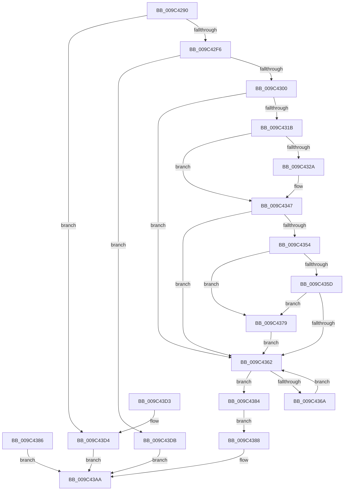

# NtWaitForMultipleObjects32

- RVA: `0x009C4290`–`0x009C43E2` (길이 `338` bytes)
- VA: `0x00000001409C4290`
- 실행 섹션: `PAGE`
- PDB 이름 있음: `예`; PDB Function 태그: `아니요`
- unwind 정보 RVA: `0x0009F9D8`
- 디코드: `87`개 명령, `338/338` bytes 표시
- 미해석 바이트: `0` (있으면 어셈블리에 `.byte`로 보존)

> 이 문서는 커널 이미지의 기계어와 PDB 기호를 분석해 생성했습니다. 4번과 5번은 함수 원형과 자료형을 바이너리 사용 방식에서 추정한 C 해석이며 원본 소스 복구 결과는 아닙니다.

## 1. Dependencies

- 직접 호출 지점: **3**; 고유 호출 대상: **3**
- 직접 호출자로 확인된 함수: **0**
- RIP 상대 이미지 참조: **1**

### Outgoing calls
- `0x009C42DE` → [memset](../../text/6C/memset_function_006C6C40.md) (function, `0x006C6C40`)
- `0x009C43A5` → [ObWaitForMultipleObjects](../86/ObWaitForMultipleObjects_function_00868DF0.md) (function, `0x00868DF0`)
- `0x009C43B5` → [_security_check_cookie](../../text/6A/_security_check_cookie_function_006AC640.md) (function, `0x006AC640`)

### Direct callers
- 이 함수 시작 RVA로 연결되는 직접 call은 확인되지 않았습니다. 간접 호출은 완전히 역산할 수 없습니다.

### Static image references
- `0x009C42A6` → RVA `0x00E0A740` (`.data`; read)

## 2. Other-region calls and transfers

- 다른 실행 섹션으로 향하는 call: **2**
  - `0x009C42DE` → [memset](../../text/6C/memset_function_006C6C40.md) (`PAGE` → `.text`)
  - `0x009C43B5` → [_security_check_cookie](../../text/6A/_security_check_cookie_function_006AC640.md) (`PAGE` → `.text`)
- 별도 외부 분기/꼬리 이동을 확인하지 못했습니다.

## 3. Assembly (complete function range)

```asm
009C4290  48 89 5C 24 10                  mov qword ptr [rsp + 0x10], rbx
009C4295  48 89 74 24 18                  mov qword ptr [rsp + 0x18], rsi
009C429A  57                              push rdi
009C429B  41 56                           push r14
009C429D  41 57                           push r15
009C429F  48 81 EC 70 02 00 00            sub rsp, 0x270
009C42A6  48 8B 05 93 64 44 00            mov rax, qword ptr [rip + 0x446493]
009C42AD  48 33 C4                        xor rax, rsp
009C42B0  48 89 84 24 60 02 00 00         mov qword ptr [rsp + 0x260], rax
009C42B8  45 0F B6 F9                     movzx r15d, r9b
009C42BC  45 8B F0                        mov r14d, r8d
009C42BF  48 8B FA                        mov rdi, rdx
009C42C2  8B D9                           mov ebx, ecx
009C42C4  48 8B B4 24 B0 02 00 00         mov rsi, qword ptr [rsp + 0x2b0]
009C42CC  48 89 74 24 40                  mov qword ptr [rsp + 0x40], rsi
009C42D1  33 D2                           xor edx, edx
009C42D3  41 B8 00 02 00 00               mov r8d, 0x200
009C42D9  48 8D 4C 24 60                  lea rcx, [rsp + 0x60]
009C42DE  E8 5D 29 D0 FF                  call 0x1406c6c40
009C42E3  33 C9                           xor ecx, ecx
009C42E5  48 89 4C 24 50                  mov qword ptr [rsp + 0x50], rcx
009C42EA  8D 43 FF                        lea eax, [rbx - 1]
009C42ED  83 F8 3F                        cmp eax, 0x3f
009C42F0  0F 87 DE 00 00 00               ja 0x1409c43d4
009C42F6  41 83 FE 01                     cmp r14d, 1
009C42FA  0F 87 DB 00 00 00               ja 0x1409c43db
009C4300  65 48 8B 04 25 88 01 00 00      mov rax, qword ptr gs:[0x188]
009C4309  44 0F B6 90 32 02 00 00         movzx r10d, byte ptr [rax + 0x232]
009C4311  4C 8B 44 24 40                  mov r8, qword ptr [rsp + 0x40]
009C4316  45 84 D2                        test r10b, r10b
009C4319  74 47                           je 0x1409c4362
009C431B  49 B9 00 00 FF FF FF 7F 00 00   movabs r9, 0x7fffffff0000
009C4325  4D 85 C0                        test r8, r8
009C4328  74 1D                           je 0x1409c4347
009C432A  49 8B C1                        mov rax, r9
009C432D  4D 3B C1                        cmp r8, r9
009C4330  48 0F 42 C6                     cmovb rax, rsi
009C4334  90                              nop
009C4335  48 8B 00                        mov rax, qword ptr [rax]
009C4338  48 89 44 24 50                  mov qword ptr [rsp + 0x50], rax
009C433D  4C 8D 44 24 50                  lea r8, [rsp + 0x50]
009C4342  4C 89 44 24 40                  mov qword ptr [rsp + 0x40], r8
009C4347  48 8D 04 9D 00 00 00 00         lea rax, [rbx*4]
009C434F  48 85 C0                        test rax, rax
009C4352  74 0E                           je 0x1409c4362
009C4354  48 8D 14 38                     lea rdx, [rax + rdi]
009C4358  49 3B D1                        cmp rdx, r9
009C435B  77 1C                           ja 0x1409c4379
009C435D  48 3B D7                        cmp rdx, rdi
009C4360  72 17                           jb 0x1409c4379
009C4362  89 4C 24 48                     mov dword ptr [rsp + 0x48], ecx
009C4366  3B CB                           cmp ecx, ebx
009C4368  73 1A                           jae 0x1409c4384
009C436A  8B D1                           mov edx, ecx
009C436C  48 63 04 97                     movsxd rax, dword ptr [rdi + rdx*4]
009C4370  48 89 44 D4 60                  mov qword ptr [rsp + rdx*8 + 0x60], rax
009C4375  FF C1                           inc ecx
009C4377  EB E9                           jmp 0x1409c4362
009C4379  41 0F B6 01                     movzx eax, byte ptr [r9]
009C437D  4C 8B 44 24 40                  mov r8, qword ptr [rsp + 0x40]
009C4382  EB DE                           jmp 0x1409c4362
009C4384  EB 02                           jmp 0x1409c4388
009C4386  EB 22                           jmp 0x1409c43aa
009C4388  4C 89 44 24 30                  mov qword ptr [rsp + 0x30], r8
009C438D  44 88 7C 24 28                  mov byte ptr [rsp + 0x28], r15b
009C4392  44 88 54 24 20                  mov byte ptr [rsp + 0x20], r10b
009C4397  45 8B CE                        mov r9d, r14d
009C439A  45 0F B6 C2                     movzx r8d, r10b
009C439E  48 8D 54 24 60                  lea rdx, [rsp + 0x60]
009C43A3  8B CB                           mov ecx, ebx
009C43A5  E8 46 4A EA FF                  call 0x140868df0
009C43AA  48 8B 8C 24 60 02 00 00         mov rcx, qword ptr [rsp + 0x260]
009C43B2  48 33 CC                        xor rcx, rsp
009C43B5  E8 86 82 CE FF                  call 0x1406ac640
009C43BA  4C 8D 9C 24 70 02 00 00         lea r11, [rsp + 0x270]
009C43C2  49 8B 5B 28                     mov rbx, qword ptr [r11 + 0x28]
009C43C6  49 8B 73 30                     mov rsi, qword ptr [r11 + 0x30]
009C43CA  49 8B E3                        mov rsp, r11
009C43CD  41 5F                           pop r15
009C43CF  41 5E                           pop r14
009C43D1  5F                              pop rdi
009C43D2  C3                              ret
009C43D3  CC                              int3
009C43D4  B8 EF 00 00 C0                  mov eax, 0xc00000ef
009C43D9  EB CF                           jmp 0x1409c43aa
009C43DB  B8 F1 00 00 C0                  mov eax, 0xc00000f1
009C43E0  EB C8                           jmp 0x1409c43aa
```

## 4. C-style interpretation (structured pseudocode)

```c
__int64 __fastcall NtWaitForMultipleObjects32(int a1, __int64 a2, int a3, unsigned __int8 a4, __int64 a5)
{
    __int64 result;
    __int64 v_rsp;
    unsigned __int64 v_stack_m18;
    unsigned __int64 v_stack_m228;
    unsigned __int64 v_stack_m238;
    unsigned int v_stack_m240;
    unsigned __int64 v_stack_m248;
    unsigned __int64 v_stack_m258;
    unsigned __int8 v_stack_m260;
    unsigned __int8 v_stack_m268;
    unsigned __int64 v_stack_m28;
    unsigned __int64 v_stack_p10;
    unsigned __int64 v_stack_p18;

    v_stack_p10 = v_rbx;
    v_stack_p18 = v_rsi;
    v_rsp = (v_rsp) - (624);
    result = (*(unsigned __int64 *)(v_rip + 4482195)) ^ (v_rsp);
    v_stack_m28 = result;
    v_stack_m248 = a5;
    a2 = 0;
    result = memset(v_stack_m228, a2, 512, a4);
    a1 = 0;
    v_stack_m238 = 0;
    if (((unsigned int)((unsigned int)(a1) - 1)) > 63) goto loc_009C43D4;
    if (((unsigned int)((unsigned int)(a3))) > 1) goto loc_009C43DB;
    if ((unsigned __int8)(*(unsigned __int8 *)(*(unsigned __int64 *)(gs_base + (0 + 392)) + 562)) == 0) goto loc_009C4362;
    result = *(unsigned __int64 *)(gs_base + (0 + 392));
    if (v_stack_m248 != 0) {
        result = a4;
        if (v_stack_m248 < a4) { result = a5; }
        result = *(unsigned __int64 *)(result);
        v_stack_m238 = result;
        a3 = v_stack_m238;
        v_stack_m248 = a3;
    }
    if ((unsigned int)(a1) * 4 == 0) goto loc_009C4362;
    if (((unsigned int)(a1) * 4 + a2 * 1) > a4) goto loc_009C4379;
    if (((unsigned int)(a1) * 4 + a2 * 1) < 0) goto loc_009C4379;
loc_009C4362:
    v_stack_m240 = 0;
    if (0 >= ((unsigned int)((unsigned int)(a1)))) goto loc_009C4384;
    *(unsigned __int64 *)(v_rsp + 0 * 8 + 96) = (int)(*(unsigned int *)(a2 + 0 * 4));
    a1 = (unsigned int)((a1) + 1);
    goto loc_009C4362;
loc_009C4379:
    goto loc_009C4362;
loc_009C4384:
    goto loc_009C4388;
loc_009C4388:
    v_stack_m258 = v_stack_m248;
    v_stack_m260 = a4;
    v_stack_m268 = (unsigned __int8)(*(unsigned __int8 *)(*(unsigned __int64 *)(gs_base + (0 + 392)) + 562));
    result = ObWaitForMultipleObjects((unsigned int)((unsigned int)((unsigned int)(a1))), v_stack_m228, (unsigned __int8)(*(unsigned __int8 *)(*(unsigned __int64 *)(gs_base + (0 + 392)) + 562)), (unsigned int)((unsigned int)((unsigned int)(a3))));
loc_009C43AA:
    a1 = (v_stack_m28) ^ (v_rsp);
    result = _security_check_cookie(a1, v_stack_m228, (unsigned __int8)(*(unsigned __int8 *)(*(unsigned __int64 *)(gs_base + (0 + 392)) + 562)), (unsigned int)((unsigned int)((unsigned int)(a3))));
    return result;
loc_009C43D4:
    goto loc_009C43AA;
loc_009C43DB:
    goto loc_009C43AA;
}
```

## 5. (Beta) C Style

```c
int64_t NtWaitForMultipleObjects32(void *Arg1, void *Arg2, int32_t Arg3, uint8_t Arg4, int64_t Arg5)
{
    uint8_t *arg1 = (uint8_t *)Arg1;
    uint8_t *arg2 = (uint8_t *)Arg2;

    int64_t result;
    int64_t local_rsp;
    uint64_t v_stack_m18;
    uint64_t v_stack_m228;
    uint64_t v_stack_m238;
    uint32_t v_stack_m240;
    uint64_t v_stack_m248;
    uint64_t v_stack_m258;
    uint8_t v_stack_m260;
    uint8_t v_stack_m268;
    uint64_t v_stack_m28;
    uint64_t v_stack_p10;
    uint64_t v_stack_p18;

    v_stack_p10 = local_rbx;
    v_stack_p18 = local_rsi;
    local_rsp = (local_rsp) - (624);
    result = (*(uint64_t *)(v_rip + 0x446493)) ^ (local_rsp);
    v_stack_m28 = result;
    v_stack_m248 = Arg5;
    Arg2 = 0;
    result = memset(v_stack_m228, Arg2, 512, Arg4);
    Arg1 = 0;
    v_stack_m238 = 0;
    if (((uint32_t)((uint32_t)(Arg1) - 1)) > 63) goto loc_009C43D4;
    if (((uint32_t)((uint32_t)(Arg3))) > 1) goto loc_009C43DB;
    if ((uint8_t)(*(uint8_t *)(*(uint64_t *)(gs_base + (0 + 0x188)) + 0x232)) == 0) goto loc_009C4362;
    result = *(uint64_t *)(gs_base + (0 + 0x188));
    if (v_stack_m248 != 0) {
        result = Arg4;
        if (v_stack_m248 < Arg4) { result = Arg5; }
        result = *(uint64_t *)(result);
        v_stack_m238 = result;
        Arg3 = v_stack_m238;
        v_stack_m248 = Arg3;
    }
    if ((uint32_t)(Arg1) * 4 == 0) goto loc_009C4362;
    if (((uint32_t)(Arg1) * 4 + Arg2 * 1) > Arg4) goto loc_009C4379;
    if (((uint32_t)(Arg1) * 4 + Arg2 * 1) < 0) goto loc_009C4379;
loc_009C4362:
    v_stack_m240 = 0;
    if (0 >= ((uint32_t)((uint32_t)(Arg1)))) goto loc_009C4384;
    *(uint64_t *)(local_rsp + 0x0 * 8 + 0x60) = (int32_t)(*(uint32_t *)(arg2 + 0x0 * 4));
    Arg1 = (uint32_t)((Arg1) + 1);
    goto loc_009C4362;
loc_009C4379:
    goto loc_009C4362;
loc_009C4384:
    goto loc_009C4388;
loc_009C4388:
    v_stack_m258 = v_stack_m248;
    v_stack_m260 = Arg4;
    v_stack_m268 = (uint8_t)(*(uint8_t *)(*(uint64_t *)(gs_base + (0 + 0x188)) + 0x232));
    result = ObWaitForMultipleObjects((uint32_t)((uint32_t)((uint32_t)(Arg1))), v_stack_m228, (uint8_t)(*(uint8_t *)(*(uint64_t *)(gs_base + (0 + 0x188)) + 0x232)), (uint32_t)((uint32_t)((uint32_t)(Arg3))));
loc_009C43AA:
    Arg1 = (v_stack_m28) ^ (local_rsp);
    result = _security_check_cookie(Arg1, v_stack_m228, (uint8_t)(*(uint8_t *)(*(uint64_t *)(gs_base + (0 + 0x188)) + 0x232)), (uint32_t)((uint32_t)((uint32_t)(Arg3))));
    return result;
loc_009C43D4:
    goto loc_009C43AA;
loc_009C43DB:
    goto loc_009C43AA;
}
```

### 관측된 메모리 오프셋

구조체 형식이 확인되지 않은 접근은 인자 기준의 오프셋으로만 기록했습니다.

| 기준 인자 | 오프셋 표현 | 폭 (bit) | 접근 |
|---|---:|---:|---|
| `Arg1` | `- 0x1` | `32` | `R` |
| `Arg2` | `+ 0x0 + rdx*4` | `32` | `R` |

## 6. Execution-region graph

[열기: 2D/3D 그래프와 함수 탐색 컨트롤 패널](../../../control-panel.html?section=page&rva=0x009C4290&view=graph)

- 2D 그래프는 위에서 아래로 흐르고, 3D 그래프는 빈 공간을 드래그해 회전합니다. Shift+드래그는 이동, 휠은 확대·축소, 함수 노드 선택은 대상 보고서 이동입니다.

### Static fallback


