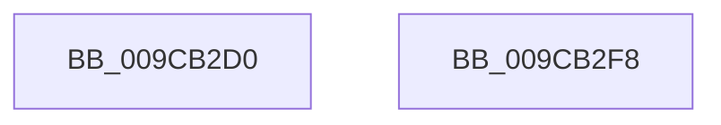

# ObGetObjectType

- RVA: `0x009CB2D0`–`0x009CB2F9` (길이 `41` bytes)
- VA: `0x00000001409CB2D0`
- 실행 섹션: `PAGE`
- PDB 이름 있음: `예`; PDB Function 태그: `아니요`
- unwind 정보 RVA: `0x000DB714`
- 디코드: `11`개 명령, `41/41` bytes 표시
- 미해석 바이트: `0` (있으면 어셈블리에 `.byte`로 보존)

> 이 문서는 커널 이미지의 기계어와 PDB 기호를 분석해 생성했습니다. 4번과 5번은 함수 원형과 자료형을 바이너리 사용 방식에서 추정한 C 해석이며 원본 소스 복구 결과는 아닙니다.

## 1. Dependencies

- 직접 호출 지점: **0**; 고유 호출 대상: **0**
- 직접 호출자로 확인된 함수: **0**
- RIP 상대 이미지 참조: **2**

### Outgoing calls
- 직접 디코드된 call 명령이 없습니다.

### Direct callers
- 이 함수 시작 RVA로 연결되는 직접 call은 확인되지 않았습니다. 간접 호출은 완전히 역산할 수 없습니다.

### Static image references
- `0x009CB2E2` → RVA `0x00FC6E4C` (`ALMOSTRO`; read)
- `0x009CB2EC` → RVA `0x00FC7800` (`ALMOSTRO`; read)

## 2. Other-region calls and transfers

- 다른 실행 섹션으로 향하는 call: **0**
- 별도 외부 분기/꼬리 이동을 확인하지 못했습니다.

## 3. Assembly (complete function range)

```asm
009CB2D0  48 8D 41 D0                     lea rax, [rcx - 0x30]
009CB2D4  0F B6 49 E8                     movzx ecx, byte ptr [rcx - 0x18]
009CB2D8  48 C1 E8 08                     shr rax, 8
009CB2DC  0F B6 C0                        movzx eax, al
009CB2DF  48 33 C1                        xor rax, rcx
009CB2E2  0F B6 0D 63 BB 5F 00            movzx ecx, byte ptr [rip + 0x5fbb63]
009CB2E9  48 33 C1                        xor rax, rcx
009CB2EC  48 8D 0D 0D C5 5F 00            lea rcx, [rip + 0x5fc50d]
009CB2F3  48 8B 04 C1                     mov rax, qword ptr [rcx + rax*8]
009CB2F7  C3                              ret
009CB2F8  CC                              int3
```

## 4. C-style interpretation (structured pseudocode)

```c
__int64 __fastcall ObGetObjectType(__int64 a1)
{
    __int64 result;

    result = (a1 - 48) >> (8);
    result = ((unsigned __int8)(result)) ^ (*(unsigned __int8 *)(a1 - 24));
    result = (result) ^ (*(unsigned __int8 *)(v_rip + 6273891));
    return *(unsigned __int64 *)(v_rip + 6276365 + result * 8);
}
```

## 5. (Beta) C Style

```c
int64_t ObGetObjectType(void *Arg1)
{
    uint8_t *arg1 = (uint8_t *)Arg1;

    int64_t result;

    result = (Arg1 - 48) >> (8);
    result = ((uint8_t)(result)) ^ (*(uint8_t *)(arg1 - 0x18));
    result = (result) ^ (*(uint8_t *)(v_rip + 0x5FBB63));
    return *(uint64_t *)(v_rip + 0x5FC50D + result * 8);
}
```

### 관측된 메모리 오프셋

구조체 형식이 확인되지 않은 접근은 인자 기준의 오프셋으로만 기록했습니다.

| 기준 인자 | 오프셋 표현 | 폭 (bit) | 접근 |
|---|---:|---:|---|
| `Arg1` | `- 0x30` | `64` | `R` |
| `Arg1` | `- 0x18` | `8` | `R` |

## 6. Execution-region graph

[열기: 2D/3D 그래프와 함수 탐색 컨트롤 패널](../../../control-panel.html?section=page&rva=0x009CB2D0&view=graph)

- 2D 그래프는 위에서 아래로 흐르고, 3D 그래프는 빈 공간을 드래그해 회전합니다. Shift+드래그는 이동, 휠은 확대·축소, 함수 노드 선택은 대상 보고서 이동입니다.

### Static fallback


