# ObpCaptureBoundaryDescriptor

- RVA: `0x009C9738`–`0x009C9A92` (길이 `858` bytes)
- VA: `0x00000001409C9738`
- 실행 섹션: `PAGE`
- PDB 이름 있음: `예`; PDB Function 태그: `아니요`
- unwind 정보 RVA: `0x000A0A04`
- 디코드: `216`개 명령, `858/858` bytes 표시
- 미해석 바이트: `0` (있으면 어셈블리에 `.byte`로 보존)

> 이 문서는 커널 이미지의 기계어와 PDB 기호를 분석해 생성했습니다. 4번과 5번은 함수 원형과 자료형을 바이너리 사용 방식에서 추정한 C 해석이며 원본 소스 복구 결과는 아닙니다.

## 1. Dependencies

- 직접 호출 지점: **16**; 고유 호출 대상: **12**
- 직접 호출자로 확인된 함수: **2**
- RIP 상대 이미지 참조: **2**

### Outgoing calls
- `0x009C97BF` → [RtlCopyVolatileMemory](../../text/6B/RtlCopyVolatileMemory_function_006BC9D0.md) (function, `0x006BC9D0`)
- `0x009C97EC` → [ExRaiseDatatypeMisalignment](../89/ExRaiseDatatypeMisalignment_function_00899FD0.md) (function, `0x00899FD0`)
- `0x009C984B` → [SeCaptureSubjectContextEx](../8C/SeCaptureSubjectContextEx_function_008C4C90.md) (function, `0x008C4C90`)
- `0x009C986B` → [SeQueryInformationToken](../8B/SeQueryInformationToken_function_008B5090.md) (function, `0x008B5090`)
- `0x009C989D` → [ExAllocatePool2](../../poolcode/B8/ExAllocatePool2_function_00B820F0.md) (function, `0x00B820F0`)
- `0x009C98CA` → [memcpy](../../text/6C/memcpy_function_006C6840.md) (function, `0x006C6840`)
- `0x009C9908` → [RtlEnumerateBoundaryDescriptorEntries](RtlEnumerateBoundaryDescriptorEntries_function_009CA278.md) (function, `0x009CA278`)
- `0x009C9928` → [RtlEnumerateBoundaryDescriptorEntries](RtlEnumerateBoundaryDescriptorEntries_function_009CA278.md) (function, `0x009CA278`)
- `0x009C9968` → [SeReleaseSubjectContext](../86/SeReleaseSubjectContext_function_0086B710.md) (function, `0x0086B710`)
- `0x009C9985` → [_security_check_cookie](../../text/6A/_security_check_cookie_function_006AC640.md) (function, `0x006AC640`)
- `0x009C99A7` → [ObpCheckDuplicateEntries](ObpCheckDuplicateEntries_function_009C9A98.md) (function, `0x009C9A98`)
- `0x009C99DA` → [SeQueryInformationToken](../8B/SeQueryInformationToken_function_008B5090.md) (function, `0x008B5090`)
- `0x009C99F1` → [RtlLengthSid](../../text/45/RtlLengthSid_function_0045D270.md) (function, `0x0045D270`)
- `0x009C9A4D` → [memcpy](../../text/6C/memcpy_function_006C6840.md) (function, `0x006C6840`)
- `0x009C9A6D` → [ExFreePoolWithTag](../../poolcode/B8/ExFreePoolWithTag_function_00B82870.md) (function, `0x00B82870`)
- `0x009C9A88` → [ExFreePoolWithTag](../../poolcode/B8/ExFreePoolWithTag_function_00B82870.md) (function, `0x00B82870`)

### Direct callers
- [NtOpenPrivateNamespace](NtOpenPrivateNamespace_function_009C94E0.md) at `0x009C958D`
- [NtCreatePrivateNamespace](NtCreatePrivateNamespace_function_009CA6D0.md) at `0x009CA725`

### Static image references
- `0x009C974D` → RVA `0x00E0A740` (`.data`; read)
- `0x009C991E` → RVA `0x009CA4F0` (`ObpHashBoundaryFunction`; read)

## 2. Other-region calls and transfers

- 다른 실행 섹션으로 향하는 call: **8**
  - `0x009C97BF` → [RtlCopyVolatileMemory](../../text/6B/RtlCopyVolatileMemory_function_006BC9D0.md) (`PAGE` → `.text`)
  - `0x009C989D` → [ExAllocatePool2](../../poolcode/B8/ExAllocatePool2_function_00B820F0.md) (`PAGE` → `POOLCODE`)
  - `0x009C98CA` → [memcpy](../../text/6C/memcpy_function_006C6840.md) (`PAGE` → `.text`)
  - `0x009C9985` → [_security_check_cookie](../../text/6A/_security_check_cookie_function_006AC640.md) (`PAGE` → `.text`)
  - `0x009C99F1` → [RtlLengthSid](../../text/45/RtlLengthSid_function_0045D270.md) (`PAGE` → `.text`)
  - `0x009C9A4D` → [memcpy](../../text/6C/memcpy_function_006C6840.md) (`PAGE` → `.text`)
  - `0x009C9A6D` → [ExFreePoolWithTag](../../poolcode/B8/ExFreePoolWithTag_function_00B82870.md) (`PAGE` → `POOLCODE`)
  - `0x009C9A88` → [ExFreePoolWithTag](../../poolcode/B8/ExFreePoolWithTag_function_00B82870.md) (`PAGE` → `POOLCODE`)
- 별도 외부 분기/꼬리 이동을 확인하지 못했습니다.

## 3. Assembly (complete function range)

```asm
009C9738  48 89 74 24 18                  mov qword ptr [rsp + 0x18], rsi
009C973D  57                              push rdi
009C973E  41 54                           push r12
009C9740  41 55                           push r13
009C9742  41 56                           push r14
009C9744  41 57                           push r15
009C9746  48 81 EC 90 00 00 00            sub rsp, 0x90
009C974D  48 8B 05 EC 0F 44 00            mov rax, qword ptr [rip + 0x440fec]
009C9754  48 33 C4                        xor rax, rsp
009C9757  48 89 84 24 80 00 00 00         mov qword ptr [rsp + 0x80], rax
009C975F  48 89 54 24 28                  mov qword ptr [rsp + 0x28], rdx
009C9764  4C 8B F1                        mov r14, rcx
009C9767  48 89 54 24 48                  mov qword ptr [rsp + 0x48], rdx
009C976C  0F 57 C0                        xorps xmm0, xmm0
009C976F  0F 11 44 24 70                  movups xmmword ptr [rsp + 0x70], xmm0
009C9774  0F 57 C9                        xorps xmm1, xmm1
009C9777  0F 11 4C 24 50                  movups xmmword ptr [rsp + 0x50], xmm1
009C977C  0F 11 4C 24 60                  movups xmmword ptr [rsp + 0x60], xmm1
009C9781  48 83 22 00                     and qword ptr [rdx], 0
009C9785  65 48 8B 04 25 88 01 00 00      mov rax, qword ptr gs:[0x188]
009C978E  8A 88 32 02 00 00               mov cl, byte ptr [rax + 0x232]
009C9794  88 4C 24 21                     mov byte ptr [rsp + 0x21], cl
009C9798  84 C9                           test cl, cl
009C979A  0F 84 1B 02 00 00               je 0x1409c99bb
009C97A0  48 BF 00 00 FF FF FF 7F 00 00   movabs rdi, 0x7fffffff0000
009C97AA  48 8B D7                        mov rdx, rdi
009C97AD  4C 3B F7                        cmp r14, rdi
009C97B0  49 0F 42 D6                     cmovb rdx, r14
009C97B4  41 B8 10 00 00 00               mov r8d, 0x10
009C97BA  48 8D 4C 24 70                  lea rcx, [rsp + 0x70]
009C97BF  E8 0C 32 CF FF                  call 0x1406bc9d0
009C97C4  8B 4C 24 78                     mov ecx, dword ptr [rsp + 0x78]
009C97C8  8D 41 F0                        lea eax, [rcx - 0x10]
009C97CB  3D EF 7F 00 00                  cmp eax, 0x7fef
009C97D0  77 27                           ja 0x1409c97f9
009C97D2  85 C9                           test ecx, ecx
009C97D4  74 14                           je 0x1409c97ea
009C97D6  41 F6 C6 03                     test r14b, 3
009C97DA  75 10                           jne 0x1409c97ec
009C97DC  49 8D 14 0E                     lea rdx, [r14 + rcx]
009C97E0  48 3B D7                        cmp rdx, rdi
009C97E3  77 0C                           ja 0x1409c97f1
009C97E5  49 3B D6                        cmp rdx, r14
009C97E8  72 07                           jb 0x1409c97f1
009C97EA  EB 1C                           jmp 0x1409c9808
009C97EC  E8 DF 07 ED FF                  call 0x140899fd0
009C97F1  8A 07                           mov al, byte ptr [rdi]
009C97F3  8B 4C 24 78                     mov ecx, dword ptr [rsp + 0x78]
009C97F7  EB F1                           jmp 0x1409c97ea
009C97F9  B8 0D 00 00 C0                  mov eax, 0xc000000d
009C97FE  E9 77 01 00 00                  jmp 0x1409c997a
009C9803  E9 72 01 00 00                  jmp 0x1409c997a
009C9808  33 F6                           xor esi, esi
009C980A  21 74 24 30                     and dword ptr [rsp + 0x30], esi
009C980E  45 32 E4                        xor r12b, r12b
009C9811  44 88 64 24 20                  mov byte ptr [rsp + 0x20], r12b
009C9816  44 8B F9                        mov r15d, ecx
009C9819  48 21 74 24 38                  and qword ptr [rsp + 0x38], rsi
009C981E  45 33 ED                        xor r13d, r13d
009C9821  48 8B 44 24 78                  mov rax, qword ptr [rsp + 0x78]
009C9826  48 C1 E8 20                     shr rax, 0x20
009C982A  A8 01                           test al, 1
009C982C  74 4C                           je 0x1409c987a
009C982E  65 48 8B 0C 25 88 01 00 00      mov rcx, qword ptr gs:[0x188]
009C9837  41 B4 01                        mov r12b, 1
009C983A  44 88 64 24 20                  mov byte ptr [rsp + 0x20], r12b
009C983F  4C 8D 44 24 50                  lea r8, [rsp + 0x50]
009C9844  48 8B 91 B8 00 00 00            mov rdx, qword ptr [rcx + 0xb8]
009C984B  E8 40 B4 EF FF                  call 0x1408c4c90
009C9850  48 8B 7C 24 60                  mov rdi, qword ptr [rsp + 0x60]
009C9855  48 39 74 24 50                  cmp qword ptr [rsp + 0x50], rsi
009C985A  48 0F 45 7C 24 50               cmovne rdi, qword ptr [rsp + 0x50]
009C9860  4C 8D 44 24 30                  lea r8, [rsp + 0x30]
009C9865  8D 56 1D                        lea edx, [rsi + 0x1d]
009C9868  48 8B CF                        mov rcx, rdi
009C986B  E8 20 B8 EE FF                  call 0x1408b5090
009C9870  39 74 24 30                     cmp dword ptr [rsp + 0x30], esi
009C9874  0F 85 53 01 00 00               jne 0x1409c99cd
009C987A  49 83 C7 30                     add r15, 0x30
009C987E  B8 FF FF FF FF                  mov eax, 0xffffffff
009C9883  4C 3B F8                        cmp r15, rax
009C9886  0F 87 CB 01 00 00               ja 0x1409c9a57
009C988C  41 8B FF                        mov edi, r15d
009C988F  41 B8 4F 62 4E 53               mov r8d, 0x534e624f
009C9895  41 8B D7                        mov edx, r15d
009C9898  B9 00 01 00 00                  mov ecx, 0x100
009C989D  E8 4E 88 1B 00                  call 0x140b820f0
009C98A2  48 8B F0                        mov rsi, rax
009C98A5  48 89 44 24 40                  mov qword ptr [rsp + 0x40], rax
009C98AA  48 85 C0                        test rax, rax
009C98AD  0F 84 AE 01 00 00               je 0x1409c9a61
009C98B3  48 8D 47 D0                     lea rax, [rdi - 0x30]
009C98B7  48 89 46 18                     mov qword ptr [rsi + 0x18], rax
009C98BB  4C 8D 7E 30                     lea r15, [rsi + 0x30]
009C98BF  44 8B 44 24 78                  mov r8d, dword ptr [rsp + 0x78]
009C98C4  49 8B D6                        mov rdx, r14
009C98C7  49 8B CF                        mov rcx, r15
009C98CA  E8 71 CF CF FF                  call 0x1406c6840
009C98CF  EB 13                           jmp 0x1409c98e4
009C98D1  8B F8                           mov edi, eax
009C98D3  48 8B 74 24 40                  mov rsi, qword ptr [rsp + 0x40]
009C98D8  44 8A 64 24 20                  mov r12b, byte ptr [rsp + 0x20]
009C98DD  4C 8B 74 24 48                  mov r14, qword ptr [rsp + 0x48]
009C98E2  EB 6C                           jmp 0x1409c9950
009C98E4  48 83 7C 24 38 00               cmp qword ptr [rsp + 0x38], 0
009C98EA  0F 85 1F 01 00 00               jne 0x1409c9a0f
009C98F0  8B 44 24 78                     mov eax, dword ptr [rsp + 0x78]
009C98F4  41 89 47 08                     mov dword ptr [r15 + 8], eax
009C98F8  8B 44 24 74                     mov eax, dword ptr [rsp + 0x74]
009C98FC  41 89 47 04                     mov dword ptr [r15 + 4], eax
009C9900  45 33 C0                        xor r8d, r8d
009C9903  33 D2                           xor edx, edx
009C9905  49 8B CF                        mov rcx, r15
009C9908  E8 6B 09 00 00                  call 0x1409ca278
009C990D  8B F8                           mov edi, eax
009C990F  85 C0                           test eax, eax
009C9911  0F 89 8D 00 00 00               jns 0x1409c99a4
009C9917  C6 46 28 00                     mov byte ptr [rsi + 0x28], 0
009C991B  4C 8B C6                        mov r8, rsi
009C991E  48 8D 15 CB 0B 00 00            lea rdx, [rip + 0xbcb]
009C9925  49 8B CF                        mov rcx, r15
009C9928  E8 4B 09 00 00                  call 0x1409ca278
009C992D  0F B6 4E 28                     movzx ecx, byte ptr [rsi + 0x28]
009C9931  B8 4D 91 CF BA                  mov eax, 0xbacf914d
009C9936  F7 E1                           mul ecx
009C9938  8B C1                           mov eax, ecx
009C993A  2B C2                           sub eax, edx
009C993C  D1 E8                           shr eax, 1
009C993E  03 C2                           add eax, edx
009C9940  C1 E8 05                        shr eax, 5
009C9943  6B C0 25                        imul eax, eax, 0x25
009C9946  2B C8                           sub ecx, eax
009C9948  88 4E 28                        mov byte ptr [rsi + 0x28], cl
009C994B  4C 8B 74 24 28                  mov r14, qword ptr [rsp + 0x28]
009C9950  48 8B 4C 24 38                  mov rcx, qword ptr [rsp + 0x38]
009C9955  48 85 C9                        test rcx, rcx
009C9958  0F 85 0D 01 00 00               jne 0x1409c9a6b
009C995E  45 84 E4                        test r12b, r12b
009C9961  74 0A                           je 0x1409c996d
009C9963  48 8D 4C 24 50                  lea rcx, [rsp + 0x50]
009C9968  E8 A3 1D EA FF                  call 0x14086b710
009C996D  85 FF                           test edi, edi
009C996F  0F 88 02 01 00 00               js 0x1409c9a77
009C9975  49 89 36                        mov qword ptr [r14], rsi
009C9978  8B C7                           mov eax, edi
009C997A  48 8B 8C 24 80 00 00 00         mov rcx, qword ptr [rsp + 0x80]
009C9982  48 33 CC                        xor rcx, rsp
009C9985  E8 B6 2C CE FF                  call 0x1406ac640
009C998A  48 8B B4 24 D0 00 00 00         mov rsi, qword ptr [rsp + 0xd0]
009C9992  48 81 C4 90 00 00 00            add rsp, 0x90
009C9999  41 5F                           pop r15
009C999B  41 5E                           pop r14
009C999D  41 5D                           pop r13
009C999F  41 5C                           pop r12
009C99A1  5F                              pop rdi
009C99A2  C3                              ret
009C99A3  CC                              int3
009C99A4  48 8B CE                        mov rcx, rsi
009C99A7  E8 EC 00 00 00                  call 0x1409c9a98
009C99AC  85 C0                           test eax, eax
009C99AE  0F 85 63 FF FF FF               jne 0x1409c9917
009C99B4  BF 0D 00 00 C0                  mov edi, 0xc000000d
009C99B9  EB 90                           jmp 0x1409c994b
009C99BB  41 0F 10 06                     movups xmm0, xmmword ptr [r14]
009C99BF  0F 11 44 24 70                  movups xmmword ptr [rsp + 0x70], xmm0
009C99C4  41 8B 4E 08                     mov ecx, dword ptr [r14 + 8]
009C99C8  E9 3B FE FF FF                  jmp 0x1409c9808
009C99CD  4C 8D 44 24 38                  lea r8, [rsp + 0x38]
009C99D2  BA 1F 00 00 00                  mov edx, 0x1f
009C99D7  48 8B CF                        mov rcx, rdi
009C99DA  E8 B1 B6 EE FF                  call 0x1408b5090
009C99DF  8B F8                           mov edi, eax
009C99E1  85 C0                           test eax, eax
009C99E3  0F 88 62 FF FF FF               js 0x1409c994b
009C99E9  48 8B 4C 24 38                  mov rcx, qword ptr [rsp + 0x38]
009C99EE  48 8B 09                        mov rcx, qword ptr [rcx]
009C99F1  E8 7A 38 A9 FF                  call 0x14045d270
009C99F6  44 8B E8                        mov r13d, eax
009C99F9  8B C8                           mov ecx, eax
009C99FB  48 83 C1 07                     add rcx, 7
009C99FF  48 83 E1 F8                     and rcx, 0xfffffffffffffff8
009C9A03  48 83 C1 08                     add rcx, 8
009C9A07  4C 03 F9                        add r15, rcx
009C9A0A  E9 6B FE FF FF                  jmp 0x1409c987a
009C9A0F  8B 4C 24 78                     mov ecx, dword ptr [rsp + 0x78]
009C9A13  49 03 CF                        add rcx, r15
009C9A16  48 8D 41 07                     lea rax, [rcx + 7]
009C9A1A  48 83 E0 F8                     and rax, 0xfffffffffffffff8
009C9A1E  48 3B C8                        cmp rcx, rax
009C9A21  75 91                           jne 0x1409c99b4
009C9A23  C7 01 02 00 00 00               mov dword ptr [rcx], 2
009C9A29  41 8D 45 07                     lea eax, [r13 + 7]
009C9A2D  83 E0 F8                        and eax, 0xfffffff8
009C9A30  83 C0 08                        add eax, 8
009C9A33  89 41 04                        mov dword ptr [rcx + 4], eax
009C9A36  01 44 24 78                     add dword ptr [rsp + 0x78], eax
009C9A3A  FF 44 24 74                     inc dword ptr [rsp + 0x74]
009C9A3E  45 8B C5                        mov r8d, r13d
009C9A41  48 83 C1 08                     add rcx, 8
009C9A45  48 8B 54 24 38                  mov rdx, qword ptr [rsp + 0x38]
009C9A4A  48 8B 12                        mov rdx, qword ptr [rdx]
009C9A4D  E8 EE CD CF FF                  call 0x1406c6840
009C9A52  E9 99 FE FF FF                  jmp 0x1409c98f0
009C9A57  BF 95 00 00 C0                  mov edi, 0xc0000095
009C9A5C  E9 EA FE FF FF                  jmp 0x1409c994b
009C9A61  BF 9A 00 00 C0                  mov edi, 0xc000009a
009C9A66  E9 E0 FE FF FF                  jmp 0x1409c994b
009C9A6B  33 D2                           xor edx, edx
009C9A6D  E8 FE 8D 1B 00                  call 0x140b82870
009C9A72  E9 E7 FE FF FF                  jmp 0x1409c995e
009C9A77  48 85 F6                        test rsi, rsi
009C9A7A  0F 84 F8 FE FF FF               je 0x1409c9978
009C9A80  BA 4F 62 4E 53                  mov edx, 0x534e624f
009C9A85  48 8B CE                        mov rcx, rsi
009C9A88  E8 E3 8D 1B 00                  call 0x140b82870
009C9A8D  E9 E6 FE FF FF                  jmp 0x1409c9978
```

## 4. C-style interpretation (structured pseudocode)

```c
__int64 __fastcall ObpCaptureBoundaryDescriptor(__int64 a1, __int64 a2)
{
    __int64 result;
    __int64 v_r12;
    __int64 v_r13;
    __int64 v_r15;
    __int64 v_rdi;
    __int64 v_rsi;
    __int64 v_rsp;
    unsigned __int64 v_stack_m38;
    unsigned int v_stack_m40;
    unsigned int v_stack_m44;
    unsigned __int64 v_stack_m48;
    unsigned __int64 v_stack_m58;
    unsigned __int64 v_stack_m68;
    unsigned __int64 v_stack_m70;
    unsigned __int64 v_stack_m78;
    unsigned __int64 v_stack_m80;
    unsigned int v_stack_m88;
    unsigned __int64 v_stack_m90;
    unsigned __int8 v_stack_m97;
    unsigned __int8 v_stack_m98;
    unsigned __int64 v_stack_p18;
    unsigned __int64 v_stack_p38;
    unsigned __int64 v_stack_p70;
    unsigned int v_stack_p74;
    unsigned int v_stack_p78;

    v_stack_p18 = v_rsi;
    v_rsp = (v_rsp) - (144);
    result = (*(unsigned __int64 *)(v_rip + 4460524)) ^ (v_rsp);
    v_stack_m38 = result;
    v_stack_m90 = a2;
    v_stack_m70 = a2;
    v_stack_m48 = v_xmm0;
    v_stack_m68 = v_xmm1;
    v_stack_m58 = v_xmm1;
    v_stack_m97 = (unsigned __int8)(*(unsigned __int8 *)(*(unsigned __int64 *)(gs_base + (0 + 392)) + 562));
    if ((unsigned __int8)(*(unsigned __int8 *)(*(unsigned __int64 *)(gs_base + (0 + 392)) + 562)) == 0) goto loc_009C99BB;
    a2 = v_rdi;
    if (a1 < v_rdi) { a2 = a1; }
    result = RtlCopyVolatileMemory(v_stack_m48, a2, 16, a4);
    if (((unsigned int)((unsigned int)(v_stack_m40) - 16)) > 0x7FEFULL) goto loc_009C97F9;
    if ((unsigned int)((unsigned int)(v_stack_m40)) == 0) goto loc_009C97EA;
    if ((((unsigned __int8)(a1)) & (3)) != 0) goto loc_009C97EC;
    if ((a1 + (unsigned int)(v_stack_m40) * 1) > v_rdi) goto loc_009C97F1;
    if ((a1 + (unsigned int)(v_stack_m40) * 1) < a1) goto loc_009C97F1;
loc_009C97EA:
    goto loc_009C9808;
loc_009C97EC:
    result = ExRaiseDatatypeMisalignment((unsigned int)(v_stack_m40), a1 + (unsigned int)(v_stack_m40) * 1, 16, a4);
loc_009C97F1:
    goto loc_009C97EA;
loc_009C97F9:
    goto loc_009C997A;
loc_009C9808:
    v_rsi = 0;
    v_r12 = 0;
    v_stack_m98 = 0;
    v_r13 = 0;
    result = (v_stack_m40) >> (32);
    if ((((unsigned __int8)(result)) & (1)) == 0) goto loc_009C987A;
    v_stack_m98 = 1;
    result = SeCaptureSubjectContextEx(*(unsigned __int64 *)(gs_base + (0 + 392)), *(unsigned __int64 *)(*(unsigned __int64 *)(gs_base + (0 + 392)) + 184), v_stack_m68, a4);
    v_rdi = v_stack_m58;
    if (v_stack_m68 != 0) { v_rdi = v_stack_m68; }
    result = SeQueryInformationToken(v_rdi, v_rsi + 29, v_stack_m88, a4);
    if (v_stack_m88 != 0) goto loc_009C99CD;
loc_009C987A:
    v_r15 = ((unsigned int)((unsigned int)((unsigned int)(v_stack_m40)))) + (48);
    if (v_r15 > ((unsigned int)(0xFFFFFFFFULL))) goto loc_009C9A57;
    result = ExAllocatePool2(256, (unsigned int)((unsigned int)(v_r15)), (unsigned int)(0x534E624FULL), a4);
    v_stack_m78 = result;
    if (result == 0) goto loc_009C9A61;
    *(unsigned __int64 *)(result + 24) = (unsigned int)((unsigned int)(v_r15)) - 48;
    result = memcpy(result + 48, a1, (unsigned int)(v_stack_m40), a4);
    goto loc_009C98E4;
loc_009C98E4:
    if (v_stack_m80 != 0) goto loc_009C9A0F;
loc_009C98F0:
    *(unsigned int *)(result + 48 + 8) = (unsigned int)((unsigned int)(v_stack_m40));
    *(unsigned int *)(result + 48 + 4) = (unsigned int)((unsigned int)(v_stack_m44));
    a3 = 0;
    a2 = 0;
    result = RtlEnumerateBoundaryDescriptorEntries(result + 48, a2, a3, a4);
    if (!sign_flag) goto loc_009C99A4;
loc_009C9917:
    *(unsigned __int8 *)(result + 40) = 0;
    result = RtlEnumerateBoundaryDescriptorEntries(result + 48, v_rip + 3019, result, a4);
    result = (unsigned int)(((unsigned int)((unsigned int)(*(unsigned __int8 *)(result + 40)))) - ((unsigned int)(v_rip + 3019)));
    result = (unsigned int)((result) >> (1));
    result = (unsigned int)((result) + ((unsigned int)(v_rip + 3019)));
    result = (unsigned int)((result) >> (5));
    result = (unsigned int)((result) * ((unsigned int)(result)));
    a1 = (unsigned int)((*(unsigned __int8 *)(result + 40)) - ((unsigned int)(result)));
    *(unsigned __int8 *)(result + 40) = (unsigned __int8)(a1);
loc_009C994B:
loc_009C9950:
    if (v_stack_m80 != 0) goto loc_009C9A6B;
loc_009C995E:
    if (1 != 0) {
        a1 = v_stack_m68;
        result = SeReleaseSubjectContext(a1, v_rip + 3019, result, a4);
    }
    if (sign_flag) goto loc_009C9A77;
    *(unsigned __int64 *)(v_stack_m90) = result;
loc_009C9978:
loc_009C997A:
    a1 = (v_stack_m38) ^ (v_rsp);
    result = _security_check_cookie(a1, v_rip + 3019, result, a4);
    v_rsp = (v_rsp) + (144);
    return result;
loc_009C99A4:
    result = ObpCheckDuplicateEntries(v_stack_p18, v_rip + 3019, result, a4);
    if ((unsigned int)(result) != 0) goto loc_009C9917;
loc_009C99B4:
    goto loc_009C994B;
loc_009C99BB:
    v_stack_p70 = v_xmm0;
    goto loc_009C9808;
loc_009C99CD:
    result = SeQueryInformationToken((unsigned int)(0xC000000DULL), 31, v_stack_p38, a4);
    if (sign_flag) goto loc_009C994B;
    result = RtlLengthSid(*(unsigned __int64 *)(v_stack_p38), 31, v_stack_p38, a4);
    a1 = ((unsigned int)((unsigned int)(result))) + (7);
    a1 = (a1) & (-8);
    a1 = (a1) + (8);
    v_r15 = (result + 48) + (a1);
    goto loc_009C987A;
loc_009C9A0F:
    a1 = ((unsigned int)(v_stack_p78)) + (v_r15);
    result = (a1 + 7) & (-8);
    if (a1 != result) goto loc_009C99B4;
    *(unsigned int *)(a1) = 2;
    result = (unsigned int)(((unsigned int)((unsigned int)(result)) + 7) & (0xFFFFFFF8ULL));
    result = (unsigned int)((result) + (8));
    *(unsigned int *)(a1 + 4) = (unsigned int)(result);
    a1 = (a1) + (8);
    result = memcpy(a1, *(unsigned __int64 *)(v_stack_p38), (unsigned int)((unsigned int)((unsigned int)((unsigned int)(result)))), a4);
    goto loc_009C98F0;
loc_009C9A57:
    goto loc_009C994B;
loc_009C9A61:
    goto loc_009C994B;
loc_009C9A6B:
    a2 = 0;
    result = ExFreePoolWithTag(a1, a2, (unsigned int)((unsigned int)((unsigned int)((unsigned int)(result)))), a4);
    goto loc_009C995E;
loc_009C9A77:
    if (v_stack_p18 == 0) goto loc_009C9978;
    result = ExFreePoolWithTag(v_stack_p18, (unsigned int)(0x534E624FULL), (unsigned int)((unsigned int)((unsigned int)((unsigned int)(result)))), a4);
    goto loc_009C9978;
}
```

## 5. (Beta) C Style

```c
int64_t ObpCaptureBoundaryDescriptor(void *Arg1, void *Arg2)
{
    uint8_t *arg1 = (uint8_t *)Arg1;
    uint8_t *arg2 = (uint8_t *)Arg2;

    int64_t result;
    int64_t local_r12;
    int64_t local_r13;
    int64_t local_r15;
    int64_t local_rdi;
    int64_t local_rsi;
    int64_t local_rsp;
    uint64_t v_stack_m38;
    uint32_t v_stack_m40;
    uint32_t v_stack_m44;
    uint64_t v_stack_m48;
    uint64_t v_stack_m58;
    uint64_t v_stack_m68;
    uint64_t v_stack_m70;
    uint64_t v_stack_m78;
    uint64_t v_stack_m80;
    uint32_t v_stack_m88;
    uint64_t v_stack_m90;
    uint8_t v_stack_m97;
    uint8_t v_stack_m98;
    uint64_t v_stack_p18;
    uint64_t v_stack_p38;
    uint64_t v_stack_p70;
    uint32_t v_stack_p74;
    uint32_t v_stack_p78;

    v_stack_p18 = local_rsi;
    local_rsp = (local_rsp) - (144);
    result = (*(uint64_t *)(v_rip + 0x440FEC)) ^ (local_rsp);
    v_stack_m38 = result;
    v_stack_m90 = Arg2;
    v_stack_m70 = Arg2;
    v_stack_m48 = v_xmm0;
    v_stack_m68 = v_xmm1;
    v_stack_m58 = v_xmm1;
    v_stack_m97 = (uint8_t)(*(uint8_t *)(*(uint64_t *)(gs_base + (0 + 0x188)) + 0x232));
    if ((uint8_t)(*(uint8_t *)(*(uint64_t *)(gs_base + (0 + 0x188)) + 0x232)) == 0) goto loc_009C99BB;
    Arg2 = local_rdi;
    if (Arg1 < local_rdi) { Arg2 = Arg1; }
    result = RtlCopyVolatileMemory(v_stack_m48, Arg2, 16, a4);
    if (((uint32_t)((uint32_t)(v_stack_m40) - 16)) > 0x7FEFULL) goto loc_009C97F9;
    if ((uint32_t)((uint32_t)(v_stack_m40)) == 0) goto loc_009C97EA;
    if ((((uint8_t)(Arg1)) & (3)) != 0) goto loc_009C97EC;
    if ((Arg1 + (uint32_t)(v_stack_m40) * 1) > local_rdi) goto loc_009C97F1;
    if ((Arg1 + (uint32_t)(v_stack_m40) * 1) < Arg1) goto loc_009C97F1;
loc_009C97EA:
    goto loc_009C9808;
loc_009C97EC:
    result = ExRaiseDatatypeMisalignment((uint32_t)(v_stack_m40), Arg1 + (uint32_t)(v_stack_m40) * 1, 16, a4);
loc_009C97F1:
    goto loc_009C97EA;
loc_009C97F9:
    goto loc_009C997A;
loc_009C9808:
    local_rsi = 0;
    local_r12 = 0;
    v_stack_m98 = 0;
    local_r13 = 0;
    result = (v_stack_m40) >> (32);
    if ((((uint8_t)(result)) & (1)) == 0) goto loc_009C987A;
    v_stack_m98 = 1;
    result = SeCaptureSubjectContextEx(*(uint64_t *)(gs_base + (0 + 0x188)), *(uint64_t *)(*(uint64_t *)(gs_base + (0 + 0x188)) + 0xB8), v_stack_m68, a4);
    local_rdi = v_stack_m58;
    if (v_stack_m68 != 0) { local_rdi = v_stack_m68; }
    result = SeQueryInformationToken(local_rdi, local_rsi + 29, v_stack_m88, a4);
    if (v_stack_m88 != 0) goto loc_009C99CD;
loc_009C987A:
    local_r15 = ((uint32_t)((uint32_t)((uint32_t)(v_stack_m40)))) + (48);
    if (local_r15 > ((uint32_t)(0xFFFFFFFFULL))) goto loc_009C9A57;
    result = ExAllocatePool2(256, (uint32_t)((uint32_t)(local_r15)), (uint32_t)(0x534E624FULL), a4);
    v_stack_m78 = result;
    if (result == 0) goto loc_009C9A61;
    *(uint64_t *)(result + 0x18) = (uint32_t)((uint32_t)(local_r15)) - 48;
    result = memcpy(result + 48, Arg1, (uint32_t)(v_stack_m40), a4);
    goto loc_009C98E4;
loc_009C98E4:
    if (v_stack_m80 != 0) goto loc_009C9A0F;
loc_009C98F0:
    *(uint32_t *)(result + 0x30 + 0x8) = (uint32_t)((uint32_t)(v_stack_m40));
    *(uint32_t *)(result + 0x30 + 0x4) = (uint32_t)((uint32_t)(v_stack_m44));
    a3 = 0;
    Arg2 = 0;
    result = RtlEnumerateBoundaryDescriptorEntries(result + 48, Arg2, a3, a4);
    if (!sign_flag) goto loc_009C99A4;
loc_009C9917:
    *(uint8_t *)(result + 0x28) = 0;
    result = RtlEnumerateBoundaryDescriptorEntries(result + 48, v_rip + 3019, result, a4);
    result = (uint32_t)(((uint32_t)((uint32_t)(*(uint8_t *)(result + 0x28)))) - ((uint32_t)(v_rip + 3019)));
    result = (uint32_t)((result) >> (1));
    result = (uint32_t)((result) + ((uint32_t)(v_rip + 3019)));
    result = (uint32_t)((result) >> (5));
    result = (uint32_t)((result) * ((uint32_t)(result)));
    Arg1 = (uint32_t)((*(uint8_t *)(result + 0x28)) - ((uint32_t)(result)));
    *(uint8_t *)(result + 0x28) = (uint8_t)(Arg1);
loc_009C994B:
loc_009C9950:
    if (v_stack_m80 != 0) goto loc_009C9A6B;
loc_009C995E:
    if (1 != 0) {
        Arg1 = v_stack_m68;
        result = SeReleaseSubjectContext(Arg1, v_rip + 3019, result, a4);
    }
    if (sign_flag) goto loc_009C9A77;
    *(uint64_t *)(v_stack_m90) = result;
loc_009C9978:
loc_009C997A:
    Arg1 = (v_stack_m38) ^ (local_rsp);
    result = _security_check_cookie(Arg1, v_rip + 3019, result, a4);
    local_rsp = (local_rsp) + (144);
    return result;
loc_009C99A4:
    result = ObpCheckDuplicateEntries(v_stack_p18, v_rip + 3019, result, a4);
    if ((uint32_t)(result) != 0) goto loc_009C9917;
loc_009C99B4:
    goto loc_009C994B;
loc_009C99BB:
    v_stack_p70 = v_xmm0;
    goto loc_009C9808;
loc_009C99CD:
    result = SeQueryInformationToken((uint32_t)(0xC000000DULL), 31, v_stack_p38, a4);
    if (sign_flag) goto loc_009C994B;
    result = RtlLengthSid(*(uint64_t *)(v_stack_p38), 31, v_stack_p38, a4);
    Arg1 = ((uint32_t)((uint32_t)(result))) + (7);
    Arg1 = (Arg1) & (-8);
    Arg1 = (Arg1) + (8);
    local_r15 = (result + 48) + (Arg1);
    goto loc_009C987A;
loc_009C9A0F:
    Arg1 = ((uint32_t)(v_stack_p78)) + (local_r15);
    result = (Arg1 + 7) & (-8);
    if (Arg1 != result) goto loc_009C99B4;
    *(uint32_t *)(arg1) = 2;
    result = (uint32_t)(((uint32_t)((uint32_t)(result)) + 7) & (0xFFFFFFF8ULL));
    result = (uint32_t)((result) + (8));
    *(uint32_t *)(arg1 + 0x4) = (uint32_t)(result);
    Arg1 = (Arg1) + (8);
    result = memcpy(Arg1, *(uint64_t *)(v_stack_p38), (uint32_t)((uint32_t)((uint32_t)((uint32_t)(result)))), a4);
    goto loc_009C98F0;
loc_009C9A57:
    goto loc_009C994B;
loc_009C9A61:
    goto loc_009C994B;
loc_009C9A6B:
    Arg2 = 0;
    result = ExFreePoolWithTag(Arg1, Arg2, (uint32_t)((uint32_t)((uint32_t)((uint32_t)(result)))), a4);
    goto loc_009C995E;
loc_009C9A77:
    if (v_stack_p18 == 0) goto loc_009C9978;
    result = ExFreePoolWithTag(v_stack_p18, (uint32_t)(0x534E624FULL), (uint32_t)((uint32_t)((uint32_t)((uint32_t)(result)))), a4);
    goto loc_009C9978;
}
```

### 관측된 메모리 오프셋

구조체 형식이 확인되지 않은 접근은 인자 기준의 오프셋으로만 기록했습니다.

| 기준 인자 | 오프셋 표현 | 폭 (bit) | 접근 |
|---|---:|---:|---|
| `Arg1` | `+ 0x0` | `128` | `R` |
| `Arg1` | `+ 0x8` | `32` | `R` |
| `Arg2` | `+ 0x0` | `64` | `R/W` |

## 6. Execution-region graph

[열기: 2D/3D 그래프와 함수 탐색 컨트롤 패널](../../../control-panel.html?section=page&rva=0x009C9738&view=graph)

- 2D 그래프는 위에서 아래로 흐르고, 3D 그래프는 빈 공간을 드래그해 회전합니다. Shift+드래그는 이동, 휠은 확대·축소, 함수 노드 선택은 대상 보고서 이동입니다.

### Static fallback

```mermaid
flowchart TD
  bb_009C9738[BB_009C9738]
  bb_009C97A0[BB_009C97A0]
  bb_009C97D2[BB_009C97D2]
  bb_009C97D6[BB_009C97D6]
  bb_009C97DC[BB_009C97DC]
  bb_009C97E5[BB_009C97E5]
  bb_009C97EA[BB_009C97EA]
  bb_009C97EC[BB_009C97EC]
  bb_009C97F1[BB_009C97F1]
  bb_009C97F9[BB_009C97F9]
  bb_009C9803[BB_009C9803]
  bb_009C9808[BB_009C9808]
  bb_009C982E[BB_009C982E]
  bb_009C987A[BB_009C987A]
  bb_009C988C[BB_009C988C]
  bb_009C98B3[BB_009C98B3]
  bb_009C98D1[BB_009C98D1]
  bb_009C98E4[BB_009C98E4]
  bb_009C98F0[BB_009C98F0]
  bb_009C9917[BB_009C9917]
  bb_009C994B[BB_009C994B]
  bb_009C9950[BB_009C9950]
  bb_009C995E[BB_009C995E]
  bb_009C9963[BB_009C9963]
  bb_009C996D[BB_009C996D]
  bb_009C9975[BB_009C9975]
  bb_009C9978[BB_009C9978]
  bb_009C997A[BB_009C997A]
  bb_009C99A3[BB_009C99A3]
  bb_009C99A4[BB_009C99A4]
  bb_009C99B4[BB_009C99B4]
  bb_009C99BB[BB_009C99BB]
  bb_009C99CD[BB_009C99CD]
  bb_009C99E9[BB_009C99E9]
  bb_009C9A0F[BB_009C9A0F]
  bb_009C9A23[BB_009C9A23]
  bb_009C9A57[BB_009C9A57]
  bb_009C9A61[BB_009C9A61]
  bb_009C9A6B[BB_009C9A6B]
  bb_009C9A77[BB_009C9A77]
  bb_009C9A80[BB_009C9A80]
  bb_009C9738 -->|branch| bb_009C99BB
  bb_009C9738 -->|fallthrough| bb_009C97A0
  bb_009C97A0 -->|branch| bb_009C97F9
  bb_009C97A0 -->|fallthrough| bb_009C97D2
  bb_009C97D2 -->|branch| bb_009C97EA
  bb_009C97D2 -->|fallthrough| bb_009C97D6
  bb_009C97D6 -->|branch| bb_009C97EC
  bb_009C97D6 -->|fallthrough| bb_009C97DC
  bb_009C97DC -->|branch| bb_009C97F1
  bb_009C97DC -->|fallthrough| bb_009C97E5
  bb_009C97E5 -->|branch| bb_009C97F1
  bb_009C97E5 -->|fallthrough| bb_009C97EA
  bb_009C97EA -->|branch| bb_009C9808
  bb_009C97EC -->|flow| bb_009C97F1
  bb_009C97F1 -->|branch| bb_009C97EA
  bb_009C97F9 -->|branch| bb_009C997A
  bb_009C9803 -->|branch| bb_009C997A
  bb_009C9808 -->|branch| bb_009C987A
  bb_009C9808 -->|fallthrough| bb_009C982E
  bb_009C982E -->|branch| bb_009C99CD
  bb_009C982E -->|fallthrough| bb_009C987A
  bb_009C987A -->|branch| bb_009C9A57
  bb_009C987A -->|fallthrough| bb_009C988C
  bb_009C988C -->|branch| bb_009C9A61
  bb_009C988C -->|fallthrough| bb_009C98B3
  bb_009C98B3 -->|branch| bb_009C98E4
  bb_009C98D1 -->|branch| bb_009C9950
  bb_009C98E4 -->|branch| bb_009C9A0F
  bb_009C98E4 -->|fallthrough| bb_009C98F0
  bb_009C98F0 -->|branch| bb_009C99A4
  bb_009C98F0 -->|fallthrough| bb_009C9917
  bb_009C9917 -->|flow| bb_009C994B
  bb_009C994B -->|flow| bb_009C9950
  bb_009C9950 -->|branch| bb_009C9A6B
  bb_009C9950 -->|fallthrough| bb_009C995E
  bb_009C995E -->|branch| bb_009C996D
  bb_009C995E -->|fallthrough| bb_009C9963
  bb_009C9963 -->|flow| bb_009C996D
  bb_009C996D -->|branch| bb_009C9A77
  bb_009C996D -->|fallthrough| bb_009C9975
  bb_009C9975 -->|flow| bb_009C9978
  bb_009C9978 -->|flow| bb_009C997A
  bb_009C99A3 -->|flow| bb_009C99A4
  bb_009C99A4 -->|branch| bb_009C9917
  bb_009C99A4 -->|fallthrough| bb_009C99B4
  bb_009C99B4 -->|branch| bb_009C994B
  bb_009C99BB -->|branch| bb_009C9808
  bb_009C99CD -->|branch| bb_009C994B
  bb_009C99CD -->|fallthrough| bb_009C99E9
  bb_009C99E9 -->|branch| bb_009C987A
  bb_009C9A0F -->|branch| bb_009C99B4
  bb_009C9A0F -->|fallthrough| bb_009C9A23
  bb_009C9A23 -->|branch| bb_009C98F0
  bb_009C9A57 -->|branch| bb_009C994B
  bb_009C9A61 -->|branch| bb_009C994B
  bb_009C9A6B -->|branch| bb_009C995E
  bb_009C9A77 -->|branch| bb_009C9978
  bb_009C9A77 -->|fallthrough| bb_009C9A80
  bb_009C9A80 -->|branch| bb_009C9978
```


