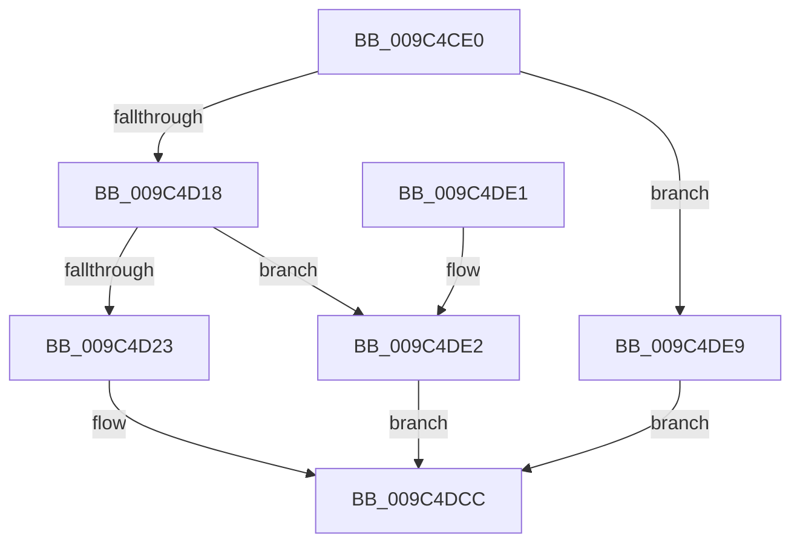

# ObpCaptureHandleInformation

- RVA: `0x009C4CE0`–`0x009C4DF0` (길이 `272` bytes)
- VA: `0x00000001409C4CE0`
- 실행 섹션: `PAGE`
- PDB 이름 있음: `예`; PDB Function 태그: `아니요`
- unwind 정보 RVA: `0x0007A3F0`
- 디코드: `73`개 명령, `272/272` bytes 표시
- 미해석 바이트: `0` (있으면 어셈블리에 `.byte`로 보존)

> 이 문서는 커널 이미지의 기계어와 PDB 기호를 분석해 생성했습니다. 4번과 5번은 함수 원형과 자료형을 바이너리 사용 방식에서 추정한 C 해석이며 원본 소스 복구 결과는 아닙니다.

## 1. Dependencies

- 직접 호출 지점: **1**; 고유 호출 대상: **1**
- 직접 호출자로 확인된 함수: **0**
- RIP 상대 이미지 참조: **2**

### Outgoing calls
- `0x009C4D26` → [ExGetHandlePointer](../../text/43/ExGetHandlePointer_function_00430C90.md) (function, `0x00430C90`)

### Direct callers
- 이 함수 시작 RVA로 연결되는 직접 call은 확인되지 않았습니다. 간접 호출은 완전히 역산할 수 없습니다.

### Static image references
- `0x009C4D72` → RVA `0x00FC6E4C` (`ALMOSTRO`; read)
- `0x009C4D7C` → RVA `0x00FC7800` (`ALMOSTRO`; read)

## 2. Other-region calls and transfers

- 다른 실행 섹션으로 향하는 call: **1**
  - `0x009C4D26` → [ExGetHandlePointer](../../text/43/ExGetHandlePointer_function_00430C90.md) (`PAGE` → `.text`)
- 별도 외부 분기/꼬리 이동을 확인하지 못했습니다.

## 3. Assembly (complete function range)

```asm
009C4CE0  48 89 5C 24 08                  mov qword ptr [rsp + 8], rbx
009C4CE5  48 89 6C 24 10                  mov qword ptr [rsp + 0x10], rbp
009C4CEA  48 89 74 24 18                  mov qword ptr [rsp + 0x18], rsi
009C4CEF  57                              push rdi
009C4CF0  48 83 EC 20                     sub rsp, 0x20
009C4CF4  4C 8B 5C 24 60                  mov r11, qword ptr [rsp + 0x60]
009C4CF9  49 8B F9                        mov rdi, r9
009C4CFC  49 8B F0                        mov rsi, r8
009C4CFF  48 8B DA                        mov rbx, rdx
009C4D02  8B E9                           mov ebp, ecx
009C4D04  45 8B 13                        mov r10d, dword ptr [r11]
009C4D07  41 83 C2 18                     add r10d, 0x18
009C4D0B  45 89 13                        mov dword ptr [r11], r10d
009C4D0E  41 83 FA 18                     cmp r10d, 0x18
009C4D12  0F 82 D1 00 00 00               jb 0x1409c4de9
009C4D18  44 39 54 24 58                  cmp dword ptr [rsp + 0x58], r10d
009C4D1D  0F 82 BF 00 00 00               jb 0x1409c4de2
009C4D23  49 8B C9                        mov rcx, r9
009C4D26  E8 65 BF A6 FF                  call 0x140430c90
009C4D2B  48 8B 0B                        mov rcx, qword ptr [rbx]
009C4D2E  4C 8B D0                        mov r10, rax
009C4D31  66 89 31                        mov word ptr [rcx], si
009C4D34  44 8B 0F                        mov r9d, dword ptr [rdi]
009C4D37  48 8B 03                        mov rax, qword ptr [rbx]
009C4D3A  49 C1 F9 11                     sar r9, 0x11
009C4D3E  41 83 E1 07                     and r9d, 7
009C4D42  41 0F B6 C9                     movzx ecx, r9b
009C4D46  80 C9 08                        or cl, 8
009C4D49  F7 47 08 00 00 00 02            test dword ptr [rdi + 8], 0x2000000
009C4D50  44 0F B6 C1                     movzx r8d, cl
009C4D54  45 0F 44 C1                     cmove r8d, r9d
009C4D58  41 80 E0 07                     and r8b, 7
009C4D5C  44 88 40 05                     mov byte ptr [rax + 5], r8b
009C4D60  49 8B C2                        mov rax, r10
009C4D63  48 C1 E8 08                     shr rax, 8
009C4D67  0F B6 C8                        movzx ecx, al
009C4D6A  41 0F B6 42 18                  movzx eax, byte ptr [r10 + 0x18]
009C4D6F  48 33 C8                        xor rcx, rax
009C4D72  0F B6 05 D3 20 60 00            movzx eax, byte ptr [rip + 0x6020d3]
009C4D79  48 33 C8                        xor rcx, rax
009C4D7C  48 8D 05 7D 2A 60 00            lea rax, [rip + 0x602a7d]
009C4D83  48 8B 04 C8                     mov rax, qword ptr [rax + rcx*8]
009C4D87  48 8B 0B                        mov rcx, qword ptr [rbx]
009C4D8A  0F B6 40 28                     movzx eax, byte ptr [rax + 0x28]
009C4D8E  88 41 04                        mov byte ptr [rcx + 4], al
009C4D91  48 8B 0B                        mov rcx, qword ptr [rbx]
009C4D94  0F B7 44 24 50                  movzx eax, word ptr [rsp + 0x50]
009C4D99  66 89 41 06                     mov word ptr [rcx + 6], ax
009C4D9D  33 C0                           xor eax, eax
009C4D9F  85 ED                           test ebp, ebp
009C4DA1  49 8D 4A 30                     lea rcx, [r10 + 0x30]
009C4DA5  8B D0                           mov edx, eax
009C4DA7  48 0F 44 D1                     cmove rdx, rcx
009C4DAB  48 8B 0B                        mov rcx, qword ptr [rbx]
009C4DAE  48 89 51 08                     mov qword ptr [rcx + 8], rdx
009C4DB2  48 8B 0B                        mov rcx, qword ptr [rbx]
009C4DB5  66 89 41 02                     mov word ptr [rcx + 2], ax
009C4DB9  8B 57 08                        mov edx, dword ptr [rdi + 8]
009C4DBC  48 8B 0B                        mov rcx, qword ptr [rbx]
009C4DBF  81 E2 FF FF FF 01               and edx, 0x1ffffff
009C4DC5  89 51 10                        mov dword ptr [rcx + 0x10], edx
009C4DC8  48 83 03 18                     add qword ptr [rbx], 0x18
009C4DCC  48 8B 5C 24 30                  mov rbx, qword ptr [rsp + 0x30]
009C4DD1  48 8B 6C 24 38                  mov rbp, qword ptr [rsp + 0x38]
009C4DD6  48 8B 74 24 40                  mov rsi, qword ptr [rsp + 0x40]
009C4DDB  48 83 C4 20                     add rsp, 0x20
009C4DDF  5F                              pop rdi
009C4DE0  C3                              ret
009C4DE1  CC                              int3
009C4DE2  B8 04 00 00 C0                  mov eax, 0xc0000004
009C4DE7  EB E3                           jmp 0x1409c4dcc
009C4DE9  B8 95 00 00 C0                  mov eax, 0xc0000095
009C4DEE  EB DC                           jmp 0x1409c4dcc
```

## 4. C-style interpretation (structured pseudocode)

```c
__int64 __fastcall ObpCaptureHandleInformation(int a1, __int64 a2, __int64 a3, __int64 a4, unsigned __int16 a5, unsigned int a6, __int64 a7)
{
    __int64 result;
    __int64 v_r10;
    __int64 v_rsp;
    unsigned __int64 v_stack_p10;
    unsigned __int64 v_stack_p18;
    unsigned __int64 v_stack_p8;

    v_stack_p8 = v_rbx;
    v_stack_p10 = v_rbp;
    v_stack_p18 = v_rsi;
    v_rsp = (v_rsp) - (32);
    v_r10 = (unsigned int)(((unsigned int)(*(unsigned int *)(a7))) + (24));
    *(unsigned int *)(a7) = (unsigned int)(v_r10);
    if (((unsigned int)(v_r10)) < 24) goto loc_009C4DE9;
    if (a6 < ((unsigned int)(v_r10))) goto loc_009C4DE2;
    result = ExGetHandlePointer(a4, a2, a3, a4);
    *(unsigned __int16 *)(*(unsigned __int64 *)(a2)) = (unsigned __int16)(a3);
    a4 = ((unsigned int)(*(unsigned int *)(a4))) >> (17);
    a4 = (unsigned int)((a4) & (7));
    a1 = (unsigned __int8)(((unsigned __int8)(a4)) | (8));
    a3 = (unsigned __int8)(a1);
    if (((*(unsigned int *)(a4 + 8)) & (0x2000000ULL)) == 0) { a3 = (unsigned int)(a4); }
    a3 = (unsigned __int8)((a3) & (7));
    *(unsigned __int8 *)(*(unsigned __int64 *)(a2) + 5) = (unsigned __int8)(a3);
    result = (result) >> (8);
    a1 = ((unsigned __int8)(result)) ^ (*(unsigned __int8 *)(result + 24));
    a1 = (a1) ^ (*(unsigned __int8 *)(v_rip + 6299859));
    *(unsigned __int8 *)(*(unsigned __int64 *)(a2) + 4) = (unsigned __int8)(*(unsigned __int8 *)(*(unsigned __int64 *)(v_rip + 6302333 + a1 * 8) + 40));
    *(unsigned __int16 *)(*(unsigned __int64 *)(a2) + 6) = a5;
    result = 0;
    a2 = 0;
    if ((unsigned int)((unsigned int)(a1)) == 0) { a2 = result + 48; }
    *(unsigned __int64 *)(*(unsigned __int64 *)(a2) + 8) = a2;
    *(unsigned __int16 *)(*(unsigned __int64 *)(a2) + 2) = 0;
    a2 = (unsigned int)(((unsigned int)(*(unsigned int *)(a4 + 8))) & (0x1FFFFFFULL));
    *(unsigned int *)(*(unsigned __int64 *)(a2) + 16) = (unsigned int)(a2);
loc_009C4DCC:
    v_rsp = (v_rsp) + (32);
    return result;
loc_009C4DE2:
    goto loc_009C4DCC;
loc_009C4DE9:
    goto loc_009C4DCC;
}
```

## 5. (Beta) C Style

```c
int64_t ObpCaptureHandleInformation(int32_t Arg1, void *Arg2, int64_t Arg3, void *Arg4, uint16_t Arg5, uint32_t Arg6, void *Arg7)
{
    uint8_t *arg2 = (uint8_t *)Arg2;
    uint8_t *arg4 = (uint8_t *)Arg4;
    uint8_t *arg7 = (uint8_t *)Arg7;

    int64_t result;
    int64_t local_r10;
    int64_t local_rsp;
    uint64_t v_stack_p10;
    uint64_t v_stack_p18;
    uint64_t v_stack_p8;

    v_stack_p8 = local_rbx;
    v_stack_p10 = local_rbp;
    v_stack_p18 = local_rsi;
    local_rsp = (local_rsp) - (32);
    local_r10 = (uint32_t)(((uint32_t)(*(uint32_t *)(arg7))) + (24));
    *(uint32_t *)(arg7) = (uint32_t)(local_r10);
    if (((uint32_t)(local_r10)) < 24) goto loc_009C4DE9;
    if (Arg6 < ((uint32_t)(local_r10))) goto loc_009C4DE2;
    result = ExGetHandlePointer(Arg4, Arg2, Arg3, Arg4);
    *(uint16_t *)(*(uint64_t *)(arg2)) = (uint16_t)(Arg3);
    Arg4 = ((uint32_t)(*(uint32_t *)(arg4))) >> (17);
    Arg4 = (uint32_t)((Arg4) & (7));
    Arg1 = (uint8_t)(((uint8_t)(Arg4)) | (8));
    Arg3 = (uint8_t)(Arg1);
    if (((*(uint32_t *)(arg4 + 0x8)) & (0x2000000ULL)) == 0) { Arg3 = (uint32_t)(Arg4); }
    Arg3 = (uint8_t)((Arg3) & (7));
    *(uint8_t *)(*(uint64_t *)(arg2) + 0x5) = (uint8_t)(Arg3);
    result = (result) >> (8);
    Arg1 = ((uint8_t)(result)) ^ (*(uint8_t *)(result + 0x18));
    Arg1 = (Arg1) ^ (*(uint8_t *)(v_rip + 0x6020D3));
    *(uint8_t *)(*(uint64_t *)(arg2) + 0x4) = (uint8_t)(*(uint8_t *)(*(uint64_t *)(v_rip + 0x602A7D + Arg1 * 8) + 0x28));
    *(uint16_t *)(*(uint64_t *)(arg2) + 0x6) = Arg5;
    result = 0;
    Arg2 = 0;
    if ((uint32_t)((uint32_t)(Arg1)) == 0) { Arg2 = result + 48; }
    *(void **)(*(uint64_t *)(arg2) + 0x8) = Arg2;
    *(uint16_t *)(*(uint64_t *)(arg2) + 0x2) = 0;
    Arg2 = (uint32_t)(((uint32_t)(*(uint32_t *)(arg4 + 0x8))) & (0x1FFFFFFULL));
    *(uint32_t *)(*(uint64_t *)(arg2) + 0x10) = (uint32_t)(Arg2);
loc_009C4DCC:
    local_rsp = (local_rsp) + (32);
    return result;
loc_009C4DE2:
    goto loc_009C4DCC;
loc_009C4DE9:
    goto loc_009C4DCC;
}
```

### 관측된 메모리 오프셋

구조체 형식이 확인되지 않은 접근은 인자 기준의 오프셋으로만 기록했습니다.

| 기준 인자 | 오프셋 표현 | 폭 (bit) | 접근 |
|---|---:|---:|---|
| `Arg2` | `+ 0x0` | `64` | `R` |
| `Arg2` | `+ 0x0` | `64` | `R/W` |
| `Arg4` | `+ 0x0` | `32` | `R` |
| `Arg4` | `+ 0x8` | `32` | `R` |
| `Arg7` | `+ 0x0` | `32` | `R` |
| `Arg7` | `+ 0x0` | `32` | `W` |

## 6. Execution-region graph

[열기: 2D/3D 그래프와 함수 탐색 컨트롤 패널](../../../control-panel.html?section=page&rva=0x009C4CE0&view=graph)

- 2D 그래프는 위에서 아래로 흐르고, 3D 그래프는 빈 공간을 드래그해 회전합니다. Shift+드래그는 이동, 휠은 확대·축소, 함수 노드 선택은 대상 보고서 이동입니다.

### Static fallback


