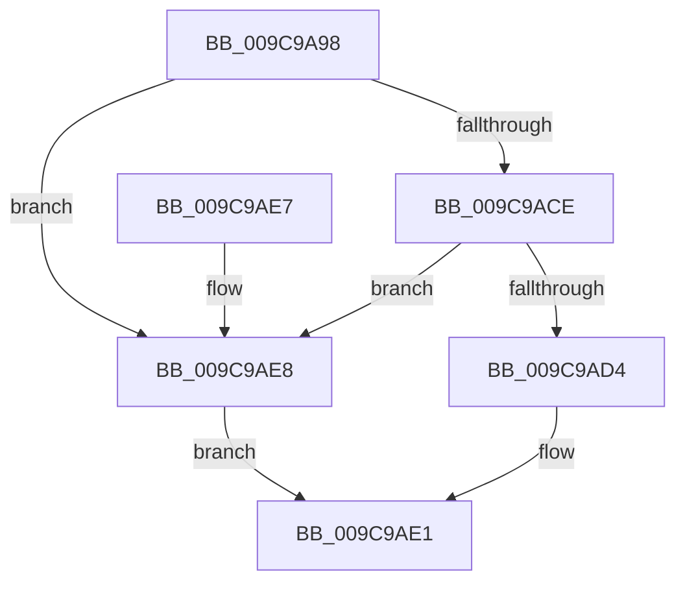

# ObpCheckDuplicateEntries

- RVA: `0x009C9A98`–`0x009C9AEC` (길이 `84` bytes)
- VA: `0x00000001409C9A98`
- 실행 섹션: `PAGE`
- PDB 이름 있음: `예`; PDB Function 태그: `아니요`
- unwind 정보 RVA: `0x000A0A58`
- 디코드: `27`개 명령, `84/84` bytes 표시
- 미해석 바이트: `0` (있으면 어셈블리에 `.byte`로 보존)

> 이 문서는 커널 이미지의 기계어와 PDB 기호를 분석해 생성했습니다. 4번과 5번은 함수 원형과 자료형을 바이너리 사용 방식에서 추정한 C 해석이며 원본 소스 복구 결과는 아닙니다.

## 1. Dependencies

- 직접 호출 지점: **1**; 고유 호출 대상: **1**
- 직접 호출자로 확인된 함수: **1**
- RIP 상대 이미지 참조: **1**

### Outgoing calls
- `0x009C9AC5` → [RtlEnumerateBoundaryDescriptorEntries](RtlEnumerateBoundaryDescriptorEntries_function_009CA278.md) (function, `0x009CA278`)

### Direct callers
- [ObpCaptureBoundaryDescriptor](ObpCaptureBoundaryDescriptor_function_009C9738.md) at `0x009C99A7`

### Static image references
- `0x009C9AB6` → RVA `0x009CA220` (`ObpCompareEntryLevel1`; read)

## 2. Other-region calls and transfers

- 다른 실행 섹션으로 향하는 call: **0**
- 별도 외부 분기/꼬리 이동을 확인하지 못했습니다.

## 3. Assembly (complete function range)

```asm
009C9A98  48 8B C4                        mov rax, rsp
009C9A9B  53                              push rbx
009C9A9C  48 83 EC 50                     sub rsp, 0x50
009C9AA0  33 DB                           xor ebx, ebx
009C9AA2  48 89 48 C8                     mov qword ptr [rax - 0x38], rcx
009C9AA6  48 89 48 D0                     mov qword ptr [rax - 0x30], rcx
009C9AAA  4C 8D 40 C8                     lea r8, [rax - 0x38]
009C9AAE  48 83 C1 30                     add rcx, 0x30
009C9AB2  48 89 58 D8                     mov qword ptr [rax - 0x28], rbx
009C9AB6  48 8D 15 63 07 00 00            lea rdx, [rip + 0x763]
009C9ABD  48 89 58 E8                     mov qword ptr [rax - 0x18], rbx
009C9AC1  48 89 58 E0                     mov qword ptr [rax - 0x20], rbx
009C9AC5  E8 AE 07 00 00                  call 0x1409ca278
009C9ACA  85 C0                           test eax, eax
009C9ACC  78 1A                           js 0x1409c9ae8
009C9ACE  39 5C 24 40                     cmp dword ptr [rsp + 0x40], ebx
009C9AD2  7C 14                           jl 0x1409c9ae8
009C9AD4  8B 4C 24 38                     mov ecx, dword ptr [rsp + 0x38]
009C9AD8  39 4C 24 3C                     cmp dword ptr [rsp + 0x3c], ecx
009C9ADC  0F 94 C3                        sete bl
009C9ADF  8B C3                           mov eax, ebx
009C9AE1  48 83 C4 50                     add rsp, 0x50
009C9AE5  5B                              pop rbx
009C9AE6  C3                              ret
009C9AE7  CC                              int3
009C9AE8  33 C0                           xor eax, eax
009C9AEA  EB F5                           jmp 0x1409c9ae1
```

## 4. C-style interpretation (structured pseudocode)

```c
__int64 __fastcall ObpCheckDuplicateEntries(__int64 a1)
{
    __int64 result;
    __int64 v_rbx;
    __int64 v_rsp;
    unsigned int v_stack_m18;
    unsigned int v_stack_m1C;
    unsigned int v_stack_m20;

    v_rsp = (v_rsp) - (80);
    v_rbx = 0;
    *(unsigned __int64 *)(v_rsp - 56) = a1;
    *(unsigned __int64 *)(v_rsp - 48) = a1;
    a1 = (a1) + (48);
    *(unsigned __int64 *)(v_rsp - 40) = 0;
    *(unsigned __int64 *)(v_rsp - 24) = 0;
    *(unsigned __int64 *)(v_rsp - 32) = 0;
    result = RtlEnumerateBoundaryDescriptorEntries(a1, v_rip + 1891, v_rsp - 56, a4);
    if (sign_flag) goto loc_009C9AE8;
    if (v_stack_m18 < 0) goto loc_009C9AE8;
    v_rbx = (v_stack_m1C == ((unsigned int)((unsigned int)(v_stack_m20)))) ? 1 : 0;
loc_009C9AE1:
    v_rsp = (v_rsp) + (80);
    return (unsigned int)((unsigned int)(v_rbx));
loc_009C9AE8:
    result = 0;
    goto loc_009C9AE1;
}
```

## 5. (Beta) C Style

```c
int64_t ObpCheckDuplicateEntries(int64_t Arg1)
{
    int64_t result;
    int64_t local_rbx;
    int64_t local_rsp;
    uint32_t v_stack_m18;
    uint32_t v_stack_m1C;
    uint32_t v_stack_m20;

    local_rsp = (local_rsp) - (80);
    local_rbx = 0;
    *(uint64_t *)(local_rsp - 0x38) = Arg1;
    *(uint64_t *)(local_rsp - 0x30) = Arg1;
    Arg1 = (Arg1) + (48);
    *(uint64_t *)(local_rsp - 0x28) = 0;
    *(uint64_t *)(local_rsp - 0x18) = 0;
    *(uint64_t *)(local_rsp - 0x20) = 0;
    result = RtlEnumerateBoundaryDescriptorEntries(Arg1, v_rip + 1891, local_rsp - 56, a4);
    if (sign_flag) goto loc_009C9AE8;
    if (v_stack_m18 < 0) goto loc_009C9AE8;
    local_rbx = (v_stack_m1C == ((uint32_t)((uint32_t)(v_stack_m20)))) ? 1 : 0;
loc_009C9AE1:
    local_rsp = (local_rsp) + (80);
    return (uint32_t)((uint32_t)(local_rbx));
loc_009C9AE8:
    result = 0;
    goto loc_009C9AE1;
}
```

## 6. Execution-region graph

[열기: 2D/3D 그래프와 함수 탐색 컨트롤 패널](../../../control-panel.html?section=page&rva=0x009C9A98&view=graph)

- 2D 그래프는 위에서 아래로 흐르고, 3D 그래프는 빈 공간을 드래그해 회전합니다. Shift+드래그는 이동, 휠은 확대·축소, 함수 노드 선택은 대상 보고서 이동입니다.

### Static fallback


