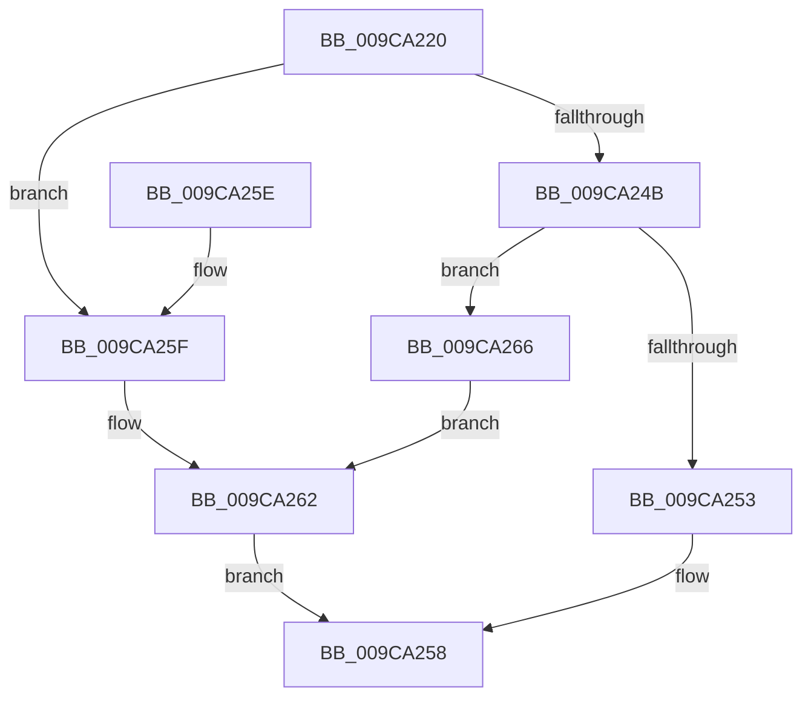

# ObpCompareEntryLevel1

- RVA: `0x009CA220`–`0x009CA26F` (길이 `79` bytes)
- VA: `0x00000001409CA220`
- 실행 섹션: `PAGE`
- PDB 이름 있음: `예`; PDB Function 태그: `아니요`
- unwind 정보 RVA: `0x00070B1C`
- 디코드: `25`개 명령, `79/79` bytes 표시
- 미해석 바이트: `0` (있으면 어셈블리에 `.byte`로 보존)

> 이 문서는 커널 이미지의 기계어와 PDB 기호를 분석해 생성했습니다. 4번과 5번은 함수 원형과 자료형을 바이너리 사용 방식에서 추정한 C 해석이며 원본 소스 복구 결과는 아닙니다.

## 1. Dependencies

- 직접 호출 지점: **1**; 고유 호출 대상: **1**
- 직접 호출자로 확인된 함수: **1**
- RIP 상대 이미지 참조: **1**

### Outgoing calls
- `0x009CA242` → [RtlEnumerateBoundaryDescriptorEntries](RtlEnumerateBoundaryDescriptorEntries_function_009CA278.md) (function, `0x009CA278`)

### Direct callers
- [RtlEnumerateBoundaryDescriptorEntries](RtlEnumerateBoundaryDescriptorEntries_function_009CA278.md) at `0x009CA3C2`

### Static image references
- `0x009CA237` → RVA `0x009CA430` (`ObpCompareEntryLevel2`; read)

## 2. Other-region calls and transfers

- 다른 실행 섹션으로 향하는 call: **0**
- 별도 외부 분기/꼬리 이동을 확인하지 못했습니다.

## 3. Assembly (complete function range)

```asm
009CA220  40 53                           push rbx
009CA222  48 83 EC 20                     sub rsp, 0x20
009CA226  FF 42 18                        inc dword ptr [rdx + 0x18]
009CA229  48 8B DA                        mov rbx, rdx
009CA22C  48 89 4A 10                     mov qword ptr [rdx + 0x10], rcx
009CA230  4C 8B C2                        mov r8, rdx
009CA233  48 8B 4A 08                     mov rcx, qword ptr [rdx + 8]
009CA237  48 8D 15 F2 01 00 00            lea rdx, [rip + 0x1f2]
009CA23E  48 83 C1 30                     add rcx, 0x30
009CA242  E8 31 00 00 00                  call 0x1409ca278
009CA247  85 C0                           test eax, eax
009CA249  78 14                           js 0x1409ca25f
009CA24B  8B 43 1C                        mov eax, dword ptr [rbx + 0x1c]
009CA24E  39 43 18                        cmp dword ptr [rbx + 0x18], eax
009CA251  75 13                           jne 0x1409ca266
009CA253  B8 01 00 00 00                  mov eax, 1
009CA258  48 83 C4 20                     add rsp, 0x20
009CA25C  5B                              pop rbx
009CA25D  C3                              ret
009CA25E  CC                              int3
009CA25F  89 43 20                        mov dword ptr [rbx + 0x20], eax
009CA262  33 C0                           xor eax, eax
009CA264  EB F2                           jmp 0x1409ca258
009CA266  C7 43 20 7B 01 00 C0            mov dword ptr [rbx + 0x20], 0xc000017b
009CA26D  EB F3                           jmp 0x1409ca262
```

## 4. C-style interpretation (structured pseudocode)

```c
__int64 __fastcall ObpCompareEntryLevel1(__int64 a1, __int64 a2)
{
    __int64 result;
    __int64 v_rsp;

    v_rsp = (v_rsp) - (32);
    *(unsigned __int64 *)(a2 + 16) = a1;
    a1 = (*(unsigned __int64 *)(a2 + 8)) + (48);
    result = RtlEnumerateBoundaryDescriptorEntries(a1, v_rip + 498, a2, a4);
    if (sign_flag) goto loc_009CA25F;
    if ((*(unsigned int *)(a2 + 24)) != ((unsigned int)((unsigned int)(*(unsigned int *)(a2 + 28))))) goto loc_009CA266;
loc_009CA258:
    v_rsp = (v_rsp) + (32);
    return 1;
loc_009CA25F:
    *(unsigned int *)(a2 + 32) = 1;
loc_009CA262:
    result = 0;
    goto loc_009CA258;
loc_009CA266:
    *(unsigned int *)(a2 + 32) = 0xC000017BULL;
    goto loc_009CA262;
}
```

## 5. (Beta) C Style

```c
int64_t ObpCompareEntryLevel1(int64_t Arg1, void *Arg2)
{
    uint8_t *arg2 = (uint8_t *)Arg2;

    int64_t result;
    int64_t local_rsp;

    local_rsp = (local_rsp) - (32);
    *(uint64_t *)(arg2 + 0x10) = Arg1;
    Arg1 = (*(uint64_t *)(arg2 + 0x8)) + (48);
    result = RtlEnumerateBoundaryDescriptorEntries(Arg1, v_rip + 498, Arg2, a4);
    if (sign_flag) goto loc_009CA25F;
    if ((*(uint32_t *)(arg2 + 0x18)) != ((uint32_t)((uint32_t)(*(uint32_t *)(arg2 + 0x1C))))) goto loc_009CA266;
loc_009CA258:
    local_rsp = (local_rsp) + (32);
    return 1;
loc_009CA25F:
    *(uint32_t *)(arg2 + 0x20) = 1;
loc_009CA262:
    result = 0;
    goto loc_009CA258;
loc_009CA266:
    *(uint32_t *)(arg2 + 0x20) = 0xC000017BULL;
    goto loc_009CA262;
}
```

### 관측된 메모리 오프셋

구조체 형식이 확인되지 않은 접근은 인자 기준의 오프셋으로만 기록했습니다.

| 기준 인자 | 오프셋 표현 | 폭 (bit) | 접근 |
|---|---:|---:|---|
| `Arg2` | `+ 0x8` | `64` | `R` |
| `Arg2` | `+ 0x10` | `64` | `W` |
| `Arg2` | `+ 0x18` | `32` | `R` |
| `Arg2` | `+ 0x18` | `32` | `R/W` |
| `Arg2` | `+ 0x1C` | `32` | `R` |
| `Arg2` | `+ 0x20` | `32` | `W` |

## 6. Execution-region graph

[열기: 2D/3D 그래프와 함수 탐색 컨트롤 패널](../../../control-panel.html?section=page&rva=0x009CA220&view=graph)

- 2D 그래프는 위에서 아래로 흐르고, 3D 그래프는 빈 공간을 드래그해 회전합니다. Shift+드래그는 이동, 휠은 확대·축소, 함수 노드 선택은 대상 보고서 이동입니다.

### Static fallback


