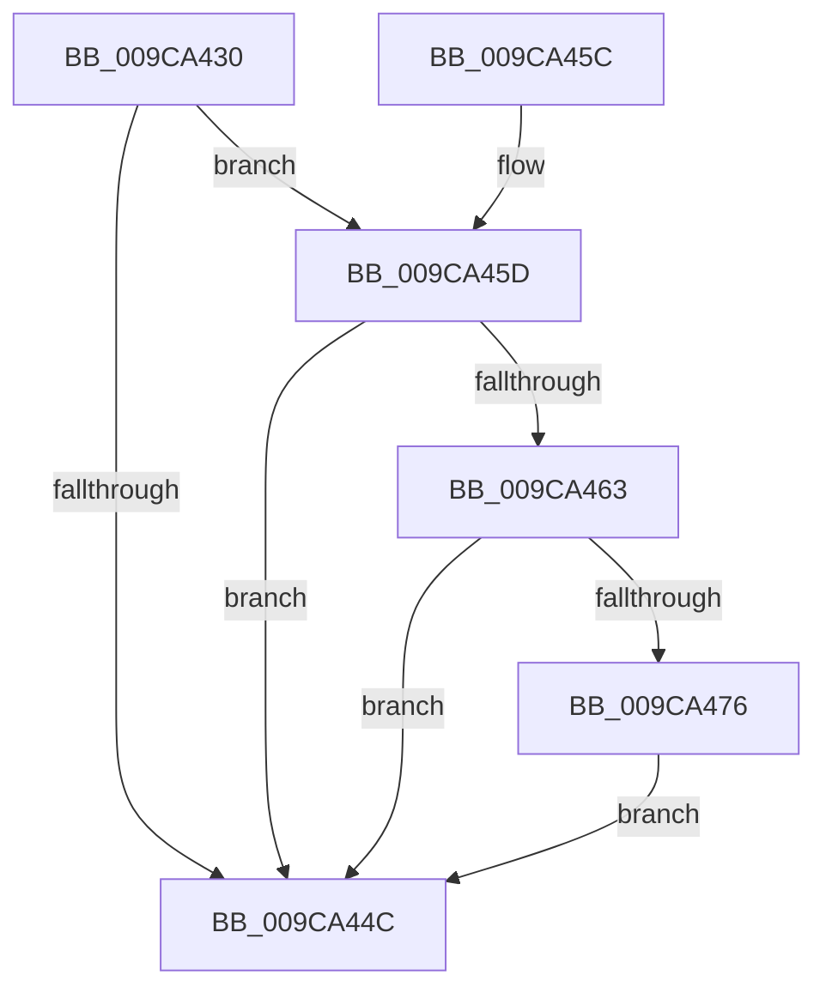

# ObpCompareEntryLevel2

- RVA: `0x009CA430`–`0x009CA47B` (길이 `75` bytes)
- VA: `0x00000001409CA430`
- 실행 섹션: `PAGE`
- PDB 이름 있음: `예`; PDB Function 태그: `아니요`
- unwind 정보 RVA: `0x00065944`
- 디코드: `26`개 명령, `75/75` bytes 표시
- 미해석 바이트: `0` (있으면 어셈블리에 `.byte`로 보존)

> 이 문서는 커널 이미지의 기계어와 PDB 기호를 분석해 생성했습니다. 4번과 5번은 함수 원형과 자료형을 바이너리 사용 방식에서 추정한 C 해석이며 원본 소스 복구 결과는 아닙니다.

## 1. Dependencies

- 직접 호출 지점: **1**; 고유 호출 대상: **1**
- 직접 호출자로 확인된 함수: **1**
- RIP 상대 이미지 참조: **0**

### Outgoing calls
- `0x009CA469` → [RtlCompareMemory](../../text/6B/RtlCompareMemory_function_006BA670.md) (function, `0x006BA670`)

### Direct callers
- [RtlEnumerateBoundaryDescriptorEntries](RtlEnumerateBoundaryDescriptorEntries_function_009CA278.md) at `0x009CA332`

### Static image references
- 디코드된 RIP-relative 메모리 참조가 없습니다.

## 2. Other-region calls and transfers

- 다른 실행 섹션으로 향하는 call: **1**
  - `0x009CA469` → [RtlCompareMemory](../../text/6B/RtlCompareMemory_function_006BA670.md) (`PAGE` → `.text`)
- 별도 외부 분기/꼬리 이동을 확인하지 못했습니다.

## 3. Assembly (complete function range)

```asm
009CA430  48 89 5C 24 08                  mov qword ptr [rsp + 8], rbx
009CA435  57                              push rdi
009CA436  48 83 EC 20                     sub rsp, 0x20
009CA43A  48 8B DA                        mov rbx, rdx
009CA43D  48 8B F9                        mov rdi, rcx
009CA440  48 8B 52 10                     mov rdx, qword ptr [rdx + 0x10]
009CA444  8B 49 04                        mov ecx, dword ptr [rcx + 4]
009CA447  3B 4A 04                        cmp ecx, dword ptr [rdx + 4]
009CA44A  74 11                           je 0x1409ca45d
009CA44C  48 8B 5C 24 30                  mov rbx, qword ptr [rsp + 0x30]
009CA451  B8 01 00 00 00                  mov eax, 1
009CA456  48 83 C4 20                     add rsp, 0x20
009CA45A  5F                              pop rdi
009CA45B  C3                              ret
009CA45C  CC                              int3
009CA45D  8B 02                           mov eax, dword ptr [rdx]
009CA45F  39 07                           cmp dword ptr [rdi], eax
009CA461  75 E9                           jne 0x1409ca44c
009CA463  4C 8B C1                        mov r8, rcx
009CA466  48 8B CF                        mov rcx, rdi
009CA469  E8 02 02 CF FF                  call 0x1406ba670
009CA46E  8B 4F 04                        mov ecx, dword ptr [rdi + 4]
009CA471  48 3B C1                        cmp rax, rcx
009CA474  75 D6                           jne 0x1409ca44c
009CA476  FF 43 1C                        inc dword ptr [rbx + 0x1c]
009CA479  EB D1                           jmp 0x1409ca44c
```

## 4. C-style interpretation (structured pseudocode)

```c
__int64 __fastcall ObpCompareEntryLevel2(__int64 a1, __int64 a2)
{
    __int64 result;
    __int64 v_rsp;
    unsigned __int64 v_stack_p8;

    v_stack_p8 = v_rbx;
    v_rsp = (v_rsp) - (32);
    if (((unsigned int)((unsigned int)(*(unsigned int *)(a1 + 4)))) == (*(unsigned int *)(*(unsigned __int64 *)(a2 + 16) + 4))) goto loc_009CA45D;
loc_009CA44C:
    v_rsp = (v_rsp) + (32);
    return 1;
loc_009CA45D:
    if ((*(unsigned int *)(a1)) != ((unsigned int)((unsigned int)(*(unsigned int *)(*(unsigned __int64 *)(a2 + 16)))))) goto loc_009CA44C;
    result = RtlCompareMemory(a1, *(unsigned __int64 *)(a2 + 16), (unsigned int)(*(unsigned int *)(a1 + 4)), a4);
    if (result != ((unsigned int)(*(unsigned int *)(a1 + 4)))) goto loc_009CA44C;
    goto loc_009CA44C;
}
```

## 5. (Beta) C Style

```c
int64_t ObpCompareEntryLevel2(void *Arg1, void *Arg2)
{
    uint8_t *arg1 = (uint8_t *)Arg1;
    uint8_t *arg2 = (uint8_t *)Arg2;

    int64_t result;
    int64_t local_rsp;
    uint64_t v_stack_p8;

    v_stack_p8 = local_rbx;
    local_rsp = (local_rsp) - (32);
    if (((uint32_t)((uint32_t)(*(uint32_t *)(arg1 + 0x4)))) == (*(uint32_t *)(*(uint64_t *)(arg2 + 0x10) + 0x4))) goto loc_009CA45D;
loc_009CA44C:
    local_rsp = (local_rsp) + (32);
    return 1;
loc_009CA45D:
    if ((*(uint32_t *)(arg1)) != ((uint32_t)((uint32_t)(*(uint32_t *)(*(uint64_t *)(arg2 + 0x10)))))) goto loc_009CA44C;
    result = RtlCompareMemory(Arg1, *(uint64_t *)(arg2 + 0x10), (uint32_t)(*(uint32_t *)(arg1 + 0x4)), a4);
    if (result != ((uint32_t)(*(uint32_t *)(arg1 + 0x4)))) goto loc_009CA44C;
    goto loc_009CA44C;
}
```

### 관측된 메모리 오프셋

구조체 형식이 확인되지 않은 접근은 인자 기준의 오프셋으로만 기록했습니다.

| 기준 인자 | 오프셋 표현 | 폭 (bit) | 접근 |
|---|---:|---:|---|
| `Arg1` | `+ 0x0` | `32` | `R` |
| `Arg1` | `+ 0x4` | `32` | `R` |
| `Arg2` | `+ 0x10` | `64` | `R` |
| `Arg2` | `+ 0x1C` | `32` | `R/W` |

## 6. Execution-region graph

[열기: 2D/3D 그래프와 함수 탐색 컨트롤 패널](../../../control-panel.html?section=page&rva=0x009CA430&view=graph)

- 2D 그래프는 위에서 아래로 흐르고, 3D 그래프는 빈 공간을 드래그해 회전합니다. Shift+드래그는 이동, 휠은 확대·축소, 함수 노드 선택은 대상 보고서 이동입니다.

### Static fallback


