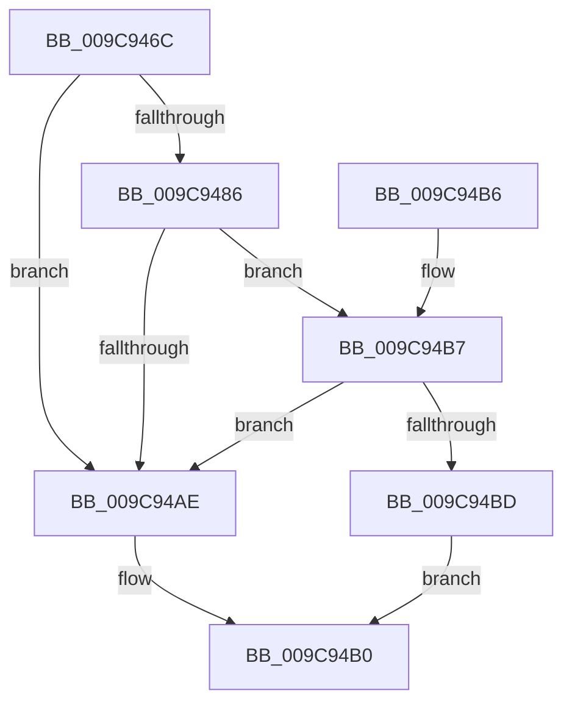

# ObpCompareNamespaceEntry

- RVA: `0x009C946C`–`0x009C94CC` (길이 `96` bytes)
- VA: `0x00000001409C946C`
- 실행 섹션: `PAGE`
- PDB 이름 있음: `예`; PDB Function 태그: `아니요`
- unwind 정보 RVA: `0x000A09B0`
- 디코드: `31`개 명령, `96/96` bytes 표시
- 미해석 바이트: `0` (있으면 어셈블리에 `.byte`로 보존)

> 이 문서는 커널 이미지의 기계어와 PDB 기호를 분석해 생성했습니다. 4번과 5번은 함수 원형과 자료형을 바이너리 사용 방식에서 추정한 C 해석이며 원본 소스 복구 결과는 아닙니다.

## 1. Dependencies

- 직접 호출 지점: **1**; 고유 호출 대상: **1**
- 직접 호출자로 확인된 함수: **1**
- RIP 상대 이미지 참조: **1**

### Outgoing calls
- `0x009C94A5` → [RtlEnumerateBoundaryDescriptorEntries](RtlEnumerateBoundaryDescriptorEntries_function_009CA278.md) (function, `0x009CA278`)

### Direct callers
- [ObpLookupNamespaceEntry](ObpLookupNamespaceEntry_function_009C9408.md) at `0x009C943D`

### Static image references
- `0x009C949A` → RVA `0x009CA220` (`ObpCompareEntryLevel1`; read)

## 2. Other-region calls and transfers

- 다른 실행 섹션으로 향하는 call: **0**
- 별도 외부 분기/꼬리 이동을 확인하지 못했습니다.

## 3. Assembly (complete function range)

```asm
009C946C  4C 8B DC                        mov r11, rsp
009C946F  53                              push rbx
009C9470  48 83 EC 50                     sub rsp, 0x50
009C9474  8B 42 34                        mov eax, dword ptr [rdx + 0x34]
009C9477  33 DB                           xor ebx, ebx
009C9479  49 89 5B D8                     mov qword ptr [r11 - 0x28], rbx
009C947D  89 5C 24 44                     mov dword ptr [rsp + 0x44], ebx
009C9481  39 41 34                        cmp dword ptr [rcx + 0x34], eax
009C9484  75 28                           jne 0x1409c94ae
009C9486  49 89 4B C8                     mov qword ptr [r11 - 0x38], rcx
009C948A  4D 8D 43 C8                     lea r8, [r11 - 0x38]
009C948E  49 89 53 D0                     mov qword ptr [r11 - 0x30], rdx
009C9492  48 83 C1 30                     add rcx, 0x30
009C9496  49 89 5B E4                     mov qword ptr [r11 - 0x1c], rbx
009C949A  48 8D 15 7F 0D 00 00            lea rdx, [rip + 0xd7f]
009C94A1  89 5C 24 38                     mov dword ptr [rsp + 0x38], ebx
009C94A5  E8 CE 0D 00 00                  call 0x1409ca278
009C94AA  85 C0                           test eax, eax
009C94AC  79 09                           jns 0x1409c94b7
009C94AE  33 C0                           xor eax, eax
009C94B0  48 83 C4 50                     add rsp, 0x50
009C94B4  5B                              pop rbx
009C94B5  C3                              ret
009C94B6  CC                              int3
009C94B7  39 5C 24 40                     cmp dword ptr [rsp + 0x40], ebx
009C94BB  7C F1                           jl 0x1409c94ae
009C94BD  8B 4C 24 38                     mov ecx, dword ptr [rsp + 0x38]
009C94C1  39 4C 24 3C                     cmp dword ptr [rsp + 0x3c], ecx
009C94C5  0F 94 C3                        sete bl
009C94C8  8B C3                           mov eax, ebx
009C94CA  EB E4                           jmp 0x1409c94b0
```

## 4. C-style interpretation (structured pseudocode)

```c
__int64 __fastcall ObpCompareNamespaceEntry(__int64 a1, __int64 a2)
{
    __int64 result;
    __int64 v_rbx;
    __int64 v_rsp;
    unsigned int v_stack_m14;
    unsigned int v_stack_m20;
    unsigned int v_stack_p38;
    unsigned int v_stack_p3C;
    unsigned int v_stack_p40;

    v_rsp = (v_rsp) - (80);
    v_rbx = 0;
    *(unsigned __int64 *)(v_rsp - 40) = 0;
    v_stack_m14 = 0;
    if ((*(unsigned int *)(a1 + 52)) != ((unsigned int)((unsigned int)(*(unsigned int *)(a2 + 52))))) goto loc_009C94AE;
    *(unsigned __int64 *)(v_rsp - 56) = a1;
    *(unsigned __int64 *)(v_rsp - 48) = a2;
    a1 = (a1) + (48);
    *(unsigned __int64 *)(v_rsp - 28) = 0;
    v_stack_m20 = 0;
    result = RtlEnumerateBoundaryDescriptorEntries(a1, v_rip + 3455, v_rsp - 56, a4);
    if (!sign_flag) goto loc_009C94B7;
loc_009C94AE:
    result = 0;
loc_009C94B0:
    v_rsp = (v_rsp) + (80);
    return result;
loc_009C94B7:
    if (v_stack_p40 < 0) goto loc_009C94AE;
    v_rbx = (v_stack_p3C == ((unsigned int)((unsigned int)(v_stack_p38)))) ? 1 : 0;
    goto loc_009C94B0;
}
```

## 5. (Beta) C Style

```c
int64_t ObpCompareNamespaceEntry(void *Arg1, void *Arg2)
{
    uint8_t *arg1 = (uint8_t *)Arg1;
    uint8_t *arg2 = (uint8_t *)Arg2;

    int64_t result;
    int64_t local_rbx;
    int64_t local_rsp;
    uint32_t v_stack_m14;
    uint32_t v_stack_m20;
    uint32_t v_stack_p38;
    uint32_t v_stack_p3C;
    uint32_t v_stack_p40;

    local_rsp = (local_rsp) - (80);
    local_rbx = 0;
    *(uint64_t *)(local_rsp - 0x28) = 0;
    v_stack_m14 = 0;
    if ((*(uint32_t *)(arg1 + 0x34)) != ((uint32_t)((uint32_t)(*(uint32_t *)(arg2 + 0x34))))) goto loc_009C94AE;
    *(void **)(local_rsp - 0x38) = Arg1;
    *(void **)(local_rsp - 0x30) = Arg2;
    Arg1 = (Arg1) + (48);
    *(uint64_t *)(local_rsp - 0x1C) = 0;
    v_stack_m20 = 0;
    result = RtlEnumerateBoundaryDescriptorEntries(Arg1, v_rip + 3455, local_rsp - 56, a4);
    if (!sign_flag) goto loc_009C94B7;
loc_009C94AE:
    result = 0;
loc_009C94B0:
    local_rsp = (local_rsp) + (80);
    return result;
loc_009C94B7:
    if (v_stack_p40 < 0) goto loc_009C94AE;
    local_rbx = (v_stack_p3C == ((uint32_t)((uint32_t)(v_stack_p38)))) ? 1 : 0;
    goto loc_009C94B0;
}
```

### 관측된 메모리 오프셋

구조체 형식이 확인되지 않은 접근은 인자 기준의 오프셋으로만 기록했습니다.

| 기준 인자 | 오프셋 표현 | 폭 (bit) | 접근 |
|---|---:|---:|---|
| `Arg1` | `+ 0x34` | `32` | `R` |
| `Arg2` | `+ 0x34` | `32` | `R` |

## 6. Execution-region graph

[열기: 2D/3D 그래프와 함수 탐색 컨트롤 패널](../../../control-panel.html?section=page&rva=0x009C946C&view=graph)

- 2D 그래프는 위에서 아래로 흐르고, 3D 그래프는 빈 공간을 드래그해 회전합니다. Shift+드래그는 이동, 휠은 확대·축소, 함수 노드 선택은 대상 보고서 이동입니다.

### Static fallback


