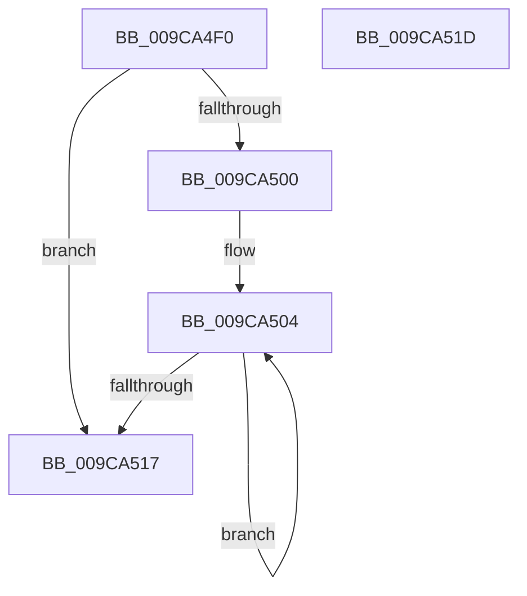

# ObpHashBoundaryFunction

- RVA: `0x009CA4F0`–`0x009CA51E` (길이 `46` bytes)
- VA: `0x00000001409CA4F0`
- 실행 섹션: `PAGE`
- PDB 이름 있음: `예`; PDB Function 태그: `아니요`
- unwind 정보 RVA: `0x000DB714`
- 디코드: `14`개 명령, `46/46` bytes 표시
- 미해석 바이트: `0` (있으면 어셈블리에 `.byte`로 보존)

> 이 문서는 커널 이미지의 기계어와 PDB 기호를 분석해 생성했습니다. 4번과 5번은 함수 원형과 자료형을 바이너리 사용 방식에서 추정한 C 해석이며 원본 소스 복구 결과는 아닙니다.

## 1. Dependencies

- 직접 호출 지점: **0**; 고유 호출 대상: **0**
- 직접 호출자로 확인된 함수: **1**
- RIP 상대 이미지 참조: **0**

### Outgoing calls
- 직접 디코드된 call 명령이 없습니다.

### Direct callers
- [RtlEnumerateBoundaryDescriptorEntries](RtlEnumerateBoundaryDescriptorEntries_function_009CA278.md) at `0x009CA3D8`

### Static image references
- 디코드된 RIP-relative 메모리 참조가 없습니다.

## 2. Other-region calls and transfers

- 다른 실행 섹션으로 향하는 call: **0**
- 별도 외부 분기/꼬리 이동을 확인하지 못했습니다.

## 3. Assembly (complete function range)

```asm
009CA4F0  41 B8 08 00 00 00               mov r8d, 8
009CA4F6  4C 8D 51 08                     lea r10, [rcx + 8]
009CA4FA  44 39 41 04                     cmp dword ptr [rcx + 4], r8d
009CA4FE  76 17                           jbe 0x1409ca517
009CA500  44 8A 4A 28                     mov r9b, byte ptr [rdx + 0x28]
009CA504  45 02 0A                        add r9b, byte ptr [r10]
009CA507  41 FF C0                        inc r8d
009CA50A  49 FF C2                        inc r10
009CA50D  44 88 4A 28                     mov byte ptr [rdx + 0x28], r9b
009CA511  44 3B 41 04                     cmp r8d, dword ptr [rcx + 4]
009CA515  72 ED                           jb 0x1409ca504
009CA517  B8 01 00 00 00                  mov eax, 1
009CA51C  C3                              ret
009CA51D  CC                              int3
```

## 4. C-style interpretation (structured pseudocode)

```c
__int64 __fastcall ObpHashBoundaryFunction(__int64 a1, __int64 a2)
{
    __int64 v_r10;

    if ((*(unsigned int *)(a1 + 4)) <= 8) goto loc_009CA517;
loc_009CA504:
    a4 = (unsigned __int8)((*(unsigned __int8 *)(a2 + 40)) + (*(unsigned __int8 *)(a1 + 8)));
    a3 = (unsigned int)((8) + 1);
    v_r10 = (a1 + 8) + 1;
    *(unsigned __int8 *)(a2 + 40) = (unsigned __int8)(a4);
    if (((unsigned int)(a3)) < (*(unsigned int *)(a1 + 4))) goto loc_009CA504;
loc_009CA517:
    return 1;
}
```

## 5. (Beta) C Style

```c
int64_t ObpHashBoundaryFunction(void *Arg1, void *Arg2)
{
    uint8_t *arg1 = (uint8_t *)Arg1;
    uint8_t *arg2 = (uint8_t *)Arg2;

    int64_t local_r10;

    if ((*(uint32_t *)(arg1 + 0x4)) <= 8) goto loc_009CA517;
loc_009CA504:
    a4 = (uint8_t)((*(uint8_t *)(arg2 + 0x28)) + (*(uint8_t *)(arg1 + 0x8)));
    a3 = (uint32_t)((8) + 1);
    local_r10 = (Arg1 + 8) + 1;
    *(uint8_t *)(arg2 + 0x28) = (uint8_t)(a4);
    if (((uint32_t)(a3)) < (*(uint32_t *)(arg1 + 0x4))) goto loc_009CA504;
loc_009CA517:
    return 1;
}
```

### 관측된 메모리 오프셋

구조체 형식이 확인되지 않은 접근은 인자 기준의 오프셋으로만 기록했습니다.

| 기준 인자 | 오프셋 표현 | 폭 (bit) | 접근 |
|---|---:|---:|---|
| `Arg1` | `+ 0x4` | `32` | `R` |
| `Arg1` | `+ 0x8` | `64` | `R` |
| `Arg2` | `+ 0x28` | `8` | `R` |
| `Arg2` | `+ 0x28` | `8` | `W` |

## 6. Execution-region graph

[열기: 2D/3D 그래프와 함수 탐색 컨트롤 패널](../../../control-panel.html?section=page&rva=0x009CA4F0&view=graph)

- 2D 그래프는 위에서 아래로 흐르고, 3D 그래프는 빈 공간을 드래그해 회전합니다. Shift+드래그는 이동, 휠은 확대·축소, 함수 노드 선택은 대상 보고서 이동입니다.

### Static fallback


