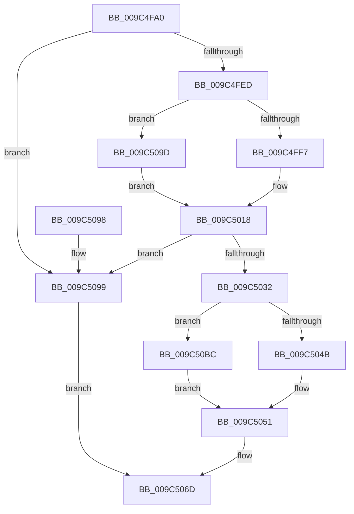

# ObpInsertHandleCount

- RVA: `0x009C4FA0`–`0x009C50C8` (길이 `296` bytes)
- VA: `0x00000001409C4FA0`
- 실행 섹션: `PAGE`
- PDB 이름 있음: `예`; PDB Function 태그: `아니요`
- unwind 정보 RVA: `0x0009FD88`
- 디코드: `87`개 명령, `296/296` bytes 표시
- 미해석 바이트: `0` (있으면 어셈블리에 `.byte`로 보존)

> 이 문서는 커널 이미지의 기계어와 PDB 기호를 분석해 생성했습니다. 4번과 5번은 함수 원형과 자료형을 바이너리 사용 방식에서 추정한 C 해석이며 원본 소스 복구 결과는 아닙니다.

## 1. Dependencies

- 직접 호출 지점: **6**; 고유 호출 대상: **6**
- 직접 호출자로 확인된 함수: **1**
- RIP 상대 이미지 참조: **1**

### Outgoing calls
- `0x009C4FDC` → [OBJECT_HEADER_TO_HANDLE_INFO](../../text/41/OBJECT_HEADER_TO_HANDLE_INFO_function_0041B570.md) (function, `0x0041B570`)
- `0x009C5025` → [ExAllocatePool2](../../poolcode/B8/ExAllocatePool2_function_00B820F0.md) (function, `0x00B820F0`)
- `0x009C503E` → [memcpy](../../text/6C/memcpy_function_006C6840.md) (function, `0x006C6840`)
- `0x009C505F` → [memset](../../text/6C/memset_function_006C6C40.md) (function, `0x006C6C40`)
- `0x009C5075` → [_security_check_cookie](../../text/6A/_security_check_cookie_function_006AC640.md) (function, `0x006AC640`)
- `0x009C50C1` → [ExFreePoolWithTag](../../poolcode/B8/ExFreePoolWithTag_function_00B82870.md) (function, `0x00B82870`)

### Direct callers
- [ObpLockHandleDataBaseEntry](ObpLockHandleDataBaseEntry_function_009C4E00.md) at `0x009C4F1D`
- [ObpLockHandleDataBaseEntry](ObpLockHandleDataBaseEntry_function_009C4E00.md) at `0x009C4F6E`

### Static image references
- `0x009C4FBC` → RVA `0x00E0A740` (`.data`; read)

## 2. Other-region calls and transfers

- 다른 실행 섹션으로 향하는 call: **6**
  - `0x009C4FDC` → [OBJECT_HEADER_TO_HANDLE_INFO](../../text/41/OBJECT_HEADER_TO_HANDLE_INFO_function_0041B570.md) (`PAGE` → `.text`)
  - `0x009C5025` → [ExAllocatePool2](../../poolcode/B8/ExAllocatePool2_function_00B820F0.md) (`PAGE` → `POOLCODE`)
  - `0x009C503E` → [memcpy](../../text/6C/memcpy_function_006C6840.md) (`PAGE` → `.text`)
  - `0x009C505F` → [memset](../../text/6C/memset_function_006C6C40.md) (`PAGE` → `.text`)
  - `0x009C5075` → [_security_check_cookie](../../text/6A/_security_check_cookie_function_006AC640.md) (`PAGE` → `.text`)
  - `0x009C50C1` → [ExFreePoolWithTag](../../poolcode/B8/ExFreePoolWithTag_function_00B82870.md) (`PAGE` → `POOLCODE`)
- 별도 외부 분기/꼬리 이동을 확인하지 못했습니다.

## 3. Assembly (complete function range)

```asm
009C4FA0  48 89 5C 24 10                  mov qword ptr [rsp + 0x10], rbx
009C4FA5  48 89 6C 24 18                  mov qword ptr [rsp + 0x18], rbp
009C4FAA  48 89 74 24 20                  mov qword ptr [rsp + 0x20], rsi
009C4FAF  57                              push rdi
009C4FB0  41 54                           push r12
009C4FB2  41 55                           push r13
009C4FB4  41 56                           push r14
009C4FB6  41 57                           push r15
009C4FB8  48 83 EC 40                     sub rsp, 0x40
009C4FBC  48 8B 05 7D 57 44 00            mov rax, qword ptr [rip + 0x44577d]
009C4FC3  48 33 C4                        xor rax, rsp
009C4FC6  48 89 44 24 38                  mov qword ptr [rsp + 0x38], rax
009C4FCB  33 C0                           xor eax, eax
009C4FCD  0F 57 C0                        xorps xmm0, xmm0
009C4FD0  0F 11 44 24 20                  movups xmmword ptr [rsp + 0x20], xmm0
009C4FD5  89 44 24 30                     mov dword ptr [rsp + 0x30], eax
009C4FD9  48 8B D9                        mov rbx, rcx
009C4FDC  E8 8F 65 A5 FF                  call 0x14041b570
009C4FE1  4C 8B F8                        mov r15, rax
009C4FE4  48 85 C0                        test rax, rax
009C4FE7  0F 84 AC 00 00 00               je 0x1409c5099
009C4FED  F6 43 1B 40                     test byte ptr [rbx + 0x1b], 0x40
009C4FF1  0F 84 A6 00 00 00               je 0x1409c509d
009C4FF7  BE 18 00 00 00                  mov esi, 0x18
009C4FFC  C7 44 24 20 01 00 00 00         mov dword ptr [rsp + 0x20], 1
009C5004  0F 10 00                        movups xmm0, xmmword ptr [rax]
009C5007  4C 8D 64 24 20                  lea r12, [rsp + 0x20]
009C500C  F3 0F 7F 44 24 28               movdqu xmmword ptr [rsp + 0x28], xmm0
009C5012  8D 6E EA                        lea ebp, [rsi - 0x16]
009C5015  8D 7E 10                        lea edi, [rsi + 0x10]
009C5018  8B D7                           mov edx, edi
009C501A  B9 00 01 00 00                  mov ecx, 0x100
009C501F  41 B8 4F 62 48 64               mov r8d, 0x6448624f
009C5025  E8 C6 D0 1B 00                  call 0x140b820f0
009C502A  4C 8B F0                        mov r14, rax
009C502D  48 85 C0                        test rax, rax
009C5030  74 67                           je 0x1409c5099
009C5032  44 8B C6                        mov r8d, esi
009C5035  49 8B D4                        mov rdx, r12
009C5038  48 8B C8                        mov rcx, rax
009C503B  44 8B EE                        mov r13d, esi
009C503E  E8 FD 17 D0 FF                  call 0x1406c6840
009C5043  8A 4B 1B                        mov cl, byte ptr [rbx + 0x1b]
009C5046  F6 C1 40                        test cl, 0x40
009C5049  74 71                           je 0x1409c50bc
009C504B  80 E1 BF                        and cl, 0xbf
009C504E  88 4B 1B                        mov byte ptr [rbx + 0x1b], cl
009C5051  2B FE                           sub edi, esi
009C5053  4B 8D 1C 2E                     lea rbx, [r14 + r13]
009C5057  44 8B C7                        mov r8d, edi
009C505A  48 8B CB                        mov rcx, rbx
009C505D  33 D2                           xor edx, edx
009C505F  E8 DC 1B D0 FF                  call 0x1406c6c40
009C5064  41 89 2E                        mov dword ptr [r14], ebp
009C5067  48 8B C3                        mov rax, rbx
009C506A  4D 89 37                        mov qword ptr [r15], r14
009C506D  48 8B 4C 24 38                  mov rcx, qword ptr [rsp + 0x38]
009C5072  48 33 CC                        xor rcx, rsp
009C5075  E8 C6 75 CE FF                  call 0x1406ac640
009C507A  4C 8D 5C 24 40                  lea r11, [rsp + 0x40]
009C507F  49 8B 5B 38                     mov rbx, qword ptr [r11 + 0x38]
009C5083  49 8B 6B 40                     mov rbp, qword ptr [r11 + 0x40]
009C5087  49 8B 73 48                     mov rsi, qword ptr [r11 + 0x48]
009C508B  49 8B E3                        mov rsp, r11
009C508E  41 5F                           pop r15
009C5090  41 5E                           pop r14
009C5092  41 5D                           pop r13
009C5094  41 5C                           pop r12
009C5096  5F                              pop rdi
009C5097  C3                              ret
009C5098  CC                              int3
009C5099  33 C0                           xor eax, eax
009C509B  EB D0                           jmp 0x1409c506d
009C509D  4C 8B 20                        mov r12, qword ptr [rax]
009C50A0  41 8B 2C 24                     mov ebp, dword ptr [r12]
009C50A4  8B F5                           mov esi, ebp
009C50A6  83 C5 04                        add ebp, 4
009C50A9  C1 E6 04                        shl esi, 4
009C50AC  8B FD                           mov edi, ebp
009C50AE  83 C6 08                        add esi, 8
009C50B1  C1 E7 04                        shl edi, 4
009C50B4  83 C7 08                        add edi, 8
009C50B7  E9 5C FF FF FF                  jmp 0x1409c5018
009C50BC  33 D2                           xor edx, edx
009C50BE  49 8B CC                        mov rcx, r12
009C50C1  E8 AA D7 1B 00                  call 0x140b82870
009C50C6  EB 89                           jmp 0x1409c5051
```

## 4. C-style interpretation (structured pseudocode)

```c
__int64 __fastcall ObpInsertHandleCount(__int64 a1)
{
    __int64 result;
    __int64 v_rbp;
    __int64 v_rdi;
    __int64 v_rsi;
    __int64 v_rsp;
    unsigned __int64 v_stack_m28;
    unsigned __int64 v_stack_m30;
    unsigned int v_stack_m38;
    unsigned __int64 v_stack_m40;
    unsigned __int64 v_stack_m48;
    unsigned __int64 v_stack_p10;
    unsigned __int64 v_stack_p18;
    unsigned __int64 v_stack_p20;

    v_stack_p10 = v_rbx;
    v_stack_p18 = v_rbp;
    v_stack_p20 = v_rsi;
    v_rsp = (v_rsp) - (64);
    result = (*(unsigned __int64 *)(v_rip + 4478845)) ^ (v_rsp);
    v_stack_m30 = result;
    result = 0;
    v_stack_m48 = v_xmm0;
    v_stack_m38 = 0;
    result = OBJECT_HEADER_TO_HANDLE_INFO(a1, a2, a3, a4);
    if (result == 0) goto loc_009C5099;
    if (((*(unsigned __int8 *)(a1 + 27)) & (64)) == 0) goto loc_009C509D;
    v_stack_m48 = 1;
    v_stack_m40 = v_xmm0;
loc_009C5018:
    result = ExAllocatePool2(256, (unsigned int)((unsigned int)(24 + 16)), (unsigned int)(0x6448624FULL), a4);
    if (result == 0) goto loc_009C5099;
    result = memcpy(result, v_stack_m48, 24, a4);
    if ((((unsigned __int8)(*(unsigned __int8 *)(a1 + 27))) & (64)) == 0) goto loc_009C50BC;
    a1 = (unsigned __int8)((*(unsigned __int8 *)(a1 + 27)) & (191));
    *(unsigned __int8 *)(a1 + 27) = (unsigned __int8)(a1);
loc_009C5051:
    v_rdi = (unsigned int)((24 + 16) - (24));
    a2 = 0;
    result = memset(result + 24 * 1, a2, (unsigned int)((unsigned int)(v_rdi)), a4);
    *(unsigned int *)(result) = (unsigned int)(24 - 22);
    *(unsigned __int64 *)(result) = result;
loc_009C506D:
    a1 = (v_stack_m30) ^ (v_rsp);
    result = _security_check_cookie(a1, a2, (unsigned int)((unsigned int)(v_rdi)), a4);
    return result;
loc_009C5099:
    result = 0;
    goto loc_009C506D;
loc_009C509D:
    v_rbp = (unsigned int)(((unsigned int)(*(unsigned int *)(*(unsigned __int64 *)(result)))) + (4));
    v_rsi = (unsigned int)(((unsigned int)((unsigned int)((unsigned int)(*(unsigned int *)(*(unsigned __int64 *)(result)))))) << (4));
    v_rsi = (unsigned int)((v_rsi) + (8));
    v_rdi = (unsigned int)(((unsigned int)((unsigned int)(v_rbp))) << (4));
    v_rdi = (unsigned int)((v_rdi) + (8));
    goto loc_009C5018;
loc_009C50BC:
    a2 = 0;
    result = ExFreePoolWithTag(*(unsigned __int64 *)(result), a2, (unsigned int)((unsigned int)(v_rdi)), a4);
    goto loc_009C5051;
}
```

## 5. (Beta) C Style

```c
int64_t ObpInsertHandleCount(void *Arg1)
{
    uint8_t *arg1 = (uint8_t *)Arg1;

    int64_t result;
    int64_t local_rbp;
    int64_t local_rdi;
    int64_t local_rsi;
    int64_t local_rsp;
    uint64_t v_stack_m28;
    uint64_t v_stack_m30;
    uint32_t v_stack_m38;
    uint64_t v_stack_m40;
    uint64_t v_stack_m48;
    uint64_t v_stack_p10;
    uint64_t v_stack_p18;
    uint64_t v_stack_p20;

    v_stack_p10 = local_rbx;
    v_stack_p18 = local_rbp;
    v_stack_p20 = local_rsi;
    local_rsp = (local_rsp) - (64);
    result = (*(uint64_t *)(v_rip + 0x44577D)) ^ (local_rsp);
    v_stack_m30 = result;
    result = 0;
    v_stack_m48 = v_xmm0;
    v_stack_m38 = 0;
    result = OBJECT_HEADER_TO_HANDLE_INFO(Arg1, a2, a3, a4);
    if (result == 0) goto loc_009C5099;
    if (((*(uint8_t *)(arg1 + 0x1B)) & (64)) == 0) goto loc_009C509D;
    v_stack_m48 = 1;
    v_stack_m40 = v_xmm0;
loc_009C5018:
    result = ExAllocatePool2(256, (uint32_t)((uint32_t)(24 + 16)), (uint32_t)(0x6448624FULL), a4);
    if (result == 0) goto loc_009C5099;
    result = memcpy(result, v_stack_m48, 24, a4);
    if ((((uint8_t)(*(uint8_t *)(arg1 + 0x1B))) & (64)) == 0) goto loc_009C50BC;
    Arg1 = (uint8_t)((*(uint8_t *)(arg1 + 0x1B)) & (191));
    *(uint8_t *)(arg1 + 0x1B) = (uint8_t)(Arg1);
loc_009C5051:
    local_rdi = (uint32_t)((24 + 16) - (24));
    a2 = 0;
    result = memset(result + 24 * 1, a2, (uint32_t)((uint32_t)(local_rdi)), a4);
    *(uint32_t *)(result) = (uint32_t)(24 - 22);
    *(uint64_t *)(result) = result;
loc_009C506D:
    Arg1 = (v_stack_m30) ^ (local_rsp);
    result = _security_check_cookie(Arg1, a2, (uint32_t)((uint32_t)(local_rdi)), a4);
    return result;
loc_009C5099:
    result = 0;
    goto loc_009C506D;
loc_009C509D:
    local_rbp = (uint32_t)(((uint32_t)(*(uint32_t *)(*(uint64_t *)(result)))) + (4));
    local_rsi = (uint32_t)(((uint32_t)((uint32_t)((uint32_t)(*(uint32_t *)(*(uint64_t *)(result)))))) << (4));
    local_rsi = (uint32_t)((local_rsi) + (8));
    local_rdi = (uint32_t)(((uint32_t)((uint32_t)(local_rbp))) << (4));
    local_rdi = (uint32_t)((local_rdi) + (8));
    goto loc_009C5018;
loc_009C50BC:
    a2 = 0;
    result = ExFreePoolWithTag(*(uint64_t *)(result), a2, (uint32_t)((uint32_t)(local_rdi)), a4);
    goto loc_009C5051;
}
```

### 관측된 메모리 오프셋

구조체 형식이 확인되지 않은 접근은 인자 기준의 오프셋으로만 기록했습니다.

| 기준 인자 | 오프셋 표현 | 폭 (bit) | 접근 |
|---|---:|---:|---|
| `Arg1` | `+ 0x1B` | `8` | `R` |
| `Arg1` | `+ 0x1B` | `8` | `W` |

## 6. Execution-region graph

[열기: 2D/3D 그래프와 함수 탐색 컨트롤 패널](../../../control-panel.html?section=page&rva=0x009C4FA0&view=graph)

- 2D 그래프는 위에서 아래로 흐르고, 3D 그래프는 빈 공간을 드래그해 회전합니다. Shift+드래그는 이동, 휠은 확대·축소, 함수 노드 선택은 대상 보고서 이동입니다.

### Static fallback


