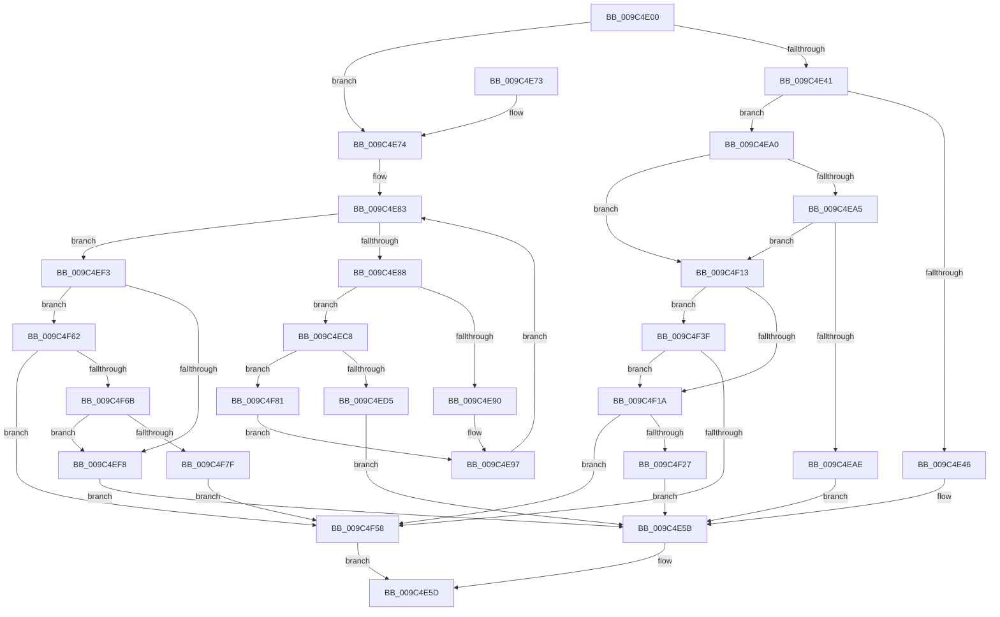

# ObpLockHandleDataBaseEntry

- RVA: `0x009C4E00`–`0x009C4F98` (길이 `408` bytes)
- VA: `0x00000001409C4E00`
- 실행 섹션: `PAGE`
- PDB 이름 있음: `예`; PDB Function 태그: `아니요`
- unwind 정보 RVA: `0x0009FD70`
- 디코드: `117`개 명령, `408/408` bytes 표시
- 미해석 바이트: `0` (있으면 어셈블리에 `.byte`로 보존)

> 이 문서는 커널 이미지의 기계어와 PDB 기호를 분석해 생성했습니다. 4번과 5번은 함수 원형과 자료형을 바이너리 사용 방식에서 추정한 C 해석이며 원본 소스 복구 결과는 아닙니다.

## 1. Dependencies

- 직접 호출 지점: **2**; 고유 호출 대상: **1**
- 직접 호출자로 확인된 함수: **1**
- RIP 상대 이미지 참조: **1**

### Outgoing calls
- `0x009C4F1D` → [ObpInsertHandleCount](ObpInsertHandleCount_function_009C4FA0.md) (function, `0x009C4FA0`)
- `0x009C4F6E` → [ObpInsertHandleCount](ObpInsertHandleCount_function_009C4FA0.md) (function, `0x009C4FA0`)

### Direct callers
- [ObpIncrementHandleCountEx](../86/ObpIncrementHandleCountEx_function_0086DA10.md) at `0x0086DE80`

### Static image references
- `0x009C4E1F` → RVA `0x00F0FF80` (`.data`; read)

## 2. Other-region calls and transfers

- 다른 실행 섹션으로 향하는 call: **0**
- 별도 외부 분기/꼬리 이동을 확인하지 못했습니다.

## 3. Assembly (complete function range)

```asm
009C4E00  48 89 5C 24 08                  mov qword ptr [rsp + 8], rbx
009C4E05  48 89 74 24 10                  mov qword ptr [rsp + 0x10], rsi
009C4E0A  48 89 7C 24 18                  mov qword ptr [rsp + 0x18], rdi
009C4E0F  41 56                           push r14
009C4E11  48 83 EC 20                     sub rsp, 0x20
009C4E15  0F B6 41 1A                     movzx eax, byte ptr [rcx + 0x1a]
009C4E19  4C 8B D1                        mov r10, rcx
009C4E1C  83 E0 07                        and eax, 7
009C4E1F  48 8D 0D 5A B1 54 00            lea rcx, [rip + 0x54b15a]
009C4E26  49 8B F8                        mov rdi, r8
009C4E29  48 8B DA                        mov rbx, rdx
009C4E2C  44 0F B6 0C 08                  movzx r9d, byte ptr [rax + rcx]
009C4E31  49 8B C2                        mov rax, r10
009C4E34  49 2B C1                        sub rax, r9
009C4E37  41 F6 42 1B 40                  test byte ptr [r10 + 0x1b], 0x40
009C4E3C  48 8B 08                        mov rcx, qword ptr [rax]
009C4E3F  74 33                           je 0x1409c4e74
009C4E41  48 85 C9                        test rcx, rcx
009C4E44  75 5A                           jne 0x1409c4ea0
009C4E46  C6 40 0B 01                     mov byte ptr [rax + 0xb], 1
009C4E4A  81 60 08 00 00 00 FF            and dword ptr [rax + 8], 0xff000000
009C4E51  48 89 10                        mov qword ptr [rax], rdx
009C4E54  41 C7 00 01 00 00 00            mov dword ptr [r8], 1
009C4E5B  33 C0                           xor eax, eax
009C4E5D  48 8B 5C 24 30                  mov rbx, qword ptr [rsp + 0x30]
009C4E62  48 8B 74 24 38                  mov rsi, qword ptr [rsp + 0x38]
009C4E67  48 8B 7C 24 40                  mov rdi, qword ptr [rsp + 0x40]
009C4E6C  48 83 C4 20                     add rsp, 0x20
009C4E70  41 5E                           pop r14
009C4E72  C3                              ret
009C4E73  CC                              int3
009C4E74  44 8B 09                        mov r9d, dword ptr [rcx]
009C4E77  4C 8D 41 08                     lea r8, [rcx + 8]
009C4E7B  33 F6                           xor esi, esi
009C4E7D  44 8B DE                        mov r11d, esi
009C4E80  44 8B F6                        mov r14d, esi
009C4E83  45 85 C9                        test r9d, r9d
009C4E86  74 6B                           je 0x1409c4ef3
009C4E88  49 8B 08                        mov rcx, qword ptr [r8]
009C4E8B  48 3B CB                        cmp rcx, rbx
009C4E8E  74 38                           je 0x1409c4ec8
009C4E90  48 85 C9                        test rcx, rcx
009C4E93  4D 0F 44 D8                     cmove r11, r8
009C4E97  49 83 C0 10                     add r8, 0x10
009C4E9B  41 FF C9                        dec r9d
009C4E9E  EB E3                           jmp 0x1409c4e83
009C4EA0  48 3B CB                        cmp rcx, rbx
009C4EA3  75 6E                           jne 0x1409c4f13
009C4EA5  0F B6 50 0B                     movzx edx, byte ptr [rax + 0xb]
009C4EA9  80 FA FF                        cmp dl, 0xff
009C4EAC  73 65                           jae 0x1409c4f13
009C4EAE  FE C2                           inc dl
009C4EB0  88 50 0B                        mov byte ptr [rax + 0xb], dl
009C4EB3  8B 48 08                        mov ecx, dword ptr [rax + 8]
009C4EB6  8B C1                           mov eax, ecx
009C4EB8  C1 E8 18                        shr eax, 0x18
009C4EBB  81 E1 FF FF FF 00               and ecx, 0xffffff
009C4EC1  03 C1                           add eax, ecx
009C4EC3  41 89 00                        mov dword ptr [r8], eax
009C4EC6  EB 93                           jmp 0x1409c4e5b
009C4EC8  0F B6 48 0B                     movzx ecx, byte ptr [rax + 0xb]
009C4ECC  80 F9 FF                        cmp cl, 0xff
009C4ECF  0F 83 AC 00 00 00               jae 0x1409c4f81
009C4ED5  41 FE 40 0B                     inc byte ptr [r8 + 0xb]
009C4ED9  8B 48 08                        mov ecx, dword ptr [rax + 8]
009C4EDC  8B C1                           mov eax, ecx
009C4EDE  C1 E8 18                        shr eax, 0x18
009C4EE1  81 E1 FF FF FF 00               and ecx, 0xffffff
009C4EE7  41 03 C6                        add eax, r14d
009C4EEA  03 C8                           add ecx, eax
009C4EEC  89 0F                           mov dword ptr [rdi], ecx
009C4EEE  E9 68 FF FF FF                  jmp 0x1409c4e5b
009C4EF3  4D 85 DB                        test r11, r11
009C4EF6  74 6A                           je 0x1409c4f62
009C4EF8  41 81 63 08 00 00 00 FF         and dword ptr [r11 + 8], 0xff000000
009C4F00  41 8D 46 01                     lea eax, [r14 + 1]
009C4F04  89 07                           mov dword ptr [rdi], eax
009C4F06  49 89 1B                        mov qword ptr [r11], rbx
009C4F09  41 C6 43 0B 01                  mov byte ptr [r11 + 0xb], 1
009C4F0E  E9 48 FF FF FF                  jmp 0x1409c4e5b
009C4F13  33 F6                           xor esi, esi
009C4F15  48 3B CB                        cmp rcx, rbx
009C4F18  74 25                           je 0x1409c4f3f
009C4F1A  49 8B CA                        mov rcx, r10
009C4F1D  E8 7E 00 00 00                  call 0x1409c4fa0
009C4F22  48 85 C0                        test rax, rax
009C4F25  74 31                           je 0x1409c4f58
009C4F27  81 60 08 00 00 00 FF            and dword ptr [rax + 8], 0xff000000
009C4F2E  C6 40 0B 01                     mov byte ptr [rax + 0xb], 1
009C4F32  48 89 18                        mov qword ptr [rax], rbx
009C4F35  8D 46 01                        lea eax, [rsi + 1]
009C4F38  89 07                           mov dword ptr [rdi], eax
009C4F3A  E9 1C FF FF FF                  jmp 0x1409c4e5b
009C4F3F  8B 48 08                        mov ecx, dword ptr [rax + 8]
009C4F42  8B C1                           mov eax, ecx
009C4F44  C1 E8 18                        shr eax, 0x18
009C4F47  81 E1 FF FF FF 00               and ecx, 0xffffff
009C4F4D  03 C1                           add eax, ecx
009C4F4F  8B F0                           mov esi, eax
009C4F51  3D 01 FF FF 00                  cmp eax, 0xffff01
009C4F56  72 C2                           jb 0x1409c4f1a
009C4F58  B8 9A 00 00 C0                  mov eax, 0xc000009a
009C4F5D  E9 FB FE FF FF                  jmp 0x1409c4e5d
009C4F62  41 81 FE 01 FF FF 00            cmp r14d, 0xffff01
009C4F69  73 ED                           jae 0x1409c4f58
009C4F6B  49 8B CA                        mov rcx, r10
009C4F6E  E8 2D 00 00 00                  call 0x1409c4fa0
009C4F73  4C 8B D8                        mov r11, rax
009C4F76  48 85 C0                        test rax, rax
009C4F79  0F 85 79 FF FF FF               jne 0x1409c4ef8
009C4F7F  EB D7                           jmp 0x1409c4f58
009C4F81  8B 50 08                        mov edx, dword ptr [rax + 8]
009C4F84  44 03 F1                        add r14d, ecx
009C4F87  81 E2 FF FF FF 00               and edx, 0xffffff
009C4F8D  4C 8B DE                        mov r11, rsi
009C4F90  44 03 F2                        add r14d, edx
009C4F93  E9 FF FE FF FF                  jmp 0x1409c4e97
```

## 4. C-style interpretation (structured pseudocode)

```c
__int64 __fastcall ObpLockHandleDataBaseEntry(__int64 a1, __int64 a2, __int64 a3)
{
    __int64 result;
    __int64 v_r11;
    __int64 v_r14;
    __int64 v_rsi;
    __int64 v_rsp;
    unsigned __int64 v_stack_p10;
    unsigned __int64 v_stack_p18;
    unsigned __int64 v_stack_p8;

    v_stack_p8 = v_rbx;
    v_stack_p10 = v_rsi;
    v_stack_p18 = v_rdi;
    v_rsp = (v_rsp) - (32);
    result = (unsigned int)((*(unsigned __int8 *)(a1 + 26)) & (7));
    result = (a1) - (*(unsigned __int8 *)(result + v_rip + 5550426 * 1));
    if (((*(unsigned __int8 *)(a1 + 27)) & (64)) == 0) goto loc_009C4E74;
    if (*(unsigned __int64 *)(result) != 0) goto loc_009C4EA0;
    *(unsigned __int8 *)(result + 11) = 1;
    *(unsigned __int64 *)(result) = a2;
    *(unsigned int *)(a3) = 1;
loc_009C4E5B:
    result = 0;
loc_009C4E5D:
    v_rsp = (v_rsp) + (32);
    return result;
loc_009C4E74:
    v_rsi = 0;
loc_009C4E83:
    if ((unsigned int)((unsigned int)(*(unsigned int *)(*(unsigned __int64 *)(result)))) == 0) goto loc_009C4EF3;
    if ((*(unsigned __int64 *)(*(unsigned __int64 *)(result) + 8)) == v_stack_p8) goto loc_009C4EC8;
    v_r11 = 0;
    if (*(unsigned __int64 *)(*(unsigned __int64 *)(result) + 8) == 0) { v_r11 = *(unsigned __int64 *)(result) + 8; }
loc_009C4E97:
    a3 = (*(unsigned __int64 *)(result) + 8) + (16);
    a4 = (unsigned int)(((unsigned int)(*(unsigned int *)(*(unsigned __int64 *)(result)))) - 1);
    goto loc_009C4E83;
loc_009C4EA0:
    if ((*(unsigned __int64 *)(*(unsigned __int64 *)(result) + 8)) != v_stack_p8) goto loc_009C4F13;
    if (((unsigned __int8)(*(unsigned __int8 *)(result + 11))) >= 255) goto loc_009C4F13;
    a2 = (unsigned __int8)((*(unsigned __int8 *)(result + 11)) + 1);
    *(unsigned __int8 *)(result + 11) = (unsigned __int8)(a2);
    result = (unsigned int)(((unsigned int)((unsigned int)((unsigned int)(*(unsigned int *)(result + 8))))) >> (24));
    a1 = (unsigned int)(((unsigned int)(*(unsigned int *)(result + 8))) & (0xFFFFFFULL));
    result = (unsigned int)((result) + ((unsigned int)(a1)));
    *(unsigned int *)(a3) = (unsigned int)(result);
    goto loc_009C4E5B;
loc_009C4EC8:
    if (((unsigned __int8)(*(unsigned __int8 *)(result + 11))) >= 255) goto loc_009C4F81;
    result = (unsigned int)(((unsigned int)((unsigned int)((unsigned int)(*(unsigned int *)(result + 8))))) >> (24));
    a1 = (unsigned int)(((unsigned int)(*(unsigned int *)(result + 8))) & (0xFFFFFFULL));
    result = (unsigned int)((result) + (0));
    a1 = (unsigned int)((a1) + ((unsigned int)(result)));
    *(unsigned int *)(v_stack_p18) = (unsigned int)(a1);
    goto loc_009C4E5B;
loc_009C4EF3:
    if (v_r11 == 0) goto loc_009C4F62;
loc_009C4EF8:
    *(unsigned int *)(v_stack_p18) = (unsigned int)(0 + 1);
    *(unsigned __int64 *)(v_r11) = v_stack_p8;
    *(unsigned __int8 *)(v_r11 + 11) = 1;
    goto loc_009C4E5B;
loc_009C4F13:
    v_rsi = 0;
    if (a1 == v_stack_p8) goto loc_009C4F3F;
loc_009C4F1A:
    result = ObpInsertHandleCount(a1, a2, a3, a4);
    if (result == 0) goto loc_009C4F58;
    *(unsigned __int8 *)(result + 11) = 1;
    *(unsigned __int64 *)(result) = v_stack_p8;
    *(unsigned int *)(v_stack_p18) = (unsigned int)(v_rsi + 1);
    goto loc_009C4E5B;
loc_009C4F3F:
    result = (unsigned int)(((unsigned int)((unsigned int)((unsigned int)(*(unsigned int *)(v_rsi + 1 + 8))))) >> (24));
    a1 = (unsigned int)(((unsigned int)(*(unsigned int *)(v_rsi + 1 + 8))) & (0xFFFFFFULL));
    result = (unsigned int)((result) + ((unsigned int)(a1)));
    if (((unsigned int)(result)) < 0xFFFF01ULL) goto loc_009C4F1A;
loc_009C4F58:
    goto loc_009C4E5D;
loc_009C4F62:
    if (0 >= 0xFFFF01ULL) goto loc_009C4F58;
    result = ObpInsertHandleCount(a1, a2, a3, a4);
    if (result != 0) goto loc_009C4EF8;
    goto loc_009C4F58;
loc_009C4F81:
    v_r14 = (unsigned int)((0) + ((unsigned int)(a1)));
    a2 = (unsigned int)(((unsigned int)(*(unsigned int *)(result + 8))) & (0xFFFFFFULL));
    v_r14 = (unsigned int)((v_r14) + ((unsigned int)(a2)));
    goto loc_009C4E97;
}
```

## 5. (Beta) C Style

```c
int64_t ObpLockHandleDataBaseEntry(void *Arg1, int64_t Arg2, void *Arg3)
{
    uint8_t *arg1 = (uint8_t *)Arg1;
    uint8_t *arg3 = (uint8_t *)Arg3;

    int64_t result;
    int64_t local_r11;
    int64_t local_r14;
    int64_t local_rsi;
    int64_t local_rsp;
    uint64_t v_stack_p10;
    uint64_t v_stack_p18;
    uint64_t v_stack_p8;

    v_stack_p8 = local_rbx;
    v_stack_p10 = local_rsi;
    v_stack_p18 = local_rdi;
    local_rsp = (local_rsp) - (32);
    result = (uint32_t)((*(uint8_t *)(arg1 + 0x1A)) & (7));
    result = (Arg1) - (*(uint8_t *)(result + v_rip + 0x54B15A * 1));
    if (((*(uint8_t *)(arg1 + 0x1B)) & (64)) == 0) goto loc_009C4E74;
    if (*(uint64_t *)(result) != 0) goto loc_009C4EA0;
    *(uint8_t *)(result + 0xB) = 1;
    *(uint64_t *)(result) = Arg2;
    *(uint32_t *)(arg3) = 1;
loc_009C4E5B:
    result = 0;
loc_009C4E5D:
    local_rsp = (local_rsp) + (32);
    return result;
loc_009C4E74:
    local_rsi = 0;
loc_009C4E83:
    if ((uint32_t)((uint32_t)(*(uint32_t *)(*(uint64_t *)(result)))) == 0) goto loc_009C4EF3;
    if ((*(uint64_t *)(*(uint64_t *)(result) + 0x8)) == v_stack_p8) goto loc_009C4EC8;
    local_r11 = 0;
    if (*(uint64_t *)(*(uint64_t *)(result) + 0x8) == 0) { local_r11 = *(uint64_t *)(result) + 8; }
loc_009C4E97:
    Arg3 = (*(uint64_t *)(result) + 8) + (16);
    a4 = (uint32_t)(((uint32_t)(*(uint32_t *)(*(uint64_t *)(result)))) - 1);
    goto loc_009C4E83;
loc_009C4EA0:
    if ((*(uint64_t *)(*(uint64_t *)(result) + 0x8)) != v_stack_p8) goto loc_009C4F13;
    if (((uint8_t)(*(uint8_t *)(result + 0xB))) >= 255) goto loc_009C4F13;
    Arg2 = (uint8_t)((*(uint8_t *)(result + 0xB)) + 1);
    *(uint8_t *)(result + 0xB) = (uint8_t)(Arg2);
    result = (uint32_t)(((uint32_t)((uint32_t)((uint32_t)(*(uint32_t *)(result + 0x8))))) >> (24));
    Arg1 = (uint32_t)(((uint32_t)(*(uint32_t *)(result + 0x8))) & (0xFFFFFFULL));
    result = (uint32_t)((result) + ((uint32_t)(Arg1)));
    *(uint32_t *)(arg3) = (uint32_t)(result);
    goto loc_009C4E5B;
loc_009C4EC8:
    if (((uint8_t)(*(uint8_t *)(result + 0xB))) >= 255) goto loc_009C4F81;
    result = (uint32_t)(((uint32_t)((uint32_t)((uint32_t)(*(uint32_t *)(result + 0x8))))) >> (24));
    Arg1 = (uint32_t)(((uint32_t)(*(uint32_t *)(result + 0x8))) & (0xFFFFFFULL));
    result = (uint32_t)((result) + (0));
    Arg1 = (uint32_t)((Arg1) + ((uint32_t)(result)));
    *(uint32_t *)(v_stack_p18) = (uint32_t)(Arg1);
    goto loc_009C4E5B;
loc_009C4EF3:
    if (local_r11 == 0) goto loc_009C4F62;
loc_009C4EF8:
    *(uint32_t *)(v_stack_p18) = (uint32_t)(0 + 1);
    *(uint64_t *)(local_r11) = v_stack_p8;
    *(uint8_t *)(local_r11 + 0xB) = 1;
    goto loc_009C4E5B;
loc_009C4F13:
    local_rsi = 0;
    if (Arg1 == v_stack_p8) goto loc_009C4F3F;
loc_009C4F1A:
    result = ObpInsertHandleCount(Arg1, Arg2, Arg3, a4);
    if (result == 0) goto loc_009C4F58;
    *(uint8_t *)(result + 0xB) = 1;
    *(uint64_t *)(result) = v_stack_p8;
    *(uint32_t *)(v_stack_p18) = (uint32_t)(local_rsi + 1);
    goto loc_009C4E5B;
loc_009C4F3F:
    result = (uint32_t)(((uint32_t)((uint32_t)((uint32_t)(*(uint32_t *)(local_rsi + 0x1 + 0x8))))) >> (24));
    Arg1 = (uint32_t)(((uint32_t)(*(uint32_t *)(local_rsi + 0x1 + 0x8))) & (0xFFFFFFULL));
    result = (uint32_t)((result) + ((uint32_t)(Arg1)));
    if (((uint32_t)(result)) < 0xFFFF01ULL) goto loc_009C4F1A;
loc_009C4F58:
    goto loc_009C4E5D;
loc_009C4F62:
    if (0 >= 0xFFFF01ULL) goto loc_009C4F58;
    result = ObpInsertHandleCount(Arg1, Arg2, Arg3, a4);
    if (result != 0) goto loc_009C4EF8;
    goto loc_009C4F58;
loc_009C4F81:
    local_r14 = (uint32_t)((0) + ((uint32_t)(Arg1)));
    Arg2 = (uint32_t)(((uint32_t)(*(uint32_t *)(result + 0x8))) & (0xFFFFFFULL));
    local_r14 = (uint32_t)((local_r14) + ((uint32_t)(Arg2)));
    goto loc_009C4E97;
}
```

### 관측된 메모리 오프셋

구조체 형식이 확인되지 않은 접근은 인자 기준의 오프셋으로만 기록했습니다.

| 기준 인자 | 오프셋 표현 | 폭 (bit) | 접근 |
|---|---:|---:|---|
| `Arg1` | `+ 0x0` | `64` | `R` |
| `Arg1` | `+ 0x0` | `64` | `W` |
| `Arg1` | `+ 0x8` | `32` | `R` |
| `Arg1` | `+ 0x8` | `32` | `R/W` |
| `Arg1` | `+ 0xB` | `8` | `R` |
| `Arg1` | `+ 0xB` | `8` | `W` |
| `Arg1` | `+ 0x1A` | `8` | `R` |
| `Arg1` | `+ 0x1B` | `8` | `R` |
| `Arg3` | `+ 0x0` | `32` | `W` |

## 6. Execution-region graph

[열기: 2D/3D 그래프와 함수 탐색 컨트롤 패널](../../../control-panel.html?section=page&rva=0x009C4E00&view=graph)

- 2D 그래프는 위에서 아래로 흐르고, 3D 그래프는 빈 공간을 드래그해 회전합니다. Shift+드래그는 이동, 휠은 확대·축소, 함수 노드 선택은 대상 보고서 이동입니다.

### Static fallback


