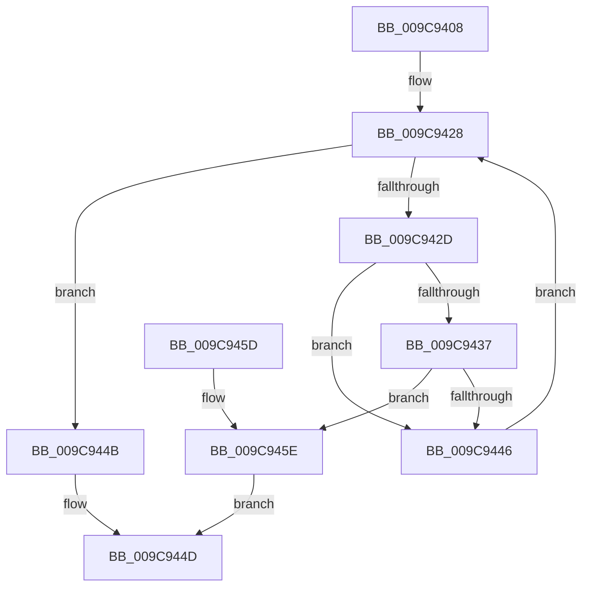

# ObpLookupNamespaceEntry

- RVA: `0x009C9408`–`0x009C9463` (길이 `91` bytes)
- VA: `0x00000001409C9408`
- 실행 섹션: `PAGE`
- PDB 이름 있음: `예`; PDB Function 태그: `아니요`
- unwind 정보 RVA: `0x00095A44`
- 디코드: `30`개 명령, `91/91` bytes 표시
- 미해석 바이트: `0` (있으면 어셈블리에 `.byte`로 보존)

> 이 문서는 커널 이미지의 기계어와 PDB 기호를 분석해 생성했습니다. 4번과 5번은 함수 원형과 자료형을 바이너리 사용 방식에서 추정한 C 해석이며 원본 소스 복구 결과는 아닙니다.

## 1. Dependencies

- 직접 호출 지점: **1**; 고유 호출 대상: **1**
- 직접 호출자로 확인된 함수: **2**
- RIP 상대 이미지 참조: **0**

### Outgoing calls
- `0x009C943D` → [ObpCompareNamespaceEntry](ObpCompareNamespaceEntry_function_009C946C.md) (function, `0x009C946C`)

### Direct callers
- [NtOpenPrivateNamespace](NtOpenPrivateNamespace_function_009C94E0.md) at `0x009C95F5`
- [ObpRegisterPrivateNamespace](ObpRegisterPrivateNamespace_function_009CA9F4.md) at `0x009CAA73`

### Static image references
- 디코드된 RIP-relative 메모리 참조가 없습니다.

## 2. Other-region calls and transfers

- 다른 실행 섹션으로 향하는 call: **0**
- 별도 외부 분기/꼬리 이동을 확인하지 못했습니다.

## 3. Assembly (complete function range)

```asm
009C9408  48 89 5C 24 08                  mov qword ptr [rsp + 8], rbx
009C940D  48 89 74 24 10                  mov qword ptr [rsp + 0x10], rsi
009C9412  57                              push rdi
009C9413  48 83 EC 20                     sub rsp, 0x20
009C9417  0F B6 7A 28                     movzx edi, byte ptr [rdx + 0x28]
009C941B  48 8B F2                        mov rsi, rdx
009C941E  48 C1 E7 04                     shl rdi, 4
009C9422  48 03 F9                        add rdi, rcx
009C9425  48 8B 1F                        mov rbx, qword ptr [rdi]
009C9428  48 3B DF                        cmp rbx, rdi
009C942B  74 1E                           je 0x1409c944b
009C942D  48 8B 46 18                     mov rax, qword ptr [rsi + 0x18]
009C9431  48 39 43 18                     cmp qword ptr [rbx + 0x18], rax
009C9435  75 0F                           jne 0x1409c9446
009C9437  48 8B D6                        mov rdx, rsi
009C943A  48 8B CB                        mov rcx, rbx
009C943D  E8 2A 00 00 00                  call 0x1409c946c
009C9442  85 C0                           test eax, eax
009C9444  75 18                           jne 0x1409c945e
009C9446  48 8B 1B                        mov rbx, qword ptr [rbx]
009C9449  EB DD                           jmp 0x1409c9428
009C944B  33 C0                           xor eax, eax
009C944D  48 8B 5C 24 30                  mov rbx, qword ptr [rsp + 0x30]
009C9452  48 8B 74 24 38                  mov rsi, qword ptr [rsp + 0x38]
009C9457  48 83 C4 20                     add rsp, 0x20
009C945B  5F                              pop rdi
009C945C  C3                              ret
009C945D  CC                              int3
009C945E  48 8B C3                        mov rax, rbx
009C9461  EB EA                           jmp 0x1409c944d
```

## 4. C-style interpretation (structured pseudocode)

```c
__int64 __fastcall ObpLookupNamespaceEntry(__int64 a1, __int64 a2)
{
    __int64 result;
    __int64 v_rdi;
    __int64 v_rsp;
    unsigned __int64 v_stack_p10;
    unsigned __int64 v_stack_p8;

    v_stack_p8 = v_rbx;
    v_stack_p10 = v_rsi;
    v_rsp = (v_rsp) - (32);
    v_rdi = (*(unsigned __int8 *)(a2 + 40)) << (4);
    v_rdi = (v_rdi) + (a1);
loc_009C9428:
    if ((*(unsigned __int64 *)(v_rdi)) == v_rdi) goto loc_009C944B;
    if ((*(unsigned __int64 *)(*(unsigned __int64 *)(v_rdi) + 24)) != (*(unsigned __int64 *)(a2 + 24))) goto loc_009C9446;
    result = ObpCompareNamespaceEntry(*(unsigned __int64 *)(v_rdi), a2, a3, a4);
    if ((unsigned int)(result) != 0) goto loc_009C945E;
loc_009C9446:
    goto loc_009C9428;
loc_009C944B:
    result = 0;
loc_009C944D:
    v_rsp = (v_rsp) + (32);
    return result;
loc_009C945E:
    goto loc_009C944D;
}
```

## 5. (Beta) C Style

```c
int64_t ObpLookupNamespaceEntry(int64_t Arg1, void *Arg2)
{
    uint8_t *arg2 = (uint8_t *)Arg2;

    int64_t result;
    int64_t local_rdi;
    int64_t local_rsp;
    uint64_t v_stack_p10;
    uint64_t v_stack_p8;

    v_stack_p8 = local_rbx;
    v_stack_p10 = local_rsi;
    local_rsp = (local_rsp) - (32);
    local_rdi = (*(uint8_t *)(arg2 + 0x28)) << (4);
    local_rdi = (local_rdi) + (Arg1);
loc_009C9428:
    if ((*(uint64_t *)(local_rdi)) == local_rdi) goto loc_009C944B;
    if ((*(uint64_t *)(*(uint64_t *)(local_rdi) + 0x18)) != (*(uint64_t *)(arg2 + 0x18))) goto loc_009C9446;
    result = ObpCompareNamespaceEntry(*(uint64_t *)(local_rdi), Arg2, a3, a4);
    if ((uint32_t)(result) != 0) goto loc_009C945E;
loc_009C9446:
    goto loc_009C9428;
loc_009C944B:
    result = 0;
loc_009C944D:
    local_rsp = (local_rsp) + (32);
    return result;
loc_009C945E:
    goto loc_009C944D;
}
```

### 관측된 메모리 오프셋

구조체 형식이 확인되지 않은 접근은 인자 기준의 오프셋으로만 기록했습니다.

| 기준 인자 | 오프셋 표현 | 폭 (bit) | 접근 |
|---|---:|---:|---|
| `Arg2` | `+ 0x18` | `64` | `R` |
| `Arg2` | `+ 0x28` | `8` | `R` |

## 6. Execution-region graph

[열기: 2D/3D 그래프와 함수 탐색 컨트롤 패널](../../../control-panel.html?section=page&rva=0x009C9408&view=graph)

- 2D 그래프는 위에서 아래로 흐르고, 3D 그래프는 빈 공간을 드래그해 회전합니다. Shift+드래그는 이동, 휠은 확대·축소, 함수 노드 선택은 대상 보고서 이동입니다.

### Static fallback


