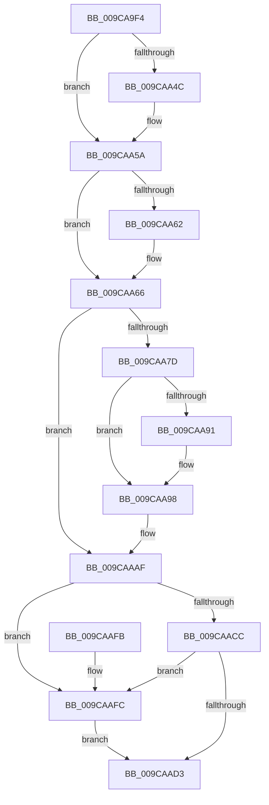

# ObpRegisterPrivateNamespace

- RVA: `0x009CA9F4`–`0x009CAB06` (길이 `274` bytes)
- VA: `0x00000001409CA9F4`
- 실행 섹션: `PAGE`
- PDB 이름 있음: `예`; PDB Function 태그: `아니요`
- unwind 정보 RVA: `0x0007AC84`
- 디코드: `77`개 명령, `274/274` bytes 표시
- 미해석 바이트: `0` (있으면 어셈블리에 `.byte`로 보존)

> 이 문서는 커널 이미지의 기계어와 PDB 기호를 분석해 생성했습니다. 4번과 5번은 함수 원형과 자료형을 바이너리 사용 방식에서 추정한 C 해석이며 원본 소스 복구 결과는 아닙니다.

## 1. Dependencies

- 직접 호출 지점: **7**; 고유 호출 대상: **7**
- 직접 호출자로 확인된 함수: **1**
- RIP 상대 이미지 참조: **0**

### Outgoing calls
- `0x009CAA14` → [PsGetCurrentServerSiloGlobals](../../text/2F/PsGetCurrentServerSiloGlobals_function_002FE1F0.md) (function, `0x002FE1F0`)
- `0x009CAA3C` → [KeAbPreAcquire](../../text/21/KeAbPreAcquire_function_00210230.md) (function, `0x00210230`)
- `0x009CAA55` → [ExfAcquirePushLockExclusiveEx](../../text/20/ExfAcquirePushLockExclusiveEx_function_0020FC90.md) (function, `0x0020FC90`)
- `0x009CAA73` → [ObpLookupNamespaceEntry](ObpLookupNamespaceEntry_function_009C9408.md) (function, `0x009C9408`)
- `0x009CAAD6` → [KeAbPostRelease](../../text/2E/KeAbPostRelease_function_002E1600.md) (function, `0x002E1600`)
- `0x009CAADB` → [KeLeaveCriticalRegion](../../text/25/KeLeaveCriticalRegion_function_0025D8B0.md) (function, `0x0025D8B0`)
- `0x009CAAFF` → [ExfReleasePushLock](../../text/26/ExfReleasePushLock_function_002638D0.md) (function, `0x002638D0`)

### Direct callers
- [NtCreatePrivateNamespace](NtCreatePrivateNamespace_function_009CA6D0.md) at `0x009CA825`

### Static image references
- 디코드된 RIP-relative 메모리 참조가 없습니다.

## 2. Other-region calls and transfers

- 다른 실행 섹션으로 향하는 call: **6**
  - `0x009CAA14` → [PsGetCurrentServerSiloGlobals](../../text/2F/PsGetCurrentServerSiloGlobals_function_002FE1F0.md) (`PAGE` → `.text`)
  - `0x009CAA3C` → [KeAbPreAcquire](../../text/21/KeAbPreAcquire_function_00210230.md) (`PAGE` → `.text`)
  - `0x009CAA55` → [ExfAcquirePushLockExclusiveEx](../../text/20/ExfAcquirePushLockExclusiveEx_function_0020FC90.md) (`PAGE` → `.text`)
  - `0x009CAAD6` → [KeAbPostRelease](../../text/2E/KeAbPostRelease_function_002E1600.md) (`PAGE` → `.text`)
  - `0x009CAADB` → [KeLeaveCriticalRegion](../../text/25/KeLeaveCriticalRegion_function_0025D8B0.md) (`PAGE` → `.text`)
  - `0x009CAAFF` → [ExfReleasePushLock](../../text/26/ExfReleasePushLock_function_002638D0.md) (`PAGE` → `.text`)
- 별도 외부 분기/꼬리 이동을 확인하지 못했습니다.

## 3. Assembly (complete function range)

```asm
009CA9F4  48 89 5C 24 08                  mov qword ptr [rsp + 8], rbx
009CA9F9  48 89 6C 24 10                  mov qword ptr [rsp + 0x10], rbp
009CA9FE  48 89 74 24 18                  mov qword ptr [rsp + 0x18], rsi
009CAA03  57                              push rdi
009CAA04  41 56                           push r14
009CAA06  41 57                           push r15
009CAA08  48 83 EC 20                     sub rsp, 0x20
009CAA0C  48 8B F9                        mov rdi, rcx
009CAA0F  BD 35 00 00 C0                  mov ebp, 0xc0000035
009CAA14  E8 D7 37 93 FF                  call 0x1402fe1f0
009CAA19  4C 8B F0                        mov r14, rax
009CAA1C  45 33 C0                        xor r8d, r8d
009CAA1F  65 48 8B 04 25 88 01 00 00      mov rax, qword ptr gs:[0x188]
009CAA28  33 D2                           xor edx, edx
009CAA2A  49 8D 9E D0 02 00 00            lea rbx, [r14 + 0x2d0]
009CAA31  66 FF 88 E4 01 00 00            dec word ptr [rax + 0x1e4]
009CAA38  48 8B CB                        mov rcx, rbx
009CAA3B  90                              nop
009CAA3C  E8 EF 57 84 FF                  call 0x140210230
009CAA41  F0 48 0F BA 2B 00               lock bts qword ptr [rbx], 0
009CAA47  48 8B F0                        mov rsi, rax
009CAA4A  73 0E                           jae 0x1409caa5a
009CAA4C  4C 8B C3                        mov r8, rbx
009CAA4F  48 8B D0                        mov rdx, rax
009CAA52  48 8B CB                        mov rcx, rbx
009CAA55  E8 36 52 84 FF                  call 0x14020fc90
009CAA5A  45 33 FF                        xor r15d, r15d
009CAA5D  48 85 F6                        test rsi, rsi
009CAA60  74 04                           je 0x1409caa66
009CAA62  C6 46 0A 01                     mov byte ptr [rsi + 0xa], 1
009CAA66  49 8D B6 80 00 00 00            lea rsi, [r14 + 0x80]
009CAA6D  48 8B D7                        mov rdx, rdi
009CAA70  48 8B CE                        mov rcx, rsi
009CAA73  E8 90 E9 FF FF                  call 0x1409c9408
009CAA78  48 85 C0                        test rax, rax
009CAA7B  75 32                           jne 0x1409caaaf
009CAA7D  0F B6 47 28                     movzx eax, byte ptr [rdi + 0x28]
009CAA81  48 C1 E0 04                     shl rax, 4
009CAA85  48 03 C6                        add rax, rsi
009CAA88  48 8B 48 08                     mov rcx, qword ptr [rax + 8]
009CAA8C  48 39 01                        cmp qword ptr [rcx], rax
009CAA8F  74 07                           je 0x1409caa98
009CAA91  B9 03 00 00 00                  mov ecx, 3
009CAA96  CD 29                           int 0x29
009CAA98  48 89 07                        mov qword ptr [rdi], rax
009CAA9B  41 8B EF                        mov ebp, r15d
009CAA9E  48 89 4F 08                     mov qword ptr [rdi + 8], rcx
009CAAA2  48 89 39                        mov qword ptr [rcx], rdi
009CAAA5  48 89 78 08                     mov qword ptr [rax + 8], rdi
009CAAA9  FF 86 58 02 00 00               inc dword ptr [rsi + 0x258]
009CAAAF  0F 0D 0B                        prefetchw byte ptr [rbx]
009CAAB2  48 8B 03                        mov rax, qword ptr [rbx]
009CAAB5  48 8B C8                        mov rcx, rax
009CAAB8  48 83 E1 F0                     and rcx, 0xfffffffffffffff0
009CAABC  48 83 F9 10                     cmp rcx, 0x10
009CAAC0  48 8D 50 F0                     lea rdx, [rax - 0x10]
009CAAC4  49 0F 46 D7                     cmovbe rdx, r15
009CAAC8  A8 02                           test al, 2
009CAACA  75 30                           jne 0x1409caafc
009CAACC  F0 48 0F B1 13                  lock cmpxchg qword ptr [rbx], rdx
009CAAD1  75 29                           jne 0x1409caafc
009CAAD3  48 8B CB                        mov rcx, rbx
009CAAD6  E8 25 6B 91 FF                  call 0x1402e1600
009CAADB  E8 D0 2D 89 FF                  call 0x14025d8b0
009CAAE0  48 8B 5C 24 40                  mov rbx, qword ptr [rsp + 0x40]
009CAAE5  8B C5                           mov eax, ebp
009CAAE7  48 8B 6C 24 48                  mov rbp, qword ptr [rsp + 0x48]
009CAAEC  48 8B 74 24 50                  mov rsi, qword ptr [rsp + 0x50]
009CAAF1  48 83 C4 20                     add rsp, 0x20
009CAAF5  41 5F                           pop r15
009CAAF7  41 5E                           pop r14
009CAAF9  5F                              pop rdi
009CAAFA  C3                              ret
009CAAFB  CC                              int3
009CAAFC  48 8B CB                        mov rcx, rbx
009CAAFF  E8 CC 8D 89 FF                  call 0x1402638d0
009CAB04  EB CD                           jmp 0x1409caad3
```

## 4. C-style interpretation (structured pseudocode)

```c
__int64 __fastcall ObpRegisterPrivateNamespace(__int64 a1, int a2, int a3)
{
    __int64 result;
    __int64 v_r15;
    __int64 v_rsp;
    unsigned __int64 v_stack_p10;
    unsigned __int64 v_stack_p18;
    unsigned __int64 v_stack_p8;

    v_stack_p8 = v_rbx;
    v_stack_p10 = v_rbp;
    v_stack_p18 = v_rsi;
    v_rsp = (v_rsp) - (32);
    result = PsGetCurrentServerSiloGlobals(a1, a2, a3, a4);
    a3 = 0;
    a2 = 0;
    result = KeAbPreAcquire(result + 720, a2, a3, a4);
    if (!(condition_is_above_or_equal)) {
        a3 = result + 720;
        a2 = result;
        a1 = result + 720;
        result = ExfAcquirePushLockExclusiveEx(a1, a2, a3, a4);
    }
    v_r15 = 0;
    if (result != 0) {
        *(unsigned __int8 *)(result + 10) = 1;
    }
    result = ObpLookupNamespaceEntry(result + 128, a1, a3, a4);
    if (result != 0) goto loc_009CAAAF;
    result = (*(unsigned __int8 *)(a1 + 40)) << (4);
    result = (result) + (result + 128);
    if ((*(unsigned __int64 *)(*(unsigned __int64 *)(result + 8))) != result) {
        a1 = 3;
    }
    *(unsigned __int64 *)(a1) = result;
    *(unsigned __int64 *)(a1 + 8) = a1;
    *(unsigned __int64 *)(a1) = a1;
    *(unsigned __int64 *)(result + 8) = a1;
loc_009CAAAF:
    a1 = (*(unsigned __int64 *)(result + 720)) & (-16);
    a2 = *(unsigned __int64 *)(result + 720) - 16;
    if (a1 <= 16) { a2 = 0; }
    if ((((unsigned __int8)(*(unsigned __int64 *)(result + 720))) & (2)) != 0) goto loc_009CAAFC;
    if ((((unsigned __int8)(*(unsigned __int64 *)(result + 720))) & (2)) != 0) goto loc_009CAAFC;
loc_009CAAD3:
    result = KeAbPostRelease(result + 720, a2, a3, a4);
    result = KeLeaveCriticalRegion(result + 720, a2, a3, a4);
    v_rsp = (v_rsp) + (32);
    return 0;
loc_009CAAFC:
    result = ExfReleasePushLock(v_stack_p8, a2, a3, a4);
    goto loc_009CAAD3;
}
```

## 5. (Beta) C Style

```c
int64_t ObpRegisterPrivateNamespace(void *Arg1, int32_t Arg2, int32_t Arg3)
{
    uint8_t *arg1 = (uint8_t *)Arg1;

    int64_t result;
    int64_t local_r15;
    int64_t local_rsp;
    uint64_t v_stack_p10;
    uint64_t v_stack_p18;
    uint64_t v_stack_p8;

    v_stack_p8 = local_rbx;
    v_stack_p10 = local_rbp;
    v_stack_p18 = local_rsi;
    local_rsp = (local_rsp) - (32);
    result = PsGetCurrentServerSiloGlobals(Arg1, Arg2, Arg3, a4);
    Arg3 = 0;
    Arg2 = 0;
    result = KeAbPreAcquire(result + 720, Arg2, Arg3, a4);
    if (!(condition_is_above_or_equal)) {
        Arg3 = result + 720;
        Arg2 = result;
        Arg1 = result + 720;
        result = ExfAcquirePushLockExclusiveEx(Arg1, Arg2, Arg3, a4);
    }
    local_r15 = 0;
    if (result != 0) {
        *(uint8_t *)(result + 0xA) = 1;
    }
    result = ObpLookupNamespaceEntry(result + 128, Arg1, Arg3, a4);
    if (result != 0) goto loc_009CAAAF;
    result = (*(uint8_t *)(arg1 + 0x28)) << (4);
    result = (result) + (result + 128);
    if ((*(uint64_t *)(*(uint64_t *)(result + 0x8))) != result) {
        Arg1 = 3;
    }
    *(uint64_t *)(arg1) = result;
    *(void **)(arg1 + 0x8) = Arg1;
    *(void **)(arg1) = Arg1;
    *(void **)(result + 0x8) = Arg1;
loc_009CAAAF:
    Arg1 = (*(uint64_t *)(result + 0x2D0)) & (-16);
    Arg2 = *(uint64_t *)(result + 0x2D0) - 16;
    if (Arg1 <= 16) { Arg2 = 0; }
    if ((((uint8_t)(*(uint64_t *)(result + 0x2D0))) & (2)) != 0) goto loc_009CAAFC;
    if ((((uint8_t)(*(uint64_t *)(result + 0x2D0))) & (2)) != 0) goto loc_009CAAFC;
loc_009CAAD3:
    result = KeAbPostRelease(result + 720, Arg2, Arg3, a4);
    result = KeLeaveCriticalRegion(result + 720, Arg2, Arg3, a4);
    local_rsp = (local_rsp) + (32);
    return 0;
loc_009CAAFC:
    result = ExfReleasePushLock(v_stack_p8, Arg2, Arg3, a4);
    goto loc_009CAAD3;
}
```

### 관측된 메모리 오프셋

구조체 형식이 확인되지 않은 접근은 인자 기준의 오프셋으로만 기록했습니다.

| 기준 인자 | 오프셋 표현 | 폭 (bit) | 접근 |
|---|---:|---:|---|
| `Arg1` | `+ 0x0` | `64` | `W` |
| `Arg1` | `+ 0x8` | `64` | `W` |
| `Arg1` | `+ 0x28` | `8` | `R` |

## 6. Execution-region graph

[열기: 2D/3D 그래프와 함수 탐색 컨트롤 패널](../../../control-panel.html?section=page&rva=0x009CA9F4&view=graph)

- 2D 그래프는 위에서 아래로 흐르고, 3D 그래프는 빈 공간을 드래그해 회전합니다. Shift+드래그는 이동, 휠은 확대·축소, 함수 노드 선택은 대상 보고서 이동입니다.

### Static fallback


