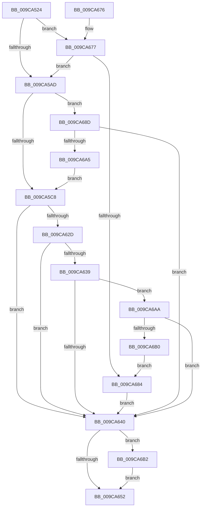

# ObpVerifyCreatorAccessCheck

- RVA: `0x009CA524`–`0x009CA6BB` (길이 `407` bytes)
- VA: `0x00000001409CA524`
- 실행 섹션: `PAGE`
- PDB 이름 있음: `예`; PDB Function 태그: `아니요`
- unwind 정보 RVA: `0x000A0AEC`
- 디코드: `103`개 명령, `407/407` bytes 표시
- 미해석 바이트: `0` (있으면 어셈블리에 `.byte`로 보존)

> 이 문서는 커널 이미지의 기계어와 PDB 기호를 분석해 생성했습니다. 4번과 5번은 함수 원형과 자료형을 바이너리 사용 방식에서 추정한 C 해석이며 원본 소스 복구 결과는 아닙니다.

## 1. Dependencies

- 직접 호출 지점: **12**; 고유 호출 대상: **10**
- 직접 호출자로 확인된 함수: **2**
- RIP 상대 이미지 참조: **2**

### Outgoing calls
- `0x009CA556` → [memset](../../text/6C/memset_function_006C6C40.md) (function, `0x006C6C40`)
- `0x009CA58C` → [SeCaptureSubjectContextEx](../8C/SeCaptureSubjectContextEx_function_008C4C90.md) (function, `0x008C4C90`)
- `0x009CA5B9` → [SeQueryInformationToken](../8B/SeQueryInformationToken_function_008B5090.md) (function, `0x008B5090`)
- `0x009CA5D4` → [SeQueryInformationToken](../8B/SeQueryInformationToken_function_008B5090.md) (function, `0x008B5090`)
- `0x009CA5ED` → [RtlSubAuthoritySid](../../text/45/RtlSubAuthoritySid_function_00456D10.md) (function, `0x00456D10`)
- `0x009CA603` → [SeLockSubjectContext](../8C/SeLockSubjectContext_function_008C64C0.md) (function, `0x008C64C0`)
- `0x009CA616` → [RtlEnumerateBoundaryDescriptorEntries](RtlEnumerateBoundaryDescriptorEntries_function_009CA278.md) (function, `0x009CA278`)
- `0x009CA621` → [SeUnlockSubjectContext](../8C/SeUnlockSubjectContext_function_008C6520.md) (function, `0x008C6520`)
- `0x009CA644` → [SeReleaseSubjectContext](../86/SeReleaseSubjectContext_function_0086B710.md) (function, `0x0086B710`)
- `0x009CA65C` → [_security_check_cookie](../../text/6A/_security_check_cookie_function_006AC640.md) (function, `0x006AC640`)
- `0x009CA699` → [SeQueryInformationToken](../8B/SeQueryInformationToken_function_008B5090.md) (function, `0x008B5090`)
- `0x009CA6B4` → [ExFreePoolWithTag](../../poolcode/B8/ExFreePoolWithTag_function_00B82870.md) (function, `0x00B82870`)

### Direct callers
- [NtDeletePrivateNamespace](../70/NtDeletePrivateNamespace_function_00700920.md) at `0x00700988`
- [NtCreatePrivateNamespace](NtCreatePrivateNamespace_function_009CA6D0.md) at `0x009CA73B`

### Static image references
- `0x009CA53B` → RVA `0x00E0A740` (`.data`; read)
- `0x009CA60F` → RVA `0x00A5E500` (`ObpVerifyAccessToBoundaryEntry`; read)

## 2. Other-region calls and transfers

- 다른 실행 섹션으로 향하는 call: **4**
  - `0x009CA556` → [memset](../../text/6C/memset_function_006C6C40.md) (`PAGE` → `.text`)
  - `0x009CA5ED` → [RtlSubAuthoritySid](../../text/45/RtlSubAuthoritySid_function_00456D10.md) (`PAGE` → `.text`)
  - `0x009CA65C` → [_security_check_cookie](../../text/6A/_security_check_cookie_function_006AC640.md) (`PAGE` → `.text`)
  - `0x009CA6B4` → [ExFreePoolWithTag](../../poolcode/B8/ExFreePoolWithTag_function_00B82870.md) (`PAGE` → `POOLCODE`)
- 별도 외부 분기/꼬리 이동을 확인하지 못했습니다.

## 3. Assembly (complete function range)

```asm
009CA524  48 89 5C 24 10                  mov qword ptr [rsp + 0x10], rbx
009CA529  48 89 7C 24 18                  mov qword ptr [rsp + 0x18], rdi
009CA52E  55                              push rbp
009CA52F  48 8D 6C 24 A9                  lea rbp, [rsp - 0x57]
009CA534  48 81 EC C0 00 00 00            sub rsp, 0xc0
009CA53B  48 8B 05 FE 01 44 00            mov rax, qword ptr [rip + 0x4401fe]
009CA542  48 33 C4                        xor rax, rsp
009CA545  48 89 45 47                     mov qword ptr [rbp + 0x47], rax
009CA549  33 D2                           xor edx, edx
009CA54B  48 8B F9                        mov rdi, rcx
009CA54E  48 8D 4D F7                     lea rcx, [rbp - 9]
009CA552  44 8D 42 44                     lea r8d, [rdx + 0x44]
009CA556  E8 E5 C6 CF FF                  call 0x1406c6c40
009CA55B  83 65 BB 00                     and dword ptr [rbp - 0x45], 0
009CA55F  4C 8D 45 BF                     lea r8, [rbp - 0x41]
009CA563  83 65 B7 00                     and dword ptr [rbp - 0x49], 0
009CA567  0F 57 C0                        xorps xmm0, xmm0
009CA56A  0F 11 45 BF                     movups xmmword ptr [rbp - 0x41], xmm0
009CA56E  33 C0                           xor eax, eax
009CA570  0F 11 45 CF                     movups xmmword ptr [rbp - 0x31], xmm0
009CA574  48 89 45 EF                     mov qword ptr [rbp - 0x11], rax
009CA578  0F 11 45 DF                     movups xmmword ptr [rbp - 0x21], xmm0
009CA57C  65 48 8B 0C 25 88 01 00 00      mov rcx, qword ptr gs:[0x188]
009CA585  48 8B 91 B8 00 00 00            mov rdx, qword ptr [rcx + 0xb8]
009CA58C  E8 FF A6 EF FF                  call 0x1408c4c90
009CA591  48 8B 45 BF                     mov rax, qword ptr [rbp - 0x41]
009CA595  48 8B 5D CF                     mov rbx, qword ptr [rbp - 0x31]
009CA599  48 85 C0                        test rax, rax
009CA59C  48 0F 45 D8                     cmovne rbx, rax
009CA5A0  83 BB C0 00 00 00 02            cmp dword ptr [rbx + 0xc0], 2
009CA5A7  0F 84 CA 00 00 00               je 0x1409ca677
009CA5AD  4C 8D 45 B7                     lea r8, [rbp - 0x49]
009CA5B1  BA 1D 00 00 00                  mov edx, 0x1d
009CA5B6  48 8B CB                        mov rcx, rbx
009CA5B9  E8 D2 AA EE FF                  call 0x1408b5090
009CA5BE  83 7D B7 00                     cmp dword ptr [rbp - 0x49], 0
009CA5C2  0F 85 C5 00 00 00               jne 0x1409ca68d
009CA5C8  4C 8D 45 BB                     lea r8, [rbp - 0x45]
009CA5CC  BA 19 00 00 00                  mov edx, 0x19
009CA5D1  48 8B CB                        mov rcx, rbx
009CA5D4  E8 B7 AA EE FF                  call 0x1408b5090
009CA5D9  33 D2                           xor edx, edx
009CA5DB  C7 45 F7 01 01 00 00            mov dword ptr [rbp - 9], 0x101
009CA5E2  48 8D 4D F7                     lea rcx, [rbp - 9]
009CA5E6  C7 45 FB 00 00 00 10            mov dword ptr [rbp - 5], 0x10000000
009CA5ED  E8 1E C7 A8 FF                  call 0x140456d10
009CA5F2  8B 55 BB                        mov edx, dword ptr [rbp - 0x45]
009CA5F5  48 8D 4D BF                     lea rcx, [rbp - 0x41]
009CA5F9  89 10                           mov dword ptr [rax], edx
009CA5FB  48 8D 45 F7                     lea rax, [rbp - 9]
009CA5FF  48 89 45 E7                     mov qword ptr [rbp - 0x19], rax
009CA603  E8 B8 BE EF FF                  call 0x1408c64c0
009CA608  4C 8D 45 BF                     lea r8, [rbp - 0x41]
009CA60C  48 8B CF                        mov rcx, rdi
009CA60F  48 8D 15 EA 3E 09 00            lea rdx, [rip + 0x93eea]
009CA616  E8 5D FC FF FF                  call 0x1409ca278
009CA61B  48 8D 4D BF                     lea rcx, [rbp - 0x41]
009CA61F  8B D8                           mov ebx, eax
009CA621  E8 FA BE EF FF                  call 0x1408c6520
009CA626  8B 4D EF                        mov ecx, dword ptr [rbp - 0x11]
009CA629  85 C9                           test ecx, ecx
009CA62B  78 13                           js 0x1409ca640
009CA62D  85 DB                           test ebx, ebx
009CA62F  0F 48 CB                        cmovs ecx, ebx
009CA632  89 4D EF                        mov dword ptr [rbp - 0x11], ecx
009CA635  85 C9                           test ecx, ecx
009CA637  78 07                           js 0x1409ca640
009CA639  48 83 7D DF 00                  cmp qword ptr [rbp - 0x21], 0
009CA63E  75 6A                           jne 0x1409ca6aa
009CA640  48 8D 4D BF                     lea rcx, [rbp - 0x41]
009CA644  E8 C7 10 EA FF                  call 0x14086b710
009CA649  48 8B 4D DF                     mov rcx, qword ptr [rbp - 0x21]
009CA64D  48 85 C9                        test rcx, rcx
009CA650  75 60                           jne 0x1409ca6b2
009CA652  8B 45 EF                        mov eax, dword ptr [rbp - 0x11]
009CA655  48 8B 4D 47                     mov rcx, qword ptr [rbp + 0x47]
009CA659  48 33 CC                        xor rcx, rsp
009CA65C  E8 DF 1F CE FF                  call 0x1406ac640
009CA661  4C 8D 9C 24 C0 00 00 00         lea r11, [rsp + 0xc0]
009CA669  49 8B 5B 18                     mov rbx, qword ptr [r11 + 0x18]
009CA66D  49 8B 7B 20                     mov rdi, qword ptr [r11 + 0x20]
009CA671  49 8B E3                        mov rsp, r11
009CA674  5D                              pop rbp
009CA675  C3                              ret
009CA676  CC                              int3
009CA677  83 BB C4 00 00 00 02            cmp dword ptr [rbx + 0xc4], 2
009CA67E  0F 8D 29 FF FF FF               jge 0x1409ca5ad
009CA684  C7 45 EF 22 00 00 C0            mov dword ptr [rbp - 0x11], 0xc0000022
009CA68B  EB B3                           jmp 0x1409ca640
009CA68D  4C 8D 45 DF                     lea r8, [rbp - 0x21]
009CA691  BA 1F 00 00 00                  mov edx, 0x1f
009CA696  48 8B CB                        mov rcx, rbx
009CA699  E8 F2 A9 EE FF                  call 0x1408b5090
009CA69E  89 45 EF                        mov dword ptr [rbp - 0x11], eax
009CA6A1  85 C0                           test eax, eax
009CA6A3  78 9B                           js 0x1409ca640
009CA6A5  E9 1E FF FF FF                  jmp 0x1409ca5c8
009CA6AA  F6 45 F3 01                     test byte ptr [rbp - 0xd], 1
009CA6AE  75 90                           jne 0x1409ca640
009CA6B0  EB D2                           jmp 0x1409ca684
009CA6B2  33 D2                           xor edx, edx
009CA6B4  E8 B7 81 1B 00                  call 0x140b82870
009CA6B9  EB 97                           jmp 0x1409ca652
```

## 4. C-style interpretation (structured pseudocode)

```c
__int64 __fastcall ObpVerifyCreatorAccessCheck(__int64 a1, int a2)
{
    __int64 result;
    __int64 v_rbx;
    __int64 v_rsp;
    unsigned __int64 v_stack_m18;
    unsigned __int64 v_stack_m5F;
    unsigned int v_stack_m64;
    unsigned __int64 v_stack_m68;
    unsigned __int8 v_stack_m6C;
    unsigned __int64 v_stack_m70;
    unsigned __int64 v_stack_m78;
    unsigned __int64 v_stack_m8;
    unsigned __int64 v_stack_m80;
    unsigned __int64 v_stack_m90;
    unsigned __int64 v_stack_mA0;
    unsigned int v_stack_mA4;
    unsigned int v_stack_mA8;
    unsigned __int64 v_stack_p10;
    unsigned __int64 v_stack_p18;

    v_stack_p10 = v_rbx;
    v_stack_p18 = v_rdi;
    v_rsp = (v_rsp) - (192);
    result = (*(unsigned __int64 *)(v_rip + 4456958)) ^ (v_rsp);
    v_stack_m18 = result;
    a2 = 0;
    result = memset(v_stack_m68, a2, a2 + 68, a4);
    v_stack_mA0 = v_xmm0;
    result = 0;
    v_stack_m90 = v_xmm0;
    v_stack_m70 = 0;
    v_stack_m80 = v_xmm0;
    result = SeCaptureSubjectContextEx(*(unsigned __int64 *)(gs_base + (0 + 392)), *(unsigned __int64 *)(*(unsigned __int64 *)(gs_base + (0 + 392)) + 184), v_stack_mA0, a4);
    v_rbx = v_stack_m90;
    if (v_stack_mA0 != 0) { v_rbx = v_stack_mA0; }
    if ((*(unsigned int *)(v_rbx + 192)) == 2) goto loc_009CA677;
loc_009CA5AD:
    result = SeQueryInformationToken(v_rbx, 29, v_stack_mA8, a4);
    if (v_stack_mA8 != 0) goto loc_009CA68D;
loc_009CA5C8:
    result = SeQueryInformationToken(v_rbx, 25, v_stack_mA4, a4);
    a2 = 0;
    v_stack_m68 = 257;
    v_stack_m64 = 0x10000000ULL;
    result = RtlSubAuthoritySid(v_stack_m68, a2, v_stack_mA4, a4);
    *(unsigned int *)(result) = (unsigned int)((unsigned int)(v_stack_mA4));
    v_stack_m78 = v_stack_m68;
    result = SeLockSubjectContext(v_stack_mA0, (unsigned int)(v_stack_mA4), v_stack_mA4, a4);
    result = RtlEnumerateBoundaryDescriptorEntries(a1, v_rip + 605930, v_stack_mA0, a4);
    result = SeUnlockSubjectContext(v_stack_mA0, v_rip + 605930, v_stack_mA0, a4);
    if (sign_flag) goto loc_009CA640;
    a1 = (unsigned int)(v_stack_m70);
    if (sign_flag) { a1 = (unsigned int)((unsigned int)((unsigned int)(result))); }
    v_stack_m70 = (unsigned int)(a1);
    if (sign_flag) goto loc_009CA640;
    if (v_stack_m80 != 0) goto loc_009CA6AA;
loc_009CA640:
    result = SeReleaseSubjectContext(v_stack_mA0, v_rip + 605930, v_stack_mA0, a4);
    if (v_stack_m80 != 0) goto loc_009CA6B2;
loc_009CA652:
    a1 = (v_stack_m18) ^ (v_rsp);
    result = _security_check_cookie(a1, v_rip + 605930, v_stack_mA0, a4);
    return result;
loc_009CA677:
    if ((*(unsigned int *)(*(unsigned __int64 *)(v_stack_m8 + 24) + 196)) >= 2) goto loc_009CA5AD;
loc_009CA684:
    v_stack_m70 = 0xC0000022ULL;
    goto loc_009CA640;
loc_009CA68D:
    result = SeQueryInformationToken(*(unsigned __int64 *)(v_stack_m8 + 24), 31, v_stack_m80, a4);
    v_stack_m70 = (unsigned int)(result);
    if (sign_flag) goto loc_009CA640;
    goto loc_009CA5C8;
loc_009CA6AA:
    if (((v_stack_m6C) & (1)) != 0) goto loc_009CA640;
    goto loc_009CA684;
loc_009CA6B2:
    a2 = 0;
    result = ExFreePoolWithTag(*(unsigned __int64 *)(v_stack_m8 + 24), a2, v_stack_m80, a4);
    goto loc_009CA652;
}
```

## 5. (Beta) C Style

```c
int64_t ObpVerifyCreatorAccessCheck(int64_t Arg1, int32_t Arg2)
{
    int64_t result;
    int64_t local_rbx;
    int64_t local_rsp;
    uint64_t v_stack_m18;
    uint64_t v_stack_m5F;
    uint32_t v_stack_m64;
    uint64_t v_stack_m68;
    uint8_t v_stack_m6C;
    uint64_t v_stack_m70;
    uint64_t v_stack_m78;
    uint64_t v_stack_m8;
    uint64_t v_stack_m80;
    uint64_t v_stack_m90;
    uint64_t v_stack_mA0;
    uint32_t v_stack_mA4;
    uint32_t v_stack_mA8;
    uint64_t v_stack_p10;
    uint64_t v_stack_p18;

    v_stack_p10 = local_rbx;
    v_stack_p18 = local_rdi;
    local_rsp = (local_rsp) - (192);
    result = (*(uint64_t *)(v_rip + 0x4401FE)) ^ (local_rsp);
    v_stack_m18 = result;
    Arg2 = 0;
    result = memset(v_stack_m68, Arg2, Arg2 + 68, a4);
    v_stack_mA0 = v_xmm0;
    result = 0;
    v_stack_m90 = v_xmm0;
    v_stack_m70 = 0;
    v_stack_m80 = v_xmm0;
    result = SeCaptureSubjectContextEx(*(uint64_t *)(gs_base + (0 + 0x188)), *(uint64_t *)(*(uint64_t *)(gs_base + (0 + 0x188)) + 0xB8), v_stack_mA0, a4);
    local_rbx = v_stack_m90;
    if (v_stack_mA0 != 0) { local_rbx = v_stack_mA0; }
    if ((*(uint32_t *)(local_rbx + 0xC0)) == 2) goto loc_009CA677;
loc_009CA5AD:
    result = SeQueryInformationToken(local_rbx, 29, v_stack_mA8, a4);
    if (v_stack_mA8 != 0) goto loc_009CA68D;
loc_009CA5C8:
    result = SeQueryInformationToken(local_rbx, 25, v_stack_mA4, a4);
    Arg2 = 0;
    v_stack_m68 = 257;
    v_stack_m64 = 0x10000000ULL;
    result = RtlSubAuthoritySid(v_stack_m68, Arg2, v_stack_mA4, a4);
    *(uint32_t *)(result) = (uint32_t)((uint32_t)(v_stack_mA4));
    v_stack_m78 = v_stack_m68;
    result = SeLockSubjectContext(v_stack_mA0, (uint32_t)(v_stack_mA4), v_stack_mA4, a4);
    result = RtlEnumerateBoundaryDescriptorEntries(Arg1, v_rip + 605930, v_stack_mA0, a4);
    result = SeUnlockSubjectContext(v_stack_mA0, v_rip + 605930, v_stack_mA0, a4);
    if (sign_flag) goto loc_009CA640;
    Arg1 = (uint32_t)(v_stack_m70);
    if (sign_flag) { Arg1 = (uint32_t)((uint32_t)((uint32_t)(result))); }
    v_stack_m70 = (uint32_t)(Arg1);
    if (sign_flag) goto loc_009CA640;
    if (v_stack_m80 != 0) goto loc_009CA6AA;
loc_009CA640:
    result = SeReleaseSubjectContext(v_stack_mA0, v_rip + 605930, v_stack_mA0, a4);
    if (v_stack_m80 != 0) goto loc_009CA6B2;
loc_009CA652:
    Arg1 = (v_stack_m18) ^ (local_rsp);
    result = _security_check_cookie(Arg1, v_rip + 605930, v_stack_mA0, a4);
    return result;
loc_009CA677:
    if ((*(uint32_t *)(*(uint64_t *)(v_stack_m8 + 0x18) + 0xC4)) >= 2) goto loc_009CA5AD;
loc_009CA684:
    v_stack_m70 = 0xC0000022ULL;
    goto loc_009CA640;
loc_009CA68D:
    result = SeQueryInformationToken(*(uint64_t *)(v_stack_m8 + 0x18), 31, v_stack_m80, a4);
    v_stack_m70 = (uint32_t)(result);
    if (sign_flag) goto loc_009CA640;
    goto loc_009CA5C8;
loc_009CA6AA:
    if (((v_stack_m6C) & (1)) != 0) goto loc_009CA640;
    goto loc_009CA684;
loc_009CA6B2:
    Arg2 = 0;
    result = ExFreePoolWithTag(*(uint64_t *)(v_stack_m8 + 0x18), Arg2, v_stack_m80, a4);
    goto loc_009CA652;
}
```

## 6. Execution-region graph

[열기: 2D/3D 그래프와 함수 탐색 컨트롤 패널](../../../control-panel.html?section=page&rva=0x009CA524&view=graph)

- 2D 그래프는 위에서 아래로 흐르고, 3D 그래프는 빈 공간을 드래그해 회전합니다. Shift+드래그는 이동, 휠은 확대·축소, 함수 노드 선택은 대상 보고서 이동입니다.

### Static fallback


