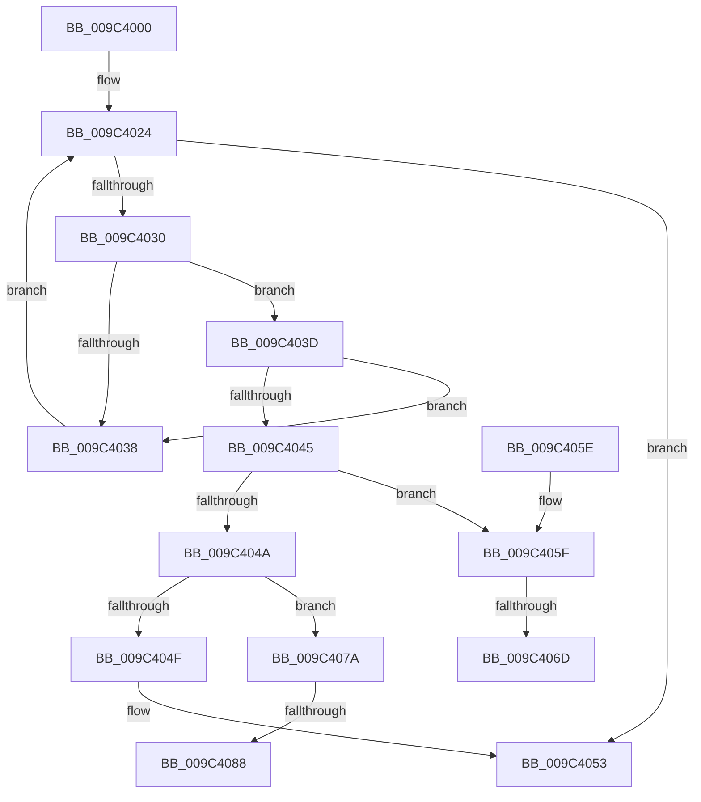

# PiUEventCoalesceBroadcastEvents

- RVA: `0x009C4000`–`0x009C4095` (길이 `149` bytes)
- VA: `0x00000001409C4000`
- 실행 섹션: `PAGE`
- PDB 이름 있음: `예`; PDB Function 태그: `예`
- unwind 정보 RVA: `0x0009F8AC`
- 디코드: `42`개 명령, `149/149` bytes 표시
- 미해석 바이트: `0` (있으면 어셈블리에 `.byte`로 보존)

> 이 문서는 커널 이미지의 기계어와 PDB 기호를 분석해 생성했습니다. 4번과 5번은 함수 원형과 자료형을 바이너리 사용 방식에서 추정한 C 해석이며 원본 소스 복구 결과는 아닙니다.

## 1. Dependencies

- 직접 호출 지점: **0**; 고유 호출 대상: **0**
- 직접 호출자로 확인된 함수: **1**
- RIP 상대 이미지 참조: **1**

### Outgoing calls
- 직접 디코드된 call 명령이 없습니다.

### Direct callers
- [PiUEventQueueBroadcastEventEntry](PiUEventQueueBroadcastEventEntry_function_009C3F44.md) at `0x009C3F6C`

### Static image references
- `0x009C400A` → RVA `0x00F8CAE0` (`.data`; read)

## 2. Other-region calls and transfers

- 다른 실행 섹션으로 향하는 call: **0**
- call이 아닌 외부 분기/꼬리 이동: **4**
  - `0x009C4067` → [sub_00B2F42E](../B2/Unknown_function_00B2F42E.md) (`tail-transfer`)
  - `0x009C4075` → [sub_00B2F42E](../B2/Unknown_function_00B2F42E.md) (`tail-transfer`)
  - `0x009C4082` → [sub_00B2F42E + 0x44](../B2/Unknown_function_00B2F42E.md) (`tail-transfer`)
  - `0x009C4090` → [sub_00B2F42E + 0x44](../B2/Unknown_function_00B2F42E.md) (`tail-transfer`)

## 3. Assembly (complete function range)

```asm
009C4000  48 89 5C 24 08                  mov qword ptr [rsp + 8], rbx
009C4005  57                              push rdi
009C4006  48 83 EC 40                     sub rsp, 0x40
009C400A  48 8B 1D CF 8A 5C 00            mov rbx, qword ptr [rip + 0x5c8acf]
009C4011  0F 57 C0                        xorps xmm0, xmm0
009C4014  0F 57 C9                        xorps xmm1, xmm1
009C4017  48 8B F9                        mov rdi, rcx
009C401A  0F 11 44 24 30                  movups xmmword ptr [rsp + 0x30], xmm0
009C401F  0F 11 4C 24 20                  movups xmmword ptr [rsp + 0x20], xmm1
009C4024  48 8D 05 B5 8A 5C 00            lea rax, [rip + 0x5c8ab5]
009C402B  48 3B D8                        cmp rbx, rax
009C402E  74 23                           je 0x1409c4053
009C4030  8B 4B 14                        mov ecx, dword ptr [rbx + 0x14]
009C4033  3B 4F 14                        cmp ecx, dword ptr [rdi + 0x14]
009C4036  74 05                           je 0x1409c403d
009C4038  48 8B 1B                        mov rbx, qword ptr [rbx]
009C403B  EB E7                           jmp 0x1409c4024
009C403D  8B 47 18                        mov eax, dword ptr [rdi + 0x18]
009C4040  39 43 18                        cmp dword ptr [rbx + 0x18], eax
009C4043  75 F3                           jne 0x1409c4038
009C4045  83 F9 03                        cmp ecx, 3
009C4048  74 15                           je 0x1409c405f
009C404A  83 F9 02                        cmp ecx, 2
009C404D  74 2B                           je 0x1409c407a
009C404F  C6 43 10 00                     mov byte ptr [rbx + 0x10], 0
009C4053  48 8B 5C 24 50                  mov rbx, qword ptr [rsp + 0x50]
009C4058  48 83 C4 40                     add rsp, 0x40
009C405C  5F                              pop rdi
009C405D  C3                              ret
009C405E  CC                              int3
009C405F  48 8B 4B 1C                     mov rcx, qword ptr [rbx + 0x1c]
009C4063  48 2B 4F 1C                     sub rcx, qword ptr [rdi + 0x1c]
009C4067  0F 85 C1 B3 16 00               jne 0x140b2f42e
009C406D  48 8B 4B 24                     mov rcx, qword ptr [rbx + 0x24]
009C4071  48 2B 4F 24                     sub rcx, qword ptr [rdi + 0x24]
009C4075  E9 B4 B3 16 00                  jmp 0x140b2f42e
009C407A  48 8B 4F 1C                     mov rcx, qword ptr [rdi + 0x1c]
009C407E  48 2B 4B 1C                     sub rcx, qword ptr [rbx + 0x1c]
009C4082  0F 85 EA B3 16 00               jne 0x140b2f472
009C4088  48 8B 4F 24                     mov rcx, qword ptr [rdi + 0x24]
009C408C  48 2B 4B 24                     sub rcx, qword ptr [rbx + 0x24]
009C4090  E9 DD B3 16 00                  jmp 0x140b2f472
```

## 4. C-style interpretation (structured pseudocode)

```c
__int64 __fastcall PiUEventCoalesceBroadcastEvents(__int64 a1)
{
    __int64 v_rsp;
    unsigned __int64 v_stack_m18;
    unsigned __int64 v_stack_m28;
    unsigned __int64 v_stack_p8;

    v_stack_p8 = v_rbx;
    v_rsp = (v_rsp) - (64);
    v_stack_m18 = v_xmm0;
    v_stack_m28 = v_xmm1;
loc_009C4024:
    if ((*(unsigned __int64 *)(v_rip + 6064847)) == (v_rip + 6064821)) goto loc_009C4053;
    if (((unsigned int)((unsigned int)(*(unsigned int *)(*(unsigned __int64 *)(v_rip + 6064847) + 20)))) == (*(unsigned int *)(a1 + 20))) goto loc_009C403D;
loc_009C4038:
    goto loc_009C4024;
loc_009C403D:
    if ((*(unsigned int *)(*(unsigned __int64 *)(*(unsigned __int64 *)(v_rip + 6064847)) + 24)) != ((unsigned int)((unsigned int)(*(unsigned int *)(a1 + 24))))) goto loc_009C4038;
    if (((unsigned int)((unsigned int)(*(unsigned int *)(*(unsigned __int64 *)(v_rip + 6064847) + 20)))) == 3) goto loc_009C405F;
    if (((unsigned int)((unsigned int)(*(unsigned int *)(*(unsigned __int64 *)(v_rip + 6064847) + 20)))) == 2) goto loc_009C407A;
    *(unsigned __int8 *)(*(unsigned __int64 *)(*(unsigned __int64 *)(v_rip + 6064847)) + 16) = 0;
loc_009C4053:
    v_rsp = (v_rsp) + (64);
    return (unsigned int)(*(unsigned int *)(a1 + 24));
loc_009C405F:
    a1 = (*(unsigned __int64 *)(v_stack_p8 + 28)) - (*(unsigned __int64 *)(a1 + 28));
    a1 = (*(unsigned __int64 *)(v_stack_p8 + 36)) - (*(unsigned __int64 *)(a1 + 36));
loc_009C407A:
    a1 = (*(unsigned __int64 *)(a1 + 28)) - (*(unsigned __int64 *)(v_stack_p8 + 28));
    a1 = (*(unsigned __int64 *)(a1 + 36)) - (*(unsigned __int64 *)(v_stack_p8 + 36));
}
```

## 5. (Beta) C Style

```c
int64_t PiUEventCoalesceBroadcastEvents(void *Arg1)
{
    uint8_t *arg1 = (uint8_t *)Arg1;

    int64_t local_rsp;
    uint64_t v_stack_m18;
    uint64_t v_stack_m28;
    uint64_t v_stack_p8;

    v_stack_p8 = local_rbx;
    local_rsp = (local_rsp) - (64);
    v_stack_m18 = v_xmm0;
    v_stack_m28 = v_xmm1;
loc_009C4024:
    if ((*(uint64_t *)(v_rip + 0x5C8ACF)) == (v_rip + 6064821)) goto loc_009C4053;
    if (((uint32_t)((uint32_t)(*(uint32_t *)(*(uint64_t *)(v_rip + 0x5C8ACF) + 0x14)))) == (*(uint32_t *)(arg1 + 0x14))) goto loc_009C403D;
loc_009C4038:
    goto loc_009C4024;
loc_009C403D:
    if ((*(uint32_t *)(*(uint64_t *)(*(uint64_t *)(v_rip + 0x5C8ACF)) + 0x18)) != ((uint32_t)((uint32_t)(*(uint32_t *)(arg1 + 0x18))))) goto loc_009C4038;
    if (((uint32_t)((uint32_t)(*(uint32_t *)(*(uint64_t *)(v_rip + 0x5C8ACF) + 0x14)))) == 3) goto loc_009C405F;
    if (((uint32_t)((uint32_t)(*(uint32_t *)(*(uint64_t *)(v_rip + 0x5C8ACF) + 0x14)))) == 2) goto loc_009C407A;
    *(uint8_t *)(*(uint64_t *)(*(uint64_t *)(v_rip + 0x5C8ACF)) + 0x10) = 0;
loc_009C4053:
    local_rsp = (local_rsp) + (64);
    return (uint32_t)(*(uint32_t *)(arg1 + 0x18));
loc_009C405F:
    Arg1 = (*(uint64_t *)(v_stack_p8 + 0x1C)) - (*(uint64_t *)(arg1 + 0x1C));
    Arg1 = (*(uint64_t *)(v_stack_p8 + 0x24)) - (*(uint64_t *)(arg1 + 0x24));
loc_009C407A:
    Arg1 = (*(uint64_t *)(arg1 + 0x1C)) - (*(uint64_t *)(v_stack_p8 + 0x1C));
    Arg1 = (*(uint64_t *)(arg1 + 0x24)) - (*(uint64_t *)(v_stack_p8 + 0x24));
}
```

### 관측된 메모리 오프셋

구조체 형식이 확인되지 않은 접근은 인자 기준의 오프셋으로만 기록했습니다.

| 기준 인자 | 오프셋 표현 | 폭 (bit) | 접근 |
|---|---:|---:|---|
| `Arg1` | `+ 0x14` | `32` | `R` |
| `Arg1` | `+ 0x18` | `32` | `R` |
| `Arg1` | `+ 0x1C` | `64` | `R` |
| `Arg1` | `+ 0x24` | `64` | `R` |

## 6. Execution-region graph

[열기: 2D/3D 그래프와 함수 탐색 컨트롤 패널](../../../control-panel.html?section=page&rva=0x009C4000&view=graph)

- 2D 그래프는 위에서 아래로 흐르고, 3D 그래프는 빈 공간을 드래그해 회전합니다. Shift+드래그는 이동, 휠은 확대·축소, 함수 노드 선택은 대상 보고서 이동입니다.

### Static fallback


